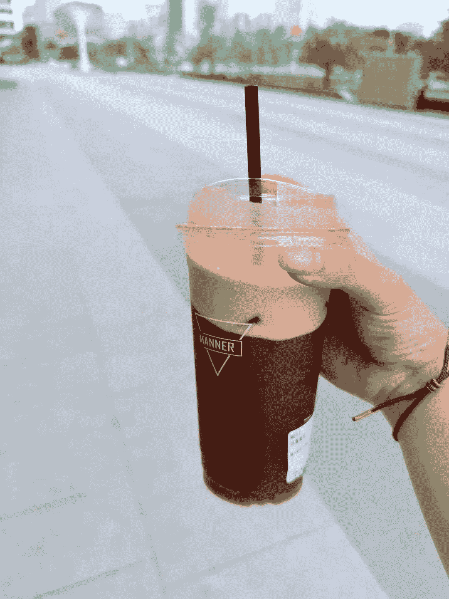
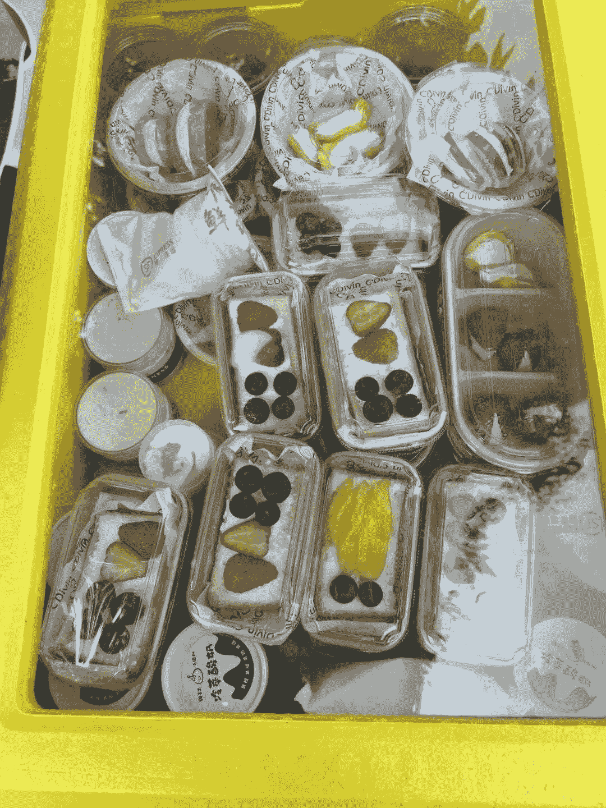
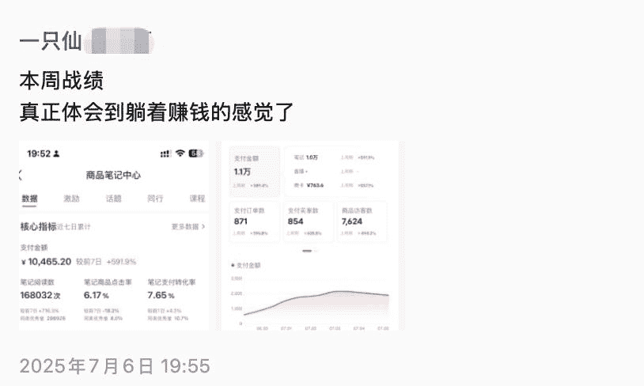
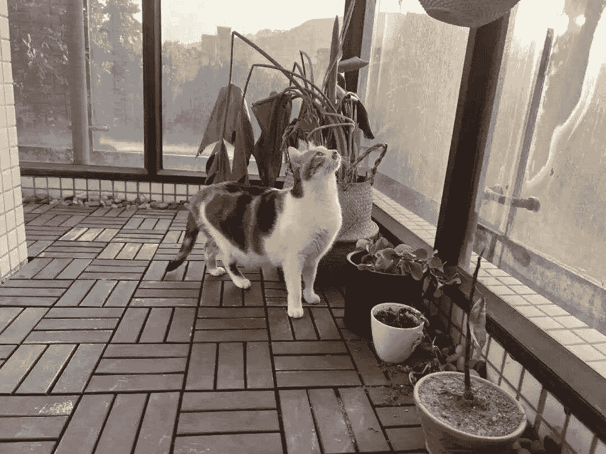
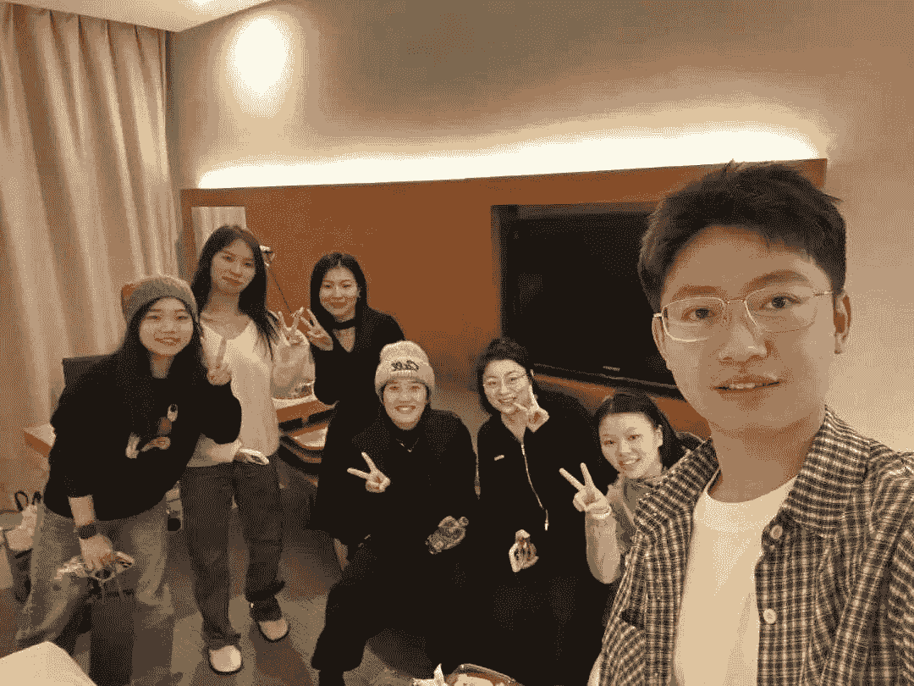
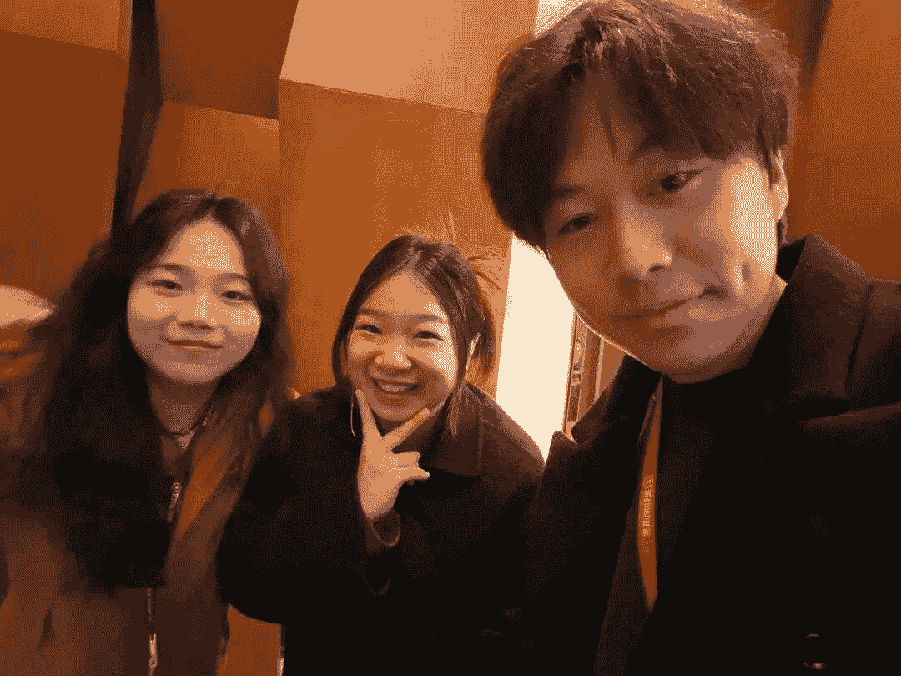
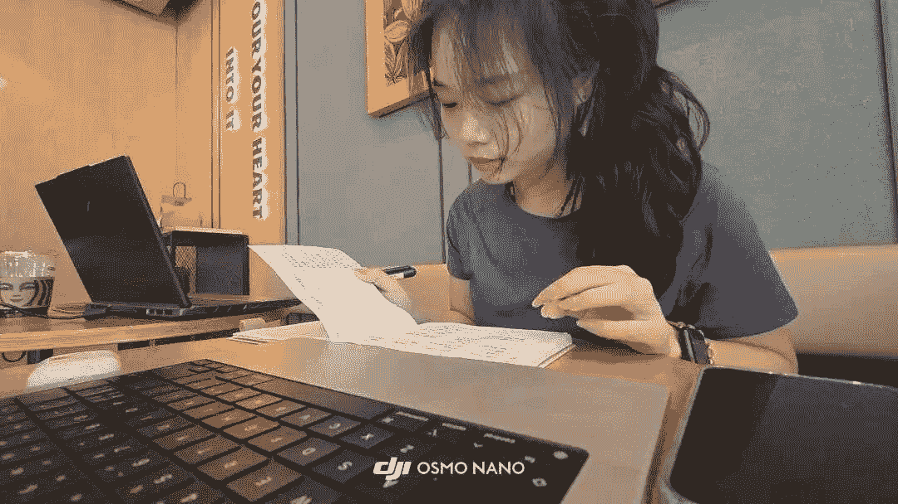

# 每天只工作**2**小时，月收入最高是上班时的**10**倍，她用**2**年成为一人公司
作者：龙哥

每天真正专注工作的时间只有两小时，月收入却是上班时的十倍。她用两年时间，从一名需要六轮面试才能挤进公司的普通打工人，活成了一个人也能运转的“一人公司”。她叫一只仙，她的故事，或许能给那些想逃离格子间的人一点勇气。

现在的她，早上七点起床，七点半去跑步。今年想跑半马，就请Claude做了一份循序渐进的课表，从三公里跑到十公里，每周加一公里。跑完步，她会去Manner点一杯冰橙美式，听着歌慢慢走回家。她说，那一刻觉得自己是全世界最幸福的人。

她常去健身房附近的咖啡店，先工作一阵，健身时间到了就去锻炼，练完再回来继续。开始工作前，她习惯留出一小时看书。这是她理想中的生活状态——不是只有赚钱，也不是非要去当什么大老板。对她来说，生活永远排在赚钱前面。阅读、运动、一些可控的小事，在稳定的节奏里一点点推进；剩下的时间，再用来安排赚钱。钱是基本保障，但绝不是唯一追求。

但这份从容，并不是从天而降的。两年前，她还在一家光鲜的公司里，每天睁开眼就觉得日子在被白白消耗。

她是双非院校毕业，没有亮眼履历，靠六轮面试才拿到offer，所以格外珍惜。可入职第一年，她就意识到自己待不久。表面是互联网岗位，骨子里还是传统行业的管理方式：不让穿拖鞋短裤，弹性工作制却要开早会。最让她警醒的是，她看到工龄十年的导师，工资只比自己多五千块。她问自己：再过五年，如果我的成长只值五千块，那还有什么意思？随着时间推移，她发现自己眼里的光一点点熄灭了。那个曾经对什么都充满好奇的女孩，变得麻木。她不是冲动辞职，这个念头，她反复想了快两年。

裸辞之前，她问了自己两个问题。第一，存款是否足以支撑一两年零收入？她仔细算过。第二，如果副业全失败，能否接受重回职场面试一份月薪四五千的工作，从头再来？她认真想过，答案是能接受。即使失败了，也不会后悔。想清楚这两点，她提交了离职。

离职后的核心愿望，是获得“睡后收入”。这源自《纳瓦尔宝典》里的杠杆思维。她希望睡觉时也能有东西替她赚钱。那时她跟朋友聊起这些，朋友都担心她被洗脑。一个长期在公司打工的人，确实很难相信这种可能性。后来她做📕赚到钱，内心甚至一度有种“不配得感”。

她的第一个项目，是在旅行中撞上的。辞职后她给自己安排了一个月旅程，偶然接触到一个信息量巨大的社群。她兴奋得差点不想玩了，只想赶紧把里面的东西都学透。

可行程已经定好，她只能一边旅行，一边找咖啡店看文章。她看到一篇关于AI代写的内容，作者小鹅经历真诚，和自己有相似之处，便加了对方。

旅途还没结束，她就开始试着接AI代写的单子。边玩边做，等到旅行快结束时，学费已经赚了回来。

这段经历给她的最大收获，不是赚了多少钱，而是让她第一次真正把AI用到了实际业务里。她接的单五花八门：中药学、名校学生、党建材料、公司职员。她自认写作天赋一般，但在反复磨单的过程中，学会了设定角色、背景、任务，学会了喂资料，也把Kimi、GPT和国内各类AI工具试了个遍。

旅行结束后，她报了门流量课，用闲鱼获客继续做代写。第三天流量突然爆了，可她很快发现不对劲——闲鱼的消息必须秒回，否则客户就跑掉。她不敢睡觉，饭都顾不上吃，不停谈单、写单。就算收入能追平上班日薪，可这和上班有什么区别？同样是用大量精力换钱，根本不是她渴望的自由。她给自己的判断标准很简单：能不能让我每天只工作四小时？这个项目显然不能，那就不是一个值得长期做的事。

后来她试过做油管，却一直没有进账。辞职快到一年时，现实的压力逼她必须让现金流回来。正好有一天，她听播客听到姜思达聊希腊酸奶，就去📕搜了一下，发现“干噎酸奶”本地没人做。她一下子兴奋起来，当天下午算账：成本、定价、利润、前期投入，算完就下单了。

第一次摆摊很狼狈，做了20罐，只卖出2罐。她也曾怀疑那些“轻松卖爆”的故事是不是骗人的，但好在开始前她就做好了最坏的打算：如果全亏了，能不能接受？能。于是她继续想问题出在哪。她发现多数人根本不知道干噎酸奶是什么，小罐卖十几二十块，决策成本太高。于是她做了两块钱的试吃装——草莓中间夹点酸奶，或者水果杯里加酸奶。两块钱，让顾客愿意先尝一口。

尝过的人觉得不错，又回来买大罐。复购渐渐多了，她再同步发📕，引流链路变得很顺：客户直接问“什么时候送”“送到哪里”“要几罐”就下单了。

生意真的爆了，可她还是只有一个人。研发、制作、配送全都自己扛。没有车，她就骑共享单车送货，广州的盛夏和雨天都经历过。那阵子她很累，却特别快乐，因为太久没有得到正反馈。有人夸她做得好吃，她就成就感满满。她发现，只要稍微动动脑子，结果就能立竿见影。

但摆摊也让她第一次认真思考“产品”二字。旁边卖手串的跨境小姐姐提醒了她：干噎酸奶会过期，手串不会。今天卖不掉，明天还能继续卖。后来排单越来越多，可她就一个冰箱。要不要换设备？要不要招人？朋友一句话点醒她：“你招一个人，一个月五千，你自己还剩多少？”她算完发现，这本质上是个苦力活，就算跑通了也不值得往大做。于是她果断停掉项目，正式转向📕电商。

做📕从0到1，她认为最关键的不是一开始就选对，而是先选定一个品，然后持续试下去。她最初选了玩具赛道，从模仿对标开始，素材、封面、拍法，几乎照搬，可别人爆了，她没爆。她没停在“模仿失败”的挫败感里，而是继续换新素材、新场景。当时她并没有把📕看作一件特别重的事业来做。她还在健身，日常骑车去上课、去路上，产品都塞在包里，想到什么就顺手拍。第一个爆款素材，就是去健身的路上看到一处好看的风景，顺手拍出来的。那条视频回头看很普通，但它就是爆了。她复盘时觉得，一半是运气，另一半是没放弃测试——如果前面试了那么多次没结果就停了，根本等不到那个“顺手一拍”的节点。

爆了之后并不代表稳妥，很快迎来了一大波负反馈。差评、退货、用户发帖吐槽，流量像坐了滑梯，低迷了一个多月。她一度觉得自己把“垃圾”卖给了别人，非常愧疚。但她没有因此停摆，而是边做边优化。后来她学到一些降低负反馈的具体动作，果然把差评率慢慢压下来。更重要的是，她转念想通了一件事：负反馈看似难看，实际上是在帮你筛选更精准的人群。产品表达持续优化，流量虽然变少，转化反而可能更高。那段时间不是结束，而是人群校准。

果然，当负反馈得到控制，再加上她开始持续产出原创素材，第二次流量起来比第一次更高，单日最好做到了22000元。她不再模仿别人，而是自己设计场景、想标题、拍封面，真正站在用户心理角度去思考：他们会被什么打动，为什么会下单。她把这当成一场理解用户的游戏，乐在其中。从0到1真正完成的标志，不是某条笔记爆掉，而是你终于知道这群人为什么会买。

除了内容和流量，还有两个关键动作——客服和投流。它们一个守住底线，一个探到上限，也是她一人公司能稳稳运转的护城河。

从那个需要六轮面试才能进入公司的普通女孩，到单日营收两万二的一人公司，她只用了两年。这条路没有捷径，只有想清楚自己要什么，然后不断试错，在正反馈和负反馈里坚持往前走。她的故事也许无法复制，但至少让很多人相信：工作，真的不一定被困在工位里。

这两年在📕电商的实操中，我从零做到了月销过万，也亲眼看着一批同行半路撤退。回头盘点，拉开差距的并不是什么独门秘籍，而是被忽略的细节，以及在想放弃的瞬间多撑了一下。

如果你正在这个赛道里摸索，下面这些是从坑里爬出来的体感。

**一、客服是生意反转的杠杆**

很多人把客服当成售后跑腿。我的经历却是，从客服位开始才真正读懂生意。

早期供应链很乱，发错货、品质波动都发生过。我亲自顶客服，用直白的说法跟买家沟通。供应商在调试新品时错发，我会直接告诉对方，这单算我送，再补发一件全新的。

结果往往超出预期，本来要留差评的客户，因为沟通里的真诚，最后改成了好评。

印象最深的是一个客户先在公开渠道发帖吐槽。我主动跟进，该退退该补补，态度不推诿。后来他把抱怨删掉，重新发了一篇表扬我的笔记。那次让我明白，做生意不止卖出，糟糕的事在沟通到位后能变成加分项。

投放观念上我也转过弯。一开始很保守，每天预算卡在三百，不敢放开。后来被点醒：模型是正向的，就别自己设限，让系统去跑。心态从省钱焦虑转向验证模型是否成立。

模型跑通后，投流就不再是支出，而是放大。

**二、零到一万单，考验的是扛住撤退的冲动**

常有人问万单的核心是什么，我的答案很朴素：我没比别人聪明，只是没在难的时候跑掉。

表面上是选品踩中、素材炸了、负面处理好、第二轮增长来了。但每个节点前都有一段极想停手的空窗。

模仿很久没水花时想停，数据冲高又回落时想停，差评集中时想停，供应链出事时更想停。

我走的路径是：先挑一个值得做的品，前期大量模仿测款，等到第一个有效素材；单子起来后立刻处理负反馈，持续做原创、钻研用户心理；最后用客服和投放把结果承接住。

没有捷径，真正把我带出来的，是愿意一直做下去的执念。

**三、敢涨价，因为已经站到类目前列**

后来我逐步把客单拉高，甚至比同行贵，这也是刻意的。

起初客单只有十几块，后来提升到二十多。支撑它的两个操作。

其一是组合SKU。产品款式多，把不同款打包，用户会觉得更划算，下单意愿提升。

其二是持续上新。那阶段我已经在头部，有底气调价。同行可能怕掉量，我觉得产品、素材、整体调性都在变好，价格就该跟上。

我也不是全线抬价，最狠的一招是最低价引流。把店里最便宜的SKU设得比同行略低，其他款反而定得更高。

用户从笔记点进来，第一眼看价格，最低价让他觉得能接受就进来了。进到详情页后，关注点转向好不好看、合不合适、有没有感觉。最后成交的，往往不是引流款，而是更贵的款。最初我也只敢试，跑通后才彻底信服。

**四、爆款笔记，先有人再有品**

写了大量笔记后我发现，动笔前不该先想产品，而该先想这个人此刻在经历什么。

比如面向大学生，我不会先想怎么卖，而是先想她的状态：是不是临近考试？是不是在备考？学习里有没有卡点？有没有焦虑、压力或某个具体小烦恼？

判断她在备考，就从备考场景切入；有痛点，就从痛点切入。关键词也围绕考试、焦虑、学习状态这些真实处境展开。

我常自问：她最近被什么卡住了？会因什么焦虑？在哪个瞬间会觉得这个东西有用？先把人描清，再想产品如何进入生活。

正因如此，我越来越偏爱原创。我发现真正有趣的不是卖货，而是理解人。为什么她会停留？为什么会点？为什么会买？画面为什么有感？标题为什么会被点？被哪句话打中了？

那段时间我不再只是拍产品，而是在研究人群心理，自己搭场景、搭氛围、做封面，像跟一个看不见的人对话，猜她会为哪一点心动。

笔记到最后，靠的不是套路，是洞察。你看懂她了，内容自然能打动她。

**五、从半天到半小时，是把流程拆了**

有人问我一篇笔记为何从半天变成半小时。核心是流程化。

起初做图全靠AI，反复改、去重、调色，费时；文案也是手打，从不复制粘贴。看完同行后我会重新组织语言自己敲一遍。很慢，但让我越来越清楚产品在卖什么情绪。

那段慢时光其实是在学习：这款产品到底在贩卖哪种情绪。

后来我开始提效。先在备忘录里把流程拆成环节，按线作业；再把AI图换成实拍，产品已卖出去，真实素材更有说服力；文案也不再手搓，直接参考同行，以自己的爆款为基准二次优化。

叠加后效率大幅提升。还有一个关键是专注。我每天会留出两小时高度沉浸，不被打扰。第一次真切感受到，专注时一个人的产出可以快到什么程度。

**六、十万单后，反而更想换品**

手里这个品累计十万单，说实话，我对它后面的增长天花板并不乐观。

有趣的是，卖到一万单时我心里就没底了。当时还让GPT估算天花板，它说能到十万单，后来真的到了。

到这个节点，我反而更确定要开拓新品。让老品继续稳定出单的同时，去同类目找新品，也会开新店试不同类目。

谈到所谓天选之品，我现在看的不是能不能卖，而是能不能操作。

第一，竞争不能太激烈。第二，利润太薄的品我不碰，性价比低。

我给自己定的底线是单件利润不低于十块。只要现在有十块，后面完全可以通过组合装、SKU搭配把客单拉高。用户不一定只买一件，可能买一件也买、买两件也买。所以有利润基础，就有足够的空间做投放、做套装、提客单、给用户更多选择。

现在的选品方式比较野路子：主要靠刷自己的小号。小号养成熟后刷出来的几乎全是电商内容，刷的过程就是选品。另一个做法是复盘，复盘时会看同行的动作，除了他们在推的主品，还有没有别的品在起量。发现同行卖A的同时B品突然爆了，我就会去研究B。

我的复盘不只看自己。观察同行销量走势、新爆款封面、新款式、供应商新品，都是日常。

**七、关店潮背后，是人卡住了**

朋友圈里陆续有人关店，有的是几千单，有的是几万单，却找不到新增长。

平台变化肯定有影响，但我觉得根子在人。

同样处境，有人老品卖不动就去测新品，又跑出爆款。另一些人，哪怕之前卖过一两万单，仍死死盯着原品不放。数据下滑也没有尝试新方向，或者内心没有足够动力迈步。

我在他们身上看到自己的影子。去年我也意识到该选新品了，但行动上仍押注在爆品上继续深耕。运气好，后来又刷出了新封面、新标题，让老品续命，虽然增速变慢，但还在前行。

而那些人，比我更早站在了必须放弃过去成绩、从零重建的关口。那道坎很难跨。

**八、每天只干两小时，收入翻十倍，关键在三件事**

现在我每天纯工作时间确实只有两小时左右，不夸张。

但这句话容易误导——前面那些试错、复盘、焦虑、学习的时间难道不算吗？外人只看到现在的轻松，看不到之前的爬行。

如果总结，最重要的三点是：

第一，有勇气做梦。要真相信这件事能成。很多人不是没能力，而是打心底不敢相信“我可以过另一种生活”，于是原地打转。

第二，不怕挫折。只要不是致命打击，坑都有价值。跨过去一次，下一次会更耐打。

最近读《反脆弱》很有感触。反脆弱不是从不犯错、不是完美，而是允许错误发生，不会被一次失误击穿。在持续受挫中变得更坚韧，同时保持试错的胆量。

第三，多去交流。我很庆幸遇到的贵人、社群里的朋友，他们在不同阶段都给我开过窗。更关键的是让我明白，我的困境不是个例，而是共性。做电商前我很孤军奋战。

有些朋友加了后没聊几句，只是偶尔看到彼此动态或文章。你会知道他也在做事，我也在前行。这种默契本身就是补给。

我做成一件事，你在爬坡，我给你一点鼓励。下阶段我遇到坎，你有了突破又反过来给我力量。这种相互映照很有分量。

我现在仍是一个人做项目，但不再是闭塞的孤军奋战，因为心里有一簇火，是别人点燃的，也是我自己守着的。

**九、大结果前是无数小结果的堆叠**

很多人是看到我爆单后才认识我。但对我来说，真正重要的反而是更早那段——在拿到大结果前，我在无数个小结果里反复折腾、反复练习。

刚入圈时，看到的大二学生、00后、大学生早已赚到可观收入。那种对比很容易泄气。

那时我满脑子是：我怎么这么慢，为什么人家这么强。我热衷对标，越对越焦虑。

后来我慢慢接受：节奏不一样，经历不一样。用别人的进度条丈量自己，除了添堵无用。于是逼着自己沉下来，承认自己走得慢，但一直在挪动。

**十、想对两年前的自己说一句话**

“你真棒。”

回头看这两年的经历像梦。我从未想过自己会是这样的人：敢冲、能吃苦、摔了会站起来。

做📕那段时间一直没结果，我妈一直劝我考公，甚至去算命。算命先生说我不适合创业，会失败，但考公合适。

在这种声音下我还是坚持下来了。所以我现在真心觉得自己挺棒的。

—End—

————分割线————

看完这份SOP，你可能觉得懂了。可实操时，九成的人会在第一步卡住。

工具和教程只是表层壁垒，真正的壁垒是“立刻动手”和“信息差”。

我们不聊虚的，只拆商业闭环和AI效率压榨。体系内已沉淀1000+跑通的实战案例。

👉 查阅圈子完整数字资产与上车门槛：
https://lazyso.com/insider/

备注：【实操上车】，不闲聊

