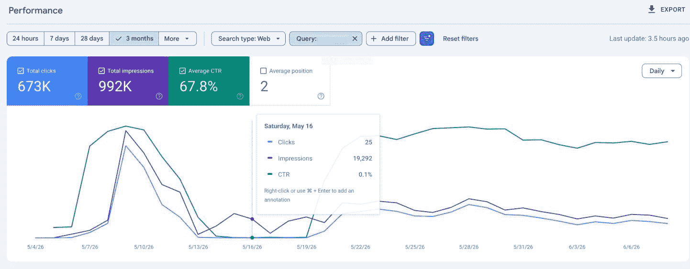
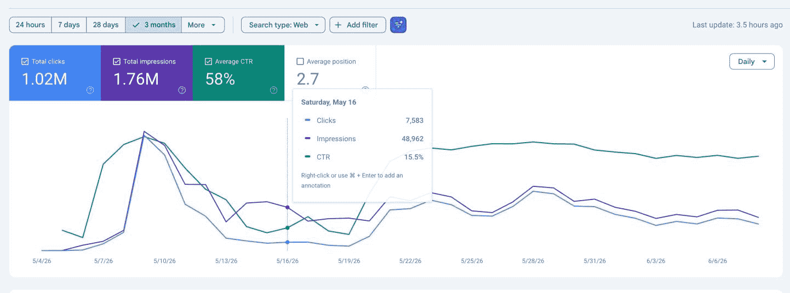
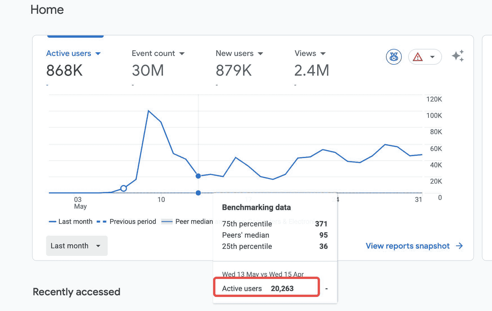
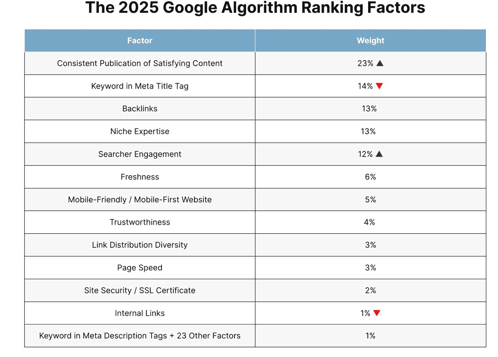

# ('第一次做出海 SEO，我用一个练手小游戏', (7, 27))

把一个练手小游戏做到 100 万 UV，我用了 30 天

先自我介绍下，我是野生小虎，早前是互联网大厂研发。关注出海挺久了，航海活动参加过，SEO 课也听过不少，哥飞老师的社群我一直泡着。不过以前我的搜索排名经验，基本停留在“看别人成功”的阶段。

今年五月，我终于自己上场了。挑了一个反馈极快的新词方向，做了个英文小游戏站。运气占了不少成分——这个词五月的绝大部分流量被我接到了手里，还顺手拿了哥飞朋友们社群五月新词比赛的第一。

按时间把关键节点列一下：
- 5月5日深夜：锁定一个正在爬升的新词，决定当场开干。
- 5月6日凌晨：买域名、改代码、部署上线，守着 Google 收录等到快四点钟。
- 5月7日—8日：流量抬头，我赶紧补上互动和留存相关的小功能。
- 5月9日：单日 UV 突破 10 万，数据库被挤爆，我在山上用手机把它救活了。
- 5月12日—14日：主关键词名次一路下滑，点击率最低掉到 0.1%。
- 5月15日—19日：所有能想到的都试了，GSC 依然毫无反应。
- 5月21日前后：主关键词重新回到首页前列。
- 6月7日：整 30 天，GA4 显示 UV 100 万、PV 290 万。

一、凭什么认定一个新词能上车？

5月5日晚上 11 点，我拿着哥飞社区教我的 Vercel App 找词法，发现有个子域名流量涨得飞快。点进去，是一个英文小游戏。

这个游戏不花哨，考的是你对童年动画、游戏、角色颜色的记忆。皮卡丘的黄谁都认识，可你能不能在色卡里精准指出来？那些小时候看过的角色，他的服装、头发、道具到底是什么颜色，你还记得住吗？

要不要跟风做？我给自己设了三道考察。

1. 热度还在不在延续

我第一件事就是打开 Google Trends。这词已经烧了四五天，整体曲线在往下走，但切到“24 小时 / 4 小时”的粒度去看，它依然烫手。

追新词最怕追到尾巴。热度彻底散场以后你才把网站搭好，那就成了“站建好了，流量没了”。不过热度降了也不代表永久没戏，它完全有可能在之后反弹。

顺着热度往前查，我基本确定这波爆发来自社媒——某位 YouTuber 直播玩了这游戏，直接把搜索人气带了起来。直播切片播放量几十万，还能继续贡献长尾，24h 和 4h 的趋势线也都指向这一点。

至于未来会不会更火，谁也说不准。毕竟引爆点是社媒，社媒生态我们能干预的实在有限。

2. 前排都是什么选手

通常刚冒出来的新词，抢的人不多，竞争相对温和。但如果它本身带着商业属性，比如各种模型关键词，那就是另一套打法了。

我把注意力全部放在搜索首页。搜索用户几乎不会翻到第二页，能看完前三条已经算很有耐心。如果排到 10 名开外还能稳定有点击，那大概率是爬虫在帮忙。

有意思的是，Google 首页当时挤了不少内页。我手动往后翻了好几页，也没看到几个主题高度垂直的站。这通常说明大家都没怎么发力。再去查域名注册记录，很多词根确实没人抢注，并不是权重不够没排上来。

首页还混着一些大站的内页和爆火原站的子域名页。不同 URL 的权重排序向来是主域名 > 子域名 > 子目录。如果是一个竞争饱和的词，前排根本轮不到内页抛头露面。

顺手翻了翻外链，首页各站基本都是个位数，DR 也都只有个位数。这种市场环境对新人是相当友好的。

域名和外链不是决定项，却是判断窗口期的好帮手。如果所有优质后缀和组合词都被扫光，前排又全是高权重老站，那这个窗口显然不属于新手。

3. 我自己的赢面在哪

除了数据，我还有一个很重要的观察：首页上很多同类游戏，其实并没有踩准用户的真实意图。

原站之所以能在社媒爆火，靠的是“童年回忆杀”——让人回忆角色身上的颜色。而前排大多数竞品就是一张干巴巴的调色卡。这两者要满足的需求，差距实在太大。

所以我最后给出的判断是：还有长尾余温的新词 + 竞争对手普遍都很新、外链很少 + 搜索意图没有被现有服务满足 = 可以做。

二、当晚上线：通宵改代码，凌晨四点在等 Google

分析完已是深夜十二点，我其实已经很困。

但转念一想，这游戏不复杂，GitHub 上开源项目一大把，随便改改就能部署，一个小时绰绰有余吧？

结果收工的时候，已经快到凌晨四点。在项目圈混过的人都懂，“一个小时”只是幻觉的开始。

为什么拖那么久？夜色降临后，大洋对岸的老美开始上号，Codex 和 Claude 的运行速度比白天慢了一大截。

等待 AI 输出的空当，我闲着也是闲着，就开始东看西看找优化空间。

也因此加了两样东西。

一个是分享功能：允许用户复制链接，指望着靠这种小动作搞点裂变，顺手攒些外链。

另一个是留言墙。原站其实有留言功能，只是埋得太深，入口不醒目，基本都是隐形状态。

我一直觉得，小游戏里的留言并不仅仅是写评论，它同时肩负“秀分数”和“证明这里有真人”两件事。

基于这个判断，我把留言墙放到了显眼位置，还给高分用户加了专属徽章，让他们更有晒的乐趣。可我也不想只围着头部玩家转。

普通用户才是基本盘。他们的停留、互动、留言、成绩提交，每一下都在影响这个站“是否热闹”的第一印象。所以我把留言拆成两个池子：高分池和普通池，约 7:3 的比例展示。高分用户能获得更多曝光，普通用户排队也能上墙，无非等久一点。

既然判断这个词竞争弱，新站完全有机会直接冲进首页。那 Google 给你的流量能不能保住，就得看标题、描述、H 标签的功夫了。我上线前认真打磨了 TDH，顺手补了 FAQ、metadata、sitemap、robots、canonical 整套配置，数据统计则只接了个 GA4。

正打算发布的那一刻，我发现了一个特别低级的失误：

域名拼错了一个字母。这个词本来就跟另一个词长得很像，我又全程手打，整个项目命名全部跟着错了。

当时真想抽自己。平时我总爱教育别人“能复制就别手打”，结果自己也翻了车。

但这个坑后来变成了新路子。既然我会拼错，用户凭什么不会？

于是我专门做了一套 typo SEO，在 FAQ 和页面里埋了不少常见错拼，又把买错的域名用 301 跳过来。这部分错拼流量，最后累计贡献了几十 K。

因此这个失误并不仅仅是“下次别手打”的教训。认真做一件事时，那些看起来很蠢的低级错误，用户同样会犯；反过来看，它们全都是优化点。

我又重新买对了域名，全面修正项目里所有错误命名，再次部署。为什么非得当晚搞定？因为这个游戏的主要玩家在欧美。

我们这边的深夜，正是欧美用户最活跃的时候。早一天被索引，就早一天拿到先手。提交索引之后，大约十几分钟就被收录了。看了眼时间，逼近凌晨四点，终于可以睡了。

后来还踩过另一个坑：favicon。

第一版上线时，我放了一个特别临时、特别丑的图标。Google 搜索结果里的 icon 更新极其迟缓，不是今天改了明天就换。我这次等了两周才看到变化。

三、流量来了，下一步是让人留下来

5月6日早上起来，流量没有想象中那种爆炸感，但每 30 分钟就有 50 多人同时在线。再看一眼 Google Trends，热度居然比昨天还高了一些，这让我确信方向没有偏差。

我以普通玩家的身份，把站点从头到尾体验了一遍，立刻发现不少问题。最刺眼的是 UI：第一天弄的分享和留言墙，在 PC 端说不上难看，一到手机端各种截断、错位、样式乱。而小游戏偏偏是移动端用户最多。所以我当场在 claude.md 和 agent.md 里加了一条规矩：以后任何 UI 改动，发布前必须过一遍移动端效果。

5月7日，流量进一步上涨，到了 6K 多 UV。

我盯着页面，想起微信上的跳一跳、羊了个羊。它们都靠一个东西紧紧钩住用户：排行榜。我的游戏天然有分数，为什么不加排行榜？

这功能在当时同类站点里几乎见不到。反正系统已经存了玩家分数，再堆一张排行榜表并不难，难的是榜单要拉多长？Top 10 太精英，只会服务头部玩家；我们做的是免费小游戏，又不是国产氪金网游，不能全场只有头部玩家爽、普通玩家当陪衬。第一版我定成 Top 50。为了不破坏 UI，默认只显示前几名，想细看的可以翻页。

当晚功能上线后，我一直盯着后台看。有个画面印象很深：榜单人数一个接一个往上蹦，还有人反复上榜，说明他确实在一遍一遍地玩。这让我确信，排行榜对拉长用户在线时间很有效。Google 那套算法再复杂，本质上不就是在为每个搜索挑出一个最让人满意的页面吗？

5月8日，UV 到了 1.6 万。

Top 50 很快就装不下各路高手，普通玩家几乎摸不到榜单。排行榜机制还能发挥作用吗？我把规模扩成了 Top 100。

可再想深一层，总不能用户越多就榜单越长吧？最后的解法是拆成两个榜：历史总榜，加每日榜单。历史榜承包长期荣誉，每日榜每 24 小时重置，给新玩家留足机会。没上榜的人也会想：明天还能接着试。

刷新时间也不是随口定的。我翻遍 GA4 里的用户时区分布，把刷新点卡在主力用户下班后、正好有空玩小游戏的时间段。

除了排行榜和留言墙，我还加了一个公告区域，告诉玩家题库会每周更新。

这功能很轻，但心理暗示很重：它让人感觉这个站是活的，不是一次性的小页面。今天玩完，知道下周还有新题，就多了一条回来的理由。

再补一个小细节：命名。“排行榜”这三个字太朴素了。随着历史榜门槛不断抬高，玩家需要一点荣誉包装。国内网游最擅长整这些，我于是选用了 Legends。翻译过来就是“You are the legend of the game”，听起来立刻有味道了。虽然我们只是一个小破站。

整体功能其实不多，但小细节不少。在一个竞争不那么猛的新词里，恰恰是这些细碎的小优化叠在一起，让用户愿意多看一眼、多留一会、多玩一把。

我们不需要碾压所有人，只要赢过同场的对手就行。对手成色怎么样，我在前期评估时早已摸过底。

四、爆量的那天，我在山顶重启数据库

5月9日，流量彻底爆炸。那天是周六，我在外面爬山。项目最高光的时刻就发生在这天：单日 UV 冲到 10 万左右。

因为前几天的流量一直在涨，我心里始终挂着这事。爬到山顶休息时打开手机看了一眼网站，结果发现排行榜没了。登进 Supabase 后台才知道，用户请求太多，数据库直接罢工。

做这个功能的时候，我完全没想过会有这么大的访问量，性能上几乎是裸奔的。重复提交、排队请求、尖峰堆积——随便哪个都能把数据库压死。倒不是硬件不行，是架构压根没考虑并发。

但小游戏有个好处：没有资金资产，排行榜的请求丢一点也就丢了。更幸运的是，手机 Chrome 上一直保留着 Supabase 的账号密码，我顺利登进去，直接在手机上重启了服务，清掉堆积的请求，榜单恢复正常。晚上回家后，又专门针对并发场景做了一轮性能加固。

流量大了以后，刷榜、刷留言的人也闻着味儿来了。我的原则是低成本防御：陆陆续续上了 Turnstile、关键词检查、IP 黑名单、用户名拉黑，先把最无脑的刷量挡在门外。

中间我还放过 Adsterra 的 banner。后来主关键词从 5月9日、10日的第一名开始往下掉。我不确定是不是广告惹的祸，但环顾一圈，同类站当时都没挂广告。为了不出幺蛾子，我主动把它撤了。

练手项目，没必要为了那点广告收入去赌搜索排名。

五、主词点击率崩到 0.1%，多语言给了我一条命

5月9日登顶之后，主关键词的排名就像坐了滑梯。5月14日基本跌没，点击率最低到了 0.1%，简直当场退市。

但让我意外的是，每天仍然有 20K 左右的点击。多语言和长尾词一直在下面稳稳托着。

主关键词搜索情况，最低跌到 0.1% CTR 图，连续一周左右的超低 CTR。

所有关键词搜索情况，主要来源是多语言和错别字，以及其他内页覆盖的长尾关键词。

GA4 图，低谷期的每天依旧有 20K 左右的访客。

回到 5月12日，主词流量一直在缩，我跑到 GA4 里拆用户画像。一个有趣的现象出现了：除了欧美用户，俄罗斯人的占比居然不小。欧洲很多地区的英语也一般，比如西班牙。我脑子里冒出一个念头：是不是该上多语言？

假如用户真心喜欢这个游戏，只是被英文界面挡在门外，那本地化其实就是刚需。但多语言这件事，我一直非常谨慎。社群里的翻车案例一抓一把——加了多语言反而流量暴跌，机翻质量差、hreflang 拼错、页面质量不稳，任何一个环节都能引爆风险。

所以我第一批只上了 4 个语种：德语、西班牙语、葡萄牙语、俄语。本地化 sitemap 和 hreflang 全部配好，每种语言的内容反复核对。

现在回头看，如果可以重来，我一定会把多语言排期往前提。但多语言从来不是多多益善，而是在内容靠谱的前提下，优先覆盖那些已经有访问、但英语水平一般的区域。

5月13日，我发现不少竞品开始“致敬”我的排行榜、留言墙、命名和交互逻辑。

虽然我觉得他们的体验不如我，但外链确实比我多。外链的影响到底有多大，我心里没底，于是这一天也主动联系了几个 DR 高些的站做交换。

真正让我紧张的是5月14日。早上一看，主关键词的点击几乎归零，如前面所说 CTR 只有 0.1%——曝光还在，就是没人点。

我去对比了排在前面的一个网站：外链没我多，体验也一般。问题到底出在哪？我先是检查 TDH，感觉并没有毛病。

接着我去看关键词密度，整个人直接呆住。

排名第一的关键词是 ago。第二是一个用户昵称。

我的主关键词去哪了？答案是：排行榜和留言墙把页面关键词搞脏了。每当有人提交成绩，页面上就会冒出一堆“2h ago”“3h ago”这样的时间描述。用户越多、提交越勤，这些无意义词的占比就越高。最终 UGC 把页面核心关键词稀释得干干净净。

UGC 污染是不是主词下滑的唯一元凶，我没法打包票。但我很确定一件事：它对 SEO 一定是负向的。到底是不是根本原因先放一边，它是一个我亲眼看到、也一定会先修掉的问题。

修复思路不复杂：把排行榜、留言墙这类 UGC 板块从 SEO 主文档里隔离开；把时间戳、重复词、随机内容这些干扰项压下去；同时撤掉广告，继续补一点基础外链，再观察主词和长尾的走向。

庆幸的是，多语言关键词、typo 关键词，以及 Yandex / Bing 带来的搜索流量，把当天的 UV 硬生生拉回了 8K。

那一刻只有一个感想：永远别把身家性命压在一个主词上。

事后又挖出一个因素：我们原本对标的原站，也就是那个 Vercel App 子域名站点，在5月9日推出了自己的独立站，并做了 301 跳转。这显然也在蚕食我们的表现。

处理完这些问题以后，我盯了 GSC 整整 24 小时，纹丝不动。说句实话，那时我已经生出弃站的心思，打算把精力挪去别的地方。

六、我正准备放弃时，流量自己又活过来了

5月15日到19日，我几乎没再碰过这个站。直到5月21日看到哥飞老师在群里说“Google 更新算法了”，我才回去看了一眼。

结果出乎意料。主关键词不但回了首页，还稳稳待在 1.x 附近。之后的几天，它基本就在 1 到 1.9 之间来回摆动。

这要归功于5月14日那次 UGC 清理吗？我不敢断言，Google 算法本来就是黑盒。但能确认的是：关键词堆叠一定是负向信号，原站启用独立域名也对我们有过挤压。

而且那几天我并不是只做了这一件事。广告撤了、外链补了、UGC 清理了、多语言上线了，中间还撞上算法更新。

所以更靠谱的说法是：这些动作叠加在一起，再加上算法更新这个变量，最后把主词送回了首页。UGC 污染未必是唯一原因，但它是我能清楚看见、也能明确修掉的负向因素。

排名恢复后，我继续往站里填内容：给游戏角色做独立页、故事页，还建了 color study 页面，并在5月24日上线了新玩法。原站作者非常卷，更新频率比我快得多。我的新模式上线不久，他也上了类似的一套——算是被“致敬”了一回。

顺带说一句，持续发布新的内页在 Google 那边是有额外加成的。外链也是，大约占排名因素的 13%。

我之所以能排在原站作者前面，是因为我的 SEO 做得更细，内页更丰富，产品留存也更好，综合起来就占了上风。

还有一个值得记录的现象：我不光超过了原站作者，也压过了一批外链数量明显比我多的站。有的站外链已经有几千条，我的外链屈指可数，却在这个词上排到了更前面。

不是“外链无用”，而是这个词的竞争还没激烈到只能拼外链的程度。大家都还处在早期，页面质量、产品体验、停留时长、互动信号这些维度就会被放大。放到成熟的大词里，前排全是内容扎实、体验不差、外链又多的站，我这点外链储备肯定扛不住。

外链当然有用，只是在弱竞争的蓝海词里，体验更好的网站有机会越过一些外链更多但体验粗糙的对手。拼的终究是综合得分。

七、最后说几句

这就是我第一次做出海 SEO 的完整记录。一个拿来练手的小游戏，意外拿到了流量：30 天 UV 100 万、PV 290 万。

翻来覆去复盘，能跑出来其实是几件事叠在一起：
- 选对了一个竞争还不激烈的新词
- 上线速度足够快
- 产品细节上没偷懒
- 多语言和长尾词把底盘做扎实了

每天在页面上修修补补，说到底就是为了让 Google 形成一种预期：这个站点能真正满足搜索者的需求。

下面这些教训是真金白银换来的，愿你不用再走同样的弯路：

1. 凡是涉及网址、目标词、项目代号、接口密钥、代码包的名字这类信息，一律从原文档复制，不要手动敲。敲错一位，后面排查会花掉好几倍时间。

2. 网站图标第一次上线前就要定稿。Google 对图标的抓取刷新很慢，别抱“先进去再说，以后有空再优化”的想法——你会盯着旧图标很久。

3. 用户生成的内容不要混进主着陆页。热门榜单、留言板、讨论区这些模块，都很容易把核心词的权重分走。

4. 别用一整天去验证一次调整是否奏效。把明显的问题一次性改完，然后给抓取程序足够的缓冲时间，让它重新认识这个页面。

5. 多语种站点应该尽早规划，但翻译品质不能打折。用机翻来凑数等于埋雷；hreflang 的标注要与 sitemap 里面列出的语言版本一一对应。

6. 广告不要急着投放。核心词的位置还没坐稳时，为了那点广告收入去牺牲浏览体验与搜索位次，太不划算。

7. 搜索位次一旦下滑，优先检查站内环节。挨个看 TDH 结构、内容密度、用户内容区域、手机展示效果、页内广告与加载速度，最后再研究外部对手的动作。

8. 手机上的真实体验一定要单独测。电脑页面再好看，跟手机屏幕里能不能顺手用完全是两码事。

9. 别把目光全锁在 Google。Yandex 和 Bing 的后台也主动去提交，特别是做完多语种之后，它们说不定会给你送来惊喜访客。

———————————

等你把整套流程读完，很可能产生一种“我全会了”的感觉。可绝大多数人一进入实战，连开头的动作都做不出来。

软件、课件、资料都不是最难的，最难的是“马上开工”以及“你知道但别人不知道的信息不对称”。

如果你想看当下最前沿的赚钱路子，跟一帮敢打敢拼的人一起出成绩，欢迎来我的内部圈子【懒人专属群】。

这个群不摆花架子，只干两件事：把商业变现的完整链路拆开讲透，把 AI 的出活效率逼到极限。社群里已经攒了 1000 多个验证过能跑的套利案例。

👉 完整资源清单和入圈要求，看这里：https://lazyso.com/insider/

如果你认可这里的价值，也想亲自上手，就扫下方的二维码，我的微信是 lazyhelper1。备注记得写【实操上车】，没有同频想法的人就不用加了。

