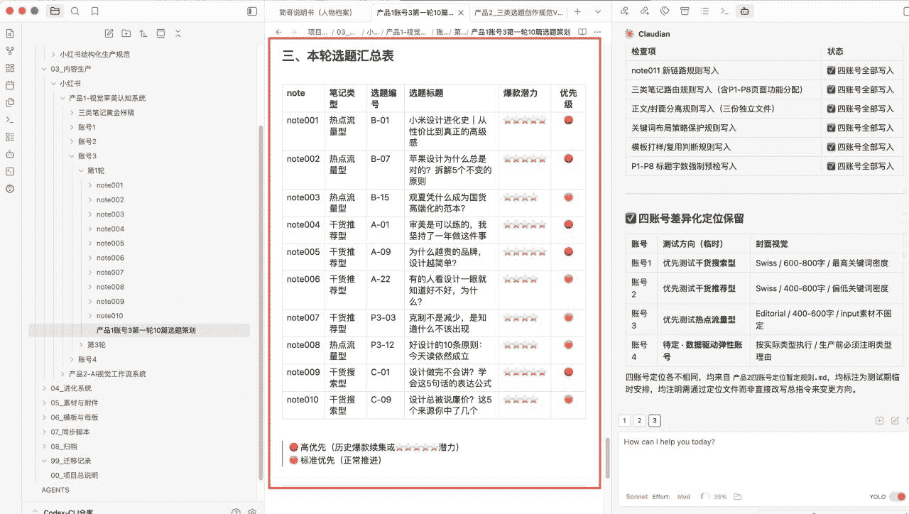
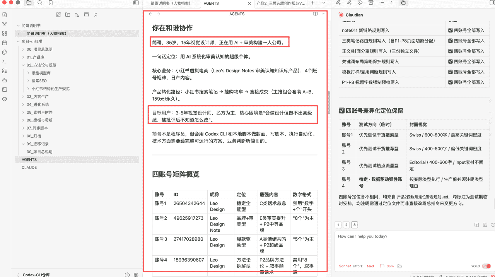
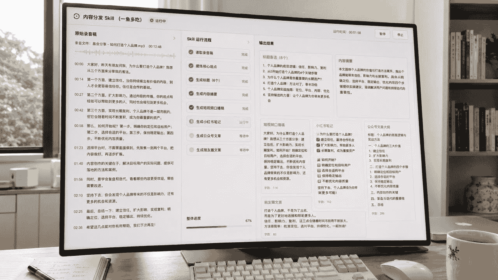
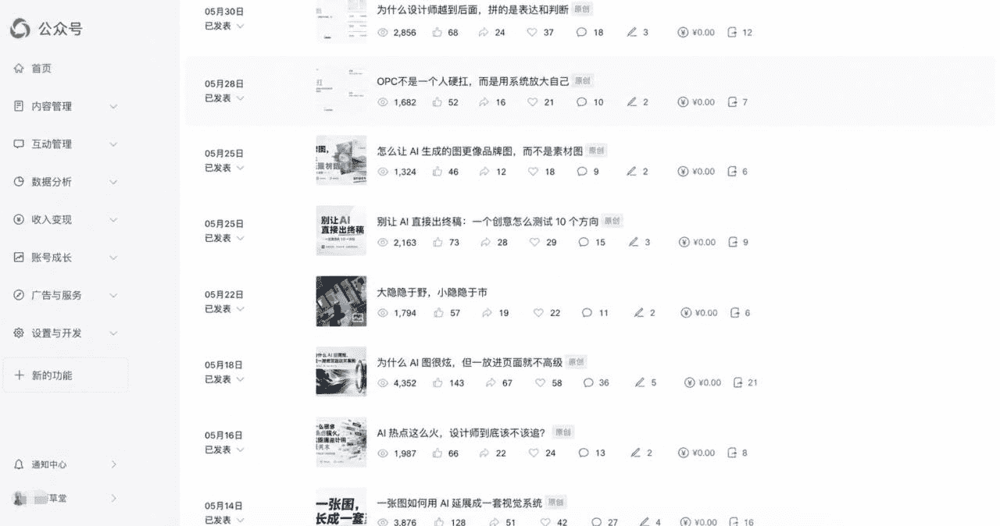
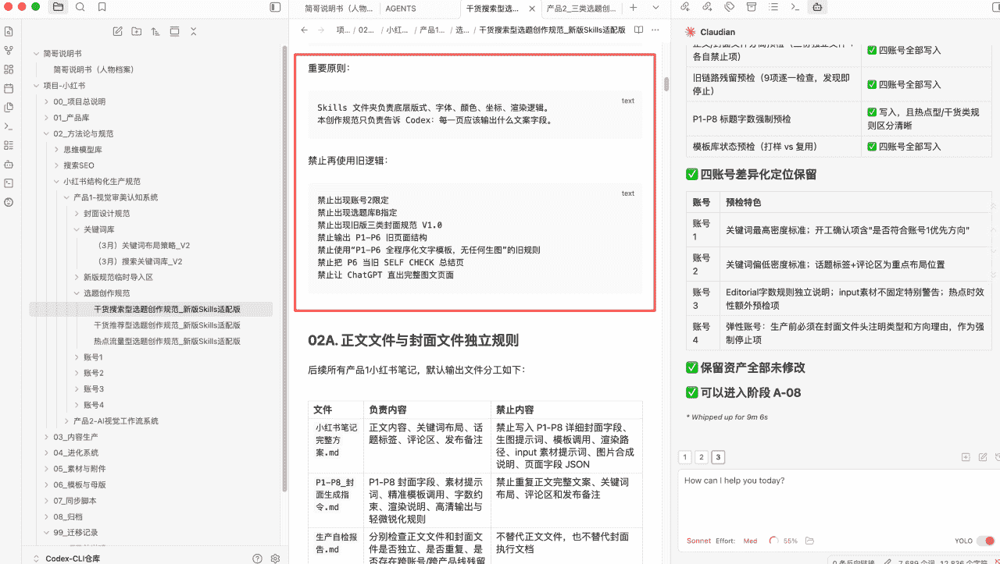

# 花 3 个月时间，我把 10 年设计经验沉淀搭建自己专属的 Skills，全方位接管我的虚拟电商和👸号内容（附搭建流程）

90天，我把十年设计老底全交给了AI。换来的结果：虚拟电商和👸号内容，基本不用我亲自盯着写了。

先说人设。白天我是普通民营公司的视觉设计师，电商、市场宣传的物料都归我；下班就把自己切换成小老板，从傍晚六点干到半夜十二点，一天十四五个小时是常态。我一直憋着一个念头：用审美+AI，做一家一个人的公司。

算起来，这趟大航海的船我已经上过七回，也换过好几种航线，见过不一样的风景。可绕了一圈，最后还是选电商号往深水区跑。这一路有开心也有焦虑，可能这就是折腾的意义。眼瞅着快靠岸了，我把这段路的体会整理出来，既算分享，也算给自己的记录。

一年之前，我其实干啥啥不灵。📕实物电商做过，AI自媒体也碰过，都没折腾出像样的结果。后来刷了大量精华帖，又闭关想了几天，才转到📕虚拟电商。当初选实物电商，是觉得自己有淘宝和抖音的老底，应该匹配。可做了才发现，光外出拍照、选品、整理几百张实拍图就够喝一壶，再加上发货、退款、售后，店铺差点被干瘫痪。虚拟电商就清爽多了：不用发货，不用售后，不用出门，不用堆积如山的实拍图，把前端内容做好就行。

但“好好做内容”这四个字，很快就让我体会到什么叫难。一个人要管四个号，不借AI的力根本盯不过来。所以从去年起，我就把Claude当主力，从聊天窗口一路用到Claude Code，工作流改了一版又一版。

说句实话，刚开始用AI那会儿，我就是个标准的“搬运工”。GitHub上star高的Skills，收；群里有人发的Skills，存。总以为手里囤得越多，AI就越能打。结果呢？绝大多数Skills跑不动我的业务：要么是给程序员写代码的，跟📕八竿子打不着；要么好不容易跑通，出来的东西一股塑料味儿，怎么改都别不过劲来。

我花了好一阵子才想明白：问题不在Skills，在AI压根儿不认识我。它不知道我在做什么，不知道我审美是什么级别，不知道我服务的是谁，更不知道我说话是什么腔调。让一个对我一无所知的AI，用一套不是为我量身写的东西来替我干活，这不是为难它吗？

说到这儿，得先把Skills说清楚。很多人一听Skills，觉得是程序员才能玩的高深技术。其实没那回事。说白了，Skills就是给AI的一份工作手册：这个任务是什么、按什么标准做、做完交给谁。你想象一下，AI是从学校刚出来的实习生，脑子好使、不知疲倦，但对你公司一无所知。你得给他写一份能照着执行的手册，细节越全，他干得越接近你想要的样子。等这些手册沉淀到位，AI差不多能继承你七成功力，等于给自己养了个AI镜像。

什么样的任务才值得写成Skills？就看两个字：重复。天天做、周周做，而且你有自己的章法，那就值得封装。比如写📕笔记、写👸号长文，都是高频、有套路的事，必须Skill化。反过来，一个月才一两次的合同，直接对话解决就行；帮孩子改作业这种每回都变的事，也犯不上做Skill。

所以Skills从来不是越多越好。我Obsidian里跑了十几个，基本覆盖业务里的高频环节。每多一个能用的Skill，就少一桩我亲自动手的事，这笔账怎么算都值。

那为什么我从外面囤的那几十个Skills，一个都不灵？往深了说，就两条。

第一，任务场景对不上。市面上的Skills，大多在服务程序员或通用需求，PPT、封面图、👸号排版这几个方向更是重灾区。可你想想，Gamma、Canva、秀米、壹伴这些工具早就把活儿干得很漂亮了，直接拿来用不是更高效？真正值得做Skill的，是那种没有现成工具能搞定的场景。比如我做的这套“Leo’s Design Notes风格的📕笔记”，要六张图文配正文、配关键词、配评论文案，市面上没有工具能全包，只能自己造。

第二，Skills最值钱的部分不是外壳，是里面塞了多少只有你才懂的东西。这东西我管它叫“隐性知识”。比如一篇笔记的标题怎么写、痛点怎么戳、钩子放哪句、图放P1还是P5、评论区先说啥后说啥，全是我做几百篇笔记试错试出来的直觉。你让我说个所以然，我得想半天；但让我拿眼睛扫一眼标题，三秒就知道它能不能起量。这种手感，别人的Skills里根本没有。它给不了你判断力，只能给你一个随处可见的空壳子，跑出来的东西看着像模像样，用起来废。

所以后来我问自己两个问题：这个任务市面上有没有现成工具？这件事是不是高频、值不值得封装？想通了之后，我承认：真正属于自己的Skill，只能从自己的业务里长出来，没法从外面搬。

但长出来之前，有一个绝大多数人都跳过的前提：先让AI认识你。

每次开新对话，AI都跟失忆了一样，不知道你是谁，不知道你几斤几两。你不告诉它，它就只能照着“最大公约数的人类”来猜你，猜出来的东西当然没有你的味道。我第一次真切意识到这件事，是在给Leo’s Design Notes选品的时候。别人选品都是朝着数据看，哪个热就扑哪个；我偏要反过来，先琢磨自己是谁、能赚谁的钱。那阵子我天天跟Claude聊，从技能、经历、兴趣一点点聊起，最后把“我是谁”写成一篇长文发给它。当时单纯是为了选品，后来才反应过来，那篇文章成了后面所有操作的基石。

正因为AI够了解我，它才可能帮我把设计师这个大池子一层层往下筛：先筛出视觉设计师，再筛出三到五年经验的中高级设计师，最后筛到“被甲方说太土、做不出高级感”这个真实痛点。换成不认识我的AI，它只会让我去做设计教程、教PS这种烂大街的建议。

后来搭Obsidian + Claude Code/Codex系统时，我把这件事固定成了流程。系统里专门有一个文件写“我是谁”，学名叫CLAUDE.md或AGENTS.md，也就是我的个人档案。每次AI被唤醒，第一件事就是读它，读完就知道在给一个什么样的人干活。我这份档案写得很细：基本信息、性格、核心能力、价值观，外加十年经历的完整脉络。里面没有一句技术，全是“我这个人”。但恰恰是这些，决定了我后面每个Skills的成色。

打个比方：Skills是种子，CLAUDE.md是土壤。一颗种子再优良，落进不认识你的贫瘠土里，照样结不出你想摘的果；反过来，只要土够肥、够“你”，哪怕种子普通，也能长出独特的东西。所以千万别跳过这步。在研究Prompt、研究工作流之前，先老老实实写一份“我是谁”。

最后，讲讲我的Skills是怎么从地里长出来的。

一个反常识的开头：我搭Skills，不是从写Skill开始，而是先搭知识库。因为写笔记这个动作背后，得有一整套东西托底，不然Skill就是空中楼阁。

最底下一层，就是产品本身：Leo’s Design Notes。12大模块、65+章节、25个品牌拆解、80+正反案例，是我十年设计经验和AI深度共创的成果。每一次笔记、每一个选题，都是从这套产品里切出来的。它本身不是Skill，却是所有Skill的弹药库。别人能抄我的标题、抄我的格式，但抄不走这套几十万字的知识库。

知识库之后，第一个长出的是选题Skill。我手里有个500+的选题库，按痛点紧迫度分成P0到P4。选题Skill要干的，就是按规则帮我从这里头挑。我现在十篇文章里，三篇冲热度，七篇做转化。这个比例不是拍脑袋定的，是做了几百篇之后摸出来的手感。

不过丑话得说在前面：AI筛选题，人不能放手。每轮我都得亲自过目，重点盯两件事：一是比例别偏，热点多了只有热闹、没有转化，干货多了没人设、难拉新；二是选题别跑出产品框架，AI偶尔会夹带一些看着像选题、实际无关痛痒的私货，这种发出去就是浪费曝光，必须当场毙掉。另外，我还会定期让Codex去清一些过期报告，省得AI拿着旧数据当新依据。

再往后是核心关键词库和关键词使用指南，让AI知道哪些词该埋在标题、正文和标签里。最后，也是最花心思的，是写笔记的Skill。在我这儿，一篇笔记不是一段文字，而是一整套零件：六张封面图文、一篇正文、十个话题标签、一套评论文案。每一块都有我自己的硬规矩。

标题压到二十个字以内，必须命中搜索词，同时扎到具体痛点，绝不用卖点思维硬夸；正文不超过一千字，讲用户能得到什么，不讲产品有什么；痛点归因只能归到外部，不能说“你不懂审美”“你不够拼”这种话；下笔前先过三层筛子：这篇给谁看、想勾起哪种情绪、在什么场景下被读到；结尾用软钩子把读者引到完整产品上，让他觉得要系统解决就得看完整版。最后，我还在这个Skill里单独塞了一组反AI味的规则，免得它一开口就露馅。

好了，今天就聊到这儿。如果你发现自己工具越来越多，活儿却越来越没自己的味儿，不妨回到第一步，问问自己：那份“我是谁”的档案，你到底写了没？

AI 生成的文字为什么总显得假？根儿上就几道死穴改不过来：特别爱用连环短句、破折号到处冒、段落切得碎得像清单。一旦这些特征出现，机器感立刻就被识破了。

于是我把底线钉死：不允许连发短句、不允许破折号、不允许过度分段。仅靠这三条卡口，AI 味道就能砍掉大半。



现在看到的这些限制，本质上是我自己写作的避坑清单。不是照搬的模板，是我在实战里一遍遍踩出来的手感。把它固化进 Skill 之后，AI 输出的笔记才有了“我写”的质感，而不是又一份典型的模型产物。

## 6.4 关键词布局 Skill：把搜索流量提前埋点

稿子成型不算完，后面还要做搜索词的埋设。

很多人写完就发，这块我一直当成战略投入。📕的流量分两种：平台推荐量大但泛，主动搜索量小但精准，我两头都要。

所以先搭一个核心搜索词池，再配一套落地方案，明确告诉模型封面、标题、正文开头中部结尾、话题、评论区，分别该放哪些词、放多大比重。相当于给词库配了个调度官，把词合理铺满笔记的各个角落。

有了这套机制，即便之后一段时间内不发新内容，之前预埋的关键词仍会持续带来搜索转化。词库是活的，我每周会从后台捞出成交好、点击高的词补进去，再按转化表现排序。

## 6.5 全部串起来：一句指令跑通一条流水线

把前面几个 Skill 串联起来，就是我现在用的生产线。

一套📕内容在我这等于 1 篇文案 + 6 张封面图。固定路径是：选题 → 写文案 → 配人设图 → 做封面 → 截图出图 → 发布。

现在一条指令就能启动整条线，指令发出后我可以去忙别的，回来工作已经在跑，基本半自动化，自检自修也做了。

有人问，这种初稿能不能直接用？

实话说：我通常只改 10% 以内。

改哪里？基本就是 P1 封面和正文标题。其余位置很少动。

因为这两处决定点击，是第一道关卡。AI 写的标题从结构看都很规范：痛点有、方案有、数据有、公式感也有。可全对不等于好，还得拿在手里品一品，是否有情绪，能否把用户情绪撬动。同样意思，有情绪和没情绪，点击率能差出一倍。AI 擅长把“正确”做到位，“感觉”这块必须人来加。

正文结尾的转化引导我扫一眼，靠模板兜底基本没问题。关键词、话题、评论区文案直接用即可。

所以分工很清晰：AI 完成 90% 的正确部分，我往剩下 10% 里注入质感。很舒服。

我的周节奏是：周一调研关键词与竞品，周二生成文案，周三做封面，周四同步飞书，周末逐篇润色后发布。4 个账号稳定周更，核心精力只放在最后的人工润色上，其他交给系统跑。

核心逻辑就一个：把我十年的经验变成可复用工具，而不是每次都要从零向 AI 解释我是谁、要什么。这些 Skill 没有一个是网上下载的，全是业务土壤里长出来的。

## 七、换个赛道，Skill 长相完全不同

讲完📕，你可能会觉得 Skill 不就是知识库加选题加写稿的套路，换个业务照搬就行。

并不。我用👸号举例，同一个人、同一套底层系统，换个赛道长出来的 Skill 完全是另一副模样。

👸号写的是个人成长、创业复盘、AI 方法论，跟📕的审美干货是两回事。底层仍是 Obsidian + Claude Code / Codex，但喂进去的材料和长出的 Skill 都变了。

### 7.1 同一套系统，两份“我是谁”

这里有个关键细节必须单独拆开说。

我的 Obsidian 里存着两份自我定位文件：

```text
Obsidian Vault/
├── 人物档案.md
## 真实的简哥 → 👸号 / 社群 / 个人品牌
└── Leo-IP/
    └── IP 定位.md
       # 博主 Leo 人设 → 📕
```

一份是 Leo 的 IP 定位，给📕用的人设。里面是我是博主 Leo，专门讲设计审美、服务中高端设计师。另一份是我真实的个人档案，35 岁、创业 8 次、屡败屡起、骨子里热血，这份给👸号、朋友圈、社群用。

我专门立了规矩：📕内容禁止调用真实档案，👸号和个人品牌内容才用它。

为什么要分开？因为场景不同，“我”也不同。📕读者要干货和方案，他们认“设计专家 Leo”。👸号读者想看一个活生生的人，想看简哥是怎么摔倒又爬起来的。档案混用就会精神分裂：📕笔记里冒出创业失败的



苦情，👸号文章里却全是冷冰冰的设计术语，体验会很怪。

所以让 AI 认识你，也要先分清是哪个场景的你。同一个人不同业务有不同身份，要用不同角色去做不同项目的工作。这就是 CLAUDE.md 越做越细的原因。

### 7.2 👸号的主力 Skill：一鱼多吃

📕的核心是选题 + 创作 + 关键词，👸号的扛把子是我叫“一鱼多吃”。

它解决我一个痛点：原始语料很多、散着、整理成本高。

我经常有开车口述的长语音、跟圈友 1 对 1 交流的录音、社群分享的片段。信息密度高，都是真实思考，却常躺着吃灰，因为整理太费劲。

一鱼多吃 Skill 就是干这个的。把一段录音稿丢进去，它能加工成：一篇👸号长文初稿、几条朋友圈文案、一个📕笔记角度，再把里面的金句和观点提炼出来。一场 1-2 小时的直播或分享，加工后够我用半个月。

### 7.3 长文 Skill：把反 AI 感做到极致

👸号写长文，最怕 AI 感。一篇个人成长文一旦被识破，信任感瞬间没了。

所以我的长文 Skill 里，反 AI 规则比📕更严：禁止连续短句、禁止滥用破折号、禁止过度碎段、禁止“首先其次最后”这类八股、禁止讲正确的废话。都是我自己写作时的真实忌讳，一条条抠出来塞进去的。



你现在读的这篇文章，本质就是在长文 Skill 辅助下一段段打磨出来的。它知道我是谁、我的经历、我的语气、我讨厌的表达。所以递上来的初稿已经有七八分“简哥味”，我再改、调、加料，效率比从零写高很多。

### 7.4 两个案例并看，结论就出来了

把📕和👸号放一起看，结论很清晰：Skill 不通用。它长成什么样，取决于业务任务是什么、你这个人是谁。同样是我，同样用 Obsidian + Claude Code，因为📕要高频标准化搜索导向的短笔记，就长出“选题 + 创作 + 关键词”这套。因为👸号要真实感、观点、传播力的长内容，就长出“一鱼多吃 + 长文”这套。土壤不同、任务不同，种子自然长成不同形态。

这也是为什么别人的 Skill 你抄不走。不是技术抄不走，是土壤、真人、业务场景抄不走。

## 八、如何从零原创一个属于你的 Skill

说了这么多，可能你也想动手了。

先说清楚：原创 Skill 不需要会写代码。难的是想清楚你的重复任务是什么。

我总结成三步。

### 8.1 第一步：找准高频重复任务

把你每周都在循环做的事情列出来。核心看“高频”和“重复”。偶尔做一次的不算，每次做法都变的不算。要找那种“这周做、下周还做、做法大差不差”的活儿。

比如我的笔记审稿，客服的重复回复，知识付费的选题写稿。按频率排序，越靠前的越优先。

很多人卡在这，觉得自己做的事“没技术含量”“不值得做成 Skill”。先记住：越是你闭眼都能做的活，越值得 Skill 化。

### 8.2 第二步：把判断标准掏出来

这是最核心也最难的一步。

找到高频任务后问自己：我做这件事时脑子里按什么标准在过？

审稿时我会看：标题能不能用、开头能不能抓人、逻辑顺不顺、有没有硬伤。这些就是判断标准。

把隐性知识变成显性规则写清楚。写得越细，Skill 越像你。我那个创作 Skill 里塞了几十条标准：标题字数、思维方式、归因逻辑、禁用词，全是我掏出来的。

小窍门：想不起标准就回想“上次我为什么毙掉一稿”。你的否定理由，就是最真实的标准。

### 8.3 第三步：让 AI 出第一版，然后死磕迭代

标准理清后，把任务和标准丢给 Claude Code 或你用的 AI，让它出第一版。肯定不完美，拿真实任务去测，不对就改：规则没写清就补，理解跑偏就说明白，漏了标准就加进去。测改再测，直到满意。



我踩过的最大坑：别想着一个 Skill 把所有事都包了。

早期我想做全能 Skill，一次性搞定对标、选题、写稿、配图。结果一塌糊涂。越想一步到位，越慢。因为一个 Skill 干三件事，就要做三次独立判断，每次都可能偏离标准，三次相乘早就飞了。

正确做法是拆。选题 Skill 只管选题，创作 Skill 只管创作，关键词 Skill 只管布局。每个 Skill 只做一件事、只做一次判断，结果更稳也更好维护。记住：专而精，不贪大。

维护方面：骨架不动，微调常做。

框架不能乱动，因为 Skill 间强关联，一个变整条线都要调。所以主体定下来后我很少动。

但小修小补每周都有：按数据新增规范、更新关键词、给封面 P1-P5 加引导词、调字体规则，几分钟搞定。

何时大改？我定的信号是：封面点击率持续下滑，或阅读量连续 2-3 个月下降。那就说明底层规范过时，需要重改设计规范和关键词策略。

一句话：数据不报警就小保养，报警了再大手术。

## 九、最后两句心里话

方法说完了，最后说两句更重要的。

我这半年接触不少想用 AI 的朋友，发现卡住他们的不是技术，是心结。我自己也曾被困住，现在一起说破。

第一个心结：“我的工作没价值，不值得做成 Skill”

太多人这么想，觉得自己每天做的事平平无奇，谁都会。

恰恰相反。你“看一眼就知道行不行”的直觉、你没意识到的操作流程、你踩坑换来的标准，对你来说是日常，对 AI 和别人来说是稀缺资源。

我做 567 篇笔记才磨出的标题手感，拆 25 个品牌才沉淀的审美判断，对我只是习惯，却让我的 Skill 长出了别人复制不了的模样。

Skill 的价值不在于技术复杂，而在于你的隐性知识密度。你觉得不值钱的日常，一旦固化成可运转的系统，就值钱了。别瞧不起自己的活儿，你的“习以为常”才是金子。

第二个心结：“我的方法论不够高级，拿不出手”

也有人觉得自己的东西太土，不够高级。

想通一个点：专业是相对的。60 分的人能教 40 分，40 分能教 20 分。你不需要是行业顶尖，只需要比你的用户多走几步就够了。

我在真大神面前不算什么，但对还在为“高级感”发愁的 3-5 年设计师，我的经验就是解药。你的方法论不需要惊天动地，只要真实、来自实战、能解决一群具体人的具体问题，就够了。

## 写在最后

回到最初的问题：为什么别人的 Skill 到你手里就废了？

现在清楚了。不是 AI 不够强，是 AI 不认识你。不是 Skill 不好，是它没在你的土壤里长出来。

我用 AI 最大的体会是：AI 只是放大器，放大的只你自己。

你是谁、你有多少真东西、你愿不愿意把自己完整喂给它，决定了它能帮你长出什么。所以别到处搬运，先回头写好一份“我是谁”，把这些年攒下的真东西一点点喂进去。

种子可以借，土壤必须是你的。

我还在路上，还没单飞，但方向已定。如果这篇文章能让你搭系统时少走弯路，我就很欣慰了。

一起加油，一起龙哥盟！

————分割线————

看完 SOP 你觉得懂了，但 90% 的人实操第一步就卡住。

工具和教程只是最低壁垒，真正的壁垒是立刻动手和圈层信息差。

如果你想看全网最新的变现玩法，和一群执行力强的极客一起落地拿结果，欢迎围观我的核心私域：【懒人专属群】。

我们只拆商业闭环和 AI 效率，不聊虚的。系统内已沉淀 1000+ 跑通的套利实战局。

⏱ 查阅圈子完整数字资产与上车门槛：

https://lazyso.com/insider/

认同价值、准备好下场干活的，扫码加我🛰️（lazyhelper1）

备注：【实操上车】，不闲聊

