# 大四学生做👸号一年变现**6万+**，深耕大学生赛道的我如何通过流量主、商单和私域变现，新人可参考
作者：龙哥

各位赚钱的朋友，我是龙哥，今年4月18日刚加入这个大圈子的新人，目前还在读大四。

先简单说说现状：2025年这一年，我靠👸号完成了6万多元的变现；账号里已经出现了19篇阅读量破10万的文章。加入赚钱之后，我又看到圈友分享的贴图号玩法，跟着试了一个月，顺利写出了两篇10万+贴图爆款，其中一篇只用了12小时就冲到25万阅读，连续两天日入200+。

放几张截图，让大家直观感受一下：

这是流量主单日收益破400的时候，当时特别开心。

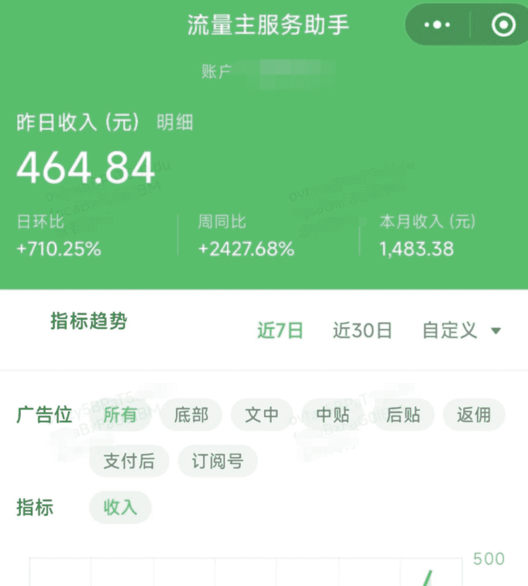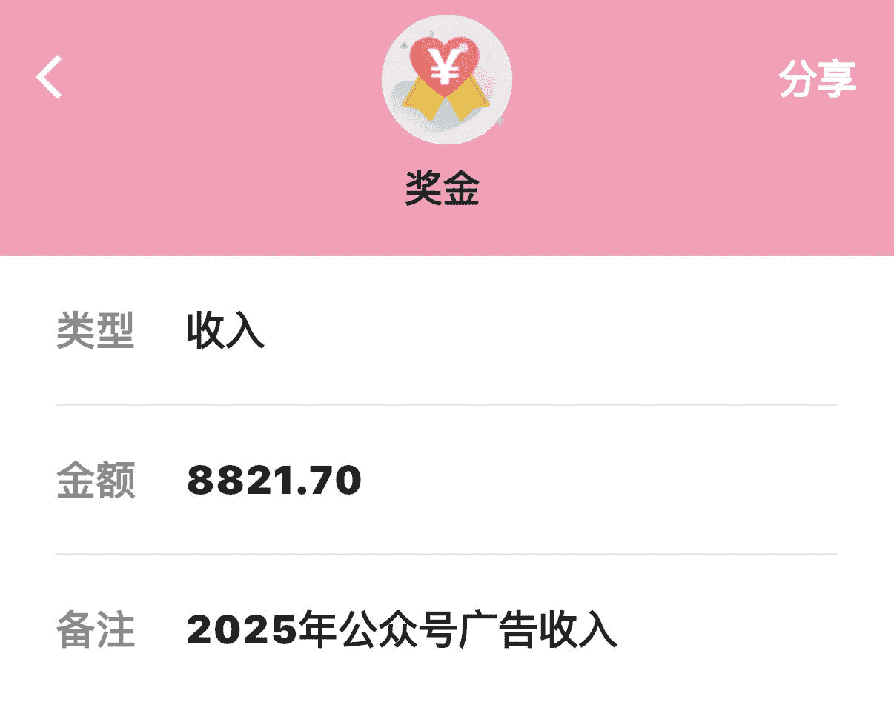

2025年有三个月的接广告收益也相当不错。单号流量主收益、带学员和分销的收入也都有体现。

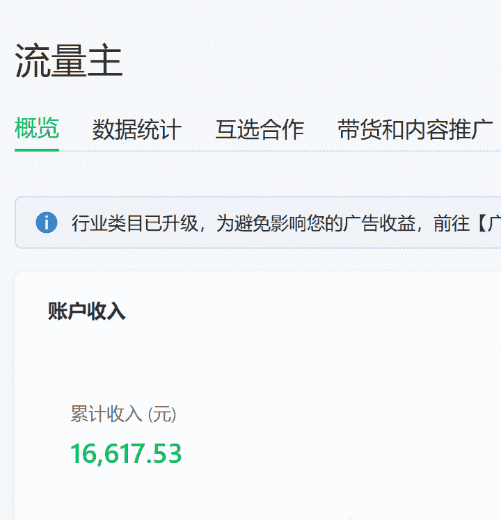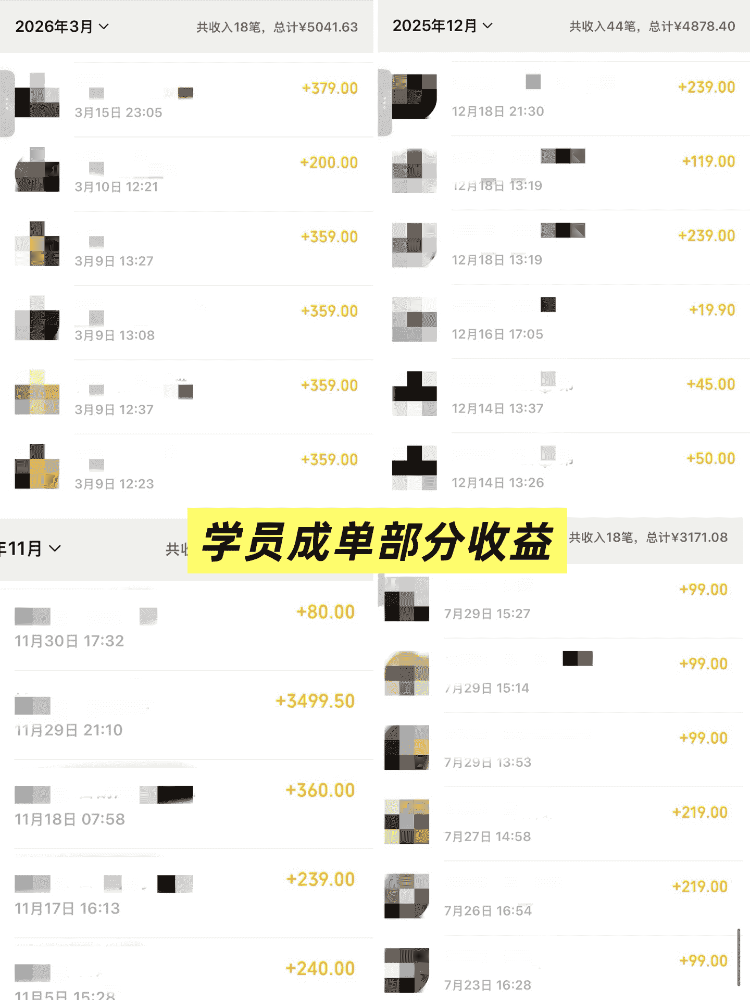

再放几张10万+爆款文章的截图。

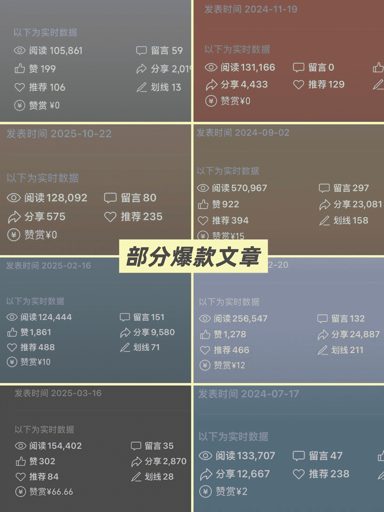

这里先交代一下背景：我做👸号基本靠“手搓”，推文会适度借助AI工具，但为了保持手感，核心内容一直是自己写。因为没有条件做矩阵，最多的时候也就同时运营两个号。

接下来聊聊大家最关心的问题：我为什么选择大学生赛道？

我的第一个👸号注册于2022年底，当时只是隔三差五更新一点，主要是为了记录自己的成长。

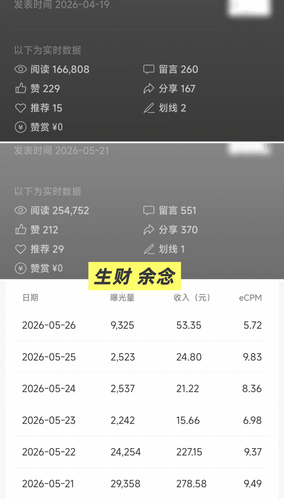

真正开始认真做这个号，是2024年7月。说实话，那会儿我完全不懂运营，不知道什么叫定位、什么叫赛道，更不知道怎么写出爆款。正因为什么都不会，我只能从最了解自己的地方下手——大学生身份。

当时我刚读大三，前两年在学校里攒下了一些可以讲的经历：拿过国家奖学金，四六级一次通过，还拿到过大厂实习的面试机会。加上我之前在一个大学生成长平台发布过52篇文章，手头素材很充足，所以就直接开写了。前几篇数据平平，只有两位数阅读。真正带来转机的是我写的那篇关于大学室友的文章，数据一下子有了起色，后来它还成了我的第一篇10万+爆款。

其实这个选择很早就埋下了种子。高中时我就喜欢刷👸号，当时关注了一位叫“跑步的人”的博主，他写的就是大学生赛道，那些经验分享对我帮助很大。等我开始自己写，发现也会有人来关注、点赞，甚至有人在评论区向我请教。这种感觉让我觉得，文字确实能帮助别人，也能扩大自己的影响力。

我本人是双非学生，背景平平，做👸号的过程让我收获了不少成就感，而且还能补贴生活费，自然就坚持下来了。更要紧的是，我赶上了一小段红利：2024年下半年写大学生赛道的人还很少，流量竞争没那么激烈，我大概花了三个月，粉丝就涨到了一万多。

回到正题：这个赛道现在还有没有机会？我的答案是肯定的。

第一，受众群体比想象中大。大学生赛道不只吸引学生本人，还会吸引很多家长。他们觉得文章好，会主动转给孩子，等于一下子覆盖了两批人。我写过一篇四六级备考文章，在文末说留言加好友就能免费领资料，结果一位家长领完资料后，直接发了个188元的红包感谢我。还有一次，一位帮老师管理学生群的家长，看完文章后主动加我，把我的👸号转发到了800人大群里，当天就涨了不少粉。

第二，需求足够大。很多大学生，特别是学校层次不太高的学生，刚进大学时其实很迷茫，特别需要抱团取暖。四六级怎么考、比赛怎么打、实习怎么找、转专业怎么操作、宿舍关系怎么处理……这些都是学校不教、但真实存在的痛点。大学生每年都在更新，大一到大四的内容都能写，往下还能切研究生赛道，所以流量是源源不断的。

第三，起号速度快。我做第一个号的时候，不到一个月就开通了流量主；今年年初重新注册的新号，半个多月也达到了开通条件。

第四，容易聚拢同频的人。如果你本身就是大学生，账号天然带着亲和力和信任感，私域里很容易沉淀一群和你在相似阶段的同龄人。大家聊得来、有共同话题，后面变现也会顺畅很多。

第五，创作门槛和成本真得很低。哪怕你的经历不算丰富，室友矛盾、不知道怎么和辅导员相处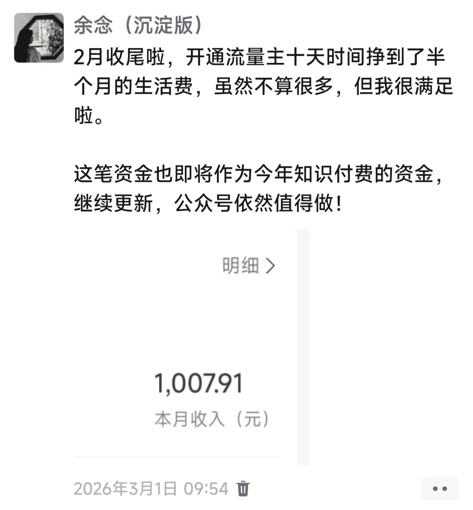这些事，99%的大学生都经历过，这些全都是素材。把自己的过去写下来，再结合爆款思路去表达，就很容易起来。大学生人人都有电脑，只要不盲目报课，自己摸索几乎零成本。就算最后没做起来，损失的也只是打游戏刷剧的时间。

第六，👸号长文很适合干货输出。我自己尝试过做视频，效果一般，而且学习成本高；文字简洁有逻辑，👸号恰好能承载完整的内容。别担心没人看长文，这个赛道吸引的很多中年家长，真的愿意静下心来读。实习规划、备考攻略、竞赛解读、心态调整、职业选择，这些都需要系统性输出，长文刚刚好。我的大号已经很久不更新大学生内容了，但仍然会有人给过去的文章点赞，这就是内容沉淀的力量。

说完成赛道的价值，再聊聊选题怎么来。我那些10万+爆款里，大部分属于干货文，比如实习、大学生做自媒体、寒假可参加的比赛、入党等。但我在干货里加入了大量能引发共鸣的内容，所以流量很容易被引爆。

我的选题方法主要有四个：

第一，刷对标、看同行。这是最基础也最高效的方法。空闲时我会去刷同赛道的👸号，重点关注阅读量5万、10万级别的爆款，然后点进对方主页综合判断。什么样的账号值得学习？注册时间不长、更新稳定、能持续产出爆款，而且文章结构清晰。我会把看到的优质内容全部收集起来，方法很简单：用两个🛰️建一个群，命名为「👸号写作」，平时刷到好内容直接转发进去。不用刻意分类，这个群就是我的懒人素材库。没有灵感的时候翻一翻，看看近期热门话题，再结合自己账号的定位找切入点。还有个技巧：在👸号里刷到同赛道文章顺手点个赞，系统后续就会给你推荐更多同类账号。注意不要去刷那些官方大号，像“中国青年报”“豆瓣”之类，虽然它们10万+很多，但对我们素人博主没有参考价值；真正值得研究的是素人博主的账号。

第二，从自己的生活里挖灵感，先验证再动笔。作为在校大学生，你本身就站在赛道中心，每天的琐事、烦恼、收获都是选题。竞赛获奖就写备赛经验，室友闹别扭就写宿舍相处，拿到实习Offer就写面试心得。但自己觉得有价值远远不够，得让平台和用户来验证。我每次有灵感，会先把核心关键词放到👸号搜索栏里，看看类似内容多不多、阅读数据怎么样；如果👸号里同类文章少，再去📕、今日头条继续搜。综合判断这个话题有没有爆款潜力，再正式开写，这样能避开不少坑。

第三，多平台联动，捕捉全网热点。👸号上刷不到好选题时，我会去📕、抖音找。不一定只看图文，视频火了我们也能把它写成👸号文章，每个平台调性不同，但爆款的底层逻辑是相通的。

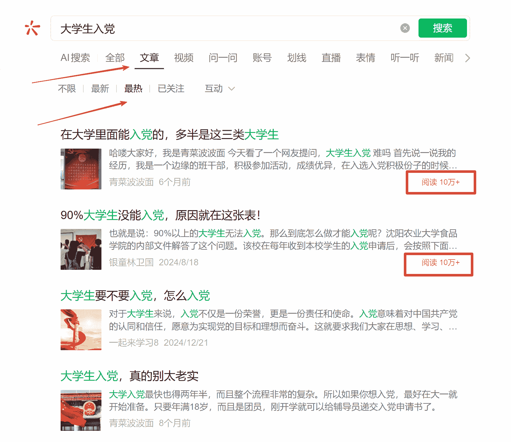

平时刷到热门内容，我会把标题关键词复制下来，拿到👸号里再搜一遍。如果平台内已经有同类爆款，就说明受众需求很旺盛，可以直接定为自己的选题。开学、毕业、实习秋招、考证季这些节点，全平台都会一起出现相关话题，跨平台捕捉，能让选题始终踩在用户需求上。

第四，深挖爆款评论区，摆脱同质化。现在大学生赛道确实很卷，入党攻略、热门竞赛、校园日常这些常规选题早就被写烂了。如果自己暂时没有新观点，不如去爆款评论区找灵感。那些数据好的文章下方，往往有成百上千条留言，正文没有写透的细节、新角度、实用技巧和真实痛点都藏在里面，都是很好的写作素材。

解决了选题，再聊聊出爆款的核心。我总结下来就一句话：把真实的自己写进去。每次创作，我会先拆解同赛道爆款的选题逻辑，但从不照搬，而是在干货里大量融入自己的经历。

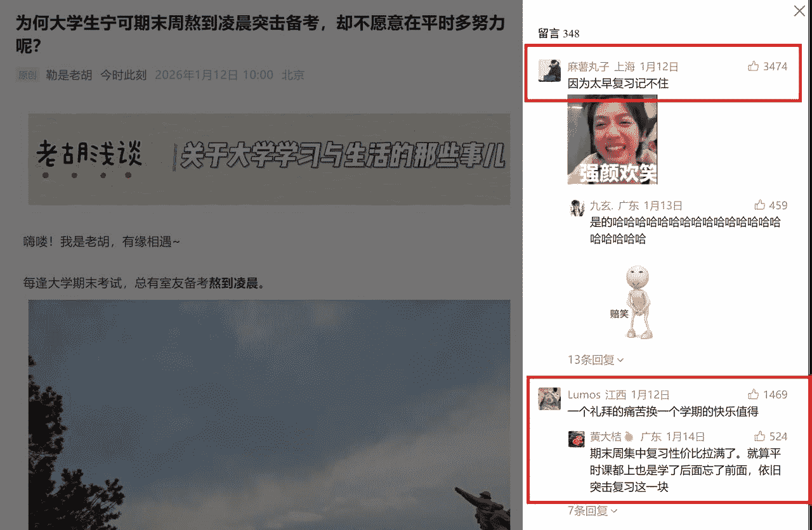

我的目标是打造个人IP，吸引同频的大学生进入私域，这一点光靠干货是做不到的。读者获得实用经验之外，还能看到另一个活生生的人——一个和他们站在同一条起跑线的同龄人。他们现在的迷茫、焦虑、对信息差的困惑，我都经历过；只不过后来我一步一步往前走，慢慢变成了很多人期待中的样子。这种身份共鸣和成长轨迹，是我和其他账号拉开差距的关键。也许大家的校园困惑和成长烦恼很相似，但每个人的见闻、踩过的坑、拿到过的结果和心路历程，都不可能完全一样，这些正是别人复制不走的素材。

在内容配比上，我习惯按“六分干货、四分人设”来做：六成输出可落地的经验方法，保证实用价值；四成融入个人故事和感悟，让形象更立体。我从不会刻意夸大或包装人设，也没这个必要，只要把最真实的经历放在文字里，就已经足够打动人。所以说，真实经历永远是流量密码。干货不够全面、不够专业也没关系，一个真诚的故事、一段真实的感悟，往往更能戳中人心，而共鸣正是一篇文章成为爆款的核心动力。

最后重点说说变现。我的逻辑很简单：多条腿走路，互相配合。

第一块是流量主。目前我两个号的流量主收益加起来已经超过2万。开通门槛现在降到了100粉，比从前容易太多。我的第一个号是靠自然流量推荐开通的；中间也试着买粉、抽奖红包这类玩法，但那些号后来都“死”掉了，所以这条路千万别碰。今年新开的号，我用图文起号把粉丝做起来了，顺利开通流量主，而且没有影响后续的推文流量。

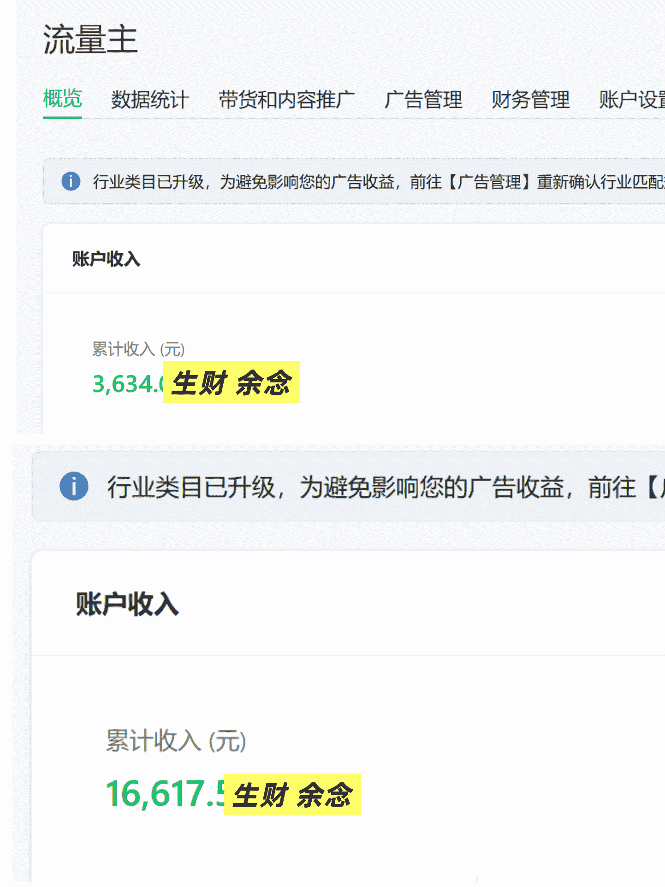

这个方法赚钱里已经有很多圈友分享过，和贴图号玩法一样。考虑到我是大学生赛道，不确定前期发别的方向会不会影响后续写推文，所以我的图文也保持大学生话题垂直。具体操作很简单：先去搜其他博主怎么发，拿关键词在🛰️里搜索，找到贴图后不断去刷，重点关注阅读量1万以上的内容，这些就是可对标的选题。

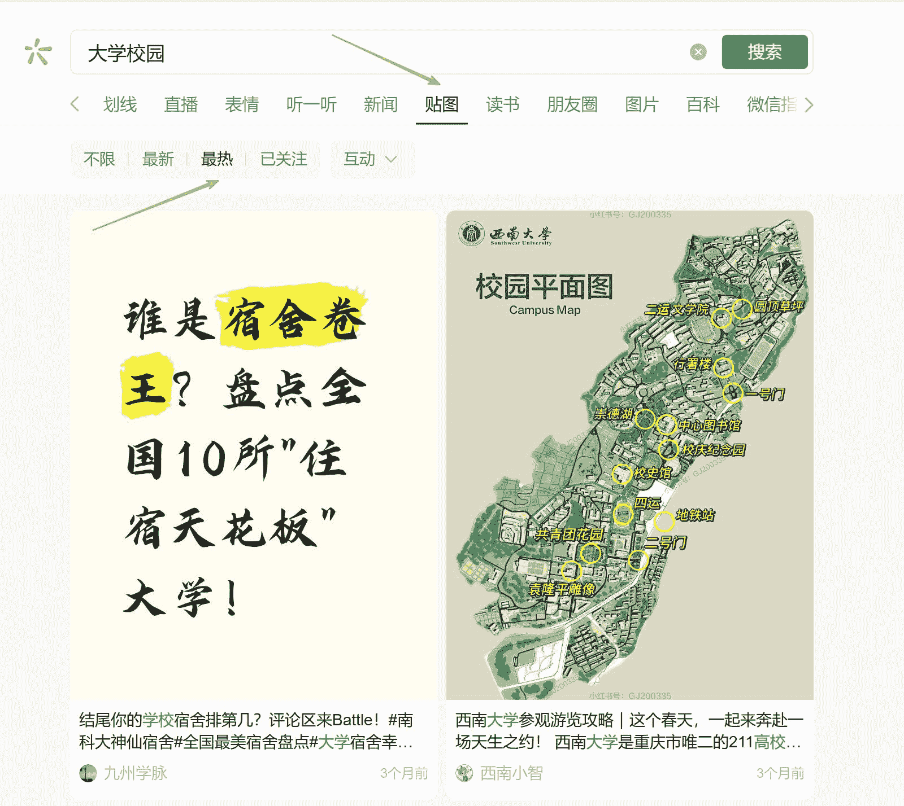

图片方面，有自己的实拍图最好；没有的话就去📕搜相关素材进行二创，找那种简单好改的图。大学宿舍、食堂饭菜、图书馆这类图片很多，也可以到评论区找别人拍的，这样不容易被判定侵权搬运。我基本每天发一篇，时间不固定，随时想起来就发。图文起号确实比推文涨粉快，等开通流量主后再转回推文，继续深耕大学生内容，整体收益很可观。推文更新频率我尽量保持日更，实在忙不过来也至少两天一更，别断更太久。

第二块是接广告。说实话，今年接广的行情已经不如去年，我也不建议新人随意接，尤其是违规广告，比如副业兼职、体育赛事、医药、明星八卦、国学这些，非常容易导致限流甚至封号。我的大号之前就是因为一个月接了两篇广告被限流，从那以后我再也没碰过接广。广告分两种：一种是代发，广告商直接给稿子，我只需要按自己的排版习惯发布，整篇都是推广；另一种是原创，广告商给需求，我结合赛道写一篇软广，只在文末或合适的位置放链接，读者接受度也更高。

我接的第一条广告是代发，报价500元，当时粉丝几千人，原创报价1500元。说实话一开始我不知道怎么定价，只能参考别人。后来认识了嘻嘻姐，她给了我不少指导，到粉丝一万多时，她把我的代发报价提到了1200元，原创提到了2000元。当时有3个合作方都很爽快地接受了。2025年1月，Kimi和密塔也来找我合作，原创报价分别是1000元和1500元。

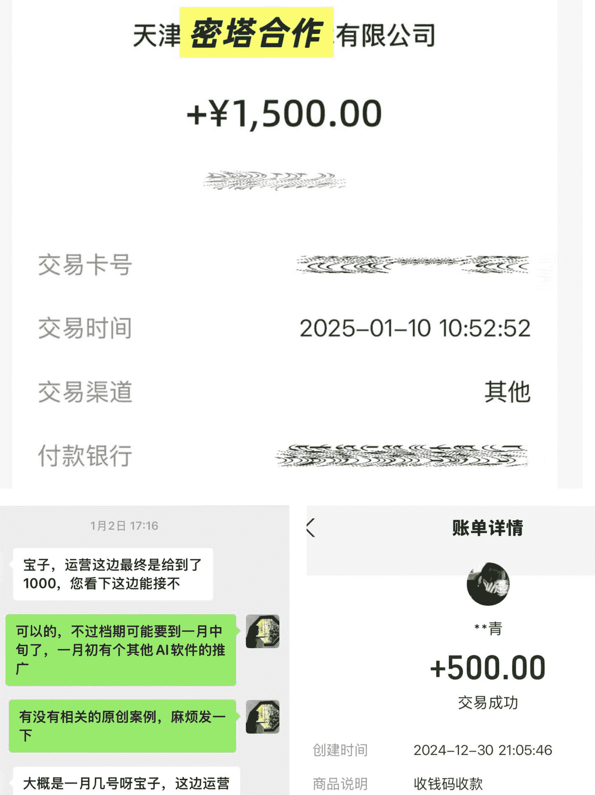

对还在上大学的我来说，这个收入确实很有吸引力。那会儿做家教两小时才60块，在外面兼职一小时也就十来块，而我每天花两小时写文章，收入能翻好几倍。当然，接广我不是来者不拒。违规广告、跟赛道不搭的广告一律不接，因为每次发广告数据都会下滑，还会掉粉。广告商之所以愿意给这个价，一方面是我数据确实稳定，基本一写就有大几千甚至上万阅读；另一方面我的受众人群和他们的产品匹配，容易成交。我现在接广告基本不走官方互选渠道，因为那条路要跟流量主收益一起算，还会扣税。私下收款方式更灵活，有些直接🛰️或支付宝转账，有些公司打到银行卡，都不扣税。

第三块是私域变现，也是我这一年投入最多、未来还会继续做下去的部分。我的私域流量主要来自👸号：文末简单介绍自己，放上二维码。流量好的时候，每天都有很多人加进来，第一步就是打标签，方便后续管理。平时我也会分享一些自己整理的自媒体资料，让大家更了解我。私域变现目前两条线在跑：一是帮别人分销，因为我和嘻嘻姐深度绑定，主要分销她的产品，先练练手；二是后来自己做产品，自己变现，这条路我已经走通了。

最后想说，大学生赛道给了我这样一个普普通通的双非学生被看见的机会，也让我在毕业前就找到了可以长期做下去的方向。如果你也是大学生，也想做👸号，不用等什么完美时机，从你自己的真实经历开始，就是最好的一步。

做私域，无论是帮别人带货还是推广自己的产品，最核心的一件事就是——让用户信你。很多人确实是带着需求来的，比如想做👸号却不知道从哪里下手，但如果他并不信任你，再大的痛点也是白搭，始终很难转化成实际的收益。

当私域里慢慢进人了，怎么做好运营就变得至关重要。朋友圈绝对是主阵地中的主阵地。说实话，我自己从来没干过私聊群发广告这种事，因为我就特别反感收到那种消息。尤其是双方还不熟、信任感一点都没有的情况下，这么一搞只会被拉黑。

后来在嘻嘻姐的指导下，我开始坚持每天更新朋友圈。内容一般我是这么分类的：

第一类，日常向内容——让人看到真实的你，一下子没那么有距离感。关键是放下“我是来卖东西的”这种心态，做一个有烟火气的人。不需要完美人设，也没必要刻意修饰，真实感最重要。

比如随手记录一下自己做的菜、路边拍到的风景、今天遇到的糟心事，都会让人觉得“原来她跟我一样，也是普通人”。不要小看这些碎碎念，很多时候，正是这些不起眼的碎片让人觉得你鲜活、可信。

第二类，成长向内容——用你的价值打动用户。私域的核心从来都是“利他”，人家肯花时间看你、信任你、追随你，是因为你能持续输出对他有价值的东西。

我会发一些自己的学习笔记、最近学会的新技能、做私域过程中的思考和复盘，或者是一些行业内的小技巧。这样客户会觉得你一直在进步，也确实有东西可以学，信任就这么一点一点累积出来的。

第三类，业务向内容——让产品和业务自然渗透出来。这里说的“业务内容”，不是硬邦邦地扔广告，而是结合生活和成长的内容，把业务线柔和地融入进去。

比如发一下学员的好评反馈、自己做项目的一些瞬间、产品真实的使用场景。不用吹得天花乱坠，也不用催单，让别人在潜移默化中知道你是做什么的、能带来什么价值，最后愿意付费就是水到渠成的事。

还有一个心得：发圈的频率不用太高，我自己的习惯是每天2条固定打底。如果实在想不出发什么，就随手写一条流水账。保持节奏感很重要，生活、成长、业务三条线穿插着发，会让整个账号看起来更自然。

朋友圈其实就是别人了解你的第一扇窗口。有时候发的东西可能没人点赞、没人买，但只要你能坚持更新，就一定会有信任你的人慢慢靠过来。

前段时间我就靠这个逻辑，成交了一单👸号课程。那个学员其实一年前就问过课，但当时没有买，我也完全没有追着人家推销。一年后他自己又跑来找我下单了，这就是信任长期积累最好的证明。

私域运营跟做👸号一样，讲究的就是准时“出摊”。只要你稳定输出，就会持续收到正向反馈，变现自然也越来越顺。

另外我想说一点自己的感受。这两年我不光做了大学生相关的赛道，也尝试过另外几个方向。但后来我新开的号，依然选择了回到大学生赛道——倒不是仅仅为了收益，而是我真真正正对这个话题有兴趣。说实话，看到别人做中老年、漫画这类赛道赚了不少钱，我也会很心动，自己也试着去摸索过，但最后还是坚持不下来。

那些赛道对我来说，只能算是一个“赚快钱”的机会，没有情感的连接，也没有想表达的冲动。

所以我特别想跟圈友们说：不管做什么赛道，想要长期走下去，一定要找到一个能支撑你的点——除了赚钱之外的意义。这才是真正让你能熬下去的东西。

好了，今天的分享就到这里，我是余念，希望和大家一起龙哥盟！

————分割线————

看完这篇SOP，是不是觉得好像懂了？但说实话，90%的人到了实操阶段还是会卡在第一步。

工具和教程其实是最低层级的门槛，真正难跨越的，是“说干就干”的冲劲和“掌圈层信息差”的视野。

我们不讲空话，只专注做商业闭环拆解和AI效率的提升。目前群内已经沉淀了1000多套跑通了的实战玩法。

👉 点此查看圈子完整数字资产与上车门槛：

https://lazyso.com/insider/

备注：【实操上车】，非诚勿扰

