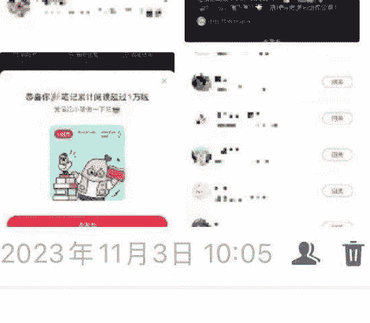
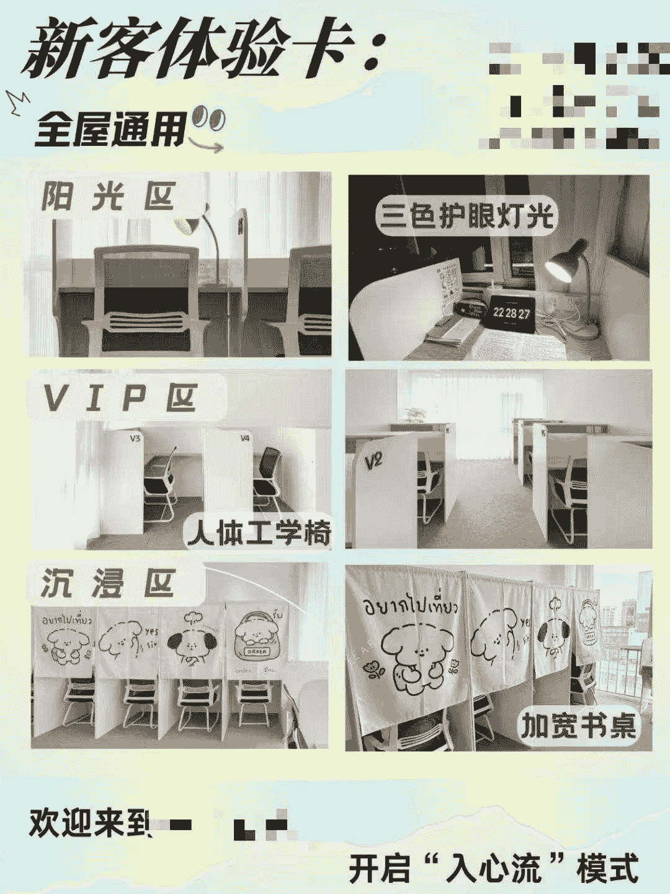
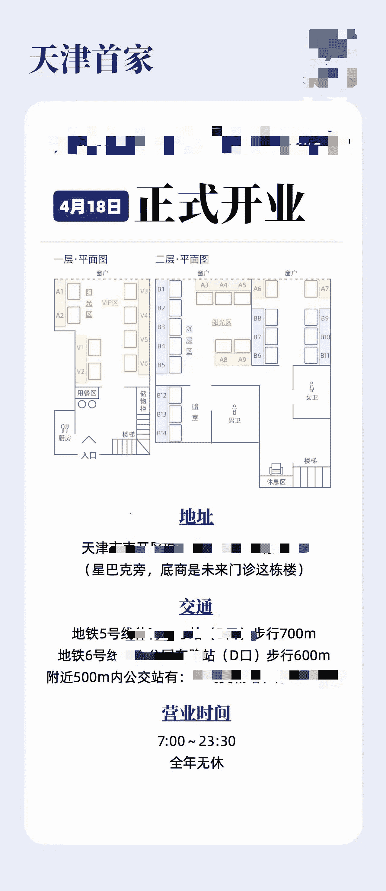
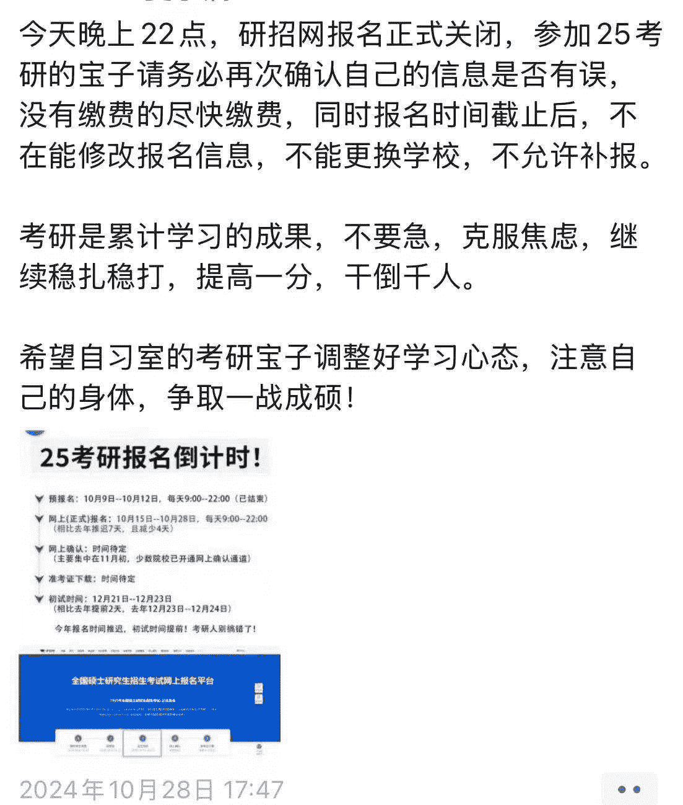
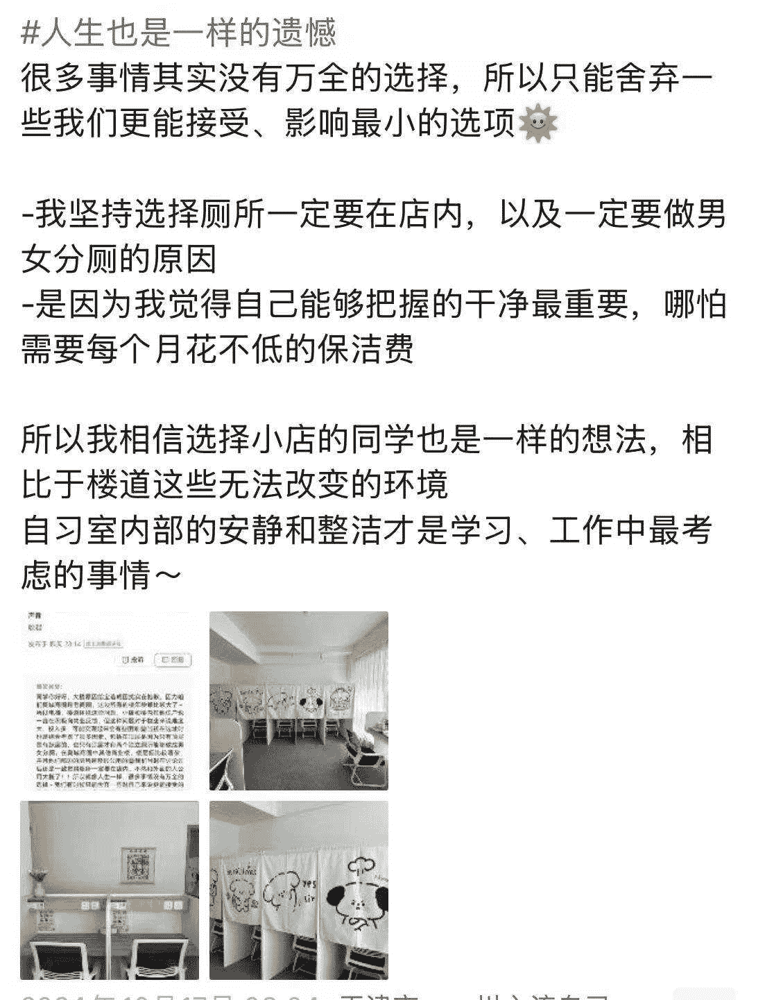
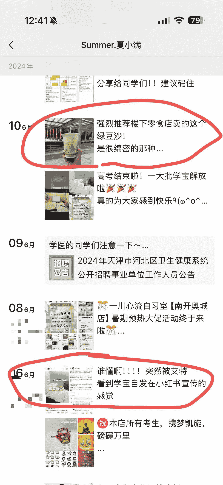
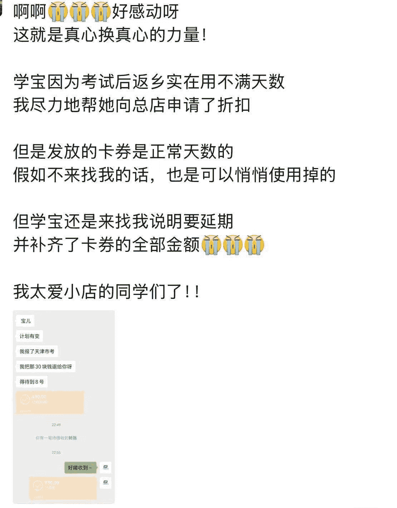
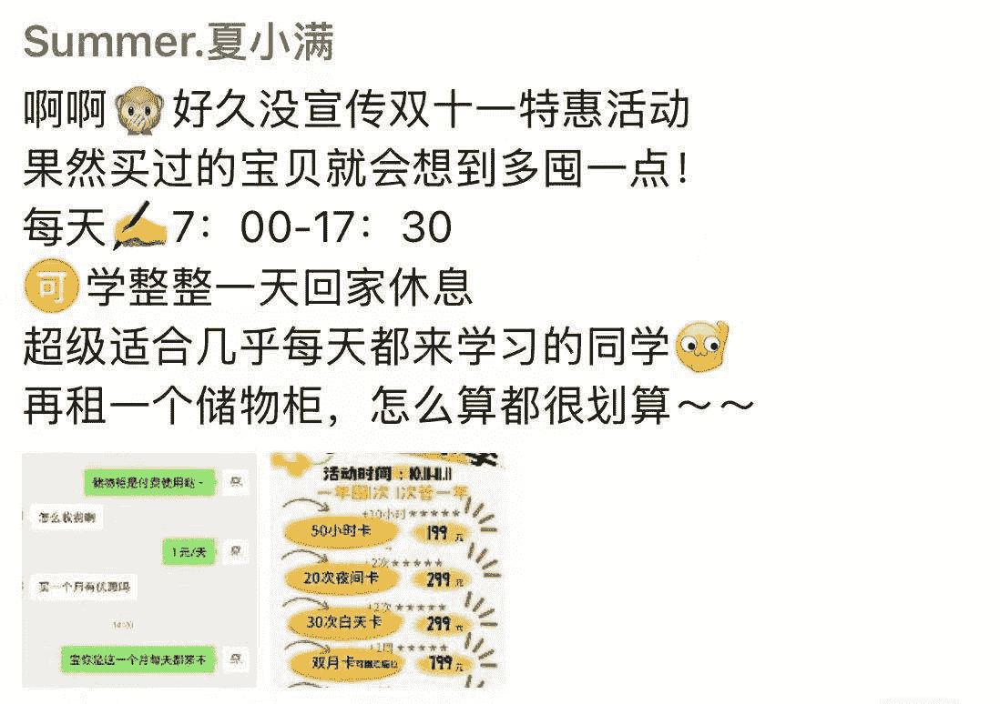
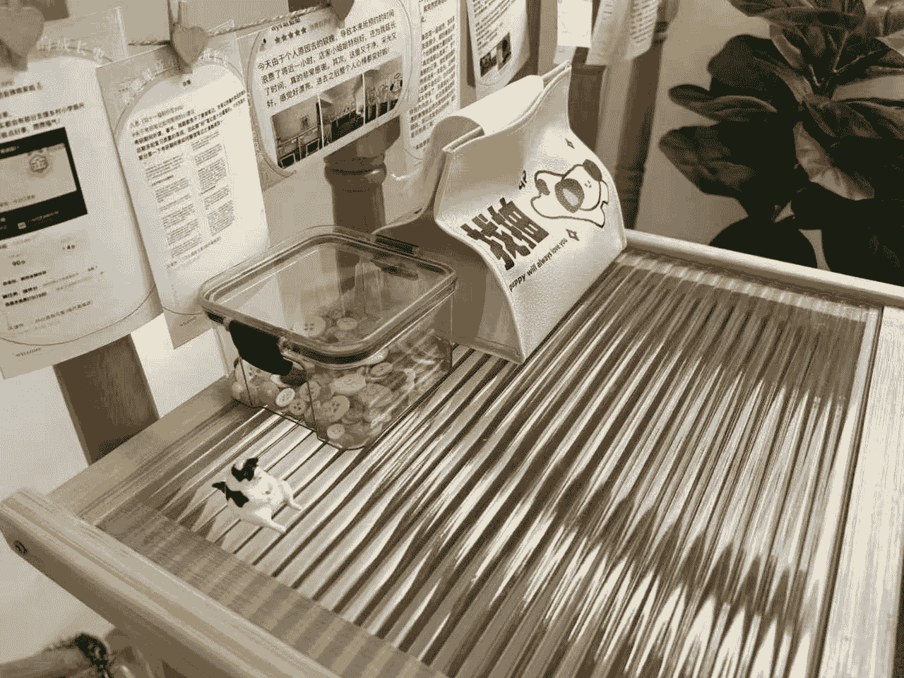

# 无人实体店获客难题，纯免费流量年 GMV15 万，全流程 AI 自动化复盘

一间30个座位的无人自习室，一年做到15万流水，还拿过美团金牌商家，但最后还是关门了。听起来很矛盾？看完这篇复盘你就明白，流量和赚钱，从来不是一回事。

先说说我的背景。开店前我一直在做内容副业，👸号流量主、📕博主都跑通过，还接过轻奢品牌的广告。当时我也晒过一些成绩：

可做得越久越焦虑：流量看似热闹，却很难沉淀成自己的资产。发一篇笔记、接一条广告，时间花掉了，复利没有。于是我开始找一款能反复售卖的产品。它最好不占用我太多精力，能持续有复购，还能让我之前的内容能力变成差异化优势。

调研下来，我发现无人自习室特别合适。它是本地生活生意，但大多数传统商家根本没把内容流量玩明白；用户带着明确目的来学习，会主动搜索，不需要我疯狂推销；而且自助模式省人力，下班后完全可以兼顾。就这样，我在2023年底开了一家30座的自习室，一直经营到2025年初。

说成绩，确实有点东西：年GMV超过15万，开业仅半年，纯靠线上引流到店并加了🛰️的新客超过700人；巅峰时区域同行营业额排第二，还拿过美团金牌商家。但最终，我还是选择停业。

为什么？因为流量再漂亮，也填不满账本上的窟窿。实体店的生死线不是流量，是收支平衡。流量能帮你把人叫来，但房租、客单价、复购周期、淡旺季、平台抽佣、人工精力，这些才会告诉你到底有没有赚到钱。

我踩过最深的坑，是选址。当时我天真地以为，只要地段热闹，租金贵点无所谓，把价格定高一些就能赚回来。事实是，热闹地段的房租是成倍上涨的，但顾客的钱包不会成倍膨胀。备考人群大多收入不稳，甚至没有收入，偶尔体验一次贵价没问题，长期消费根本扛不住。贪便宜选偏僻的地方，又没自然客流，照样死。更要命的是，自习室是很依赖地理半径的生意，用户只会选离家近、方便的店，周边居民的年龄结构直接决定了你的种子用户数量。线上内容再厉害，吸引的也只能是附近三公里的人。

第二个坑是淡旺季。娱乐需求是稳定的，想吃火锅随时想吃，但学习需求是脉冲式的。考研、考公、期末冲刺期，一座难求；考试一结束，需求断崖式下跌。寒暑假、周末和工作日的数据差异，比想象中夸张得多。

第三个坑是复购周期。我以为学习是长期需求，顾客来了就会一直来。实际上，这是阶段性复购。一个人备考前可能会连续消费一两个月，考完就消失，你的营销动作又得重新洗牌。今天加了🛰️，不代表今天会买卡，可能观望一两个月才下单，也可能买完就流失。

第四个坑是隐形消耗。所谓无人店，不是真没人，只是没有店员。顾客第一次来，怎么进门、电梯卡怎么拿、设备怎么用、wifi密码是什么、退款怎么操作，全得老板在线回答。这些事看着小，但会持续打断你的工作节奏。更别提差评了，一个不满意就能影响平台上新客的判断，这压力是纯线上生意体会不到的。

既然这么多坑，为什么还能跑出成绩？因为我把获客和客服的流程尽量压缩了。流量不是万能的，但在账算不平的情况下，至少先活下来。

平台选择上，我主攻📕。它特别适合女生、学生、年轻白领这类人群，比如自习室、拍照空间、手作店、轻食店，都很容易被📕用户提前收藏。📕的逻辑是先种草后消费，首图和标题够吸引人，用户就会等有需求时回来问。抖音偏团购和即时消费，可以设一个低价套餐作为引流入口。视频号适合两类人：一类是年纪偏大、消费力强的本地客，一类是已经加了你🛰️的老客户，因为视频号离朋友圈和社群很近，天然适合做复购提醒。别一上来就铺全平台，先专注一个，跑通了再复制。

开业前，我建议发三类内容：求助型、创业型、设想型。求助型就是让用户参与你的选址、起名、选装修，评论区互动率很高；创业型是记录开店过程，但卖点一定不是“我有多努力”，而是“这个店能给你带来什么”；设想型是提前预告服务和设计，但别画大饼，要给自己留调整空间，写“正在考虑”就好。

📕具体怎么打？我给大家三个心得。第一，先模仿高赞笔记，但别急着抄，先去翻评论区。如果评论区全是同行问“怎么开店”“成本多少”，这种内容带不来顾客；真正值得学的是有人在问“地址在哪里”的笔记。学的是首图结构、标题角度、场景表达，不是照搬原文。第二，不要在笔记里直接放🛰️号、手机号，容易违规，也容易让人产生戒备。把店铺场景、价格范围、适合人群讲清楚，让用户主动来问。第三，账号里要穿插真实人设内容，比如打扫卫生、顾客反馈、开店吐槽、空间改造。很多用户问完价格就没下文，不是没兴趣，而是没信任你。信任感比单篇爆文更重要。

AI和流程化是让我少掉头发的关键。我当时用的是文本AI，主要帮我看长文档、整理素材。如果现在重新做，我会用Codex+飞书搭一个内容库：先用飞书多维表格把标题、链接、首图逻辑、点赞收藏、评论区需求存起来，再让Codex围绕“自习室”“考研自习室”“安静学习空间”等关键词去收集素材，筛选出评论区有真实顾客咨询的笔记。注意，AI只是辅助筛选，最终判断还得自己做，比如要分辨赞藏是不是同行贡献的。后面可以让Codex基于表格里的爆款结构，生成30篇本店可用的文案。我会给它明确要求：替换成真实店铺信息，标题参考角度但正文不照搬，不出现导流词，每篇标注配套首图类型和对应需求（价格、环境、安静、考研、短租等）。一天准备出一个月的图文，真的可以实现。

图片方面，别完全依赖AI生图。线下店卖的是真实空间，用户最怕“图片与实物不符”。到店一次性拍一批实景：门头、座位、窗边、桌面、灯光、饮水区、储物柜、夜间效果。发布也尽量人工，📕电脑端支持定时发布，没必要用AI自动发，账号风控风险太高。

视频也可以流程化。先下载五六个同行爆款视频，拆镜头：第一个镜头是门头？第二个是窗边座位？然后到自己的店里模仿拍。每段5到10秒，两分钟的视频大概需要12到24个片段，多拍一些备用。我当时用剪映把同行视频的语音转成字幕，替换成本店信息，再插入自己的画面，很快就能批量做出几条。更进一步，你可以把镜头素材按类型打标签放进飞书，剪片时让AI直接帮你调用。

整套链路现在总结起来就是：公域内容引流，私域沉淀，AI客服承接，朋友圈营销，到店体验，复购转化。低价团购只是入口，真正的价值是把用户沉淀到🛰️后的长期复购。

但我想再强调一遍：无人自习室看起来是“无人”，其实最考验的是老板有没有把流程设计好。如果你选择它当副业，本来就是想少占时间；可如果每天都被写文案、回消息、解释门禁、催加🛰️这些琐事淹没，它就完全背离初衷了。所以，入局之前，先静下心来算一笔账，再谈流量和自动化。账算平了，AI才能帮你放大；账算不平，AI只会帮你更快地忙乱。

先把话说透：AI 能帮你拆解镜头、起草脚本、整理字幕、编排剪辑逻辑，但真实空间的画面，永远需要你自己扛着设备去拍。做线下店的内容，更不能把门店本身藏起来。用户花钱买的是走进店里的感受，而不是看一个只会写漂亮文案的账号。

### 四、把本地生活平台的主页变成转化页面

过去一年我最大的体感是，本地生活平台的搜索入口相当稳。它不像种草社区那样大起大落。只要基础评分、团购商品、关键词和配送距离这些要素达标，几乎每天都等得到新面孔进来。

但把店铺挂上去，不等于它就会自动产生订单。这类平台的本质更像本地搜索引擎：用户带着明确意图，在附近找一家可以立刻消费的地方。她没空看品牌故事，只会快速回答自己三个问题：离我近不近？现在能不能用？花得值不值？

所以门店主页和详情页的优化重点不是漂亮，而是让客人少犹豫。

我优先动的是这几个环节。

第一，封面图。封面不要放概念海报，也别只放 logo。对以空间为卖点的店来说，用户最想看的实景是：座位怎么排、灯光亮不亮、桌面够不够宽、会不会拥挤、整体安不安静。应该直接放最能代表体验的空间照，比如座位区、窗边位、学习区。环境有优势就把环境放在最前；交通有优势就再补一张到店路线图。

第二，团购配置。价格数字必须做大、做显眼。低价能带来点击，但套餐说明含糊，客人照样犹豫。我把商品包分成两个层级：首单尝鲜和长期卡。首单尝鲜用来降低第一次到店的门槛，长期卡用来接住那些已经认可环境的客人。每个商品包都要写清楚：适合谁、时效多久、怎么预约、到店后怎么用。

这里有一个踩过坑的调整。我最早把首单体验券定为 9.9 元/3小时，平台下单转化率一直提不上去。我翻了大量同行页面，发现不少家做的都是 1 元/2小时。我把定价锚点改成同样口径后，第一次上门的客人明显变多了。

由此得到一个核心结论：实体店的引流品，不能照抄电商的逻辑。想靠后续升单做出高客单，前端的门槛就得压得足够低。我相信自己的环境足够打动人，所以首要任务是把人请进店里。只要她付出了到店的时间成本，又加上了🛰️，后续被你影响的可能性就会成倍增加。这件事比在内容平台投流更值得，因为能走到线下的人，大概率带着真实需求。

第三，商品详情页的排版。页面一进来不要急着堆促销。用户点开详情，最先要解决的是信任和使用问题。建议的顺序是：空间实拍、到店路径、优惠信息。下面是我当时挂在平台上的详情页截图。

这是开业时用的那一版，上面标注了详细地址、交通路线、门店活动、座位分布图。

尤其是无人值守型门店，第一次到店怎么进门、怎么核销、怎么用设施，这些流程必须写清楚。用户越不确定，越容易退出。

我还专门拍了一段从不同地铁口走到店门口的视频，放在平台详情里。

第四，评价与问答区。点评不只是给平台交差的，更是给新客看的转化素材。“环境安静”“桌距舒服”“店长回复快”“第一次来很顺利”这类评价，本身就是最有说服力的广告。我会把高频好评提炼出来，反哺到详情页、好友动态和线下物料。

如果评论区总有同一种问题反复出现，比如怎么进门、要不要预约、能不能临时来、有没有插座、空调凉不凉，那说明详情页没有讲透。与其一次次回复，不如把这些问题直接前置到页面上。

第五，差异化卖点。共享自习空间看起来都差不多，别写“安静舒适环境好”这种谁都会写的空话。要写能辅助判断的具体信息，例如离某个地铁口步行几分钟、靠窗座位有几个、晚上营业到几点。

平台页面做到位，解决的是点击和下单。但无人值守型门店还有一个关键问题：下单并不是终点。

### 五、让客人主动加你的🛰️

没有🛰️，后面的复购、活动触达、套餐解释、到店提醒、问题处理统统接不上。你精心设计的首单体验券，最后会变成一张纯白嫖券。

很多老板的做法是干巴巴地发一句“您好，加一下店长🛰️”。客人没有理由，当然会忽略。

我的做法是，把“不得不加”的理由嵌进使用流程里。例如我的店需要电梯卡才能进入，于是我在平台下单后的自动回复里写：“存放电梯卡的密码箱密码，添加店长🛰️获取。”这句话之所以有效，是因为它解决了客人在下一步就会遇到的麻烦。

这里有两个条件缺一不可：客人下单后，要第一时间引导加🛰️；话术里必须有一个非得通过你才能解决的问题。

不同门店可以设计各自不同的理由，例如门禁密码、预约凭证、操作指南。但千万不要为了加人而刻意制造障碍，这个理由必须真正服务到客人，否则只会招来反感。

我开业半年时，店内只有三十个座位，🛰️好友却攒到七百多人，还全是真实付费用户。这件事让我越发笃定：线下店的私域，从来不是靠一句“加我🛰️”做起来的，而是把客人最需要被帮助的那一步，放到🛰️上承接。

### 六、把个人号做成老板人设，而不是客服号

客人加入好友以后，新的问题跟着来了：不少人第一时间就屏蔽了动态；就算当时没屏蔽，看几天广告也会屏蔽。

我的策略是先改造个人号的三个门面：昵称、背景图、简介。

01 简介。当时我写的是：店名 + 有问题先查手册 + 动态不定期有优惠。“动态不定期有优惠”这句话给了用户一个暂不屏蔽的理由——她想知道：你到底会发什么优惠？

02 昵称。做活动时，我会把昵称改成：九思（xx 活动在动态）。哪怕对方早就屏蔽了我，只要打开聊天框看到昵称，也会知道现在有活动，说不准就点进去了。

03 背景图。背景图放的是营业时间和店主在线时段。这个细节非常小，但无人店格外需要。很多人默认无人店等于 24 小时客服在线，半夜发消息没被秒回就会躁，甚至直接到平台打差评。写清楚在线时段之后，因回复不及时产生的矛盾几乎清零。

04 内容结构。我从不建议做纯客服号，客服号很难做出差异化。更建议做老板人设号。并非天天灌鸡汤，而是让用户知道，这个号背后站着一个真实经营的人。

我能做到发一条动态就成交一张高客单卡券，关键是三类内容反复穿插：干货分享（避免被屏蔽）→ 店铺更新（让用户提意见）→ 人设分享（和用户拉近关系）→ 营销转化（信任到位后自然出单）。

第一类，干货分享。这类内容最大的作用是防止被屏蔽，让用户觉得你的动态有养分，偶尔还想主动翻一翻：

第二类，店铺更新和人设分享。店铺更新包括装修升级、日常保洁、服务调整、根据用户反馈做出的改进。内容要有真实场景，让客人看到这家店一直在用心维护：

人设分享则包括开店故事、行业见闻、日常吐槽、经营感悟、用户带来的暖心反馈。适当吐槽反而比完美形象更接地气：

还可以顺手给店铺“上价值”，例如反复夸自己的客人善良、真诚、自律。没有到过店的用户看久了，会觉得这里的人都很好相处，对你的态度也会更友善；同时，看到别人这么认真，那些还没买卡的人多少会产生一点紧迫感：

第三类，营销内容。例如优惠活动、卡券介绍、套餐差异、截止时间。但别只写“快来买”。要站在客人的角度说清楚：这个套餐适合什么人、哪些人不必买、活动什么时候结束。最好配一张和用户的聊天截图，用用户的原话去表达活动力度：

那段时间，这类动态几乎发出就能成单，客单价普遍在 499～2000 元。

还有一个容易被忽略的位置：评论区。长文动态会被系统折叠，我会把正文里的重点句拆成一条条评论。这样客人不用点“全文”也能看到核心信息。评论区就像天然的高亮区，有时候比正文还抢眼。

### 七、先攒素材，再做自动推送

很多店主每天都在愁“今天发什么”。日更一条都难，更别提每天三条。但好友动态运营偏偏依赖长期输出，用户的购买习惯不是靠一条促销养成的。有人今天加你，可能下个月才买卡，甚至出现过 4 月加好友、12 月才下单的情况。

所以动态内容不能总指望临时灵感。我采用的思路是先建素材池。

素材可以从这些方向收集：同行在种草平台的爆款笔记；本地生活平台上对手点评里透出的真实需求；自家门店被反复询问的问题；用户好评与反馈；往期活动记录；价目表；日常保洁、维护、改造时拍下的照片。

把这些素材集中到一起，再交给 AI 做二次加工，效果远好过让它凭空编内容。

我习惯先整理一份门店基础资料，把地址、营业时间、价格、套餐、目标人群、门禁规则、退费规则、安静公约、手册链接全部放进去。然后把同行文案和这份资料一起投喂给 AI，让它生成适合自家调性的动态。

这里说的不是复制同行，而是借鉴对方的叙事角度，换成自己的真实经营信息。动态没有公域限流压力，重复容忍度比较高，做到三个月内没有明显雷同，基本就够了。

节日活动也可以提前布置。让 AI 拉一遍全年重要节日清单，再配上价目表，就能排出一年的活动节奏。

最近我还试过用 AI 配合设计工具批量产出营销海报，具体方法在我的历史文章里写过：mp.weixin.qq.com

但决策终究要老板自己拍板。AI 能排期、能拟稿，却不能判断某个折扣会不会亏钱、用户会不会觉得被套路、套餐是不是足够清晰。这些账，只有老板自己算得清。

自动化成交的前提，是把购买路径简化到极致。用户看完一条动态，应该马上明白：买什么、多少钱、找谁买。如果还要来来回回问半天，那这条动态就没有完成它该干的活。

### 八、把重复客服问题挡在手册之外

最近的项目里，我用 AI 编程做了一个🛰️客服自动回复的小工具，也解决了 AI 思考太久导致无法秒回的问题，有需要的朋友欢迎来交流。

更早之前，我是靠一本自助手册保住了自己的精力。

无人值守店最耗人的环节，往往不是获客，而是客服。客人站在门口不知道怎么进，每个人都要来问一遍，老板早晚会崩。雇一个专职客服？我做的是无人生意，再背一份人工成本，实在不划算。

我的解法是用在线文档做出一本门店操作指南，里面写清到店前、到店中、使用后大概率遇到的各种问题：怎么导航、怎么开门、Wi-Fi 密码、空调在哪里、用完要不要归位……

从平台把用户加到🛰️后，我会把手册链接设为自动回复。加完好友立刻发出去，再补一句：“第一次来的话，先看手册，大部分问题里面都有答案。”

起初我也担心没人愿意点。但实践下来，会主动选无人店的人，大多不喜欢麻烦别人。除了少数年纪大的用户，多数人都乐于自己看说明。就算有人一开始还是来问我，一旦我没有秒回，她急着解决问题，最后也会自己打开链接。等我再回复时，她往往说的是：“已经弄好了，谢谢。”

这件事让我想明白：用户需要的不是秒回，而是问题被解决。只要能高效解决她的麻烦，回得快不快反而没那么重要。

手册不是冷冰冰地把人推开，而是替你先答掉 80% 的重复问题，让你只去处理真正特殊的状况。对无人店老板来说，注意力本身就是成本。

### 九、把线上信任证据搬进线下空间

后来我发现一个现象：用户从加🛰️到第一次买高价卡，中间往往隔了很久。短一点是一个月，长一点的话，4 月加的好友可能拖到 12 月才下单。这里面有用户自己的节奏，也有一个重要变量——信任需要时间养成。

🛰️动态能传递信任，但动态是按时间轴往下滚的。刚加来的用户，很难一口气翻完你过去几个月的内容。

我于是开始琢磨：能不能把动态里那些按时间排列的内容，横向铺到用户真正会停留的空间里？

灵感来自培训机构的评价墙。我的店里原本有一面便利贴打卡墙，但线上大量真实好评和经营记录，用便利贴根本展示不完。

后来我把部分动态内容、用户反馈、经营理念、服务说明打印出来，贴到休息区、饮水区、就餐区、高频座位附近。这些区域很适合做轻量宣传。用户接水、吃饭、歇脚时，总要停上一会儿。你不用逼她看，她只是随手扫一眼，就能看到这家店过去做过什么、用户如何评价、老板为什么这样经营。

实践了三个月，我能明显感到首次到店就买高价卡的人多起来了。新用户和我聊天时的态度也更友好，反馈更正向。

这不是几张纸有了魔力，而是我把原本散在动态里的信任证据，平移到了用户正身处其中的空间里。她一边坐着，一边看到别人的真实评价，自然而然会把“线上看到的宣传”和“线下正在体验的感受”连成一条线。

### 十、这套打法适合哪些店

要是你开的是无人值守型线下店，这套方法会比较好用。尤其是这个特征特别明显的品类：用户先在线搜索、做好判断再上门：

例如共享自习空间、共享办公小隔间、舞蹈室、共享茶室、棋牌室、轻运动空间、手作体验店，都可以参考。

但那些完全依赖自然客流、用户即买即走、几乎不回头的生意，没有沉淀🛰️关系的必要，这套玩法的价值也会大幅缩水。

还有一种情况也不适合：产品体验本身很弱，却急着上自动化。自动化放大的是你已有的体验。环境差、价格模糊、服务不稳、第一次到店就不舒服，内容发得越多，问题反而暴露得越快。

最后一种不适合的是：老板自己不愿意整理真实素材，只想让 AI 天天编。线下店终归要见真人，用户一到现场，就能看穿你的图是不是照骗、文案是不是空话、服务是否对得上。

AI 更擅长归纳、重写、排期和复用，但它永远替代不了真实的经营。

### 十一、如果能重开一家店，我会这样搭

第一步，建立门店信息底稿。地址、营业时间、价格、套餐、规则、服务项、常见问题、门禁方式、客服时段，全部收进一份文档。这份底稿以后是所有 AI 处理的事实来源。

第二步，搭同行素材库。用 Codex 搜关键词、拆爆款笔记、提取封面结构、记录评论区真实需求，统一沉淀到表格工具里。

第三步，产出整月内容。让 Codex 基于素材库和门店信息，生出一整个月的种草平台文案，并标注每篇适合搭配什么图。

第四步，一次性拍齐线下素材。按门头、座位、桌面、灯光、水吧、休息区、安静氛围、评价墙这些类别分别拍摄。

第五步，搭视频分镜库。拆解同行视频的镜头类型，列出可复用的分镜清单，再用自己的素材去模仿。

第六步，配置平台自动回复和🛰️承接话术。不要只写“加店长🛰️”，要给出用户当下就需要的东西，例如门禁、手册、预约确认。

第七步，布置🛰️自动回复和自助手册。把 80% 的高频问题写进手册，让 AI 能理解，用户能自助解决。

第八步，建好友动态内容库。按店铺更新、人设分享、营销活动三类归档，再配合全年节日表提前备料。

第九步，把线上信任证据搬到线下。将好评、服务说明、经营理念、用户反馈做成店内陈列，让首次到店的用户更快放下防备。

这套流程看起来不少，但真正的好处是能复利。系统搭好之后，你不是每天从零开始想“发什么”，而是在库里抽取、调整、发布、复盘。这或许才是无人值守店更合适的运营方式。

### 十二、写在最后：不劝你入局，但我感谢这段路

2024 年到 2025 年，我一直在默默经营这间小小的共享自习空间。一边复盘一边修正，把互联网上学到的方法一点一点落到真实门店里。

这家店曾经凭 30 个座位做到同行中的营业额第二，也在天津有了一点名气，还拿过金牌商家。

但最后，它还是停业了。

这个项目不适合作“普通人副业轻松赚钱”的叙事模板。线下生意背着房租、运维、淡旺季、用户体验和长期支出，哪怕运营做得不错，最终账面回报也未必值得继续。

但我依然感谢它。24 岁那年，我用几万块的投入换回了一段几乎无法复刻的真实商业经验。

我也更早认清了一件事：AI 在小型实体生意里真正的大用处，不是替你写出漂亮的文案，而是把那些每天重复、每周重复、每月重复的环节，固化成流程。

该老板拍板的地方，老板来拍板。该工具反复执行的地方，交给工具。该用户自己解决的地方，提前写成指南。该被用户看到的信任凭证，就不要只躺在动态里。

这套认知，比任何一个具体工具都重要。

————分割线————

看完这篇复盘，你可能觉得自己已经会了。可等到真正动手，九成的人都会卡在第一步。

工具和教程只是最浅的门槛。真正的分水岭，是“现在就去执行”和“信息差”。

想看最新的变现玩法，也想和一群执行力很强的同频人一起拿结果，欢迎加入我的私域圈子：【懒人专属群】。

这里不聊空话，只拆商业闭环、压榨 AI 生产力。圈内已经沉淀了 1000+ 跑通的套利实战案例。

👉 了解圈子的完整数字资产与加入方式：

https://lazyso.com/insider/

认可价值、准备好下场的朋友，扫码添加🛰️（lazyhelper1）

提示：【实操上车】，全程干货直给

