# ('贴图养号，文章赚钱，公众号新手**30**天', (7, 29))

不写原创，靠图片帖冷启+文字稿变现，新手30天做到7000+的复盘

各位好，我是清歌，来自生财社群。今天把一套我已经跑通的公号赚钱法完整分享出来：先用图片帖给新号做初始流量测试，再换成文字稿接广告分成。你只要照着复制，就能上手出结果。

这套思路源于澄心分享的图片帖玩法，我在后面又加了一层文字稿变现。前5天只发图片帖，帮账号跨过刚注册没有权重的尴尬期，顺利进入推荐池子；第6天起改为正式图文内容，后续的稿子就能享受到额外的系统助推。文字稿的广告转化数据明显好过图片帖，因此我把图片帖当作起步燃料，把文字稿当作收入主力。

一、流量分成的基础常识

(一) 钱从哪里赚

公号开通流量分成权限后，发出的每篇内容都会自动挂上推广组件，被阅读得越多，分成就越多。单次点击的价格也并非恒定——推送的广告类别、读者的群体特征都会影响报价。单价高，收入自然水涨船高。

一个小窍门：想拉高广告单价，关键在于增加广告位。以超过600字的稿子为例，正文中间会自动插一条广告，评论区再留一条，文末再挂一条，一共就是3个曝光点。评论区的广告需要有人留言才会显示，自己动手评一句就能把它激活。

稿子长度各有取舍：篇幅长的，能塞更多的广告位；篇幅短的，读者点进来一眼就能看到底部广告，曝光效率反而更高。

(二) 钱怎么取出来

在网页版微信公众平台后台上，进入流量分成板块把收款信息登记好，腾讯每隔半个月就会结算一次，自动汇入你的银行卡。

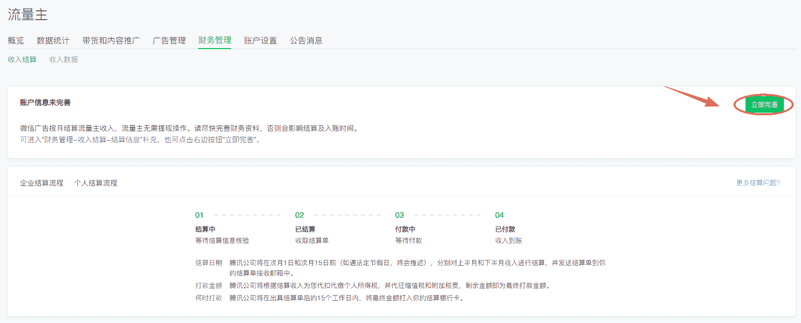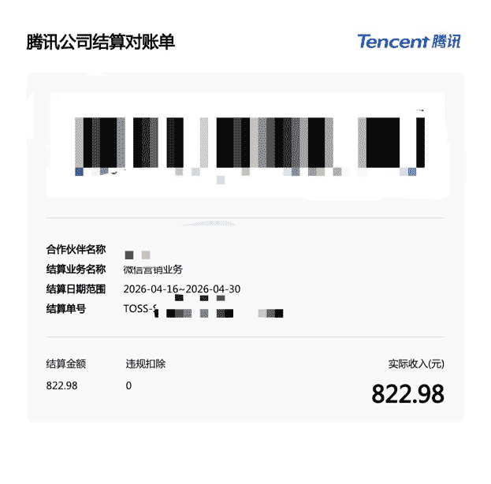

二、注册号与预热，还有几条避坑建议

(一) 完成注册

每张身份证只能绑定一个公号的流量分成资格。想握有10个号，就需要10张身份证。号源不够时，可以请亲友帮忙注册并实名。超过5个号的话，建议借助比特浏览器配合独立IP操作；5个以内，谷歌浏览器多开几个页面就够了。

单个号的操作流程：先把微信官方的管理应用装好，通过微信登录并完成实名。接着找靠谱渠道花几块钱补足100个粉丝，粉丝数一到，流量分成自动开启。如果手里超过两个号，就用电脑网页版多开浏览器管理。

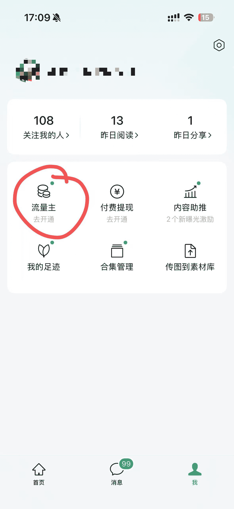

(二) 预热期怎么操作

① 新号需要先做流量激活测试：每天发1条图片帖，连发5天，一天都不要断。图片数量我通常控制在3到5张。第1天把图片帖发完，就可以顺手去补粉。

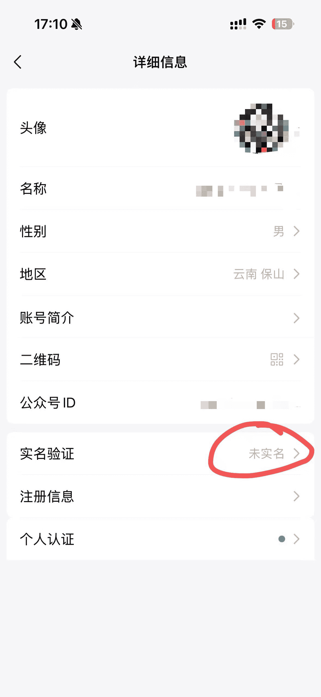

这段时间如果某条图片帖爆了，可以先赚一波图片广告的收入；没爆也没关系，第6天正常切换到文字稿方向。图片帖的题材和后面文字稿的领域不用对齐，两者独立运作。

② 图片帖素材从哪里来：在微信官方管理应用或电脑端后台点发布即可。内容需要自己去找，最常见的方式是从小红书、抖音的图文内容里挑素材，再加工一次。题材不限，汽车、美甲、三农、风景都可以；若想冲高推荐量，就选那些争议性强的话题图。另外图片帖必须带上标题和文案再发。

③ 图片帖的本质作用：给新号暖场，把账号的初始权重推上去。权重上去了，破池就发生了，之后发正式稿子会明显感受到系统给的流量扶持。数据上，图片帖只要单条阅读维持在50以上就算健康；最糟的是连续出现0或者1的播放，一旦多条图片帖都卡在零播放和一播放之间，说明素材有问题或者账号本身被降权了，这时候把号注销了重新开最好。记住，公号账号并不值钱，别舍不得。

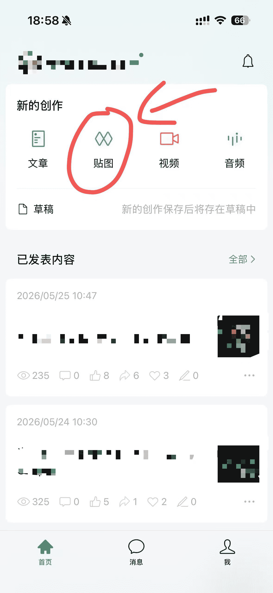

(三) 预热成功后怎么发稿

① 先学改编，这是最低门槛的路。凡是做爆文的，都是去找当前最热门的话题，然后做一比一的复刻。新手千万不要碰纯原创！我翻过很多平台，目前只有今日头条的内容最适合拿来改编。

② 电脑打开今日头条的官网，界面上会列出许多内容分区。勾选对应分区，就能刷到大量刚发布的新稿子，这些稿子的阅读量和点赞普遍很高。假如你的网感不错，可以自己筛选一遍再改编；假如判断力还没建立，就直接选“最新+点赞高”的稿子动手。

板块方面，我推荐三个：科技、热点、历史。

如果你的号已经发了好几篇改编稿，并且连续

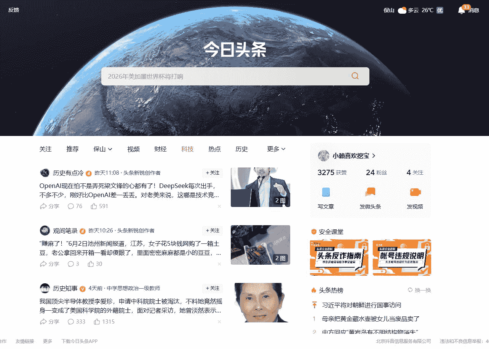

出现的单篇阅读都能破千，你可以选择对应的头条分区继续改编。或者去那个爆款原作者的主页逛一逛，把他其他的高赞作品也拿过来改编。

③ 一比一改编时要怎么做：把原文文字直接复制到公号后台粘贴，图片也一张张保存。如果图片带了水印，记得保存后把它裁掉。遇到特别满意的博主，可以关注起来，持续追踪他的高赞内容。

刚开始不知道哪个赛道流量好，你就单个号只测一个赛道，三个号就同时测三个赛道，千万别反复横跳，否则账号不垂直。等测试出哪个方向表现最好，所有号再统一换成那个方向。

④ 发文频率怎么控制：第1天到第5天一律发图片帖，这几天全在养号。第6天起切换到正式文字稿，注意发布时要选“文章”，不是“图片帖”。多号操作如果用的网页版，每3天会掉线一次，需要重新扫码登录。

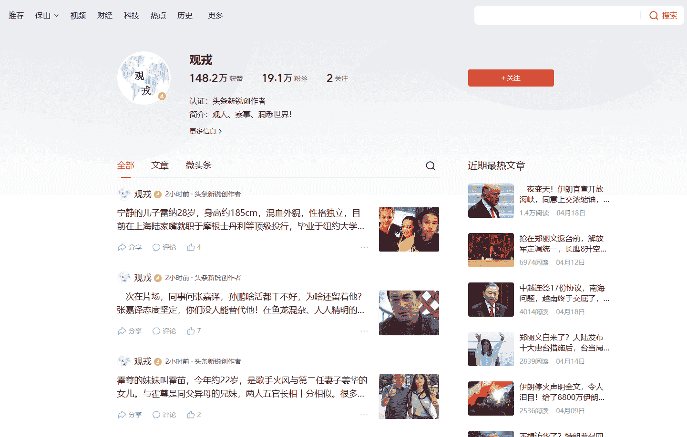

还有，初次发稿前记得关掉“群发保护”，否则以后每次发布都要扫码，非常耗时间，这个开关务必要设好。

正常情况下每天发1篇就够了；如果当天流量很好，阅读能破万，可以加到2篇。假如当天首篇稿子的阅读破万，强烈建议拿同样的标题让豆包再生成一篇新内容，大概率能再爆一次。

(四) 怎么选赛道与平台优势

刚开号时，很多人纠结领域选择。我次序推荐：历史、热点、科技、情感。这些赛道没有绝对的优劣——没有最好的赛道，只有最好的标题。标题起得漂亮，点击率自然节节攀升，内容稍微弱一点也没关系。实在拿不准就选历史，历史类内容覆盖面最广，最符合公号读者的口味。

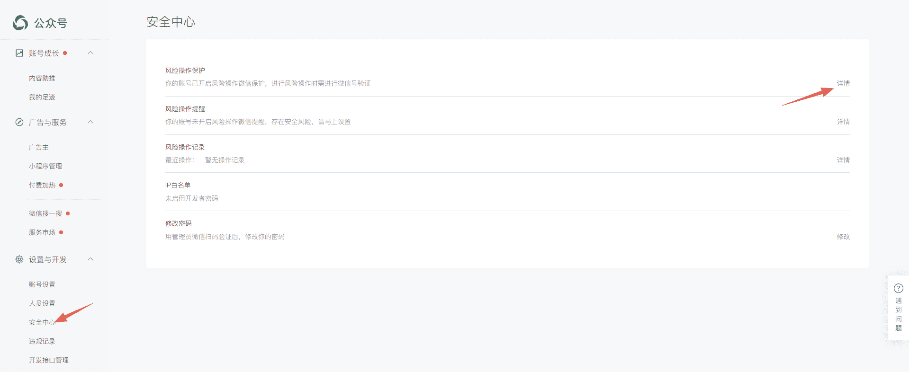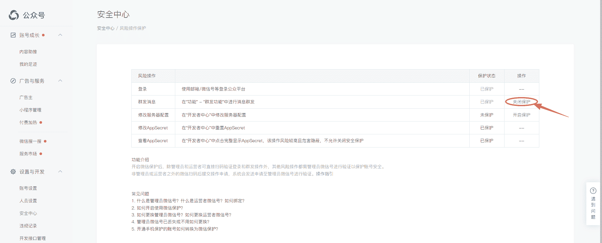

我还刷到过有的同行把AI生成的内容包括所有提示词原件直接粘贴发布，照样能跑出十万加的阅读。

三、避开违规雷区，让号活得更久

(一) 防违规的操作细节

① 一比一发布改编稿时，务必勾上“原创声明”。

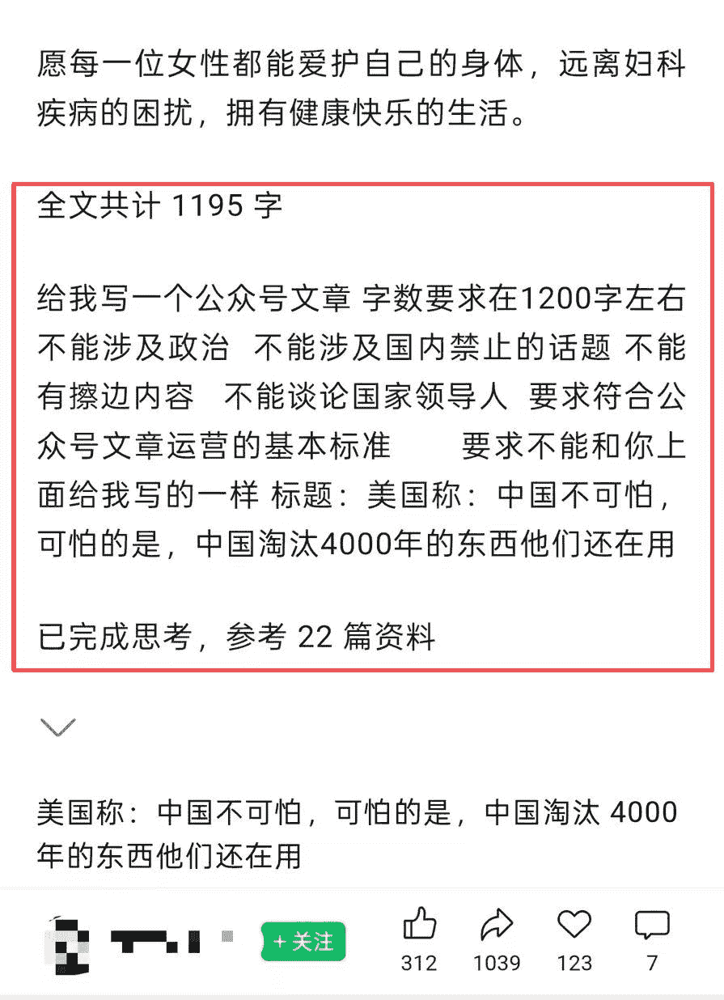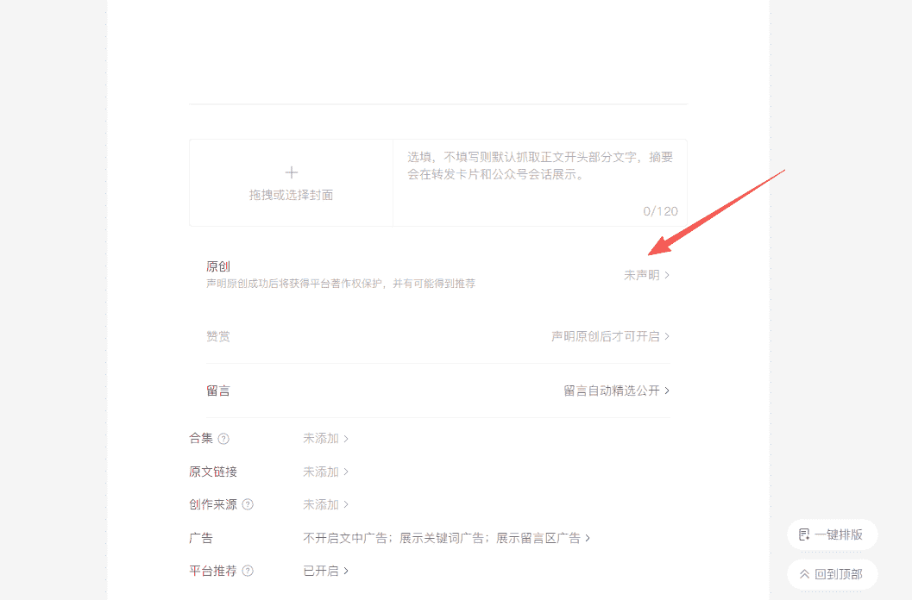

勾选后，系统会检测有没有人发过同款内容，一旦有人抢发，就会提示你不是原创、不建议发布。这样一来，它就成了一个手动查重工具。当你确定这篇文章没人用过，勾不勾选其实影响不大，我实测不会改变账号流量。把它当作查重开关即可。

② 广告选项务必设好

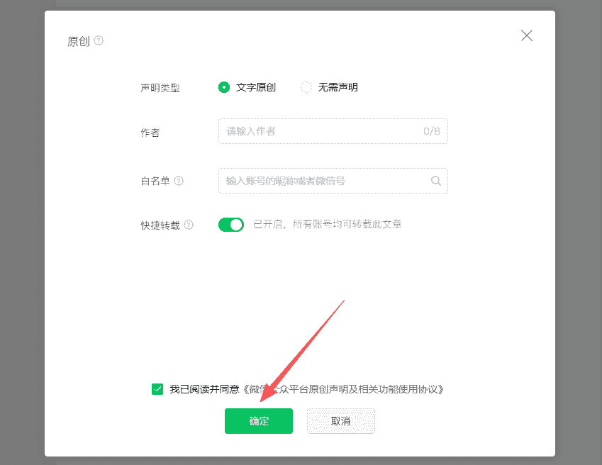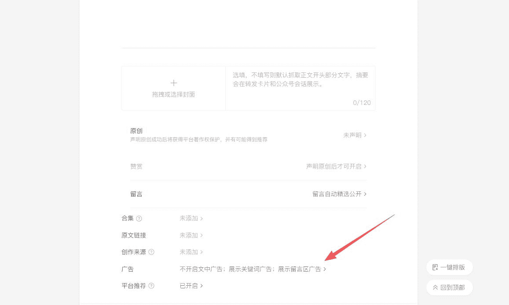

原创声明下方有一个广告按钮，初次发稿时一定要打开它，选择“智能插入”，并把全部类目都勾上，最后确认。这样往后发布新内容时，广告会自动挂载，不需要每次去手动调整。而且平台会根据文章的读者画像匹配最合适的广告，有利于提升广告点击转化。（如果你的图片帖也想挂广告，需要先开通流量分成权限，然后在发布图片帖时同样设置好一次，以后就自动生效了。）

③ 什么内容不能发？

政治类内容绝对不能碰，尤其是涉台政治言论——我在这上面栽过跟头，一旦收到警告，整个号的流量就会崩掉。

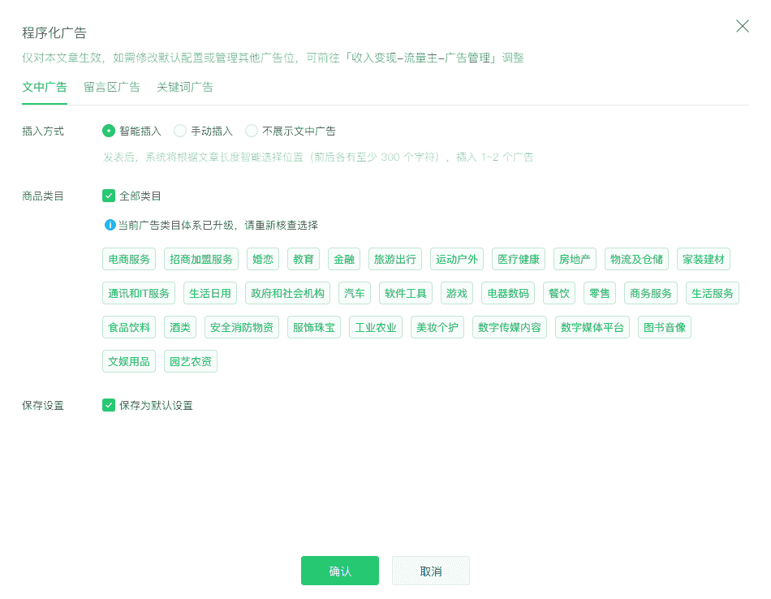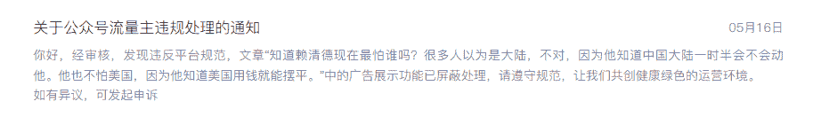

另外，三观不正、无脑黑的文章也不能复刻。我们只能去追那些阳光的热点，比如张雪机车在国外参赛不断夺冠的话题，这类正能量的内容发起来很安全。

(二) 哪些情况建议直接换号

① 连续几篇文章的阅读都低于300，基本后面跑不起来了，这种情况可以直接注销重开。我自己的判断流程是：先发垂直内容测试，如果垂直方向一直没反应、但还零星有点流量，那就换个题材再试；如果换完还是没过百，就立刻注销。这里有个细节：点了注销后会有7天冷静期。在手机端微信公众号主页下方点“立即注销”，就能跳过等待，做到真正的秒注销秒注册。

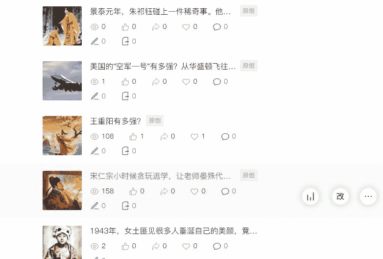

② 还有一种场景：账号曾经爆过流量，后面突然不行了。比如说图片帖发了5天，前两篇一比一改编稿都有不错的阅读，但从第三篇开始数据一路走低——这种情况我同样是直接注销重来。有时候连续3到5篇新稿都跑不起来，也已经到了放弃的临界点。因为新号前期的系统扶持流量是最值钱的，老号继续耗下去毫无意义。

③ 什么情况下号可以长期用？图片帖转文章后，只要每天内容的阅读稳在1000以上，就可以固定一个方向持续做。

举个例子：我手里有个专做影评的号，专发电视剧《密语纪》的剧情解析和剧透，阅读长期维持在3000左右，后来还跑出来一个不小的爆款。每天都有广告收入进账，还可以慢慢等大爆。

我第一次让文章爆掉，做的就是那部热播剧的影评。当时这部剧正火，我一边让AI帮忙起标题，一边改编同行的爆款标题。如果你对某部剧特别熟，影评赛道非常值得做，经典剧集比如甄嬛传、我的前半生、《知否》系列都行。尽量坚持一种内容类型，科技号就一直做科技，历史号就一直做历史，自然流的图文这样才有长期价值。

四、除了改编，还有哪些内容生产方式

(一) 打造专属于你的AI出稿助理

① 提示词是核心

前面提到过，如果一比一的改编稿爆了，用它的标题让AI再写一篇，大概率还会爆。这里直接给出一段提示词：

https://www.doubao.com/thread/w7916d3d5ba1f8ccf

点开这个链接，是我在豆包上调试好的模板，你只需把框里的三篇示例文章换成任意博主的三篇高赞稿（头条、公号都可以），AI就会自动按照那位博主的风格给你生成新文章。任何AI工具都能用，豆包、元宝、Kimi、GPT等不限。

这么做的优点是：大家拿到手的文章原创度都很高，而且想要什么风格就能调出什么风格。

② 对AI生成的内容不满意一定要提要求

一比一的改编稿爆了之后，复制标题丢给训练好的AI出文。如果输出的内容你不满意，就让它直接改，并且提醒它下次别犯同样的低级错误。沟通得越细，AI对你公号的帮助会越来越大。

(二) AI出稿助手的进阶用法

① 批量找标题，批量产爆文

去头条复刻爆款文章是新手获取网感最快的路径。当你爆过几篇之后，就会很清楚什么样的内容受欢迎。除了把爆过的文章喂给AI，我们

还可以直接在头条找适合的爆款标题，批量派给AI生成完整文章。因为一比一的改编做久了，平台会对账号做出限制，账号的流量周期就会变短。所以后期我更建议转向AI批量出文。爆款标题占据绝对核心地位——一个标题可以反复引爆内容，甚至可以一字不改地复用，但内容每篇都要换新的。前期用改编练网感，后期靠AI放量。

② 批量出文的几个注意点

提示词可以反复用，也可以制作出多套不同风格的提示词产品。每个被投喂出来的AI助手，顶多分给三五个号共用。因为同一套文风用太多号，很容易被系统判定为同质化。号到了一定数量，就要训练不同风格的AI助手来分配使用。

五、公号冷知识与整体复盘

(一) 后半夜发布，数据更惊喜

我记得澄心好像也分享过这一点，而且不能使用定时发布。我通常把发布时间放在凌晨2点到5点之间，先把要发的内容存草稿，定个闹钟起来手动发。凌晨时段的数据就是比白天好，爆文的概率也更高。

(二) 图文内容与图片帖的转化对比

图文的广告转化普遍更高，上限可以做到1万阅读100元以上的收入，常规水平也在1万阅读50元左右。这跟读者群体的属性强相关，同时也和广告被点击的次数挂钩。图片帖的阅读量更容易冲高，但分成单价偏低；图文虽然冲高有难度，但转化回报更好。两套玩法互不打扰，都值得做。

(三) 短期流和长期流怎么选

我自己做的是短期废号流派：号对我来说不重要，注册、注销都是秒级完成的事。所以账号流量不好或者被处罚，完全不需要影响心态。号出问题，直接注销，下一秒就能注册一个新号，新号依然能拿到系统的初始助推。本质上，我们赚的就是新号启动期的红利。如果账号流量持续强势，就保持每天更新；如果流量疲软、持续性不行，就注销重开。号越多，收入天花板越高，（有能

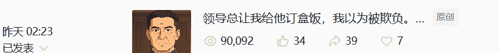

力的可以多铺几个号。）

我的账号基本没有一夜大爆的现象，收益来自许多个小爆款的叠加。所以跟着这套流程走，赚到钱是大概率事件；要搏大爆，还需要更精细的运营外加一点运气。大家也不用担心流量机制变动——每次变动都会洗掉一批人，也会给留下来的人留下更多机会。

(四) 我的自我复盘

① 账号情况：目前我一共运营6个公号，号源来自于父母和朋友帮忙注册，绑定的收款卡也是他们名下的。我没有用代收款，他们提现后转给我即可。如果想用自己的卡收款，签一份代收款协议就行。

② 初期的真实状态：刚接触这个项目时我很头疼，毕竟从没做过图文类项目，总觉得这是自己的短板。起初发的几篇文章数据都很难看，只能不断尝试各种题材。直到首篇爆文出现，你才真的知道什么样的内容是好内容。另外，每天雷打不动地刷同行的爆款，也是积累网感的好方法；复刻他们的热门标题，同样能打开局面。

③ 做好公号的秘诀是什么：上手之后我发现，做公号和做视频平台的逻辑是一样的。所有互联网项目的爆款因素都相通。我把视频领域积累的经验搬到图文领域，爆文逻辑完全一致，甚至还能连爆。暖号、推流的机制也都是互通的。

我强烈建议多注册几个号：号多了，容错率高，爆的概率也更高。前期单个号测一个方向，六个号能测出六个方向；知道哪个方向流量好之后，下一批新号就集中押注那个方向。

等到你有了网感、也有了稳定的出稿能力（这些都需要时间累积），再用多号矩阵加持，公号就等于是你的自动取款机，每月固定领工资。这套能力，以后做其他互联网项目也用得上。

④ 怎样找对标账号和刷热门内容？

打开手机微信端的订阅号频道，你想做什么板块，就直接搜对应的标题和关键词。不知道怎么搜的话，先去头条找到爆款标题，再到公众号搜索同样的标题。

这样做的意义在于：喂给系统你的兴趣信号，之后它就会不断推荐同类型的热门给你，这是最精准的热门推送。以后每次点进公众号，平台都会自动推送最新、最热的低粉爆款，看到这类内容要格外留意——因为它们拿去改编后，特别容易发生二次爆。

手册到这里就全部结束了，感谢大家的阅读。

————分割线————

读完整份SOP，你可能觉得已经懂了。但现实是，九成的人会在落地第一步就卡住。

工具和教程远远不是核心壁垒，真正的差距在于“立即执行”和“圈层信息差”。

想围观全网最新的变现打法，和一群执行力极强的极客一起拿结果，欢迎加入我的核心私域：【懒人专属群】。

我们不聊空话，专注商业闭环拆解与AI效率的极致挖掘。社群里已经沉淀了1000多个跑通的套利实战案例。

👉 查看圈子完整数字资产与入场要求：

https://lazyso.com/insider/

认可价值、准备下场实干的朋友，扫码加我微信：lazyhelper1。

备注【实操上车】，不闲聊。

