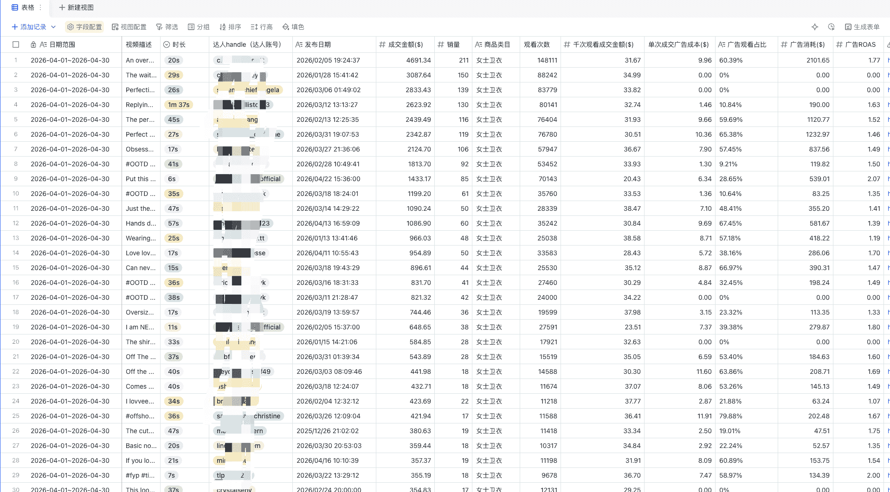
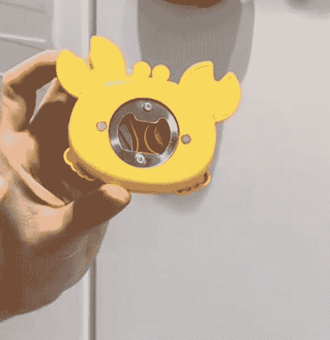
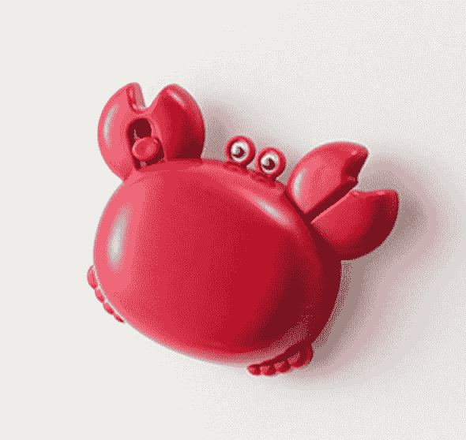
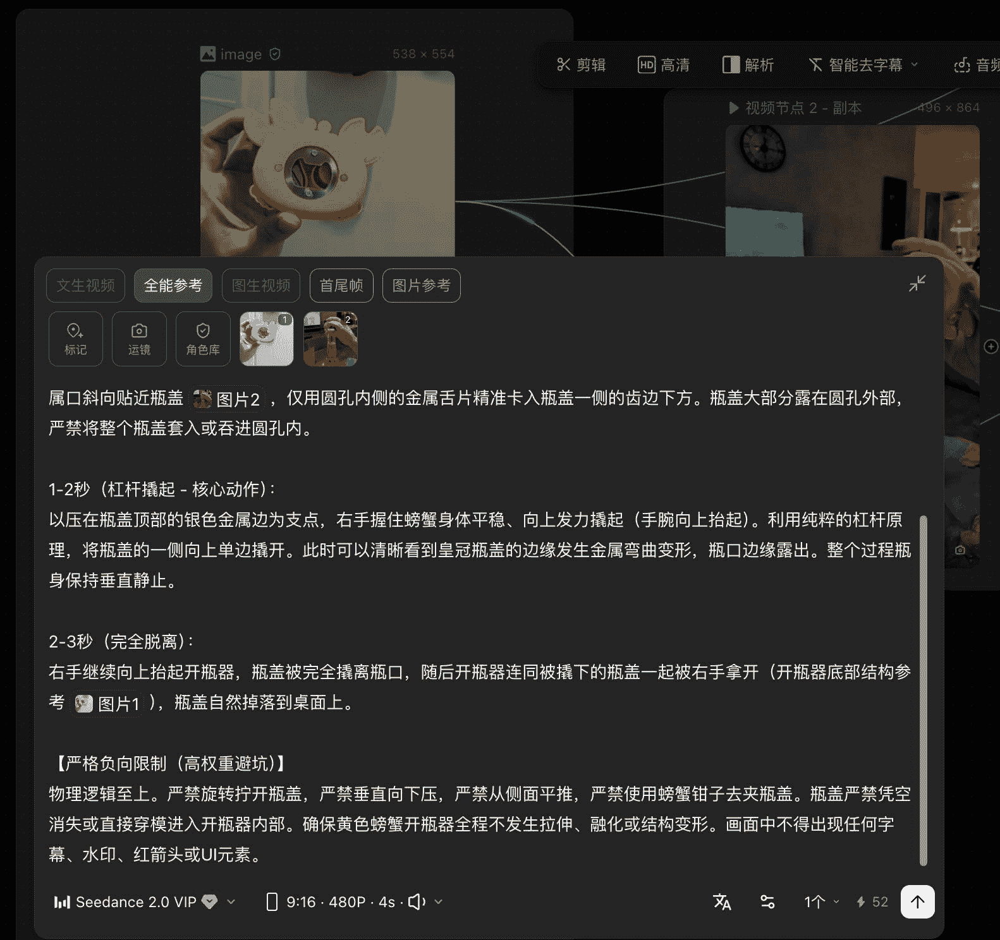

# 两年交付近千条AI短片后，我重新理解了AI内容生意
作者：龙哥

> 这篇文章不罗列提示词，只讲我如何把AI影像做成一门能反复复购的B端业务。如果你也在做类似的事，或许能避开几条弯路。

入行两年，我们团队服务过的需求方超过十家，累计交付成片接近一千条。主营业务以AI影像为主，一条线是电商带货类短片的代工，另一条是账号内容托管。合作方大多来自跨境电商圈，包括TikTok卖家、独立站运营者和亚马逊商家，也有不少做国内抖音的团队。

常见交付形态大致如下：

- 面向独立站和Meta平台的测试性广告素材
- TikTok内的带货型短视频
- 亚马逊SBV或站内商品介绍短片

- 抖音及其他国内信息流渠道的广告内容
- 需要长期更新的账号托管内容

主力工具方面，Gemini承担了大量视频拆解与创意沉淀，GPT用来生成素材，Codex协助处理部分制作难题。视频生成主要依赖Libtv上的seedance2.0和klingO3，两个模型各有优势。

跑通整个业务流程后，我最大的感受是：AI商业内容并不是“会几个模型就能交付”的生意。拆开看，至少要具备五种能力。

第一，资源判断力。需求方进来时，不能只看订单量，还要判断他的品类、渠道、现有素材、预算范围和验收方式适不适合AI完成。第二，编导能力。要把卖点转化为具体情境、动作、人物、口播流程和购买理由，同时能搭上当下的爆款叙事。第三，制作功底。提示词怎么写、底图怎么控制、人物一致性怎么保持、模型怎么取舍、抽到什么程度该放弃，都直接影响成本。第四，项目统筹。两条试做与一百条批量交付的难度完全不同，后者需要清晰的客户管理、团队协作、数据收集和复查标准。第五，反馈闭环。需求方最终看的是素材能不能投、能不能出结果、能不能继续放量，没有数据回传，项目很容易止步于“交了一批内容”。

所以一条完整的业务动线是：线索进入→初筛判断→需求沟通会→免费试做1-2条→基准片确认→小规模裂变→百条级交付→内部质检→对接反馈→修改交付→数据复盘→下一轮测试→合适时转为年度合作。

## 一比技术更值钱的是连接能力和服务沉淀

不少同行以为，这门生意拼的是模型参数和生成技巧。技术当然重要，但不构成真正的护城河。能够直接触达核心需求方、把服务做到位，并通过一次又一次交付沉淀出可复用的方法和数据，才是更难被复制的东西。

我们也见过很多技术很强的人，始终找不到变现路径。原因往往不是能力不够，而是没有机会接触真实市场，没有被真实订单倒逼着成长。

早期我对项目的理解过于乐观，觉得无非是接需求、写方案、做图、生成、剪辑。真正跑起来才发现，每个需求方的投放目标不同，质量预期不同，时间节奏也不同，几乎每个项目都是独一无二的，前期很难标准化。

拿内容类型来举例，差异相当明显：

独立站投放内容追求快速测试新卖点、新人群和新场景，每条片子不需要完美，但要能直接拿去做实验。TikTok带货则讲究真实感，越像普通用户随手拍越好。亚马逊SBV尤其重视商品展示速度，因为用户带着明确意图进来，商品出现晚了就会流失。抖音信息流内容更依赖情绪和场景，氛围感比细节展示更重要。账号托管内容则要从经营角度考量，定位、频率、选题连贯性、数据走势都要一体规划。

我们服务过一家做工业部件的独立站，对方同时需要两种内容：一种偏海外素人分享，营造自然流量和轻种草；另一种偏投放转化，追求强烈的购买推动。这两种逻辑从根上就不一样。我们刚开始惯性沿用投放逻辑做第一种，结果第一批内容并不理想。复盘后及时切换思路，才慢慢满足对方的预期。

团队内部还会用一张判断表来区分“内容爆款”和“投放爆款”，提醒自己别把“好看”误当成“好卖”。

| 维度 | 内容爆款 | 投放爆款 |
|------|----------|----------|
| 目标 | 完播、互动 | 点击、加购、下单 |
| 商品出现时机 | 可以推后 | 通常前置 |
| 讲述方式 | 梗、反转、人设、情绪 | 问题、展示、佐证、引导 |
| 论据强度 | 可以较弱 | 必须明确 |
| 行动指令 | 可有可无 | 一般清晰 |
| 风险 | 看的人多，买的人少 | 有转化，但曝光有限 |

新朋友如果觉得抽象，可以从拆解爆款内容开始锻炼感觉。每看一条，就把画面和台词还原成骨架：钩子怎么设置，痛点怎么引出，商品怎么进入，演示动作是什么，用了哪种证明方式，情绪如何推进，最后怎么收尾。以宠物除毛刷为例，仅这一品类就能拆出多种可复用的结构。

## 二启动会做得好，后续才能省力

需求沟通会做得越扎实，后面生产越顺畅。我们把一整套问询清单整理成了文档，这些问题的底层逻辑只有一个：如何把需求方那些模糊的、感受性的表述，变成制作团队能执行的动作。

清单大概分六组。

渠道和用途：这批内容投放到哪里，独立站、TikTok、亚马逊还是抖音？自然流量还是付费买量？为了测素材还是测账号？目标带货还是品牌曝露？

商品和人群：产品当前销量如何，主力市场在哪里，目标用户是谁，为什么购买，最痛的场景是什么，需求方认知里最重要的卖点是哪条。

资料与偏好：对方可以提供产品链接、高清图、实拍图、样品、竞品内容、达人视频、用户评价吗？有没有跑过数据的老素材？有没有特别欣赏或排斥的风格？

周期与批量：先做几条试做？基准片何时确认？什么时候进入批量？每周需要多少条？覆盖哪些语言？是否要分账号、分市场？

验收标准：什么算合格，什么算返工。

数据反馈：对方能不能在试做后指出哪一秒影响了投放、哪个地方漏掉了产品重点，并且在后续提供曝光、点击、转化等数据。没有这些回传，优化只会停留在感觉层面。

这里有一段教训。某次合作中，一位做TK服装带货的甲方提了很多修改意见，有些是特别细小的物理瑕疵。我当时把精力放在争论“技术上能不能做到”上，一条条解释，结果对方觉得我们不配合，合作就此终止。后来我想通了：并不是每个甲方都理解AI的边界，争论只会让对方觉得你在推诿。遇到分歧，第一反应不是对抗，而是先接下来，再用新版本沟通，往往更高效。

## 三试做样片的价值：双向确认

我们与多数需求方的合作，都是从一两条试做内容开始的。过去我把试做当成能力证明，现在我更愿意把它看成双向筛选。

试做期间，重点看三件事。

一是看产品适不适合AI生产。我们有一份负面清单，比如复杂组装流程、对零部件展示精度要求极高、涉及材质弹性或折叠演示的产品，都很难在提示词里描述清楚。即使勉强做出来，批量裂变时也难以保证稳定。这一两条都跑不通，后续一百条的风险太大。

二是看需求方预期是否现实。对方能不能接受AI试做素材的完成度，能不能分清核心问题与边缘问题，在试做阶段就能显现。有用的反馈往往是：“这个场景不是目标用户会出现的场景”“这个卖点没讲出来”“前3秒看不懂是什么商品”。无效反馈则是：“不够真实”“不够高级”“再优化一下”，这种话只能靠不断追问才能挖出真实意图。

三是看内部生产链路是否健康。脚本、出图、生成、剪辑所有环节要做一次完整试跑，确认成本可控，否则进入量产阶段会发现压力巨大。

## 四先对齐交付标准，再谈动手

项目正式推进前，我们会花时间与需求方确认交付基准。最想表达的一句话是：AI商业短片本质上是一条电商广告测试素材，不是影视广告大片。

测试素材的意义是什么？前几秒能否留住人，痛点是否打中，卖点是否清楚，场景有没有可信度，能不能支持投放团队去验证不同变量。如果对方按TVC标准逐帧验收，那就不是一套体系，需要不同的价格、周期和制作流程。

我们的交付共识有四条。第一，叙事能看懂。痛点、卖点、转化理由全链路顺畅，普通用户刷到时能迅速理解产品价值。第二，产品可识别。品牌、品类、用途、主要卖点、关键外观都不能错；局部纹理、边缘、褶皱、小配件在非关键镜头中出现轻微差异可以接受，但不能让人误认。第三，画面不能出戏。人脸崩坏、手部畸形、物体漂浮、穿模、主体变形必须处理；而背景边缘、小物件、快速切换镜头里的轻微AI痕迹，不必无限放大。第四，具备可投放性。前几秒成立、卖点完整、没有审核风险、不误导用户，达到这些就能进入测试，而不是反复逐帧打磨。

对于修改意见，我们分三个等级。A类必须返工，包括品牌信息错误、产品用途讲错、核心卖点不成立、画面严重穿帮、合规隐患、可能误导用户。B类予以评估，指非关键镜头中的细节偏差、快切画面中的轻微AI痕迹、局部纹理或背景小问题，判断标准是会不会影响用户理解和投放效果。C类不做返工依据，比如放大后才发现的小瑕疵、正常观看下无感的材质差异、非主体区域的微小波动，以及纯主观的美学偏好。

## 五基准成片就是批量生产的定盘星

试做通过后，需求方如果满意，通常会进入五十到一百条的正式合作期。这个阶段，最考验的是叙事方案和基准成片。

我们内部把“脚本对应的第一条成片”叫做基准成片，由专门的提示词工程师负责。因为它的图片提示词和视频提示词会成为后续所有版本的参照，所以要求极高。它不仅要完全实现脚本规定的画面和镜头，还要保证提示词足够稳定，减少后续裂变时的抽卡次数。

基准成片的审核重点包括：人物是否真实、产品演示是否细致、人货场是否匹配、前3秒钩子是否有力。确认时要同步敲定几个事项：脚本内容是否准确、产品呈现方式是否正确、人物和场景是否符合品牌调性、核心卖点有没有被清楚表达、画面质感能不能满足测试素材的要求、需求方对AI痕迹的容忍边界在哪里。方向一旦错误，后面裂变越多，返工越重。

我们还有一条操作纪律：基准成片连续尝试四五次仍不做出来，就立刻停止抽卡，回到脚本层重新审视，或者和编导商量调整方向。因为编导对AI边界的理解是有限的，有些镜头短期内确实不适合AI生成，比如复杂的人与产品交互、精细零件更换、强物理逻辑动作。继续抽卡，浪费的可能是半天时间。合理的选择是改脚本、换镜头或模型，用实拍兜底，或者直接告诉需求方这个画面不建议继续用AI。这不算放弃，而是项目管理的必要环节。

## 六叙事设计决定一条片子值不值得做

AI商业短片中，叙事设计的价值被大多数人低估了。我的经验判断是：叙事设计和成片质量的重要性大约是六比四。提示词决定画面能否生成，叙事设计决定片子有没有测试价值。没有价值的画面，做得再精细也是自娱自乐。

很多AI短片画面并不差，但投放效果不好，常见问题都出在叙事端：痛点表达不到位，场景和人物缺少真实感，卖点堆得太多，开头没有吸引人看下去的理由，种草属性强而收割属性弱。

所以团队定下一条原则：每条短片只测一个核心变量。同一类商品，这条用痛点开头，下一条用结果开头；同一个卖点，这条打宝妈人群，下一条打户外人群；同一个人群，这条放家居场景，下一条放旅行场景。可以更换人物、场景、语言或开头，但心里必须清楚每一条到底在测什么。脚本库真正值得沉淀的不是几段漂亮话术，而是可以被复用的结构。

在这个基础上，还能引入多智能体协同：先拆解海外的爆款内容，再把商品真实评论做成VOC分析，最后将不同品类和结构交叉组合，形成新的测试方案。简单说就是：爆款提供形式，评论提供痛点，产品资料提供卖点，最后才落到脚本和提示词。

## 七底图先行，先把人、货、场定住

我们目前主要采用“底图+提示词”的生成方式来控制质量。在seedance2.0的全能参考模式下，图片权重非常高，几乎决定了后续内容的基本观感。

首先是场景的真实感。经常看到一些AI生成的TikTok服装展示内容，场景像精装样板间。而真实达人家里，沙发上可能搭着没叠好的毯子，衣帽间地上散着几双鞋。这些“不完美”的细节，恰恰是削弱AI感的关键。

其次是人物真实感。UGC风格内容里，脸部质感最重要，尤其是皮肤纹路和磨皮程度。我们一般会预先生成人物三视图或场景+人物组合，因为直接让模型生成人物，很容易出现明确的建模感。一些文化细节也很重要：美国白人女性常有小纹身，黑人女性喜欢夸张美甲，这些都不是可有可无的装饰，而是原生感的来源。

再次是产品使用逻辑。部分产品外观比较特殊，因为设计上有创新，这会

导致模型在理解物理操作时出错。这时候要先做底图，把正确的关键动作固定下来，避免反复抽卡。

举一个例子：螃蟹造型的开瓶器。它的开启方式和常见开瓶器很不一样，下方开口要贴近瓶盖，靠金属凸片卡住一侧。只用提示词描述，模型很容易穿模。像这种复杂动作类内容，不要急着写长提示词，先判断动作的关键帧在哪里，然后用首帧图把手的位置、瓶盖的位置、产品之间的受力关系全部锁死。下面是我们当时遇到的情况：

穿模1：

穿模2：

优化后的版本里，瓶盖的形变有细微问题，但整体动作逻辑基本正确。

服装类内容也遵循类似逻辑，最大的难点是人、衣服、场景和动作的匹配。人群定位一旦出错，视频再精致也带不动转化；花纹复杂的产品，生成时也容易穿模变形。所以我们内部处理服装类需求时，一定会要求需求方提供产品链接、高清图、原始视频，尽量拿到侧面图或真人上身图，否则AI很容易靠想象补全。必要时，会去TikTok、Instagram、📕、YouTube等平台寻找真实穿着参考。

最后，关于“真实感”再分享一条宠物牵引绳短片的经验。那条片子的真实感来自三层设计。

第一层是人脸细节。抬头纹、皮肤纹理、略带凌乱的发型，这些看起来像瑕疵的地方，恰恰是为了抹去AI感的刻意设计。

第二层是人宠互动。短片第5秒和第13秒各有一个男生拉狗狗的动作，这既是展示牵引绳的结实，也让两个角色之间的运动变得可信。很多人喜欢从提示词层面解决AI感，我反而认为，在脚本里设计清楚动作发生的原因，才是更本质的做法。如果换成人物拿着牵引绳站在镜头前讲解，容易在神态、眼神和表情上暴露AI的痕迹。

第三层是光线。那条片子的场景没有选在晴天公园。晴天的光线太标准，标准到让人不真实。阴天的不完美光线，反而让画面落在了现实的一侧。

## 写在最后

把整条业务路径再串一下：线索进入→初步筛选→需求沟通会→免费试做1-2条→基准片确认→小批量裂变→百条级生产→内部质量检查→交付→修改反馈→数据复盘→下一轮投放→成熟后转入年度合作。

如果你也计划把AI影像做成服务产品，希望上面这些内容能提供一些参考。这个行业最不缺会操作模型的人，缺的是能把服务闭环跑完整、把复杂项目管理明白的团队。

在海外市场，达人做的衣服种草内容，绝大多来都是最朴素的UGC展示。形式受场景和拍摄手法的限制比较大，而AI生成的视频正好能突破这些物理限制，实现真人拍摄很难落地的画面。但AI只能执行，创意上的灵感和细节把控，还是得靠编导的人工干预。

举个最简单的例子：女生走在街上，被一个路人随口一句“这裙子真好看”，她脸上那种克制又有点惊喜的反应。这种不做作的小心机，广告味很淡，反而更容易戳中人。但这种人性化的细节，AI目前很难自主设计出来。

## 六、从一次性交付到长期陪跑：什么样的客户更适合深度绑定

测试期里，拿到长期合作才是最核心的目标。除了交付本身过硬，客户那边的客观条件也决定了能不能走得长远。结合我们现阶段的实操经验，值得长期服务的客户通常有这四点共性：

# 第一，内容需求是持续型的。

持续投放、跨平台分发、多账号矩阵产出，只有这种体量的需求才支撑得起长期协作。

# 第二，客户懂测试打法。

测试思维的核心是批量产出素材、根据数据做迭代、把跑通的方向不断放大。这和一次性买几个视频的逻辑完全不一样。

# 第三，对AI的边界有合理预期。

长期跑下来，肯定会遇到模型做不好的场景。只要客户明白AI视频的定位是快速测试素材，而不是影视级别的还原，配合起来会顺畅很多。

# 第四，数据回传意愿强。

能主动给到播放量、点击率、转化率、留存率、订单数据等，我们才知道哪些内容值得复制放大，哪些方向该及时止损。

## 结尾：红利会退潮，留下来的永远是服务力

批量化交付的背后，内功在于管理系统。现在我们主要靠飞书多维表格在撑，包括项目进度表、人员分工表、交付清单表、各类人物和音色资产库等。说实话，这个体系目前还不够精细化，还有很大的优化空间。

对AI商单视频这件事的判断是：眼下是技术红利期，未来终究会回归到服务能力。模型会迭代，工具会换代，但客户要卖货、要获客、要投放的需求不会变。真正值钱的能力，是把客户的产品特性、平台规则和投放目标，拆解成可测试、可交付、可复盘的一批批视频，并沉淀成一套可复制的组织流程。最后，特别感谢加入赚钱以来得到的所有帮助！

————分割线————

看完这篇SOP，你觉得你懂了。但90%的人一到实操就会卡在第一步。

工具和教程只是最低级的壁垒，真正的壁垒是“立刻动手”和“圈层信息差”。

我们不聊虚的，只做商业闭环的拆解与AI效率的压榨。系统内已沉淀1000+跑通的套利实战局。

👉 查阅圈子完整数字资产与上车门槛：

https://lazyso.com/insider/

