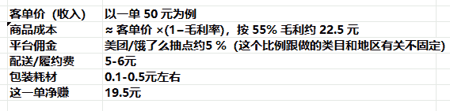
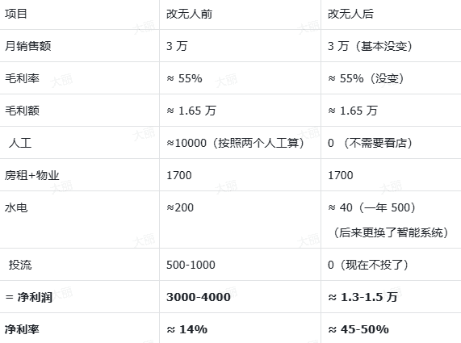

# 把宠物用品店做成挂机现金流，每周补货三小时年入近四十万的拆解

我是鑫鑫，同时在工业紧固件和宠物赛道做了多年。紧固件本职六年，宠物无人超市副线四年。2022年太太在大厂被裁又临盆，家里需要一笔不用盯盘的收入，宠物这摊子就是那时候起的。22年先做线下，23年砍掉人力切换无人，现在门店还在苏州稳定运转，我们的精力已回流到主业和AI实验。

这个打法适合想用副业补现金流的职场人、带娃的妈妈、想创业又不愿被店面拴住的人，以及对无人零售、即时零售好奇想落地的人。笔记里说的每一步都是真金白银踩出来的。

先看结果对比。

同铺同址，只卖宠物用品。

无人化之前，店里必须有人坐镇。月流水约三万，毛利看上去50%-60%很漂亮，但扣掉太太的工时、晚班朋友的薪水、平台抽成、水电、少量投流，落袋净利每月三四千，净利率大概15%。

改成无人后，每周补货一次两次，总时长约三小时。流水基本持平，净利率直接拉到近50%。人被解放了，店变成了挂着就能收钱的被动收入。

峰值月单量曾破800单，现在主动收敛到200-300单，反而更稳。想低投入创业的可以参考这套逻辑，宠物赛道跑通后叠加AI电商，增量会更明显。

## 怎么选到这个赛道

本职是螺丝紧固件，收入稳定。转折点是22年太太失业加怀孕，短期无法工作。面包西点也调研过，最后是疫情宅家养狗，自己做健康零嘴发到群里，有需求才发现了口子。

宠物服务类很快被排除，洗澡剪毛一小时一只，一天十只封顶，天花板是体力。用品方向留了下来。即便品类价格透明、竞争激烈，做即时到家的场景仍有空间，外卖半小时达比电商等快递更有用。

去深圳看了几家头部同行，参加了行业展会，回来后开始找铺面。供应链不用费劲谈，线上店一开，批发商会主动上门。前期SKU要覆盖几百上千，自己找源头不现实，先找本地大型批发商起盘，动销好的单品再去找厂家，数据在手谈价更有底气。

选址主张是地段好、环境差。首店在三楼，日均上门四五个人，正好我们要的是配送覆盖，不是店客。租金1.8万加物业2000，首批进货三到五万，甚至一两万即可启动。最坏情况亏租金，能承受就开。首月销售额三万多，毛利约50%，验证了模型。

开局两个坑。美团代运营基本是智商税，第二个月就自研运营。另一个当时觉得麻烦现在觉得值的是私域，一年多积累近三千养宠精准用户，复购拉动回本快，这批资产至今还在为其他项目导流。

## 竞争卷到必须做减法

生意稳定后遇到双重压力。

其一是人力成本。白天太太进货理货，晚上找朋友住店值班。底薪加派单提成，水电平台费每月投流一千到一千五，固定支出不低。

其二是对手激增。美团自营宠物店入局，街区同行从四家扩到二十多家，价格战开打。

先尝试减库存减品类，结果成本几乎没降，进货次数变多运费上涨，单价反而上升，品类收窄导致客单下降，总成本不降反升。

租金已是同区最低，砍不动。

最后只剩下减人。去掉人工每月省五千到七千，两人算下来上万。没人看店怎么办？起初我每天下班去店里守，很耗精力。

## 无人化是意外撞出来的解法

两个小事件点醒我们。

第一是丢钥匙。原本铁锁麻烦，换成磁吸电子锁，可手机远程或密码开门，本意只是方便。

第二是旅游时系统失灵。出门设了歇业，返程当天订单却一直进。只能远程开门，让骑手进店自取，靠监控看着完成。连续操作几次后意识到可以完全自助，只要货架按序摆放并编号，骑手自取即可。

无人配置非常便宜：
电子锁几百元，支持手机远程；店内监控全天录制；无人系统两千内搞定，骑手扫码入店，货架A到Z编号、盒子1到100编号，系统亮灯指引；智能开关手机控制，年电费约500元。

流程演变：挂牌加微信 → 熟悉骑手白名单 → 系统亮灯自助拣货。偶尔看一眼视频防漏拿，若品类单一可24小时纯自助。

会不会被偷？多年下来没发生过。买宠物粮零食的人群素质整体较高，骑手有平台实名与监控，风险极低。宠物超市有其特殊性，百货类需另评估。

订单来源：美团、淘宝闪购、京东到家，外加微信私域复购，四条腿并行。现在的工作只是补货、拆包裹、整理货架，给骑手放瓶水。

单量从月500-600起步，峰值冲过800单，24年初赶上快递停运窗口冲到最高。现主动控在200-300单，利润更健康。

## 不跟风打价格战

周边二十多家在亏本拼声量，套路是低价冲数据→收加盟→倒闭换牌。连美团自营最后也撤了，就是不赚钱。9.9猫砂带来全是薅羊毛的。

我们交过学费，9.9起送两周发现连配送费都亏，改回48.8起送。现在不做付费活动，不卷低价，只做利润品和刚需品。单量从600降到200多，净利更舒服。

开店目标是赚钱，不是堆数据圈钱。

## 能跑通的底层原因

复盘有三点。

其一即时零售基建成熟。美团等平台把到家配送做好，小店不再依赖客流。我们三楼无人问津，但线上能做两三百单，靠的是地段的配送辐射。

其二人力成本只涨不跌。小店请人性价比越来越低，人工是利润生死线。

其三智能硬件平价。电子锁几百，无人系统一两千，十年前是资本风口，现在是夫妻店标配。

能活下来的差异就四个字：地段、私域、控本、选品。底色始终是只为赚钱。

## 最致命的错误是不算账

我们也曾粗放经营，缺货就进，缺钱就投，月末发现亏损。后来落到每一笔。

算账分三层。

单笔层：9.9起送单量快，但算上货成本、佣金、配送费全亏，马上调回48.8起送。起送价要倒推。

月结层：毛利没增加，只是砍掉人力、水电、投流，净利率从14%到近50%。毛利高不等于赚钱，净利率才关键。

决策层：选品看毛利排序而非销量；红海区域不投流；房租省六万等于净利加六万；无人工具省下的固定成本即净增利润；不要代运营，不要加盟，不要9.9引流，不要起盘大囤货。

## 可复制的零到一清单

调研1-2周：画五公里圈，统计小区数量与入住率，画像高收入/上班族/老年人，决定客单与选品，数清竞品与最大玩家。

选址：要配送辐射而非门客，2-3楼、写字楼皆可，租金压到最低，能注册。

首期投入：租金押金按当地行情压低；首批货2-5万，SKU 400-600个；无人设备内两千搞定；智能开关省电。

平台起单：美团、淘宝闪购、京东到家全上，起送价建议30元以上；起盘期适度做活动拿评价并设止损线，自营运营。

做私域：沉淀复购用户，决定寿命。

现在这家店就是挂着的副业现金流，周末能旅游也不用管。核心始终是算清账、砍掉人力、选对地段。

很多人把开店想得太浪漫，其实它是个精细活。特别是想做成“无人值守”的现金流生意，每一步都得踩稳。下面这套打法已经跑通过，关键逻辑全部摊开讲。

一、先搭好复购底盘
每一笔订单，都要有意识地把客户拉进自己的私域池；到店取货的人，顺手送个小礼物，用“小恩小惠”换第一波好感。别小看这个动作——当复购在私域里跑起来，哪怕不投流量，订单也不会断；更重要的是，这份客户资产以后你做什么生意都能用。

二、无人化改造的四个细节
1. 所有货架和盒子都编号：货架按A到Z，盒子按1到100，而且一盒只放一种商品。
2. 电子锁加远程开门，监控全程无死角，这是无人店的基本盘。
3. 别急着一步到位：先和固定骑手加微信，视频看着他们取货，流程跑顺了再放开成全自助。
4. 数据必须记：哪怕用到Excel，也要把销量、毛利、复购一笔笔记清楚，进货不是凭感觉，而是照数据来。

三、每周维护“工作量清单”
日常就三件事：拆包裹、补货上架、整理货架。
每周还要根据数据调整选品，把卖不动的SKU果断下架。
骑手嫌自助取货麻烦怎么办？在店里备些水、零食和香烟，贴一张“按需自取”的提示，别让人一次都拿空。这样将心比心，他们接单也会更主动。不过刚开始可能会遇到骑手看到无人店直接拒单，导致配送时间变长，这个要提前有心理准备。

四、哪一种人能入局？哪一种人该避开？
适合的人：
- 有主业、想靠副业赚现金流的人；
- 夫妻俩想踏踏实实做点事、又不想背太高实体成本的人；
- 有开店梦、但被传统门店投入劝退的人；
- 愿意算细账、能沉下心做长线的人。
技能门槛很低，会用Excel记账就够了，根本不用会编程；以前写宏是因为没有AI，现在让AI做一个简易进销存系统，几分钟就搞定。

不适合的人：
- 想“躺着收钱”的人——前期理货、盯单，没有一样轻松；
- 想当甩手掌柜、把希望全押在加盟上的人；
- 不算账、凭感觉拍板的人；
- 指望低价冲量、讲大故事找融资的人。
因为这行做到头，也就是每月稳稳赚出几千到一两万现金的一台小机器，跟“性感创业故事”完全不沾边。

五、这套思路能复制到哪？
不只有宠物用品能做，零食超市、成人用品超市逻辑完全一样。核心公式就是：线上订单+好地段差环境+无人化+私域。换个赛道再让我来一回，我照样愿意做，宠物市场还有上升空间，只是前期调研绝不能省。

六、送你一句话
开店不难守店难；销售额只是给人看的，净利润才是自己的命。别为了数据好看而开店，要为了钱包真正鼓起来而开店。

看完这套SOP，你也许觉得心里有数了，可九成的人真到实操时，连第一步都迈不出去。工具、教程从来不是核心壁垒，真正的分水岭在于“马上行动”和“圈层信息差”。

想第一时间看到全网最新变现玩法，和一群执行力爆表的人一起下场拿结果，欢迎进我的内部圈子【懒人专属群】。这里不谈虚的，只拆解商业闭环、压榨AI效率，已经沉淀了1000多个验证过的套利实战局。

完整数字资产和入圈门槛在这里：https://lazyso.com/insider/
认可价值、准备下场动手的，直接加微信 lazyhelper1，备注【实操上车】，不闲聊。
