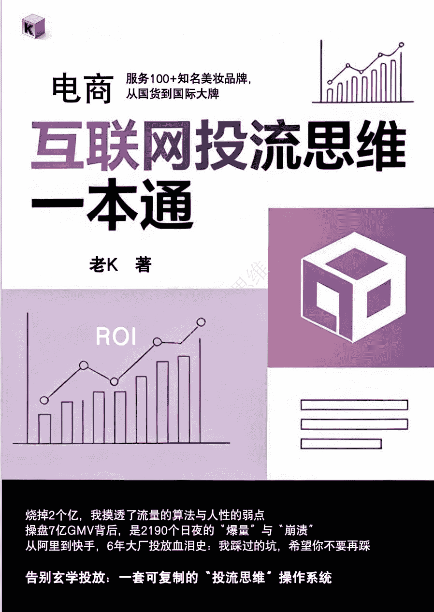

# 用3年试错10多个副业，用6年投放经验写出13万字书：我是怎么做到选项目、换项目都不内耗的

260616 副业SC 精华

整理：👸号懒人搜索，懒人专属群精选

懒人微信：lazyhelper1

大家好，我是安然，赚钱的一年级学员。五月份的Ai航海里作业超额完成，被邀请作为优秀学员分享航海心得。其实早在加入赚钱前，我就已经折腾过十多个副业项目了。这篇帖子是应鱼丸邀请写的，想把这几年的踩坑经历和选项目的思路都摊开来讲。

先简单做个自我介绍：

在大厂做投流优化干了6年，累计消耗过2个亿，拉动GMV超7亿。2023到2026年这三年里，我自己下场实操过十几个副业，主要集中在电商、直播和婚礼督导，现在的核心盘是投流和婚礼督导，月利润稳定在2-3万左右。23年就通过雪姨认识了赚钱，也参加过线下活动，但真正加入是今年4月，一直在观望。

很多人总说赚钱项目太多，不知道自己的副业够不够好，要不要换，怕坚持不下来，看别人出结果自己会慌。我却没有这种焦虑。

项目做多了就明白，并不是所有机会都适合自己，能真正做出来、能长在自己身上的才算数。比如2024年我做过短剧，2026年初AI漫剧火起来的时候很多人冲，我就选择观望。因为我清楚剧类项目要投入多少心力去赌爆率。就像《天道》里芮小丹说的**“只要不是我觉到、悟到的，你给不了我，给了我也拿不住。只有我自己觉到、悟到的，我才有可能做到，我能做到的才是我的”**。

多说几句，希望能给正在纠结的圈友降降焦虑，回到自己身上。

看完一部剧，等于陪主角走完一生；看完这篇文章，差不多就等于走过我的副业三年。全文分四个部分，大概1万字，阅读10-15分钟：

- 1. 我当时为什么选这个项目？最后怎么样？复盘了什么？
- 2. 这些项目现在还能做吗？难点在哪？
- 3. 为什么最后回到主业，把6年投放沉淀成一本书？
- 4. 怎么判断要不要换项目？怎么决策才不内耗不后悔？

## 一、项目选择逻辑/结果/复盘

从2023年到2026年，我试过的项目有十几个，从跟风入局到形成自己的判断，最后回到自己的专业能力把投放经验做成一本书。下面是关键节点的拆解。

### 1. 拼多多百货饰品店：2023年4月

玩法是买插件批量铺货，出单后去1688找低价货发差价，客单价3~20元。

为什么做：2023年拼多多正红，百亿补贴加出海，消费降级明显。工作三年到倦怠期，想找个副业练手。平时爱穿搭，饰品链接被问得多，就想从相关赛道试水。看到别人赚钱也想试试。

结果：花2700买插件被割韭菜，前期铺几百条货出过十几单，后面全倒贴，单笔亏几块，加起来亏上百。没时间管就关店了。

复盘：商业认知不够，觉得铺货就能卖。拼多多日百竞争极其激烈，价格战打不过老店。核心能力外包，自己不懂选品和平台规则。平台有客服3分钟回复考核、发货时效考核等，都没搞懂。

### 2. 直播切片带货：2023年7月起

剪辑头部主播直播精华，做二次分发，前置爆点堆量。2024年做多余、毛毛姐，2025年做张雪峰的图书教材。4个号剪了500-600条视频，最高单条200万赞、3000万播放。

为什么做：朋友在做兼职介绍过来，和电商主业相关。多余毛毛姐热度还在，切片当时很火，很多达人开放授权。媒体也报道有人靠这个赚百万。

结果：赚到一台苹果手机和一台佳能相机的钱，基本覆盖成本。第一次感受到除了上班钱还能自己赚。

复盘：多账号日更极其消耗意志力，剪辑耗时长。佣金率下调，达人公信力下降后就剪不动了。后期很多人开始投流，成本上去转化下降。张雪峰账号后来被封。所以切片需要高执行力，红利期一过很难持续。

### 3. 穿戴甲直播：2024年5月

在家搭直播间，不露脸只露手卖穿戴甲赚差价。

为什么做：切片停后筛选新项目，穿戴甲刚起来，📕说好做。作为女生自己也能用。产品新颖，比美甲店更方便。

结果：扣掉设备和十几副样品成本，净赚300多。卖了两三个月坚持不下去就停了。

复盘：直播很累，新手播1-2小时就吃不消。单副利润几块钱，竞争大，随时出新款要不断更新货盘和人货场。启动成本低意味着天花板低，很难形成复利。

### 4. 短剧分发：2024年11月

剪爆款短剧做付费章节分发，引流到APP看。剪过《我在80年代当后妈》等男频剧，在视频号和📕发冲突开头引导付费。

为什么做：当时短剧是热点，大家觉得上头。自己做过小说信息流投放，对内容熟悉。朋友给了一套SOP，照着做能变现。

结果：赚了140块，两个平台号都被封了。

复盘：风口高低不定，新鲜感过去付费意愿下降，还能找到盗版。搬运分发100%有封号风险。要做风口就要做好随时撤退。

### 5. 婚礼督导：2020年8月至今

线下兼职，双胞胎一人督导一人音控，主攻杭州及周边：金华、湖州、温州、宁波、南通等。既能免费旅游，又能赚钱。

为什么做：哥哥朋友是浙江台主持人介绍来的。双胞胎优势可双岗。擅长沟通，周末还能散心。

结果：做了6年，督导200多场，赚7万+。还录了599元的录播课加PPT卖出2单。

复盘：教别人做和自己做是两回事。线上交付需要私域运营，我们不擅长，拉群对接时间繁琐。双胞胎固定搭档有局限，安全和信任成本也存在。

### 6. 商务对接美妆母婴：2025年5月至今

用投放资源给有货的商家找商务，再让商务找达人带货，赚中间差价。

为什么做：工作接触大量商务，有资源。商家有货卖不出去，属于顺手帮忙。和主业高度相关。

结果：给雅迪推荐达人赚1000多，母婴益生菌也推了两个达人。

复盘：单子不稳定，达人需求波动大，匹配成本高。沟通成本高，返点不固定，常因缺货中断。

### 7. 📕代投护肤品：2026年4月

给瑞士新品牌做📕聚光CID投放，跳转天猫，靠消耗返点赚钱。

为什么做：和主业相关好上手，可借鉴其他平台经验。写投流书期间想增加收入。

结果：跑通了，但素材质量差，客户配合度低，冷启动期就停投了。

复盘：个人代投要扛全链路，沟通成本远高于公司协作。投流只是放大器，产品不行投了也白投。

### 8. 投流经验书：2025年5月至今

把6年大厂投放经历写成书。从阿里到快手，烧2亿，操盘7亿GMV，服务100+品牌，2190个日夜的爆量与崩溃。耗时一年，改20多版，13万字。

为什么做：想把经验沉淀下来，不想人走茶凉。希望帮到需要的人，也给自己一个代表作。

结果：还没大规模销售。

总结和反思：

写书极难，中途想放弃好几次，写到三分之一剩三分之二会崩溃。
接下来怎么让别人知道这本书、怎么卖出去是新问题。
任何事都难，要找热爱并长期深耕，慢就是快。

## 二、这些项目现在还有机会吗

**拼多多店铺**。有稳定货源和工厂可以试试，走Temu出海还有空间。新人入局难，平台闭环强竞争大。

**直播切片**。头部IP授权还能赚点奶茶钱，但整体红利已过，达人信任度下降。难点是执行力、敏锐度和日更坚持。

**穿戴甲**。产品已更精美，客单价提到一定水平仍有机会，但需要团队或低价渠道。难点是直播坚持和直播间打造。

**短剧**。风口已过，番茄、红果免费剧增多。平台更扶持AI短剧和漫剧。信息差价值消失，非要做就结合AI个人创作。

**婚礼督导**

我把过去两年跑过的十几个副业都复盘了一遍，最后发现一个规律：风口来临时猪都能飞，风口过去就得落地。

先说婚礼督导。婚礼是刚需，每到五一、国庆这些高峰期，结婚的人依旧不少，所以这条赛道没死。问题在于它太特殊了，并不是人人都有渠道接触到，而且门槛不只是会拍会说。如果你是一个人单打独斗的小女生，跑场子的交通住宿成本就可能把你赚的那点钱吃掉。

不过想先试水也不是不行，可以去📕、BOSS直聘搜主持人或者婚庆公司，问一句需不需要兼职督导，先去现场蹭一次体验。能看无数新人当着你的面宣誓仪式，也算是一件挺有意思的事，值不值得长期做，体验完自然心里有数。

**商务这摊子**
现在带货的商务非常卷，兼职做倒还轻松，混口饭吃没问题。一旦想进公司全职，就得无休止地建联、人脉消耗是真的高。另一个大环境是，品牌投放预算比以前紧了，而且消费者对KOL的信任度在祛魅，商务的工作比过去更难做了。

**📕代投**
如果你喜欢做甲方乙方的活，愿意跟客户来回沟通几百轮，一点小变动都要立刻解释，并且相信投流能解决一切，那可以去试代投。但说实话，不管是挂靠代理商还是单干，代投都是又脏又累的活。信息对接多、沟通成本高、事多钱少，很难吃香。

反过来，如果你自己就有品牌，或者本身就需要投放，不妨自己上手。现在投放平台都对商家开放，自己投反而省事，也能把产品能力放大。

**写投流书**
把多年的经验沉淀成书或一份系统文档，本质是给自己职业生涯做一次清算，也能帮到后面的人。听起来美好，但要做成一本书，必须是真的深耕多年，懂岗位也懂行业商业逻辑。不是拼个SOP就完事，还得有持续输出的能力：坚持写一年，反复改二十多版，甚至推翻重写，写到十万字以上。对很多人来说，投入产出比并不划算。

### 跑完一圈副业，我为什么把6年投放经验写成书？

1. 很多副业都是风口型项目。直播切片、短剧分发，当年在那个时间点能赚钱，等浪潮退了，照样变回普通。

2. 副业终究是副业。回到主业才发现，把六年投放经验整理成一本可交付的产品，比到处接项目更有价值。它既是给自己职业的交代，也免得几年后脑子空了什么都没留下。

3. 长期主义看，真正的商业模式是拥有自己的产品。起一个新品需要大量资金和资源，但把自己的经验产品化，成本最低，也最可行。边锻炼产品化能力，边帮到需要的人。

4. 投放本质很难。需要真金白银的实战积累，AI时代大家都在做产品，懂投放的人天然比不懂的人更容易成功。这本书就是图文化、可落地的实操笔记，而不是一堆定义。市场上的投放书90%在讲“什么是信息流”“什么是OCPM”，基本是平台帮助文档的复读。我的这本不一样，是在大厂被锤了6年、烧掉2亿后，把血泪、方法论、模型全倒出来整理成册。

书里是一套完整的投流思维操作系统，从底层逻辑到顶层策略，从计划优化到团队管理、品牌经营，层层递进。不是教你投放是什么，而是让你拥有流量逻辑、产品思维、商业逻辑和管理方法。

因为你能做出东西不代表能卖出去。产品做出来，第一个卡点就是卖给谁、怎么卖、在哪卖。想减少卖货门槛，就得懂平台逻辑和卖方逻辑。

这本书记录了我6年投放经历：从阿里到快手，烧掉2亿，操盘7亿GMV，服务100+品牌，涵盖国内外头部美妆。2190个日夜的“爆量”与“崩溃”。耗时一年，改了20多版，总字数13万字。我的第一感受是，这不是一本写出来的书，而是一本用钱烧出来的书。

它后续也会上架到📕店铺和朋友圈私域，目前版权已申请完毕。有需要可以去看看。

从直播切片、婚礼督导、拼多多店铺，到最后我发现最适合我的，是把自己最深的投放能力产品化，最后回到主业。

### 怎么测试一个项目是否适合自己

分享三条我常用的判断标准：

**1. 结合自身擅长领域**
回看职业和生活经历，你在哪个领域有表达欲和创作力？能不能无痛坚持，能不能在做的过程中不断有新点子加进来。

**2. 已经被验证过**
不要脑子一热就上。先分析大环境、项目周期和未来估值，风口项目尤其要看周期。并且这个项目是真实有人跑通、能赚钱、还在红利期，才值得结合自身经验进入。

比如直播切片当时正当时，市场信任度高，我做半个月就出了3000万播放的爆款，从1000粉涨到1万，外部风口+内部正反馈，信心自然上来。短剧也是基于我本来的行业认知去做的，及时上车赚到钱。

**3. 别被完美主义绑架**
总想做一个从未出现过的惊艳产品，结果一版都拿不出来。所有好产品都是先不完美地推出去，在市场上碰撞迭代。摇摆不定最致命，A好B也不错C好像更赚钱，犹豫中就错过了窗口期。

### 何时换项目？如何做不后悔的决策

从投放角度说，就是看投入产出比。老项目产出不稳定，新项目出现，就衡量迁移成本和旧项目沉没损失。一旦决定换，就all in，别让两个项目一起拖死你。

做决策时扪心自问：换了会不会后悔？不会就换，会就先优化旧项目。优化不了，就为“没换”的结果负责，别到后面换也后悔不换也后悔。

做到尽力即可。当前看是坏事，可能长期是好的选择。相信自己能把一个项目做好，后面也能做好。焦虑到睡不着，那就凌晨三点起来优化一次，优化不了就找原因，别被情绪困住。

从职场到自由职业，我是从直播切片开始过渡的。已经自由两年了。变化很大：

项目上：自己找项目、评估、从0到1搭建、扛结果。主观能动性全部自己承担，比在公司做一环更累，但成就感更高，也能看到完整的商业链路。

生活上：作息完全自由。刚开始半年很堕落，中午才起。后来主动调整，现在早上九十点起床看书运动，再开始工作。时间自由的同时，必须更清醒，否则很容易进入信息茧房和假装努力的陷阱。

做项目和上班一样，它只是人生的一部分，不是代表要做一辈子。没有最好的项目，只有最适合某个人的项目。

本文很多是个人经历，方法论不多，但希望能带给你启发：原来有人和我一样在挣扎、内耗、反复试错。你会更释然。

哪怕只是帮你避雷或提供一个思路，也值了。用我的来时路，照亮你的前路。祝大家找到适合自己的项目，拿到想要的结果，一起龙哥盟，马上有钱！

————分割线————

看完这篇 SOP，你觉得你懂了。但 90% 的人一到实操就会卡在第一步。

工具和教程只是最低级的壁垒，真正的壁垒是“立刻动手”和“圈层信息差”。

如果你想看全网最新的变现玩法，并且和一群执行力极强的极客一起下场拿结果，欢迎围观我的核心私域：【懒人专属群】。

我们不聊虚的，只做商业闭环的拆解与 AI 效率的压榨。系统内已沉淀 1000+ 跑通的套利实战局。

👉 查阅圈子完整数字资产与上车门槛：

https://lazyso.com/insider/

认同价值、准备好下场干活的，扫码加我

微信（lazyhelper1）

备注：【实操上车】，不闲聊

