# 一个人，一套系统，月入3700美金：游戏攻略站的“无人驾驶”玩法

> 从大厂程序员到旅居自由职业者，我靠一套全自动系统，让网站自己“跑”起来赚钱。

很多人问我，为什么放着大厂的高薪不待，非要出来折腾？

答案其实很简单：我受够了当牛马的日子。

大家好，我是诗意听涛。98年，前大厂软件研发，现在是个旅居的自由职业者。

2026年初，我彻底告别了北京的格子间，搬到了广东惠州。而支撑我这种生活的，不是存款，而是一套我自己搭建的、能自动赚钱的“印钞系统”——游戏攻略站。

你可能觉得我在吹牛，但数据不会说谎：**月入稳定3700+美金，高峰时日入超200美金，一个月能轻松上线近100个网站。**

这一切，都源于一套我亲手打造的 **全自动化系统**。

它有多智能？

从关键词挖掘、网站搭建、内容发布到外链建设，全流程无人值守。它甚至能自己修复bug，自己优化技能，自己学习和进化。

我只需要在后台看着它“自我生长”，然后等着收钱就好了。是不是有点像“自动驾驶”？

## 游戏攻略站，到底是什么？

一句话解释：就是针对玩家搜索的游戏相关关键词，制作专门的攻略内容页，靠广告点击赚钱。

它的赚钱逻辑非常简单：

玩家搜“GTA攻略” → 你的网站排在谷歌首页 → 玩家点进来 → 浏览或点击页面广告 → 你的广告后台就有收入了。

就是这么朴实无华。

以我4月份的数据为例，上了近100个站，成本基本全收回来了。其中大概十分之一跑出了不错的流量，而这一两个“明星站点”，就贡献了绝大部分的利润。

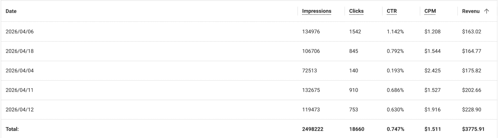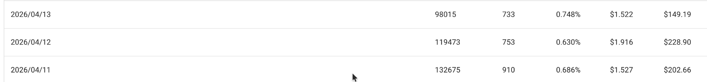
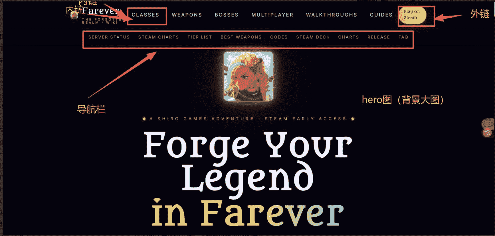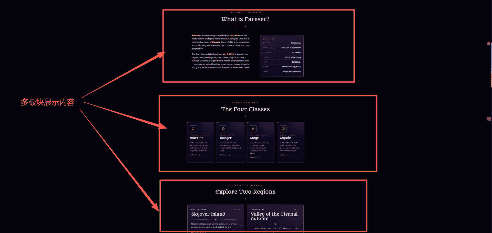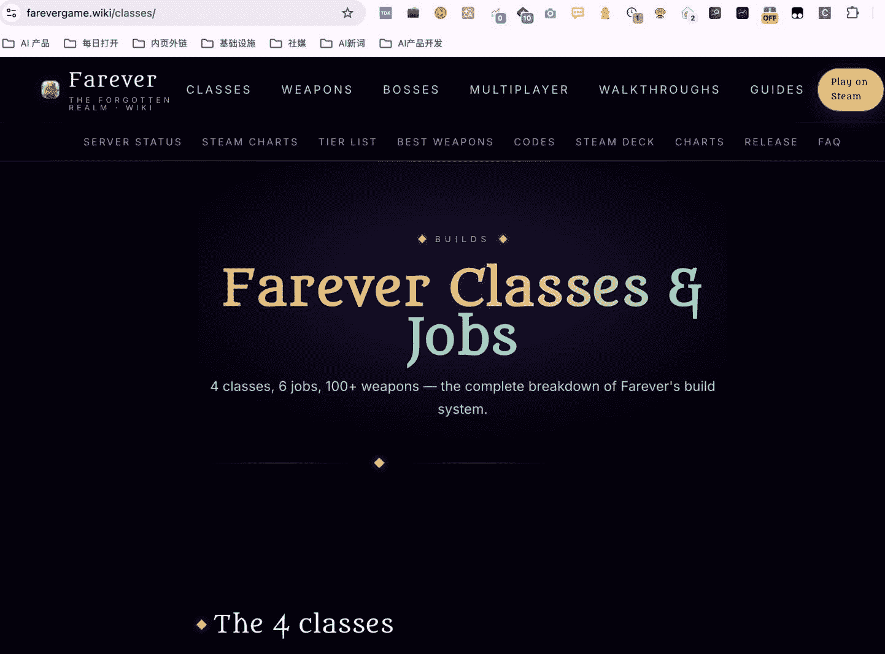
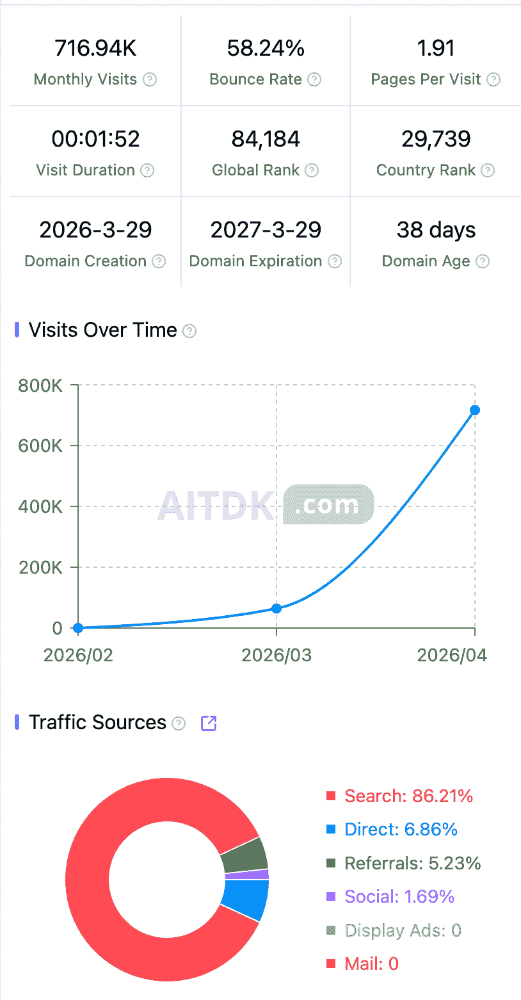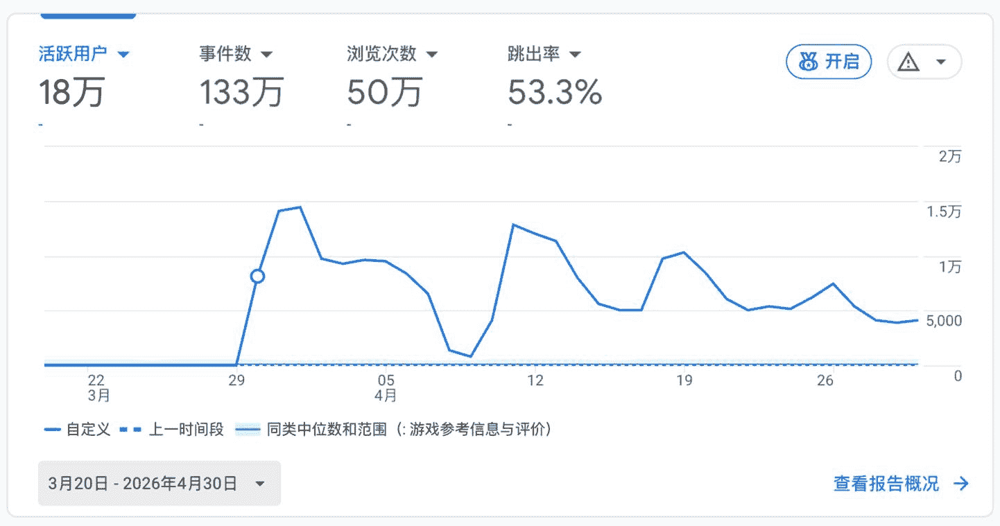

## 为什么我死磕游戏站？

其实在选择赛道时，我也对比过很多方向，最后坚定选择游戏站，是因为它有几个独一无二的优势：

**第一，启动成本极低。**
相比那些动辄需要投流、烧API费用的AI订阅站，游戏站就像摆地摊。你只需要花几百块买个域名和服务器，就能开张。当天出摊，当天就能见着回头钱。而那些重资产项目，就像开饭店，回本周期长，风险大，对心态的考验极其残酷。

**第二，需求天然存在，不用教育用户。**
玩家找攻略是刚需。每天都有新游戏发布，新攻略词层出不穷。你根本不需要像做社群或自媒体那样，四处去找用户、验证需求。你要做的，只是筛选出那些“低竞争、高搜索量”的词，然后做出内容等着流量上门就行。

**第三，正反馈极快。**
从挖词到网站上线，快的话可能半天，慢也就一两天，就能看到谷歌收录和零星流量。这种看得见的反馈，在一段无人问津的创业初期，比什么都宝贵。它能让你心不慌。

**第四，这是一个被验证过的赛道。**
我做事有个原则：只做已经有成功先例的事。游戏站行业里，月入万刀、甚至十万刀的大神早已存在。这就像给我吃了一颗定心丸，不用去黑暗中摸索，只要沿着正确的路走，总有到的一天。

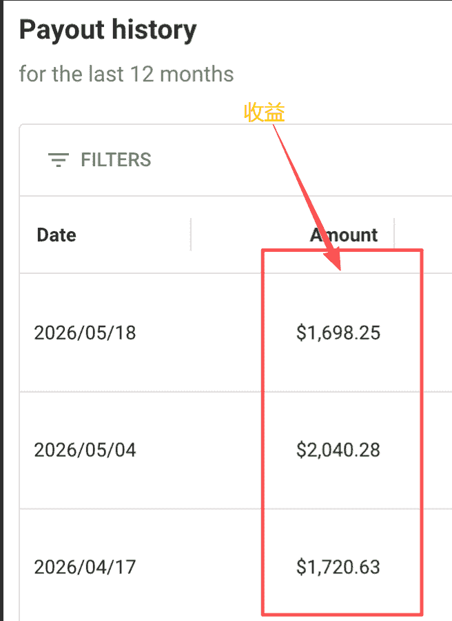

## 我的全自动化进化之路

你看到我现在很轻松，但这条路，我也是从“人力拉车”一步步走到“自动驾驶”的。

**阶段一：从0到1，疯狂踩坑（2025.10-11）**

刚起步时，我还是个在职的“挤时间选手”。

每天5点起床，在地铁上复盘计划，在公司摸鱼研究代码。那时候做一个网站，可能要三五天。踩过的坑更是不计其数：选词瞎选、服务器部署报错、页面样式错乱……做了几个站，谷歌搜索翻三页都找不到，流量自然惨淡。

**阶段二：量变引起质变，迎来转折点（2025.12）**

28岁生日那天，我拿到了大厂的裁员“大礼包”。说实话，心里挺平静的，甚至有点解脱。

我用这笔赔偿金作为启动资金，正式开始全职All in。

当时我的策略是：先把单个网站的质量打磨好。对标优秀同行，集中优化首页、内页、导航和内链结构。那段时间，高峰日收入能达到30-50美金。

**阶段三：拥抱自动化，解放双手（2026.2-3）**

当单站质量到了一定程度，我发现再花时间进去，边际效益极低。

这时候，程序员的本能让我想到了“偷懒”：既然我讨厌重复劳动，那为什么不写一套系统，让AI帮我干？

说干就干。我用三个月时间，硬是磨出了一套覆盖多浏览器、多会话、远程控制、技能自优化的“AI数字员工系统”。

这套系统的复杂程度，远超做几个网站本身。我写了无数个Skills，每天都盯着它测试、修复、迭代。它更像是在做“基础设施建设”——当这套基建完成后，剩下的一切业务，都只是往上面挂流程而已。

结果你也看到了。

**阶段四：全面爆发，彻底撒手（2026.4）**

4月是这套系统全面操盘的第一个月。

其中一个基于3月29日新域名搭建的站，上线第二天就稳定日入100+美金，还拿了哥飞老师新词比赛的冠军。

![图片描述占位符]

那个月，我的总收入达到了3700+美金。**这已经追平了我大厂时期的税后月薪。**

但我付出的时间，却减少了90%。

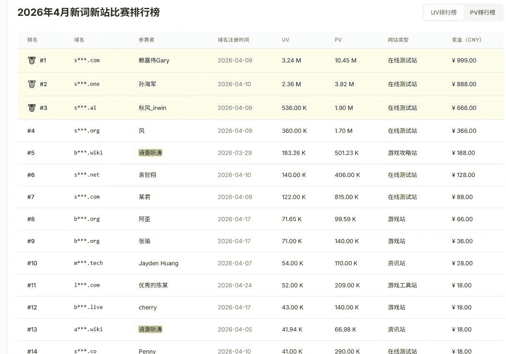

## 游戏站的核心底层玩法

很多人问，这套玩法的底层逻辑是什么？

我认为就一句话：**找对词，用对方法，然后把数量堆起来。**

**1. 如何找词？**
这是最关键的一步。要么用工具去谷歌搜索框里挖下拉词，要么去发现新发布的游戏名。核心要义是：**需求真实存在，竞争足够小。**

**2. 如何上站？**
用AI编程工具，让自然语言变成网站代码。现在的AI能力，让技术门槛降到几乎为零。只要你能想清楚需求，描述清楚样子，AI就能帮你快速搭建。我最快可以做到**半小时上线一个首页，3小时搞定一个完整网站**。

**3. 如何放大？**
靠规模。单个网站再怎么优化，收入也有天花板。但我用一套自动化的系统，可以实现“一个站3-4小时，一个月上百站”。

算一笔账：
- 半自动时期（手动操作）：一个站8-12小时，月收入几百刀。
- 全自动时期（系统操作）：一个站3-4小时，月入3700+刀。

差别在哪？不是我更努力了，恰恰相反，是因为我变“懒”了。我花了三个月时间，把那些重复的、机械的劳动，全部交给了AI。

这，就是技术的红利。

## 最后

现在的我，每天只需要打开后台，看看系统有没有报错，然后看看今天又赚了多少钱。

游戏站的赛道依然宽广，它留给有准备的人。如果你也有出海赚美金的想法，也厌倦了重复劳动，欢迎一起来交流。

愿我们都能在这个时代，找到属于自己的那套“印钞系统”。

# 游戏站出海别蛮干：从选词到上线，这套保姆级流程帮你少踩90%的坑

很多人看到AI建站风一起，就兴冲冲进场做游戏站。结果呢？域名买了，页面也生成了，就是没流量。说到底，游戏站不是靠技术堆出来的，是靠“需求”喂出来的。

## 一、做站前先问自己：你的玩家到底要什么

不同平台、不同游戏类型，玩家需求天差地别。有人来就是为了找攻略，有人想要工具，有人只想看资讯。再细一点，游戏刚上线时玩家缺的是基础攻略，到了中后期又需要进阶内容和玩法深挖。

这些需求没搞明白，网站方向就是歪的，后面再努力也可能白费。

## 二、挑新词，记住这三个“探测器”

选词就像挑股票，得看势头，也要防着突然崩盘。

1. 谷歌趋势：曲线最好陡峭向上，但也要防着第二天就直线跳水。
2. 社媒热度：一周内YouTube上相关视频多，说明讨论度高，游戏的寿命通常更长。
3. 平台性格：Roblox偏慢热，会一点点火起来；Steam经常发售日爆冲，但也可能快速冷场。

没有一招鲜的判断公式，真正的功力就是在不停尝试、复盘、再验证中长出来的。

## 三、记住谷歌老大哥的“潜规则”

流量想靠谷歌吃饭，就得按它的规矩来：

- 一个页面只专注一个关键词，别搞“一仆二主”。
- 首页和內页、內页和內页之间，内链要织成一张网。
- 网站加载速度、移动端适配、HTTPS安全证书，一个都不能少。
- 优质外链越多越好，但也要看相关性和质量。

## 四、先丢颗石子，再决定下多大的注

选好新词后，别一上来就全力以赴。只花三成力气，快速把站搭起来，扔出去看水花。

水花大，你就加油门；水花小，亏损也在可控范围。这种低成本测试，比任何完美计划都管用。

## 五、水花小，别慌；水花大，更要猛追

水花小不代表词废了。有可能是进场慢了、搜索趋势还没起来、页面不够顺滑，甚至只是运气不好。把这些原因逐一复盘，下次才有机会翻盘。

水花明显不错，就赶紧追加投入，持续优化内容和体验，尽量延长这个站的赚钱周期。

## 六、小白从零到上手的六个阶段

### 阶段一：准备（1-2天）
先把核心概念搞清楚：新词、上站、外链、广告联盟盈利（比如Adsterra）。

工具包建议：大模型准备2-3个，比如Claude Code和Codex，防风控；云服务器一台，性价比选VPS；SEO工具用Google Trends，配合Semrush或Similarweb挖词；魔法工具按需准备。

### 阶段二：学AI编程（3-5天）
系统熟悉Claude Code的chat、plan、agent三种模式，理解CLAUDE.md和Skill的用处。最后用AI写一个HTML页面，并成功部署到服务器。流程跑通了，后面才高效。

### 阶段三：理解底层逻辑（同步进行）
谷歌排名看什么？看网站速度、内容质量、用户停留时长、跳出率，还有内外链。

为什么要“一个词一个域名”？因为关键词越聚焦，相关性越高，排名越快。新词本身就有竞争小、易起排名的优势。挖词方法包括Google Trends看趋势、与GPTs对话推断搜索量级别。

### 阶段四：实战上线第一个站（3-7天）

**选词**：用Google Trends找正在上升的游戏词。趋势向上、竞争不大、自己也有兴趣，就可以下手。判断竞争程度，直接谷歌搜这个词，如果首页大站不多，就是机会。

**买域名**：到Spaceship、Namecheap或GoDaddy，搜这个词，买一个包含核心关键词、简短易记的域名。

**建仓库**：在GitHub新建一个私有仓库，复制好仓库地址备用。

**AI建站**：打开AI编程工具，让它连接仓库、初始化并完成第一次推送。先让AI生成首页，再收集关键词（谷歌下拉框联想词、谷歌趋势相关查询、SEO工具关键词生成器），筛选后一个关键词生成一个内页。

**检查**：所有页面能不能正常打开？按钮和导航有没有跳对？底部的connect us、privacy页面有没有补齐？再用AITDK插件检查SEO标签：Title是否含主关键词且有吸引力、Meta Description是否说清楚“play online、free、no download”、H1和URL是否清晰简洁、H2/H3有没有把玩法、FAQ、推荐游戏分好。

**推送**：把完成的游戏站push到仓库。

**域名绑定**：在Cloudflare添加域名，选免费方案，删掉自带的A记录和CNAME记录，把Nameserver替换成Cloudflare的，再回域名商那边更新。

**统计工具**：去Google Analytics生成GA ID，去Microsoft Clarity生成Clarity ID，放到项目文件里。新手先配这两项，有流量后再加广告代码。

**部署**：用Vercel连接你的GitHub仓库，填好环境变量，直接点击部署。几分钟后网站就上线了。

**DNS记录**：在Vercel的Domains里添加你的域名，拿到系统给的记录：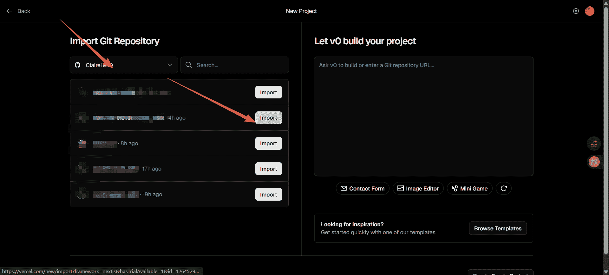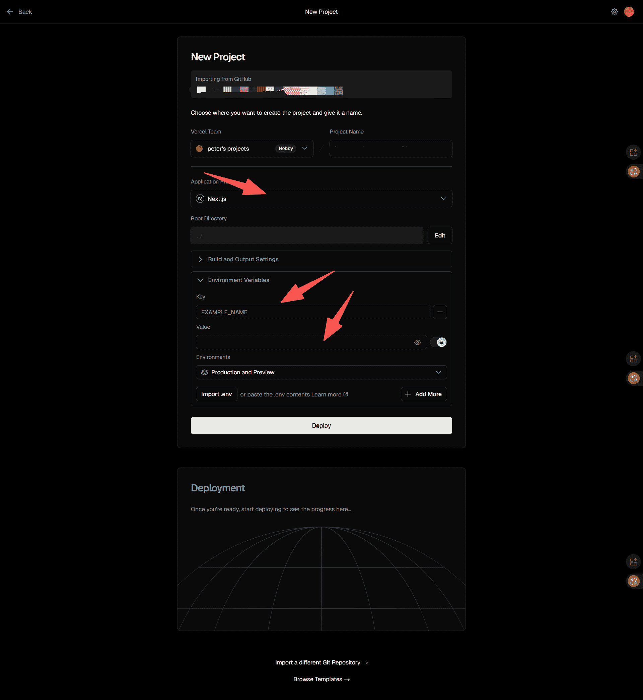。然后去Cloudflare添加DNS记录：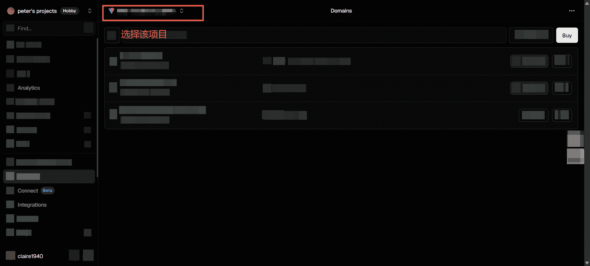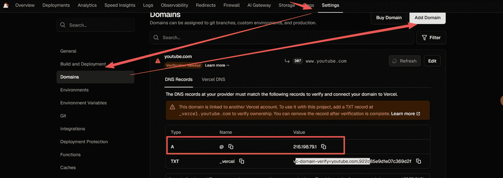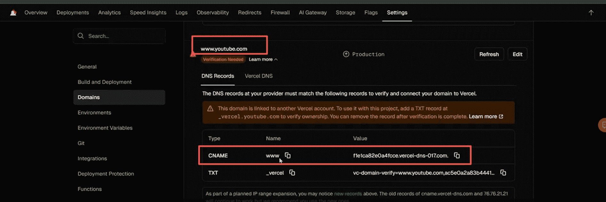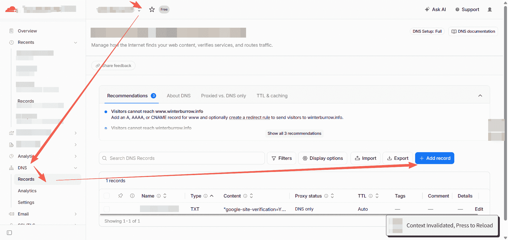。注意@和www别冲突，有AAAA记录先删掉。

**提交搜索**：到Google Search Console新增域名，并完成验证：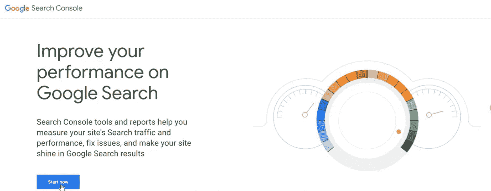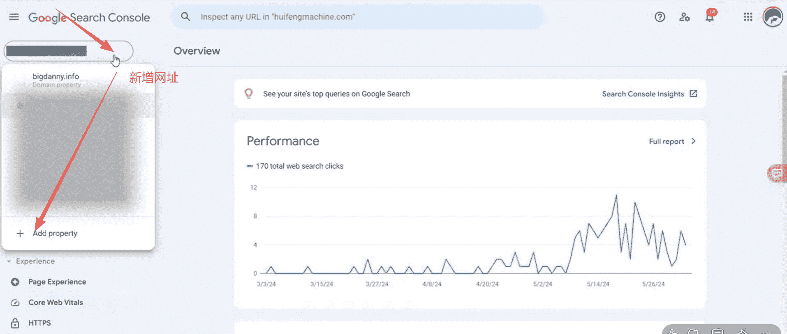。验证成功后测试实际网址，请求编入索引：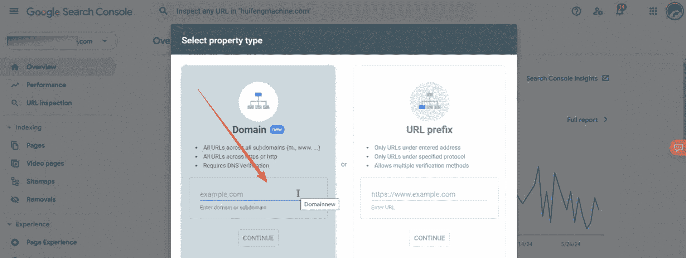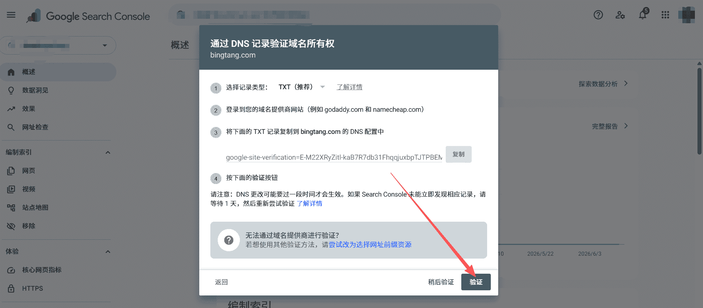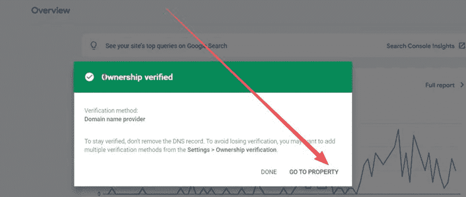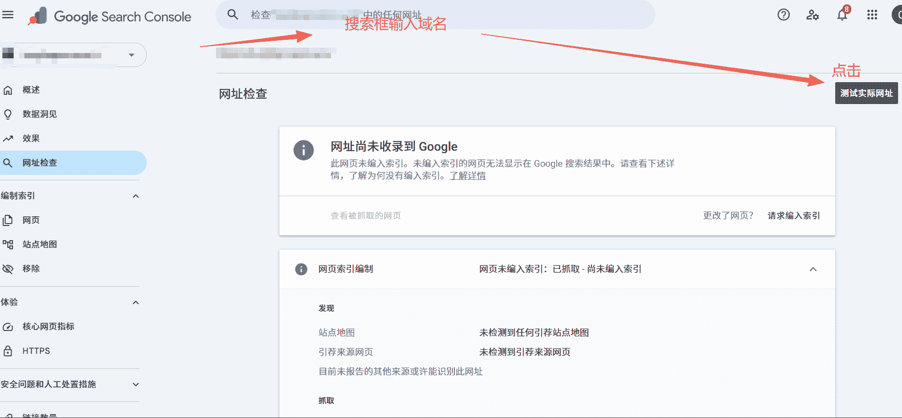。接着提交sitemap.xml，提交成功后：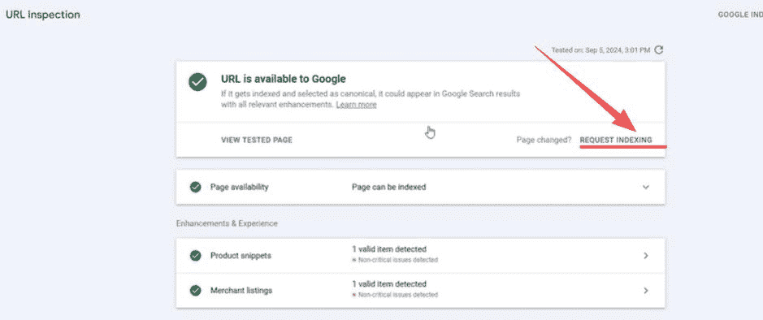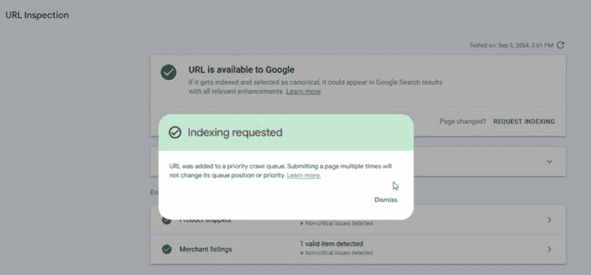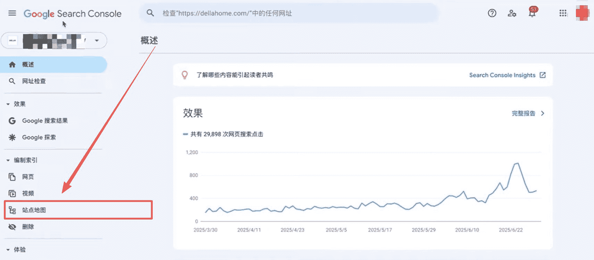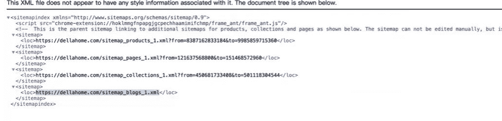。如果提示无法抓取，刷新一下或许就正常了。

**观察效果**：上线后看3-7天，重点关注GSC的收录数和点击量，再复盘成败。

### 阶段五：沉淀模板（1-2周）
把首页模板化：Hero区域放游戏名称和核心卖点，攻略/工具区做核心内容，个人区写关于作者，导航层级要清晰。

内页也模板化：攻略页、工具页、资讯页分开；Title、Description、Canonical建立标准；内链结构固定下来。

运营动作照样模板化：买域名、部署网站、配置GSC/GA，每次都能复用。参考示意：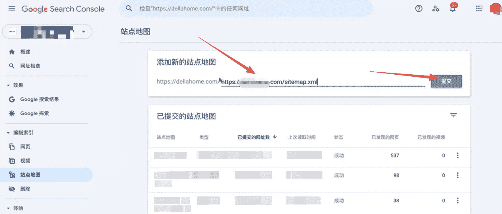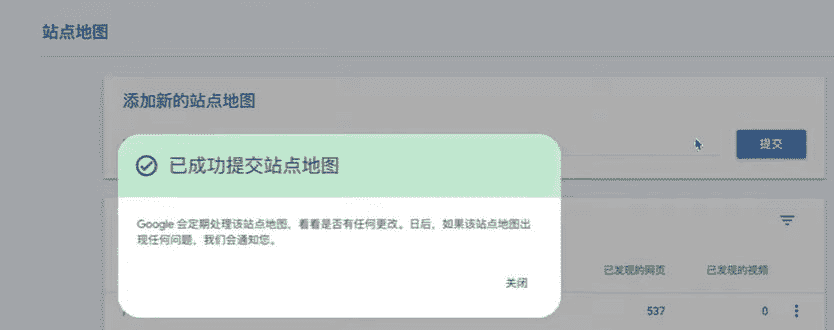

### 阶段六：持续优化与放大（长期）
不断打磨内容深度、页面性能、SEO布局和广告位。同时提升效率：建词库、用模板、写自动化脚本。跑通一个模型后，从1个站复制到10个站，最后做到全自动挖词-建站-发外链。

## 最后说几句

我最近也在复盘：之前太沉迷自动化技术，反而忽视了用户体验。游戏站是个完整生态，技术只是其中一环。接下来要把用户真正喜欢什么，当成重点来补。

工具和教程都不是壁垒，“立刻动手”才是。你要是也对游戏站感兴趣，别光收藏，先选一个词，跑通一遍流程。卡住哪里就解决哪里，跑通之后再谈放大。

想看更多实战玩法、和执行力强的人一起拿结果，可以来我的核心私域【懒人专属群】。群里不聊虚的，只做商业闭环拆解和AI效率压榨，已经沉淀了1000+跑通的套利实战局。

👉 查阅圈子完整资产与上车门槛：https://lazyso.com/insider/

认同价值，准备好下场干活，加🛰️ lazyhelper1，备注【实操上车】。

