# 一段真实经历，让我在👸号贴图号上赚到第一桶金：2个月9000+复盘
作者：龙哥

你好，我是龙哥。很多人认识我，是因为我在龙哥盟认识了我的老公；而我的账号能起号，靠的正是这段“赚钱CP”的真实故事。在这之前，我一直深耕私域发售领域，曾与肖厂长、格掌门、孟慧歌、白先生、旷智勇等头部IP并肩作战，执行过多个单场流水百万甚至千万的发售项目。如今我成为自由职业者，一边做着商业陪跑与发售工作，一边尝试自媒体创业。

今天想跟你分享的，是一段关于👸号贴图号的真实复盘。这是一个普通圈友如何因赚钱结识伴侣，再用这段关系的真实故事启动账号，最终在👸号流量主赛道上跑出成绩的记录。

## 先交代一下背景

截至目前，我一共运营过五个👸号：

1.  一个主号：就是用我和老公的赚钱CP故事作为起点做起来的。
2.  三个小号：曾用AI生成虚拟人设，阅读量很快冲到1000，但说实话，AI作图打造的假人设让我内心不太舒服，而且平台对“AI生成人脸+非真人内容”的审查越来越严格，所以这三个号已经全部搁置，正在探索新的方向。
3.  一个多年未更新的老号：播放量为零，最近换了赛道重新激活，目前账号状态已经恢复正常，打算长期经营，作为IP积累。

下面这份成绩单，来自CP故事主号：

- 两个月流量主合计收益：9000+
- 单月峰值：5000+
- 单日峰值：400+
- 产出过百万阅读的贴图内容
- 多篇长文阅读量破万

复盘后最深的体感是：贴图的价值在于抢流量、试选题、挖爆点；而长文则更擅长拉升收益、强化信任、沉淀长期资产。

我是这样安排更新节奏的：贴图持续一个多月后，我开始加入长文模块。早晨更新贴图，晚上黄金阅读时段推送长文。贴图因为更容易获取公域推荐，一般不主动群发；文章则通过群发触达用户，靠已有粉丝拉动前期的阅读与互动。

这篇复盘主要回应五个关切：
1.  零基础新手做👸号，到底从什么内容下手？
2.  文笔一般、网感欠缺，贴图内容能不能做好？
3.  如何从自己身上挖掘出有爆款潜质的内容？
4.  贴图和长文怎样搭配，才能让收益最大化？
5.  新手入局👸号贴图号，有哪些坑必须避开？

## 一、与其说是我选对了项目，不如说是在赚钱遇到了“人”和“故事”

在做这件事之前，我的职业重心是私域发售。2023年这个赛道最火热的时候，我长期混迹在头部团队，给各类IP操盘发售。这个模式的爆发力确实很强，但对人的消耗也异常明显。尤其是直播型发售，往往一连好几天高负荷运转，凌晨一两点收工是家常便饭。

时间一长，我心里越来越清楚：这种高耗能模式，很难支撑起一个长期、稳定且健康的生活节奏。于是，我开始留意新的副业机会。

说来也巧，👸号流量主就在这时闯进了我的视线。

当然，绕不开的一定是龙哥盟。我和老公最初就是在赚钱的520活动上认识的。今年我们办完婚礼后，我随手写了一篇关于我们“相差7岁姐弟恋+异地+南北文化差异”的小故事，没想到阅读量直接飙到几十万。

这件事给我带来的冲击非常大。以前做内容，我已经习惯了找选题、追热点、扒爆款。但这一次我忽然明白：真正能引发广泛传播的内容，未必是你刻意构思出来的。很多时候，它早就藏在你的真实生活里，等你把它写出来。

赚钱带给我的，绝对不只是项目库、航海手册、圈友人脉，还附赠了我人生的另一半。靠着赚钱认识了老公，靠着CP故事写出了爆款贴图，又靠着爆款贴图撞开了👸号流量主的大门——这其中的巧合，我自己都觉得奇妙。

所以，我对赚钱的价值有了新的认知：它不是一个只能“翻资料、找项目”的工具箱，它更像一个把“人、项目、行动场、正反馈”串联起来的生态闭环。

真心建议大家：不要把赚钱仅仅当作一个资料库来用。这里有项目、有航海、有手册、有圈友，还藏着许多你预想不到的邂逅和可能性。你报名参加的活动、在线下认识的人、亲身经历的故事、偶然收获的灵感——很可能就是你下一篇内容的起点。

## 二、从一篇真实故事到9000+收益，我是怎么一步步走出来的

当时👸号开通流量主的门槛是500粉丝，于是我开始了高频更新。CP故事火了之后，我顺着这条主线又衍生了不少相关主题，一口气出了几十篇爆款，粉丝也迅速突破500，流量主顺利开通。

后来贴图内容逐渐走红，我开始投入精力认真经营贴图号。从3月到5月这段时间：

- 爆款频出，其中就包括百万阅读级别的帖子。
- 收益最高的一天进账400多元。
- 每月稳定产出的爆文基本维持在10篇上下。
- 到了4月份，单月流量主收入正式突破5000元。

截几张收益图给你们感受一下：（注意：下面第一张图阅读量更低但收益反而更高，原因是当时有长文爆了）

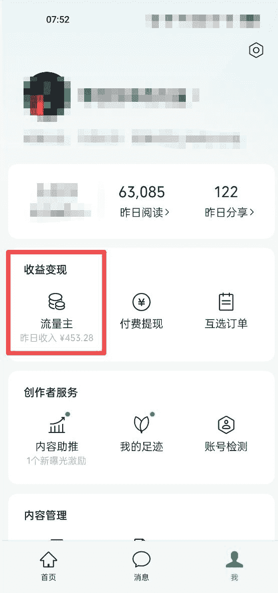

贴图类的爆文：

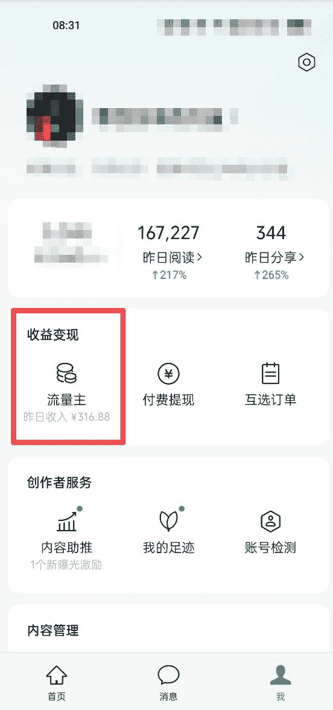

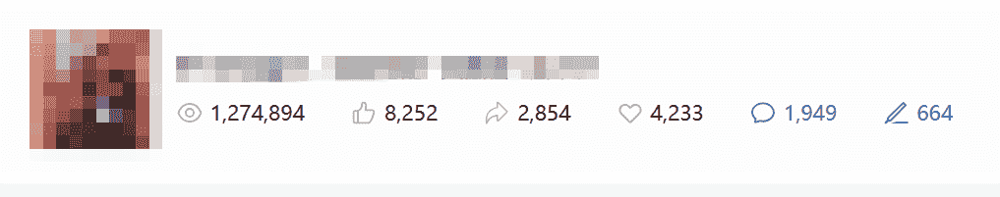

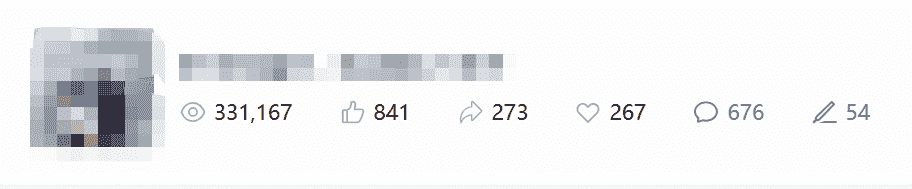

长文类的爆款：

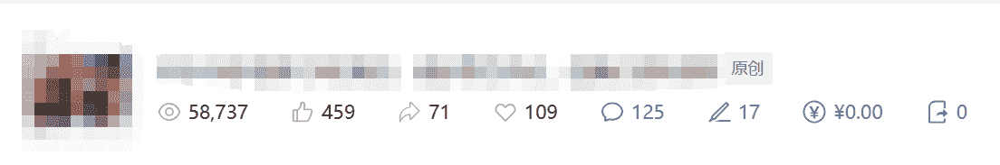

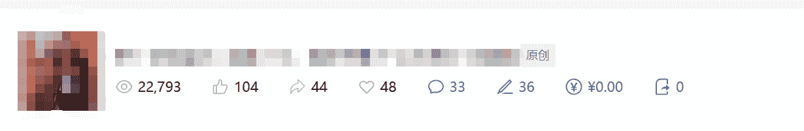

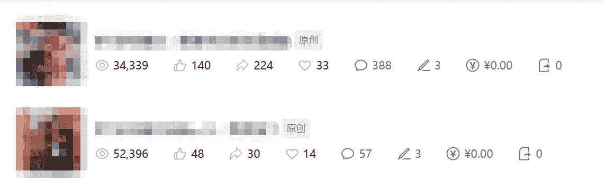

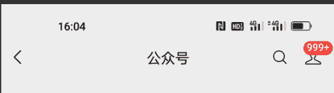

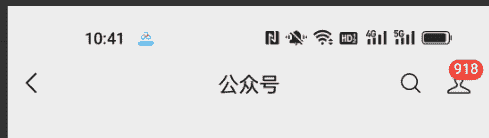

每天看到互动数据蹭蹭上涨，说不兴奋是假的。

这段经历让我确认了一件事：👸号并没有凉，只是很多新人根本不知道从哪儿下手。尤其是纯小白，通常会被这三个问题卡住：

- 不知道该写什么方向。
- 不知道图该怎么做。
- 不知道怎样判断一条内容到底有没有跑出来的可能。

接下来，我会把自己从0到1做账号的过程、方法、细节全部摊开来讲。我不敢保证你照着做就一定能爆，但至少能帮你迈出第一步，拿到第一波流量主收益的正反馈。

## 三、新手第一课：别急着定赛道，先盘点自己手里的“可传播资产”

很多刚入行的朋友，开口第一句就是：我该选什么赛道？养生能做吗？情感号还行不行？追热点来得及吗？

我的回答是：先别急着给自己贴标签。从你现有的积累出发——你擅长什么，就输出什么；你经历过什么，就讲述什么；你长期对什么着迷，就从哪里入手。

新人最容易踩的坑，不是赛道选得不够好，而是一上来就冲进一个自己完全不了解的领域。又要补赛道知识，又要练写作表达，还要摸平台规则，所有东西都是新的，学习成本太高了。

你不妨先问自己几个问题：

- 我身上有什么与众不同的反差？
- 我有没有让人想一探究竟的经历？
- 我曾经操盘过哪些项目？
- 我有没有一个可以反复展开的故事？
- 我是否拥有一个鲜明的人设标签？
- 我目前是不是正处在某种转型、困境或变化之中？

拿我自己来说吧，我最初下笔的方向就是情感类内容。原因很简单：一方面，我的感情经历本身就比较丰富，一直在探索和积累；另一方面，我和老公的故事确实自带话题点——龙哥盟CP、南北地域差异（我云南人，他山东人）、异地恋开局（我在广州，他在济南）、7岁年龄差的姐弟恋。这些元素天生就有讨论度。

当你以自己为创作圆心时，灵感就不会枯竭；用你的真实人设去驱动内容，天然就有辨识度。你甚至可以把你的简历和兴趣方向直接丢给AI，让它帮你梳理：“我准备做自媒体了，请你帮我分析一下，我适合往哪些赛道走，以及对应的流量关键词是什么。”

这里有个小建议：不妨多问几个AI，对比一下答案，往往会有意外之喜。我常用的有DeepSeek、ChatGPT，还有元宝（最近发现它在内容流畅度上，反而比豆包和ChatGPT更贴合我的需求）。

从自己出发做内容，初期完全不用纠结什么账号垂直度、标签精准度之类的问题，各种方向都可以大胆试水。但也要注意一个边界：比如把“赚钱”和“美食”强行塞在一个账号里，那就显得太分裂了，不如拆成两个号各自运营。如果方向之间还算有关联，那就放心去试，跑一段时间看看哪个方向你做起来最顺手、最容易出爆款，再把它定为你的垂直主线。

### 新手最容易起量的3种内容类型

如果你暂时定不下一个明确的品类方向，又怕自己坚持不下去，那我建议你多准备2到3个账号。

其中一个号，可以先从爆款类选题入手，用来练网感、拿早期收益反馈。这类内容的优点很直接：起号速度快、流量来势猛、短期内就能见到收益，特别适合建立信心。但它的短板也很明显：

- 账号没有人格化，用户信任难以建立。
- 数据波动大，你可能今天十万+、明天就个位数，心理落差很容易让人泄气。

所以，我更推荐这种组合打法：同时运营2—3个号——一个号专心做爆款内容，快速积累信心；另一个号用来尝试那些你想写但暂时不够笃定的领域（像婚姻、养生、AI之类）。后者更适合作为长期事业来深耕。可如果你只开一个号死磕这种深耕型内容，很可能因为很长一段时间看不到起色（阅读量一直只有几十）而陷入自我怀疑。

尤其当你没有后端产品做变现、只能靠流量主收入维持动力时，这种挫败感会被进一步放大。再加上垂直类的深度内容通常篇幅更长、创作耗时更多，如果迟迟看不到投入产出比，信心真的很容易被磨掉。

爆款型内容，我建议尝试下面这几类：

### 有话题度/争议性的真实生活话题

情感与生活领域，其实特别容易产出有讨论度、有争议性的话题。情感这个圈子本身就够大：亲情、爱情、友情、婚姻、婆媳、两性、老年情感……全都算。

人天生就有“八卦”的倾向，对生活琐事也能聊上几句。所以写这类内容，即使篇幅很短，也能引发评论区的共鸣：

“我们家也一样。”

“我老公就是那样。”

“我婆婆也是。”

“这不就是在说我吗？”

这类主题完全可以做成垂直账号，而且选材几乎取之不尽：你自己的家庭日常、身边亲友的故事、评论区的高赞回复，全都可以回收再利用。也可以去各平台的热门评论区，淘一些讨论度高的素材回来。配上实拍图片和几句话，制作成本非常低。

### 猎奇型内容

生活里那些少见、反常、突破常规认知的事情，天然勾起人的窥探欲和新鲜感，极易成为爆款。你可以去找一些冷门职业、离奇遭遇、奇特风俗，或者身边人“活久见”的真实故事。这类内容天生带着点击欲望，读者会忍不住好奇：这到底怎么发生的？后来呢？真的假的？对于新手来说，这类内容相对友好，因为它取胜靠的是选题本身自带的好奇心。

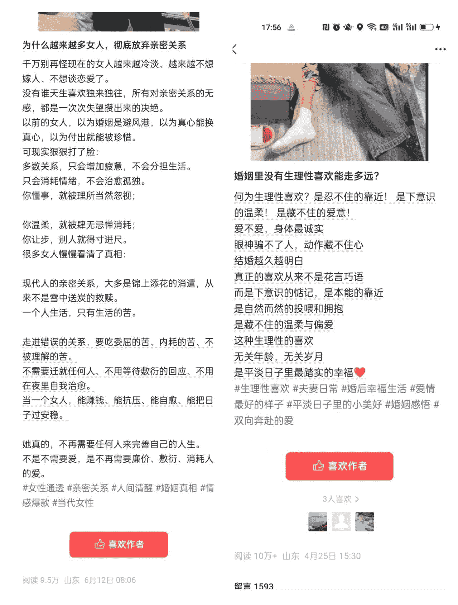

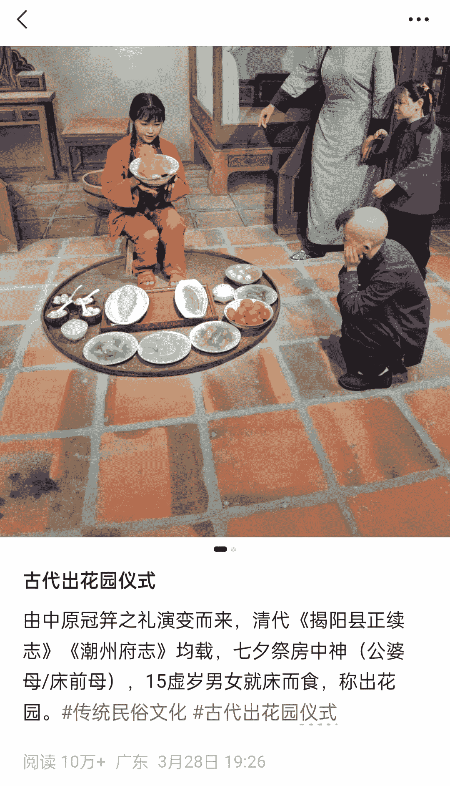

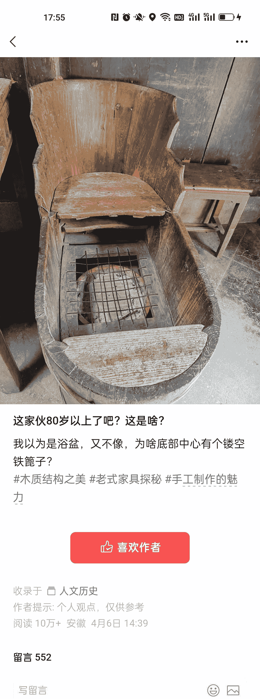

### 热点追踪

热点本身就是流量。🧣热搜、头条新榜、抖音热榜、📕热榜，都可以作为选题来源。社会事件、民生话题、综艺八卦、明星动态，全都值得关注。

但追热点有两个硬性要求：

第一，手速要快。热点是有黄金窗口期的，等你反应过来，红利早就没了。

第二，务必避开敏感地带。政治敏感、立场极端对立、价值导向有问题的话题，一律不碰。

新手蹭热点，千万不要只想着“蹭”。比较稳妥的做法是，从普通人的日常感触、亲密关系议题、女性自我成长、情绪共鸣这些角度切入。这样既安全，又能写出你自己的观点和温度。

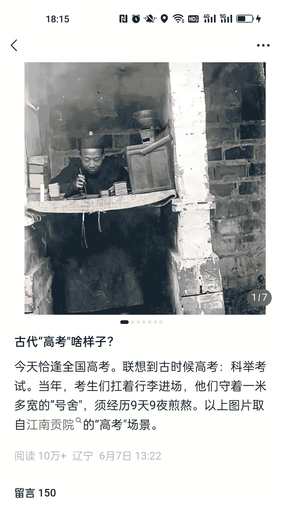

## 秦昊说，他已经被伊能静删好友删习惯了，这事你们怎么看？

在很多人的印象里，伊能静几乎是“完美女性”的模板：高情商、相貌好、有才华、会赚钱，还有一个比自己小10岁的丈夫，而且秦昊对她也是出了名的宠。

但那些看似完美的表象之下，其实他们和普通夫妻没什么两样，照样会拌嘴、会有小摩擦。

当我看到秦昊说自己经常被伊能静拉黑时，第一反应是觉得她有点可爱；但同时也会想，生气就删好友是不是有点孩子气？

细想想，每一对伴侣都有自己独特的相处模式。如果删好友这件事，能让她快速消气，也能让另一半第一时间意识到问题跑来道歉，那就算不够成熟，又有什么关系呢？

都说被爱的人有恃无恐，我猜伊能静大概就是这句话最好的注解。

## 四、选题→内容→标题，我的完整创作流程

我现在做内容，绝大部分精力都花在选题和标题上。因为无论是贴图还是长文，标题都是决定成败的第一道门。

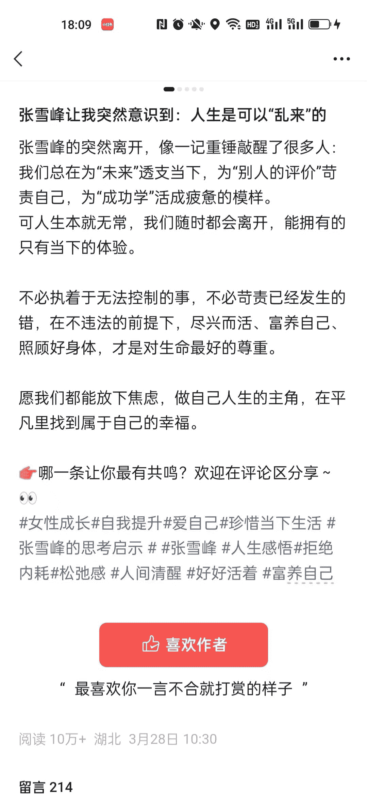

用户愿不愿意点进来，第一眼看到的就是标题。

### 跨平台淘爆款

前面提到，通过AI可以整理出一批与赛道相关的流量关键词。接下来，你要做的就是把它们丢到其他平台去搜索——📕、抖音、头条、🧣都行——看看有没有让你眼前一亮的爆款，如果有，直接“拿来主义”。

我本人最常用的是📕。我在飞书上搭了一个采集工作流：看到不错的📕笔记就一键抓取，自动同步到飞书表格，然后再从这个表格里挑选题。

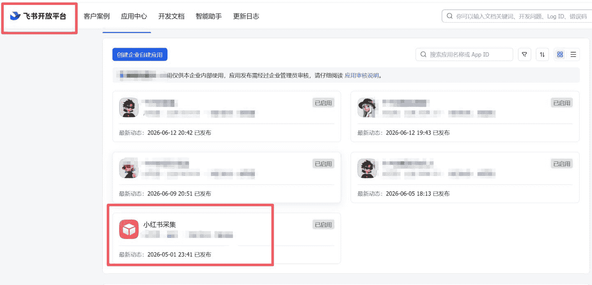

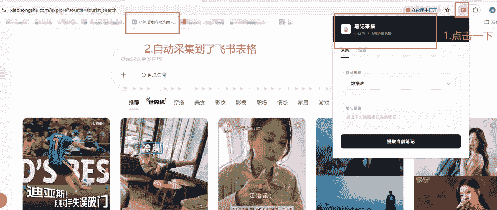

目前我只抓标题和笔记正文。因为基本是看到爆款才手动触发采集，所以没额外记录互动数据（如果你需要的话，配置采集器的时候加上这个字段就行）。

这样做的好处，我总结为三点：

1.  选题源源不断。一天就能囤好几个，就算哪天状态不好，也不至于断更。
2.  换个平台搬运内容。在别处火过一次的内容，大概率还能再火一次；同时，也降低了在同一平台被判定抄袭或洗稿的风险。
3.  一边找爆款一边挖对标。点进一个爆款，顺着作者的笔记列表继续摸，就能顺藤摸瓜找到一串对标账号。

但请务必注意，不是让你直接复制粘贴。比较聪明的姿势是：借选题，不借原文；借结构，不照搬表达；借讨论点，再加入自己的故事和态度。这样既能降低风险，也更容易形成自己的风格。

### 在🛰️生态里挖贴图对标

- 直接去服务号的信息流里刷贴图内容。
- 刷到感兴趣的领域内容，就主动点赞、评论、转发，让算法不断给你推荐同类内容。
- 建几个只有自己在的小群，把不同方向的选题素材分类丢进去。
- 看到爆款内容，往下拉评论区——下面往往藏着大量同类型的优质内容。
- 用你的领域关键词在🛰️搜索框查找，记得一定要勾选“贴图”分类，再结合“最新”“最热”排序来筛选。

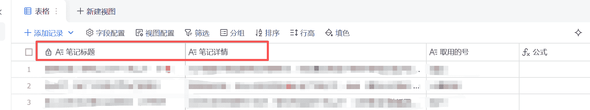

对标样本。

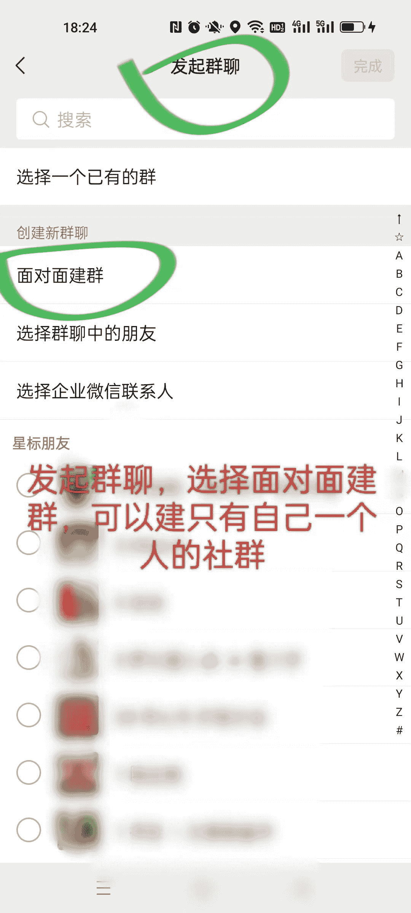

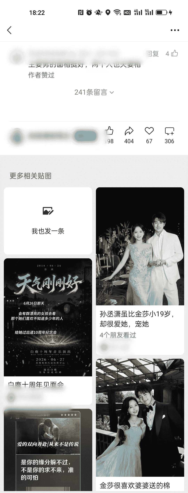

新手前期不要太相信自己的体感。多刷爆款，多盯同行，多看评论区。看得多了，网感自然就长出来了。

## 五、AI是提效工具，但不是你的替身

做贴图号这段时间，我最大的体会是：AI不会替你注入灵魂，但能帮你把效率拉满。

如果你只是把AI当成一个“一键生成器”，那你得到的只会是一堆没有血肉的模板内容。但如果你让它扮演拆解员、辅助员、加速器的角色，它会成为你的神队友。

**用AI拆解爆款**

遇到一篇爆文，直接丢给AI让它拆：

- 这个标题到底赢在哪里？
- 开头怎么设计的？
- 正文如何一步步推进的？
- 评论区为什么能吵起来？
- 它精准戳中了什么人群？
- 我能不能结合自身人设进行二次创作？

我特别建议新手：不要一上来就让AI直接写全文。先让它拆。拆得多了，你自然就明白爆款究竟为什么能爆。

**用AI做图片二创**

看到一种不错的图片表现形式，可以把参考图发给AI（我一直用ChatGPT，确实很强），告诉它：我想生成一张类似的图，哪些元素要换、哪些保留，场景需要什么氛围，文字用什么风格。最终得到的图，会和原图完全区分开。

底层逻辑就一句话：给AI一个参照物——保留爆款里最核心的视觉感觉，然后替换主体、换场景、换人物、换角度、换文字、换细节。这样既能吸收爆款的精髓，又能生成全新的原创素材。

下面放几个参考提示词，大家可以根据实际需求灵活调整：

生成相似场景的图：

帮我生成一张类似的图，白色的固体物像云朵一样，在马路上形成了比较新奇的造型。

PS. 具体哪些要变化、哪些要保留，你可以按自己的需求提出来。这类逻辑可以千变万化地应用，思路打开之后，玩法会很多。比如plog也能这样操作。

生成固定形象人物图：生成的图还原度真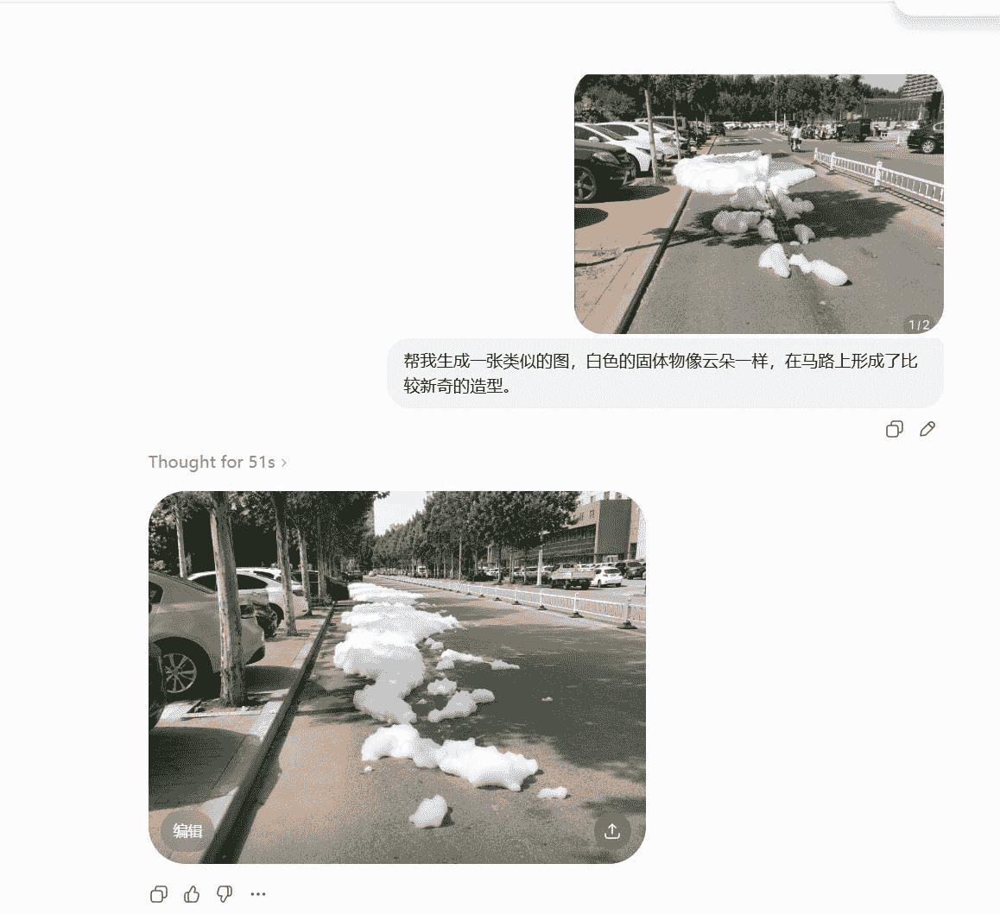的很高

请给我生成图1【主图】同样场景的图片
女生长相（五官和脸）与图2保持一模一样
服装场景随机，但需要适配
生成的图要有真实的微瑕疵，不要太像AI图

帮我用我的个人头像或者是照片（附件图片），生成5个场景的照片：

1.  躺在床上伸懒腰，穿长袖睡衣
2.  在书桌前阅读
3.  在书桌前记笔记
4.  外出逛超市
5.  外出散步

这里要提醒大家注意：👸号最近出了新规——如果你做的是露脸账号，之后很可能要求扫脸实名验证。

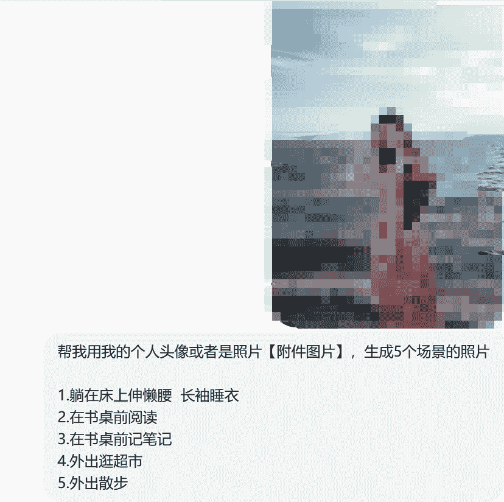

换句话说，你在内容里露过的脸，包括核心人物的人设长相，都必须跟你自己扫脸认证的通过结果保持一致。这一点一定要提前想清楚，做好风险规避。

**内容复刻：长文要“拆结构+塞进你自己的经历”**

如果是100字以内的短内容，直接让豆包或元宝帮你仿写就够了，但要跟它强调：重复率控制在20%以内。同时，你需要把需求描述清楚：

1.  发布渠道是什么
2.  字数要求多少
3.  产出标准是什么（比如：需要标题+正文，重复率低于20%）

做内容确实没有捷径，但方法对了，新人的试错成本能大幅降低。希望这篇复盘，能帮你少走一点弯路。

长文章不要直接甩给AI生成，先拆骨架再注入自己的信息，最后用自己的口吻润色，跑通这套流程，内容才会有灵魂。

这套打法是我反复琢磨刘智行老师分享的思路后落地的。要特别感谢刘智行老师，干货帖里给的实操方法和提示词帮了大忙，其中拆解提示词和模仿提示词我都用上了。

整体操作我梳理成了这样：

1. 挑两篇同赛道的头部文章，一篇用来拆结构，一篇作为表达参照。
2. 把结构拆解的那篇交给AI，配合拆解提示词，让它把开头钩子、节奏转折、收口方式等骨架完整拆出来。
3. 把拆出来的有效部分与我的人设设定做融合。
4. 再把第一篇的拆解结果配合模仿提示词一起发给AI，让它学习第二篇的表达习惯。
5. 模仿前不直接出正文，先让AI给出提纲并主动提问。我会先审提纲，不合适就直接让它改方向。
6. 在回复提问的过程中，把真实的人设、经历、核心观点和思考方式补进提纲。这个环节决定了底色是不是我的。
7. 让AI基于确认好的提纲统一语言风格。
8. 初稿出来后，我会在中间留白自己写几段，最后通读一遍按自己的习惯改写，口吻才对得上。

**提前建库，模仿才不会跑偏**

正式开模前我会做两件事：

1. 建立风格库：把过往写的文章整理成一份表达风格文档投给AI，让它先熟悉我的用词、节奏和语气再仿写。
2. 持续沉淀素材库：
3. 用飞书长期记录人设、故事线、价值观等养分，随时调用。
4. 把曾经的爆款单独归档，标题、结构、评论区高互动点全部拆出来。

这样AI能摸清我的思考方式，也知道在我号上什么人设和题材容易出圈。

## 六、提高收益：用贴图试水，用长文收钱和信任

**收益来源**

👸号粉丝达到100就能开通流量主。开通后只要持续更新就有广告露出。

贴图的广告主要落在评论区，长文的广告则分布在正文、文末和评论区。文章越长，广告位越多。比如我2000字左右的文章，正文里就能放两条。

阅读越多，广告收入越高。不同赛道单价差异很大，单价高的赛道同样阅读下收入更好。

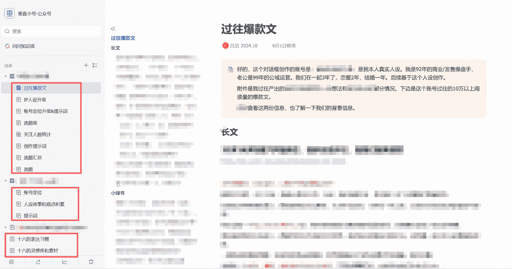

**贴图：核心是评论区的讨论度**

做贴图不能只追求好看。关键是能不能让用户愿意评论。评论区越活跃，广告展示机会就越多，所以选题一定要有可聊性。

我常用的可聊方向有：

- 婚姻里的矛盾点
- 亲子教育里的冲突
- 反常识的生活议题

只要给读者一个发声的理由，评论区就容易活起来。

我的经验是，贴图里一定要埋一个能引发站队的点。

比如我之前抛过“姐弟差7岁，是否要生孩子”的话题，瞬间引来大量观点。

还有个小操作：刚发出去后，先让身边的朋友评论到3条左右，顺便检查广告是否已挂。后面一旦有自然曝光，就更容易产生收益。

总体来看，贴图号的广告收入也很可观。

我一个账号每天曝光在3000到5000之间，带来的阅读在五六万左右，日收入大概在100左右。

**长文：更适合赚钱和建立信任**

手感稳定后一定要长文和贴图一起做。

很多人担心两者一起发会冲突，其实完全不会，反而是互补：

1. 贴图负责探路、测题、拉曝光
2. 长文负责提收益、沉淀信任、锻炼写作能力

而且长文的流量主单篇上限更高。文章内、结尾、评论区都能放广告，曝光更充分。

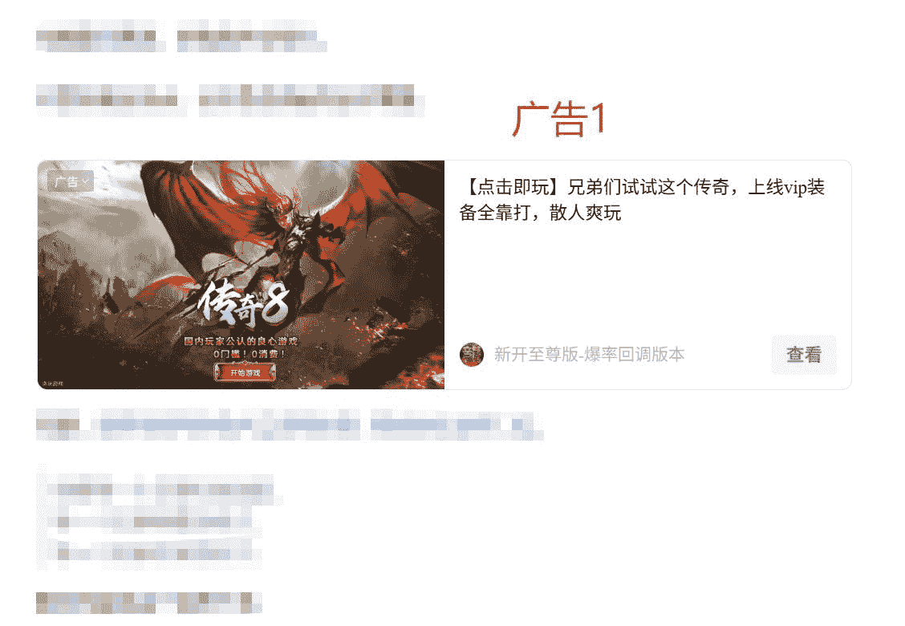

我之前的实测是：四五万阅读的长文7天累计广告收益七八百；贴图就算做到十多万阅读，收益也只有一百左右。

注：以上数据为单篇发布后7天内的累计广告收益，7天后不再显示，仅供参考。

所以我的组合策略是：贴图用来找题，长文用来收钱和建立信任。

从长期来看，靠流量主赚钱只是前端正反馈。如果你未来想做IP、私域、产品、陪跑、咨询，长文才是最核心的信任资产。

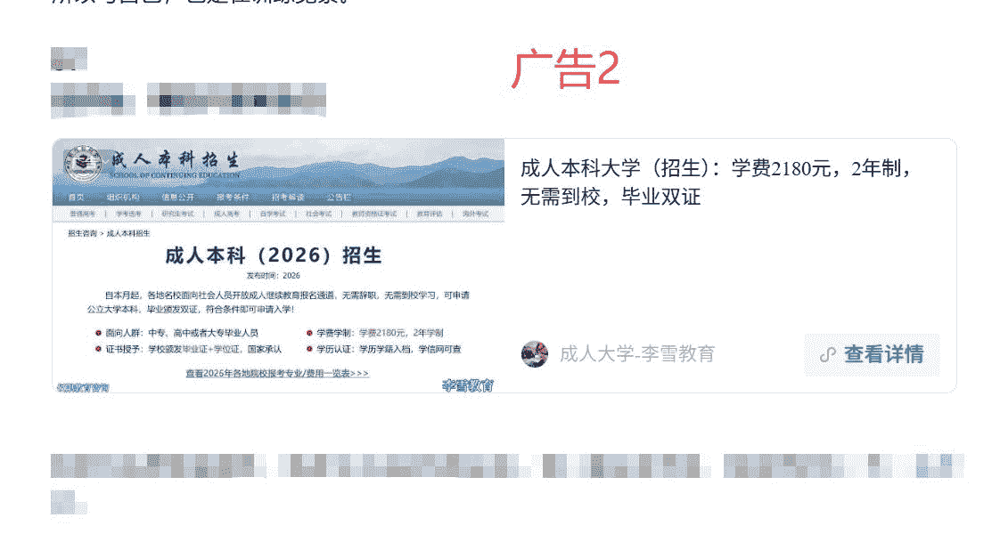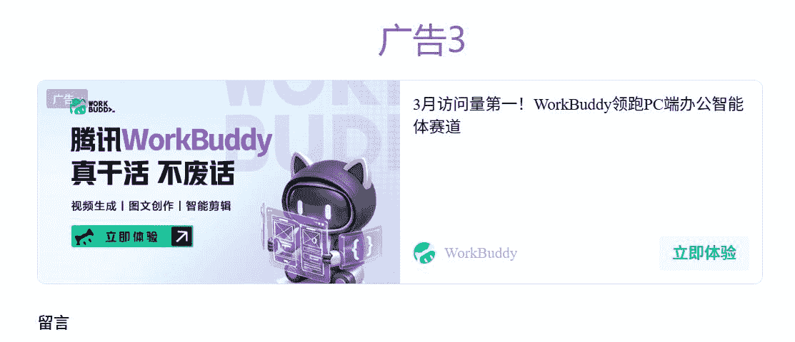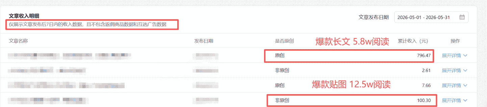

提升单篇收益的几个实操点：

1. 长文控制在1500-2500字之间：广告位能稳定保住2-3个，太长完读率会掉。
2. 标题里放停留钩子：用对比、选择、反常识的句式，让人愿意多看几秒。
3. 自然引导评论：内容里埋一个开放性问题，别硬诱导，让讨论自然发生。

## 七、新手容易踩的坑

**注册入口别选错**

这是最常见的一个坑。朋友圈里分享贴图时会出现转贴图按钮，一点就可能把注册权占了。

贴图号的注册方式和👸号一样，必须去订阅号助手App或👸号网页端操作，才能开通流量主。🛰️内部的入口注册是没法绑流量主的。

注册方法：

1. 手机端：应用市场搜订阅号助手，下载后用🛰️登录，注册新号并完成实名认证，再补全资料。
2. 网页端：
   (a) 准备手机号和邮箱
   (b) 浏览器搜索🛰️公众平台，进官方页面
   (c) 点立即注册，选择个人和媒体类目，再选个人订阅号

注册完就能发长文和贴图，流程就通了。

**多账号要提前规划实名和运营**

现在平台对绑定的管控越来越严，多号运营一定要提前想好谁实名、谁使用、谁发布。

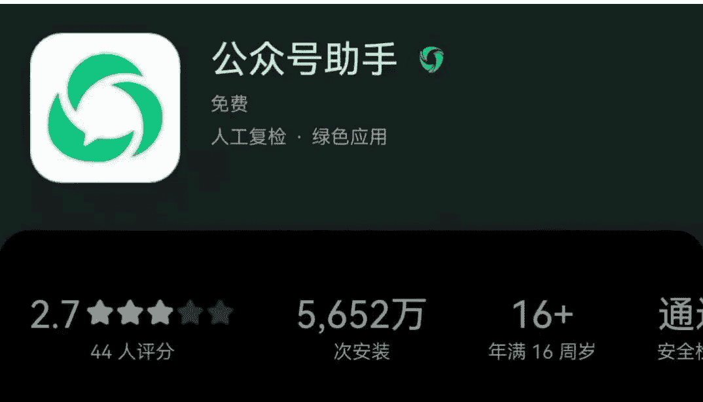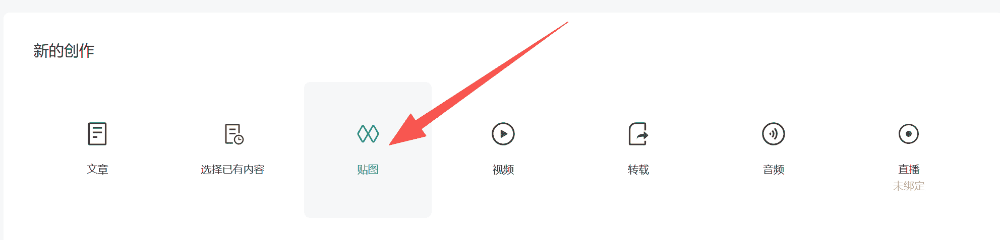

最稳的做法是用家人的身份证注册一个🛰️小号，用这个小号去绑定👸号。这样账号由你实际操作，扫码、验证都方便。

如果有营业执照，也可以直接用企业主体注册，再把自己设为运营者。

在规模起来之前，我建议先用家人实名的个人🛰️号绑定，简单高效。

**没有多部手机，电脑发布怎么隔离环境？**

可以用多浏览器加无痕模式来区分账号。

比如我的Edge就有专门的发布入口，可以用Codex帮我配置隔离链接，每次发布信息都会被清空。

缺点是每次都要扫码，如果账号不是自己的🛰️登录，就比较麻烦。

我现在用的是比特浏览器，给不同账号设置不同地区和域名隔离。用起来稍慢，套餐升级后体验会好很多。

**老号不一定废，先测再说**

我有个注册快十年的老号，之前被冻结过，后来发过国学、中医、星座内容，三个月阅读基本都在百以下，甚至零阅读。我一度以为号废了。

后来大号限流，我重启它。结果第三篇就突破300阅读。这说明号本身没问题，只是之前内容不对。

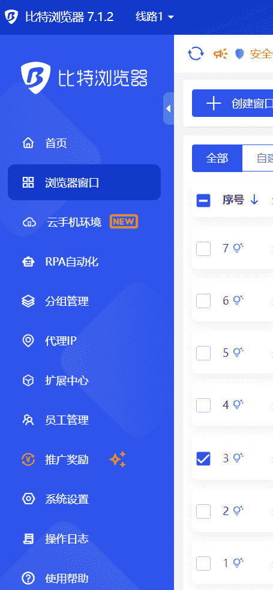

我的判断标准是：

1. 连续发一周试试，没动静且账号资产不重要，就可注销腾名额。
2. 如果阅读和播放还能起来，就把重心放回内容创作。

**助推券别乱用**

粉丝到500、收藏划线达标后，平台会送流量助推券。

我早期用过一次，流量短期冲上去后，之后大幅下跌，从日十几万掉到几千。后来才知道用助推容易被人工抽检，于是新号的券我全部没用。

**限流了怎么办**

我的大号被限流过三次：

1. 第一次停一周，恢复后爆了一波。
2. 第二次停三天，阅读从10万掉到三四千。
3. 第三次很严重，二十多天都没恢复。

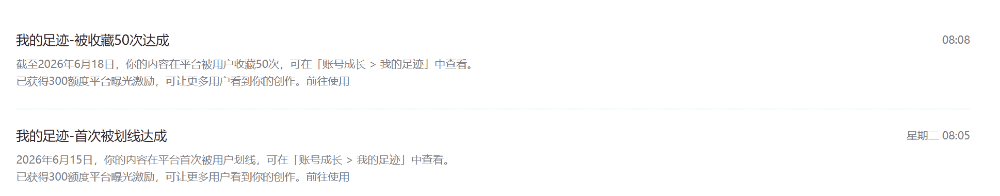

主要原因都是低原创度和不当信息。用明星热点二创，图是别人文章里直接搬的，热点晚了两三天跟进，没有独特观点，算炒冷饭。情感类内容评论区出现骚扰信息，也会影响判定。

第三次限流后我找平台反馈，反被加了导流提醒，限流更重。

后来我起几个小号，刚注册一周就猛发，一天三条，内容还是AI生成加AI假人设图，阅读从1000+掉到一百多就被判违规。

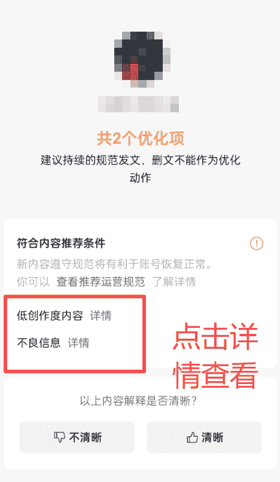

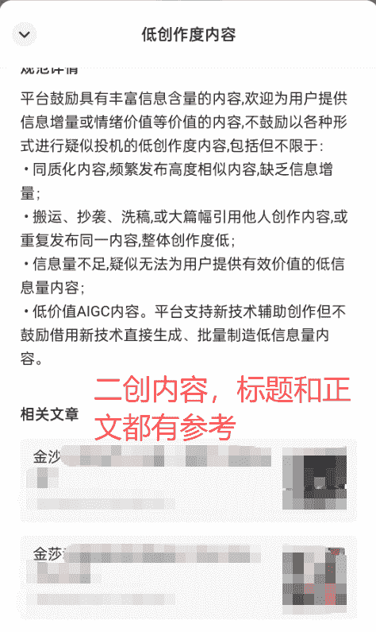

现在认识到假人设走不远了。三四月份很多AI美女封面号阅读过万，评论区全是色粉。我做情侣号也停掉了假人设，把限流号注销，正常号隐藏旧内容，全部换成真人设加长期积累素材。

那段时间我也动摇过，想过换赛道。朋友提醒我，现在确实比几个月前难，但比8月份可能反而是好时机。

从0到1和1到100的难度完全不同。用老能力去打低阶局会误以为自己进步了，等到同层级再打才发现根本不够。

于是我决定扎下去。一边用新号多赛道试水，一边深耕长文内容，研究系统和产品，第一个小产品雏形也出来了。

把这段经历分享出来，是想给同样卡住的伙伴信心。这个时候圈层的价值就体现了。

一个人做项目，很容易被短期数据带偏。在航海里你会看到别人也在卡、也在限流、也在调整，心态就稳了。

航海手册也能帮你把基础动作重捋一遍。很多时候你以为会了，再看一遍才发现收获完全不一样。

这对新手尤其重要。

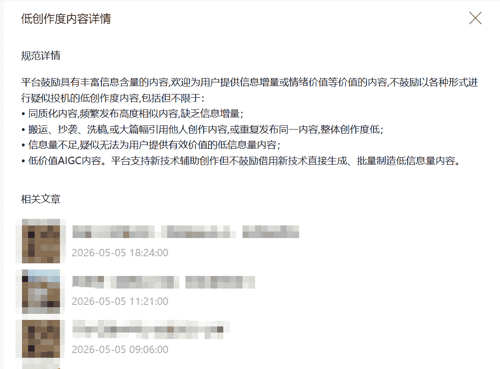

## 八、给新手的建议：先跑通最小闭环，拿到第一笔钱

想做👸号赚点零花，先从此刻开始跑通闭环：

- 第一步，正确注册账号
- 第二步，开通流量主
- 第三步，定2-3个测试方向
- 第四步，每天收集爆款选题
- 第五步，持续发内容
- 第六步，记录阅读、互动、收益
- 第七步，每周复盘一次

别追求完美，先干起来。

贴图号对新手的最大意义，不只是赚广告费，而是门槛低、反馈快，能快速拿到一次做成的体感。

对我来说，这个项目不只是9000多块钱的收入。

它让我确认了几件事：

- 第一，真实故事是长期内容资产。
- 第二，赚钱的价值不只是资料，还有人、活动、航海和圈友。
- 第三，普通人做项目，先跑通闭环再谈放大。
- 第四，卡点时先拆解问题，别急着逃跑。

## 【致谢】

最后真心感谢赚钱。

没有赚钱520，我可能遇不到我老公。

没有那个真实故事，我可能不会这么快在👸号拿到爆文反馈。

没有赚钱的项目资料、航海手册和圈友讨论，我可能也不会这么快把流量主跑通。

真的很感恩~

————分割线————

看完SOP你可能觉得懂了，但90%的人实操第一步就卡住。

工具和教程是最不值钱的壁垒，真正值钱的是立刻动手和圈层信息差。

我们只聊商业闭环拆解和AI效率压榨，系统里已沉淀1000+跑通的实战案例。

👉 查看圈子数字资产与上车门槛：

https://lazyso.com/insider/

备注：【实操上车】，不闲聊

