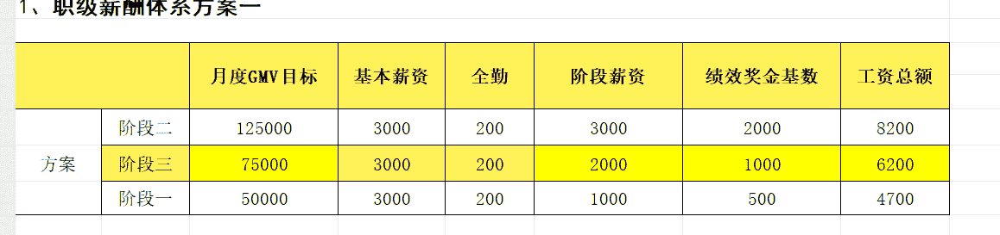

# 📕工作室3-4人小团队搭建指南：场地/招聘/培训/SOP和薪资设计经验分享

我是晓豪，目前坐标江西吉安，做📕创业已经第四年了。从最初一个人干，到如今工作室稳定在3-4名全职伙伴外加2位长期兼职，主营图书和虚拟资料。今天想把自己的团队搭建过程掰开揉碎讲一讲，希望能给同样在观望、纠结“要不要招人”的朋友一点参考。

先说说我为什么一定要从单人模式走出来。

说实话，单打独斗的时候，我的状态是“全年无休、用时间换钱”。每天从早到晚围着客服、售后、笔记打转，忙到晕头转向，业绩却不见涨。更可怕的是没有精力去看行业趋势、研究新玩法，只能被动地重复着既有的工作，本质上就是给自己打工，回报还很低。当时我一个月利润大概只有6000块，却已经累得不行。也想过招个全职客服，但利润根本撑不起人力成本；找兼职客服又担心不靠谱。后来我先招了个兼职做素材，磕磕绊绊换了三两个人，花了三四个月才把流程跑通。客服这边，我尝试了外包，从早上八点到晚上十一点、一个月500条咨询也才600元，确实便宜，但外包人员不稳定、对业务不熟，刚培养好就换人，让人非常头疼。

也正是那段经历让我明白：靠一个人堆量、堆时间，天花板实在太低了。真正让我下定决心组团队，是我想清楚了两件事。

第一，团队能让业务走向流程化和标准化，而不是依赖某个人。理想状态是：每个环节都有专人负责，业务能按标准自动运转，整个团队实现“1+1>2”。到了AI时代，有些岗位甚至不一定要用人，流程设计好了，能交给agent的就交给agent，需要人的再招聘培训。负责人的核心任务，不是亲自做事，而是持续优化流程标准，同时寻找新的增长点。

第二，团队能显著提升竞争力。比如遇到📕电商早期那种风口，发笔记就能出单。一个人再拼一天也只能写那么多篇；如果有团队能快速批量产出，就能抢到更多流量。等市场卷成红海，前期赚到的钱和腾出来的时间，又能用来升级玩法、构建护城河。我越来越认同：好的管理本身就是业绩放大器。

不过，不是所有人都需要搭团队。我总结了三类情况，其实没必要：

一是项目本身不合规，或者只是一阵风。比如之前很多人做AI账号代充，平台大规模封禁，没有技术门槛，一个人偷偷赚钱就够了。就算组了队，今天爆单明天封号，员工学会了还可能单飞。

二是项目稳定，但没法复制扩大。像强IP型项目、知识付费、流量主这类，核心价值在你个人身上。招人不会让业绩增加，反而要花精力去管理培训，还不如用AI替代部分工作，顶多招个助理打杂就足够了。

三是自己确实没有带团队的能力基因。怎么判断？第一，你敢不敢要求别人、拒绝别人；第二，能不能把复杂的事用几句话讲清楚。第二点还可以练，第一点往往是性格问题，很难改。如果招来的人你不敢管、不敢拒绝，团队迟早散掉。

如果真的想清楚了要搭团队，那第一个绕不开的就是场地和招聘。

很多人觉得线上办公就行了，但我个人体验下来，线上招聘的效率、氛围和学习接受度都会差很多。线下带团队，培训和管理能力才能真正练出来。好的场地要靠蹲。我租的第一个办公室，56平只要1000块，市场价是1500，因为在老市中心，我盯了差不多一个月，天天刷中介和物业信息，才等到这套低租金的房子。后来换到居民楼，133平1600元，但办不了图书的特许经营许可证，只能搬走。现在住的写字楼115平3750元，政府补贴了一半，环境和招聘都好了很多。一二线城市的朋友，前期可以考虑创意园区，很多都有补贴，也有三四十平的小格子间；大学城附近也是不错的选择，虽然偏一点，但招人容易、房租便宜。我的思路是：前期先用兼职把流程和培训思路跑通，标准化做好了再换好场地、招全职。如果培训思路还没落地就租个贵办公室，压力会很大。

招聘渠道，我比较推荐BOSS直聘这类软件。前期千万不要找熟人，你自己还不稳定，没必要拉熟人下水，而且出了问题很尴尬。薪资按当地水平来就行，前期就当花钱买经验，效率优先。

关于SOP，我踩过一个大坑：一开始总想写一份“一看就会”的完美文档，结果发现根本不现实。业务在变，人也无法靠SOP理解业务内核。真正的SOP不是束缚思维，而是兜底——保证产出不低于一个最低标准；如果谁有更好的想法，完全可以做得更好，工作室也愿意为此奖励。所以SOP只需要记录关键节点，比如内容模板、选题标准、交接流程。

我们之前做虚拟资料项目，选题分三类：每年都会爆的常青款，稍微加一些创新；监控同行新品，发现异常增长就迅速跟进；还有就是行业里的新热产品。内容上，我每天收集优质模板，大家每天三分之二的笔记按模板来，剩下三分之一可以自由发挥。交接流程也很简单，直接在共享文件夹打标签，兼职做完备注【已制作】，我审核后打【已审核】，客服同步后打【已同步到网盘】，运营接下一棒。另外每隔一两天，我们早上一起看后台数据，分析增长原因和趋势，形成讨论和优化氛围。

培训的思路，我总结成一句话：我说你听，你说我听，我做你看，你做我看。

“我说你听”要讲清楚为什么做这件事、怎么做，用什么工具、方法和参照。但光靠讲不够，所以要“你说我听”，让对方复述一遍，你就能发现他哪里没懂，也能避免有人怕丢面子不好意思问。然后“我做你看”，亲身示范一遍，注意是示范，不是亲力亲为，要按流程走，让对方学到可复制的方法。最后“你做我看”，盯着过程和结果，不按流程走的必须指出来。先僵化，再优化，最后固化。

如果按标准做了三到七天，对方效率和质量还是不达标，那就果断换人。换了几个人还是不行，就要回头反思自己的沟通和培训方式了。

从个人到团队，一定会经历阵痛期。把活交给别人，你讲得再细，他们做出来的东西也可能和你的预期差很远，业绩甚至会下滑。一开始我会怪他们不用心，后来才明白，这其实反映的是我自己的管理能力和培训能力薄弱。怎么提升？只能多带人，没有捷径，和做素材一样，做得多了自然就会了。

另外，当团队到了两三个人以后，负责人的定位一定要转变——从“把事情做对”变成“做对的事情”。你的时间应该大量花在调研市场、外出学习、找资源、收集信息上，因为选择一旦错了，大家再努力也拿不到结果。同时你还要服务好团队：工具、方法、账号、资金、思路，甚至一把舒服的办公椅和员工的情绪问题，都要准备好、解决好。没有稳定的后勤保障，大家也是“巧妇难为无米之炊”。

最后说一下扩量。我用人效来衡量，工资4000块，如果产出利润低于4000，ROI小于1，那就是亏的；1到2倍也勉强；我个人认为至少要做到2到3倍，也就是能产出8000到1.2万利润，这是最低可接受的标准。因为招聘还有筛选和培训成本，可能来两三个人只留下一个，培训一两个月才能产出，这期间隐性成本至少有八千到一万。所以如果半年以上的员工连这个标准都达不到，就别急着扩张，说明培训流程或管理出了问题，人再多反而是负担。

还有一点要平常心看待：有时候你发现团队看着业绩涨了，年底一算账，可能还不如一个人干的时候。这种情况往往发生在项目红海期，市场内卷，以前一个人能赚三五万，现在三个人合力也就赚个三五万。这时候团队的价值不是立刻创造更多利润，而是把你从重复劳动中解放出来，让你有精力去做增长、升级玩法，再反哺团队。

小团队的一切都要从简，所有跟业务无关的流程和管理都是负担。我自己一年半换了三个办公室，每次搬家都耗费巨大精力，但对业绩没半点帮助；我还尝试过学大公司做精细SOP，结果发现简单的业务根本没必要，一句话能说清的事，非要写个文档纯属浪费时间。记住，小团队的核心目标就是生存，想尽一切办法把业绩做起来。

至于薪资设计，我的建议是紧密结合人效和ROI来定，具体数据因行业和地区而异，但原则是让伙伴感受到“做得越好，拿得越多”，同时确保工作室的投入产出可持续。这个方向想清楚了，细节再去落地就不难了。

回头看，我很庆幸当时选择了组团队。这条路不一定让利润立刻翻倍，却能让你有精力去思考更重要的事情，也能让你在波动中站得更稳。如果你也在犹豫要不要搭团队，不妨先对照上面的情况做一次诚实的评估，想清楚了再动。团队不是目的，更好的生存和发展才是。

分享三线城市工作室的薪酬打法，以及我在组建团队路上踩过的坑

先说薪酬结构，我目前用的是三种组合方式：兼职做素材生产，全职负责账号运营，我自己扛核心决策。

# 六：团队搭建的实操体感

招第一个全职最磨人。办公室基本就是我一个人，外加一个新来的，全程压抑感拉满。感觉就像相亲，先看上我的简历，再被我劝退；我觉得能用的，人家嫌钱少。光找这个人就折腾了我快一个月。

培训上，全职和兼职走的流程在我这里其实是同一套。区别只在选人标准。全职我会偏向找学习消化快、有点主动性、眼睛活的人。因为一旦长期干下去，业务会带着他一起变。兼职我只用他把重复性、不用动脑的活干完，不考核业绩，相当于花钱买我自己的时间。

对全职的预期是能出结果并且能把现在这套东西复制出来。所以我会给一个明确的业绩模型。比如我要他做到5W月销，我就先把我自己做5W的路径拆清楚：测多少品、发多少条笔记、投多少广告、模板长什么样、标准线在哪。每天早上给他一个清单，哪些今天必须完成，标准是什么，然后去执行。

理想很丰满，现实总会乱。有人做到一半离职了，前面的培养打水漂；有人带了几个月还是起不来；业务要转，之前的玩法不行了得重新研究内容方向。这种不确定性太强了，没有万能方法，只能边走边改，尽量提前把坑堵上。最头疼的永远是人的稳定性和情绪。

有了一个全职后，办公室就我和他两个人。一定要把氛围搞好，偶尔点奶茶、聊聊天，不然每天就两个人对着干活，压抑无聊，离职率会很高。当然给的钱特别高另说。这段最好尽快过渡，赶紧把第二、第三个人招上来才稳。

业务跑顺了，人也稳定了，就会进入扩量阶段。那段时间很忙，但也很有劲，因为能扩量就说明模式是可复制的，第一个人的SOP已经跑通了。这时候组织定位和流程都要跟着改。

管理团队我只看一个东西：业绩。业绩好的时候基本不用管，大家自然往前冲。业绩一掉，我自己先焦虑、手开始乱，团队得不到清晰反馈，这时候再去管也意义不大。

起步期花大量精力打磨流程和培训是必须的，等熟了就不用管那么多，最终还是回到最本质的一点：能不能赚钱。很多解不开的问题，最后都是增长的问题。当公司在高速增长时，管理和其他内耗就不是问题。增长，才是第一性原理。

我、他、兼职分工大概是这样：

| 我 | 全职 | 兼职 |
|----|------|------|
| 核心决策、选品、内容模板制定、关键运营 | 负责账号运营 | 制作素材 |

拿目前做的图书举例，我每天会用AI大量监控同行动态，刷爆款内容和行业的新品，把有用的素材和更新同步到素材库，有新品就联系供应商寄样。 全职也会刷爆款找选题，基于当下数据好的品或者新品，用我们固定的内容模板去做。一个人负责4个账号，每个号3-5条笔记。我会先过一遍确定再发布，他们自己盯数据，每周开会根据数据调整方向。兼职就是纯做素材的执行。

# 七：我踩过的坑

## 别合伙

合伙基本分两种结局。

一种是和没结果的人合伙，比如朋友熟人或者信任的员工。几乎都会不欢而散。核心是对方跟不上你的节奏，业务在变，他起步晚又难以全身心投入，差距越拉越大。最后业务需要你全包，他只做执行，却拿合伙人的钱，权责不对等，矛盾必然来。

另一种是和能独当一面的人合伙。这种人要么有能力有野心，会优先去大公司或者资源更好的地方发展。要么你合作了也很难持续给他成长空间和预期薪资，他早晚会走。如果对方能力比你强，合伙就等于把话语权交出去。除非结果非常炸，否则还是自己来更稳。

## 小团队别铺摊子

我当年犯过一个大错，觉得人多了可以拓展别的项目。试了快一年发现根本不现实。团队小的时候去分散精力，现有项目必掉。流程标准化了，员工能承担基础工作，但市场变化、新品洞察、内容形式切换这些敏感的感知和决策能力他们没有。没人牵头，业绩就会下滑。团队小的时候一定要集中火力死磕一个项目。你必须紧盯市场、同行、用户需求，不断优化产品和流程，再让他们去大量铺笔记和成交。一个人做时怎么做都赚钱，团队做时你必须保持对市场的敏感度，才能稳定甚至拉升业绩。

## 求之于势，不责于人

业绩是方向对了+资源够了+执行到位才可能出现。缺了前两项，再努力也是巧妇难为无米之炊。 业绩好坏90%的责任在我。我觉得人不行就换人，业务不行就换业务，调控权都在我手上。他们是执行者，对结果有影响但不大。

## 钱权责要对齐

钱要砸在能带来增长的点上。对人也是，能创造业绩的人多给钱，动力自然来。不能创造业绩的就给基础薪资。 我以前以为积极性低是因为钱少，后来发现不是。钱加一点，行为可能一点不变；再加很多才有效，但长期来看他会觉得钱是应得的，甚至嫌少，态度又会回到原点。这是人性，不是钱的问题。

一定要把结果和收入挂钩。做店铺就拿店铺提成，加私域就给私域的钱。不要觉得他有空就顺手做，长久一定会消极。职责范围要提前说清楚。

## 小工作室招不到大神，降低预期是常态

人才市场就像漏斗，好的先被大公司收走。来小工作室面试的人，能力、执行力、性格往往达不到预期。这是正常事。反过来，如果你能给高薪和成长空间，也能筛选到学习能力强的人。招聘就多筛多试岗，不合适就快刀斩乱麻。时间成本和机会成本最贵。

## 培训即可，别谈培养

培养一个人成本太高也不划算。按标准化培训，留得下就留，留不下就算了。除非对方真的极度想学，否则教不动。

————分割线————

看完这套SOP，你可能觉得懂了。但90%的人卡在第一步就动不了了。

工具和教程是最底层的壁垒，真正拉开差距的是“立刻去做”和“圈层信息差”。

如果你想看全网最新在跑的变现打法，和一群执行力强的人一起下场实操，欢迎来我的核心私域：【懒人专属群】。

我们只拆商业闭环和AI效率压榨，系统里沉淀了1000+跑通的套利实战。

👉 查看圈子数字资产与上车门槛：

https://lazyso.com/insider/

认同价值、准备上车的人，扫码加我🛰️ lazyhelper1

备注：【实操上车】，不闲聊

