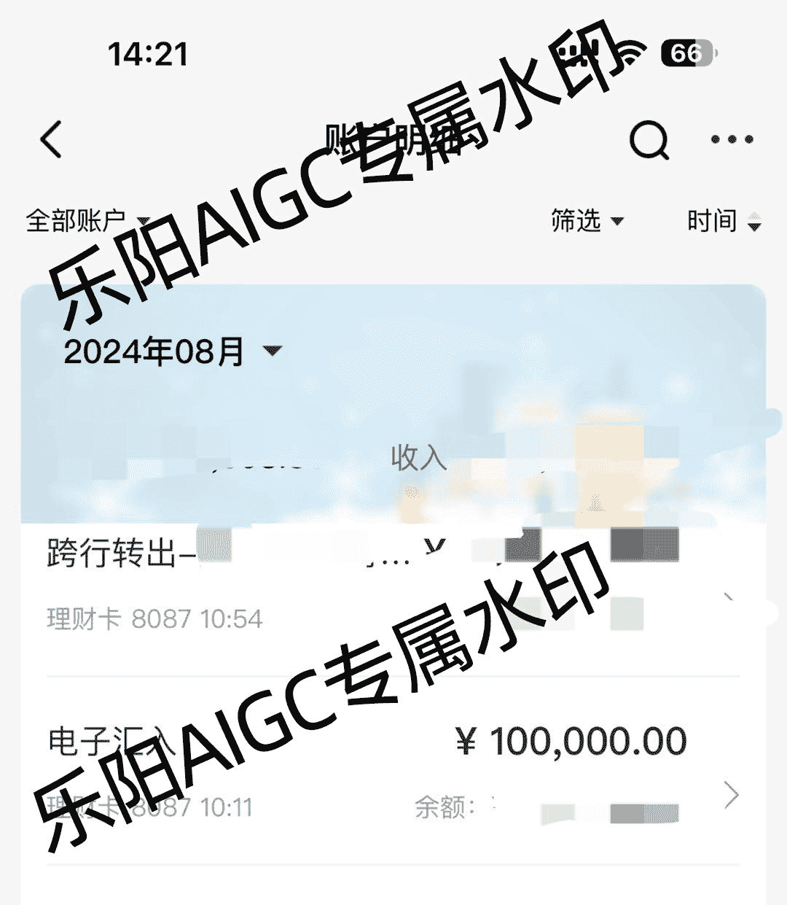
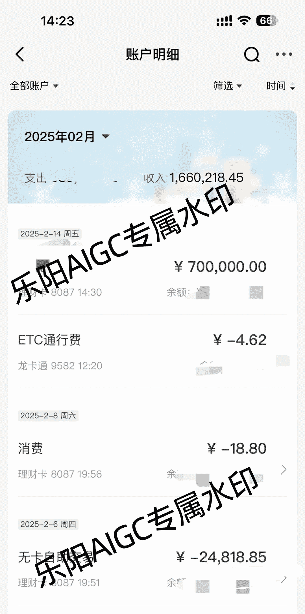
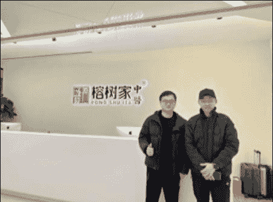
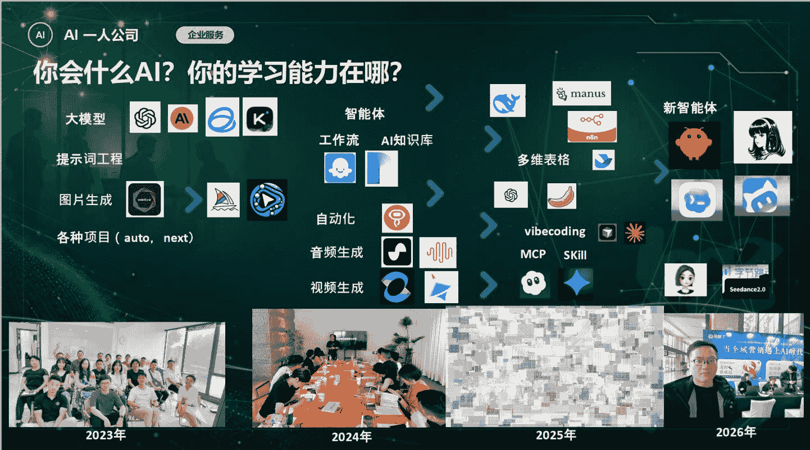
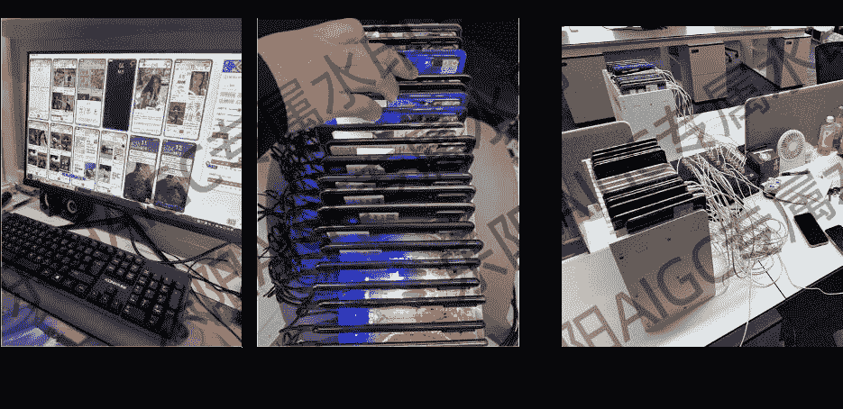
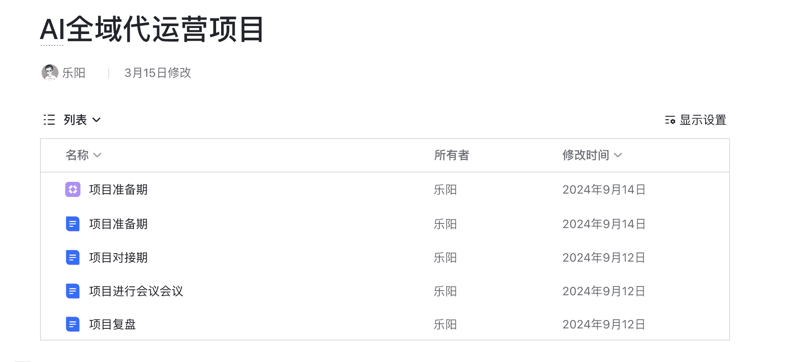
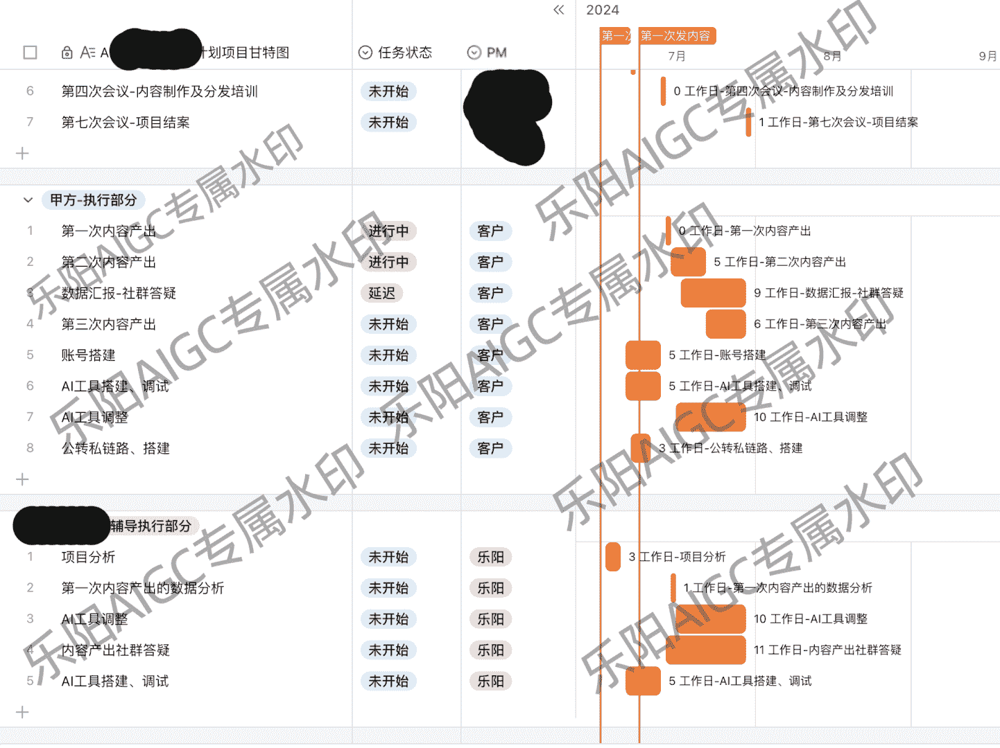
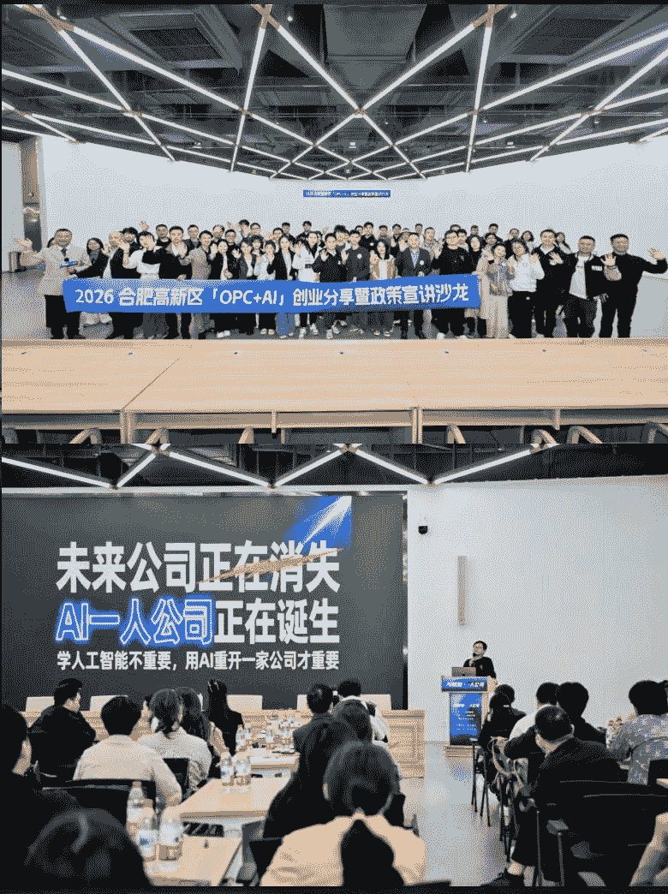
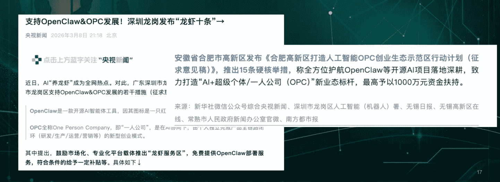

# 从 5000 元健身房订单到 100 万代运营合同：一个人做 AI 企业服务的完整复盘
作者：龙哥

大家好，我是龙哥。在赚钱做过好几期 AI 类航海的教练。

简单交代一下我的来路：上学时就折腾网赚，毕业后做电商，之后在某个电商赛道的头部品牌（全国前三）里做品牌操盘手。

2017 年我出来创业。没有回到电商老本行，原因很简单——电商太吃供应链、资金和库存，我不想碰货。于是切入了私域社交电商。

最鼎盛的时候，团队有 60 多人。2019 年之后业务开始走下坡路，我把这 60 多人全裁掉了。

之后转做短视频和直播，也做出了一些成绩。

这段经历留给我的教训很深：第一，裁员要赔钱；第二，互联网业务往往有生命周期，业务不行了你还得咬着牙发工资；第三，我认清了自己——根本不擅长管几十个人的团队。

从那时候起，我一直在琢磨：有没有一种方式，人很少，但业务依然能转起来？

后来这个概念慢慢被总结为 OPC（AI 一人公司）。

2023 年上半年我正式押注 AI 赛道，下半年进一步聚焦到 AI 企业服务，算是入场比较早的一批。

这些年我们做过企业内训、智能体和工作流定制，也接过代运营、算力采购和周边服务。

服务过的客户包括徐福记、红星、如涵 MCN、榕树家 AI 中医、西域美农、同光资本，还有新能源领域的上市企业等。

内训收费在 1 万到 3 万之间，工作流定制有过单笔 10 万，代运营最高做到 100 万。

来自定制客户

来自代运营客户

## 为什么押注企业端，而不是做 C 端

2023 年底，我给自己定了一个方向：只做企业服务，不碰 C 端。

逻辑其实很直白：面向个人的通用市场，阿里、腾讯、字节迟早会把每一寸土地都犁一遍。

这些巨头拿下 C 端通用场景只是时间问题。

企业端就完全是另一回事了。企业行业多、流程多、需求杂，大厂一口气吃不下。你只要在某个特别细分的领域深耕下去，就有自己的生存空间。

大企业

品牌企业

中小企业

政府类

媒体类

但做了这几年，我发现大多数人在迈出第一步时就错了。

我经常在现场问圈友：做 AI 企业服务，你觉得最难的是哪一环？

有人说拉客最难。

有人说是报价、信任、挖掘需求。

这些答案都不算错，但都只是表面。

找客户难、不会报价、技术不够——这些都是症状，不是病根。

真正的病根是：你根本没想清楚自己要卖什么。

你手里没有一个足够具体的产品。

“AI 企业服务”这六个字太虚了，它不是一个东西。

企业类型千差万别，需求也千差万别。

你跑到📕发一句“我做 AI 企业服务，欢迎来撩”——没人理你。

因为你连自己到底是干什么的都没说清楚。

- 手里没有具体的事 → 找不到精准客户，只能撒大网。
- 手里没有具体的事 → 每次见老板都变成免费科普课。
- 手里没有具体的事 → 定价全靠蒙，因为每个客户都不一样。
- 手里没有具体的事 → 交付越来越累，因为每一单都在从零开始造轮子。

拉客、报价、交付，所有环节的问题，都得从同一个原点说起。

所以我这场分享的第一句话是：

先把你卖的东西定下来，其他难题才会有解。

## 第一步：没有企业资源，第一单从哪来？

C 端客户和企业客户有一个巨大的差异：越大的企业越活在现实中，越小的个体越活跃在线上。一个知名品牌几乎不可能在短视频里随便找个陌生人合作，线下接触是绕不开的。

而我自己，恰好不擅长销售。一对一跟老板聊，我聊不下去，成交率很低。

早期经常遇到的场景是：约好下午 2 点到客户公司，聊到 5 点，老板说“我再想想”。

一下午就这么没了。

再早一点的情况更尴尬——很多老板压根不知道 AI 能干什么。你跟他讲两个小时，等于免费当老师。

老板不知道自己要什么，你直接推销，纯属盲人摸象。

### 与其免费上一对一的课，不如免费给一群人上课

换个思路：你反正是免费讲课，给一个人讲也是讲，给 20 个人讲也是讲。

或者更进一步，干脆收费来教？

这就是“搞分享”的底层逻辑。

2023 年我做第一场分享，是联系了本地一个读书会。读书会的人对新东西接受度高，我们就去讲了一场 AI 主题分享。

那次现场没有成交，因为当时我自己也还没想清楚卖什么。

第一次分享

分享完以后，读书会的组织者把我推荐给了本地的混沌学园。

在混沌我们又讲了一场。那时候混沌里基本没人做 AI 服务，里面的企业在这块完全是空白。

第二次分享

巧的是，那场分享我旁边坐了一位健身房老板。

我的第一单定制智能体——5000 块——就来自他。他说想做一个健身教练智能体挂在自己店里，不知道怎么弄。我帮他做完了。

后来，xx 卤菜这样的品牌也顺着这条线找了过来。

你发现了吗？分享不是一次性的动作，它是一张不断裂变的资源网。

分享的好处有两个，第二个容易被忽略。

第一个好处明摆着：你一场能覆盖 10 到 20 个潜在客户，比一对一跑 20 趟效率高得多。

一对一去谈，你的身份是销售、是推销员。

站上台讲，你的身份是老师。

讲完之后，不是你追着客户跑，是客户反过来追着你问。

这时候对方的势能比你低。哪怕你嘴笨、不会谈，你在心理上也占了上风。

我不擅长销售，但靠着这种方式反而能成交——因为客户是主动上门的。

### 分享主题就是你的筛子

主题不能乱定，它直接决定台下坐着什么人。

你讲“AI 怎么做📕获客”，来的都是做内容增长的企业。

你讲“AI 怎么管好 100 家连锁门店”，来的都是连锁品牌老板。

人群完全不同，需求完全不同。

这就是天然筛选，连你自己动手筛都省了。

当然，如果你做不了线下，线上自媒体也同样成立。选线上还是线下，本质看你的客群在哪：

如果目标是互联网、电商行业老板，他们平时泡在自媒体里，线上内容就有用。

如果目标是工厂主、传统实体老板，很多人不怎么刷自媒体，他们认的是面对面，你光做线上影响力就没那么大。

先想清楚你的客户从哪里接收信息，再决定你用哪种方式去触达。

## 三种客户，三种完全不同的打法

我把企业客户分成三类。

### 第一类：小微企业

规模在 1 到 20 人之间，多数是互联网、电商行业。

这类客户门槛低、沟通省劲，起步阶段非常好切入。

但有个麻烦——他们接触 AI 早，自己动手能力也强。

你去报价，他经常回一句：

“有点贵啊，我自己报个课学一下，让运营去搞不就行了？”

尤其电商老板，张口闭口就是 ROI。

所以这类客户的客单价上不去，基本在几百到几千元的区间。

电商其实是很好的群体：需求标准化、同行信息灵通、对要什么特别清楚。他能直接跟你说：我要批量出模特图，做成带字主图，单张成本不能超过多少。

赚钱圈友也属于这一类。

说句实话，我自己从没在赚钱接过单，因为单价太低的活我很少做。但如果你是从零起步、一个案例都没有，这里是最好的练手场——几百块的单子也接，先把流程跑通。

对零案例的新人来说，赚钱圈友就是练手的地方，钱少一点没关系，你真正要的是案例。

### 第二类：实体企业

品牌方、门店、工厂、传统行业。这也是我们现在服务的主力人群。

他们大部分人不懂 AI，但他们知道自己搞不定。

他们的心态是：你是专业的，全交给你了。

没想过自己学，也觉得员工搞不定。

这类客户对价格的承受力高很多，几千到 10 万都能聊，少数还能谈到几十万，关键看你的服务内容和背书。

整体溢价空间比第一类大得多。

这里多提一句——跟这类客户聊天，你完全不用解释自己用什么工具。

他不在乎你用的是 Coze 还是 n8n，更分不清 Codex 是什么。

你是用 AI 还是 UFO 解决的，你用的工具是不是最前沿的，他统统不关心。

他只看两件事：问题解决了没有，带来了什么结果。

### 第三类：品牌大客户

这类单子在 1 万到 100 万之间，甚至更高。

但要求完全是另一个量级：你要有背书、有同行业案例、有完整规范的项目管理和汇报流程。

没有案例基本谈不下来。所以一般建议先把前两类积累出来，才谈得上做这一类。

### 政府和高校，单独拎出来说

我的态度很直接：背书可以拿，钱别指望。

这类项目能给你带来曝光和信任积累。

但如果你没有门路、是陌生人进去，赚钱很难。大部分预算不足，顶多帮你宣传一下。

有预算的情况也有，但那要看关系和预算出口——有关系，才能赚到钱。

而且走关系拿到的项目还有另一个坑在等你：

通常要先垫资。

垫完了，回款周期说不准，没准明年才到账。

这中间你能不能扛住现金流，得先想清楚。

所以政府和高校对我来说，一直是锦上添花，不是主战场。

## 你擅长什么，也决定了你能服务谁

反过来问：你擅长哪类 AI 工具？这同样决定了你适合服务什么样的客户。

你是做哪个细分方向的？

比如圈友盖哥他们擅长 AI 设计，就是拿 AI 生图能力去服务企业。

这几年，AI 工具几乎每年一次大洗牌，新工具、新方案层出不穷，我们必须持续跟上。

## 第二步：谈单——30 分钟摸到真需求，报价不靠猜

我们早期踩过一个坑。

做那种大而全的 AI 分享，讲趋势、讲行业变化。

一场下来 30 个老板，30 种需求。

有人问 AI 能不能做人事提效，有人问能不能做📕，有人问能不能搞客服，还有人问能不能自动报税……

需求散成了一地。

需求一散，交付就难做。

你最多挑一两单接一下，剩下的没法复制。

这么搞，企业服务永远做不大。

### 把需求收回来

后来我们的做法是：收窄需求，把客户引导到你最擅长的那个点上。

我自己做过 6 年短视频和私域，有这方面的底子和案例。

于是我把方向定为 AI 营销获客。

不管今天来的是哪家公司，不管他开口说的是财务还是人事，我都把话题绕回来：

你开公司，总要搞客户吧？咱们先把获客解决了。

这样一来，我的服务面变窄，交付可以复制，效率也就上来了。

其他方向的需求不是不接，只在我们有空的时候顺手接。比如闲着的时候帮人解决人事问题、管理问题也不是不行。

有主线才有节奏；没主线，你就是天天救火。

举个例子，有次分享是在一个制造业城市，来的全是制造业老板。

我根本没做过制造业，根本无从服务起。

除非我砸大量时间去做深度调研，去搞懂他们行业里的种种细节。

制造业分享

### 跟老板谈，别跟员工谈

做企业服务，尽量直接对接老板，别跟员工或高管绕。

原因有两条。

第一，员工没有决策权也没有掏钱权。你跟他聊一下午，他最后来一句“我帮你汇报一下”，汇报完老板说“再看看”——你白忙一场。

第二，有些高管反而有敌意。

他会觉得你进来的目的就是把他的部门优化掉、把他本人取代掉。

我们有好几单就是这么黄的：老板非常认可，高管在背后说坏话，说方案不行、价格太贵，最后单子眼睁睁没了。

所以，一定要跟老板谈，让老板拍板。

那跟老板聊，到底聊什么？

我总结成四步。

#### 第一步：找到他最头疼的那根刺

先定一个主线，然后不管老板把话题扯到哪里，你都拉回来。

我的主线是 AI 营销获客，他聊啥我都往这上面带。

当然，如果你还没定方向，也可以开放式地聊。

问他：

- 公司哪个岗位最难招人？
- 哪个流程最容易出错？
- 哪件事最耗时间、最耗人力？

这些答案指向的地方，就是他最真实的痛点。

#### 第二步：确认他愿不愿意掏钱

找到痛点还不够，你要让他觉得这个痛点值钱。

最好的办法是帮他算账。

打个比方：这个岗位原来要 10 个人，现在 5 个人就够，一年省出多少工资？

原来一天只能出 1 个成果，现在能出 10 个，效率翻了多少倍？

这是老板最好理解的语言。

他不需要懂 AI，他只需要懂钱。

你帮他把降本增效翻译成具体的数字，他对付费的抗拒自然就小了。

#### 第三步：轻轻点一下焦虑

跟他提同行、提竞品都在用 AI。

他还没上，他已经在落后。

这招有效，但要点到为止。一带而过就好，别反复念叨，显得用力过猛。

让他自己心里生出“我是不是要掉队了”的感受，就够了。

#### 第四步：帮他把结果画出来

别问他“你有什么 AI 需求”。

大多数老板根本不知道什么是 AI 需求，你问了他也懵。

你应该换个问法：

你想过吗，三个月以后，你希望业务变成什么样？

或者干脆由你来画：

做完这个以后，你的这个岗位能从 10 个人减到 5 个人，获客渠道多出一条，流程出错率降到接近于零……

这张图景一旦画出来，它就是未来交付的标准。

这里有个细节要注意：

如果是互联网、电商行业的老板，你可以直接问需求。因为他们同行都在用 AI，他们脑子里有自己的具体想法，会直接告诉你“我要做批量模特图”“我要做 TikTok 店群上架方案”。

但你的客群不是这类人，就千万别直接问需求。

传统行业的老板，你一问，他是懵的。

他在乎的根本不是你用什么工具，他只要结果。

你要问的不是“你有什么 AI 需求”，而是他现在最痛的地方在哪。

## 报价：别盯着同行抄作业

很多人以为报价要参考市场行情，看看同行收多少。

但 AI 企业服务这个行业，根本没有标准价。

各家报得五花八门。

同样一个工作流，有人收 800，有人收 8000，有人收 8 万。

价格根本不是产品决定的，是客群决定的。

### 第一，客群决定价格上限

比如某个 AI 工作流，你给互联网电商老板报 8 万，他可能觉得你在割韭菜。

因为他信息灵通，大概知道市场是什么价。他会拿你跟同行比，他会算 ROI。

不是他不愿意花钱，是他的容忍区间就那么大。

但工厂老板、传统实体老板呢？

他的想法是：“这东西我搞不来，太麻烦了，你全包了最好。”

他从没想过自己学，也没想过让员工弄。

所以他对价格的承受力高得多。

同一个方案，电商老板那里报 2 万他说贵，工厂老板那里报 5 万他觉得合理。

不是你的产品变了，是你对面坐的人变了。

### 第二，痛点决定溢价

同样是工作流，你解决的是获客问题还是人事问题，价值感天差地别。

获客问题后面跟着的是收入，老板愿意为此多花钱。

人事问题呢？

他的内心戏可能是：大不了我再招两个人嘛，一个月 4000 块一个。

你的方案戳中的痛有多深，他愿意付的价就有多高。

越痛的地方，溢价空间越大。

### 第三，案例和背书决定你的报价上限

你有同行的成功案例，有相关资质背书，你就有底气往高了报。

没有，你就只能从低价起步，先把单子拿下来再说。

### 不同客户的大致价格区间

下面是我个人经验的一个大概参考，不是标准价：

- 小微个创类：几百到几千。能付，但超过 1 万很难聊，因为他们觉得自己也能学。
- 互联网电商类：几千到几万。他们会算 ROI，报价高了就比价，边界感要拿捏住。
- 传统实体类：几万到几十万。溢价空间最大，因为 AI 化程度低，需要你全包。
- 品牌大客户类：几万到上百万。前提是你必须有案例和背书，没有这些根本进不了门。

### 零案例，怎么拿下第一单？

如果你现在手上一个企业服务案例都没有，有两条路。

第一条：往更小的客户走，低价甚至免费换一个案例。

赚钱里有的是圈友，找一个跟你方向接近的，去聊：我想帮你做一套方案，收很少的钱甚至不收钱。

做完了，把过程、结果、数据全部整理成文档。

你的案例就有了。

有了案例，你再去服务更多同类型客户，报价就能往上走。

第二条：拿你原本的行业经验当背书。

- 你以前是律师，就服务律所。
- 你有电商背景，就服务电商企业。
- 你有新媒体背景，就服务内容公司。

你懂行业，比一个只会卖工具的人更容易赢得信任。

你缺的不是行业知识，而是 AI 案例。把这两样组合起来，就是你的差异化。

## 第三步：交付——把重资产做轻，一个人才能服务更多客户

我们中期踩过一个更大的坑：代运营。

当时我们想着，客单价要往上走，从几万提到几十万，甚至冲到 100 万以上，行不行？

我们设计了一个模式：AI 加代运营，帮企业做内容获客、新媒体全包，一起上。

还真接到了单。客户里有新能源上市公司、财税赛道前十的公司、K12 硬件品牌、各种中小公司。

但做着做着发现——完全接不了新客户了。

不是因为不赚钱，是因为太重了，时间和精力被吃干榨净。

单子接得到、做得了、也赚得到钱。

但想做大，很难。

你再往上加一个客户，时间就没了。

### 重在哪？

先说第一重：平台运营本身的各种杂活。

当时我们公司摆了一排手机，全是账号，抖音、📕、各个平台。

有 AI 工具辅助，我们原本以为效率会拉满。

但真正做起来，杂活多到超出想象：

- 封号了怎么办？
- 注册账号卡住了怎么处理？
- IP 被限流了怎么排查？
- 平台规则又改了怎么跟上？

这些 AI 替代不了，每一个环节都得有人盯着。

新媒体矩阵

再说第二重：客户要求开会。

只要你收了他 10 万以上，他就不可能只让你闷头干活。

他要开会，要汇报，要推进，要复盘。

第一次会讲什么，第二次会讲什么，时间节点怎么排，甲方确认什么，乙方交付什么——

全部要有标准流程，否则他根本不敢签这么大的单子。

而且开会他只找你本人。不找你的员工，不找 AI。

他觉得他付的是“老师”的钱，老师你就得亲自到场。

你的时间，就这样被锁死了。

这也正是我一直强调“轻交付”的原因：想靠一个人服务更多客户，就必须把交付做成可复制、可压减的形态，否则公司再小，也会被重模式拖垮。

以前我们做过很多种“轻咨询”类的服务，也跑过好几个流程闭环。后来，运营托管这条线被主动停掉了。现在只剩几份老客户的年度合同还在执行，等这些周期走完，就不再续约。运营托管不是说不能赚钱，而是很难长大，不适合单人企业长期压上全部精力。如果目标只是每年赚几十万，这个生意完全可以做，一年服务三五家就够了。但要做到几百万以上的盘子，会非常吃力，除非不断加人。

### 三个让履约变轻的办法

停掉运营托管后，我们反复想了一个问题：怎么让项目执行越来越轻？试下来，有三个方向。

第一，用公开分享替代逐个小范围沟通。
与其分别约20个客户私聊，不如一次把20个人聚起来，把事情讲透。这样省下的时间很明显，成交质量反而更高，原因前面聊过，这里不展开。

第二，只做一到两个细分赛道，让项目经验能循环使用。
如果你每次都做同一类问题，第二次做的时候，就可以把第一次的模型、方法、素材直接拿过来用，不需要重新研究一个新行业、新需求、新流程。能循环使用的履约，才有机会规模化。每次都是按需开发的定制活，永远要从零开始，很难做大。

第三，用项目分成代替雇佣关系。
不要把所有做事的人都招成员工。这是我们现在最核心的打法，名字叫“单人企业协作网络”，下面详细讲。

## 单人企业：不是超级个体，也不是自由职业

很多人听到“单人企业”，第一反应是：这不就是超级个体、自由职业换了个说法吗？不就是一个人单干吗？但你深入看，区别很大。

超级个体的重点在“超级”。它的逻辑是把自己做成个人IP，靠强化个人能力去包揽所有工作。而单人企业的重点在“企业”。既然是企业，就应该有社会分工、上游供应商、下游渠道、外部伙伴，以及清晰的职责划分。你不一定什么都要自己做，但你要知道哪些事该交给谁做。

举一个例子：一家电商公司，核心是卖货。上游可以对接工厂，下游可以对接渠道和达人。你不可能自己建工厂，同时自己还去当带货主播。如果所有环节都自己干，那就不是企业，而是超级个体。

所以，当一个项目过来，你要学会拆分：哪部分自己做？哪部分给AI？哪部分交给协作伙伴？哪部分需要靠人脉撬动？

我认为，在AI和Web3时代，公司这个组织形态也应该被重构。如果你有能力、又能借助AI，为什么一定要走“底薪+雇佣”的传统路线？直接按项目分成，不是更合理吗？

### 我们自己的验证

我名下的企业实体，社保人数只有1个人。但我们实际推进的项目一点都不少，背后有一群长期搭档在配合。

按官方对OPC（单人企业）的划分，社保人数在1-9人之间，都属于这个范围。我这些搭档大多也有自己的企业主体。有项目进来，大家按需分工；做完之后，按比例结算到各自公司。对外，我们用一个品牌集体出现，类似联盟生态。

没有雇佣关系，没有每月固定工资的负担。做完一单，分一次钱，多劳多得。

这个模式的形成，受两个案例影响很深。

第一个是韩都衣舍的阿米巴模式。它把一个项目拆成多个小组，小组自己负责盈亏，按贡献拿钱，不是简单的发工资。

第二个是我们当年做社交电商时的经历。当时的淘宝联盟允许不同企业主体结成联盟。2019年，我公司只剩我一个人，接了一个品牌的订单。最终，我一个人帮他们卖了10万单。

为什么能做到？因为联盟里有两三百家合作方，每家承担一小部分销量，合计就把任务完成了。

也是从那时起，我意识到：为什么别人公司的员工，不能算作我公司的合作方？为什么一定要发工资，而不是给项目分钱？

## OPC是个认知差

最近很多城市在推OPC单人企业扶持计划。合肥、深圳、杭州、北京都有。各地细节不完全一样，但大方向一致。

什么叫OPC？简单来讲，它是单人企业，要满足三个硬条件：

第一，公司社保人数在1到9人之间。
第二，有AI算力使用记录。以合肥为例，最近一个月AI算力消耗金额超过2000元，就算达标。
第三，必须有企业主体，不是个人身份。

满足条件后，可以申请到的支持大概有这些：

- 房租、水电网费全免。合肥可以免2到3年。
- 算力补助。用了多少，按比例返还，合肥补20%。
- 接单奖励。成交后向官方申报，有额外补贴。
- 官方派单。园区里有企业需要AI能力，官方会把项目分派给单人企业，不需要自己找单子。
- 住房补贴。在公司基地附近租房，合肥补50%。
- 利率很低的贷款。官方贴息，比自己去银行贷款划算很多。
- 产业资本对接。项目想融资，政府有相关基金可以帮忙介绍。

另外，如果你的业务是服务产业园，也能拿一部分资金支持。

这真的是信息差。很多做单人企业、做AI落地服务的人，对这些扶持政策完全没概念。

## 未来三类机会

做了几年AI落地服务，我觉得接下来有三类机会值得关注，也是我们正在往外探索的方向。

### 第一类：通用AI正在向行业深处走

过去大家做AI，基本是通用能力：文案生成、流程自动化、知识库管理，谁都能用。现在大家都在做，通用层已经非常拥挤。

下一波机会，很可能在某个具体行业里做深。比如美发行业AI、服装行业AI、餐饮连锁AI。

你在一个行业里做久了，案例足够多，竞争力会明显强于普通服务商，单笔收费也能更高。我们现在正在找合适的行业去切入，还没有最终定论，但方向是认同的。

### 第二类：大客户的数字化预算，正在向小微企业转移

以前大家想服务大企业，因为客单大、预算足。但今天有一个很明显的趋势：失业的人越来越多，做单人企业的人越来越多。

这群人同样需要AI，只是他们的预算比较有限。所以，产品必须做成标准化的、低成本且能反复使用的模式。

这也是我们正在尝试的方向：既自己实践单人企业，也开始服务这一类群体。

### 第三类：大单不如细水长流

过去我们一直想，单笔客单要从1万提到10万，再到100万。越往上做，越觉得有上限，而且越重。

现在换一条路：单笔不算大，但复购很稳。

比如我们给企业提供算力服务。每次充值金额不大，但客户每个月都要用，每个月都会续费。一家企业续一年、两年，累计总额也很可观，而且不需要每次都重新谈合同、重新做执行。

这种稳定复购，某种程度上比赌一个大客户更舒服。

## 建议看完后立刻做三件事

道理讲再多，不如动手做。建议你回去只做三件事：

第一，确定你的细分方向，把产品主题写具体。
不要写“AI企业服务”这种大词，要写具体问题。比如“用AI帮制造业工厂做质量检测流程优化”，比如“用AI帮连锁门店做员工培训和知识库”，比如“用AI帮新媒体公司做内容生产提效”。
只有具体到这件事，后面获客、筛客、报价、履约才都有抓手。

第二，组织一场小型线下分享，邀请10个人。
不用多，10个就够。分享完你会发现，客户真正关心的问题，和你原以为的完全不一样。
每一次分享，都是在校准方向。

第三，在分享中至少签下一单。
哪怕价格很低，甚至免费，只要做出来，就是一个案例。有了案例，才有资格接下一单。
先跑起来，跑一段再修正。

## 现场问答

### Q1：ToC和ToB，大C和小B有什么区别？

有同学问：他在帮一些做知识付费、内容获客的公司定选题框架，这算C端还是B端？单笔已经做到四五万，想往上走，路径是什么？

我的答案里没有“大C”这个概念。

真正的C端，是普通消费者。他们用AI只是为了娱乐或陪伴，比如占卜AI、陪伴AI，并不是拿它来赚钱。

只要是在以某个经营主体做生意，哪怕是一个人注册的公司，他就是小B。

所以，你现在服务的客户就是在经营，是想通过你的服务赚钱，他们就是小B。你要走的路，不是从C到B，而是从小B到大B。

这两条路的逻辑完全不同。

从小B往大B走，核心是背书和案例的累积，再加上服务更大体量公司的履约能力：开会、汇报、项目管理、周期推进。

大企业更看重的，不是你能不能做出效果，而是你能不能长期稳定地交付。

### Q2：垂类财务服务，选定制还是选标准？

有位同学在做快递行业的财务AI服务，已经做了二三十个内部系统，现在想复制给同行业网点。

他的困惑是：不同网点之间的细节差别很大。是让客户来适配我的系统，还是我去适配客户？

我的建议是：先问你的精力够不够。

定制市场的需求确实存在，很多企业也愿意为专属功能付费。

但定制的代价是执行特别重，而且不可复制。你服务完这一家，下一家又要重新来一遍。

如果想规模化，最终还是要做标准化的产品，或者把大部分流程做成标准组件，只留一小部分做个性化适配。

他还问：要不要让客户先试用？

我一般不建议客户自己上手。

很多老板并不熟悉AI工具，打开界面不知道怎么操作，点半天没反应，第一判断就是“这产品不好用”。

但问题可能只是他还没熟悉你。这种体验得来的结论，往往是错的，而且对你不利。

我的做法是：我演示，他看。录屏、共享屏幕、线上会议都可以。

由我控制讲解节奏，只展示最核心的几个亮点，不让他随便乱点。

销售阶段，你给他看的是完整画面；如果让他自己摸索，大概率看到的是残缺画面。

### Q3：单人企业协作网络，怎么保证伙伴真的投入？

有人问：你合影里的那些人，都是你的单人企业伙伴。但大家都有自己的事，怎么保证他们在项目里真的投入？合同有用吗？稳定性怎么控制？

我实话实说：没有完美解。

合同可以签，但合同不是护身符。签了合同也照样不好好做的人，哪里都有。

真正有用的，是筛选，以及长期合作中建立起来的信任。

你有机会就去链接不同的单人企业伙伴，先试合作，合作过几轮，谁靠谱谁不靠谱自然就清楚了。

不合适的慢慢淘汰，合适的越配合越默契。

另外，分成机制一定要有。

我们通常把一个项目拆成前期、后期和公司三块，按职责分配比例。完成条件达到，马上结算。

机制清楚，大家知道自己该做什么、能拿多少，才有动力把事做好。

但即便如此，也没有办法保证100%稳定。

你能做的，就是持续建联、持续合作、持续筛选，把真正合拍的人留在网络里。

我现在深度合作比较多的区域是上海和安徽，其他地区试过，但没有深入。

伙伴不需要太多，核心几个人能把项目跑起来，就够了。

### Q4：有商会和银行资源，自己不懂技术，外包合作怕被跳单怎么办？

有位同学做API通道服务，手里有商会和银行的高端客户资源，也做过培训，但自己没有后端履约能力。

他想找外部团队合作，又怕对方跳过自己联系客户，也怕销售转化做不下来。

跳单这件事，本质是信任问题，没有完美解法。

如果你在熟悉的圈子里找合作方，跳单概率会低很多。

大家都在同一个社群，抬头不见低头见，谁跳单谁就要承担声誉损失，做人留一线，日后好相见。

真的发生跳单，你可以在圈里把事情讲清楚，大家自然知道这个人的做事方式。

销售转化其实不是核心问题。

关键是你要跑通“分享—客户主动询单”这条链路。跑通之后，是别人来问你，而不是你去追着别人卖。

后端不熟，就把合作方拉进来一起开会。

对外统一说是“我们团队”，不需要解释谁属于哪个公司。

技术方案由合作方负责，客户关系由你维护，再按贡献分钱。

客户不需要知道背后的组织架构，他只需要知道，你这里能解决问题。

### Q5：客户只认“老师”本人，怎么从履约中抽身？

有同学靠做分享引流，讲师标签很强。分享结束后，客户只认他，其他人跟进不认，甚至连履约阶段也非要他在场，精力完全被拖住。

这个问题没有一招制胜的办法，但有三个缓解方向。

第一，按客户体量分配时间。
大客户和关键会议，你亲自出现。
小客户的具体执行，交给项目经理或团队成员。你待在客户群里，但不一定每次都发言，客户知道你在就行。

第二，产品形态决定了你能不能抽身。
你做的是定制化运营服务，客户自然想绑定你本人。
你做的是标准化的产品，客户对“必须见到老师”的要求就会弱很多，因为产品本身是固定的，不需要你一直出现。
想摆脱履约束缚，根本出路是让产品走向标准。

第三，客群也有影响。
小微客户通常比较客气，会觉得“老师时间宝贵，不方便打扰”。
大一点的老板反而更强势，认为给了钱，你就应该随叫随到。
所以，服务小微客户，对你个人的捆绑反而更小。

我是乐阳，欢迎建联与交流～

想联系我，可以让服务你的鱼丸转达。

————分割线————

看完这篇SOP，你觉得懂了。但90%的人一到实操就会卡在第一步。

工具和教程只是最表面的门槛，真正的壁垒是“立刻动手”和“圈层信息差”。

我们不聊虚的，只做商业闭环的拆解与AI效率的压榨。系统里已经沉淀1000+跑通的套利实战局。

👉 查阅圈子完整数字资产与上车门槛：
https://lazyso.com/insider/

添加时注明“实操上车”，不闲聊。

