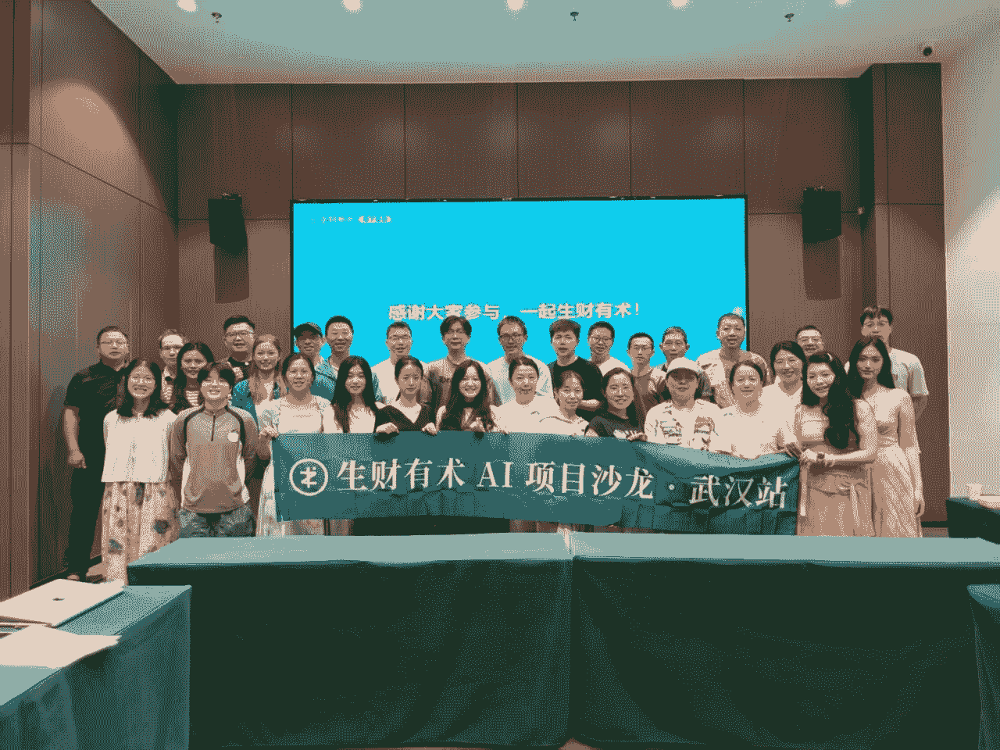
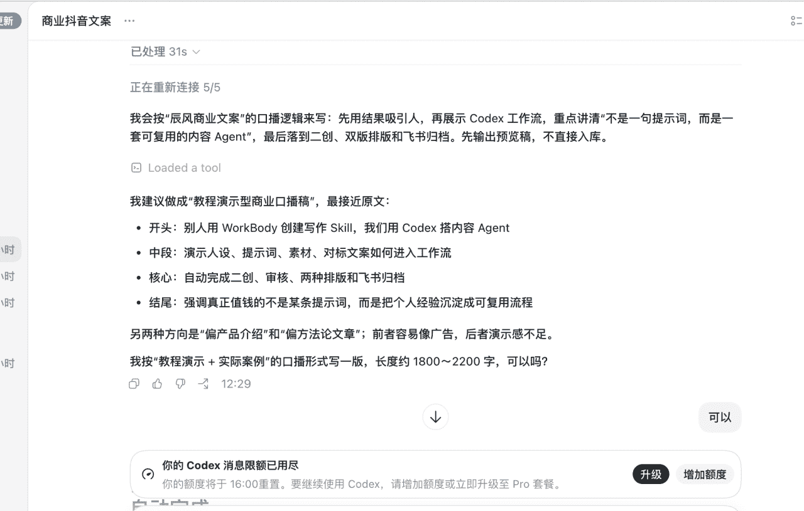
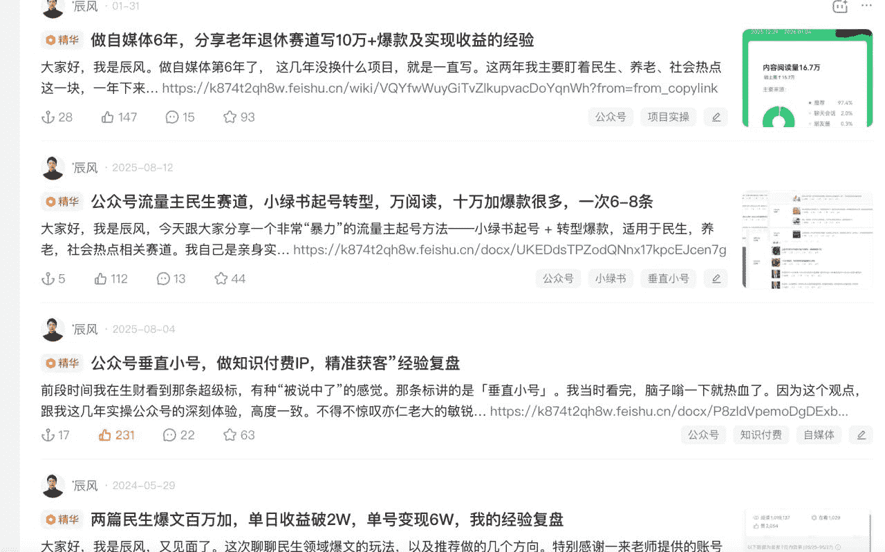
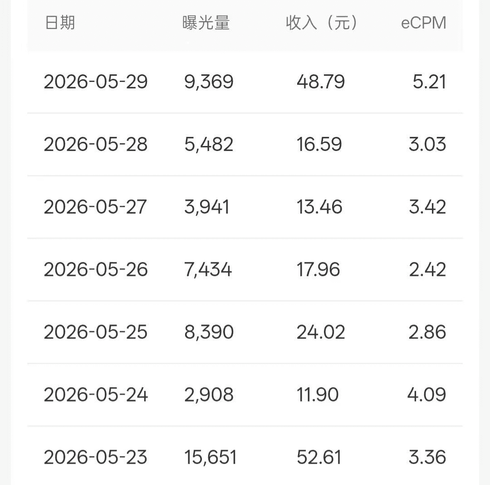
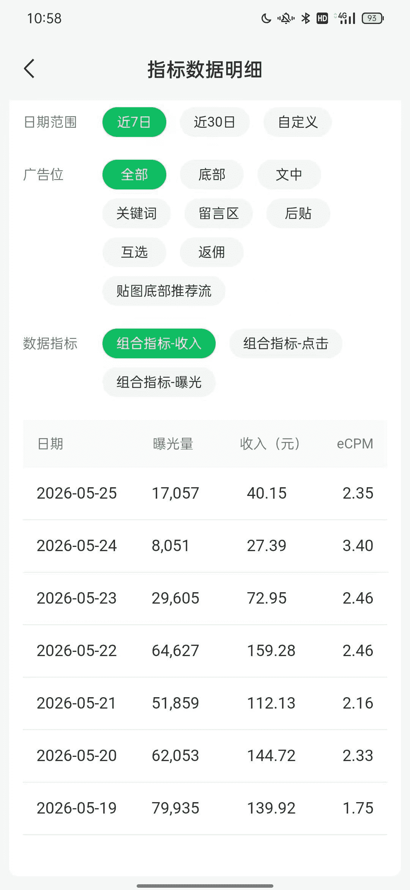
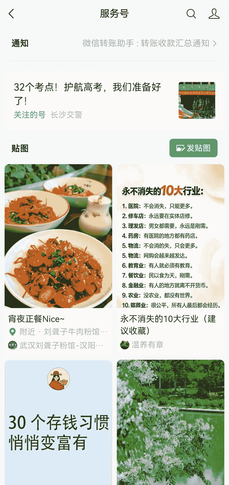
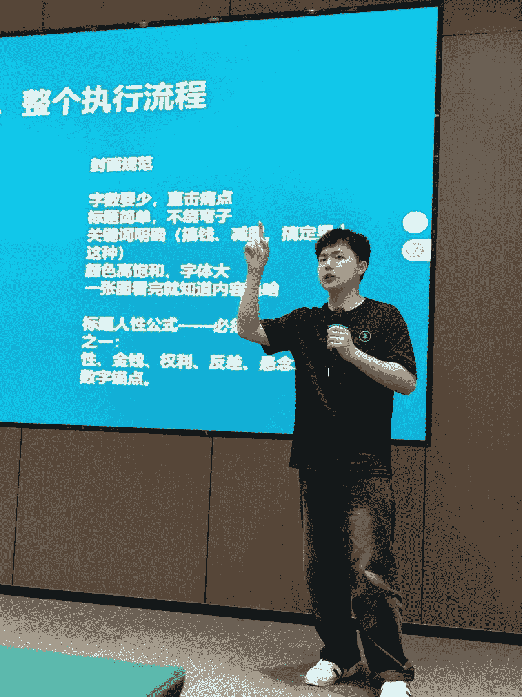
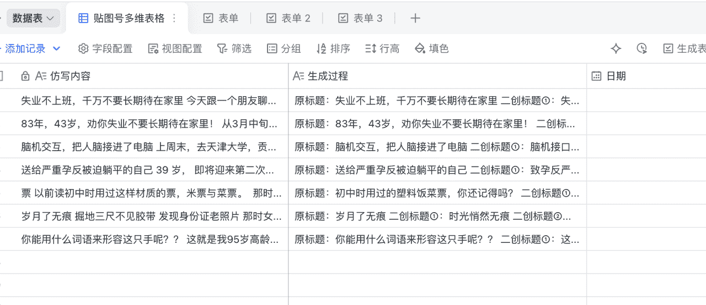
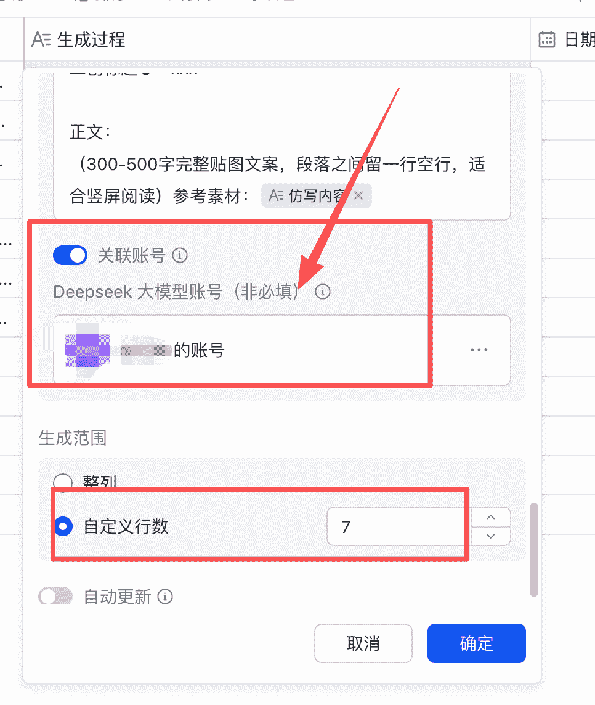

# 用 AI 加上多维表格做矩阵，十个🛰️贴图号单号月入过三千，我见证的这波内容红利

260622 副业 SC 精华

大家好，我是龙哥。武汉那场线下项目沙龙受邀分享后，我就一直泡在流量主的研究里。

贴图这套打法现在正热，我也在赚钱里拆过一次实操精华，回头看确实带了一批人入场，也收到不少朋友来报喜，说做贴图有了可观的回报。

我做自媒体快六年了，👸号基本是我主战场。越玩越有意思，AI进来以后我现在用

codex+obsidian 来跑👸号稿子的初版和短视频脚本，本质上是把产出效率再往上提。

今天主要复盘贴图号的玩法，以及最近卡点与突破。

线下分享结束后大家聊到晚上九点多，意犹未尽。六点开场，武汉的夏天很闷，但挡不住热情。当晚来了三十多位朋友，还有从外地赶来的教练，AI 大航海的熟面孔也聚齐了，氛围特别亲近。官方一直有在扶持我们把 AI 真正落地到项目里。

（高铁上连夜改 PPT）

有圈友跟我说：

“以前总觉得👸号的窗口已经关了，听你讲才明白是自己的视角被卡住了，平台的红利其实还在。”

准备分享时我也在纠结要不要把经验全倒出来，后来决定聚焦。大家要的不是一堆方法论堆砌，而是判断依据：值不值得投入、价值在哪、上限多高、能否延续。

大家关心的不仅是能不能挣到钱，更想知道这个模式能跑多久、天花板如何、是否可复制、可否矩阵化，能否借助 AI 放大。

👸号的底层逻辑很简单，做得了稿子，浏览就等于收入。

贴图把这条链路缩短了。两三百字的小文案，加上 AI 辅助写稿配图，就能让内容出去跑量。

🛰️贴图是我 2025 年认为离散户最近的机会信号。

下面是我这场分享的完整梳理。从捕捉机会到验证跑通的真实路径。

## 第一部分 · WHY ME：为什么是我来谈

先做个自我介绍。

我是辰风，00 后，自媒体玩家六年。

25 年五月做长文👸号，单篇破百万阅读。26 年切老年赛道，单周出百万爆款。

从 23 年十二月在赚钱察觉👸号转向后，我就一直在实操，做了大量赛道测试，也沉淀过不少精华帖。能做的玩法基本都试过，长文短文都验证过。

三年下来最大的体会是：内容没有万能公式。平台会定时开新口子，流量好的时候，只要执行力拉满，多开号多发稿，基本都能有不错的结果。

比如 24 年 ChatGPT 爆发那波，几乎人人吃到。等流量退潮、赛道进入中后期，再想拿到同样的数据就难了。

现在贴图依然在享受到官方扶持，只是这波能持续多久没人确定。有声音说贴图单价低，从我手上数据看 ECPM 尚可，关键是评论区广告的曝光能否堆起来。

## 为什么押注贴图

24 年我测过小绿书，也就是当时的👸号贴图，底部带广告。当时我嫌粗糙没做下去。

那会儿我搬运📕职场笔记到👸号，直接几十万播放。赛道变现弱所以没深耕。后来带朋友一起干，单号月入两三千，核心是把📕笔记批量搬到👸号。持续半年左右，流量主一取消红利结束。

（24 年五月我发的小绿书）

这次贴图流量大、单价可观，我觉得很适合个体作战。单号一个月一两千，对矩阵来说不算大，但对散户而言每天十分钟就能拿到，性价比极高。

下面展示的都是素人账号的真实运营数据，代运营形态。

贴图数据（部分）

文章数据（部分）

抖音数据

24 年其实有两波机会，一波是小绿书流量主，一波是带货。当时我没 All in，没把执行力拉满，多开号多发稿放大，现在回头看错过了一波大的。因为我轻视了简单模式，而恰恰简单才好变现。这次贴图给了新入口，我从三个月前就开始持续测试。

目前单号日均二十到三十元，万阅读长文同步在跑，抖音视频也在测 AI 自媒体。

一个号三十，十个号三百，做互联网就是看挣大钱还是小钱。

## 第二部分 · WHY：贴图为什么是 2026 年的大流量红利

各大平台都在收紧，🛰️贴图是现在唯一还在开着的窗。

📕控流量，抖音作品稍有引流动作就进小黑屋。我的抖音就被关了好几次。

👸号更严，任何引流行为都会被判定低质，禁自动回复、禁菜单、禁二维码、禁留🛰️号。

以前我们习惯从公域捞人，现在📕商业化、👸号封引流、抖音越来越难，路子都被堵。

这意味着什么？流量比任何时候都贵。

抖音买一个精准粉要五十块起步，📕更贵，👸号写篇文想导🛰️直接限流。

那做👸号还有意义吗？

👸号的价值不只是获客工具，它是🛰️生态里能沉淀用户、反复触达、长期变现的阵地。它是做个人 IP、构建影响力的基础，可以联动视频号、私域、直播，建立信任。

现在大家都在讨论👸号引流被卡死，关注后回复、菜单、文章挂二维码都不行。

怎么搞到关注？贴图是最快的获客通道。实测涨粉非常迅猛，官方正在用大量流量砸贴图。竞争小、流量免费，是🛰️生态里为数不多还能白嫖流量的入口。

逻辑很清晰：

- 第一，贴图是🛰️官方重点推的新形态，流量充足、竞争稀缺。
- 第二，贴图场景在🛰️内部，看一看、订阅号顶部、服务号消息页，往上一划就是👸号主页，关注零摩擦。
- 第三，关注是原生行为，不是引流，平台不会打压。用户自然点关注，你只是持续输出好内容。

这就是贴图的战略价值：在所有平台关门的时代，🛰️留给创作者的最后一条免费获客路。

📕的爆款是公开的，所有人都能抄，起势后一周内几百个 MCN 涌入，门槛迅速抬高。

🛰️的推荐是信息茧房、分发基于关系链和垂直标签。

你的爆款，竞争对手大概率看不到。别人抄不到，团队也碾压不了。

在📕，爆款等于公开答案；在🛰️，爆款只有你知道。

这就是普通人的护城河。你闷声干三个月，积累几万精准粉，摸清推荐逻辑，等别人反应过来，你已经抢占先机。

把趋势串起来：

- 巨头没下场，一部手机就能做；
- 平台缺内容，AI 二创就能拿量；
- 其他平台都在封，只有这条路还通，而且成果别人看不见、抄不走。

这三点叠加，就是我说的 2026 年最隐秘、最适合普通人入场的流量红利。

窗口期不会等人的。

我朋友做女性成长矩阵，内容就是这种风格：

“35 岁离婚后，我反而活明白了”

“别再为不值得的人瘦了，为自己狠一次”

“女人后半生最好的投资，不是脸，是这个”

配图是纯色背景加一句扎心文案，偶尔一张侧脸或咖啡氛围图，排版越简洁越好。真实比信息密度重要。

选题来自📕、豆瓣女性小组、抖音评论区的高赞情绪点，换句话重包一遍。连续出多篇破万笔记，变现几百。

（新手自媒体，之前学了不少 AI 却不知道怎么变现，理解了爆款逻辑后，借助 AI 产图产文就拿到结果了。）

很多人把🛰️贴图当成另一个内容平台。

在📕，用户是刷到-看完-划走，点个赞就死，生命周期靠算法。

🛰️贴图完全不同。

一个 45 岁的女性看到“这半辈子对谁都好，唯独亏待了自己”，第一反应不是点赞，是转发。

转到闺蜜群、家庭群、朋友圈、私发给需要的人。她不是在消费内容，是在用内容表达自己说不出口的话。

在📕，你的内容是被观看的对象。

在🛰️贴图，你的内容是社交货币。

社交货币的传播不靠算法，靠关系链。算法是线性分发，关系链是指数级扩散。一个 50 人群的裂变，能自我复制，平台控制不了。

这意味着爆款是用户自己传开的，平台收不回。

抖音可以改算法一夜归零，📕可以调权重让你消失，但群聊、私聊、朋友圈是用户自己的社交空间，不会被干预。

内容一旦成为某类人群的表达替代品，就进入了平台无法回收的自循环。

真正的护城河不是看不见，而是分发引擎在用户手里。

为什么 35-50 岁女性是主力？因为她们是家庭群活跃分子、高频发朋友圈的人。她们想表达情绪、想被看见，却不擅长组织文字。所以她们需要一个替她们说话的人。

你做的每一张贴图，本质是情绪代工。你把模糊感受变成一句精准的话、一张可转发的图。

她用你的图表达自己、维系关系、获得共鸣。你不是关注对象，你是她的供应商。

关系建立后她不会取关，因为取关等于切断表达来源。

总结逻辑：

- 内容不是被观看，是被使用；
- 传播不走算法，走关系链，平台收不回；
- 关系是供应商-用户，粘性来自功能依赖。

这三点叠加得出反直觉结论：在🛰️贴图，闷声做事的个体能建立比大 V 更稳固的关系，获得比算法更持久的流量。因为大 V 依赖算法宠幸，你依赖用户离不开你。

这才是普通人的结构性优势。

## 第三部分 · WHAT：变现路径是什么？

前端：公域曝光（贴图爆款）

中端：评论区广告

后端：视频号小店带货 → 导流私域 → 私域 IP 长期变现

链路跑通，前中后端打通，普通人一年做到二三十万完全可能。

### 本地商家获客——贴图就是免费版📕

为什么本地商家都在做📕？因为图文种草能引流。

但📕现在很贵，投流点击几块起步，自己发又没曝光。

🛰️贴图就是🛰️生态里的图文种草，免费。

而且客户就在🛰️。一个 40 岁宝妈每周打开📕三次，每天打开🛰️几十次。消费决策在🛰️群、朋友圈完成。

逻辑很简单：社区烘焙店发《戚风蛋糕总是塌？这 3 个细节 90% 人不知道》，配好看图，文末写“XX 路开了 8 年烘焙店，每天分享干货，关注不踩坑”。通过算法推给 3-5 公里内带烘焙、美食标签的用户，看完觉得有用就关注。下次发新品到店立减，零成本精准获客。

你不是做广告，是建立专家认知。

美容院可做《不同脸型适合什么眉形》，母婴店可做《0-3 岁辅食避雷指南》，健身房可做《久坐族 5 分钟拉伸》，房产中介可做《XX 城市买房 10 个常识》。

核心：把专业经验变成免费内容，用免费流量触达精准客户，用持续关注替代一次性广告。

### 做 IP——贴图是 2026 年冷启动成本最低的方式

IP 本质是重复曝光。

重复曝光在别的平台昂贵，抖音要靠日更博弈算法，📕要不断出爆款，一断更就被遗忘。

🛰️贴图生产成本极低，一图一句话三分钟搞定，每天发 3-5 条毫无压力，不断更。

而且关注即触达，粉丝会稳定看到你的内容，不用担心算法不推。

关注关系就是你的确定性流量。

图卡配短句，本质上是经营“记忆锚点”。一张图、一句话、一种立场，反复出现在你所擅长的话题上。用户翻到第十条、第二十条，心里就会自动生成一个判断：这人是干这一行的，而且水平在线。

IP从来不是一夜长出来的。它的形成逻辑很简单——连续90天，每天三到五条，用时间堆出来。

做法因赛道而异，内核完全一致：做AI工具方向，每天发一张“AI实操技巧卡”；做职业规划方向，每天发一张“职场认知升级卡”；做心理服务方向，每天发一张“情绪管理日签卡”。

90天之后，你手里只剩两种东西：一群精准跟随你的用户，一个经过反复验证的内容形象。正是这两样资产，让你以后的课程、咨询、社群、商务合作都有了立足点。

一句话：没有IP就硬变现，任何动作都像推销；有了IP再谈交易，用户会想“他配”。而图卡，就是酿造这种“配得感”成本最低的容器。

### 面向B端：交付“AI×图卡×👸号智能体”获客方案

一个更大的机会，藏在2025到2026的时间窗口里：中小企业集体卡在“工具很多、落地无门”的境地里。AI能提效，他们知道，却没人说得清从哪下手；👸号能做私域，他们也懂，但涨粉手段始终失灵；图卡是新流量入口，同样看得见，却找不到操盘的人。

三种“知道但不会”叠在一起，就是一个巨大的B端市场空白。

一个跑通过图卡获客全流程、又熟悉AI的人，恰好能把这三件事捏成一套标准化的可交付方案。

方案拆开来看，是三个模块。

模块A：让AI接管内容制造。给企业搭一条AI流水线，AI负责扫描行业里被验证过的选题，AI负责图文初稿，AI负责排版。当整个流程固定下来，一个行政岗员工只需要半天培训，就能每天稳定更新三到五张图卡。内容团队的预算，可以完全省掉。

模块B：图卡变成获客前哨。帮企业把选题策略体系化——什么主题能精准扎进目标人群的神经、什么钩子能诱导关注、什么更新节奏能维持活跃。这不是教他们写文章，而是在搭建一套获客基础设施。

模块C：用智能体做后端承接。原本想推荐另一个工具，但前几天偶然试了CodeX，效果确实超出预期。我个人的习惯是先把所有提示词文本灌进Obsidian，在Obsidian里消化成一套skill，再封装成agent。这一套方法基本来源于大航海的教程，就不展开讲了，真想学的后面腾个时间单独说。

放到企业环境里，CodeX只需要把他们的文档和资料全部收进本地知识库，就能稳定处理各类业务需求：客服问答、产品梳理、广告文案、流量内容，基本全覆盖。

到这一步，整条链路才真正闭合——图卡负责吸流量，👸号负责沉淀关系，智能体在后端兜住转化和规模化生产。

拿着这套方案去谈本地企业、连锁门店、教培机构、医美健康品牌，对方说的不是“我考虑下”，而是“我正好需要”。他们现在还能靠什么替代？每个月几万块的投放预算、雇两三个人专职做号、产出一堆没人看的👸号文章，ROI低到不敢看。而你的方案只需要他们原先十分之一的成本，每一环效果都能量化、能追踪。

顺带提一句，AI+企业培训这个玩法，在赚钱和大航海里都已经有一批案例，圈友也在持续试水。我自己还没完全走通，但会继续盯着，值得关注。

## HOW（一）：从0到爆款的标准化操作

说在前面：爆款是流程跑出来的，不是灵光乍现。很多人把做图卡理解成“找张图发出去”，结果数据惨到不敢打开。实际上这背后有一套可复用的动作序列，甚至可以直接固化成一个skill。

你要做的不是写，而是拆：解析爆款结构、提取底层公式、投喂给模型、批量产出内容。

### 第一步：去服务号挖已经过验证的爆款

为什么是服务号？因为服务号打开率天然偏低，还能爆的内容一定是靠标题和选题本身在硬扛，没有粉丝基数帮忙兜底。服务号的爆款，含金量通常比订阅号高十倍。

操作路径：在新榜、西瓜数据或者🛰️搜一搜里输入赛道关键词，筛选“服务号”类型，按阅读量倒序排列。找到那些粉丝不多但单篇10w+的号，一律收进“爆款素材库”，每周至少存够20篇。

### 第二步：拆标题的骨架

拆标题不是看它“说了什么”，而是看它“怎么说的”。常看到的几种结构，拆开就是公式：
“月薪5000的人，都在犯这3个错”：人群标签+负面结果+数字悬念。
“张雪峰终于说了大实话：普通人别考研”：IP名字+反常识观点。
“我靠这一招，3个月从0做到5万粉”：第一人称+方法暗示+可量化结果。
“还在这样发朋友圈？难怪没人找你买东西”：错误行为+负面后果。

把这些公式做成填空模板，赛道关键词一换，标题就自己批量长出来了。

### 第三步：拆封面的四层皮

这个内容我在上一篇图卡帖子里已经写过，这里略讲。拆封面只看四个面：
文面：总字数多少、主标题多大、有没有副标题，文字贴上方、居中还是沉底。
色面：底色和字色分别是什么、纯色还是渐变、饱和度高低。
画面：纯文字卡还是人物加文字、人物占比多大、有没有箭头、框线、emoji在引导视线。
情面：第一眼扫过，是焦虑、好奇还是向往。

### 第四步：拆正文的答案

能转化的正文，骨架通常只有一个。开头三行制造代入感——“你是不是也这样”“我以前一直以为……直到……”让读者自动认领。中段给干货，但绝不能给全：给方法就不给细节，给案例就不给步骤，钩子得留着。结尾只放一个动作：关注、私信、评论区扣词、点链接，四选一，别贪心。

拿这个框架去套十篇，套路自己就浮出来了。当然也有那种几句话拆不出花来的，大道至简，真正的差距始终在差异化、真人感、以及给到别人没给过的东西。

### 第五步：交给智能体去复刻

完成上面的拆解，你手里至少有三样资产：十个以上的标题句式、一两套封面模板、一条正文结构公式。接下来就是AI的表演时间。把标题句式、正文框架、语气风格压缩成一条Prompt，丢给ChatGPT、Claude或者Kimi都可以。指令大概是：你是某赛道的内容创作者，按照以下结构和风格，围绕某个关键词生成5条📕文案。

一次跑出来5到10条，人工筛一下、改两笔，3分钟出一条内容是真实的。唯一要小心的是字数限制。

### 第六步：想清楚要流量还是要获客

要流量，内容就偏情绪、偏争议、偏泛人群，适合起号阶段囤积粉丝；要获客，内容就偏干货、偏痛点解决方案、偏筛选人群，适合后端有产品等着承接。一条内容想要同时吃掉两种红利，结果往往是双输。常规做法是前期用流量款冲曝光，中间用获客款做筛选，配比在7:3左右。

## 发布阶段：三个决定收益的动作

第一个动作，正文别写长。三五句就够，但里面必须有一点“增量信息”——某个真实细节、一句没忍住的话、一个踩过的坑。有了人味，读者才会来互动。

第二个动作，结尾留钩子。用问句把评论钓出来：“你们觉得呢？”“如果是你会怎么选？”“评论区聊聊你的想法？”记住平台规则：评论超过四条才给你挂广告，钩子一失效，收益就是零。

第三个动作，也是新手最容易死的点：发布时点开“更多设置”，确认“平台推荐”和“留言功能”都已经打开。留言不开，广告收益直接归零。

## 去重手段：让平台认不出你

图片去重：裁一裁边缘，盖一层滤镜，微调曝光、对比度、高光、阴影、鲜明度，全套下来30秒。
文案去重：丢给豆包、Kimi这类模型，让它“用某种风格重写，保留核心意思”，意思不变，但机器的文本比对已经无法指认你们是同一篇。

## AI在整条链路里到底在做什么

有AI做杠杆，一天拿出去几十甚至上百张卡一点都不夸张。本质上是点一下、生成一批。难度全部落在素材筛选和文案处理上。不同赛道、不同文案的语言风格差别太大，别指望一个提示词通吃所有战场。

整条链路可以分成五段，每一段AI都能插进去：
选题挖掘：AI负责信息聚合和归类。
文案改写：AI负责二创和去重。
标题打磨：AI负责批量产出候选。
配图制作：AI负责底图素材。
数据复盘：AI负责爆款拆解。

### 第一站：选题挖掘，AI是情报员

太多人选主题的方法，是打开📕一通傻刷。刷一小时挑出三五个能用的，效率低到离谱。我的做法是把选题动作提示词化。给你看个模板：“你现在是👸号图卡的爆款选题负责人。我做的赛道是某某领域，目标人群是某某年龄段某某性别，痛点是某某。直接给我20个选题。”

跑完一轮，从20个里面筛出5到8个能用的，再拿着这些方向回到📕做反向验证，看它们有没有跑出过爆款。AI负责开方向，📕负责出证据，双剑合璧，选题效率能放大十倍。

### 第二站：文案改写，AI是写稿专员

图卡内容的素材源头之一就是📕。拿别人的原创来做二创，或者干脆自己从零写，都行。我用改写提示词的格式是：“你是🛰️👸号的贴图文案编辑。我会给你一段来自📕的文案，请完成后述任务……”

这套指令出来的结果，平台查重通过率九成五以上，而且读起来更“🛰️化”。

为什么🛰️化如此重要？因为两个平台的用户话语体系压根不同。📕是“姐妹文化”，而🛰️用户，尤其是中老年群体，更认“邻居文化”“长辈文化”。📕文案直接搬进🛰️，长辈会觉得生分、不贴肉。AI真正帮你做的，是换掉这一层语言皮肤。

### 第三站：标题打磨，AI是印钞机

我通常直接拿爆款标题做底，在底子上改句式、换关键词，保证标题自带流量。没事就改两版，选一个发出去。封面加标题定了打开率，打开率定了后续推荐，标题一旦写错，整篇作废。

我的提示词长这样：“你是👸号图卡的爆款标题策划。围绕以下正文内容，产出20个标题。要求……”生成之后，把自己变成读者，选出最想点的那一个。这一步谁也没法替你省。

### 第四站：配图制作，AI是美工

主图素材可以用即梦、可灵，追求质感就上Midjourney；封面模板丢进Canva套，醒图也能顶上；最后用美图秀秀加文字、滤镜，顺手把去重做了。

举个例子，做老年情书主题的封面。第一步，在即梦里输“一封泛黄的信，一杯热茶，做旧色调，胶片颗粒感，温暖光线”，十秒出图。第二步，进Canva套一个中老年情感模板，把主标题码上去。第三步，美图秀秀调曝光和对比度，加滤镜边框，去重顺路完成。

但AI不是万能的。有几个禁区，踩中一个，账号直接报废。

### 禁区一：选题值不值的判断权不能交给机器

你会发现大家特别爱用工具。可大道至简，最好的工具是你的手——自己对内容的那种直觉，没有任何模型能替代。数据平台的统计有延迟，而且按大类归档，那些真正高爆的小众选题根本不会被翻出来。AI对流量更没有感知，你得先把判断流量的原则喂给它，它才知道什么叫有流量。直接去问它，还不如自己拍脑袋。

今天你被领导PUA，晚上躺床上刷到“35岁以后我终于学会了不解释”，心口一紧，手停下来。这个选题AI当然写得出来，但“今晚发而不是明早发”这种时机的判断，只能来自你对当下社会情绪的直觉。这个能力我管它叫选题嗅觉——不是说学就能学会的，是靠大量输入喂出来的，也就是大家口中的网感。

大航海的课里也提过，做skill最后要打包一个demo，但前提是你能把需求说清楚，而不是含含糊糊连自己都不知道要什么。如果你确实想不明白，那就反过来让AI向你提问，逼你澄清，直到得出自己真正想要的路径。谁有决策权，谁才是老板；谁只做生产，谁就是打工的——哪怕你在给自己的身体打工。

### 禁区二：造一点“不完美的真实感”

AI内容最大的bug是“完美而无可指摘”。如果你的知识库没有建起来，只是让大模型直接代笔，这个问题一定会出现：没有人设、没有真人味、没有内容的锐度，只会端着一副所谓“正确答案”的姿态。

但爆文恰恰不是“正确”的产物。语法对、逻辑对、结构对、修辞对——全对，但人就是对完美无感，对偏差敏感。心理学里有个效应叫“出丑效应”：一个样样都优秀的人，偶尔犯个明晃晃的小错，反而更可信；一个绝对零瑕疵的人，只会让人下意识觉得假。AI的输出，恰恰就是那个永远不会出错的人。

真正打动人心的，从来不是那些整整齐齐的金句，而是那些“不该出现在这里却出现了”的东西：一句脏话、一段情绪崩坏的独白、一处不合逻辑却无比真实的吐槽。这些东西不是“写”出来的，是“漏”出来的。AI永远学不会“漏”，因为“漏”的前提是有一个活人在体面地克制，克制了太久终于憋不住，那一瞬间泄出来的东西才拥有巨大的情感重量。

所以我拿到AI初稿以后，一定会自己从头读一遍，把段与段之间的连接手动重新校准，在修改的过程中，把自己的情绪也塞进去。哪怕只是一句“写到这里我自己也烦了”。就这么一句，整篇文章的质感就会从“机器生成”变成“一个人在跟你讲真心话”。

别忘了，2026年了，用户每天被机器内容淹到喘不过气，活人感才是最稀缺的东西。

### 禁区三：把注意力换成信任

AI本身没有价值观，除非你给它一套导向。所以你怎么理解一件事，比模型怎么输出更重要。

信任的建立有一个非常反效率的前提：对方必须感受得到你“为他花了时间”。他在🛰️上问你一个问题，你三秒钟甩出一篇完美小作文，他只会觉得你在用AI敷衍。但如果你隔了五分钟，回一段并不完美的、却明显针对他的情况想过的话，他会觉得“这个人真把我的事放心上”。

这也是为什么私域运营的内核不是效率，而是反效率。尝试理解对方的焦虑，摸清他的卡点，用自己的说话方式回应，而不是送上一个正确的万能公式——这个看似低效的动作，恰恰是信任的催化剂。信任不是免费的，它的成本就是你的时间和注意力的总和。AI帮你省下的是内容生产的时间，省下来的时间要去哪？应该流向你最重要的那批用户，做一对一对话。

所以，AI真正重估的是“什么在贬值”与“什么在升值”。生产能力迅速贬值，因为人人都有；判断力持续升值，因为内容越多，筛选能力越稀有。完美的文本在贬值，流水线一天能造一万篇；真实的缺口在升值，它是人类存在的印记。注意力在贬值，信息爆炸时代到处都是抢它的人；信任却越来越贵，因为愿意为它交时间的人，成了珍稀动物。

你的护城河并不是会用多少工具，而是你能否说清楚自己想解决的问题、敢不敢在关键决策上投入大把时间、以及能不能把重复的环节放心交给自动化。工具越平民化，人的主观能动性就越是胜负手。

## 实操：飞书多维表格+火山引擎，批量出稿即拿即用

全套流程打通以后，你一次导入50个选题，起身喝杯水回来，标题和成稿已经全部躺在表格里，直接复制就能发布。

第一步：建一张飞书多维表格。字段设置四列：
A列“原始素材”——装你从📕、评论区、热榜上扒来的选题、金句、痛点，纯文本即可。
B列“生成标题”——由AI自动填充。
C列“最终文本”——由AI自动填充。
D列“状态”——手动标记“未生成/已生成/已发布”。

我自己用的时候更省事：左侧丢对标数据和灵感，右侧放二创出来的标题和成文，一个工作台全部结束。

第二步：接火山引擎的豆包入口。在飞书多维表格的“自动化”或“AI字段”处找到火山引擎大模型的接入位置。

实际操作不复杂：去火山引擎控制台申请一个API Key，粘贴进去，选好模型——豆包的Pro级别就够了。如果你走飞书自带的AI字段，直接挑“AI生成”类型。

第三步：内置提示词，这是整套系统的核心。在B列标题字段的AI配置里写入：

你是一个资深📕爆款标题写手。根据我给你的原始素材，生成3个贴图标题。要求：口语化、带情绪钩子、控制在20字以内、制造好奇心或共鸣感。不要用感叹号堆砌，不要假大空。直接输出3个标题，用序号分隔，不要多余解释。

第四步：批量导入素材。平时收到的所有碎片——📕爆款截图转文字、评论区高赞句、热搜关键词、随手存下的脑洞——全部粗暴地扔进A列。一条一行，不用整理格式，AI会自行提纯。

第五步：一键启动。如果设置了自动触发，AI字段会自己跑；也可以手动点“批量生成”。几分钟后B列和C列全部就位，每条素材对应3条标题加一段成品文案。

别想太多，别反复纠结。

你的全部动作就是——从备选清单里秒选一个最顺眼的标题，复制下来，补上你的独家点评，30秒搞定，直接发。

发完就打个勾，标记上“已发布”。

等数据跑起来，再回头看这波操作：哪种内容跑出的数据漂亮、有爆相，就加快投喂同类素材；哪种数据惨淡、毫无水花，果断砍掉，别恋战。

这是许多人容易忽略的一环：把标题发出去只是开始，真正的复利来自持续复盘和迭代。你以为你看懂了全流程，但真相是——90%的人一到实操，第一步就卡住了。

为什么？

因为工具和教程从来不是真正的门槛，那只是最表层的东西。

真正的分水岭有两个：一个是说干就干的执行力，另一个是你身处圈子带来的信息差。

这里不讲虚的，只做两件事：拆解可落地的商业闭环，压榨AI的效率上限。社群里已经沉淀了1000多个跑通的套利实战局。

👉 想翻翻这个圈子的完整数字资产，看看上车门槛：

https://lazyso.com/insider/

统一备注：【实操上车】。不闲聊，只干活。

