企业AI定制怎么入门？一个从程序员转行做定制的人，交给你我的完整流程复盘

大家好，我是一泽。以前是写程序的，2024年从RPA航海教练、AI编程教练这些身份开始接触企业定制，前后服务过留学、旅游、电商、小红书商家等不同行业的老板。帮留学机构做过自动提取资料的小工具，帮电商客户做过数据汇总，最近正在做电商行业的企业AI培训，也接过制造业老板的软件定制咨询。那时候AI还没现在这么全能，很多时候靠网页版GPT辅助，自动化小软件也要自己一行行写，效率比现在差远了。但也就是那段“什么行业都接、什么脏活都干”的日子，让我摸清了一件事——老板真正卡在哪里、他愿意为什么掏钱。

这里要特别感谢留学行业的珍妮老板，给了我好几个老板视角的认知和很多具体案例拆解。想看更多这类内容，可以到她主页翻一下《老板避雷手册系列》：https://scys.com/personal/19455?tab=posts

前两天我在生财做了一场线下沙龙，这篇就是那场的完整内容，再加上一些最新的思考，一起分享出来。本文由懒人搜索/懒人专属群精选整理，微信 lazyhelper1。

先说一个明显变化：AI agent现在能操作浏览器、处理文件、调用工作流了，它不再只是回答问题，而是真的能执行任务。关键这是一个质变——AI一旦具备了“自己干活干到底”的能力，它就有了可衡量的商业价值；接着资本和关注度都会涌进来，再推着技术往前走。所以我判断现在是最佳入场时机，不是因为AI突然逆天，而是它第一次有了企业愿意付费的形态。客户开始真的掏钱，这对普通人最大的意义是：过去专属于大厂的定制生意，现在单干也能接下来。

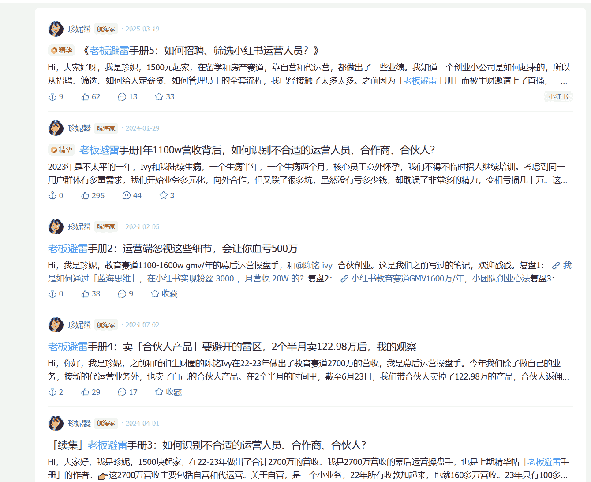

为什么偏偏是现在？因为三股趋势同时压在这个时间点上。

第一，需求侧被激活。以前很多老板也知道客服慢、数据乱，但觉得“一直这样也没事”，没有动力改。现在AI天天上热搜，他们担心被同行远远甩在后面，于是开始主动找AI方案，甚至会自己先把业务流程翻出来重新捋一遍。这等于省掉了客户教育，人家自己已经急起来了。

第二，供给侧成本崩了。很多需求传统软件其实也能做，只是过去性价比太低——以前做一个小工具要投入两周，报价却只有几千块，谁都提不起劲；现在AI编程能把成本压低一大截，两个人一分工就能接单。门槛一低，普通人自然就进得来了。

第三，形态变了。AI已经不像从前，只能作为一个附加功能插在旧流程旁边；它现在能自己读数据、动手执行任务，于是老板们愿意按“一个员工”的标准为它买单。

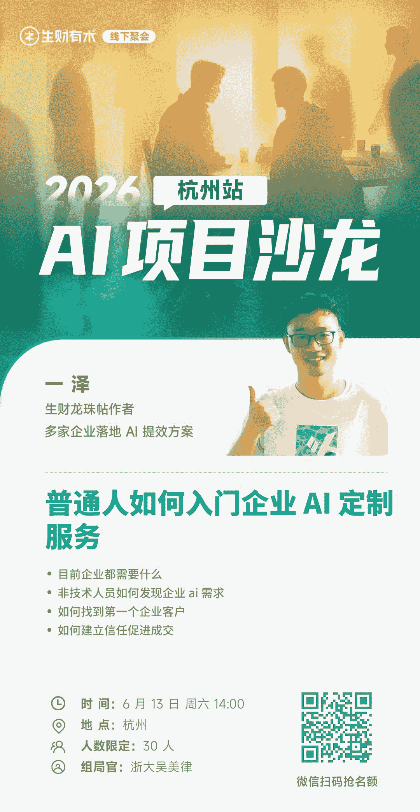

要看客户走到哪一步了，企业AI分层就是一个很清楚的尺子：

- L1 单点AI辅助：AI只帮人做某个小动作，比如客服用它生成一句回复。
- L2 单点自动化工具：一个重复动作自动完成，不需要人盯，比如自动采集数据、自动处理表格。
- L3 业务工作流：多个单点串成一条流水线，采集→清洗→分析→生成→分发一站跑完。
- L4 Agent化：AI能多步骤执行、跨系统调用、带长期记忆，只在关键节点留人工审核。通俗地说，它就是一个能连续自己干活的AI员工。
- L5 AI Native：整个业务流程围绕AI从零重建，而不是在旧流程上外挂AI。这是终局，目前极少企业能到。

这条商业路径一路从小工具走向流程、Agent和业务重构，逻辑很直白。不过要想清楚，级别越高，苦活越多。比如做到Agent那一步，数据是绕不开的；老板手里的数据往往散在PDF、Word、Excel甚至手写笔记里，光把它们整理成机器能用的格式就够呛。

所以新手阶段，最稳妥的是先拿L1、L2小单试水，让老板花小钱就看到真效果，之后慢慢往上层走。客户刚接触你、信任度还不够的时候，你直接抛一个几万块的AI Native方案，他肯定不敢下手；做几个小工具，效果马上可见，反而更容易打开局面。

但从长远看，交付物不该只是个孤立的软件。把它做成CLI后，Codex就能调用它去实现各种功能，和其他软件联动成一个完整动作。比如Codex把好评导出后，接着拿这些数据去做分析汇报，一连串操作就串起来了。再往后，你还可以用AI生成一个内容管理系统，界面看起来很专业，实际上是用GPT出图的，但拿来做演示、给老板想象力，完全够用了。

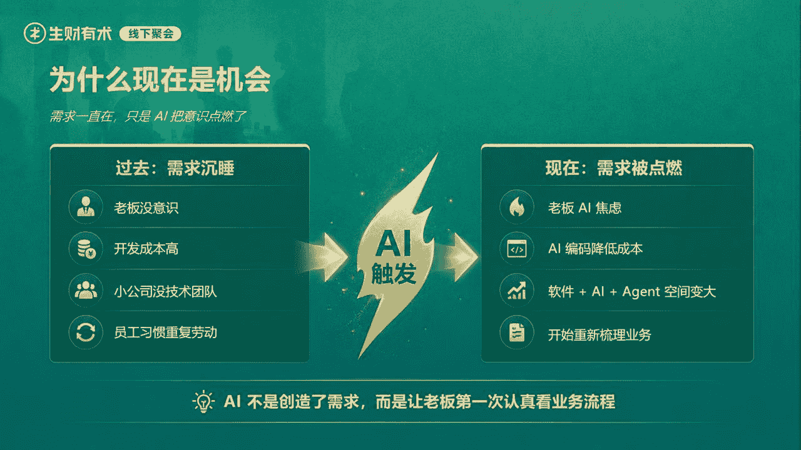

再说一个最核心的问题：企业到底为什么付费？答案不是“AI很酷”，而是“看得见的效果”。

如果从流量侧看，获客、成交、人效、经验沉淀，都是利润链条上的一环，但先后顺序很讲究；离“钱进来”越近，他掏钱越痛快。

最靠前的是获客，因为它是焦虑源头。流量越来越贵，老板最怕客资断供。他能撑到今天，说明获客、成交、后端都说得过去；但他要的不是守摊，而是把盘子放大十倍，而放大最依赖的就是渠道。比如用Claude加Obsidian知识库批量产文案，很多人已经在靠这个帮客户拉新了。

再来是成交。客资进来后，能不能接住很关键。AI的价值就是让响应更快、话术更稳，客人感受到被及时回应，信任和下单意愿自然提升。比如电商行业客服接入AI知识库，自动回复越精准，用户下单率越高。

人效要看怎么讲。老板确实想省人，但他真正愿意买单的是“同样的人做出更多业绩”，而不是单纯“省掉一个员工的工资”。少养一个客服，一个月也就省几千块；但一个人原来能上架20个品，现在能上架100个，这就不是省成本，而是直接长出了增长能力。所以跟老板谈人效，别说能砍几个人，要说同一批人能多干多少活。

经验沉淀是容易被忽视、但长期价值很高的一个维度。信息越发达，大家看到的东西越相似，AI写出的内容也都是网上一抓一大把的通货。要获客，就得写点不一样的东西，而“不一样”只能来自你在垂直行业里积累的真实经验。这一点GPT替代不了，也正是你深耕垂直行业、积累行业know-how的长期价值。

绕来绕去，最后还是落到获客、成交、利润这条主线上。所以每次报价前，先问自己：这一单到底处在利润链条的哪环？对老板的增长有没有直接拉动？他投入的钱什么时候能回本？

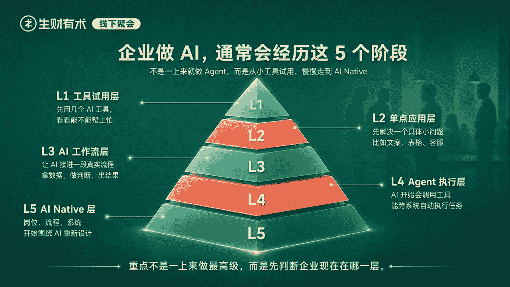

前期的需求挖掘和Demo演示，都只算热身。让客户当下坐不住、恨不得马上定的，通常就是一个画面——你现场跑一遍，让他看着那些刺刺拉拉的原始数据，一瞬间就变成他早就想看的那张报表。几百页PPT也顶不上这一眼。

比如一个视频号批量下载工具，老板看到下载、转文字、分析、拆解链路马上就通了，他立刻就知道这东西能提效。

为什么这个画面这么有杀伤力？因为老板对“过程”和“技术”没感觉，只对“结果出现在眼前”有感觉。你和他谈架构、模型、Prompt，他十有八九在走神；但你把那堆乱成一团的原始评论丢进去，几秒钟后一张清爽的日报、一张明明白白的差评归因表弹出来，他的眼神马上就不一样了。这个时候他才真正“看到”AI能帮自己干活，而不是听你讲概念。

在这个过程中，抽象的AI能力被翻译成了具体的业务结果。客户要的是结果。你把结果展示到他面前，后面什么都不用多说了。

和单点工具比，智能体带来的冲击力要大得多。小工具是你按一下，它回一个结果；智能体是你看它自己分步操作，从读数据到做判断，再自己生成和推进。你坐在旁边看它自己取数、自己判断、自己出结果，一步一步往下推，那种“这分明就是个自动干活的员工”的感觉，对老板来说是最有冲击力的。所以就算最后交付的是小工具，我也会先拿一个智能体做开场演示，先把兴趣勾起来再说。

那我真正卖的不是写代码，而是“咨询+交付”一整套。如果一开始就把自己当成“帮人写AI软件的”，那就只能按代码量算钱，客户还会来回比价、压价。

真正贵的反而是前期做梳理的过程。跟客户把整条业务流程从头到尾重新走一遍，找到卡顿的地方，再设计改法。这部分属于咨询和洞察，没法外包，也最难被别人复制。

一套完整服务分两半：前半段是咨询，核心是流程梳理和需求诊断。你得扎进行业里，把客户的业务链路一点一点掰开看。看哪一步卡住了、哪一步适合用AI来提效、改完之后能有多少收益。就算这个阶段你连一行代码都没碰，这钱也值得收。同时它也是后续所有项目的大门，诊断让客户认可了你，后面开发订单就顺理成章。后半段才是把方案变成能跑的东西，可能是小工具、工作流，也可能是智能体。重点是要放进客户的真实业务里去跑，跑出的结果能直接看到。刚才提到的“一把乱数据变结果”的名场面，就是这一段的爆点。

只做咨询不做落地，客户会说你是空谈；只做落地不做咨询，你又成了按工作量计费的苦力。两个合成一个，才算完整的服务。

产品和客户的关系也可以从轻到重排个序，一共四档。

第一档是需求诊断，也就是纯咨询。不动代码，先把客户整个业务流转一遍，告诉他哪些地方能用AI、大概能省多少人力提多少效。这个动作既是单独收费的服务，又是后续项目的敲门砖；只要诊断够准，客户就会信任你，开发订单顺势到手。新手最该从这里开始，因为成本低、风险小，还能提前分辨出哪些客户真的舍得花钱。

第二档是单点工具，比如一个小程序、网页或自动化脚本，解决客户一个明确的痛点。这类项目交付周期短、风险小，适合攒案例，同时也可以拿来测试客户的付费意愿。

第三档是工作流方案，把多个单点串成一条完整流水线，比如采集、处理、分析、分发一条龙。客单价会明显上去，而且流程已经长在客户业务里了，用习惯之后很难把你换掉。

第四档是行业知识库，也是我眼中最高客单的终局产品。把某一行的经验整理成资料库、话术库和SCRM，再封装成一个行业通用智能体。做到这一步，你赚的不是一个老板的钱，而是整个行业一批老板的钱。

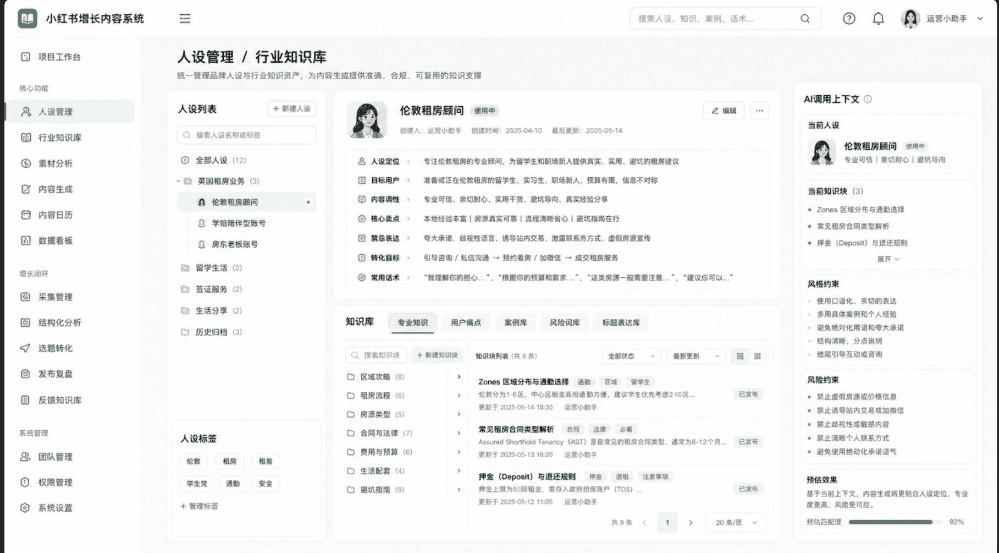

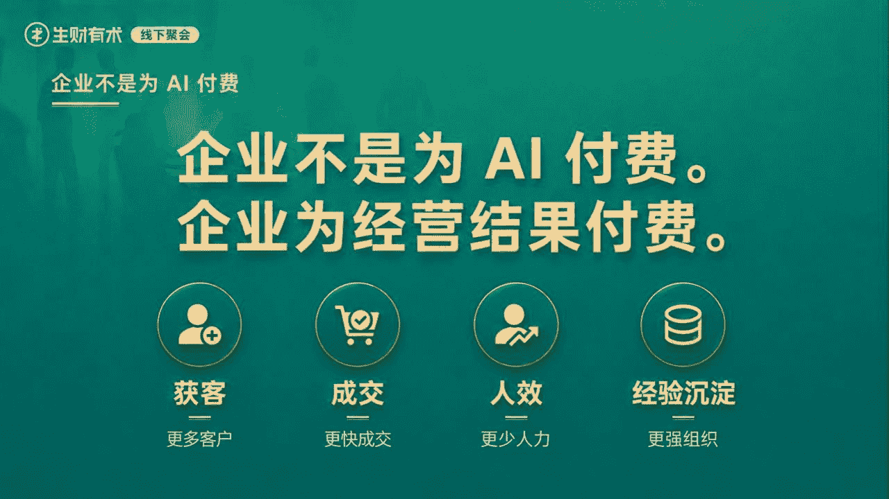

下面分享几个我真正交付过的案例，都属于最适合新手起步的形态。

先看第一个，抖店飞鸽导出工具。有一位电商客户，每天被海量评价和售后工单淹没；售后要反复切换多个抖音店铺，把中差评一一导出，再借助workbuddy逐条判断问题源头——是物流不给力，还是产品有瑕疵，是尺码标错，还是客服语气太冲。最后还要把当天的差评结论整理成一份汇报，给老板决策用。这件事听起来没什么技术含量，但量一上来，光阅读和归类就能吃掉一个人一两小时，而且漏看是常事。

我做的事很简单：把“原始评论到原因日报”的整条链路自动化。重新做了一个操作界面，客服只要选好店铺和日期，评论表格就能自动导出，不用再十几个店挨个点。然后接着跑一层AI分析，直接得到老板要的异动归因表。

效果也很直观：原来每天两小时的读评和归类，现在压缩到几分钟；差评原因当天就能浮出水面，哪一批货质量出了问题、哪一家物流在拖后腿，当天就能去处理，不必等到月底复盘才后知后觉。

我顺手放了一个模拟器，想玩的可以加几个店铺，点一下就能导出一堆模拟数据。

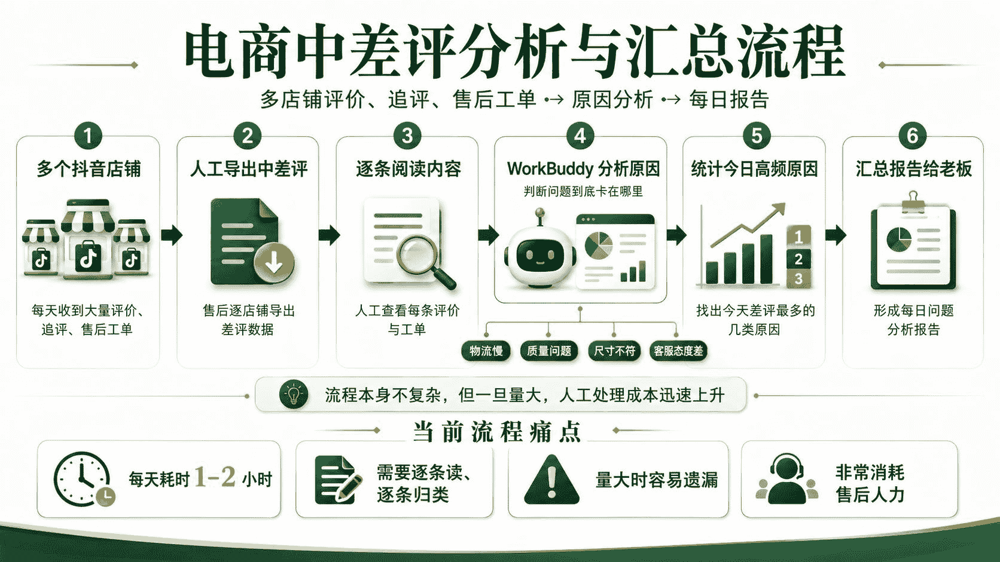

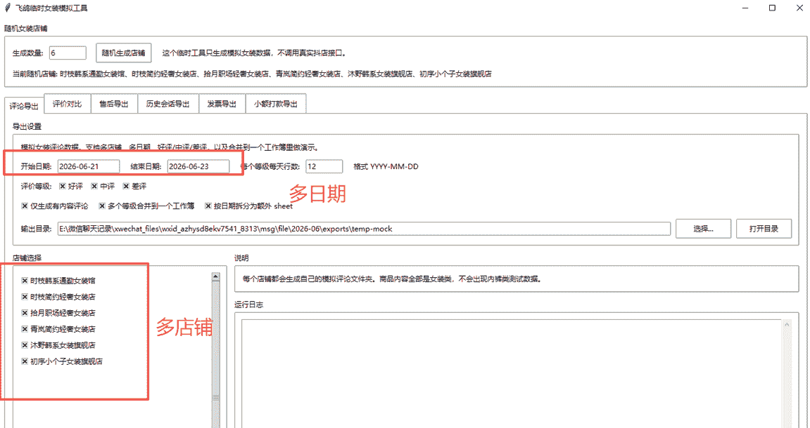

第二个项目是专门给小红书获客团队做的采集系统。小红书引流的基本功就是研究同行：看爆款笔记、拆封面、存文案。但你真去执行会发现，每一步都是坑。市面上采集工具通常只能拿到标题和正文，最有价值的评论区反而拿不全——很多用户在评论区里说“这个在哪里买”“有什么缺点”“我也遇到了同样问题”，这些都是真实需求，比正文值钱，可目前根本抓不到。接着想同步到飞书，能用的工作流要么受限制，要么数据量太小；要沉淀到本地知识库，还得在Markdown和Word之间来回倒，每转一次都损耗一点精力。

于是我做了一站式处理：采集范围涵盖图片、完整的一二级评论，然后一键进飞书，或者直接生成Obsidian知识库。中间那些格式转换和步骤断裂全部消掉，让原本很费神的对标研究变成点一下就完事。

最后的交付是把人工采集+沉淀，变成全自动流程。而且每个客户可以调成不同玩法，比如给穿戴甲老板温盈做的就不是扒文案，而是让系统自动把成品图一张张打开轮播，用来培训新员工怎么看审美、学手法。

老板付费也心甘情愿：内容创作和竞对分析都建立在数据采集之上，地基一动起来，后面写文、定选题、建知识库都顺了。

我还把整个采集器打成了CLI，Codex可以把它当API来调，抓完笔记之后接着做下一步处理。以后自己开发别的软件，也都能按CLI的标准做，当成Agent的一个工具环节。

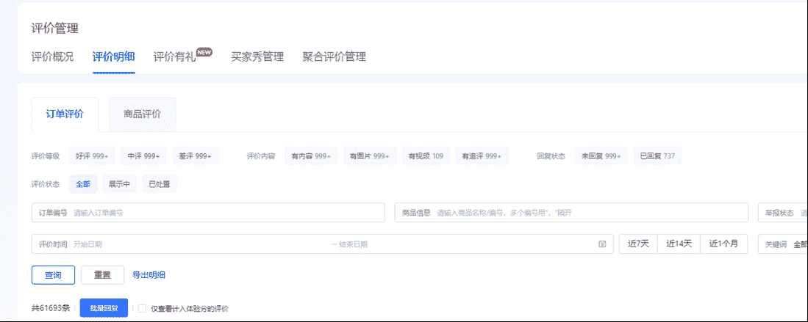

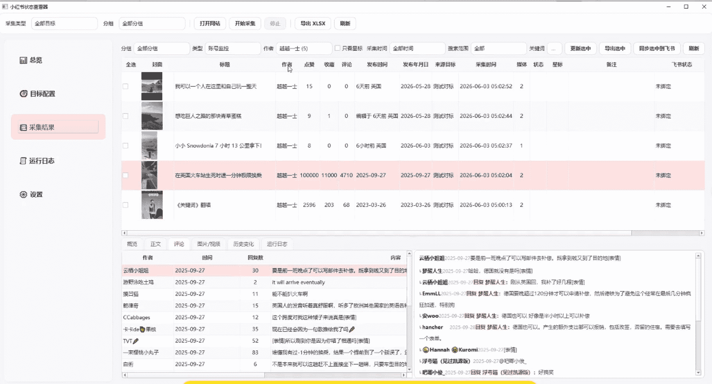

第三个是抖音千川投流视频批量混剪。当时我们公司上传的素材量远远不够，但人力就那么多，只能把已经拍好的素材二次利用，用Codex做批量混剪。具体操作是：对原视频做语音转写，按语义切成100个只保留3到6秒的小碎片，再交给Codex按语义拼装、去重。

切片前后对比：

切片前：27个1分钟原始视频；切片后：100个左右3-6秒的碎片视频。

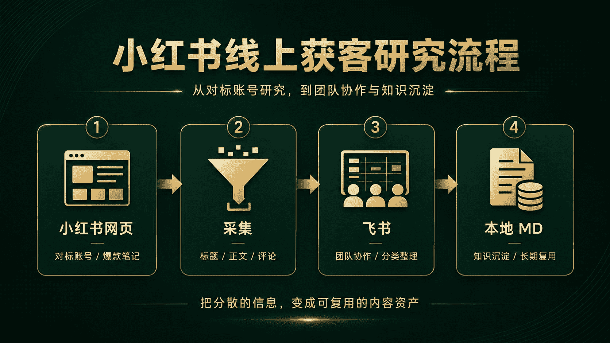

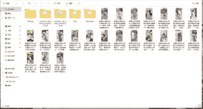

切完之后会得到一张索引表，Codex拼视频的时候，就靠表里的文案、时间和语义标签来决定哪个片段放开头、哪个放中间。把素材打散再重组，原声切换可能有点硬，配上BGM就好很多。现在演示用的切片量偏少，等切片数量越多，语义衔接就会越自然。

再来一个特别能说明问题的例子：消防行业AI获客。这位老板做消防业务，天天发视频，但平台推来的全是同行，真正客户线索一个没有。钱花了不少，精力也搭进去了，客资依旧为零。我后来并没有给他写任何代码，只是基于对消防行业的理解，回了三句话——讲明白爆款视频的逻辑，以及这套逻辑落到消防领域该怎么操作。就是这三句话，他立刻决定做定制。这让我意识到，信任不是靠代码赚来的，而是靠对行业的理解赚来的。你一句话说到点子上，老板心里就会想：这人真的懂我这个行业。

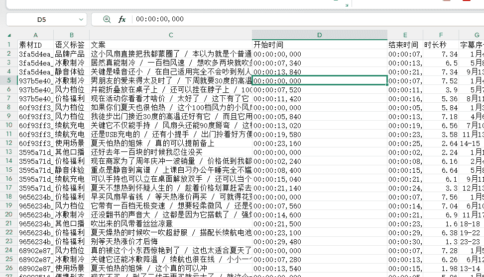

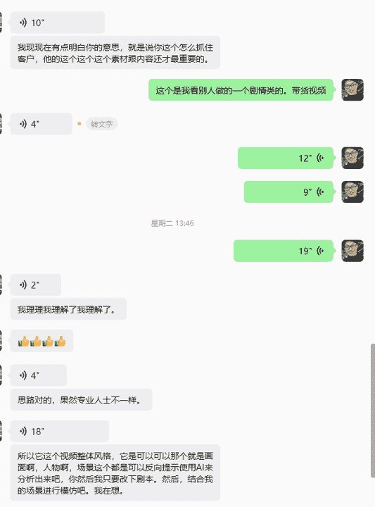

第五个案例做到更高一层，旅游行业Agent。这类项目客单价高、护城河也深，而且意味着你从单纯接单，转变成做产品。可以参考上海圈友陈六哥的案例，链接贴出来：https://mp.weixin.qq.com/s/1qNvzX1HMYA2AnL75_5kfw

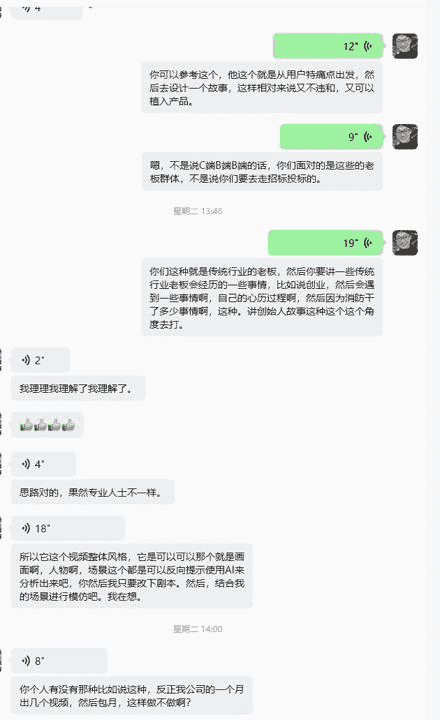

他的思路是：把TikTok和小红书的数据采集能力做成一个开放网站，让整个旅游行业的老板都能接入这个Agent，再结合各自手中的私有数据去生成文案。本质上，你不是在给某一个客户干活，而是在给整个行业铺一条公共设施。商业上的好处是，只要先落地一两个标杆客户，就能往整个赛道去复制，赚的不再是一个客户的开发费，而是行业级的机会。

需要泼一盆冷水的是，Agent虽然被吹得很火，客户未必有需求；在他自己的业务流程还乱着的时候，硬推Agent只会给他压力。正确顺序应该是先判断客户卡在哪个环节，再决定用多复杂的技术。

最后说一个更通用的框架。不管案例怎么换，客户的真实需求拆到根上，基本就是三个大方向。这三个方向在企业价值链上站的位置不同，老板付钱的意愿也随之一层层抬升。把这条排序捋清楚，你就能知道精力该往哪压、报价该按什么梯度走。

希望这篇复盘能让你少走点弯路。如果你也正准备切入企业AI定制，欢迎交流。

近期咨询很多的人都在问同一个问题：做AI Agent 接企业业务，怎么从起步做到稳定拿单。我把自己实战跑通的逻辑整理成一套可复制的思路，给你参考。

先抓住一个底层规律：客户为AI买单的核心不在技术炫酷，而在距离业绩的远近。越贴近获客与成交，付费越痛快；越远离结果，再辛苦也只能收劳务费。

按照贴近收入的程度，企业对AI的需求大致可以分成三类。

第一类是后端的信息整理与处理，比如售后、运营、财务的数据归集，或电商表格、小红书爬取。这类项目技术门槛低，上手快，成了大多数人拿到首单的突破口，也相对稳妥。但本质是帮员工提效，老板愿意付点小钱，却不会为此激动，更谈不上溢价，除非你最终打造成一个规模化系统。这样的微型工具更适合用来攒案例、建立信任、敲开第一扇门，而不是高客单的主战场。

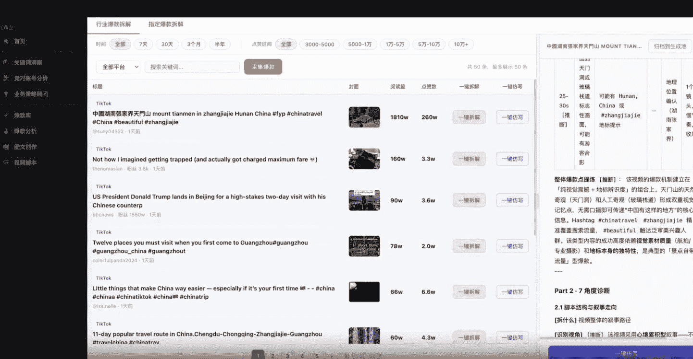

第二类是卡在成交链路上的关键提速，比如报价流程提速、留学资料自动抽取、汽配型号自动识别。这类方向直接打通拖慢成交的瓶颈，离收入更近一步，客户感知到的痛感更强，付费意愿明显高于纯后端整理。完成首批案例后，这才是向上走的主攻带。

第三类是前端的获客扩张，直接解决老板最在意的获客数量与转化率。这一类付费意愿最强，也最容易形成溢价，老板为获取客户付费几乎不犹豫。但交付难度最高，也最忌讳过度承诺。客资是否能持续到来，从来不是单一工具能决定的，而是整套方案执行的总结果。总结一句话：越靠近获客与成交，你收获的现金越容易。

选客户比打磨技术更关键，选错了赛道，方法再好也无用。

大B与政府客户预算体量大，单个项目动辄几十上百万。但决策链条漫长，要经过多层审批与对接；配合度低，想要数据与负责人难如登天；而且内部普遍配备研发人员，随时有自建可能，个人很难真正切入。唯一进入的钥匙是已有成熟案例，能一眼看见效果，否则决策流程就能耗尽个体。C端业务则不稳定，付费犹豫，倾向于自行解决，偶有稳定高客单C端愿意买成熟方案，但整体不确定性高。

相比之下，规模在百人左右的小B最友好。公司内部以剪辑、编导、售后、财务为主，几乎没有技术与AI人才，从获客到结算各环节都需要外部赋能。老板判断可行，第二天就能付款，无需层层审批。

不过“小B月入3-5万”并非普遍规律。小B内部差异极大，有的老板3000元都嫌贵，有的能爽快付10万。决定成交与金额的关键不是体量，而是三件事：决策者能否直接拍板？需求是否落在获客或成交链路上？该需求是否高频重复？这三点满足，数万元级别项目就有机会。并且这类客户一旦服务透彻，方案几乎可以原样复制给同类型公司，形成规模复用价值。

筛选客户的底线是现金流、决策权、离收入的距离，公司大小对个人创業者意义不大。

落地时还有一个人性坑：如果直接让老团队上手Agent，配合度往往很低。对员工而言，学习新工具等于增加工作量，还可能动摇现有业务基本盘。我亲眼见过一位编导，装好Codex后让她把日常工作抛进去对话，她看了一会儿抬头说不知道该怎么提问。

对从未接触过AI价值的人，空白输入框不是激发创意，而是让人懵。人只能提出自己脑中已有的需求。要向AI提需求，前提是脑中有能力地图，清楚边界与可能性。对新手而言这张地图是空白，让他面对空白框提问等于让他描述未见之物。问题不在操作，而在想象力的鸿沟。越是全能开放的工具，越让人无从下手，自媒体宣传的Agent无所不能，对新手反而是压力。

正确的切入顺序要反向进行。先引导员工讲清日常流程，然后基于流程为其定制一个现成带界面的小工具，点两下就有结果。尝到甜头后，脑中地图开始形成，会主动提出“这里若能再改一下就好了”。这时再交付通用工具，他就带着明确目标使用。给AI的正确方式是先交付结果，再交付工具；先补足想象力，再谈使用自由度。地图建立后，工具自然上手。

需求挖掘也要避雷。不要上来就问“你想要什么功能”，对方往往说不清，只会得到模糊或偏离的需求。正确做法是先做行业功课，沟通前用AI预跑业务流程，预判几个提效点，带着具体案例去点对方。被点中痛处时才会出现“对对对，就是这个”的反应。沟通时打开录音，逐步细化：目标是什么、现行流程如何走、原始表与结果表形态、中间手工操作有哪些、需要匹配哪些字段。细节越清晰，方案越可落地，报价底气越足。

最后做价值排序：直接促进成交的排第一；可降人力成本的排第二，但要翻译成业绩增长才好卖；炫酷但不赚钱的放最后。精力始终压在距离收入最近的需求上。

从零到首单的可执行路径：

确认一个熟悉的行业；拆解三个高频痛点；制作一个可演示的小工具Demo；拿着Demo与十位同行负责人交流；收一笔诊断费或小单验证付费意愿；做成案例后在同类客户中复制。

寻找前十位对话对象的高效渠道：行业内同事与同行，多在用Excel，可带他们体验WorkBuddy的AI表格分析，切换DeepSeek模型即可感受自动处理本地文件的效果；转介绍成交率最高，有信任背书；公域如小红书、视频号及垂直社群持续输出；公开拆解案例做教程，信任度高于纯流量内容。

首单建议从小工具切入，难度可控，不易陷入技术泥潭。技术一旦卡住会消耗时间并打击信心。先用小工具拿到客户，后续再引入技术合伙人承接重活，自己聚焦获客与成交。

防白嫖原则很简单：要么收钱，要么收情绪价值。若对方长期夸赞却在付费环节犹豫，多半是想要而非真需求。做出来展示也难吸引真正买单者，时间会被浪费。最好是把已有成功案例拆解成教程，或直接服务愿意付费的客户。

关于核心竞争力：技术本身在贬值，AI coding让写代码成本越来越低。真正稀缺的是既懂业务、懂技术边界、懂老板付费逻辑，并能整合为方案的人。技术是入场券，洞察才是护城河。

不擅长技术者不必硬啃代码，用AI写Web应用耗时且只能做小工具。直接寻找技术合伙人，自己专注需求挖掘、成交与个人IP。但技术边界必须懂：老板问能否实现，不能只回“回去问技术”，当场要能给出初步判断：安全性如何、数据能否打通、风险点在哪、周期大概多久。能聊边界，老板才认为专业。

利润分配取决于野心。野心大可多分利润给技术方，激励其快速高质交付；自己负责Demo制作与流量传播，IP起来后项目自然汇聚。寻找靠谱搭档可通过长期交流、小活筛选，观察靠谱度、技术水平、沟通默契与交付准时性，避免一开始就把大项目交给陌生人。

长期壁垒在于从定制走向可复制产品。持续接电商、留学、制造等不同行业，认知无法积累，本质仍是时间换钱。破局路线分四步：先接项目赚现金流并积累案例；沉淀标准作业流程；聚焦单一行业打造行业模板；最终升级为垂直行业Agent，将采集与交付能力产品化售卖给全赛道。核心判断标准是复用性，能复用的是资产，不能复用的是打工。个人服务能力有限，同时服务2-3家即达天花板，需借助垂直Agent解放交付，专注获客与产品经营，这才是从高级服务者到经营者的分水岭。

风险与合规提醒：AI Agent案例多涉及爬取，需注意边界。

微信自动化仅做聊天记录导出相对安全，自动回复、自动加好友等点击类操作风险极高，封号会导致客户客资损失。

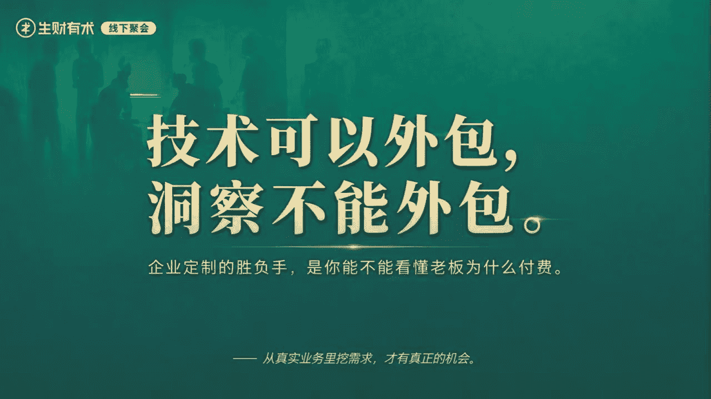

小红书不要做自动发布，平台已封一批账号；采集可用，但频率过快易触发风控。数据安全不可忽视：知识库交付需做数据脱敏，隐私不得外泄；对外问答系统存在注入风险；若Agent拥有修改本地系统权限，可能删除本地文件、获取本地信息或操控本地应用。

企业定制成败不取决于会不会写代码，而取决于是否理解老板付费动机。先锁定行业、锁定老板、拆解流程、做小工具、验证付费点。把最小闭环跑通，比任何理论都更有说服力。

欢迎交流讨论。

