# 加入赚钱**3** 个月的我在抖音 **CPS** 航海里，从跑通**0-1** 到日入**5000+** 的经验复盘

抖音CPS航海90天：从播放卡几百到日入5000+，我把这段经历完整复盘给你

先从身份说起吧：阿爔，今年4月成为赚钱的一员。到今天，我在抖音CPS航海里已经交出累计成交额200万+、单日佣金5000+的成绩。这一路怎么从0走过来的，我想完整地复盘一遍，给正在做或准备上车的你看看。

严格来说，这个项目我之前零基础。做抖音CPS以前，我的副业主要集中在📕——商单号、商家号都碰过，算是跑通过一点小闭环。但抖音完全是另一个世界：平时连刷都不怎么刷，更别说做过相关项目。所以这对我来说，等于从零开始。

我当时的方法也相当粗糙：真人出镜，逐字口播，每次录前还得化妆，精力被吸走大半；账号倒是开了好几个，内容却全凭感觉，很少认真拆解同行；视频也不是一天一天更，而是拍好几天的量，定时发布。结果可想而知——播放量长期卡在几百，偶有出单，却始终打不破天花板。

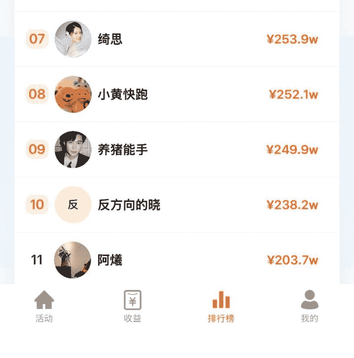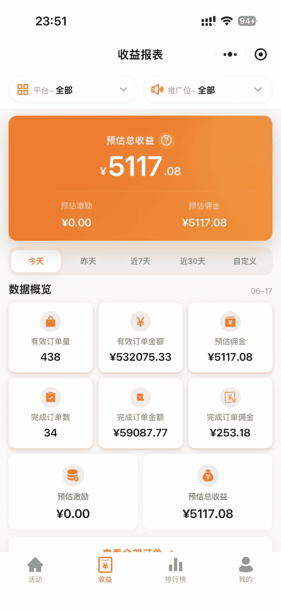

进航海之后，一切都开始变了。在教练和助教的辅导下，我的打法被重新打磨，挑几个最关键的转变说。

第一，把“研究同行”变成每天雷打不动的功课。不再凭灵感写内容，而是每天抽时间刷当下跑出来的爆款，琢磨它们到底凭什么能火。

第二，给每个账号做一次“体质体检”。图文、视频、口播、表情包、曼波……能试的形式我全试了一遍，再根据数据判断这个号更适合吃什么内容，而不是硬塞自己想做的东西。

第三，先1:1复刻，再在细节里放进自己的手感。骨架按爆款来，血肉可以有自己的风格，这点后面详细展开。

第四，学会和平台的审核规则“躲猫猫”。航海初期，我还是老习惯，把口令直接写进视频描述，违禁词也懒得管，结果几乎条条都被标记“引流到第三方平台”，推荐量大打折扣。

我做的第一个调整，是把发现得了的违禁词全部清理掉。有个特别容易漏的细节：会场截图里那些很小的“京东”“红包”字样或图标，也是违禁项，我一般用擦除或者贴纸盖住。但这么处理之后，违规提醒还是没断。

转机出现在我刷到的一条对标视频上。大部分同行的路径是：点右下角分享，复制链接，打开东哥。而那条爆款的文案是：点一下这个，复制，去“抖音的邻居——小东”那里。路径没变，但主体换了称呼，而且开头先抛出一个话题，引导大家去评论区吐槽“抖音的券不够大”，聊到后面才引到京东。

这个设计一箭双雕：互动率被抬上去了，“抖音”两个字也自然地融进了整个内容里。我马上照着这个结构仿了一条，文案几乎原样保留，只把真人出镜换成了猪猪表情包。结果这条视频跑了几千播放，也没有再触发违规。之后按这个模板生产，流量都不错，违规提示越来越少。再往后，随着曼波、图文这些新形式陆续尝试，我彻底切到“密令词体系”，描述里不放任何口令，违禁词全面排查，审核问题基本绝迹。

第五，把剪辑效率提上去，试错成本自然降下来。核心思路是模板复用：预设、结构、会场截图都提前固定好，做新视频的时候直接在上一条的剪辑轨道上接着改——换掉主视频素材（表情包或AI真人出镜），换配音配乐，会场截图留着，字幕生成后再按字幕长短微调素材时长，整个流程很顺畅。

但素材不能永远不变，要定期更新，文案也适当给点变量，防止内容重复度太高。我自己没有固定套路，更多是凭感觉判断该什么时候换——

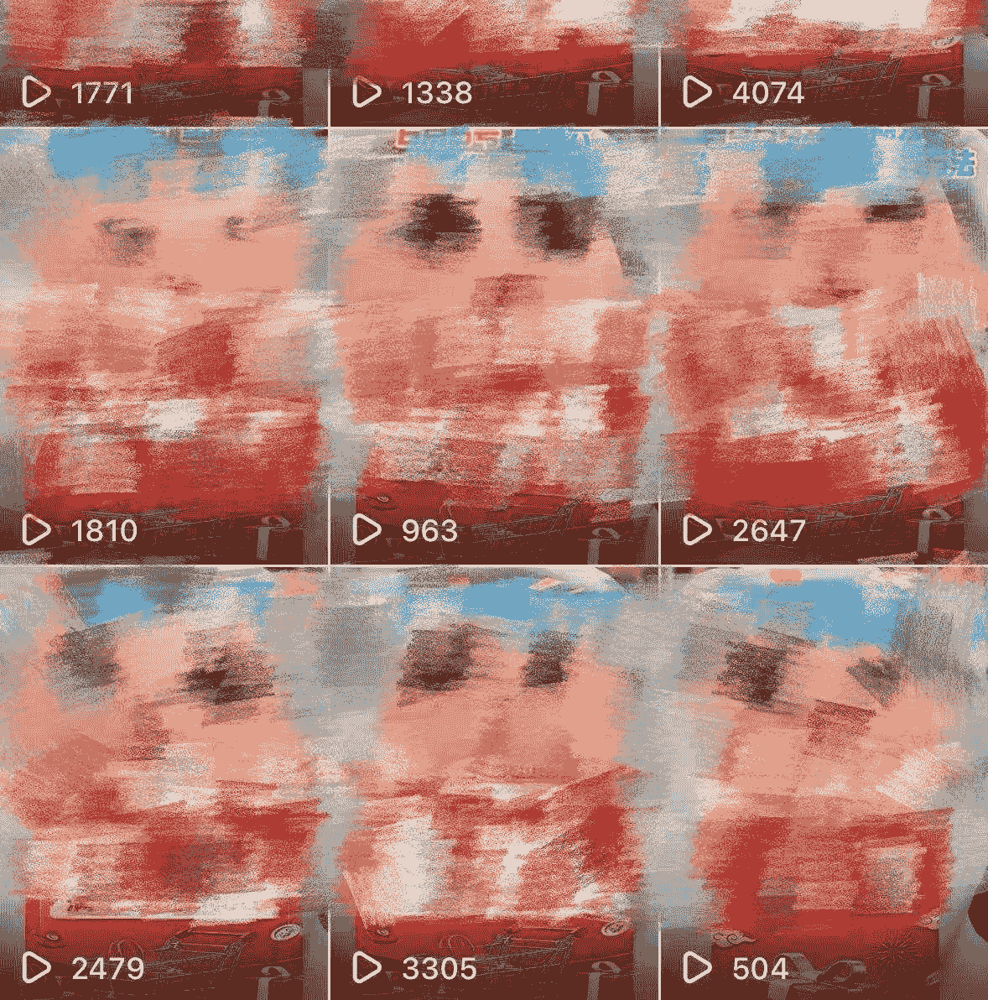

可能我“P人”属性比较重，不喜欢把规则定得太死，临场调整反而顺手。剪一条视频的成本足够低，试错的心理负担也跟着变小：这条没跑起来，再剪一条就是了，总有一条能跑出来。

第六，把注意力从数据挪回内容。不再死盯流量和出单，而是看“这次改动之后效果有没有提升”，把每一次波动当作下一次迭代的参考，而不是焦虑的源头。

第七，别人再好的方法，也得消化成自己的。进航海前，我几乎翻遍了赚钱上所有抖音CPS的精华帖，小明伙伴做的工具让我很震撼，航海里也试过，但我的AI编程水平有限，折腾出来的东西帮不上什么忙。沐亦教练的数据复盘方法同样尝试过，但对一个“P人”来说，实在坚持不下来。不过还是很感谢这些前辈的分享，让我在一次次试错中摸到了自己的节奏：每天刷爆款，有灵感的立刻复刻，再做复盘和迭代。

厉害的方法，只有变成你能坚持做下去的方法，才真正属于你。

真正的转折，发生在5月31日。

那天我做出一条航海期间真正的爆款：用描述里埋口令的方式推广618京享红包会场，只推这个会场，视频大概20秒，这个会场能锁单15天，所以后面我几乎把全部精力都押在它上面，没再去单推品类或单品。

在此之前，我对“参考对标”的理解很浅——抄文案、抄配乐、抄配图，却从没认真拆解过一条爆款是怎么被制造出来的。

这次不一样。我发现那条猪猪表情包对标，并不是真人配音再变声，而是一条一直张嘴的表情包视频，配上剪映/必剪的文字转语音。同样用猪猪表情包，对标选的是“怕冷猪猪”，我原来用的是“客服猪猪”。

想起海宇教练在直播里讲的方法，我决定彻底复刻——除了换会场截图和表情包，结构、节奏、形式甚至文案都尽量跟原视频保持一致。

这条视频选在5月31日晚7点发出，此时正值618开门红的流量高峰期。最后定格在6.7万播放、9700多次分享，吸引过来的大部分是精准搜索流量，6月1日给我带来了3000+的收入。

意外的收获是效率大幅提升。航海前一小段时间我还做真人出镜，每次拍摄前要化妆，非常耗精力。换成表情包+AI配音后，模板跑通，一条视频20分钟左右就能做完。

那一刻我才真正理解：复刻对标，复刻的到底是什么。首先是别自作主张加入那些你以为“不影响数据”的改动；其次，复刻的绝不只是文案和画面，还有背后的生产方式与结构逻辑。

6月初到6月12日这段时间，手感慢慢回来了。我在多个账号上陆续复刻出13万、10万、6万的播放，说明这套打法可复制，不是运气。但新问题也来了：6月9日上午我发了条曼波视频，播放跑到13万+，但因为视频比较长，密令词被我参考对标放在结尾，位置太靠后，导致大量流量没有转化成实际订单。

流量大不等于转化好，密令词出现的时机和位置，需要仔细设计。那阵子我的流量数据并不差，GMV却始终上不去，航海排名也一度从12名滑到22名。

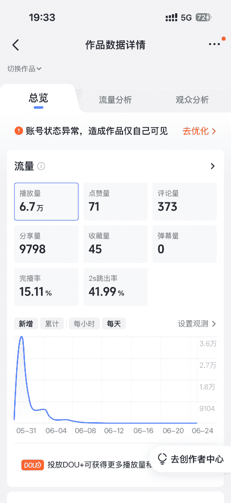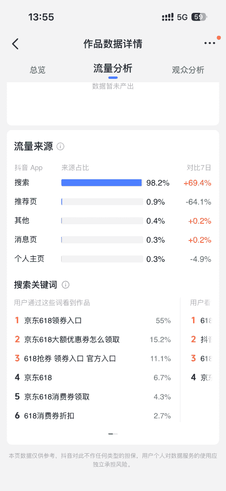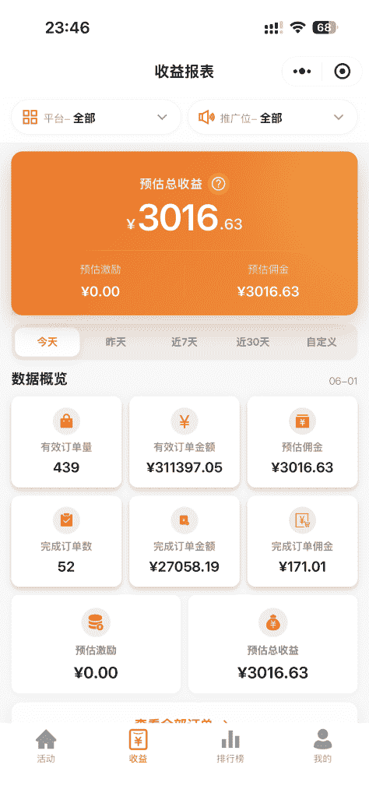

真正的至暗时刻，是6月12日晚上。账号突然被禁言30天，还波及到其他关联账号。坦白说，我当时对抖音规则的理解很浅，第一反应就是慌：要不要注销？这个号还能不能要？

但情绪解决不了任何问题。我很快逼自己从“为什么会这样”切换到“接下来怎么办”。很多事情原本就没那么严重，只要你还在场，就有翻盘的可能。

我先问了助教老师。老师判断这情况比较个例，可能是被同行举报，但618流量正在往上走，建议直接开新号继续干。这句话让我想通了：被封的原因已经不重要，那些号就是过去式，真正要想的是接下来的路。

接着我去请教AI龙哥，一轮对话下来，核心结论很清晰：要让新号彻底摆脱旧号的影响，设备和网络环境必须干净。

当晚我就下单了一台二手手机，同时把手上的备用机恢复出厂设置；第二天一早办理了一张新手机卡。先用随拍视频验证流量正常，6月14日新账号发出第一条内容，当天一共发布了4个作品，其中包括曼波和图文。

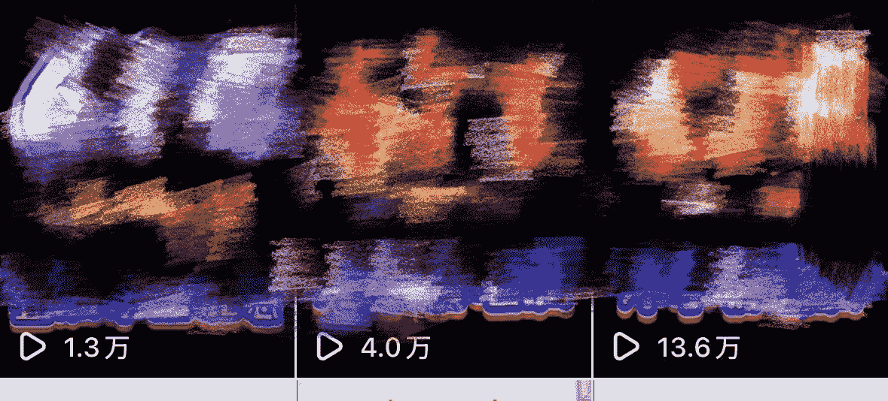

新号重启之后，我做了不少形式测试：曼波流量只有几千，一条几乎完全复刻爆款的图文跑到了6万+播放。

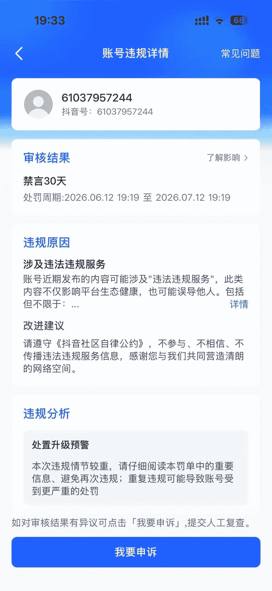

真正的跨越在6月15日——我做了一条图文，把两个不同对标的爆款融合起来，再用“手抄”的方式重新呈现，播放量一路狂飙到37.2万。

事后复盘，这次爆发是三重因素叠在一起：新账号+新设备吃到冷启动流量加权；618的大盘流量本来就在上涨；内容本身是融合创新，不是单一复刻。三者缺一不可，才有了这个成绩。

这次重启我总共开了3个新号，其中2个流量表现不错，剩下1个的所有作品都没超过5千播放——同一套打法，不同账号的“体质”差异还是很大，这恰好说明了多账号布局的必要性。

新号后来发布的系列作品也陆续有万播、千播的成绩。到6月17日晚8点，佣金开始持续飙升，单日突破5000+，也算是赶上618的小高峰。

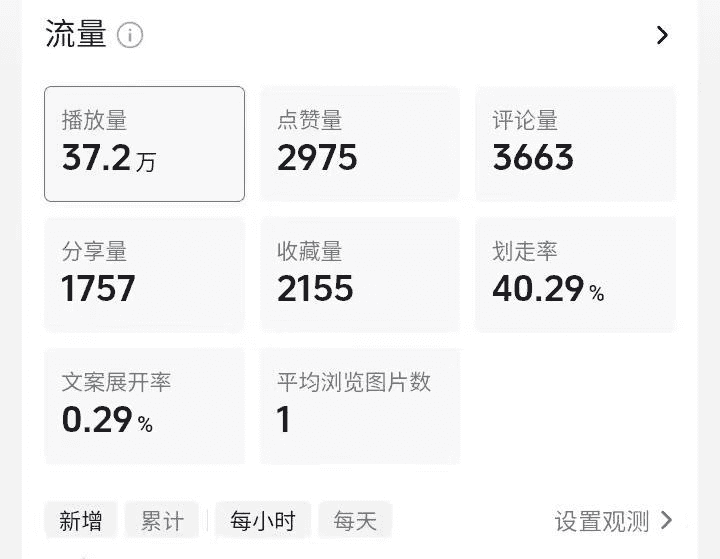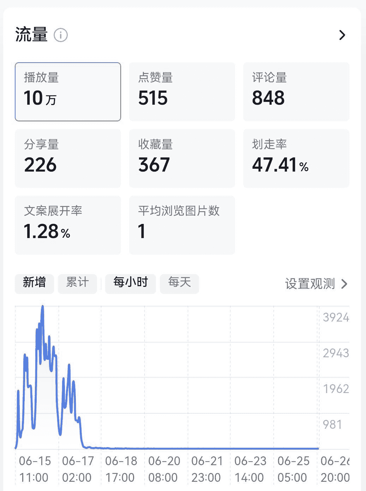

6月19日，我主动选择停更。原因有三个：618最猛的增长周期已经过去，虽然19到21号还有一波余热，但自己对这个结果已经满意；高强度转了很久，确实需要休息；新账号的冷启动红利正在消退，流量也在往下走，继续硬撑性价比太低。

这里想特别夸一下航海里的排行榜机制，它对我帮助很大。我生性好胜，佣金增长不动的时候，第一反应容易是怀疑环境和外部因素；但看到榜单上伙伴们的GMV一个比一个高，就会清醒地认识到问题出在自己这边，然后逼自己彻底复盘卡点在哪。没有这个排行榜，我大概率拿不到今天这个结果。

也借着这个机会，由衷感谢赚钱，感谢这次航海，感谢教练和助教老师们。

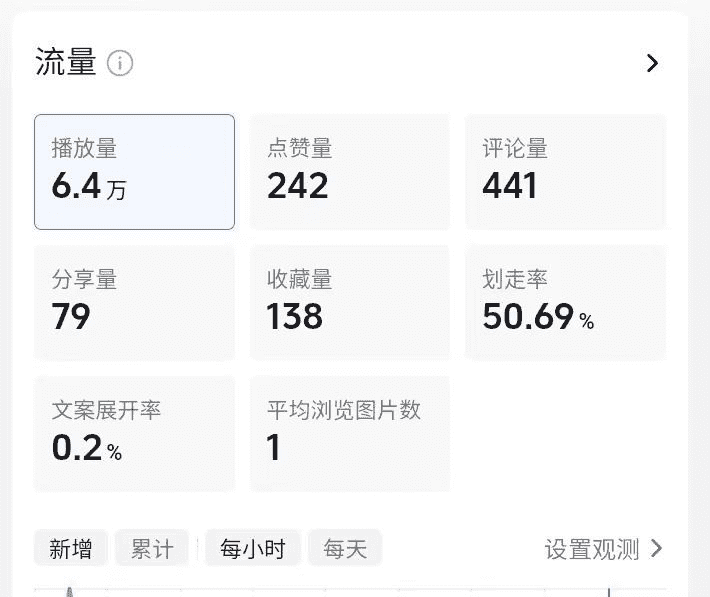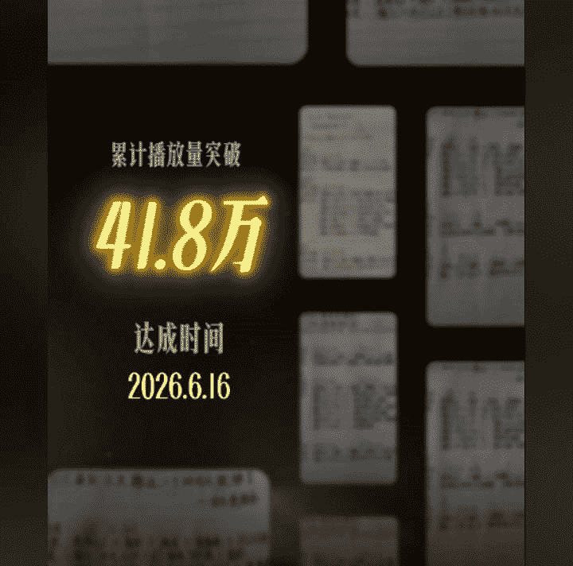

最后，把这一路踩出来的经验整理成6条避坑建议，送给想上手或已经上手的你：

一、数据只是反馈，不是主人。发完视频就反复刷新，盯播放、看出单、盯佣金，是最消耗心力但对结果毫无帮助的动作——这是我亲身体会。真正有效的复盘，是观察“这次改动有没有让结果变好”，把每次波动当成决策依据，而不是情绪出口。

二、复制爆款，别只盯着文案和画面，背后的生产方式才值得琢磨。我早期对标就停留在文案、配乐、配图，后来才明白，决定复刻成败的往往是更底层的东西——内容以什么形态呈现、语气是什么调性、话术结构怎么走。把这些研究透，复刻才算真正开始。

三、账号被限流、被判定违规，都不是末日；该做的是把规则重视起来，提前排查。引流类内容天然容易踩线，有时候截图里一个不起眼的字样也能把你送走。别等问题发生了再补救，最好一开始就熟悉规则、养成排查习惯。

四、做多账号，最怕“环境关联”。几个号共用同一套设备、内容大差不差、还互相跑去评论区引流——这些操作都可能让平台判定它们是一家人。一旦一个号出了问题，其他号也可能被连坐。想做矩阵，最好提前把这些隐患拆掉。

五、技术和技巧，都排在心态后面。封号那天，我也慌、也迷茫，不知道该注销还是怎么处理。但我没有反复追问“为什么是我”，而是立刻把问题换成“下一步怎么办”。很多事没有那么严重，只要你还在牌桌上，就有重新上桌的机会。

六、别做理论上的巨人。想清楚了大干一场，不如先干起来。这个项目不需要特殊天赋或资源，是普通人完全能抓住的机会。开始之后，靠强执行力持续产出，靠有效迭代不断优化，结果自然会跟上来。

————分割线————

看完这篇复盘，你可能觉得已经懂了。但90%的人，实操第一步就会卡住。

工具和教程从来只是最低门槛，真正的门槛是“立刻动手”和“圈层信息差”。

这里不聊虚的，只做商业闭环拆解与AI效率压榨。系统已沉淀1000+跑通的套利实战局。

👉 查阅圈子完整数字资产与上车门槛：https://lazyso.com/insider/

备注：【实操上车】，不闲聊。

