# ('做流量3年，转型AI写作第一个月利润2W：一个00后流量玩家的踩坑复盘贴', (7, 43))

大家好，我是阿皓，00年出生，大学时期就开始混网赚圈，潜水三年多，算是一个标准的流量型玩家。

这几年我试过很多方向——微商、表情图导粉、某红书垂直人群、用户池后端转化，每一段都赚到过钱，但每一段都没做深。

今年4月，我开始做AI代写，45天净入2万。这笔钱让我认真回过头审视自己：为什么我总能看到风口，也确实赚到过钱，却始终没有把任何一件事做透？

如果你也有类似的感受：
- 看了很多方向，也亲自下场试过，但真正做深入的很少；
- 一收到正向反馈就拼命干，几天没动静就开始焦虑；
- 总觉得下一个机会更好，回头一看手里却空空荡荡；
- 一直想找队友、找圈子、找推动力，但等着等着就停下来了；
- 赚过快钱，但风口一停，客户、话术、流程、团队什么都没留下。

那这篇复盘也许能帮到你。

这篇内容想探讨的核心问题是：普通人做事最容易踩的坑，就是用“打猎心态”对待每一个机会——只在意现金进账，不做长期积累。哪里有红利就往哪里冲，哪里反馈快就出现在哪里。短期看确实灵活，但拉长时间看，不过是在反复从零开始，钱赚到了，积累却是零。

先交代整体结构，正文一共五个板块：
1. 过去三年折腾过的几个方向（附一些我整理过的获客文档，现在依然能用）
2. 为什么过去没能留下长期积累？
3. 做事的人分成两类：一种叫猎手型，一种叫农夫型
4. 这次做AI代写，我决定走农夫路线
5. 如果你也频繁想换方向，先拿5个问题问问自己

一、过去三年折腾过的几个方向

1）表情图导粉（2023到2025年，断断续续在跑）

**玩法说明：**
把同一套头像和表情素材，铺到抖音、公众号、快手、某红书四个平台，同步分发。我拿自己其中一个账号做展示，大家可以参考一下。

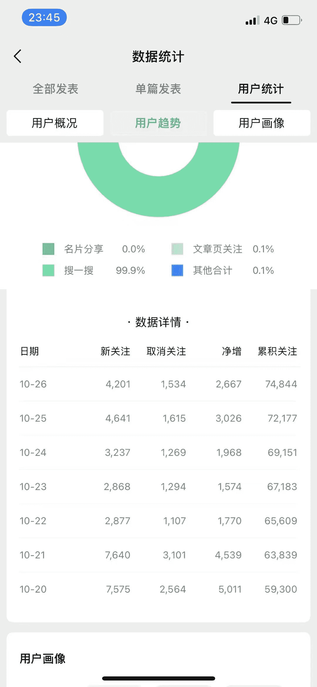

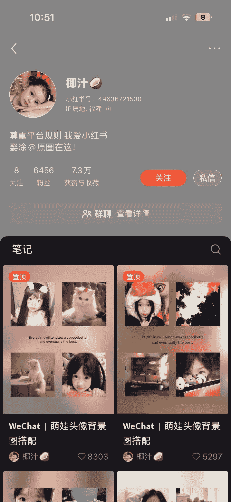

第一张是抖音表情号的数据表现，第二张是新公众号起号30天的记录，第三张是某红书同行的账号截图。

这个方向有3条变现路径，我当时主要用前两条：
1. 把粉丝引导到个人号，后端靠人设IP卖产品（我试过水晶、减肥、情趣、私护、塔罗等）；
2. 直接把粉丝批量卖给买家，一个微信好友1.2到2元不等；
3. 做公众号流量主赚广告分成，具体玩法可以翻翻赚钱里的精华帖。

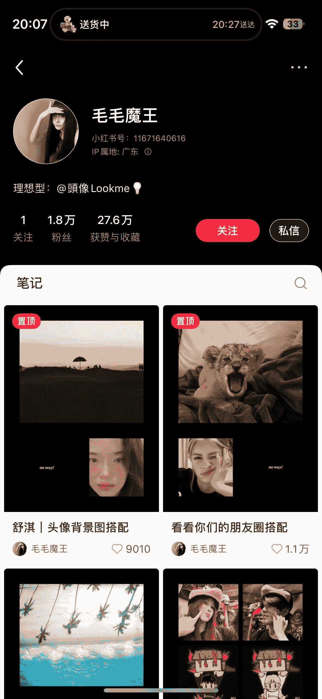

操作方式不复杂：
第一步，去微博或某红书找颜值高的图，这一步极其考验审美。后来我招过线上运营，发现人与人的眼光差距真的很大，有人找回来的图很土，有人找的就很高级顺眼；
第二步，打开醒图，搜对应的模板直接套用，修一修就能发。

**怎么导到个人微信？**
某红书、抖音、快手：引导用户看主页，主页写上公众号名字，用户关注后，后台设置自动回复，回复里放微信二维码。公众号端更简单，文章底下放名片就行。

**复盘：**
累计吸了二三十万粉，但因为封号和自身原因，没能持续下去。

这是个好方向，见效快，不需要内容能力，只要审美过关、能扛住每天机械式发布就行。

当时我也留了一部分粉在微信里，试着做减肥、占卜、水晶等后端变现。但这批人属于泛粉，是拿头像素材才加的，并非带着强需求来的。所以朋友圈必须细心经营，不能像传统微商那样天天硬广，要有互动、有温度、有生活感。

泛女粉减肥+占卜的具体玩法，我写过一份简单的SOP，有需要的圈友可以找我要。

2）某红书垂直粉（2024年，做了差不多半年）

**为什么又做获客？**
因为前面做表情图时，正反馈来得太快，现金收益也很爽。后来在知识付费里认识了不少做打粉业务的人，所以继续走量，区别是从泛粉换成了垂直粉。

打过减肥、星座、塔罗、旅游等赛道，主力放在减肥。这套某红书素人分享贴的打法我也整理成了SOP，想要的圈友可以自己拿。

当时某红书对新号扶持力度很大，很多赛道都值得试，包括我现在做的AI代写，在上面也能看到同行在发。

**复盘：**
那年我走的是矩阵路子，手里几十台设备，每天就是开号、发内容、盯数据。峰值月流水到过10w+。因为这类客资价值高，一个粉能卖15到120元，减肥粉尤其抢手，单价能到60-90。

这个模式反馈也非常快，只要号和内容能跑起来，客资自然就来。只是后来平台管控变严、流量变差、违规成本抬高，号消耗得也越来越快，我就逐步退场了。

3）客户池后端转化

**这段在做什么：**
把之前积累的泛粉和买回来的垂直粉进行转化，做过减肥、塔罗、水晶品类。

**转去做后端的原因：**
说直白点，做流量做疲了，天天重复操作，很消耗心力，而且今天做了才有，不做就没有，还得看平台脸色。

**复盘：**
第一次做减肥粉转化，加了40多个顾客，成交15个左右，首单加上后续追销，累计变现1.5w+。

前面阶段我一直做前端获客，真正坐下来做转化后，才发现自己在后端更有感觉——客户进来怎么聊、怎么判断需求、怎么挖痛点、怎么在朋友圈养信任、怎么报价、怎么逼单，这些全是边做边摸出来的。

但最后还是绕不开流量：没有新客进来，后端转化就是无源之水。当时我做的这几个赛道精准流量很不稳定，平台限制又严格，我再次开始到处看新方向、试新玩法，做着做着就搁置了。

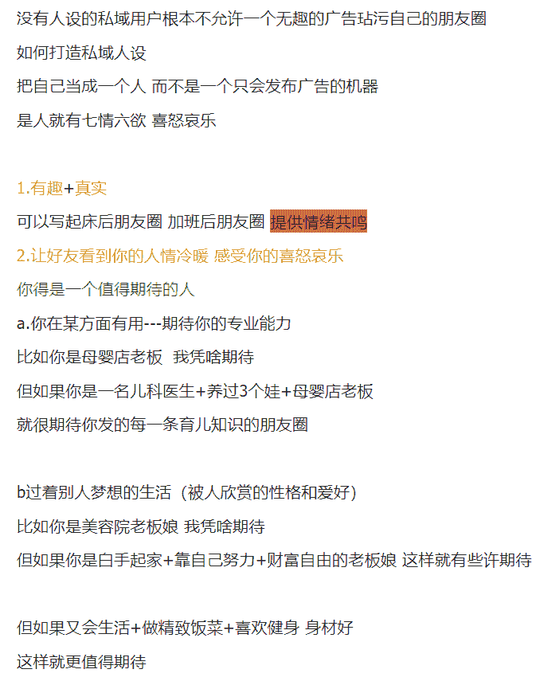

这张图是我做转化阶段刷视频时的笔记，那段内容对我帮助特别大。

现在我对成交还算有点底气，都是那段时间磨出来的。很多人手里有客资却不敢开价，或者开价后接不住客户，最后ROI算不过来。我相反，在话术、报价、成交这几个环节上，特别愿意花时间去打磨。

二、为什么过去没留下长期积累？

只看经历的话，我确实赚到过一些钱；但认真盘点之后，我发现自己几乎没有积累下什么长期资产。

表情图项目累计吸了二三十万粉，垂直粉也打过几千个，但大部分都被我卖掉换成了现金，没有沉淀到自己的私域。现金收益确实痛快，可号没了、粉没了，下次还是要从零开始找路子。

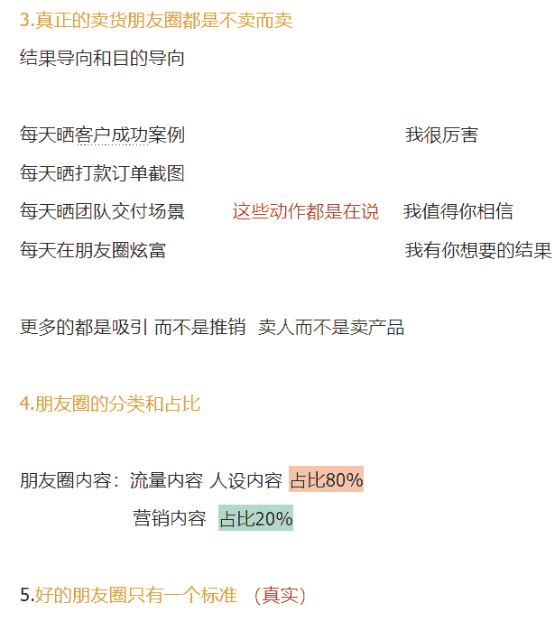

仔细回看，没留下积累的原因有四个：

1）把现金进账当成了资产
以前只要一个方向能赚钱，我就觉得它是好方向。可我的能力全长在自己脑子里——怎么测兴趣人群、怎么报价、怎么聊单，全部没有固化成文字。没有话术库，没有SOP，只要我不亲自上手，别人根本接不住。

以前我总以为是缺人才，现在才明白，我缺的不是人，是能交给人的那套流程。

2）平台一有变化就想逃
规则调整、账号被限、流量下滑，我的本能反应不是解决，而是换路。当时还会给自己找个体面的理由：这个平台不行了、政策不让玩了。现在回头看，很多情况不是方向死了，而是我从没认真尝试过拆解问题。

3）太依赖即时反馈
有正反馈我就动力十足，能一直干下去；反馈一慢下来，就忍不住去刷别人在做什么。脑子里想法越堆越多，手上动作却越来越少。以前觉得自己是懒，现在想明白了，这不是懒，是焦虑——越焦虑越乱想，越乱想越不动。

4）总想等一个合适的搭档
看到别人情侣搭档、兄弟合伙做项目，我特别羡慕，然后不断暗示自己：必须找到合适的人才能开始。这个念头卡了我很长时间。可实际上，如果一直等下去，就等于亲手放弃赚钱窗口。

三、做事的人分两类：猎手型和农夫型

我特别认同“猎手”和“农夫”这个比喻。过去的我，显然是标准猎手——哪里有猎物就去哪里，哪块地反馈快就出现在哪块地。短期看非常机灵，长期看就是在绕圈，反复从零起步。

现在我是这样理解的：

猎手型玩法：哪里有红利就冲向哪里；赚到钱先想着加大投入；平台收紧就换战场；靠即时反馈驱动；方法全在脑子里；永远从0开始。
农夫型玩法：看准一块地就持续深耕；赚到钱先想着沉淀积累；平台收紧先判断能不能换打法；靠流程和复盘驱动；把经验变成SOP、案例库、话术库；让能力被复用、让团队能接手。

猎手型的能力不是坏事——能看见机会、敢下场、敢试错，这些都很重要。很多人连机会都看不见，看见了也不敢动手。

但如果说一个人只有猎手能力，那他就很难稳定。赚一段，换一个方向；再赚一段，再换一个方向。几年下来，经历是很多，可真正属于自己的积累非常少。

农夫型不是不看机会，而是看到机会后愿意留在里面持续投入。落到做事上，就是不断复盘数据、优化转化、打磨交付、沉淀流程、积累客户和案例，把自己脑子里的能力变成别人也能执行的资产。

以前我觉得农夫太慢，现在越来越觉得，慢才是真正的快。

四、这次做AI代写，我想换一种走法

AI代写，我不是今年才听说的。早在24年就在关注小鹅老师和瑾糖老师的分享，判断这个方向有戏。后来直接跟小鹅老师付费学习，他教得特别细，完全就是“奶奶喂饭级”的SOP，再加上我之前的经验，几天时间就跑通了0到1！

这时候可能有人会问：现在人人都会用AI，真的会有人在网上花钱找代写吗？
答案是：会！而且需求量超出想象。

**项目闭环：** 在某鱼上架服务 + 付费买量 + 引流到个人号成交 + 老客回头。

我目前主打某鱼获客，走付费流量路线。今年4月才正式启动，45天净赚2万。关键是我没有任何专业背景，在各领域都是纯小白，连行业术语都看不懂，但依然跑通了0到1——全靠AI帮我分析客户需求、解释名词，最后用AI完成交付。

**项目成绩：**
和大佬们比，这点成绩完全不值一提，但还是写出来，希望能给一些圈友带来信心。

目前我在做PPT代做，一共3个账号，自己负责前端获客和客服转化，交付环节外包给写手团队。
写手的成本通常是成交价的15%到40%，只要双方谈得拢就行。
5月数据如下：

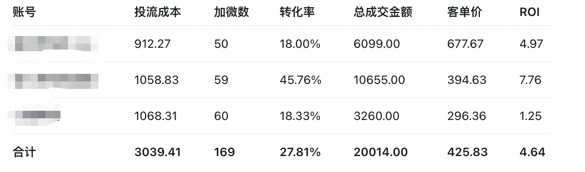

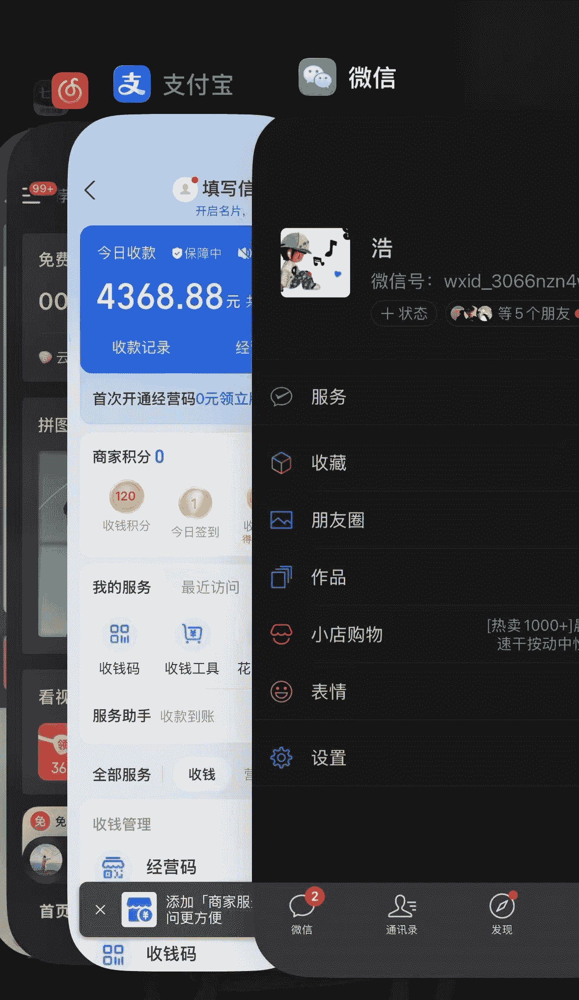

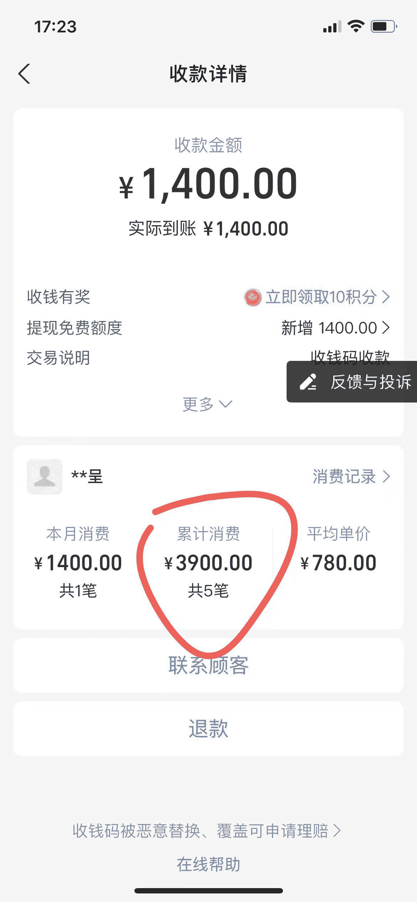

上面是部分成交记录。

**项目体感：**
选赛道、选品类真的太关键了！！因为选品类本质上就是在选人群。
只要品类选准了，价格敢报，话术打磨到位，就能接到高客单；朋友圈IP再做扎实，回头客会越来越多。

最开始我没有直接做PPT，而是先挑了3到5个品类做测试——剧本、PPT、分镜头脚本、口播文案都试过。

先讲前端获客的个人感受：
剧本品类，咨询的人多为个体创业者、公司、学生。在平台聊完，多数人不愿意加微信，就算加了好友，也比较喜欢比价。市场价也许能报到一分钟两三百，但这些人预算往往只有几十块，同行还在疯狂压价，结果就是无效咨询特别多，投流的ROI根本拉不平。（当然，现在也有大佬做剧本做到一单好几千甚至上万。）
分镜头脚本、口播文案品类，咨询的人主要是学生、IP博主、公司。当时咨询量不大，不方便一概而论，但体感也是一群预算有限、反复比价的人，成交率不算理想。

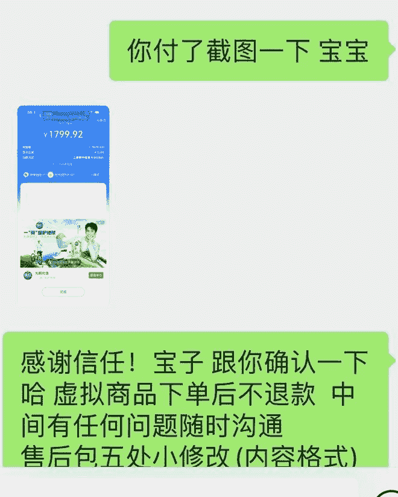

**目前遇到的卡点：**
因为自己没什么专业能力，我一直在纠结还能挖什么新品类。并且PPT的上限很明显——客单价太低。
最近开了新号，重新测这几个品类，咨询量倒是回来了，但没预算、爱比价的人依然占多数，ROI很难跑正。打算再放1000块预算试一轮，实在不行就先停手，再去观察别的品类。

**个人建议：**
如果你自带专业技能，非常推荐来平台试试——基本没有门槛，只要把链接挂上去，头两天就会有人来问。（比如程序员接Java项目，教师接课件代做，做过IP的人接口播文案、分镜头脚本等。）

**回到主线：**
我是25年11月报名的，但到今年4月才正式开跑。为什么中间拖了那么久？第一，23到25年都在做流量向的事情；第二，停下来之后，我一直想等一个合适的搭档一起进场。后来确实等到了，两人合作不到半个月就跑通0到1，拿到了现金和正反馈。
可惜后来朋友因为自己的原因退出了。我又等了一阵，越等越焦虑。换做以前，我大概率会困在等待+焦虑的循环里出不来。
但这次，我没有继续等。我一个人做获客，也做转化，把交付外包给写手。
现在这个项目还远没到稳定阶段，只能算跑通了0到1。这个成绩不大，但对我意义重大——它让我确信：只要执行力在线，先干起来，就一定能拿到结果！

而且这次，我不想再赚一波就跑了。
流量怎么调、客服怎么接、写手怎么管、质量怎么把关，这些我都要一点点写进SOP。刚开始肯定很糙，但糙也比没有强，先完成，再完美！

超级航海的课程我参加了之后，又去听了瑾糖老师的线下分享，很感谢瑾糖老师的建议，帮我在业务上理清了很多思路。
现在我也会用Obsidian、Codex这类工具，整理投放数据、客户问题、聊天话术和复盘，慢慢沉淀出获客SOP和转化SOP。不是为了显得专业，而是我真的吃过亏——经验不沉淀，项目就只能长在脑子里；长在脑子里，别人就没法接手，团队也没法放大。这次，我要做农夫。

👇这是我用Codex搭的自动化工作流：每天定时抓取投放后台的数据，再让Codex根据投放SOP生成每个账号第二天的调整动作（大家随便看下skill跑出来的结果就好，这几天没好好维护）。

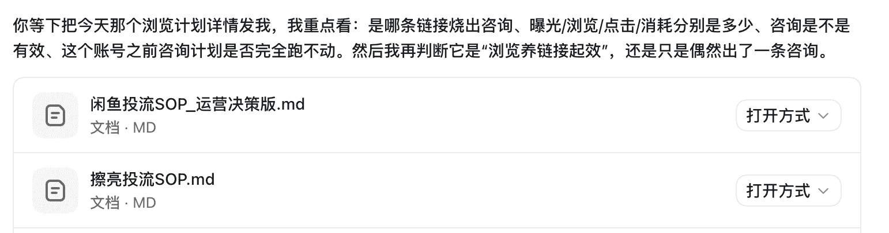

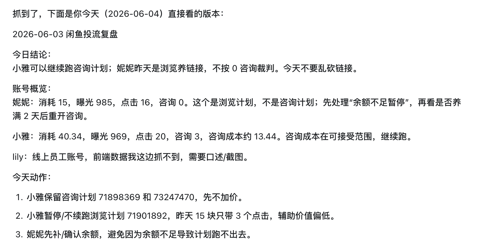

五、如果你也总想换方向，先问自己5个问题

这几年走下来，我发现普通人做不成事，通常不是因为方向没有红利，而是因为看过的方向太多——反而不知道该不该继续做眼前这个。特别是当一个项目反馈变慢，你又刚好刷到别人做新项目赚到钱，心里就会开始摇晃：要不要换一个？

我现在每次动“换方向”的念头，都会先稳住自己，问这5个问题：

1）这个方向是真的不行了，还是只是到了瓶颈期？

大多数方向起步时都有红利期，反馈快、数据好。但越往后做，越会遇到平台规则、流量成本、交付压力、团队协作这些现实问题。以前我会把这些直接理解成“方向废了”，现在我会提醒自己：先别急着跑，先判断问题能不能解决。

我自己就踩过这个坑：做表情图导粉的时候，后期平台频繁封号、流量掉得厉害，我的第一反应是“这项目黄了”，直接就想撤。现在回头看，那时候完全可以换分发策略、调整内容形式，甚至换个平台再起一轮。明明有人在同一套模式里做了更久，数据也比我好得多。我当时躲的不是项目，是问题。

2）我是在寻找更好的机会，还是在缓解当下的焦虑？

这个问题问出来很扎心。我以前很多所谓“找方向”，本质上就是用看新项目来缓解焦虑。看别人赚钱、看新玩法、找新机会，短期内会让自己觉得还有希望，但如果始终没有落地动作，焦虑只会越来越深。

具体到我自己：某红书打粉不顺之后，我长期处于刷视频、翻别人项目的状态，脑子里想法很多，手上动作几乎没有。那时候我以为自己在“找方向”，其实只是在用信息输入制造一种“还在努力”的幻觉，说白了就是瞎忙。AI代写这个方向我24年就看到了，真正开始却是今年4月，中间两年多我去哪了？大部分时间都花在“焦虑地等”和“找所谓更好的机会”上。

3）我在这个方向里留下了什么？

如果一个方向做了一两个月，最后只剩下“我做过”三个字，那真的太可惜了。就算项目最终不做，也应该留下点什么：一套SOP、一份流量测试记录、一套客服话术、几个客户案例、一条交付流程、一张踩坑清单。

这些东西才是你做下一个方向的底层资产。如果什么都没留下，那就算赚到过钱，也只是暂时的现金收益。

我的例子很典型：表情图项目前后累计吸了二三十万粉，但大部分都被卖掉换钱，没有沉淀进自己的私域；客服转化那段时间，我摸索出了一套成交心得，知道怎么聊、怎么报价，但这些全在脑子里，没有写成话术库，没有整理成SOP。后来合作的朋友没法快速接手，我也没法规模化，因为没有可以交给别人的东西。

4）我有没有先试着换方法，而不是急着换方向？

免费流量跑不动，能不能测试付费流量？一个品类不行，能不能换一个品类？转化率差，能不能优化话术？交付太累，能不能外包给写手？

多数时候，真正该换的不是方向，而是方法。成长，往往就藏在这个“换方法”的过程里。

我在AI代写这条路上就是这么调整的：一开始做剧本，咨询量很大，但成交率很低，ROI始终不正。换成以前的我，大概率会把这个大方向直接否掉，但这次我先问自己：是方向不对，还是品类不对？然后我换到PPT品类，咨询量、成交率都明显好转。方向没变、路径没变，只是换了一个品类切口，结果完全不一样。

5）如果再做3个月，我最该沉淀什么能力？

不要一上来就想做大，先把问题拆小：接下来90天，我要沉淀的是获客能力，还是转化能力？我要做的是交付流程，还是团队协作？我要积累的是私域，还是案例库？

一个阶段只盯一两个核心点，反而更容易推进。

我现在给自己定的任务很具体：这3个月只做两件事——第一，把投流SOP写完，每天用工具拉取数据、根据数据调整动作，让这套流程可复制；第二，把客服话术整理成标准SOP，不再靠感觉聊天。交付先外包给写手，不花太多精力。以前我总想一口气把所有环节做到位，结果每条线都只做了一半。这次，我要先把两条最关键的主线跑稳。

写在最后

从猎手到农夫，我花了整整三年才转过弯。以前总觉得农夫的做法太慢，现在终于明白：真正的快，其实是盯住一个方向往深处打，把经验变成可以复用的资产，让自己所有的积累都可以被传递、被放大。

如果你也总是漂在不同方向之间，希望这篇复盘能帮你再坚持一下。机会永远都不缺，但你能带走多少，终究取决于你在自己那块地上挖了多深。

我现在还不敢说自己算成功，更多的状态是卡在 0 到 1 的试错期。但这次我不想再重复老套路：冲一波流量、收一波快钱，最后什么也没沉淀下来。

我想要的节奏变了。

先让一个最小闭环跑得通、跑得稳。
先把获客和转化的打法整理成可复用的 SOP。
先把交付的每一步梳理顺滑，不靠临场发挥。
先把每天踩的坑、卡点、解法原原本本记下来。
先让这个项目从脑子里搬出来，变成看得见的东西。

如果你正处在差不多的迷茫期，希望这些尝试能给你一点参考。

未必要照做，但可以自问一句：当下你是去狩猎，还是在做农耕？

全文大部分都是我的亲历复盘，感谢你看到这里。

————分割线————

SOP 看完心里会觉得“好像明白了”，但真正上手时，90%的人会死在第一步就打不开局面。

工具和公开教程门槛已经很低了，真正拉开差距的是当下就开干的执行力，以及圈层里流通的信息差。

想第一时间看到全网在跑的最新变现打法，和一帮执行力在线的人一起实操出结果，可以来看看我的核心私域【懒人专属群】。

这边不做鸡汤，不谈概念，只拆商业闭环怎么跑通，以及怎么用 AI 把效率压到极限。圈子里已经沉淀了上千个跑通的套利实战案例。

👉 查看数字资产清单和加入门槛：
https://lazyso.com/insider/

认可这个方向、准备真下场干了的，加我微信：lazyhelper1
备注：【实操上车】，不闲聊

