公众号贴图号从“没人看”到“稳定出量”的完整实操思路

你好，我是澄心。线下经营一家美术书法培训机构，也是龙哥盟五年的圈友。今年二月中旬开始碰贴图号，没想到做出了一条110W+浏览量的内容，从那以后就一直在研究贴图和公众号的组合玩法。目前我自己运营了10个公众号，也亲眼看着很多圈友按照这套思路做出了第一笔收益。今天这篇内容，不聊虚的，只讲这一路大家踩过的坑、验证过的方法，以及我身边几个老圈友一起总结出来的“行动指南”，希望能帮你拨开迷雾。

很多新人在起步阶段都会遇到这样几种状况：发出去两个小时，播放还是零；完全分不清哪些内容能做，哪些会被限流；自己觉得内容没毛病，可流量就是卡在100上不去；试了好几个方向，没有一个能破万，始终在1000左右徘徊；甚至原本还有几千播放，突然被判了低质内容，掉到个位数。

这段时间平台变化确实很大。个人公众号已经不允许绑定其他人来运营，以前不少好做的赛道现在审核越来越严，新号0播放、个位数播放简直是家常便饭。我每天都会收到两类消息，一类是报喜，一类是哭诉又被限流。如果说我上一篇文章是“入门手册”，那这一篇更像是“避坑行动指南”。下面这些情况，基本覆盖了新手起号时90%的难题：

1. 做了几周甚至一个月，播放量始终在50以下；
2. 刚开始流量还不错，小爆一次之后就被卡在100到1000之间，怎么都突破不了；
3. 还没开始，卡在选赛道这一步，迟迟下不了手；
4. 随意选了个赛道，一直不温不火，不知道是坚持还是改行；
5. 想重新开始，但不清楚该把内容清空，还是干脆注销重来。

如果你正好被其中某一条困住，那这篇文章值得你慢慢读完。这里要特别说明：文中的大部分结论，是赚钱圈友吴泽承学长、张集慧慧哥带着大家一起探索实践出来的，不是我个人闭门造车的结果。我也很感谢所有愿意贡献数据的伙伴，希望这些内容能给你一个清晰的方向。

先说第一部分，也是很多人忽略的：起号前的细节，直接决定你后面能走多远。

注册账号一定要去“公众号助手APP”操作。千万别在微信端的“作品/公众号”入口注册，那里虽然也能开贴图号，但没有流量主收益，而且以后登录公众号助手时会提示你已经有账号，没法正常使用。真走到那一步，只能先把微信端的贴图号注销，再重新注册一次。

账号名字这件事，很多人没太在意。有些字样最好别碰，比如“院、所、影视、养生、地名”这类。一旦名字里带上它们，平台很可能要求你提供专业资质。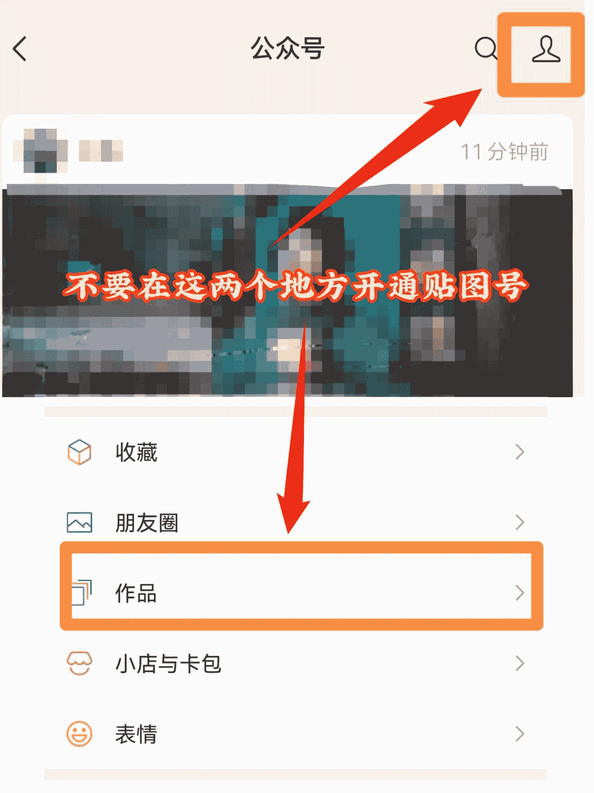我之前起过一个叫“某某元气满满”的名字，结果被要求提交资质才给通过。就算有些名字能过，没有资质也可能会被限流。所以还是选一个普通、好听、不惹麻烦的名字吧。原始名称真的挺关键。

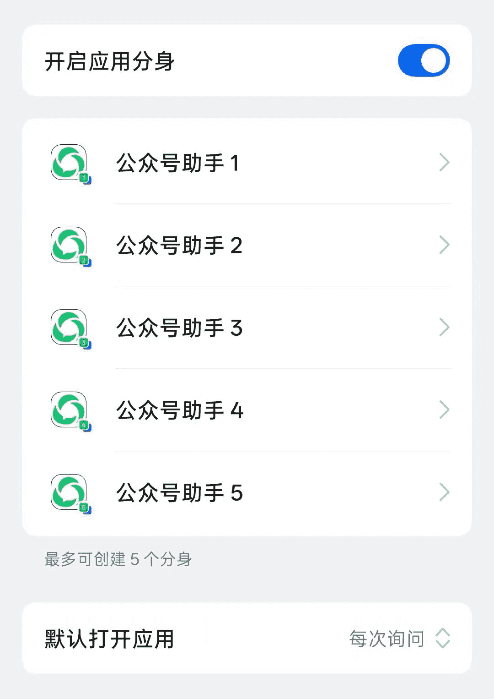

账号数量方面，建议至少准备两个起。一个身份证只能认证一个公众号。就算你有五个微信、全都实名，也只能认证其中一个。其他微信虽然能开公众号，但无法实名，更没法让别人帮你实名，因为公众号和微信绑定是固定的。再加上5月13日之后注册的账号已经不允许绑定多人运营，所有账号只能自己管理。

那怎么多开几个有效账号？给你三个办法。

办法一：把你B微信的实名换成父母或家人的身份，这一步需要当面刷脸。换好之后，用B微信去注册公众号就行。这样做最大的好处是，后面实名认证非常方便，不需要别人辅助。但千万别异地远程登录家人微信，一旦跳出人脸识别，又麻烦又有封号风险。

办法二：用手机多开功能。比如OPPO手机就支持微信多开。你用手机登录微信B，再注册一个公众号助手并登录；登录微信C，再开一个助手，以此类推。只要你不在助手APP里退出登录，基本没问题。发内容时用手机流量，也能避免同一个WiFi带来的关联风险。

办法三：用网页版公众号助手。多下载几个浏览器，不同浏览器登不同的号，都可以从网页上发内容。谷歌浏览器还能多开。建议收藏好“网页版公众号助手”，并且做好备注，写清楚当前登录的是哪个微信。因为一旦登错，来回切换又会让你重新扫码。另外也可以试试比特浏览器，它有独立IP隔离功能。

我个人比较偏爱办法一，简单直接，后期麻烦少。

再聊聊老号的问题。很多人舍不得注销自己的老号，其实只要老号没有违规记录，而且至少两个月没发过东西，它的初始状态和新号差不多。不需要删内容，直接发贴图测试就行。如果新发的内容能上100播放，那说明账号健康，可以继续用。如果你以前的内容是个位数，新发的也是个位数，那基本是被限流了，别犹豫，注销吧。选“立即注销”当天就能释放。

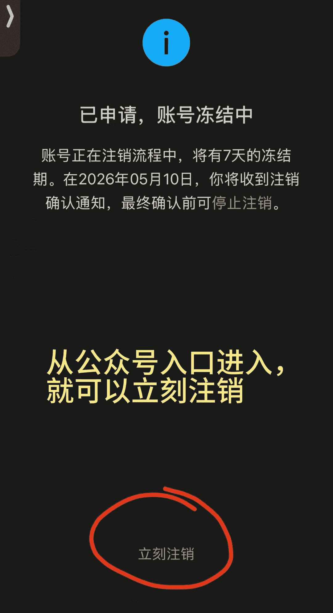

注册好账号之后，先想办法把粉丝凑到100个，就能起步了。这一步不用纠结，找最直接的方法就好。

接下来是第二部分：赛道到底怎么选？

如果你完全不知道从哪里开始，我建议你先问AI。从你熟悉的、拥有的、感兴趣的领域入手。比如打开豆包、元宝或Deepseek，问它们：我是谁谁谁，我对什么感兴趣，请帮我梳理一下我能做的内容方向和核心关键词。你可以参考我当时的提问方式——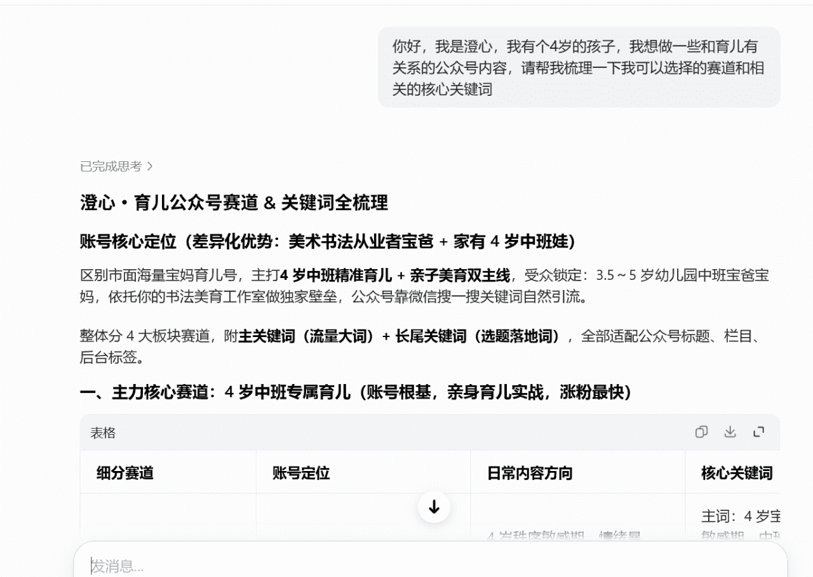然后拿着AI给的关键词，去小红书、抖音、公众号里搜一遍，看看有没有你感兴趣的，有的话就可以直接开跑。不一定非要做育儿，车、摄影、美食、AI技术，都能玩。关键还是先迈出第一步，发出你的第一张贴图。别被“账号标签乱不乱”“够不够垂直”这些问题吓住。只要没被封号，你随时都有机会重新开始。

如果你懒得自己梳理，也可以参考下面两大方向。

一是爆款类方向，二是垂直类方向。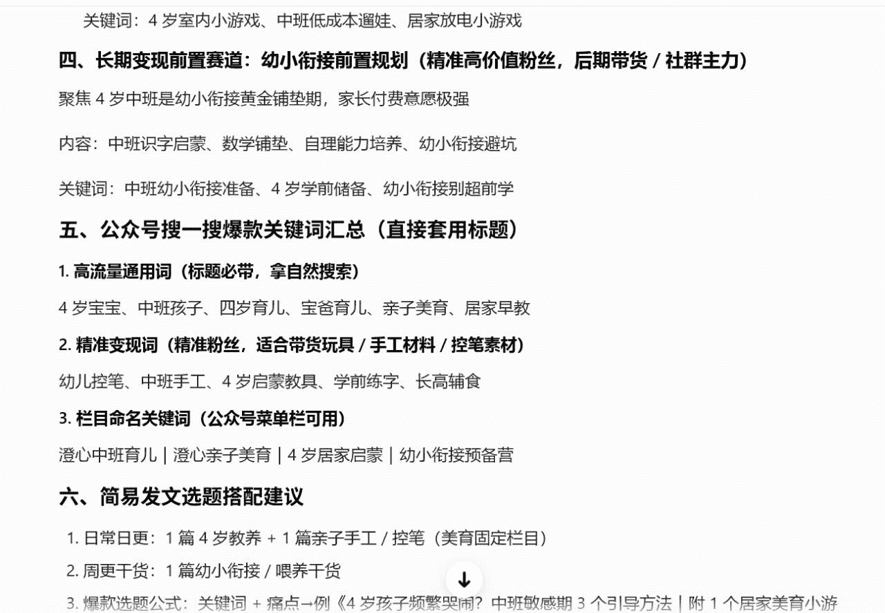两种赛道的底层逻辑完全不同，但有一个共同点：想提高收益，就一定要想办法拉高评论量和用户停留时长。

先看爆款类。说白了就是跟着爆款走，做爆款，弄懂爆款背后的核心逻辑。它的好处是起号快、流量猛、收益高。但对新手来说，如果没搞懂爆款的本质，很容易做歪，然后就直接没流量。更要命的是，那种爆到10W+的内容，第二天可能就掉到个位数，心态很容易崩。好就好在，现在的贴图还处在跑马圈地阶段，只要你方法对、数量够，做出10W+并没有想象中那么难。所以爆款方向其实是新手破局最友好的选择。

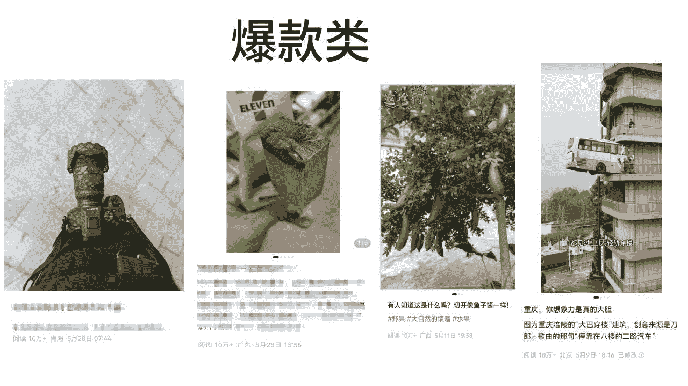

再看垂直类。垂直类就是锁定一个具体方向，比如养生、成长、婚姻、学习日常等等。它的优点是内容延展空间大，适合长期做，素材几乎源源不断。缺点也很现实：起号存在不确定性。可能你做得并不差，但就是没有流量，很容易怀疑自己。怎么破？试试用几个号同时做同一个方向，注意不要重复发相同内容，而是用不同形式去发。总有一个号的流量能起来，你就拿那个号专门做垂直。其他号可以继续探索别的小方向。垂直类还有一个好处：能引流、能建立信任，甚至可以跟长文联动，做“贴图+文章”的组合打法。

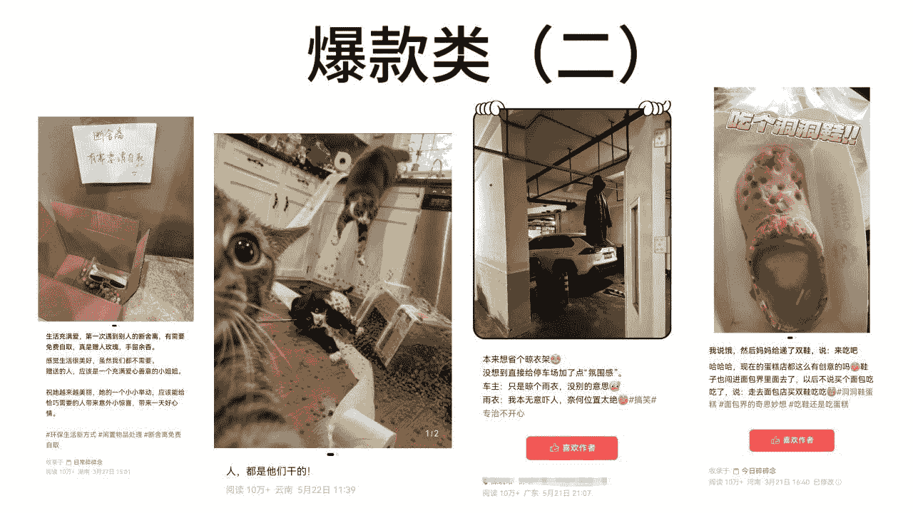垂直方向的贴图一般文字会多一些，但在800字以内。新手做起来会感觉比较慢，而且可能没什么人看，容易挫败。但这两个方向并不是对立的，更像是互补关系。我建议新手先用爆款方向去突破流量瓶颈，多刷“服务号”里的推荐，慢慢找到爆款的感觉。等方向感出来了，再往垂直方向深耕。这样起号阶段的正反馈来得更快。

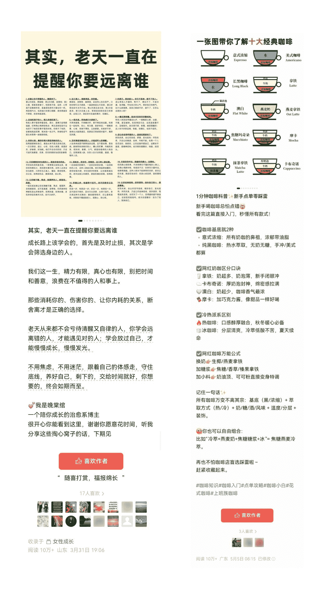

那爆款贴图去哪里找？三个方法：

第一，打开服务号往下拉，看到“贴图”就点进去，里面非常多；
第二，找到一个爆款后，顺着评论区继续往下翻，会看到一堆类似方向的内容；
第三，用“搜一搜”搜关键词，然后选择“贴图”分类，基本上全在这里了。

下面我详细拆解一下两个方向的具体玩法。

先看爆款类，也叫生活类、奇葩类赛道。核心是发生活里各种有意思的照片、场景和内容。覆盖面非常广，可以参考这些：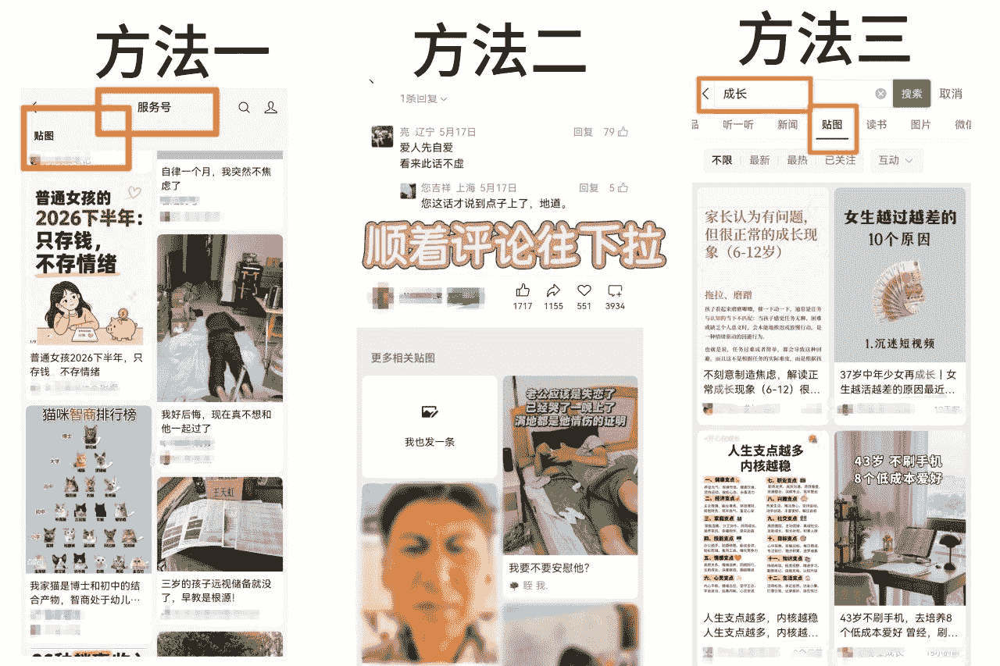你看看下面的评论量和留言数，每一篇的收益都不会低。

那怎么二创？先解释一下：二创就是用别人的图，让AI分析之后，再生成一张全新的图。只要把原图的核心爆点保留下来，原图能跑10W+，你跑到1到2W浏览基本没什么问题。赚钱圈友卢建国就复刻过一个爆款，他当时连着发了10个同类型的，好几个都破万了。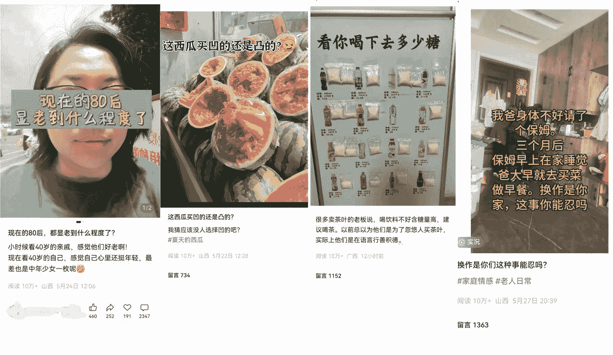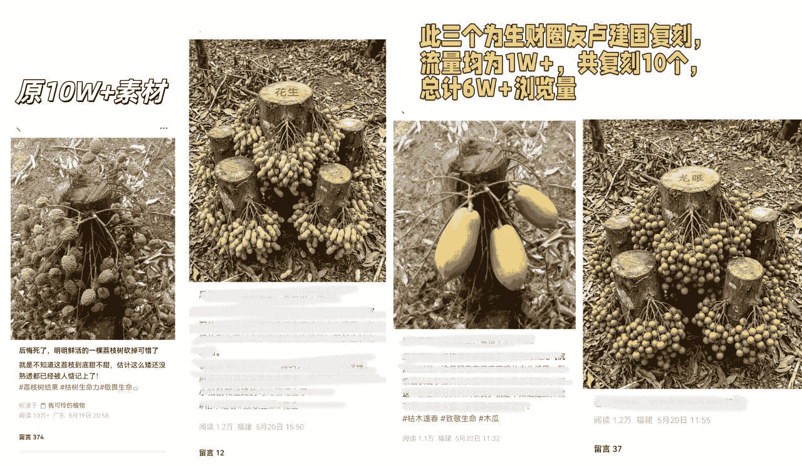

找到爆款以后，先判断自己能不能复刻，然后再动手。这里分享两个简单又实用的复刻方法。

方法一：把原图发给豆包，然后给指令：“帮我分析这张图片的构成因素，画面风格，拆解出来提示词。”这样得到的二创图，跟原图差别就非常大了。标题和内容也可以直接复制对标的，查重概率不高。如果不放心，还可以把原标题和内容发给豆包仿写，文字处理上Deepseek表现会更好。

方法二：更简单的办法，变换背景、换主体、换场景。比如把果实换成树干，把背景换成森林，一张新图就出来了。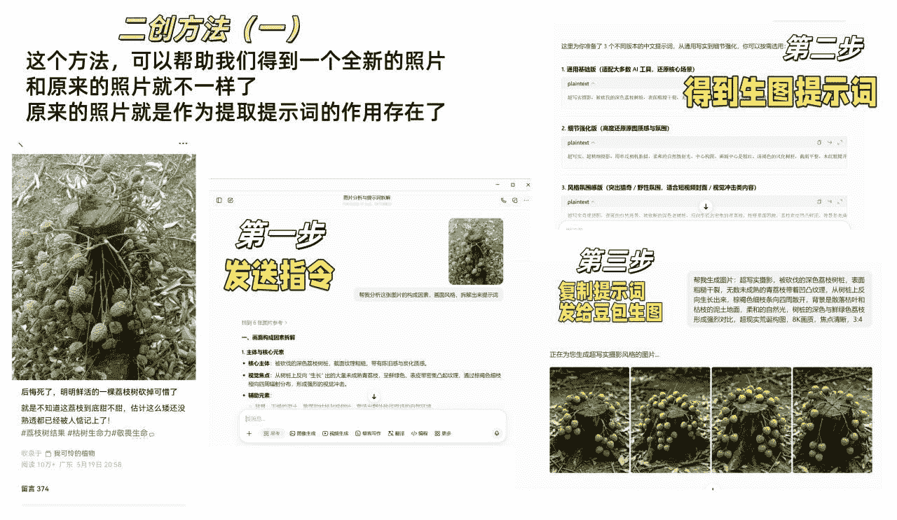这样生成的图跟原图也有明显区别。为了保险，背景也一起换掉，比如换成别的森林。这些方法听起来简单，但真的够用。你不需要多厉害的AI工具，核心是找到爆款逻辑，然后复刻它。

但有一点要特别提醒：新手做爆款复刻的时候，尽量不要做人物类型。猫、植物、豪车、森林、生活场景、书桌都可以。人物大家太熟悉了，稍微有点假就能被看出来。如果画面里实在需要人物，就把人放远一点，或者用背影。尽量选辨识度不高的场景。另外，生图时别追求完美，有时候带点瑕疵反而比精修图流量更好。

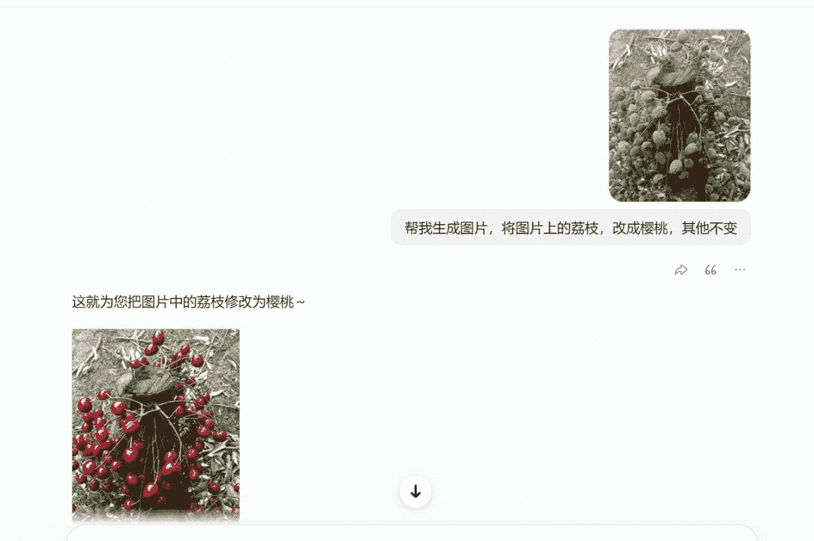

接下来看垂直类。垂直类可以分成很多种，这里挑几个适合新人的大类展开讲讲。

第一，美食赛道。表面发的是食物，实际上高流量的核心是食物背后的场景和话题。这个赛道素材多、数据广，随手就能抓到一堆。做法也很简单：自己稍微做做就能二创。也可以下载别人的视频，截屏、抠图、二创，做出来就很精美。出图速度快，后期还能用AI批量生成。跟图文联动一起做也很合适。它真的非常适合新人。不过要记住，核心不是“晒美食”，而是模仿高流量内容背后的故事和话题，让用户愿意评论。参考：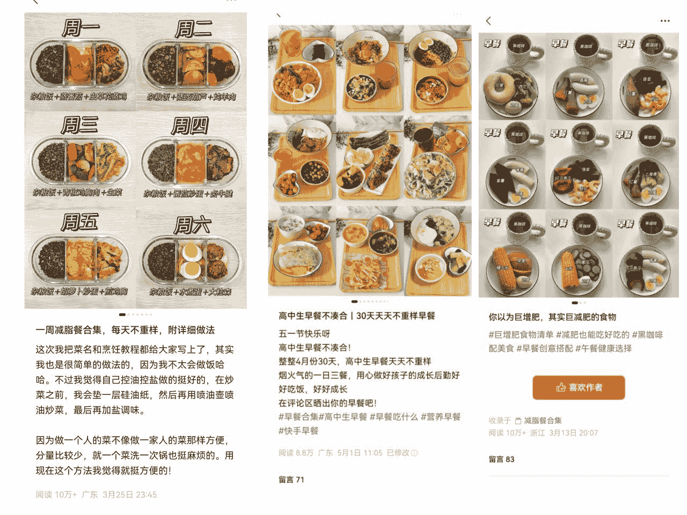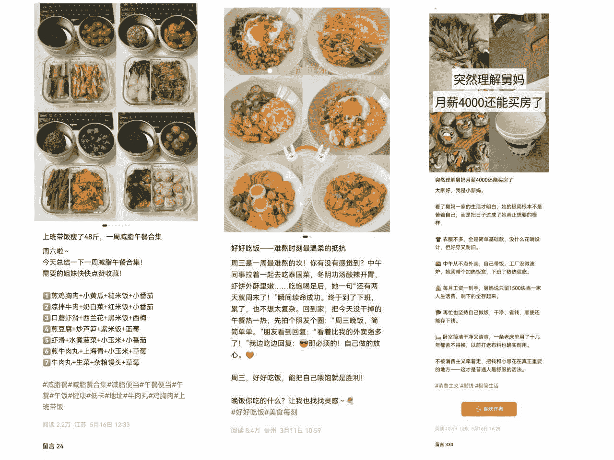你用AI生成的图再精美，阅读量也不一定高。因为单纯的美图打动不了人，能打动人的永远是内核。

第二，文字赛道。它不是一个固定的赛道，而是能延伸出很多形态，比如手写药方、手写情书、成长感悟、名人名言、情感故事，还有各种大字报，都属于这个范畴。优点就是简单好做，小红书、抖音上到处是素材。你找到1W点赞以上的作品，把文字提取出来自己二创就行。参考：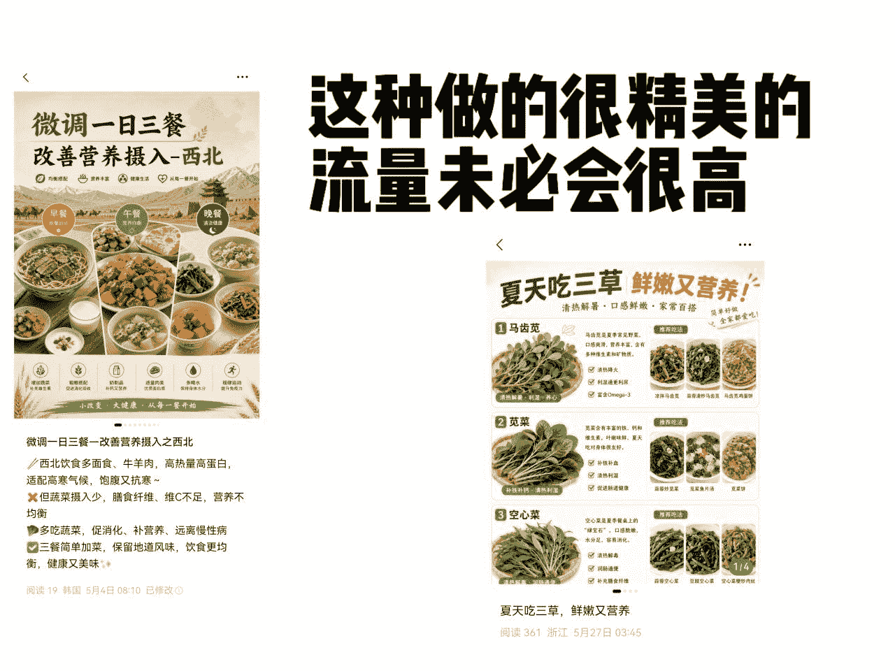内容永远高于形式，但也别做得太平淡。手写体不要求你字好看，内容只要够好，流量就容易爆。具体的细分方向，你可以先做起来，做着做着就会找到。找到爆款就多复制，试试“同一内容不同形式”和“同一形式不同内容”，交叉验证，更容易锁定适合你账号的爆款模式。

第三，怀旧赛道。这个赛道的典型内容是老照片、80-90年代影视剧、以前的建筑、房子，老物件也算。参考：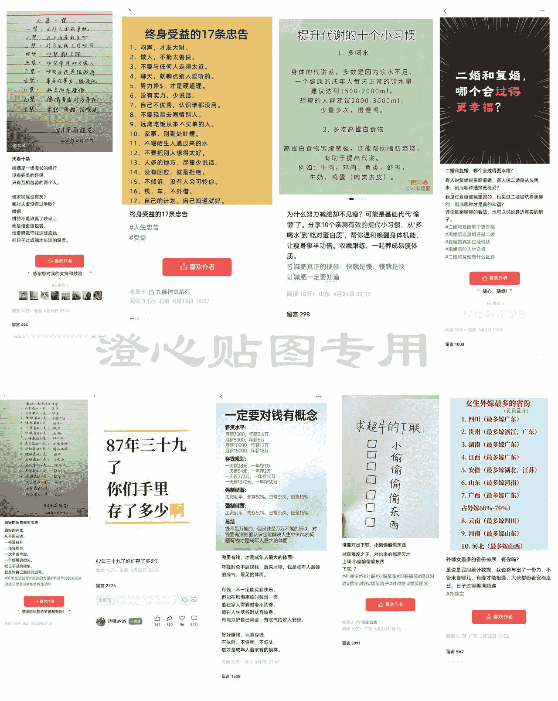它的优点是单价相对高一些，如果你开通了赞赏，偶尔还能收到打赏（不过开赞赏也有一定风险）。照片可以用AI生成，也可以去网上找怀旧照片再AI修复，都不难。这里分享两个提示词模板，你可以根据自己的画面去调整，多试几次就能出来。参考：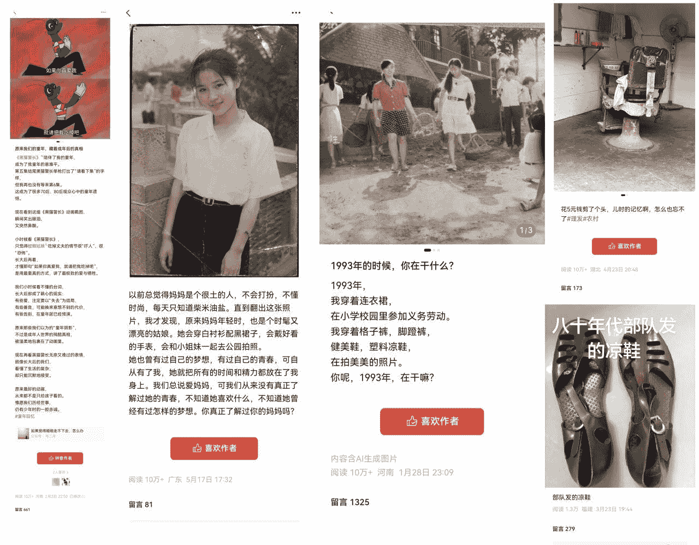我用的提示词里特别强调了“样貌”，因为如果不写清楚，AI生成的人脸全都长一个样。细节上稍微注意一下，风格方面可以试试胶片、怀旧、复古等感觉。

第四，对比类赛道。我之所以把它单独拎出来，是因为我看到太多10W+内容都带这个属性。所谓对比，就是天然有反差，特别容易引发吐槽和共鸣。比如上班前VS上班后、结婚前VS结婚后、生娃前VS生娃后、小时候VS现在、化妆前VS化妆后、男朋友来我家VS我去男朋友家……可以延伸的选题太多了。我也做过不少，最夸张的时候一天同时出了4篇10W+，流量相当猛。这类还不太容易违规，但纯搬运依然会被判低质重复。制作方法也简单：找两个不同的照片拼在一起，可以用AI二创，也可以直接找素材。多看看相关案例，自然就明白了。

第五，摄影赛道。这个赛道本质上就是人像摄影，难度会高一点，需要你会写提示词，生成看起来跟真实生活照几乎一样的AI图。因为可以以假乱真、流量又高，圈内人叫它“邪修赛道”。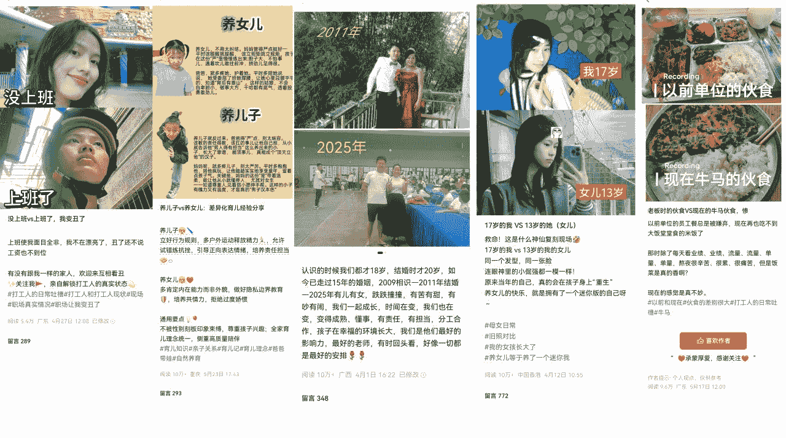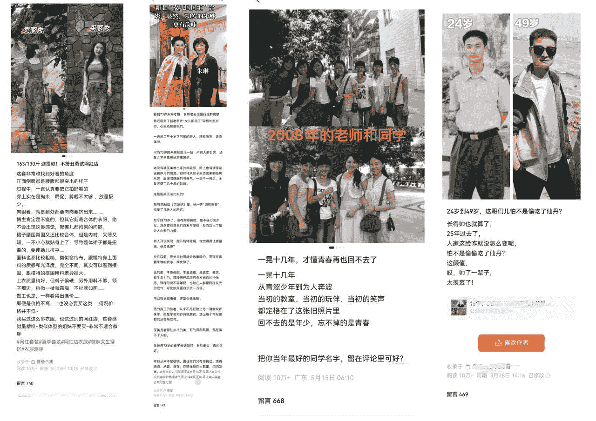它跟老照片赛道最大的差别是，受众全是年轻人。你刷服务号的时候肯定见过那种账号，内容平平无奇，就是发一些日常人像摄影，偏偏每一篇都能破万。没办法，人像摄影天然自带流量。做法上，你可以直接用AI生图，也可以买一些摄影素材来拼接。优点是起号快，很容易破万，但缺点也非常明显：爆了之后容易违规、限流，甚至可能触发人脸识别。

最后我想说，贴图号这条路，看再多技巧，不动手永远不会有结果。先把起号细节做对，再从自己能接受的方向开始试，用二创的方法控制风险，用测试的心态慢慢迭代。平台规则一直在变，但真正适合普通人的机会，往往就藏在这种看似琐碎、其实有迹可循的坚持里。希望这篇内容，能让你少一次迷茫，多一份确定。

想降低风险，无非记牢两件事：一，内容绝不碰边缘地带，碰了迟早要收警告；二，数据起来之后，等次日的分成自动到账，就立刻把那条设为私密或删除。

### 3、新手应当远离的三类方向

部分赛道表面上很风光，收益也诱人，但新手做起来特别容易翻车。建议先从稳妥内容做起。接下来这三类方向，手上账号比较多的话可以试试，号少就绝不要选。

#### ⑴、健康养生

这类内容躲不开身体器官、功效反馈等表述，属于平台严打的范畴。能长期做下去的，基本都是有正规资质的机构或诊所，独立创作者极少，有时还需要上传执业证明。我帮不少人看过这类账号，几乎全被压住，单篇阅读都很难超过50。新手想碰这个方向，基本等于给自己找麻烦。

#### ⑵、副业话题

这类账号推荐量普遍不高，而且极容易触发限制。晒自己的进账、替某个项目做宣传、写“哪些领域好赚钱”之类的内容，全都踩在危险线上。新账号一旦发布此类内容，基本就是在等违规通知。

#### ⑶、娱乐圈动态

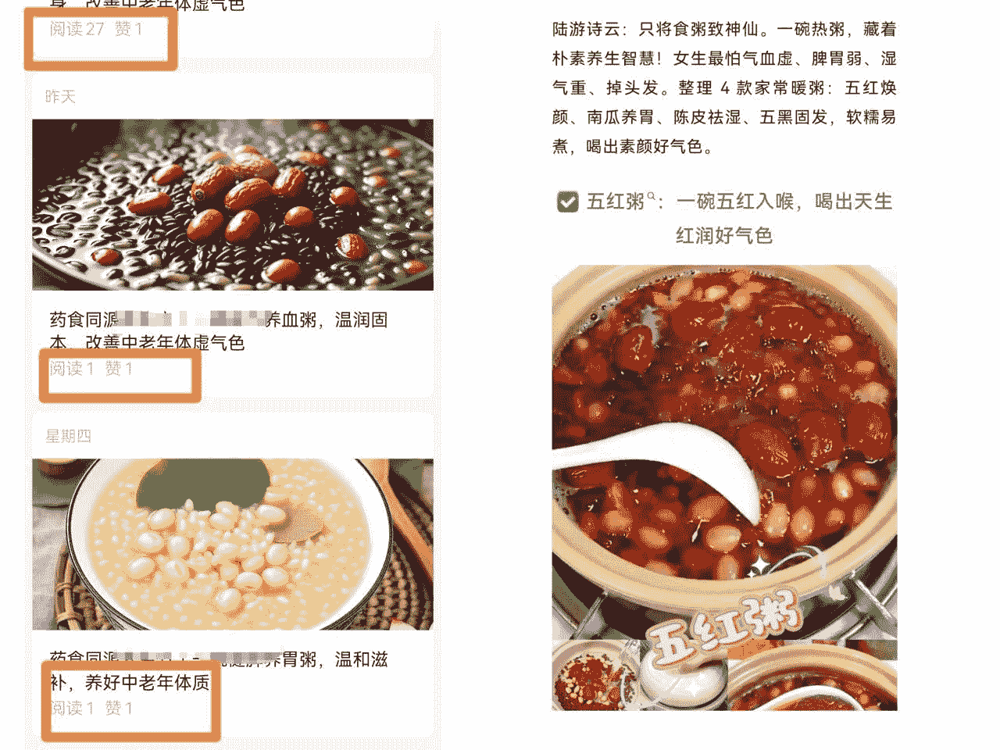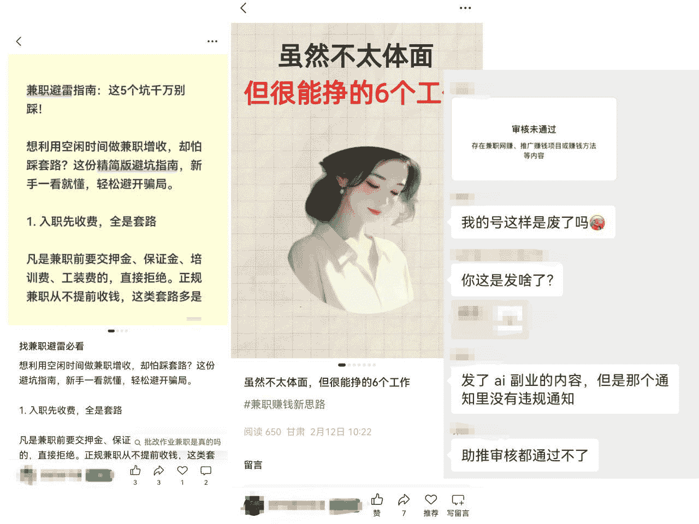

表面看去，这类题材天天都有新话题，实际新人很难驾驭。账号权重还没建立起来，再配上公众人物的照片，被系统标记为低质内容的概率很高。

这三个方向都不适合新手，尤其是手上只有1个号的人。只有单号，就专心做前面说的安全内容，起码能保证账号活着。我还是建议按前面提到的方法多准备两个号，最好能有2到3个。数量上来了，题材不受限制，收益自然也更稳。

## 三、零推荐、没阅读、被限流、被处罚，怎么处理

这类问题没有统一的万能解法，因为每个账号的情况都不同。但有一条底层规律：推荐量消失只有一个原因，那就是触碰了平台规则。

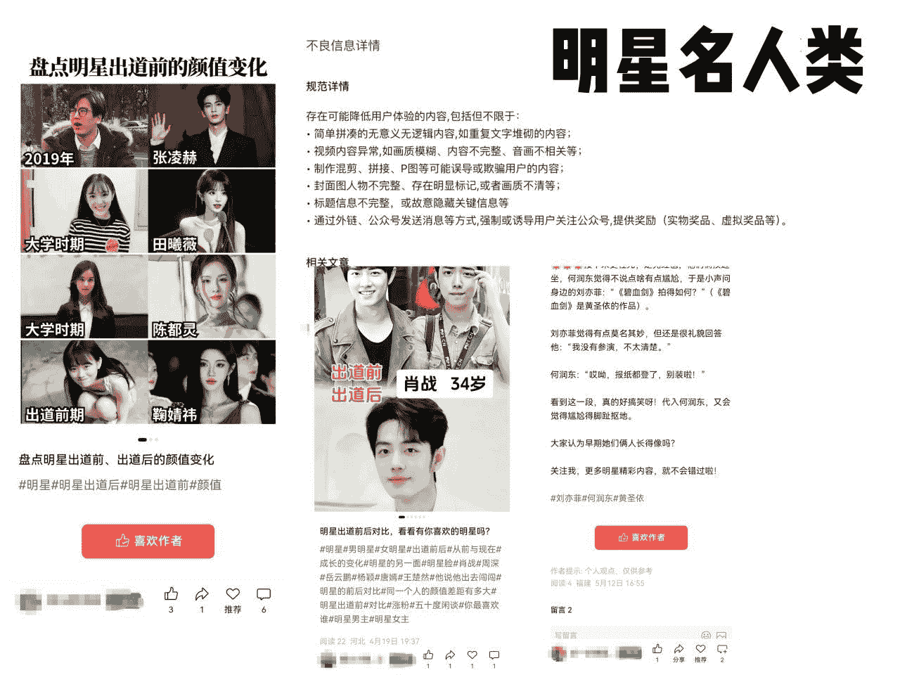

常见的越界动作屈指可数：直接截别人的图发布、打擦边球、聊政治、搞迷信、讲医疗效果、营销太猛或诱导关注。

警告通知一到，推荐通常就掉到100左右，严重的直接变成0。

下面分新老账号来说。

**刚刚注册的账号，没有人看**

新号没有推荐是普遍现象。刚发的文章，最初常常是0阅读或只有几个阅读，贴图会好一些，通常能到100，运气爆棚的话能上千。如果你刚申请的新号，第一帖发布就有1000阅读，那基本是天选号，后面冲到百万的概率很高。

但直接复制他人的文字、原封不动地截图别人作品，那你大概率只能收到几个阅读。内容和其他人一模一样，会被打上低质标记，时间一长系统就不再推流。用二创的方法重新做一份，保留可取之处就行。

**很久以前注册的老账号，同样没有量**

很多人的老号是一年前注册的，发了点东西就断更，账号随便扔着。这种账号大多已经进入冻结状态，登录一下就能恢复。如果当年没被处罚过，恢复后直接发内容，阅读量往往能回到100以上。因为账号几十天没有动静，跟重新激活一样，重启后的推荐一般不会差。

还有一种老号，当初就是因为违规被压过，阅读一直只有几个或不足50。这样的账号后续很难起来，不如注销了重新申请。具体怎么注销，前面1到4节有写。

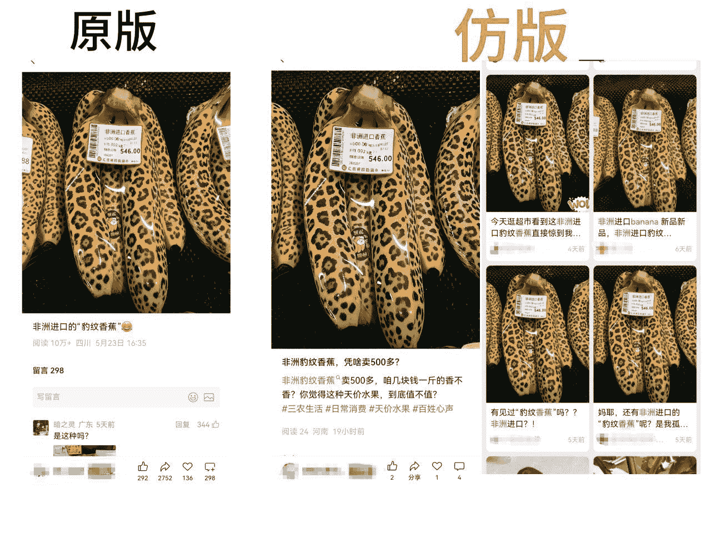

被限制过的老账号，翻盘的可能性极低。除非文章被压住但贴图还是正常的，那就能继续用。你可以多试几条，前三个小时看不到阅读数据，并不说明问题。如果过了3小时甚至12小时，阅读还在50以下，就果断注销。

以上两种都算常规情况。

接下来是内容触线后的处理。

再次强调，推荐消失的根源只有一个：违规。

违规方式不外乎那几种：搬运截图、内容擦边、涉及政治、迷信、医疗功效、过度营销或引流。

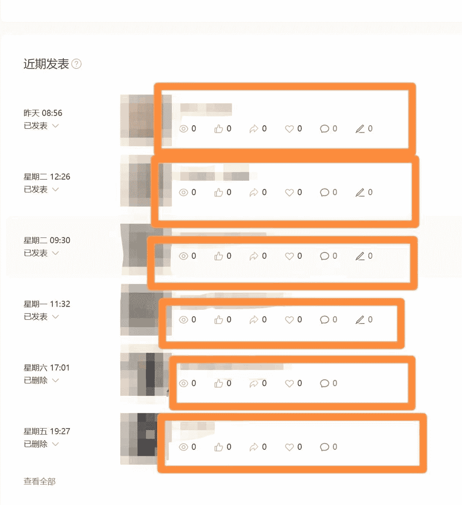

一条处罚通知下来，流量基本就只剩100左右，极端情况下直接归零。

这里补一个申诉渠道。

**本来有流量，突然归零**

有人前期发得挺好，阅读稳稳停在1000上下，但发完某一条之后突然就不推了。我观察过很多这样的情况，根源基本是某几条内容触了雷。比如发了有争议的名人，存在肖像上的风险；比如内容涉及不当话题，包括政治、地图、政策、疗效、迷信、转发求福、副业暴富等，都会招来限流。

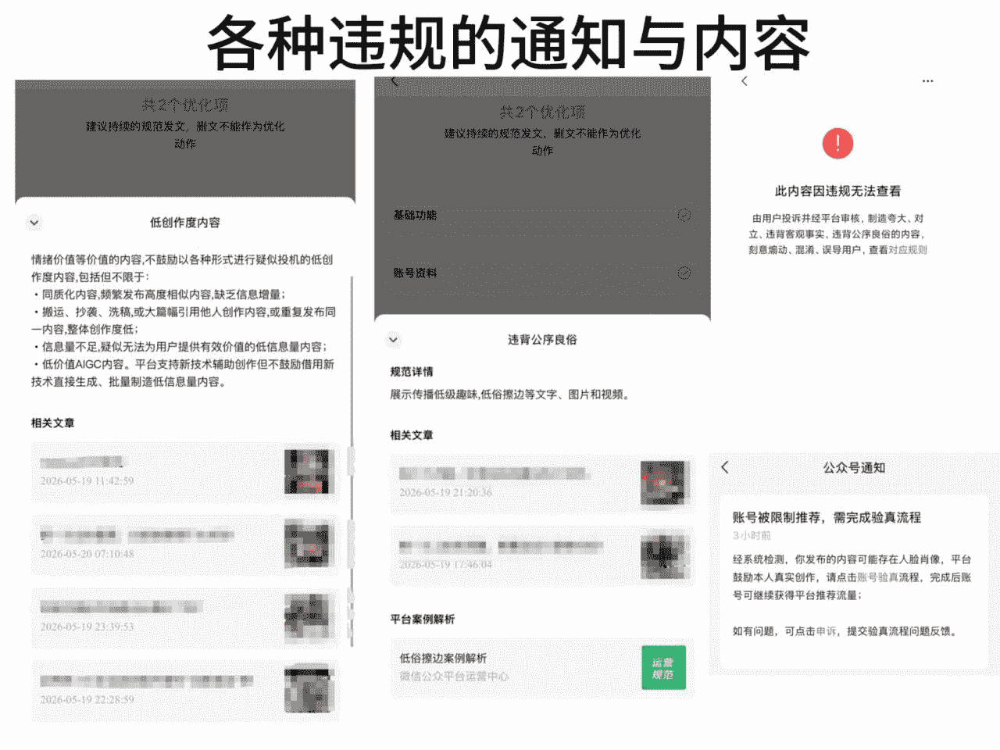

限流也分级别。普通限流是每次阅读在100到1000之间，不是太要紧，可以试着加大更新频率，平时发3条就改成4到5条，如果冲过去了，会等来一波明显的流量。严重限流是每次只有几个阅读，甚至低于50。这种情况就别犹豫，先提现再按前面1到4的方法注销。

**爆款之后突然断流**

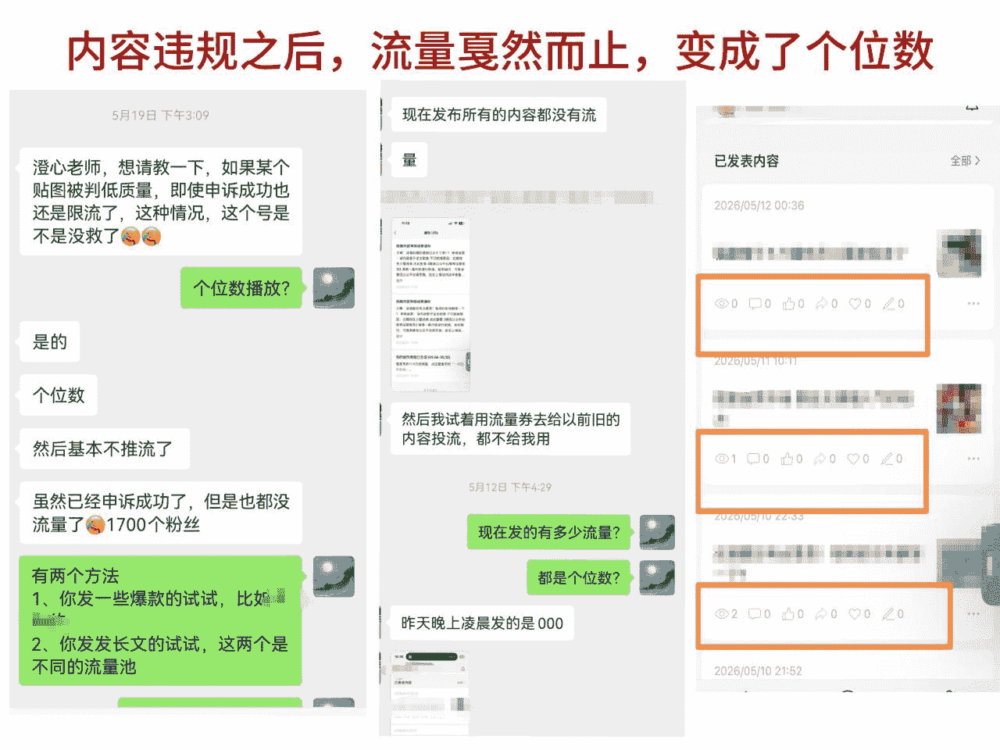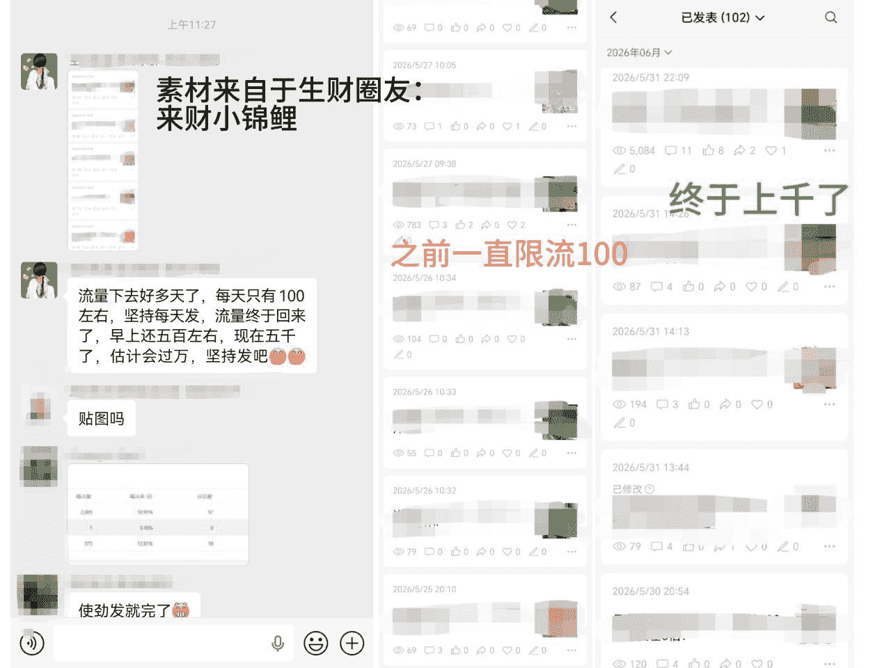

内容冲到10万以上，隔天再发新内容却没人看，这种体验其实很常见。爆款出现后，一般会触发人工复查。如果你的内容属于搬运、擦边、和别人重复度过高，系统就会判定违规并限流。

处理办法分两类：

1. 收到了明确的处罚通知。这种情况比较被动，要么把钱提出来，注销账号等待一段时间重来，大约要一个月；要么把所有问题内容删除或设为私密，日后只发合规内容。我个人实测过，文章加贴图搭配来做，账号的寿命会明显更长。所以也可以适当多发些长文。

2. 没有收到任何通知，内容也相对安全（垂直领域的账号通常更安全）。那就保持更新频率，想办法把流量重新拉起来。以前每天发3到4条，改成5到6条。只要有一条能跑到1万阅读，后面的内容就都能保持在万级以上，这个号就彻底做起来了。

这里有个小提醒：粉丝数到达100开通流量分成后，要尽快完善你的收款资料。打款审核要2到3天，整个结算周期还要再走十几天甚至几十天。如果不提前弄好，钱会拖很久才到手上，以后想要注销重开也会被卡住。要是金额不大，你也不在乎，那可以直接注销；要是账户里有几百上千块，肯定要先把钱提出来再注销。

还有一点：尽量给自己多留几个账号，2到3个是底线。只有一个号的时候，人容易缩手缩脚，既怕违规又怕亏。有了几个号，废掉一个也不至于伤筋动骨。

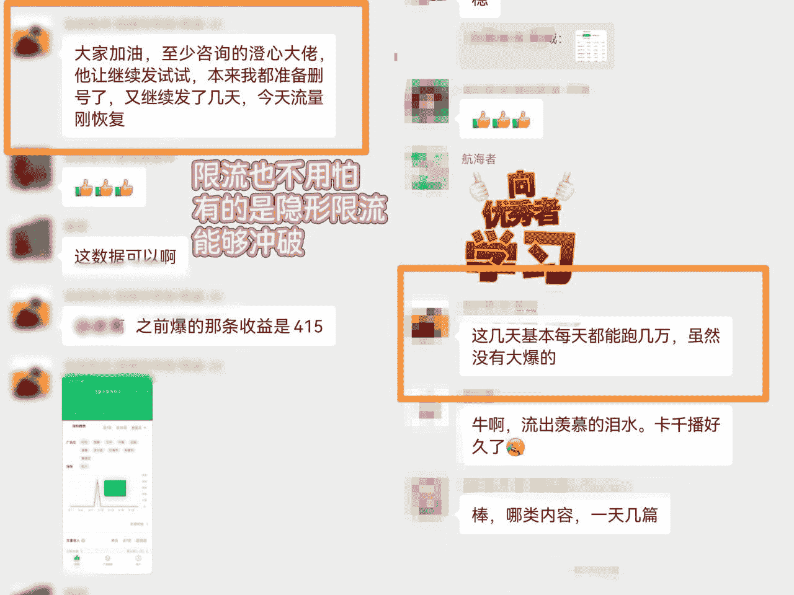

把注意力集中在内容上，比什么都重要。

## 四、怎么把贴图做成长期生意，并越赚越多

### 01、先运营起你的第一个账号

自从上次发出那篇教培转行做贴图的完整复盘，跟着操作的圈友越来越多。很多人第一次注册了账号、第一次发布贴图作品、第一次靠流量分成赚到一块钱、十块钱。

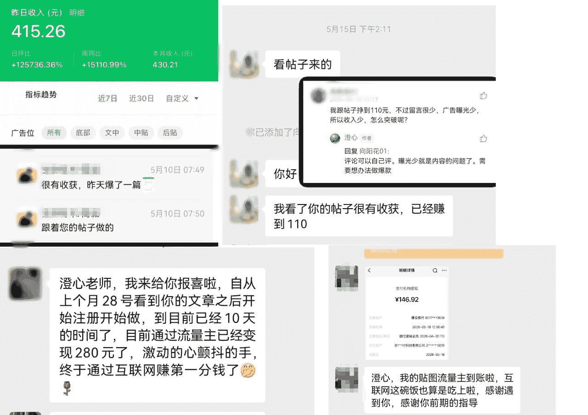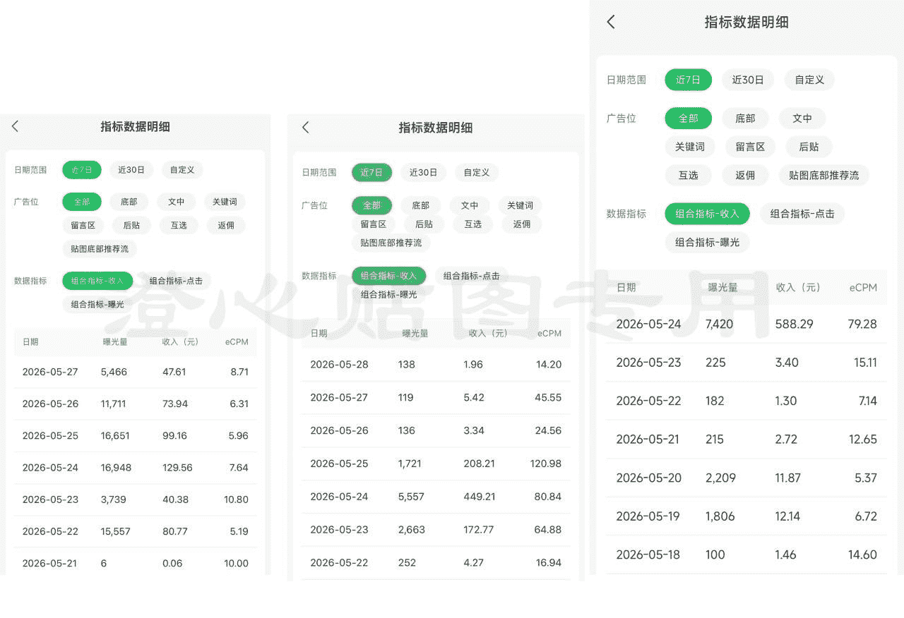

帖子发出四十多天，我看到有人迅速开出了三个甚至四个账号，甚至带动朋友一起做，自己赚到钱，朋友也跟着赚钱。还有人无意间从贴图转去做故事合集，也拿到了收益。有人原本想做这个方向，另一个方向却意外火了，等于又探出一条新路。当然也看到很多人碰到相同问题时，处理方式不同，心态不同，最后的结果完全不同。

### 02、多开账号，拉上身边人一起干

被限流被标记低质，真的不用怕。新手难免手生，被系统贴上低质标签也只是暂时的，最多限制一阵子的推荐量，只要你坚持更新，慢慢就能恢复到1000阅读，后面就正常了。

想要放大收入，最直接的办法仍然是把账号数量做上去。按前面写的思路，多准备几个账号。有一位圈友，最初觉得赚到100块就很满意了。后来她陆续开了很多号，现在经营得有声有色，每天都拉着朋友一起做。还有带孩子同学的家长一起做的、夫妻俩一起做的，每个月都能多增加一些收入，日子更有奔头。

如果你懂得搭建AI知识库、会做自动化流程，还能给自己写一套Skill，让选题自动冒出来。

眼下的分成收益，顶多算这个项目的一块拼图。往后还可以尝试做贴图领域的专门账号、图片带货等不同方向。在微信这个生态中长期耕耘，回报会很丰厚。

### 03、先定一个小目标：1000块

写到这里，我恰好翻到一位投资大师7岁时读过的《赚1000美元的1000种方法》。书的开篇讲的是如何创业，写得非常好，摘录一段与你共勉。

> 年轻的古斯塔夫斯·斯威夫特把第一头小牛卖给鳕鱼角的渔民，这笔交易成为他后来创办全球最大肉类加工企业的起点。
>
> 指引他一步步向前的，是对赚钱的渴望。
>
> 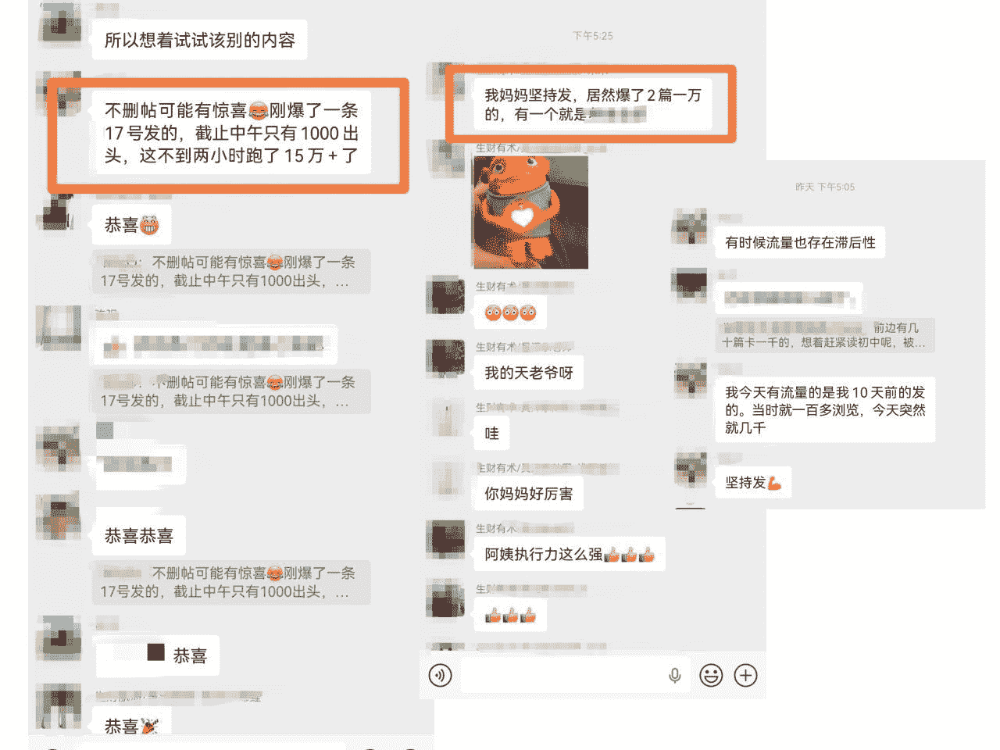
>
> 镇上的人都说他很有魄力。他想要赚钱，而不是停留在许愿上，所以直接在家里的后院做起了牛肉加工生意。
>
> 镇上还有其他渴望赚钱的年轻人，可他们还在犹豫时，斯威夫特已经拿定了主意。
>
> 这份工作并不容易，稍有不慎，加工好的牛肉就会积压。鳕鱼角地广人稀，他不得不走上好几英里去推销。
>
> 但他并不介意，因为他享受赚钱的过程，觉得这件事很有趣。这一点让他和当下很多年轻人不同——后者更喜欢享乐，觉得创业限制太多，总把“明天再说”挂嘴边。
>
> 如果他们也能拿出同样的劲头去赚钱，早晚会变得富有。
>
> 还有一些人拼命工作却没赚到钱，缺的正是目标。
>
> 他们像拿着猎枪到处乱射的猎人，打到的猎物很少。
>
> 所以，除了愿意付出努力，一个清晰的目标更加关键。
>
> 只有先学会爬，才能学走，因此把目标定在1000美元就好。
>
> 有人大概会问：为什么只定1000美元？为什么不直接定10万美元？
>
> 眼光放长远没错，但目标太大会让人偏离方向。
>
> 设定一个够得着的目标，完成后再定下一个。
>
> 创业路上挫折不少，一个触手可及的目标，能支撑你熬过最难的时期。

————分割线————

看完这套SOP，很多人会误以为自己已经会了。可真到实操那天，九成人连开头的动作都做不出来。工具、教程从来不是真正的门槛，门槛在于动手的速度，以及别人掌握而你还没有的消息差。

想看市面上最新的盈利模式，并且和一群执行型极客一起实战拿结果，欢迎来我的私密分享群：【懒人专属群】。

不谈空话，只做赚钱模式的拆解和AI效用的极限挖掘。系统里已沉淀超过1000个跑通了的套利实战案例。

👉 查看全部资料与加入条件：
https://lazyso.com/insider/

认同价值、准备好好干一场的，加微信（lazyhelper1），备注【实操上车】，不闲聊。

