# 从流量爆发到需求沉淀：我为什么把更多筹码放到小红书

260702 副业SC 精华

整理：公众号懒人搜索，懒人专属群精选

懒人微信：lazyhelper1

生财的朋友们，大家好，我是孟哥。03年出生，潮汕农村人，初中毕业，靠着在生财持续学习和实践，前后折腾了6年内容电商。

这一路，我先后做过多多视频、视频号和小红书。既经历过平台红利，也交过不少学费。

在多多视频时期，我赚到了人生中的第一笔大钱，年收入突破百万。

后来进入视频号，我做过素人口播带货、达人孵化和供应链团长。依靠短视频引流、直播承接，我们曾经把团队月销售额做到千万级，也获得过腾讯2025优秀带货机构奖项。

到了小红书，我换成了自营模式，尝试笔记带货、AI辅助生产和矩阵化运营。2025年4月开始正式投入，8个月后营收突破千万，利润达到7位数。

所以今天我并不是想简单评价哪个平台更好。

我更想结合自己从视频号转向小红书的真实经历，分享一个变化：

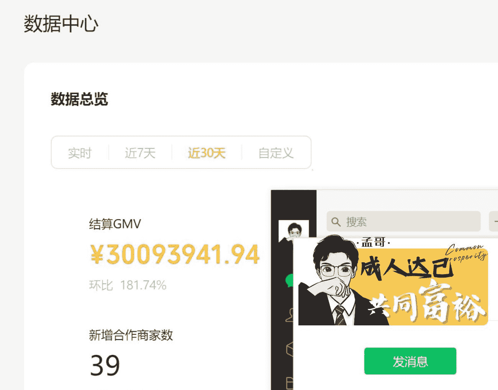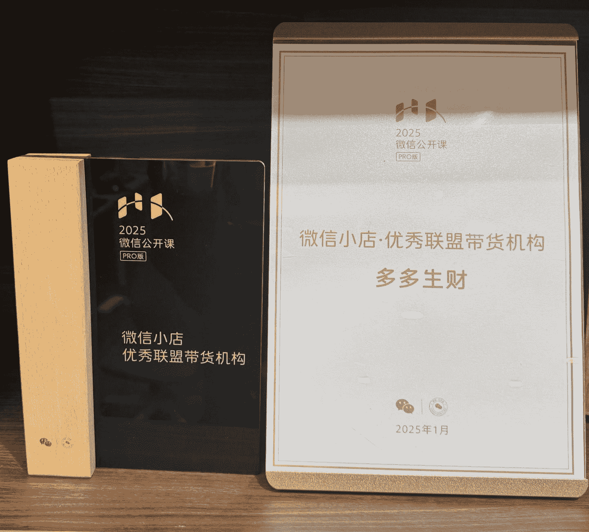

为什么都在做内容卖货，视频号和小红书却像两种完全不同的生意？

视频号明明依旧有机会，我为什么还要调整资源配置？

普通人做项目时，判断平台应该看哪些维度？接下来一年，这两个平台分别还有什么值得关注的空间？

# 一、把重心移开，不代表视频号失去价值

过去一段时间，经常有人问我：“孟哥，你是不是不做视频号了？”

如果只看业务动作，确实能看到这样的变化。

2023年至2024年，我主要精力都放在视频号，做过素人口播、团长业务，也通过培训和交付帮助2000多名学员入局，其中有不少人实现了年收入百万。

从2025年起，我们逐渐把更多资源投入小红书，自营笔记业务也跑出了7位数利润。

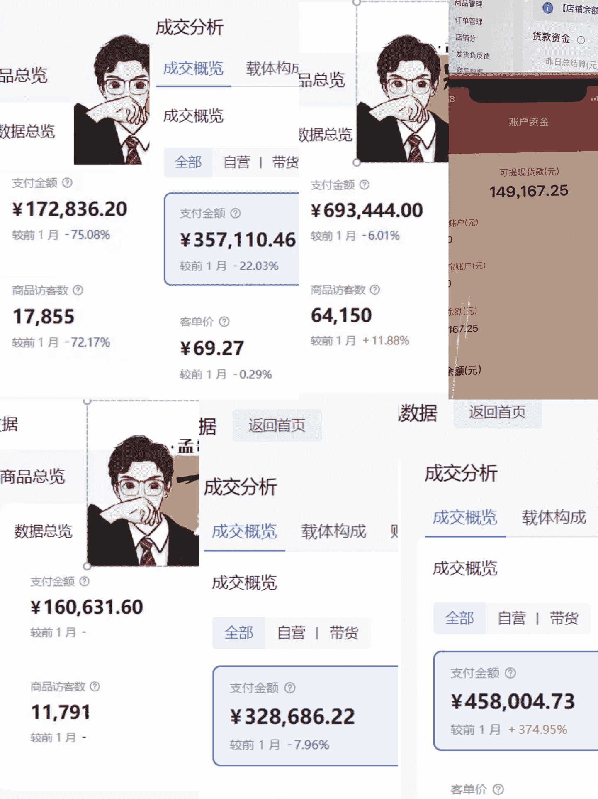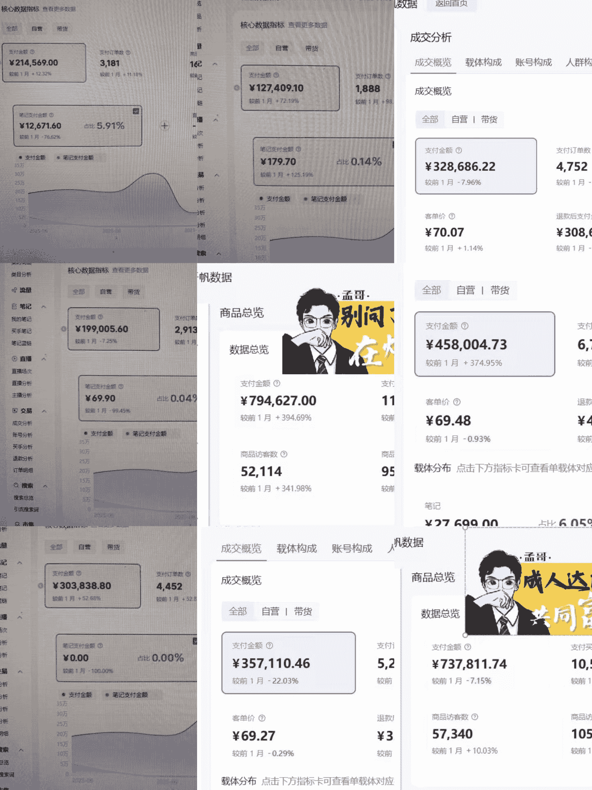

于是外界很容易得出一个结论：视频号机会变少了，小红书更值得做。

但这并不是我的判断。

我没有从视频号“逃走”，也不认为小红书天然高人一等。视频号依然处于发展阶段，微信小店、直播体系、服务商网络、供应链协同以及私域复购，都还在持续完善。

真正发生变化的是，我发现两个平台虽然都能依靠内容成交，但它们承载的消费路径并不相同。

视频号偏向“先制造注意力，再快速完成交易”。

一条内容把用户吸引住，直播承接住兴趣，主播利用信任、故事和利益点推动即时购买。这里更考验选品反应、表达能力和直播间的转化效率。

小红书则更接近“帮助用户完成选择”。

用户因为一篇笔记产生兴趣，随后主动搜索、保存、横向比较、翻阅评价，最后才做出购买决定。这里更看重消费人群分析、标题与封面设计、搜索布局以及内容长期积累带来的收益。

因此，我从视频号转向小红书，并非简单地更换平台，而是调整了整个经营模型。

以前，我更依赖流量窗口和团队扩张；现在，我希望通过内容生产效率、商品判断、AI辅助和可持续积累的内容资源获得增长。

# 二、同样挂链接，背后却是两套经营模型

很多刚开始做内容电商的人，会把所有平台理解成同一个流程：拍内容、挂商品、等订单。

真正操作一段时间后，才会发现，用户为什么购买，往往完全不同。

视频号更典型的路径是：

选商品 → 拍口播或实测内容 → 获得大规模曝光 → 直播间接住流量 → 促成即时购买。

小红书则更像：

研究目标人群 → 选择商品 → 发布场景化内容 → 用户搜索、收藏、比较 → 进入店铺或商品页完成交易。

视频号里的用户，很多时候并没有明确的购物计划。

他原本只是刷内容，突然被一个痛点、一个故事或者一种熟悉感吸引，随后进入直播间。此时，直播间承担的是最后一段交易任务：延续信任、补充信息、回答疑问，再推动购买。

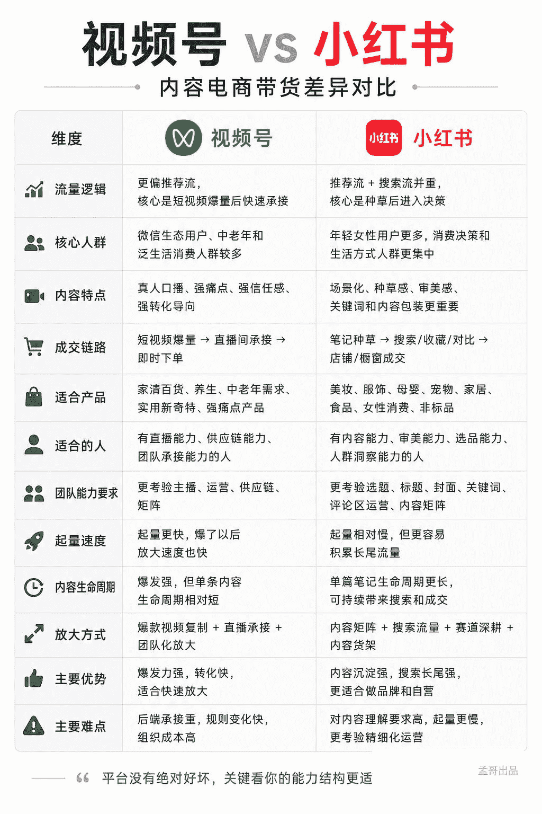

因此，视频号拼的是短时间内的组织和成交能力：

内容能否抓住注意力？

直播是否有人及时接待？

主播能否持续留住观众？

商品、价格、福利、售后和发货能否配合起来？

任何一环掉链子，前面的流量都可能白费。

小红书的用户则更常处于主动挑选状态。

她可能正在搜索“小个子上班穿搭”“养猫家庭除味用品”“宝宝辅食工具”“出租屋整理方案”或者“油皮底妆推荐”。

她通常不会看完一篇内容就立即付款，而是先浏览内容，再保存、比较、查看留言，甚至退出后继续寻找其他答案。

所以，小红书用户关注的不只是“产品有没有功能”，还会判断它是否适合自己的生活方式。

内容不能只停在“这个东西很好”。

还需要回答：

谁最适合使用？

什么情况下会用到？

它为什么比其他选择更合适？

买回去之后，生活会发生什么变化？

大家在购买前最担心的是什么？

可以这样理解：

视频号负责把需求迅速点燃，再由直播完成收口；小红书则负责把用户从产生兴趣，带到完成决策。

如果拿“快速引爆”的思路去运营小红书，往往会觉得流量不稳定；如果用小红书的慢决策方式去做视频号，又可能嫌成交节奏太慢。

平台没有绝对的高低之分，关键是自己的能力结构和平台机制是否匹配。

# 三、视频号的关键，不在发出内容，而在能否接住流量

我刚开始做视频号时，最直观的感受就是：它的放大速度非常快。

只要一条短视频准确击中了用户的需求，曝光很可能在短时间内快速增长。

在平台早期，素人口播和实拍类带货内容尤其容易获得机会。普通人只要愿意出镜，把故事、痛点和解决方案讲明白，也可能取得不错的成绩。

从我的经验看，视频号更适合以下类型的商品：

- 需求强烈、问题明确的产品；
- 用户听完就能理解的功能型商品；
- 需要真人表达来建立信任的品类；
- 适合在直播里继续解释和促单的商品。

例如家庭清洁用品、中老年日常需求、养生周边、实用型新奇产品，以及季节性刚需商品，都比较符合这类特征。

拿清洁用品来说，把“哪里难清理、过去有多麻烦、使用后能节省什么”说明白，用户很容易建立代入感。

但当业务做大以后，我越来越确定：短视频只是前端入口，真正决定规模的，是后面的承接能力。

内容带来多少人只是第一步。之后还要有人直播，有合适的话术，有完整样品，有正确链接，有稳定库存，有及时发货，还要处理售后问题。

只要其中一环没有准备好，流量就无法转化成收入。

因此，视频号做到一定规模，已经不再是单纯的内容工作，而是一套协同系统：

- 主播安排；
- 样品准备；
- 直播流程；
- 供应链协调；
- 账号管理；
- 客服与售后；
- 货品和价格策略。

早期可以依靠平台窗口、执行速度和爆品反应取得结果。但随着规则逐渐成熟，零粉直接带货、同一素材多账号铺开、短周期矩阵打法，都会变得更难。

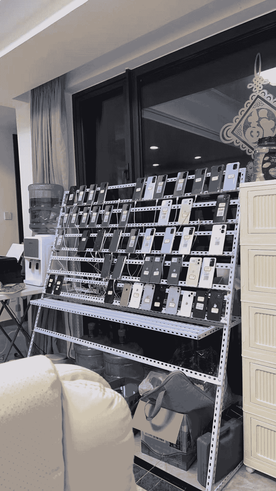

这并不意味着视频号没有价值，而是意味着经营方式会从粗放走向规范。

未来更适合视频号的人，通常具备以下条件：

- 能搭建直播承接团队；
- 能持续经营垂直内容或个人IP；
- 手里有稳定货盘和供应链；
- 熟悉微信生态中的私域、复购和关系经营。

过去可能比谁敢冲、账号多、跟品快；以后更重要的是账号沉淀、直播能力、商品组织和微信生态经营。

# 四、小红书的起点，是先搞清楚谁在为什么购买

小红书给我的最大区别感，是它更强调“人”而不是“货”。

在视频号里，很多时候先判断商品能否快速放大；但在小红书，应该先弄明白：哪群人有需求，以及她们为什么会产生这个需求。

面对一件商品，至少要问：

谁可能购买？

她处于什么生活场景？

购买前会输入哪些搜索词？

她犹豫的地方是什么？

怎样的内容，才能让她从“有点兴趣”走到“准备购买”？

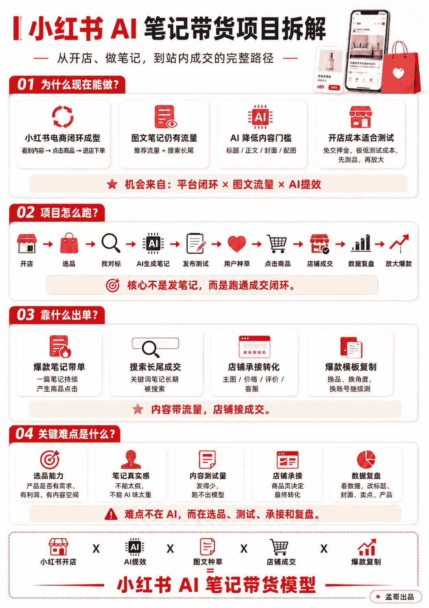

比如同样是收纳盒。

在视频号里，可以直接展示“房间很乱、容量很大、直播有优惠”。

但在小红书，需要进一步拆分生活情境：

租房女生如何整理狭小桌面？

厨房空间有限，怎样摆放用品？

化妆品太多，怎样快速分类？

宿舍里预算不高，如何改善日常环境？

商品没有变化，切入的人群和使用背景变了，内容就会完全不同。

小红书用户购买的，往往不是一个脱离生活的物件，而是一种更具体的解决办法。

所以，做小红书带货，不是不断堆发笔记，而是在搭建一组围绕需求工作的内容资产。

不同内容可以承担不同职责：

有的负责让用户产生兴趣；

有的展示具体使用场合；

有的承接搜索需求；

有的回应购买疑问；

有的帮助用户完成最后一步判断。

当你能从同一商品里拆出不同人群、生活场景和搜索表达，它才有机会持续产生订单。

## 1. 先找到需求，再决定写什么

如果连购买者是谁、购买理由是什么都没弄清楚，盲目开始发布内容，往往只能靠运气。

真正有效的顺序应该是：

先理解目标人群，再分析使用场景，接着拆解她们会搜索和担忧的内容，最后才确定笔记主题与商品表达。

## 2. 内容包装要服务于决策

标题、图片、正文和留言区，承担的任务各不相同。

标题负责让需求明确的人停下来；

首图负责制造继续浏览的理由；

正文负责补充信息和建立可信度；

留言负责解决那些没有被正文覆盖的顾虑。

很多人做小红书时，仍然沿用纯推荐流的思路，只关注当天能不能爆。

但小红书更像一组持续营业的内容页面。今天发布的内容，未来仍可能通过搜索被找到，并继续带来访问和成交。

这也是我越来越重视内容积累的原因。

我们不会只盯着某一篇内容的播放或点赞，而是观察一组内容能否围绕某类人群、某个场景和某个品类形成连续覆盖。

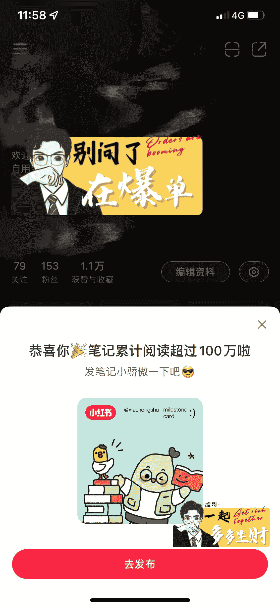

这和视频号的短期爆发逻辑不同：

视频号更关注当下能否快速放大；

小红书更关注内容能否留下来，持续承担导购工作。

# 五、一个情绪类商品案例：商品只是载体，生活状态才是切口

我们曾经做过一类情绪价值商品。

它价格不高，功能也不复杂。若只介绍材质、样式和价格，很容易把它写成普通小配件。

但用户购买它，很多时候不是为了某项实用功能，而是想获得一种心理安慰、一份象征意义，或者给自己增加一点生活仪式。

所以我们没有围绕“便宜”“好看”简单展开，而是从用户当时的生活状态切入：

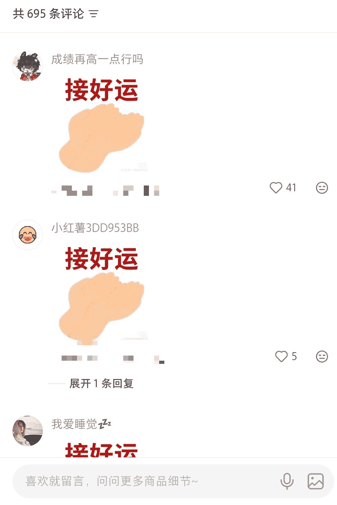

- 最近情绪低落，希望身边多一点积极提醒；
- 面临考试、面试或换工作，想给自己准备一个鼓励性的象征；
- 想送朋友一份价格轻松、但带有心意的小礼物；
- 进入新阶段，想换一件陪伴自己的日常物件；
- 想给包包增加一个有含义的装饰，让每天看到它时心情更好。

这类内容的重点，不是把商品夸得多厉害，而是让读者先联想到自己的处境，再意识到商品可能适合自己。

尤其是情绪类商品，过度渲染效果或制造焦虑，并不能真正解决成交问题。

用户真正产生购买念头的时刻，可能是想重新开始、想安慰自己、想庆祝某个阶段，或者想为平淡生活增加一点仪式。

商品只是恰好在那个时刻提供了一个出口。

此外，留言区经常会出现新的需求线索。

有人问能不能送朋友，我们就增加送礼内容；

有人询问考试前使用是否合适，我们就补充备考、面试和人生新阶段的表达；

有人关心挂在包上是否好看，我们就延伸到穿搭、包饰和日常搭配。

这些留言表面上只是提问，实际上都可能成为新的内容方向和销售理由。

所以，留言区不仅是交流位置，也是免费的用户研究入口。

能否从其中提炼出新场景、新疑问和新表达，决定了商品还能不能持续拓展。

# 六、我为什么把更多资源放到小红书：看重的是增长能否累积

我最终把重点转向小红书，并不是某一天突然看到数据上涨，而是长期运营后，越来越清楚两种模式带来的压力不同。

视频号的节奏很快，但对后端要求也很高：

内容突然起量，直播必须马上跟上；

主播承接能力不足，前面的曝光就被浪费；

规则发生变化，原有打法可能需要重新调整；

团长业务里，客服口径不统一会带来大量沟通成本；

商家备货和履约跟不上，达人关系也会受到影响。

它确实能赚钱，但收入增长的同时，组织和风险也会同步增加。

我不怕工作量大，更担心的是业务过度依赖突发爆量和即时协同。

相比之下，小红书更符合我现在想建立的经营结构。

## 1. 更适合做长期自营

视频号很多时候依赖“谁先测出爆品”。

一旦某件商品跑起来，同行会迅速跟进，随后出现价格、佣金和内容竞争，生命周期也可能很短。

小红书则更适合围绕特定人群、生活方式和使用场景持续生产内容。

家居、服饰、母婴、宠物、食品、美妆、个护、女性消费以及情绪类商品，都有机会通过持续覆盖形成稳定成交。

这对自营尤其重要。

我不希望每天都依靠某一条内容突然起量，更希望通过持续反馈去调整商品选择、价格设计、销售表达和后端供应。

## 2. 更适合借助AI提高试错效率

过去做内容，选题、标题、文案、图片和版本管理都需要大量人工参与，团队扩大后，管理成本会明显增加。

现在，我们会利用AI先完成部分内容测试。

例如把表现较好的内容结构交给模型分析，再快速生成多种标题、画面方向和表达版本，用于初步验证。只有当某个方向得到反馈，才投入更高成本进行实拍和深度制作。

这样做的价值，不是让AI替代判断，而是减少无效制作。

它无法替你确认商品是否值得卖，也不能自动理解用户真正想要什么；但它能帮助团队更快测试更多角度。

过去一名运营可能只能反复打磨少量内容，现在可以并行验证更多表达方式。

于是，真正拉开差距的能力，反而变成了：

能否识别有潜力的商品？

能否看懂用户反馈？

能否把功能拆成具体购买理由？

AI让执行变快，也让判断能力更加重要。

# 七、为什么“量感陈列”容易成为小红书的高点击画面

小红书里，有一类视觉表达经常能获得不错的点击：把商品放进类似线下店铺的陈列环境中，让画面看起来像用户在逛店时偶然发现了好东西。

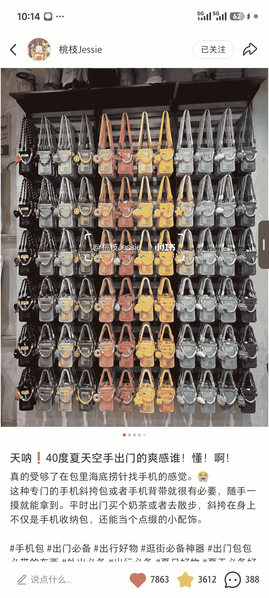

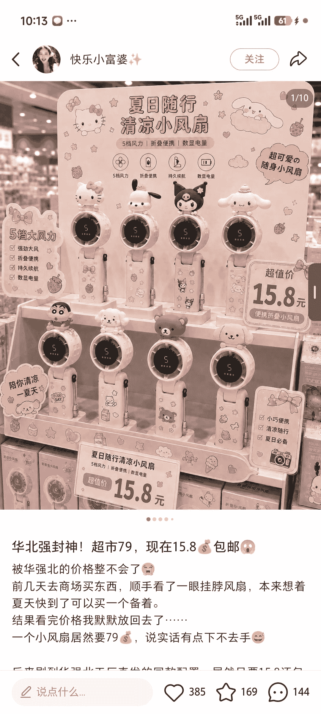

例如，画面里出现整排商品、多个颜色或多个款式，整体有明显的丰富感，像精品店、文创店或商场货架里的真实展示。

它容易吸引注意，通常有几个原因。

### 1. 丰富陈列让人产生“想逛”的感觉

单独摆放的商品，容易让人联想到广告。

但当画面里有一组商品可供选择，用户会自然产生继续查看的冲动：还有哪些颜色？有没有更适合我的款式？价格分别是多少？

这满足了小红书用户浏览和比较的心理。

### 2. 重复出现会强化“受欢迎”的视觉暗示

同一系列商品以不同颜色、包装或造型反复出现，画面会传递出一种“这是被重点展示的商品”的感觉。

它不是通过文字硬说“热门”，而是让陈列本身承担信息。

### 3. 生活化场景比标准商品照更像分享

过于精致的棚拍图，容易让人立刻意识到这是广告素材。

而带有店铺环境、货架灯光和手机拍摄痕迹的画面，更像普通人逛街时记录到的好物。

对于低价小商品、季节性用品、礼品、配件和家居杂物来说，这种场景尤其容易降低防备感。

### 4. 画面信息足够，理解成本就会下降

如果画面同时包含：

- 多种款式；
- 大致价格；
- 简单功能；
- 商品包装；
- 陈列环境；
- 清晰的消费场景；

用户即使还没读正文，也能迅速判断“这是什么、适合谁、是否值得继续看”。

因此，封面并不是用来把全部信息讲完，而是负责给用户一个打开内容的理由。

我们在使用AI制作视觉素材时，也不会只说“做一张漂亮商品图”。

更具体的要求通常包括：

- 模拟线下店铺陈列；
- 商品数量要有丰富感；
- 环境接近精品店、生活方式店或商场；
- 加入价格签、功能提示或包装元素；
- 保留手机拍摄的自然感；
- 避免白底电商图和品牌海报感。

下面是一份可以自行替换内容的提示模板：

请制作一张适合生活方式类种草内容的竖版封面图。

商品为【填写具体商品，例如：便携风扇、包饰、情绪类礼物、桌面整理用品】。

场景设定为【精品店 / 文创空间 / 商场陈列区 / 生活方式集合店】，画面要有线下购物环境，避免影棚布景、纯白背景和电商详情页风格。

画面中安排一组同系列商品进行展示，包含多个色彩或款式，形成丰富的视觉层次。前景主体清楚，后方环境自然虚化，整体像顾客逛店时随手记录下来的新发现。

整体气质：清爽、明亮、自然、有生活感，适合内容平台封面使用。避免廉价感、过度修饰和品牌广告海报感。

可以加入价格牌、卖点小标签、包装、货架、店内灯光等元素。

价格信息可替换为：【填写价格，例如：15.8元 / 29.9元 / 店内特价】。

卖点标签可替换为：【填写特点，例如：便于携带、夏天实用、适合送人、可爱、解压】。

拍摄效果：手机记录感，轻微景深，真实室内光线，主体清楚，背景自然虚化，采用9:16竖版比例。

对于小红书而言，封面负责开启后续路径。没有点击，标题、正文、留言和商品信息都没有展示机会。

# 八、小红书更像需求雷达，也能反向帮助供应链

小红书的价值不只在于销售商品。

它还像一个前端观察窗口：通过用户对内容的反应，可以逐渐看清哪些人群存在需求，哪些卖点更容易被接受，哪些生活场景更容易推动购买。

这些反馈可以继续作用于后端：

- 判断是否值得深入某个品类；
- 优化商品功能和包装；
- 调整价格带；
- 选择更准确的销售表达；
- 开发定制化产品；
- 改进供应和库存安排。

所以，我现在看待小红书，不只是把它当成一个订单渠道。

它更像一套持续收集市场信号的系统。

视频号擅长把注意力迅速转成成交，小红书擅长把需求逐步沉淀成资产。

对于普通创业者来说，真正值得思考的不是“哪个平台一定更好”，而是：

你擅长快速成交，还是擅长长期经营？

你手里有直播和供应链，还是更擅长内容、审美与用户研究？

你想赚一波流量红利，还是想搭建一套能够不断积累的业务？

选平台之前，先看清自己的能力和目标。

平台只是工具，真正决定结果的，是你有没有把正确的能力放进正确的生意里。

我做内容电商，通常不会先决定卖什么，再急着拍一堆视频。

更稳妥的顺序是：先拿内容去探测市场，观察哪些需求正在发生，再让后端的选品与供货能力围绕验证过的方向调整。

我也不满足于长期替别人销售现成的热门商品。流量来了一次，生意就结束，这不是我想要的结果。我要逐步建立自己的商品判断、表达能力、供给整合能力，以及对消费者的理解。后续还会尝试参与产品定制，并设计更有组合价值的商品方案。

因此，我研究小红书，关注点并不局限于眼前能拿到多少收益。

我更在意的是：它能否帮助我把内容与交易这件事做得更扎实，让短期成交逐渐沉淀成长期能力。

# 六、接下来一年的平台变化：视频号走向规范，小红书继续深入交易场景

未来十二个月，两个平台的方向其实比较清晰。

视频号还会继续扩大电商属性，只是竞争方式会从早期的粗放试错，转为更体系化的经营。微信本身拥有庞大的用户基础，也拥有完整的交易触点。

视频号、微信小店、公众号、社群、私域和小程序，本身就能互相导流、互相承接。一旦这些环节真正协同起来，释放出的商业价值不会小。

然而，个人玩家想复制早期的简单打法，会越来越难。以前一条口播内容、几组账号，再加一件热门商品，就可能迅速获得大量曝光和订单。

未来拼的不是短时间冲高，而是能否持续运营。

垂直领域的个人品牌、稳定的开播能力、店铺管理水平、较大规模交易的承接能力，以及对上游资源的整合能力，都会成为重要筹码。

所以，视频号不是没有机会，而是机会已经从“谁能抢到流量”转向“谁能把生意经营好”。

小红书则会继续向交易平台靠近，不过它不会照搬抖音的模式，也不会完全复制视频号的路径。

它的底层逻辑，依旧围绕生活方式展示、搜索获取信息、兴趣种草与购买判断展开。随着商家和创作者持续涌入，竞争自然会升温。

智能工具会让内容制作变得更方便。过去不会写文案、不会整理视觉素材、不会提取商品利益点，可能连入场都困难；现在，许多基础工作都能借助工具完成。

但执行更快，并不意味着收入更容易获得。

当大多数人都能批量产出内容，真正拉开差距的，就会变成：赛道是否选得准，商品是否匹配，目标人群是否看得透，表达方式是否有辨识度，以及能不能依据数据不断修正。

所以，小红书未来的价值，不是简单重复过去的曝光红利，而是建立在交易工具、履约体系和内容商业基础逐渐完善之后的运营机会。

只做表面动作的人会更吃力，愿意精细研究的人反而更容易找到位置。

# 七、普通人该选哪个平台？先盘点自己的筹码

有人问我：“我究竟应该押注视频号，还是研究小红书？”

我的回答通常不是马上替他选，而是先看他的资源结构。

## 视频号：适合有前后端配置的人

如果你已经具备稳定的视频生产能力，能够使用智能工具辅助创作，手里还有可调度的账号资源，同时拥有解决明确痛点的商品，那么视频号仍然值得考虑。

它的放大能力依旧很强。一条内容一旦获得系统分发，曝光与成交可能在较短时间内迅速增长。

但对于刚起步的人来说，今天的视频号已经不是早期那种低配打法了。过去靠真人讲解、简单拍摄就有机会获得较大曝光，现在需要补齐的环节明显更多。

首先是内容前端。许多人以为智能生成让制作变得轻松，真正执行后才会发现，流程并不省心。

商品确定后，要先搭建故事和镜头逻辑；脚本成型后，再去生成画面。生成结果往往需要多轮调整：人物设定、场景构图、肢体动作、嘴型匹配、节拍、镜头衔接，都可能需要来回修改。

即便终于得到一条可发布的片子，也无法提前保证它一定有表现。它可能发布后没有动静，过一段时间才突然增长；也可能内容表现不错，却因为商品缺乏吸引力而无法成交；还可能商品有需求，只是表达没有击中用户。

每个节点都存在验证成本。

此外，这类打法往往伴随账号损耗。某个账号状态变差后，可能需要重新配置新的账号。内容获得流量之后，还必须有主播或其他成交人员接住后续需求。

现在可以通过兼职主播、代播团队等方式解决，但这件事必须提前安排，不能等内容突然爆发了才临时找人。

因此，今天做视频号，考验的并非单纯的发布能力，而是能否同时搭建商品、脚本、内容生成、账号测试、直播衔接和成交转化这整套流程。

有资源、有团队或有成熟经验的人，仍然可以从中找到机会。完全从零开始的人，则要充分评估自己的时间、资金与试验空间。

## 小红书：适合先用内容验证市场

小红书的前期路径会短一些。

你可以先确定一个细分方向，再挑选一件确实存在使用需求的商品，通过图文内容测试标题表达、视觉呈现、核心利益点、检索词以及用户回应。

早期阶段，不必先投入复杂的视频制作，也不必马上开播或出镜，更不需要一开始就搭建大量账号。

先发布内容，再观察点击、互动和购买意愿，用户反馈会比较直接。

因此，对于没有团队、缺少账号资源，也没有强大制作能力，只希望用较小投入验证自己是否适合做内容交易的人，我会建议先尝试小红书图文带货。它更适合把验证、内容和成交串成一个轻量流程。

可以这样理解：

- 视频号更依赖内容放量与后端成交配合；
- 小红书更接近一个围绕内容陈列和消费判断展开的商品展示场。

资源充足的人，可以按照自身优势配置平台。

资源有限的人，不必一开始就追求大矩阵、大团队或所谓超级爆款。先把一条最基础的验证链跑通：

1. 明确服务对象：例如女性用户、带娃人群、学生、职场人士或养宠家庭。
2. 锁定真实情境：比如备考、搬家、季节变化、送礼、情绪压力或形象管理，再从具体需求倒推商品。
3. 规划约二十种标题切入方式：可以从困扰、使用场景、搜索需求、横向比较、问答互动等角度展开。
4. 研究同赛道内容，拆解高表现封面的构图与信息层级，再借助工具快速制作初版素材。
5. 每个主题连续发布三至五条，分别观察标题、画面和检索词的表现。
6. 认真整理留言与订单，找出消费者真正关心的因素。
7. 将得到验证的利益点继续拓展，围绕相近需求持续创作。

如果连这套基础流程都没有跑通，就急着讨论行业风口、平台机会或全流程智能化，意义并不大。

当然，小红书也不适合所有人。

如果你期待今天发布、明天爆量、后天收款，又不愿意阅读留言、分析搜索表达、反复调整标题和视觉呈现，那么这个平台很可能让你失去耐心。

只靠复制别人内容，也不愿花时间理解受众，更不愿依据反馈修改方案，同样很难在这里长期发展。

它看起来门槛不高，实际需要的是耐心、观察力和细节处理能力。它未必带来最快的收入，却更有机会把内容沉淀成可以持续产生价值的资产。

# 八、结语：别把平台当信仰，用投入产出衡量选择

最后讲一句务实的判断：平台本身没有立场，它只是承载生意的工具。

视频号和小红书都属于内容驱动的交易模式，只是侧重点不同：前者更看重内容放大与成交衔接，后者更看重认知建立与购买决断。

与其反复追问“哪个平台还有机会”，不如先问自己：

这个平台的机会，是否正好对应我已经具备的能力？

如果你有直播组织能力、稳定供货渠道和高需求商品，视频号仍然可以重点布局。

如果你更擅长内容表达、商品筛选和用户研究，希望建立轻量化内容资产，并利用搜索带来的长期流量，小红书更值得深入观察。

从多多视频，到视频号，再到小红书，我越来越明显地感受到：没有哪个平台会永远保持原样。

早期的粗放收益会减少，规则会不断调整，流量获取成本会提高，同行也会持续增多。

但只要你能理解平台当前鼓励什么，理解消费者为何愿意付款，也能判断自己的长处应该放在哪里，就不容易被单一平台牵着走。

真正危险的，不是换阵地，而是环境已经变化，自己仍然坚持过去那套做法。

赶上一轮机会，可能有运气成分；当机会转移后，仍然能把经验迁移到新的场域，才是更可持续的能力。

不要执着于某一个平台，应该把可迁移的本领握在自己手里。

这是我从视频号转向小红书之后，最深的一点感受。

如果这篇内容对你有启发，欢迎投票催更，我会继续分享更多实践观察。

————分割线————

读完一套流程，很多人会产生“已经掌握”的错觉；真正开始执行时，往往在第一个动作上停住。

软件、资料和教程只能解决表层问题。更难复制的优势，来自马上开始，以及能够接触到高质量圈层信息。

如果你想了解近期更值得关注的变现路径，并和一批行动速度很快、愿意亲自验证的技术玩家一起实践，欢迎了解我的核心私域：【懒人专属群】。

这里不做空泛讨论，主要围绕生意闭环拆分、智能工具提效，以及真实项目的执行复盘展开。系统中已经积累了 1000+ 个完成验证的套利实战案例。

👉 查看圈子数字资产详情及加入门槛：

https://lazyso.com/insider/

认可这套价值，并准备亲自参与执行的朋友，可扫码添加微信（lazyhelper1）

添加时备注：【实操上车】，不闲聊

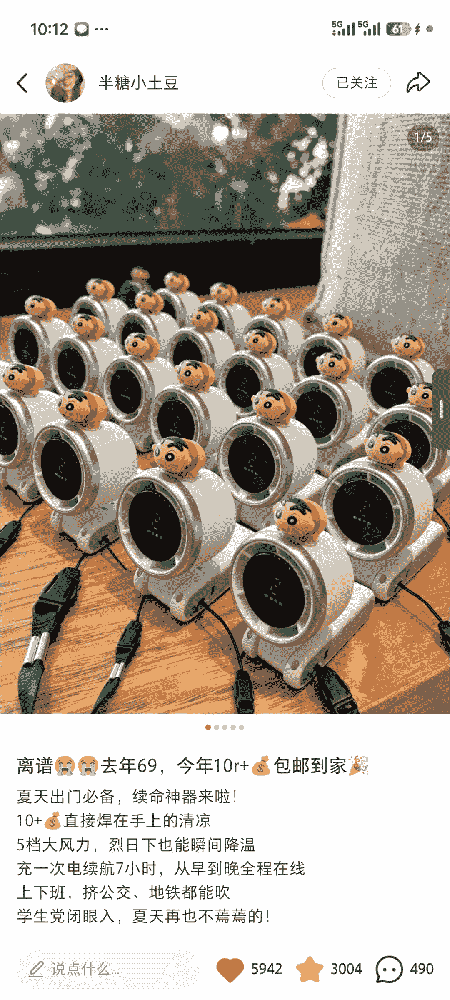

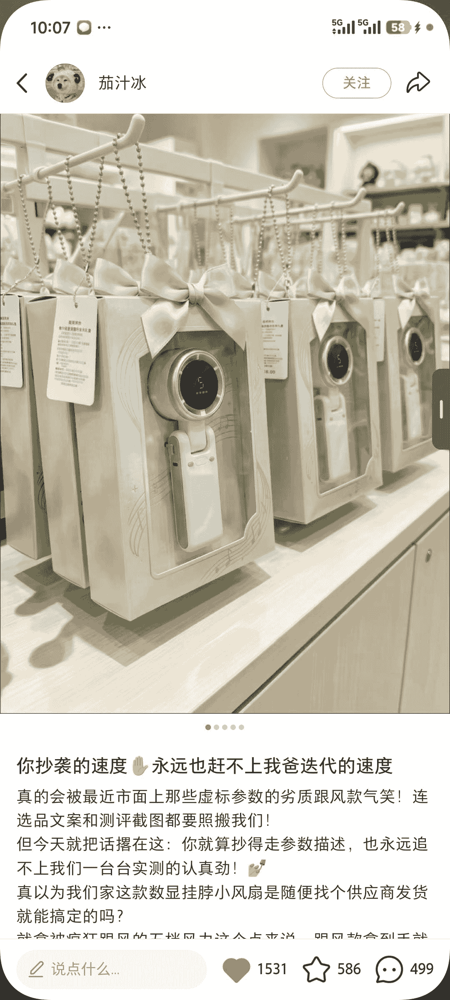

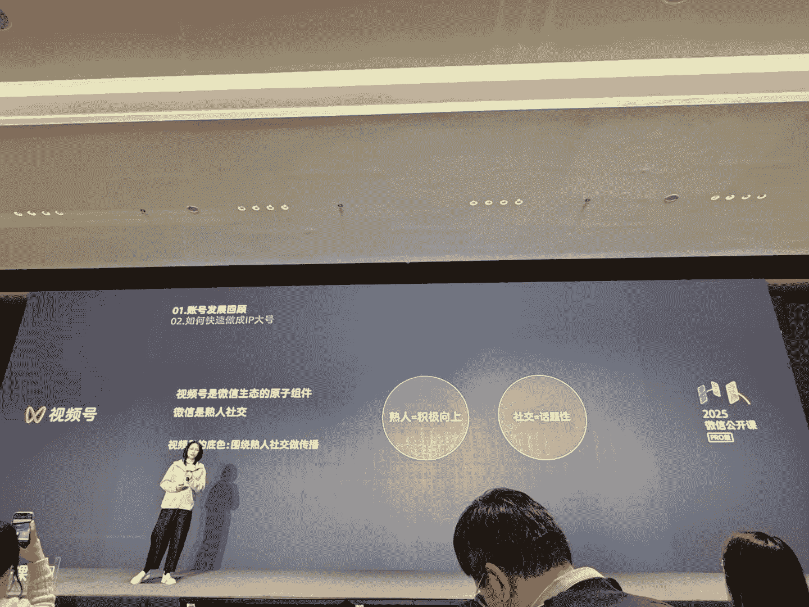

