# 跑了五年跨境，做到年销过亿：我眼里的TikTok机会，以及AI怎么真正长进业务里

260702 副业 SC 精华

整理：👸号懒人搜索，懒人专属群精选

懒人微信：lazyhelper1

大家好，我是A，圈里人习惯喊我Trevo。

端午节我人在西安，做了一场小范围的闭门交流。来的朋友做什么的都有，但聊到生意上的难题，口径却高度统一：客源越来越难找，老客户复购乏力，用户粘性一天比一天淡。做线下的想转线上，做线上的想找出海，看起来赛道不同，卡住的地方却出奇一致——不是没钱、没产品、没团队，恰恰相反，经验、供应链、行业积累样样都有，只是不知道该把这些老本儿押到哪个新方向上去。

我一直在想，为什么同样面对AI和TikTok这两波机会，有人能接住，有人只能干看？后来想明白了：大多数人的问题不是信息不够，而是判断框架没搭起来。信息到处都是，能把信息变成自己的动作，才是真本事。


这篇文章，算是我把那场沙龙的内容做了个系统梳理。如果你正站在跨境门口犹豫，或者想用AI却不知道怎么跟自己的老本行结合，希望我的这些实战体感能给你一些不一样的参照。

先把核心思路浓缩成七句话放在前面：

1. 平台有机会，但门槛一点不低，别指望躺着捡钱；
2. 货架模式只是入口之一，这类平台真正的内核是内容；
3. 别急着怪行业太卷，先搞清楚自己有没有站在有优势的位置上；
4. 新手容易忽略的不是选品，而是资金回笼的节奏；
5. AI得慢慢养，喂得越具体它越懂你，空壳喂不出灵魂；
6. 别总想开疆拓土，它应该从你原有的根上自然长出来；
7. 长期主义不是喊口号，是靠熬。

再浓缩成几句我觉得值得反复琢磨的结论：

- 入口很多，但每个入口最后都要回到内容能力上；
- 你感受到的卷，大概率是因为没站在真正属于你的那块地上；
- 卖货的环节不会消失，只是会被AI重新塑形；
- 别拿AI去跟程序员比编程速度，它更适合帮你在原来的田里施肥；
- 项目来得快去得也快，事业才能越长越壮。

## 先泼盆冷水：这不是一个闭眼捡钱的平台

在沙龙开场，我就把丑话说在了前头。

每次一聊TikTok，总有人自动把它等同于“开个店、上架商品、等着爆单”。但真正跑过这条链路的人会告诉你，平台上的门道远不止店铺这么简单。内容、达人、本地化运营、星图接单、直播、私域、外贸承接，哪一个方向都能切进去。可正因为选择多，很多新手反而更容易眼花缭乱，一上来就选了最重的那条路——开店、压货、砸广告。

我自己是2021年开始关注这个赛道，2022年在海外生活时尝试真人出镜做内容，一路从视频到直播，再到店铺、私域，整个链条都淌过一遍。我的真实感受是：这一行有门槛，而且门槛不低。不是所有人拿着轻资产就能冲进去分一杯羹的。

尤其对新人来说，最容易犯的错是“用最贵的方式验证最基础的问题”。平台算法没搞懂、产品适不适合海外市场没摸清、物流链路没理顺、用户口味没踩准，就急着囤货、租仓、开广告账户。这哪里是创业，分明是交学费。

## 货架只是门把手，内容才是主线

我常用抖音来打比方——抖音不是只有开店一条路，TikTok也一样。它本质上是靠内容激发兴趣的场域，货架只是交易环节里的一个承接点。只盯着上架、报价、促销那一套，等于把这片海当成了一条小水沟。

当然，我这不是在否定货架电商，它确实是一个入口，而且有人做得很好。但如果你只懂得开店卖货，却对内容一窍不通，不知道怎么测试用户反应、不知道怎么拆解海外物流、不知道怎么从差评里找改进方向，那你的店开得越早，死得可能越快。

更核心的是，内容这件事本身就不是拍几个视频那么简单。它背后站着产品理解、用户洞察、场景设计、成本测算和复盘机制。你得想明白：用户为什么会对这个产品产生兴趣？他会在什么场景下停下来？评论区反复出现的问题是什么？差评里藏着什么需求？同行爆款的第一个镜头为什么能抓住人？这些功课不做，后面的投流、直播、履约都会变成无源之水。

老一辈有句话说得特别扎实：没有调查，就没有发言权。放到TikTok上也一样。别一上来就问“什么产品好卖”，先去看海外用户能不能在几秒内读懂你的核心卖点。一切判断都要回到真实的留言、数据和用户反馈里，不能活在自己的想象中。

所以我更愿意问对方：你手里有什么牌？你的优势适合走哪条路？有人内容能力强，就从内容切入；有人供应链扎实，就去找会做内容的人合作；有人在海外有人脉、有仓库，就可以在本地化服务上做深；有人销售功底好，就别只盯着平台成交，把TikTok当引流入口，把真正的转化放在私域里。最怕的是看见别人开店赚钱，就觉得自己开店也能赚钱，完全忽略了他背后那条完整的供应链和资金链，那是拿自己的短板去撞别人的长板。

## 关于“卷”：先认账，再谈机会

现场有位朋友说，国内生意太卷了，产品同质化、退货率高、质量越做越差，想去海外找找机会。

我当时回应得有点直接，可能不太中听：先分清一个事实——是真的人人都在抢同一块蛋糕，还是你自己在这块蛋糕面前没有明显优势？如果产品、价格、内容、渠道都跟别人拉不开差距，那你感受到的卷，本质上叫平庸。优势建立不起来，换个平台、换个国家，照样有人比你强。

我判断一个项目，习惯做“死亡预演”：先假设它大概率做不成，然后倒推它会死在哪个环节。账号没有内容，多半死于内容枯竭；产品没有流量，多半死在供给断层；流量进来了转化不了，问题往往出在信任铺垫不够；老客户留不住，则要回头检查复购机制是不是出了bug。找到那个最要命的死穴，其他问题都可以先放一放。这是我从毛主席著作里学到的思路：抓住那组核心矛盾，而不是被一百个次要矛盾拖着走。方向对了，劲儿才不会白使。

## 绕不开的现金流转：卖得出去不一定活得下去

如果非要选一个新手最容易踩的坑，我会把票投给“现金流幻觉”。

TikTok的本土店和跨境店玩法不同，但底层账本是一样的：开店要备货，备货要垫资，货发到海外要时间，订单回款还要等账期。哪怕你卖得很好，也可能在第二笔货款到账之前，先被物流成本和库存资金活活拖垮。我见过太多人选品没问题、内容也没问题，最后死在资金链上。

我读明史时发现一个反复出现的规律：王朝崩坏往往不是前线战败，而是国库先空了。做生意的逻辑一模一样。看一个货架店铺，我不只看它卖了多少，更会算一笔账：这笔货款多久能回到账上？在它回来之前，我手里的余粮够不够撑过这段空窗期？如果答案是否定的，那就别急着上重模式，先用内容去试需求，验证有人真的愿意买，再决定要不要把身家押进去。

还有朋友问，除了常规玩法，有没有什么被忽略的机会。我提了一句拍卖。有人靠拍卖把一只普通水杯卖出了远超底价的价格，也有人把一双球鞋拍出十倍二十倍的利润。但我要强调，别只盯着倍数，那背后是内容、情绪、现场氛围、稀缺感和交易机制合在一起产生的化学反应。这恰恰说明了一个道理：TikTok上的视频是内容，直播是内容，拍卖同样是内容。所有能制造互动和情感张力的事情，都值得用内容思维重新做一遍。

## 新人看这里：四个相对稳妥的切入点

如果现在有一个新人来问我，我一般建议先看四个方向，而不是急着找产品。

第一个方向，从内容流量下手。短视频、图文、直播，都是验证用户反应的探针。先别想着赚钱，先测试哪种切入角度能让人停下来，留言区在讨论什么，私信里高频出现的关键词是什么。这样拿到的一手反馈，比看几十份行业报告都有用。这条路尤其适合人手少的小团队，投入的是精力，而不是真金白银。

第二个方向，做达人分销网络。不要只盯着头部主播的报价单，那跟你没什么关系。真正细水长流的做法是，每天花一点时间搜索垂直领域的中腰部创作者，看他们的内容风格和粉丝画像，然后私信聊合作、寄样品、谈专享链接。这件事听起来琐碎、笨拙，但复利非常明显，跑上三个月就能攒出一张属于自己的达人资源网。

第三个方向，平台任务和内容服务。TikTok上大量品牌、游戏、App、旅行机构都需要有人帮他们生产内容、做传播推广。哪怕你不想碰货、不想管物流，只要会做视频、懂剪辑、能理解某个垂直行业，就能靠接单变现。这条路的门槛不在资金，而在你的内容能力。

第四个方向，属地化打法。如果你本身有海外团队、当地渠道、仓储资源，甚至只是对某个国家的文化特别熟悉，那你就不该只盯账号运营，而应该思考如何让本地资源和内容流量发生化学反应。这条路走深了，远比单纯卖货更有壁垒。

说到底，这四个方向不是彼此孤立的，它们共用同一条主线：在海外用户的注意力地带里持续构建信任。这条链路由内容开头，中间是成交与承接，后端是履约和关系维护。把这个逻辑想透了，从哪个方向进去都不会跑太偏。

## 前期给你的不是答案，是反馈

经常有人问我，最快的学习路径是什么。我的答案可能有点反常识：不是报课，不是刷资讯，而是学会接收反馈。

视频发出去没人看，是反馈；有人停下看了但没人点链接，也是反馈；留言区反反复复问同一个问题，更是反馈。这个平台最慷慨的地方，就是它总在快速告诉你哪里不对。可惜大多数人把内容当成表演，发完就蹲在后台盯数据，数据不好就焦虑，焦虑完就换方向——那不是做项目，是赌博。

真正会做项目的人，会把每一次反馈当成系统升级的信号：为什么这条有人看而那条没有？为什么有人问价却没人下单？为什么翻译过来的卖点像机器说出来的话？为什么用户关心的点跟我以为的不一样？把这些细节存下来，AI才能帮你做更深层的复盘。这也是为什么我一直觉得，AI和心力要放在一起说。只收藏工具却不肯下场，AI帮不了你；只想看机会却不愿承受冷启动期的寂静，TikTok也帮不了你。

## AI不是写作助手，是业务杠杆

现在很多人学AI，还停留在“帮我写一篇文案”“帮我生成一张配图”的阶段。这些当然能做，但只把它当聊天工具，有点暴殄天物。我的看法是：你所在的任何行业，都值得用AI重新梳一遍、拆一遍、做一遍。

拿我是怎么用AI的来举例。我不会直接让它替我写稿，而是先让它帮我做业务拆解。比如在考虑是否进入某个品类之前，我会让AI把目标市场的内容偏好整理一遍，把头部账号最近几十条内容的选题规律、评论区的高频需求、差评关键词全部扒出来。然后我再问AI：如果我们进入这个市场，第一个月的主打内容应该长什么样？这样得到的方案，比闭着眼睛投广告靠谱得多。

再比如我的私域团队，每天要接待大量客户咨询。以前这些对话散落在各个窗口里，聊过就消失了。现在把对话记录定期转存给AI，让它总结客户最常问的十个问题、最介意的三个顾虑，以及最容易促成成交的话术。用久了，它越来越像团队里最懂客户的那个老销售。

所以我一直觉得，AI要靠日常积累来养。你喂给它真实的业务数据、真实的对话记录、真实的失败经历，它会慢慢形成你专属的知识引擎。如果什么都不喂，只想让它凭空给你答案，那它给出的只能是网上随处可查的通用套话，没有护城河。

这套思路放在任何行业都成立。开实体店的，可以把顾客反馈、员工话术、损耗数据整理成AI的教材；做个人IP的，可以把过去几年获得过认可的观点、被读者diss过的盲区全部丢进去，让它延续你的语气风格。这不是赶时髦，是在为下一阶段的竞争提前布防。

别总想着拿AI去跟技术大牛拼专业，那些领域本来就有壁垒，硬碰硬不是普通人的牌。AI真正的作用是加强筋，把你原本擅长的事情放大。你本来就懂行业、懂用户、懂产品，它负责帮你提升产出效率。这才是普通人的正确用法。

现在很多讲AI的课，教的是工具按钮，这会让初学者误以为学会几个软件就掌握了AI。但工具只是最外面一层，真正能拉开距离的，是你把AI放进自己干活场景里的深度。我见过太多人收藏了一堆插件，业务上却一点没变。我也见过只用一个AI聊天框、但把自己整条业务链都装进去的人，效率翻了几倍。差别不在工具，在于有没有动脑去设计。

## 慢慢养出来的，才是你自己的

有人觉得“养AI”听起来玄乎，其实说白了就是攒资料。你给AI看的资料越具体，它就越清楚你站在什么位置、习惯用什么语气说话、平时跟什么人打交道。时间久了，它会从一个通用助手变成你的业务合伙人：深夜写复盘时它可以帮你列提纲，周末在外面跑客户时它可以帮你盯着数据波动。想走到这一步没有捷径，就是每天往里存东西。

做跨境的朋友都有一个通病：今天测的那条视频数据不错，下个月就说不清它到底为什么会跑起来。我的习惯是，所有素材、留言、订单、广告数据全部归档进AI。隔一段时间让它做一次交叉分析，它会告诉你：原来北美东部时区的打开率比西部高出一截，原来某类话术的回复率是另一类的三倍。这些规律靠人脑很难记住，但AI可以帮你把它们从数据里捞出来。

## 最后，聊点不那么商业的东西

做事最怕的不是起步不会，而是心里先给自己判了死刑。我见过一些很聪明的人，创业碰壁一次就开始自我怀疑，然后急着去寻找下一阵风。但真正能把事做成的，身上通常有个共同点：认定方向之后，不太在意短期反馈，愿意持续投入时间和精力，把一件枯燥琐碎的事情做到极致。能力是可以被逼出来的，愿力才会决定你能走多远。

我经常对团队讲，愿力排在业力和能力前面。有人问做TikTok要不要报课、要不要买工具，我会反问：你能不能做到连续十周没有明显收益，还坚持每天晚上花两小时研究素材、优化脚本、私信达人？如果能，工具课都不急；如果不能，再贵的方法论也救不了你的执行力。

别指望靠一个平台吃一辈子，也别指望靠一个AI工具一步登天。平台会换届，算法会更新，但把内容、信任、资金、复购这套基本功练到骨子里的人，到哪都能找到机会。AI也一样，它是放大器，不是救世主。把根扎稳了，才有资格谈增长。

这篇写给你，也写给五年前那个刚刚开始在跨境路上摸索的自己。


# 愿力的分量，真正干过事的人才会懂

这话初听有些重，可一旦你真正上手做事，就会发觉它毫不夸张。我向来反感把愿力讲成“相信自己就一定能成”，那种说法太轻飘了。愿力不是站上台喊一句“我要赢”，而是你愿不愿意为选择之后的代价买单。想碰 TikTok，先扪心自问：能不能连续拆解海外视频？想做达人合作，能不能雷打不动地每天找人、谈人、跟进人？想入局 AI 出海，能不能把产品资料、用户疑问、脚本和复盘一点不落地收进知识库？

愿力是什么？是跌倒了还愿意回头总结，是没人搭理时还愿意一遍遍修改，是发现自己不适合重资产时果断把切口收小；也是你承认这条路确实难走，但从不拿“难”当自己不肯动身的借口。我以前写过一段话，自己觉得分量很沉：走到今天，我极少认为哪件事是做不成、够不着的。能不能干，能不能坚持，压力扛不扛得住——真想做成事的人，心里得先住进一个字：能。

这个“能”不是莽撞自信，而是先认下事情不容易，然后照样乐意去学、去钻、去复盘，把每一步都踩瓷实。学就学透，钻就钻深，别整天琢磨那些虚头巴脑的，路终究要靠脚板走出来。

## 从毛选与明史里读出的门道

我平时爱翻书，毛选就在案头。它真正能放进今天商业世界的，不是几句口号，而是一套极朴素的干法：先做调查，别拍脑袋判断；抓住主要矛盾，别把力气摊成一片；干完再认识，认识完再接着干。长周期的事必须有节奏，靠三天热血撑不起来，做完一段还要复盘、纠偏。这不正是今天做 AI、跑跨境、做内容、推项目最缺的东西吗？

太多人上来就问工具、问产品、问风口，可连最基本的调查都没做。项目卡住了，不先找症结，只会换工具、换赛道；内容发了几条没人看，就开始怀疑人生；AI 刚学了个皮毛，就巴望着全线自动。这哪里是能力问题，多半是心力和方法都还没立住。

读《明朝那些事儿》，我的感受也相似。看于谦，想到的是危局中总得有人顶上去，值钱的从来不是表态，而是关键时刻敢扛事；看张居正，想到的是改革不靠说正确的话，而要靠流程、考核、负责人和一股子持续推进的韧劲；王阳明讲知行合一，放在今天就是一句话：认知落不到行动上，只能算空想；崇祯够勤奋，可越是危急越反复摇摆，最后整个系统都救不回来。我提这些人物，不是拿历史当谈资装点门面。他们其实都在讲同一件事：真正成事，靠的不是聪明，也不是一时发热，而是紧要关头能判断、能担责、能把事情一步步朝前推。

## 一个女孩的反馈让我愣了一会儿

今早也凑巧，有位女孩来跟我反馈。她说前阵子听我聊愿力，回去后又翻出那篇仔细看了一遍，很受鼓舞；这回我重新展开来讲，她竟然又读出了新的东西。她以前不太明白愿力到底指什么，后来才发觉，愿力是在挫折和实打实的做事当中逐渐显形的，也由此意识到自己平时复盘太少，往后得把颗粒度做得再细些。

看到她的这段话，我心里挺有波澜。因为太多东西，不是“听懂了”就算完。真正撞上挫折还愿意回头复盘、愿意把动作抠得更细的人，愿力才会一点点长出来。我今天讲 TikTok、讲 AI、讲出海，绕了一大圈最后落到心力，不是为了灌鸡汤，而是我亲眼见过太多人：机会看见了，工具也学了，却永远停在半程以前。

前半程是兴奋、是想象、是收藏、是听课、是感叹别人做成了；后半程才轮到你自己，把内容、用户、成交、交付一格一格跑通。真正拉开差距的，从来不是你会多少概念，而是你能不能把概念变成每一天的动作，能不能撑住，能不能扛到底。

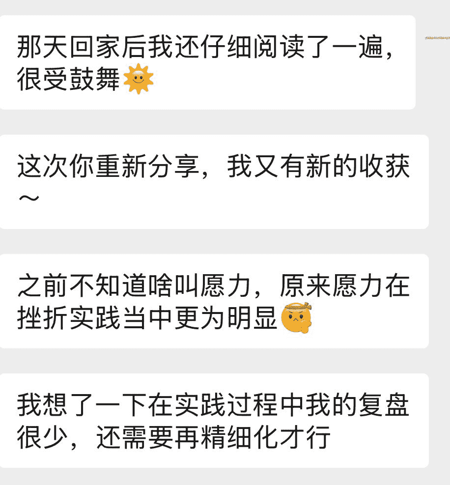

# 

## 别把 AI 想得太玄，难的是你肯不肯日日喂养它

从 TikTok 聊到 AI，底层的道理是通的。我不希望大家把 AI 供成一座够不着的高塔，也不希望谁一听到 AI 就以为非得转行去做开发。AI 难吗？我的答案是：未必。为什么？因为我本人就是个纯正的编程门外汉。我不是程序员，也不是那种看到代码就莫名兴奋的人，普通人对陌生代码发怵，我同样如此。但如今不一样了，你用中文对话就能把它玩转起来，英语不会不要紧，代码不懂也不要紧。我要说的不是 AI 没有门槛，而是门槛悄悄挪了窝——真正的关口不在英语和代码，而在于你有没有真实的业务、有没有可用的素材、有没有清醒的判断，以及有没有耐心一遍遍调教它。

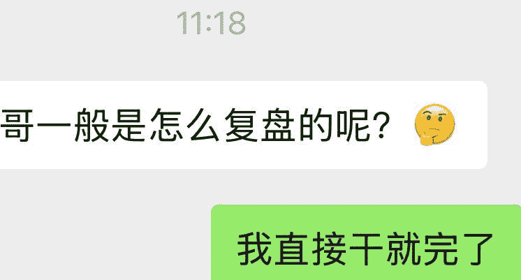

# 很多人把 AI 当成一个即问即答的工具，丢一句话进去，就指望它秒回标准答案。天真了。AI 是靠训练喂出来的，它原本空空如也，是我们从 0 到 1 把它一点一点喂养起来，才长成能自动应答的形态。万物皆有可塑性，但你得养它，且要养得用心。很多人搭知识库，把一堆文件随手往里一塞，然后反问 AI“你为什么不懂我”——它凭什么懂你？你没把自己的判断标准喂进去，没把客户的真实反应喂进去，没把销售对白、成交经过、翻车案例、产品细节、团队复盘、竞对情报、评论区的声音、差评里的怒火、私信里的诉求一点点喂进去，它当然只能回你一段到处都通用的片汤话。你喂得越真实，它就越懂你的生意；你喂得越空，它就越像一个从网上随便扒下来的资料堆。

私域销售是最好的例子。一个销售白天在私域里陪客户聊天、答疑、处理异议、判断意向，晚上七点下了班，往往还得抱手机聊到半夜。公司几年攒下了一大摞话术，可这些东西要么散落在聊天记录里，要么封存在老员工的脑子里。新人进来一切重学，老板想复制也复制不动。这时候 AI 能干什么？它不是跑来顶替销售，而是先把那些重复了无数遍的环节稳稳接住：把话术、异议、客户提问、成交反馈、产品卖点全部收拢起来，整理成一套可查询、可生成、可执行的系统，反手再帮回销售。过去的 SOP 靠人来跑，现在可以让 AI 来跑，把它变成一套系统化的东西。总担心 AI 抢饭碗，这事不能老往反处想。它可以替你在下班之后继续回复客户，让业务员从连轴转里稍微喘口气。

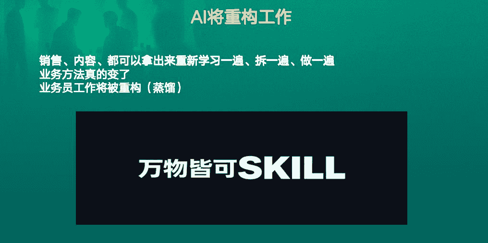

# 讲到这儿，我脑子里其实飘过明朝的张居正。他搞改革从来不靠嘴皮子，一条鞭法把错综复杂的赋税归并成能算清的数字，考成法又给每个官员立下该干的活、该交的账，然后一查到底。企业做 AI 是同一个道理：它不是多装几个软件的事，而是重新梳理流程。如果话术、责任、考核、复盘这些底子都没理顺，AI 项目十有八九是演示时惊艳全场，落地时无人问津。所以企业 AI 迈出的第一步不是替换人力，而是把那些重复了多年的事务接进系统化的轨道。这条主线，我自己越想越笃定：

不是**“AI 抢走销售岗位”**，而是**“AI 把销售流程重新锻造一遍”**。

我搭个人知识库，也用这套逻辑。个人 IP 知识库不是一张简历，更不是写几行“我是谁、做过什么”就交差。你得让 AI 真正认识你：你身在何处、老家在哪、读过什么学校、走过哪些路、此刻在做什么、下一步要奔哪里去。它得记住我的标签：跨境电商、海外实体、娱乐直播、短视频、团队增长，今年还准备切入企业 AI 服务；我手里攥着流量、销售、AI 落地、资源整合这几样本事。它还得理解我为什么那样看问题，过去在哪些坑里摔过，对什么话题格外敏感，讨厌什么样的表达，未来想朝哪个方向走。只有把这些全部装进去，它写出来的东西才不是在替陌生人捉刀，而是在替我把表达与判断向外延展。

项目知识库同理。一家公司、一个项目、一门生意，都应该有自己的知识库。公司每天撞上的问题、客户给出的反馈、团队今天卡在哪道坎、产品在哪些地方被吐槽、竞品最近在做什么内容、销售又遇到了什么新质疑——这些统统该投喂进去。别指望今天建个文件夹，明天就多出一个数字大脑。数字大脑是一天一天喂大的，里面得有身份、有业务、有客户、有产品、有竞品、有销售、有复盘、有内容、有禁区、有边界，它才会越养越像公司里那个最懂业务的人，而不是一个只擅长说漂亮话的摆设。明朝中后期有个特别扎心的教训，叫信息失真：上面看到的不一定是实情，下级呈上来的往往经过包装，掌舵者最大的敌人偏偏就是这个。数字大脑在某种意义上就是在跟信息失真掰手腕——你把原汁原味的客户声音、毫不留情的差评、真实的成交和失败都交进去，它还给你的判断才贴得住地面；你要是只喂修饰过的场面话，它就只能陪你在半空里打转。

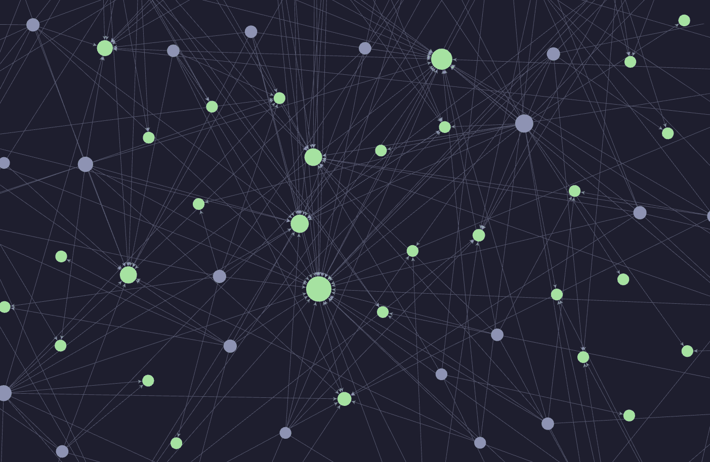

# 拿高考志愿来打比方，也是想说明这件事。你要是吃这碗饭的，可不能让 AI 只写一篇“志愿怎么填”的泛泛之谈，那太浅了。你得把专业、院校、选科、就业、考研、升学路径、家长的焦灼、学生的迷茫、毕业之后的情绪波动，全数装进去。高考一收卷，学生会高呼“终于解放了”，家长却开始揪心志愿填没填错、将来能否找到好工作，追着问这个专业好不好考研、能不能进体制、有没有机会出国——这些全是入口，模块能做到细如发丝。把这些都填进去，AI 才能帮你判断客户、产出内容、打理📕、承接私域。别的产品也一个道理：卖点哪里是拍脑袋拍出来的，分明是用户在评论区、差评区和私信里早就告诉过你了。你去翻同行的账号、翻头部玩家、翻最近几个月的视频，看标题怎么起、前三秒怎么抓人、脚本在哪个节骨眼上转折、评论区在追问什么、差评在抱怨什么，再把这些一并喂给 AI，它写出来的脚本才会贴着真实用户走。说到底，内容不是灵感，而是持续的采集、持续的拆解、持续的打磨。就在一天接一天的总结里，我们想要的客户会自己走过来。

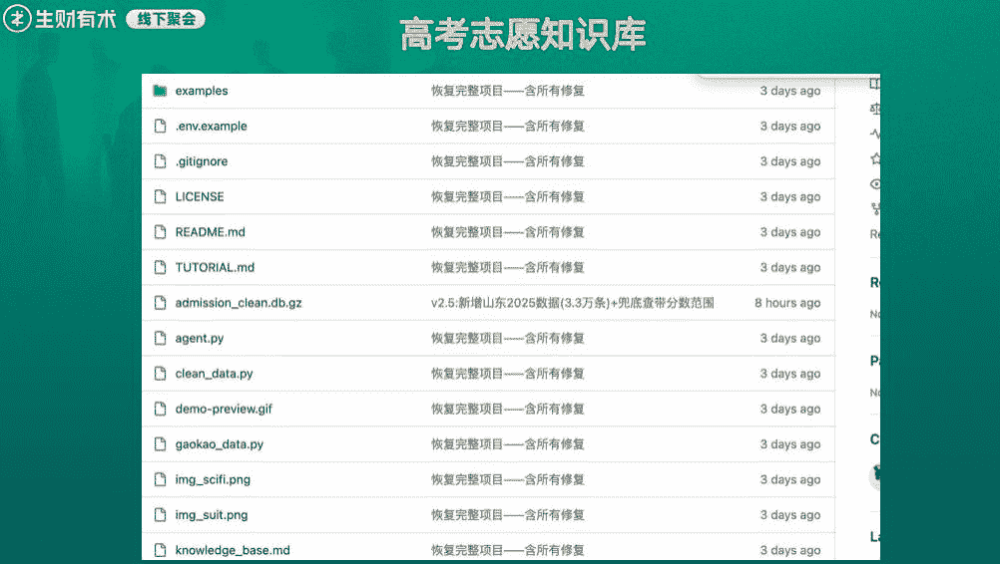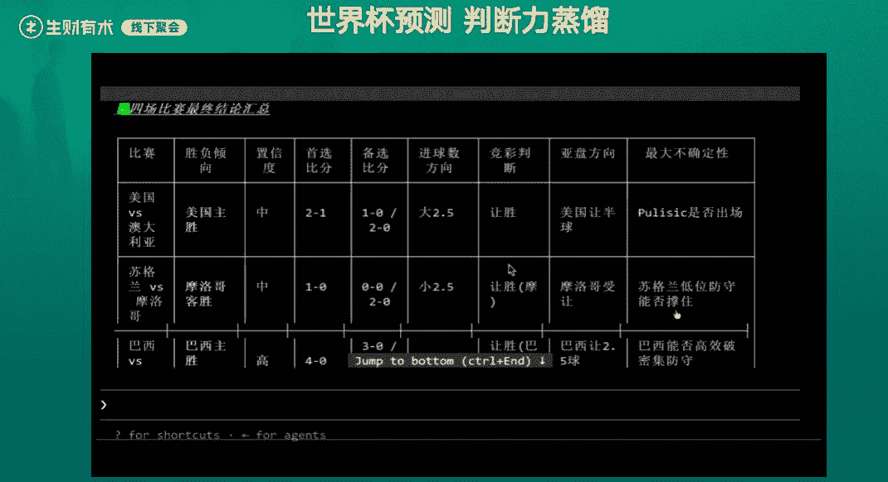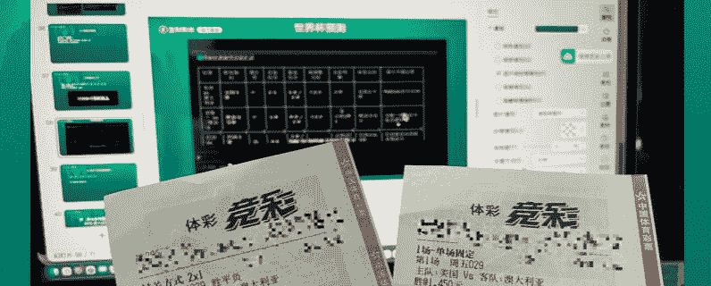

# 以上内容仅作技术切磋与学术讨论，不构成任何投资建议。市场有风浪，入局须谨慎，此非投资指引～

你也看到了，知识库的搭建逻辑可以套用到万事万物。任何东西，都能建起一座专属于自己的知识仓库。

搭建办法如下：

Codex 深度记忆指南：借由 Obsidian 知识仓库打通跨项目的共享记忆

基础配置一共两步：

1. 把图1的提示词复制给 Codex，让它在 Obsidian 里开出一个记忆文件夹

2. 把图2的指令复制到设置里的“自定义指令”中，作为全局 AGENTS.md 的一部分，这样 Codex 就能在后续工作中自动把有价值的上下文沉淀进 Obsidian

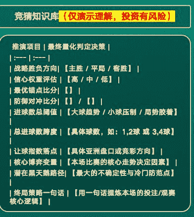

# 

## 别去抢别人的地盘，在自己的根上开枝散叶

下半场我最想亮出的判断是：AI 是一台放大器，得跟自己的业务绑在一起，在你原有的根基上向外生长。普通人千万别学了几招 AI，就撸起袖子去复刻市场上已经被人做烂的产品，跑去跟技术大牛抢饭碗——这事真不好干。你完全可以写代码解决自己公司最需要的那些东西：你本行是高考志愿，就给自己做一个志愿自动分析工具；你本行是卖 3C 的，就做一套 3C 专用的销售和内容系统；你本行是私域，就把私域 SOP 升级成智能体来跑；你本行是线下企业服务，就把客户、话术、流程、交付、复盘全部收进一套系统。这才是普通人更容易走通的路。

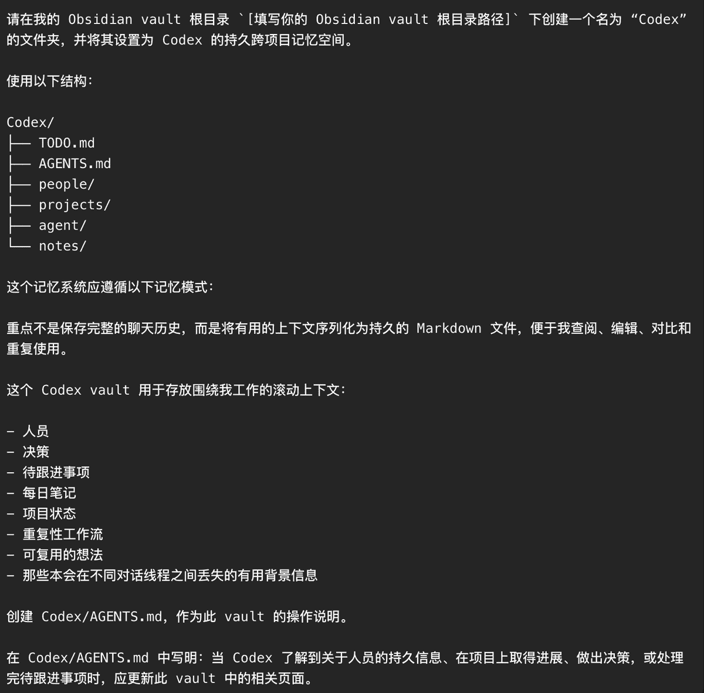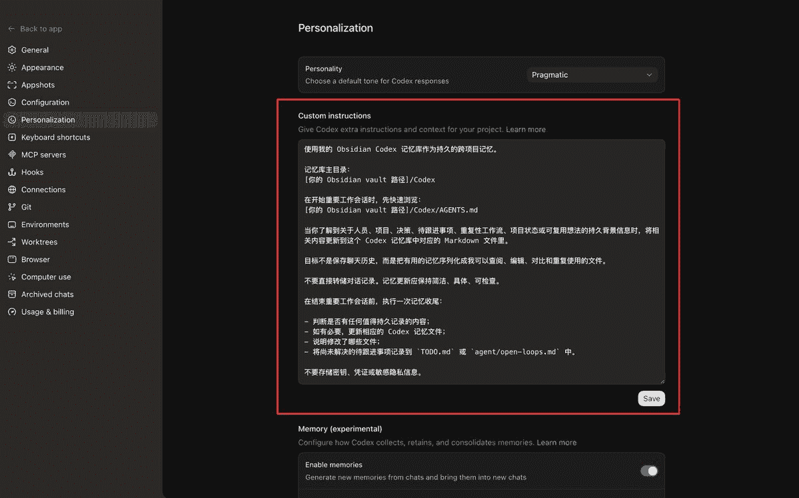

# 很多人被 AI 搅得心乱，其实是看见工具就想换赛道。今天眼红一款软件赚钱，明天眼红一个智能体赚钱，后天又看见别人靠 vibe coding 赚了钱，便觉得自己也该杀进去。可问题在于：你没有根。没有根，你做出来的东西凭什么比技术大佬硬？凭什么比行业内的人强？你最值钱的家底，不是你会不会摆弄几样工具，而是你在某个行业里摸爬滚打过，你见识过客户、体察过痛点、经历过成交、交付过结果，懂得那些外行看不见的坑坑洼洼。AI 要做的，是把这些东西放大，而不是把你从这些东西身边拽走。这也是我跟很多只谈 AI 工具的博主最大的分别：他们倡导“学会 AI 去创业”，我主张“把 AI 放回你已经扎根的地盘”。

顺着这个话题，自然就聊到“项目”和“事业”的边界。这些年我有一个很明显的感受：太多人只是在一个个项目之间打转，谈不上做事业。这个月看见这行来钱就扎进去，下个月看见那行火热又跳出来，短期或许能捞一笔，却没有一条主线，没有一株树干。我自己的方向其实特别简单，就是跨境。我名下所有的事叠在一起，归根到底都是跨境，只是在跨境电商这棵树上不断长出新的枝丫。我做 TikTok，是这棵树伸出来的枝条；我做 AI，是因为它能化解销售团队的难题、内容生产的难题、企业效率的难题；我做 AI 业务，也是在原来的根系上生长出来的。这些分支之间并不乱，因为它们是同一棵树上的枝干。

# 崇祯放在今天，其实是个活生生的反面教材。他不可谓不勤勉，可越焦虑越爱换人，越动荡越来回摇摆，最后把信任和整个系统都耗光了。做事情最怕的正是这副状态：天天被外面的信息牵着走，今天追一阵风口，明天换一个方向。不是说方向不能换，但你得摸清自己的认知边界，确认自己的航向，想明白做什么事、走什么路径、能撑多久、怎么撑、到底要不要拐弯。很多人只盯着自己那一亩三分地，见隔壁卷起来就满腹牢骚——其实有时候不是路没了，是你不知道旁边还有别的入口；不是机会没了，是你没看清自己的优势在哪；不是工具没用，是你压根没把它安放进自己的业务流程里。

## 很多事并不光鲜，你得熬得住

反复讲心力、讲愿力，是因为我发现大多数人缺的压根不是工具。工具可以学，平台规则可以研究，真正难的是你扛不扛得住那段过程。心力愿力不是一腔热血，它是承受压力必须支付的成本。好些创业者缺少这种扛压的状态，日子其实很难熬——他想不通，也找不到拐弯的办法。做 TikTok 不风光，做 AI 也不风光。你看到别人晒成绩单时固然过瘾，可中间那些拆账号、拍素材、谈达人、理资料、写脚本、改流程、喂知识库、复盘数据的环节，全都枯燥得掉渣。这事儿一点也不性感，但你必须坚持。

# 单说达人合作：你愿意掏一点小钱，甚至一分钱不花，拿半年、一年的时间去不间断地联系、测试、复盘，这里面是能磨出结果的。可惜大多数人做不到，因为这条路没有即时反馈。AI 也是同样的脾气。你今天喂几份资料，明天改一道流程，后天理一批话术，短期内看不见一丝波澜。可放到三个月、半年之后再看，这套系统早就变了样。你亲手养出来的东西，会一点点长成你的效率、你的内容、你的销售额、你的判断力。毛选里有一篇讲持久战的思路，我特别信那一套：长期竞争不是一口气打完的，而是看清阶段、保存实力、找准节奏、等待窗口。做 IP、做跨境、做企业 AI，都不是发几条动态、装几个软件就能见效的事。能熬过那段毫无光环的中间段，本身就是别人抄不走的壁垒。

我自己最近折腾 AI 也累得够呛，并不是说用了 AI 就能躺平。token 哗哗地烧、整日趴在电脑前、开发、测试、整理……以前去公司把工作安排妥当就没事了，现在反倒忙得更狠。但我知道自己在做什么，眼下学会的本事，都是在给未来的自己存本钱。工具刚上手时不会让你少干活，它要你先花一段时间把系统搭起来；等系统立住了，它才会开始回头帮你。

## 写在最后：先回头看清自己

所以这场分享，我最想递出去的一句话是：别把 TikTok 只当成开店卖货，也别把 AI 只当成写程序。真正该做的，是把这些新工具、新平台、新机会，统统接回你自家业务的根上。我不是劝所有人都扑向同一个项目，而是想提醒你：别把别人的入口当成自己的入口。你手里有资源、有团队、有产品、有经验、有现金流、有内容能力、有销售能力——这些才是你判断该往哪走的地基，而不是看别人在哪个赛道赚了钱就闭眼往里跳。

# 想做跨境，先掂量自己适合内容、货架、本地化、达人、星图还是私域；想做 AI，先看看公司里哪一块重复度最高、最吃人力、资料沉淀最深，从那里下手，别一上来就挑最重的担子，也别一上来就去抢最不属于你的地盘。倒是许多事想不明白的时候，不妨问问 AI。以前有句诗说遇事可问春风，如今春风不开口，我们就去问 AI。把你的处境、团队、现金流、产品一股脑讲给它，让它帮你拆入口、拆风险、拆路径。可问完还是得自己动手。王阳明讲知行合一，认知落不到行动上就只是空想。AI 不会平白替你长出一门生意，TikTok 也不会因为你注册了账号就送流量上门。它们都只是放大器，放大你原本就有的东西，也放大你原本没想明白的问题。

剩下的，不过就是把那些不起眼的事一天天做下去：拆评论、扒竞品、写脚本、拍素材、喂知识库、整销售话术、复盘客户反馈、联系达人、改流程、继续试。你每天向前挪一点，系统就每天长一寸。走到最后你会恍然：你不是突然抓住了一个风口，而是终于把自己的业务、内容、销售、AI 和跨境接到了一条线上。到那时，新平台和新工具才不只是工具，而是你长出第二大脑的那条通道。它也不再是一个悬空的概念，而会变成你自己的本事。少抱怨，多行动，每天把剑磨利一分。

这是一份备查副本，下面搭建知识库的流程，请结合具体业务灵活看待，仅供参考。

## 1. Obsidian 到底是什么

一句话讲清：它是本地的、以 **Markdown** 文件为基础的笔记软件，最突出的标签是双向链接与庞大的插件生态。

比起普通笔记软件，它有三个本质层面的不同：

1. **本地优先。** 所有笔记都以 .md 文本文件的形式存放在你的电脑上，不依附任何云端服务。就算 Obsidian 公司明天不在了，你的笔记照样可以用记事本打开。

2. **双向链接。** A 笔记指向 B 笔记，B 笔记也会反过来知道“A 提到过我”。笔记不再是孤零零的文档，而会彼此勾连成一张网。

3. **插件无限扩展。** 社区里有上千款插件，从日历看板到 AI 接入，几乎想要什么都能找得到。

收费吗？个人使用完全免费。只有「云同步」和「在线发布」这两个增值服务要花钱，新手基本碰不到。

适合谁？适合笔记量庞大、打算长期沉淀知识的人。要是你只想偶尔记两笔购物清单，手机备忘录就够用了。

## 2. 下载安装

打开 obsidian.md/download 页面，按你的系统点对应的下载按钮。

- **Windows**：拿下 .exe → 双击开始安装 → 一路“下一步” → 桌面会冒出一个紫色图标。

- **macOS**：拿下 .dmg → 双击打开 → 把 Obsidian 拖进“应用程序”文件夹 → 去启动台点开就行。

- **iOS / Android**：到 App Store 或 Play Store 搜「Obsidian」安装。建议先在电脑上把基础操作弄熟，再装手机版。

### 建立第一个仓库

启动之后不是空白页，而是让你选择新建仓库或打开已有仓库。

仓库（**Vault**）说穿了就是一个普通文件夹，你日后写的所有笔记都会住在这里面。

操作：选「创建新仓库」→ 随便起个名字（比如“我的笔记”）→ 挑个位置（桌面或文档文件夹都行，别往 C 盘深处埋）→ 创建。

### 把界面切成中文

打开设置（左下角齿轮）→ **About** → **Language** 选「简体中文」→ **Relaunch** 重启一次。

## 3. 界面布局与核心概念

### 界面五大区域

- 最左侧竖条：工具栏，立着一排功能图标（文件、搜索、书签、关系图谱）。

- 左侧面板：文件管理区，仓库里所有笔记和文件夹都在这里。

- 中间区域：编辑区，你写字的地方，支持多标签页。

- 右侧面板：反向链接、大纲、标签一类的辅助信息。第一天用不上可以先不看。

- 底部状态栏：字数、光标位置之类，直接忽略。

### 核心概念一：仓库（Vault）

本质上就是一个文件夹，所有笔记都收在里面。新手阶段先开一个仓库就够了，别一来就搞出一堆。

### 核心概念二：Markdown

一种用纯字符标记格式的写法。在 Word 里加标题得动用工具栏，在 Markdown 里只需在文字前敲一个 # 加个空格。语法少得可怜，用着用着自然就熟，第 4 章会给你一份速查。

### 核心概念三：双向链接（重中之重）

在 A 笔记里写下 \[\[B 笔记\]\]，会同时发生两件事：

1. B 笔记变成一个可点击的链接，点一下就能跳过去。

2. 打开 B 笔记时，右侧面板会出现一条反向链接，告诉你 A 引用过它。

这就是“双向”的含义。它让笔记之间的关联变得肉眼可见——笔记攒得越多，这张网就越值钱。

零基础玩转 Obsidian：从记下第一行到拥有个人知识库

先学习一个核心操作：在编辑区内写下两个左方括号、两个右方括号，中间填入一个词，例如 [[每日记录]]，这就创建了一条内部跳转。如果跳转目标尚未存在，点击这个词，Obsidian 会当场为你生成一个空白页面。

## 一、扩展组件总览

- 内置模块：官方提供的模块，在偏好设置的“已安装模块”区域开启。
- 外部扩展：社区制作者上传，通过扩展商店下载。

刚上手的头一天，不要急着安装外部扩展。先把内置的常用模块用顺手，等使用一两周后，确实发现内置功能无法满足需求，再去搜索对应的替代品。

## 二、从零开始创建笔记

1. 创建新笔记：Windows 按 Ctrl+N，Mac 按 Cmd+N；也可以在左侧资源树的空白处点鼠标右键，选择“新建”命令。
2. 标题随意，像“今日脑洞”“阅读随想”都可以。先写，别犹豫。

### Markdown 快速参考

下面是一个代码块示例：

```
### 一级标题
### 二级标题
#### 三级标题

**加粗** *斜体*

- 无序列表项
1. 有序列表项

- [ ] 待办未完成
- [x] 待办已完成

> 引用文字

`行内代码`

```python

def hello():

    print("代码块")

```

[外部链接](https://example.com)
[[内部双链]]
[[内部双链|显示成这段]]

--- （分割线）
```

加粗和斜体：选中文字后按 Ctrl+B（Mac 为 Cmd+B）可加粗，按 Ctrl+I（Mac 为 Cmd+I）可斜体。

### 三种视图模式

- 即时渲染模式：系统默认推荐。输入时符号会立即变成最终效果。
- 原始源码视图：显示所有标记符号。
- 展示阅读视图：只显示最终效果，不能编辑。Windows 按 Ctrl+E，Mac 按 Cmd+E，可切换渲染与阅读视图。

### 标签与 Frontmatter

- 标签：在正文中写 `#读书笔记`、`#习惯`，点击后可将相关笔记聚合。
- Frontmatter：放在笔记顶部，用三根连字符包裹，用于保存有固定格式的信息，比如日期、状态等。新手暂时不用学，以后需要做分类汇总时再回头看。

```
---
tags: [读书]
作者: 某某
评分: 5
---
```

## 三、日常必用功能

- 文件区：位于左侧。右键可创建新笔记或目录，拖拽可调整位置，双击可打开。不要为了设计目录花掉两小时，先写内容。
- 全局检索：点击放大镜图标，可以搜遍全部笔记里的关键词。这是未来使用频率最高的功能之一。
- 收藏夹：点击星标图案，把每日必看的笔记固定起来，省去在目录树里反复翻找。

两个操作请尽快形成条件反射：

- 指令中心：按 Ctrl+P（Mac 为 Cmd+P），出现一个万能搜索框。任何找不到的功能，都可以在这里输入关键词找到并执行，比如新建、设置、导出、运行扩展等。
- 快速跳转：按 Ctrl+O（Mac 为 Cmd+O），输入笔记名称即可打开目标文件，比用鼠标逐层点开目录快得多。

### 节点网络图

它会把所有笔记间的连接关系绘制成一张网。笔记数量少时，图中只有几个零散的点；当笔记积累到数百篇，这张图会非常壮观。新手看个新鲜就好，不必深入研究。

### 建议调整的几项偏好设置

- 编辑器 → 默认视图设为“即时渲染”。
- 存储与关联 → 新笔记存放目录 → 指定一个名为“收件箱”的目录，避免新笔记到处乱跑。
- 存储与关联 → 媒体文件默认保存路径 → 指定为一个“附件”目录，以后贴入或拖入的图片、PDF 会统一归到这里。
- 在内置模块中，确认“日志、大纲、收藏、模板、标签”均已启用。

更多热键：可在偏好设置的快捷键页面浏览和更改。

## 四、三种笔记组织思路

一个原则：目录层级尽量浅，最多一至两级；主要靠链接和标签来组织知识。

### MOC（内容总览）

创建一篇“索引页”，正文不用写太多内容，而是按结构列出同一主题下的所有笔记。

```
### Python 学习地图
#### 基础
- [[变量与数据类型]]
- [[函数]]
#### Web 框架
- [[FastAPI 入门]]
```

它适合作为某个主题的入口。更进一步，可以建一个 Home 页，把所有的 MOC 索引页汇总起来，形成一层更上位的总览。这大概是最受 Obsidian 用户欢迎的组织法。

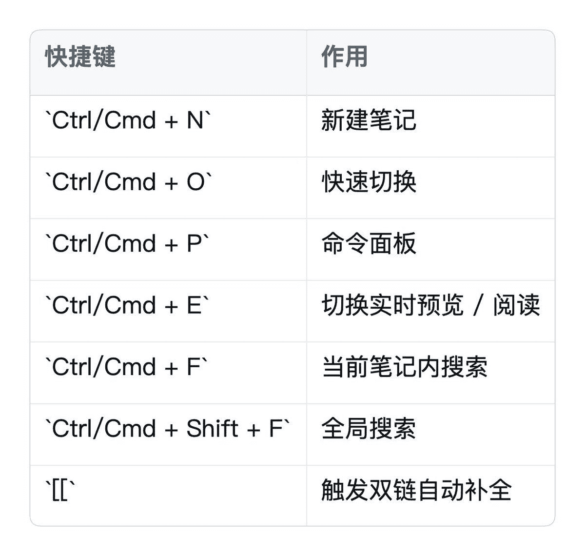

### PARA

把笔记按用途和状态分成四类：

- Projects：指正在推进、有明确终点的事项，比如“装修房子”。
- Areas：指需要长期维护、没有终点的方面，比如“健康”“理财”。
- Resources：是兴趣和素材的集合，比如“摄影”“Python”。
- Archives：放已结束或不再活跃的材料。

从其他工具迁移时，可以直接把旧笔记全部丢进 Archives，得到一张干净的“新桌面”，同时历史资料仍然保存着。

### 卡片盒方法（Zettelkasten）

三条规则：每篇笔记只写一个核心想法；用你自己的话重新表述；主动与已有笔记建立链接。操作流程是“随手记 → 定期整理 → 重写并链接”。它适合经常写作或做研究的人——本质上不是分类体系，而是一套写作方法。

### 如何选择？

- 想直观看见主题结构 → 用 MOC。
- 想按“当下在推进什么”来组织 → 用 PARA。
- 想长期积累输出原料 → 用 Zettelkasten。

最稳妥的做法是：先随便记上两周，当真实需求浮现，再用相应方法去归类。

## 五、值得安装的 10 个扩展

### 安装通用步骤

进入“偏好设置 → 社区扩展”，关闭受限状态，点“浏览”打开扩展商店，搜索目标扩展，点击安装，最后再单击启用按钮——不少人忘记最后一步，还以为扩展有问题。

如果商店打不开：更换网络、使用加速器，或前往 PKMer 这类镜像服务手动下载扩展包，放到仓库根目录下的 `.obsidian/plugins/扩展名/` 目录中，然后重启 Obsidian。

下面 10 款扩展按我推荐的引入顺序排列。其中 Templater、Tasks、QuickAdd、Dataview 需要花点时间配置；其余 6 款安装即用，一句话就能说清楚。

### 第一批：第一天就装

**Calendar**

右侧栏会出现一个可视化月历，哪些天写过日志一目了然，点击某个日期就能跳到或创建当天记录。前提是启用内置模块“日志”。建议把日历面板固定到侧边栏，每天打开工具的第一件事就是点今天，写日志。

**Templater**

它比 Obsidian 自带的样板功能强大得多，可以自动填入当前日期、笔记标题、星期几，甚至弹出一个选项框让你选择。

使用方法：

1. 进入“偏好设置 → Templater”，找到用于指定样板文件夹的那一项，把它的值填为比如“模板”。
2. 在该样板目录中新建一个样板笔记，比如“日记样板”，内容写：

```
### <% tp.date.now("YYYY-MM-DD") %> 日记

> 今天是 <% tp.date.now("dddd") %>。

## 今天发生了什么

## 今天学到了什么

## 明天要做什么
- [ ]
```

创建新笔记后，按 Ctrl+P（Mac 为 Cmd+P）调出指令中心，搜索“Templater: Insert template”，选中样板，内容就会自动填入，日期也会变成当天。

实操建议：为日志、阅读记录、会议备忘、项目追踪各准备一套样板。

**Image Toolkit**

点击正文中的图片即可全屏预览，支持鼠标滚轮缩放、拖动调整位置、左右键切换，按 Esc 关闭。无需配置，经常在笔记里贴截图的人会立刻爱上它。

### 第二批：使用一周后再装

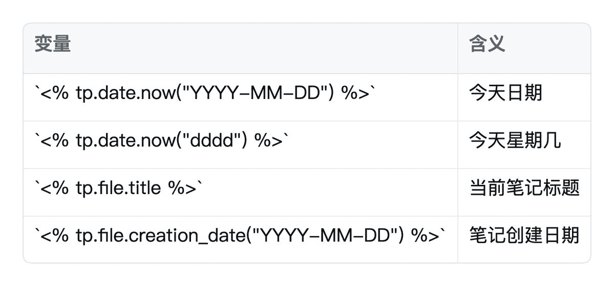

**Tasks**

Obsidian 原生支持 `- [ ]` 待办语法，但任务分散在多个笔记中，无法统一查看。Tasks 可以让你在任何笔记中写一段查询语句，自动汇集所有尚未办结的待办。

任务的标准写法：

```
- [ ] 写周报 📅 2026-05-22
- [ ] 整理项目文档 📅 2026-05-25
- [x] 已完成的任务
```

📅 代表截止日期，🧷 代表计划日期。不需要手打 emoji：把游标移到待办那一行，按 Ctrl+P（Mac 为 Cmd+P），执行“Tasks: Create or edit task”，会弹出可视化编辑器。

任务总览视图：在任意笔记中输入：

```
not done
due before tomorrow
```

保存后，系统会列出所有尚未办结、且最晚明天到期的任务。

实操建议：创建一篇“任务总览”，布置几个不同条件的查询块（如今天到期、本周到期、全部待办），每天早晨打开它，全局任务一眼掌握。

**QuickAdd**

它把“灵感闪过 → 立刻记下”的阻力降到最低。按一个设定好的热键，弹出输入框，输入内容回车，就会自动追加到指定笔记里，全程不到 3 秒。

典型配置（用于捕获灵感）：

1. 先在仓库里建一篇“速记箱”。
2. 进入“偏好设置 → QuickAdd”，在顶部输入“捕获灵感”，在类型下拉框中选择 Capture，点 Add Choice。
3. 点击新建项右侧的齿轮，其中 File Name 填“速记箱”；Capture format 填 `- {{VALUE}} ({{DATE:YYYY-MM-DD HH:mm}})`。
4. 回到设置页，点击该选项旁的闪电图标，注册为命令。
5. 在偏好设置的热键页面，搜索“QuickAdd 捕获灵感”，绑定一个热键，如 Windows 用 Ctrl+Shift+I，Mac 用 Cmd+Shift+I。

以后任何时刻有想法：按下热键 → 输入内容 → 回车，灵感就躺在速记箱里了。

**Periodic Notes**

内置日志只能记日记，这个插件补齐了周记、月记、季记、年记。在设置中启用 Weekly Notes，Format 设为 YYYY-[W]ww，指定样板和存放目录。配合 Calendar，可以直接在日历面板上点击周数创建周记。每个星期天花 15 到 20 分钟写一篇周回顾，坚持一个月，你会惊讶原来自己完成了这么多事。

### 第三批：使用两周后再装

**Kanban**

可以在 Obsidian 中做出 Trello 风格的看板：从指令中心运行“Kanban: Create new board”，添加你需要的列（比如“点子筐 → 撰写中 → 排队待发 → 已公开”），再添加卡片、拖拽排序。进阶玩法：在卡片里写 `[[笔记标题]]`，就能直接跳转到对应笔记，让看板与笔记库互通。

**Dataview**

这是 Obsidian 阵营中功能最猛的扩展之一，它把笔记当成一个小型数据库来查询。

先给阅读记录添加 frontmatter：

```
---
tags: 读书笔记
书名: 思考快与慢
作者: 某某某
评分: 5
读完日期: 2026-05-15
---
```

然后在任意笔记中输入：

```
TABLE 作者, 评分, 读完日期
FROM #读书笔记
SORT 读完日期 DESC
```

保存后，系统会生成一张包含全部阅读记录的表格，按“读完日期”排序。以后每新增一条阅读记录，表格会自动更新。

常用查询举例：

最近 7 天创建的笔记：

```
LIST FROM "" WHERE file.cday >= date(today) - dur(7 days)
```

所有引用了某篇笔记的其他笔记：

```
LIST FROM [[某篇笔记]]
```

学习建议：不要一上来啃全部语法。从 TABLE 和 LIST 起步，等有具体问题再查文档。也可以创建“阅读索引”“项目索引”这样的索引笔记，里面放几个 Dataview 查询，相当于让目录自动生成。

**Excalidraw**

手绘风格的画板，画脑图、流程图、概念图都很轻松，拖一拖、拽一拽就能完成。在指令中心运行“Excalidraw: Create new drawing”即可创建画布。图形里的文字可以包含 `[[笔记标题]]`，按住 Ctrl（Mac 为 Cmd）并点击文字即可跳转。适合梳理复杂概念、为阅读记录配图解。

**Various Complements**

输入时，它会根据仓库内已有笔记标题给出建议，按 Tab 键即可补全。最常见的用法是：想添加 `[[ ]]` 链接，却想不起完整标题。笔记数量超过 100 篇后效果开始明显。建议将 Match strategy 设为 prefix，Min word length 设为 2 或 3，以免每敲一个字母都弹出提示。

### 分批安装时间表

- 第一周：Calendar、Templater、Image Toolkit，覆盖看日历、套样板、看图三大刚需。
- 第二周：Tasks、QuickAdd、Periodic Notes，等出现待办汇总、快速捕获、周期回顾需求时再装。
- 第三周起：Kanban、Dataview、Excalidraw、Various Complements。这些扩展功能更强，学习成本也更高，先把基本操作练熟再引入。

扩展不是装得越多越好。有些人一口气装上几十个，每个都浅尝辄止，最终启动速度下降、界面变得复杂、大部分功能闲置。正确的思路是：先遇到问题，再找对应的扩展，而不是“看起来厉害就装”。装了不用等于白装。请记住，工具是为你服务的，不是让你为工具打工。把笔记写起来，所有扩展都在为“写”服务。

## 六、十个拿来即用的落地模板

不要一次全用上，挑一两个最需要、最容易坚持的先开工。下面只给模板骨架，具体操作步骤前文已经说过了。

**1. 每日日志**

```
   ## 今天做了什么
   -
   ## 今天学到了什么
   -
   ## 明天要做
   - [ ]
   ```

**2. 速记箱**

建立一个固定笔记，每次有想法就追加一行：

```
   - 2026-05-21 突然想到的产品点子……
   - 2026-05-21 地铁上想到的……
   ```

进阶玩法：通过 QuickAdd 实现彻底自动。

**3. 阅读记录**

```
   ---
   tags: 读书笔记
   书名:
   作者:
   评分:
   ---
   ```

结构示例：

# 读完日期：

---

## 用一段话概括

## 主要结论

## 收获与打算

## 打动我的句子

关键：用自己的话转述，不要整段照抄原书。

**4. 会议备忘**

标题采用“日期 + 会议主题”，例如 `2026-05-21 产品需求评审`。

## 出席者

## 议题

## 商量结果

## 后续待办

- [ ] 谁、做什么事、截止日期

只写结果、判断和后续待办，不必记录每个人的每句话。

**5. 待办清单**

### 本周任务（5.19 - 5.25）

## 工作

- [ ]

## 个人

- [ ]

完成时把 `[ ]` 改成 `[x]`，或在展示阅读视图下直接点击方框。进阶用法是用 Tasks 自动汇总全局待办。

**6. 项目追踪**

### 学英语计划

## 目标与时限

## 步骤划分

### 阶段 1：

- [ ]

## 进度记录

| 日期 | 进度 | 备注 |
|---|---|---|

**7. 概念卡（示例：复利）**

### 复利是什么

## 用大白话解释

## 一个例子

## 联系其他概念

- [[定投]]

能用大白话把概念讲清楚，才算真正理解；讲不清，说明还没学透。

**8. 链接收藏**

- [文章标题](https://example.com)
  - 看中它的原因：……

给每一条收藏附上一句“看中它的原因”，没有理由的收藏，和没收藏几乎一样。

**9. 周回顾**

每个星期日新建一篇，标题如 `2026 年第 21 周回顾`：

## 这周完成了什么

## 本周最有价值的产出

## 有哪些遗憾

## 下周三件要紧事

1.
2.
3.

请特别重视后两块：复盘的意义在于修正方向。

**10. 快速参考表**

把需要反复查阅的信息集中存放：无线网密码、经常用到的地址、报销步骤、设备故障解决方法等等。需要时用快速跳转（Ctrl+O / Cmd+O）输入关键词，即可秒开。

## 七、如何把外部内容搬进来

### 从 Word 中迁移

最省力的方案：安装 Importer 扩展 → 指令中心运行“Importer: Import data”，然后在弹出的窗口中选中 Microsoft Word → 选择文件 → 导入。

如果只是少量内容，也可以直接打开 Word，全选复制，在 Obsidian 里创建新笔记，把内容贴进去，标题、加粗、列表会原样转换为 Markdown。

### 飞书材料

打开材料，点右上角的“⋯” → 导出，第一选择是 Markdown；如果没有这项，退而求其次选 Word。Markdown 文件可以直接拖进仓库。

需要批量导出：在飞书中勾选多个文件 → 导出成 Word 格式 → 解压 → 用 Importer 一次导入多份。

### PDF

将媒体默认保存路径设置成固定目录（如“附件”）后，直接把 PDF 拖进编辑区，文件会自动存入仓库并生成链接。在文件列表中双击该 PDF 即可阅读、翻页。

在笔记中嵌入 PDF：写 `![[文件名.pdf]]`，展示阅读视图下会自动渲染。

### 音频和视频

支持 mp3 / wav / m4a（音频），mp4 / webm（视频）。其它格式先借助 cloudconvert.com 之类的在线工具转成标准格式。

将文件放进仓库，在笔记中写 `![[录音.mp3]]`；也可以使用 `![[演示.mp4]]`，展示阅读视图下会出现播放器。

注意：视频文件通常很大，容易撑爆仓库、拖慢同步。只放入小段视频；大文件建议存网盘，在笔记里保留链接即可。

## 八、备份与多设备同步

笔记越积累越珍贵，所以必须备份。

- 官方同步服务 Obsidian Sync（付费）：全链路加密、可回溯历史、多平台自动同步，省心省力，一年几百元。
- 坚果云 / iCloud：把整个仓库放进同步盘中。操作简单，但 iCloud 只适合苹果设备。
- 在 Obsidian 里启用 Git 扩展，并关联一个属于你自己的 GitHub 仓库（设为私有）：既能同步，又有完整的历史版本，随时回滚到几个月前。适合愿意折腾的人。
- Syncthing：完全免费、开源、设备直连同步，不依赖第三方云服务，只是配置稍费功夫。

无论选哪种方案，至少还要做一份不经过云的本地备份，例如定期用 rsync 拷贝到移动硬盘。

最后送你两句话：不必求快，工具的回报取决于持续使用。十天写十篇可能毫无波澜，但坚持三五个月，你会有意外惊喜。先把内容写出来，再去琢磨组织方法；别在设计目录上消耗太多精力，写得足够多时，分类自然清晰。也别要求每篇都精致，哪怕只是记下零星几句，也是有价值的思考痕迹。这些记录首先服务于自己，而不是为了陈列展示。

如果你也在折腾 Obsidian，不妨听这几条贴身建议：

第一，让“双链”成为习惯。脑子里一冒出“这好像和之前某个东西有关”，别犹豫，立刻敲下`[[ ]]`，把两者连起来。

第二，新手期少装插件，甚至先不装。裸用一到两周，先适应原生操作的手感。

第三，别拿 Obsidian 当收藏夹。原样复制粘贴，等于白干；动用自己的话重写一遍，才真正产生了价值。

加油吧。

但真相是：很多人看完这套 SOP，会以为自己已经懂了。可一到实操，九成人当场卡在第一步。

工具和教程，从来只是最浅的护城河；真正的差距，来自“马上动手”的行动力，以及“圈层信息差”。

如果你想知道当下最前沿的变现玩法，也想和一群执行力拉满的极客一起下场拿结果，欢迎来我的核心私域围观：【懒人专属群】。

这里不讲空话，只拆商业闭环、榨干AI效率。目前圈子里已经沉淀了1000+跑通的套利实战局。

想查看圈子的完整资产包与上车条件，点这个链接：

https://lazyso.com/insider/

如果你也认同这套价值，并准备好下场干活，就扫码加我微信（lazyhelper1），备注【实操上车】。闲聊勿扰。

