# 花半个月把 AI 写稿变成一条流水线后，我 7 天佣金过了 2 万

我是龙哥，目前主攻视频号短视频带货，玩法很简单：用 AI 辅助做文案二创，再靠 15 个视频号组成的矩阵去发口播视频带商品。先交代一下战绩：

项目进入第三个月时，我花了大约半个月，把 Obsidian、VS Code、Claude Code 和 Codex 这四样工具拼成了一套 AI 二创文案系统。系统刚跑顺，6 月 9 日到 6 月 15 日这 7 天，我就拿下了 954 单成交，销售额 55,929.53，预估佣金 20,245.53。

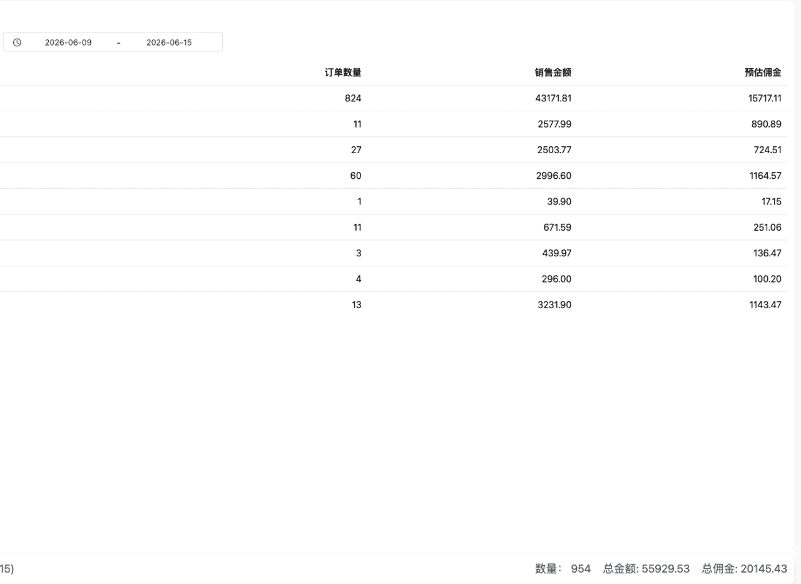

不过今天这篇文章，重点真不是晒收入。我更想把成绩背后那套系统是怎么"被逼着"一点点长出来的，原原本本讲给你听。

## 01 在最开始，我也只会把 AI 当临时工

3 月刚起步那会儿，我的打法极其原始：刷到对标爆款就抄下来，扔给 AI 做二创，改完就发，全凭运气吃饭。那时我一直在网页对话框里和 AI 来回拉扯：贴进原文、贴进产品信息，再甩一句"帮我改成一条能发的带货口播"。

当时我天真地以为是提示词写得不行。真做下来才恍然大悟——问题根本不在提示词，而是我的经验压根没地方安放。每次对话都像第一次见面，AI 就像一个随时上岗又随时消失的临时写手。

其实我已经用真金白银趟出了不少雷区：有的开头删了整条稿子就没魂，有的转品桥搭得太硬观众秒划走，产品段一不留神就写成说明书腔调，还有一类账号根本接不住高风险内容。可每次提笔重新写，这些教训都得从头再交代一遍。更扎心的是，4 月底到 5 月初，视频号大力整治同质化内容，我有 10 个号被集体限流 7 天。

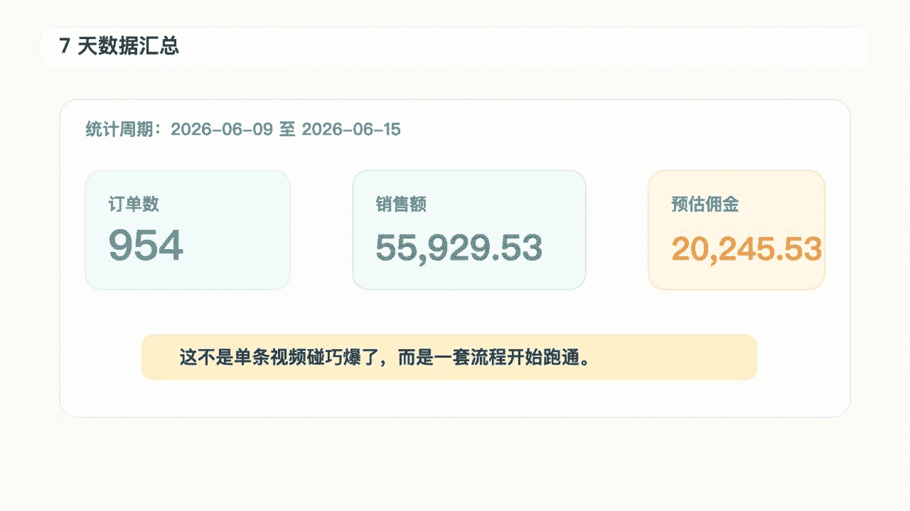

这一棍子把我彻底打醒了。我开始想明白一件事：

如果我只把 AI 当成单篇稿子的代笔，那我的工作就永远困在"逐篇修补"的怪圈里。

可要是想把这门生意长期做下去，我必须搭一套能持续压低相似率、不断沉淀经验、让数据反复复用的系统。

## 02 每个工具干好一件事，才配叫系统

后来我前前后后花了半个月，把 Obsidian、VS Code、Claude Code、Codex、小V猫这些工具捏合在一起，成了我自己的 AI 二创流水线。先交代一下各自分工：

Obsidian 管经验存档，相当于整个系统的记忆库。VS Code 是我的主战场，所有生产动作都在这发生。Claude Code 负责啃知识库、拆解爆款、撰写二创。Codex 管文件规整、账号分配、生成发稿复制台，还会把复盘结论回写进系统。小V猫则专门从各账号后台把播放量和订单数据抓回来。

打个比方你就记住了：Obsidian 是档案柜，VS Code 是办公室，Claude Code 是写手，Codex 是助理。

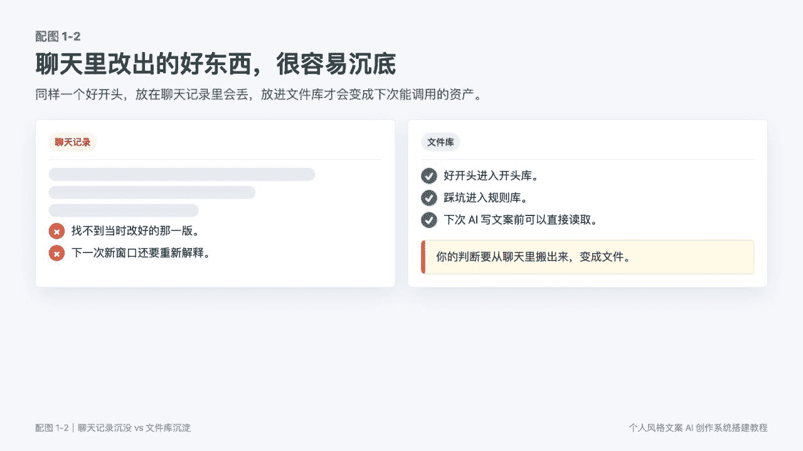

这套系统带给我最大的转变，不是手速变快了，而是每一次动笔，脚下都踩着上一次积累下来的经验往前走。

## 03 这套系统不是我规划出来的，是限流逼出来的

说句实话，我一开始完全没有系统思维，纯属被限流打急了眼。

3 月那时候，我的流程就是看到爆款就抄，抄完让 AI 改，改完就发。跑出量了高兴一阵，跑不动就换下一条接着试。我对 AI 的理解也特别简单：不就是个代笔工具吗？原文、产品资料、要求都给它，它就该还我一版能直接发的东西。然而现实很快教我做人。

网页端对话有个致命伤——每次聊天都像临时雇了个新人。今天我花半小时叮嘱它：开场别太温吞、转品别太生硬、产品部分别写成说明书、别把原文的精气神改没、更别凭空加事实。它当时答应得挺好，第二天新开一个窗口，我那些话一句不剩，全得重讲一遍。第三天换个对标，又是一轮新的循环。

最折磨人的是那种重复感。不是 AI 完全不会写，而是我昨天辛辛苦苦喂进去的东西，第二天就归零了。我每天都在训练临时工，训练完它就下班，第二天门口站着的是另一个陌生人。

更要命的，是同质化带来的连锁反应。4 月份为了冲产能，我经常把一条稿子改出好几个版本往不同账号上铺，短期确实省事。可 4 月 25 日那天，雷直接炸了。

整整 10 个号因为相似违规被限流 7 天，明着限流的 6 个，被暗暗压权重的还有 4 个。当时还能正常发挂车视频的号，基本一下子清零了。

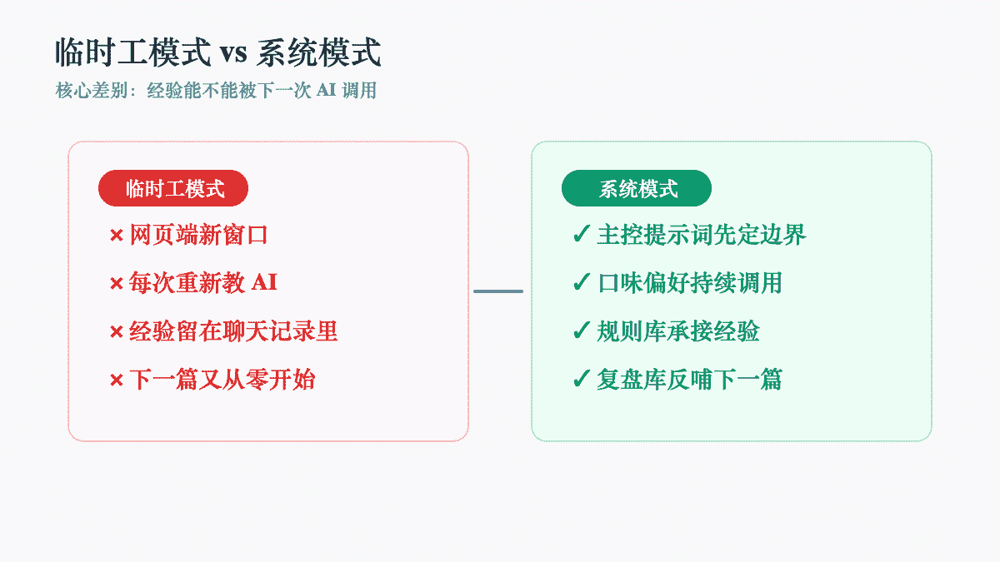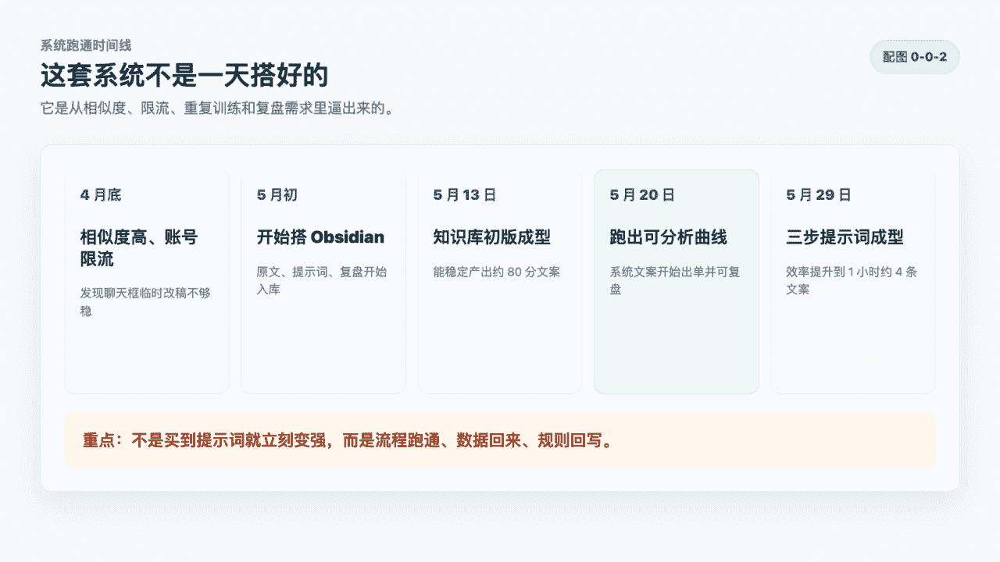

那种感觉，我一直记到现在。前一天还觉得自己摸到了点门路，隔天整个账号池就被平台摁在地上。那一刻我才认清一个事实：我做的根本不是什么矩阵，分明是拿着同一把刀，反复去抹平台的红线。

那几天我反复琢磨：如果继续依赖网页端随问随答、继续靠手感改文案、继续一条稿子打天下，这个项目迟早还得挨第二次打。而且每次挨打，赔进去的何止一条视频？账号权重、发布节奏、现金流、还有自己的心气，全在缩水。

所以从 4 月底到 5 月初，我算是咬着牙下了决心，一定要搭一套属于自己的 AI 二创系统。最初的想法很朴素，就三条：

第一，把相似率实实在在压下去。第二，让 AI 每次接手都能继承我此前的经验。第三，把验证过的数据、踩过的坑、好用的表达，真正沉淀下来，而不是任由它们烂在聊天记录里。

这中间我也参加了一些圈友的线下交流，再结合自己的生产反复验证，越来越确信：AI 写文案这件事，靠一次性提示词是走不远的，背后必须得有个系统撑着。这套东西我整整搭了半个月，从 Obsidian 知识库到 Claude Code 协作流，再到 Codex 运营辅助流，一点一点拼出来的。它刚成型时并不完美，可自从跑起来，我的项目才彻底告别"每天临阵磨枪"，进入"每天在流水线上迭代"的状态。

## 04 我栽过的跟头：把 AI 当成了纯写稿工具

刚上手 AI 时，我和绝大多数新手一样，最爱犯的错就是一上来就让 AI 写。

刷到爆款，复制粘贴，然后命令它：给我仿一篇、把它改成我的产品、帮我写得更炸一点。平心而论，这招偶尔能成，AI 交出的稿子看着也像模像样。可问题就出在不稳定：同样的指令，昨天还像人说的话，今天就变成了一股广告腔；同一个对标，今天能精准拿捏开场，明天就把最勾人的冲突给删干净；同一个产品，今天转品转得行云流水，明天忽然来一句"今天给大家推荐"，观众直接划走。

后来我给自己定死了规矩：

不拆解，不改写。

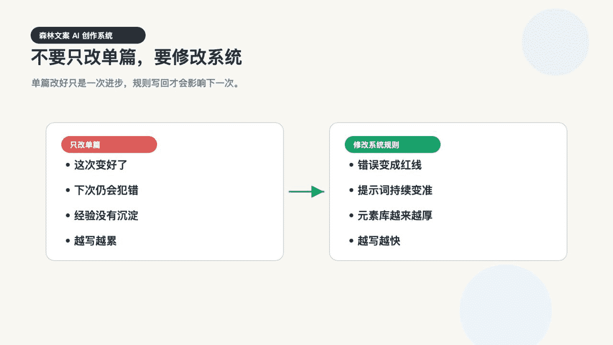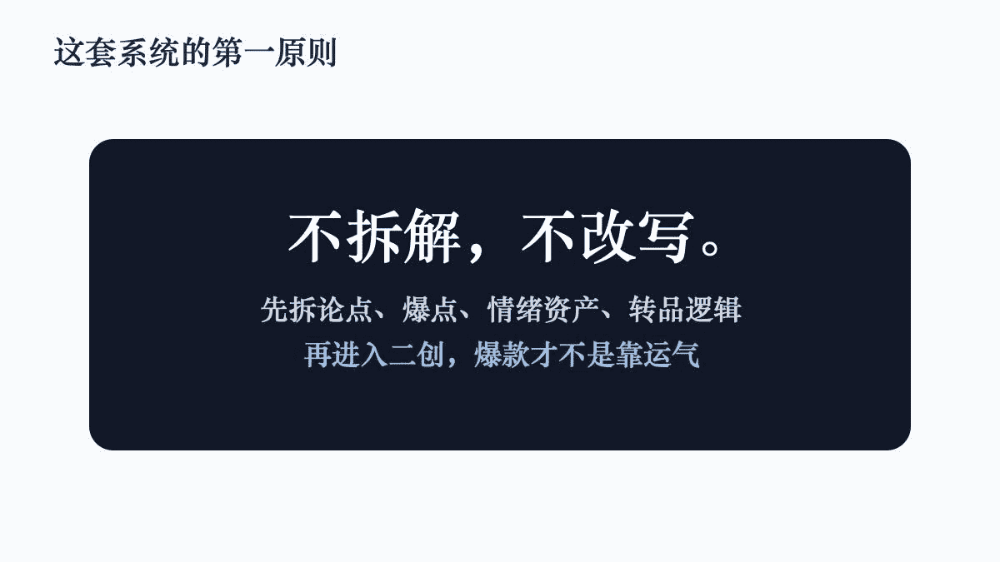

这话挺土，但确实救命。因为一个爆款真正值钱的，从来不是表面那几句词，而是骨架。它到底想让观众相信什么？第一句话凭什么留住人？中段又用什么钩子让人舍不得划走？结尾是怎么顺理成章把产品带出来的？哪些句子是碰都不能碰的情绪资产？哪些铺垫纯粹是废话、必须把冲突往前顶？

这些东西要是不拆明白，就直接让 AI 改写，它充其量只能给你换换同义词、调调句式、再硬塞几个唬人的开头。成品乍一看挺像文案，扔到战场上却未必跑得动。

这也是我执意要搭知识库的原因。我压根没指望 AI 临时帮我凑一篇稿子，我想训练的是它理解我这一类内容的生产逻辑。它得清楚我的家底：哪篇稿子跑出过成绩、哪种开头百试百灵、哪个转品桥从不翻车、哪些产品段落能稳稳接住转化、又有哪些写法我一看到就想删、还有哪些雷踩过一次就绝对不许再踩。

AI 最值钱的地方，不是替我节省了那点写作时间，而是让我每天都在积累的经验，一天都没有白费。

## 05 真正的转折点：把改写拆成三步流水线

这套系统从"勉强能用"到"越用越顺手"，中间隔着一道分水岭。

以前我怎么用 AI？一个对话窗口包揽全部活。原文丢进去，拆解、找素材、改开头、写正文、质检、起标题，全指望它一口气完成。听起来很省心，做起来四处漏风：拆解阶段分析得头头是道，一到成稿就把结论丢到九霄云外；上一秒还强调某段情绪资产不能动，下一秒它自己先给删了；第一步明明标出了政治风险，写到第三步又自作主张把它弱化；嘴上念叨着转品要顺滑，结果一落到产品段又开始报菜名。

后来我想通了：

不是 AI 偷懒，是我把太多工种硬塞进同一个窗口。让一个人同时当策划、资料员、编辑、审稿、运营，还得保证每一步都不掉链子，这本来就不现实。

于是最关键的一次升级来了——我把改写流程拆成了三步提示词。不再是"一条龙"提示词，而是像工厂那样，每一道工序只专心做一件事。

### 第一阶段（5 月 13 日—5 月 20 日）：把经验从聊天记录搬进文件

5 月 13 日，我开始搭爆款文案系统和每日复盘系统。那时候还很简陋，不过是先把开头、转品、金句、收尾、复盘卡、素材卡这些模块立起来。但这步的意义非同小可：经验不能烂在聊天记录里。聊天记录沉了底就再也捞不着，只有变成文件，才有可能被下一次 AI 调用。

5 月 15 日，我又把口语风格规则、二创六步法、政治风险规则写成了一份核心规则。那时候我已经意识到，文案不是写通顺就万事大吉，还得有口语节奏、平台风险判断、二创顺序的讲究。

5 月 20 日，我连自己的口味偏好也写进了文件：喜欢什么、烦什么、哪些表达一股 AI 味、哪些转品硬得硌牙、哪些开头平平无奇。这些以前全靠我在对话框里反复唠叨，现在统统变成了可读的规则。

这是第一个重大改变：AI 不再依赖我现场言传身教，它开始能读我的长期规则。

### 第二阶段（5 月 28 日）：主控提示词一分为三

真正的分水岭出现在 5 月 28 日。那天我下决心把主控提示词拆成三步。原因很简单——它太长了。

我以前有个执念：规则越全，AI 写得越好。于是拆解规则、口味偏好、风险规则、开头规则、转品规则、质检规则，一股脑全塞进去。结果适得其反：上下文撑得太满，AI 开始偷工减料；各种规则挤在一起互相串味；前面反复交代的重点，它转头就忘。看似每一条都读过了，真到动笔时，最要紧的那几条压根没落实。

所以我把它劈成三段：

第一步，只做拆解和素材搜集，全程不碰写作。它只需要回答：原文的核心论点是什么？爆点埋在哪？哪些是必须保住的情绪资产？风险和漏洞在哪儿？现有素材够不够撑起一篇？有没有同源爆款家族需要先排查？

第二步，只管框架和开场，也不碰完稿。它要拿主意的只有：原版结构哪些保留、哪些推翻？开头怎么保住骨架、换上全新的皮？素材里最后一个后劲最足的案例，能不能顺势递到产品手上？转品桥该搭在哪一节？

第三步，才进入成稿和质检。这一步必须把第一道工序的情绪资产清单、第二道工序的结构承诺，全部重新调取出来，在此基础上完成整稿、标题和终检。

这一步对我而言是颠覆性的。以前是一个 AI 从头写到尾，现在是三道工序接力跑。第一道像侦察兵，先把地形、雷区、家底摸得一清二楚；第二道像导演，琢磨这场戏怎么排布、开场用什么招、产品在哪一节自然长出来；第三道像主笔加终审，把前两道工序的判断真正落成一版能发的稿子。这就是我说的 AI 改写流水线。它的用意不是给 AI 松绑，恰恰相反，是收紧它的自由，让它每一步只操心这一步该操心的事。

### 第三阶段（6 月 9 日—6 月 14 日）：流水线开始接上数据

三步提示词跑顺之后，文案质量稳了一大截。可 6 月上旬我又撞见一个真相：稿子写得好，和发出去能爆，完全是两码事。同一条稿子，换一个账号发布，结果可能天差地别。

6 月 9 日到 6 月 15 日这 7 天，我一共放出 68 条视频，拿下 954 单，GMV 55,929.53，佣金 20,245.53。

这组数字让我确认：这套系统真正的价值，不在于单点写稿，而在于写稿、账号、发布、复盘必须拧成一股绳。

从 6 月 9 日起，我开始把账号权重、长尾规律、复盘结论全部回写进知识库。系统正式从"内容生产"跨入"运营决策"。哪个号刚经历过流量高峰？哪个号的下单转化最猛？哪个号适合拿来试新脚本？哪个号才配得上高转化文案？这些判断光靠人脑根本记不全，必须让 Codex 能读到、能算、能给建议。

这是第二个重大改变：AI 不再只帮我把文字搞出来，它开始参与账号分配和运营判断。

### 第四阶段（6 月 12 日—6 月 13 日）：德国马膏把规则彻底打穿

6 月 12 日那条德国马膏，是我这套系统里特别有价值的一个样本。它的播放量算不上顶级，转化率却漂亮得吓人：播放 4 万出头，净成交约 132 单，千次观看成交金额达到 281.17。

这条爆款让我彻底想通一件事：文案系统不能只盯着"能不能起流量"，更要追问"为什么它能成交"。

后来我把它拆成了一整套可复用的资产：

开头卡：用荒诞段子切入，再落到父亲真实的困境。转品卡：先讲自身体验，再搬出第三方背书，最后扣回前文的伏笔。规则层面：多案例文案不能只按信息强弱排序，还要看压轴那个高势能案例能不能自然地把产品带出来。账号层面：分配内容时不能盯着一张静态权重表做决定，而要综合近期播放、订单、GMV、佣金、完播、转发、关注这些活数据来判断。

这就是第三个重大改变：一条爆款，从此不再只是一条爆款。它会被拆解成开头、转品、账号策略、数据表现、提示词规则，重新回填到系统里。下一次再遇到同类文案，AI 不是从零起步，而是直接调取这套现成的规则。

### 第五阶段（6 月 15 日—6 月 17 日）：系统开始自己生长

过了 6 月 15 日，我明显感觉系统换了一个境界。不再是每天发现一个毛病、口头叮嘱 AI 一次，而是每次翻车，我都会先问一句：这个教训该归档进哪一份文件？

有的教训，要记进第一道工序的提示词，比如"先查同源爆款家族"。以后拆一条文案，得先看看它有没有 A/B/C 各种变体，不然只盯着单条去改，很容易改着改着就撞了稿。

有的教训，要归到第二道工序，比如"让压轴的高势能案例去托产品"。以后写多案例文案，不能只比哪个故事够刺激，还得琢磨哪个故事最衬产品、最好把转化接住。

有的教训，要落进第三道工序，比如"裂变双版本质检"。同一条母稿要裂变成 A/B 两版时，绝不能只改标题、换几个词就交差，而是要在开场入口、转品桥、识别层上做出实质差异。

有的教训，则写进账号分配规则，比如说刚爆过的账号会进入一个权重窗口期，下一轮就该优先喂它低风险、高质量、高转化的稿子。

到这一步，这套系统早就不只是"帮我产稿"那么简单了，它更像一台会自我消化的机器。当天跑出的数据，隔天就升级成新规则；当天栽过的跟头，下次就成了不能碰的高压线；当天验证过的高转化结构，转眼就成了可以随时调用的现成模板。

这也正是它和普通提示词之间最根本的差别。

普通提示词，用完即弃。

这套系统，会自己长个儿。

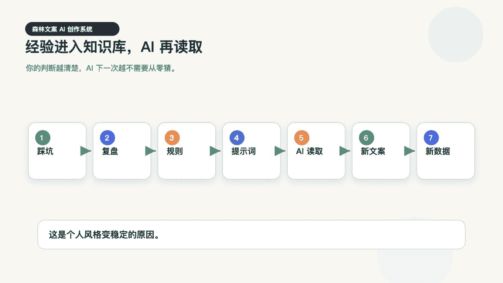

## 06 系统长什么样？它不是提示词，是生产线

退一步看，我这套 AI 二创系统本质上就是一条完整的生产线，跑起来大概是这个顺序：

爆款原文进系统 → AI 拆解 → 二创出稿 → 人工判断修改 → 定稿归档 → 账号分配 → 发稿复制台 → 各号发布 → 数据复盘 → 结论回写知识库。

这条链路听着有点长，但每一环都是冲着真实痛点去的，没有一环是摆设。

### 1. 爆款原文库：专治"输入找不到"

早先刷到好文案，我顶多截图、收藏、丢进🛰️。当时觉得都收好了，真到要用时翻破聊天记录也找不着，AI 更是碰都碰不到。后来我专门建了爆款原文库。

入库的每一条原文，除了正文，我还会顺手记下它的品类、带货产品、开场方式、转品路径、可能跑量的原因，以及适合从哪些角度下手做二创。输入这一关都守不住，后面全是空中楼阁。

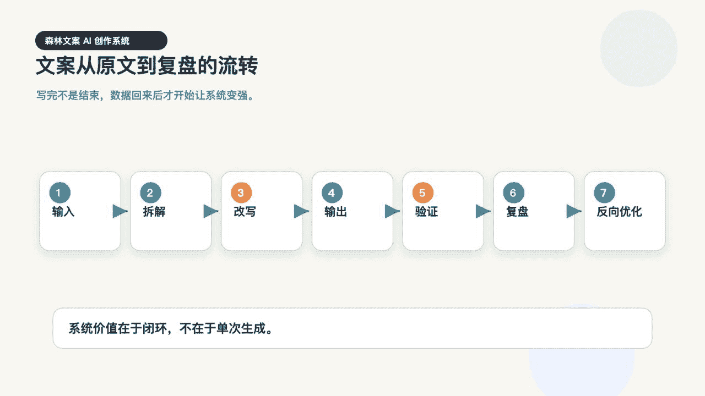

### 2. AI 拆解库：专治"不知道为啥火"

拆解和总结是两码事。总结只是告诉你这篇稿子说了什么，拆解则要回答它凭什么能跑出量。我一般会让 AI 从六个角度下手：

这篇文案真正想让观众相信什么？开场凭什么留住人？中段靠什么让人愿意听下去？产品为什么能顺理成章接上？哪些句子最金贵、删不得？哪些结构换个产品还能接着用？

只有拆到这个颗粒度，二创才配叫二创，才可能实现"保留有效骨架，替换具体表达和产品路径"，而不是换个皮就去洗稿。

### 3. 完成文案库：专治"产出不成资产"

所有能过审的稿子，我都会统一收进完成文案库。这个动作看似简单，却极其关键。因为只有定稿被集中归档了，Codex 才能读到当天最新完成的文案，替我做分发安排。

试想一下：今天的稿子躺在🛰️里、明天的稿子搁在桌面上、后天的稿子埋在某次聊天里，AI 就算想帮你，也不知道该去哪儿捞。很多人用 AI 做项目，问题恰恰出在这：不是没产出，是产出从来没变成资产。

### 4. 规则库和元素库：专治"下次不会用"

我后来又专门把开头、金句、转品、产品段、踩坑经验，拆成了规则和元素两类。但这里有个大坑必须提醒：元素库千万别做成素材垃圾桶，瞅见一句漂亮话就顺手一扔。没经过验证的东西，顶多算待定候选；只有真正跑出过成绩、或者我明确判断它值钱的表达，才配进库。比如某个开头跑出了量、某个转品让我觉得格外顺、某个产品段能让观众产生体感。这种时候，我才会让 AI 把它拆出来放进去。否则库只会越堆越臃肿，到最后净是些看着丰富、用着烫手的废料。

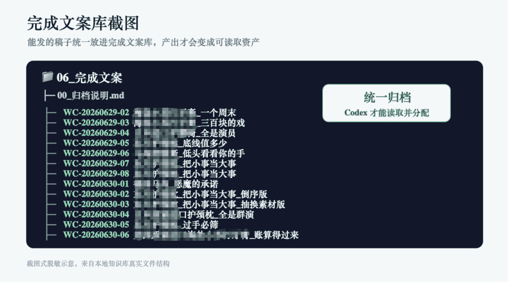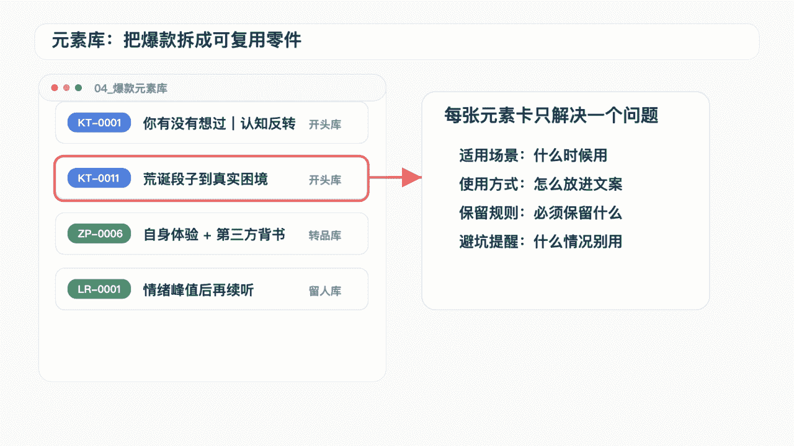

### 5. 账号分配系统：专治"不知道发给谁"

稿子写完，只是万里长征走完第一步。真正发布之前，还有个关键问题要拍板：这条稿子，到底扔给哪个账号？

早先我全凭直觉派活：哪个号这两天流量好就发哪个，哪个号用着顺手就发哪个。可等账号数量多起来，这招彻底失灵，光靠脑子根本记不过来。每个号的状态都不一样：有的刚爆过一轮、正处在权重窗口期；有的还在养号阶段，只能喂低风险内容；还有的天然适合试新脚本、测新方向。这些状态还在不断变化，所以我会让小V猫把最新的播放和订单数据抓回来，同步给 Codex 读取，再由它结合知识库里的账号规则给出分配建议，我来做最终把关。

说到底，这套系统最值钱的地方，从来不是那些工具本身，而是三句话：第一，别把 AI 当一次性代笔，要把经验沉淀成文件；第二，爆款必须拆到骨头里，才有资格换上新皮；第三，写稿、分发、复盘要连成一个环，数据才会反过来喂养内容。如果你现在也在用 AI 写文案，却总感觉每次对话都像从零开始，或者正被一条稿子发多号、相似度过高被限流折磨，那我建议你先从"把经验写成文件"这一步迈出去。那些我淌过的浑水，你本来可以不必再淌一遍。

账号运营里，最容易被忽略的，不是文案写得多快，而是每条内容究竟该交给谁。

有些账号适合承接核心内容，有些账号更适合承担试验任务；有的账号热度正在上升，成交却没有同步，有的账号销售能力不错，却不适合放置敏感度较高的稿件。尤其是刚出现爆款的账号，可能正处在一段短暂的流量红利期，越是这种时候，越不能随便安排内容。

所以，我会先让 Codex 综合账号池状态、最近数据、内容风险和商品属性，整理出一份投放建议。等我人工确认后，才继续执行。

后来我越来越确定一件事：**给账号选稿，本身就是内容创作的收尾环节。**同一份脚本，换一个账号承载，最终呈现和转化结果都可能截然不同。

配图*19*：账号分配表截图

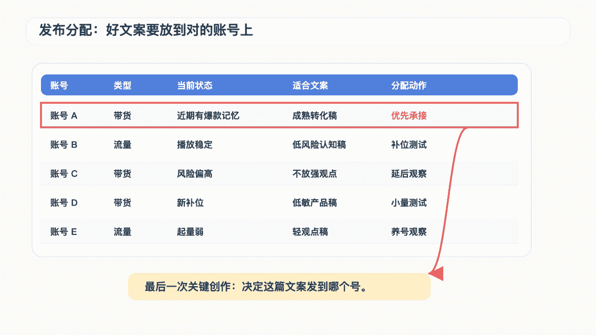

### 6. 发稿复制台：别让琐碎操作拖垮执行

真正发布时，往往不是难在策略，而是难在细节。标题、编号、正文、配音人员、发布账号，要在不同位置反复搬运。任何一次粘贴失误，都可能让整条内容卡在最后一步。

于是，我让 Codex 把当日待发布内容整理成一个本地 HTML 操作页面，集中处理所有发布信息。

页面里会显示：

1. 编号与标题的快捷复制入口。

2. 正文单独复制。

3. 标题和正文组合复制。

4. 配音人员对应关系。

5. 每条内容的投放账号。

6. 点击发布前的风险提示。

它不会直接带来订单，却能把大量低效操作压缩掉。很多项目真正耗损的地方，并不是方向错误，而是日复一日的重复动作、细节疏漏和人为失误。

配图*20*：发稿复制台截图

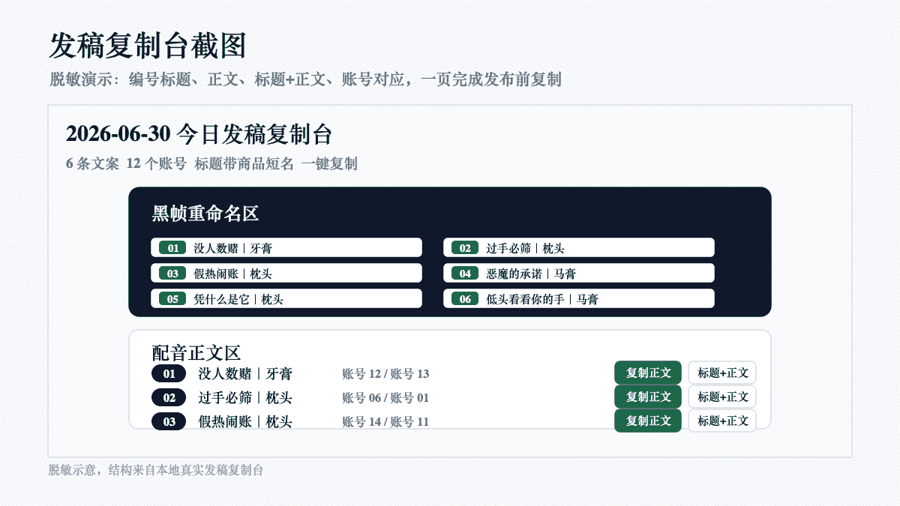

## 05 这套系统怎样改善文案：关键不在润色，而在取舍

过去我经常对 AI 说：“帮我优化一下开头。”后来发现，这种指令太模糊了。所谓“优化”，到底是更顺、更狠、更有冲突，还是更容易让人停留？没有标准，AI 只能凭感觉修饰。

它可能增加几个形容词，把语序调整得顺滑一些，或者习惯性补上一句“你有没有想过”。但短视频开场真正要解决的，是观众为什么愿意停下来，而不是句子是否漂亮。

因此，系统后来不再只负责改句子，而是先判断信息的价值。

### 1. 起手部分：删掉自我铺陈，把真正的矛盾亮出来

《逻辑哲学论：叫取消思考》这篇，最开始的开场类似这样：

> 昨晚翻来覆去睡不着，我突然琢磨一个挺有意思的悖论。咱们总说统一思想又要实事求是。这两句话搁一块逻辑上真的能自洽吗？

这段并非完全不可用，但它更像作者在记录自己的思绪。观众不会因为你昨夜失眠就留下，他们想知道的是：这件事和自己有什么关系？里面有没有值得追下去的矛盾？

重新拆开后，我发现真正具有冲击力的并不是失眠，也不是“突然想到一个悖论”，而是“统一思想”和“实事求是”这两个概念。

它们分别成立，可一旦并置，张力立刻出现：如果所有人的思想都被统一，事实还能不能保持原样？当事实与既定结论发生冲突时，究竟该调整判断，还是调整事实？

因此，开头改为：

> 统一思想，实事求是。这两句话你听了多少年，有没有认真想过，它们放在一起，方向根本是反的。

这一步不是单纯把语气变得更激烈，而是在识别素材里的有效信息：无关铺垫删掉，核心矛盾提前，能够引发思考的内容先亮相。

配图*21*：开头改写前后对比

### 2. 中间部分：不能一路平铺，要不断重新点燃兴趣

不少长内容开场不错，可讲到中间，留存便开始下滑。原因通常不是信息不足，而是叙述节奏像流水账：先讲第一件，再讲第二件，接着讲第三件，观众很快就疲惫了。

短视频用户不会像上课一样耐心坐到最后，手指随时可能向上滑。因此，长篇内容必须在中途再次制造继续观看的理由。

我后来把“中途续接注意力”写进了系统要求。

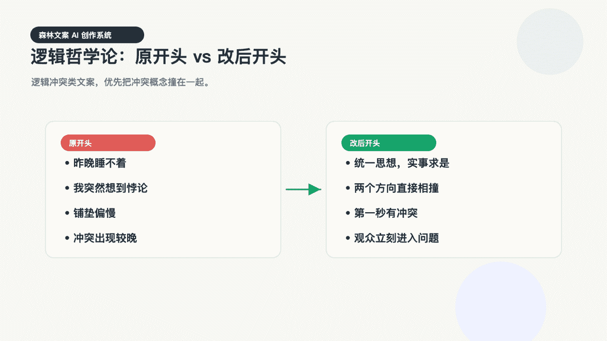

例如：

- 真正重要的部分，还没有出现。
- 后面那件事，才是整段内容的转折点。

这类句子不是为了故作神秘，而是给已经下降的注意力重新一个抓手。

同时，不能只靠一句提醒续命，素材排列也要重新设计：谁负责把人拉进来，谁负责建立可信度，谁负责把情绪推高，谁负责为商品出现做准备，都要提前安排。素材只是堆叠，不等于叙事成立；信息越多，越需要结构。

配图*22*：长文案中段留人结构图

### 3. 商品出现时：它应该顺着主题出现，而不是突然闯入

很多内容前面讲得很顺，可一到商品环节，用户马上察觉到销售意图，观看也随之中断。

问题通常不在商品本身，而在它没有承接前文。

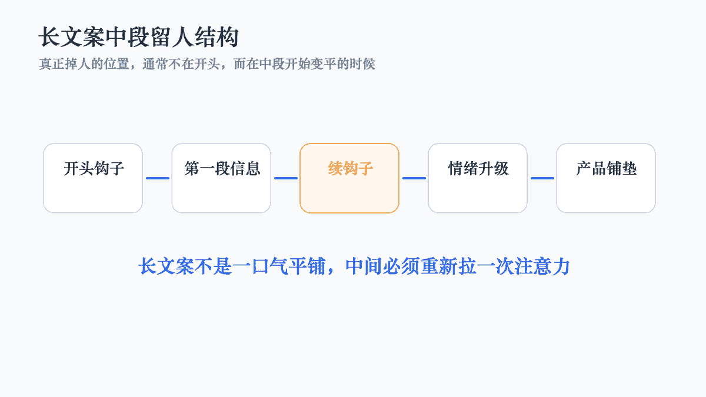

如果前面的故事与商品毫无精神联系，商品就像被临时塞进来的广告。

所以，我会重点检查一个问题：**商品与前文，是否共享同一条价值主线？**

前面谈的是严谨、标准和时间验证，后面的商品也应当继续体现这些关键词；前面说的是家庭中的责任，商品就要回到家庭场景；前面呈现的是普通人的困扰，商品也必须回应这类真实需要。

前文在谈一套逻辑，后面却突然换成另一套销售话术，观众自然会觉得突兀。

配图*23*：硬转品 vs 自然转品

### 4. 商品表达：让用户先感受到，再了解参数

商品段最常见的问题，是写成了产品说明。比如“德国进口”“品质可靠”“复购率高”“口碑不错”，这些信息不是完全没有价值，但它们无法让人立刻产生使用联想。

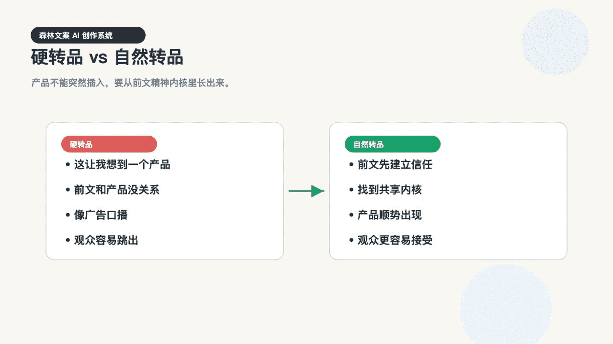

以德国马膏为例，与其只说产地和品质，不如这样描述：

> 刚涂开时是清凉感，过一阵，暖意从皮肤深处慢慢出来，像有人把绷紧的肌肉逐寸揉松。坐久了脖颈发僵，站久了双腿发沉，运动结束后身体紧绷，都能找到对应的使用时刻。

当描述落到身体感受，用户就能把自己代入进去：脖子是不是也常常僵硬？父母站久后会不会腿酸？锻炼结束后是不是需要放松？

这时，商品才不再只是一个抽象卖点，而变成了与生活有关的解决方案。

因此，我给系统设定的方向是：少罗列参数，多呈现感受；少堆砌优势，多交代场景；不要只告诉用户“它很好”，而要让用户知道自己什么时候会需要它。

配图*24*：说明书式产品段 vs 体感式产品段

## 06 这篇内容为何能带来成交

下面用德国马膏这篇做一次完整拆分。它的播放量并非最高，但销售表现很有代表性，因为整篇没有一上来就摆出广告姿态。

它的主线是：真正经得起认可的东西，不依靠别人替它背书，而是靠长期表现反复证明自己。GPS 如此，Linux 如此，阿司匹林如此，德国马膏也需要进入这条逻辑。

配图*25*：德国马膏文案信任链路

开头先借 Windows 的趣味片段把人吸引进来，但这还不够。随后，我把话题落到父亲手机上频繁弹出的广告：隔几分钟跳一次，关闭按钮小得几乎找不到，我研究了半天，最后只能卸载相关应用。

这一处很重要，因为它让抽象吐槽变成了多数人都可能遇到的家庭日常。用户会自然产生共鸣：“我家也经历过。”

中间再依次带出 GPS、Linux 和阿司匹林。之所以把阿司匹林放到最后，是因为它具备两层连接：它来自德国，同时代表着经得起岁月验证的产品。德国马膏可以顺着这条信任路径自然出现。

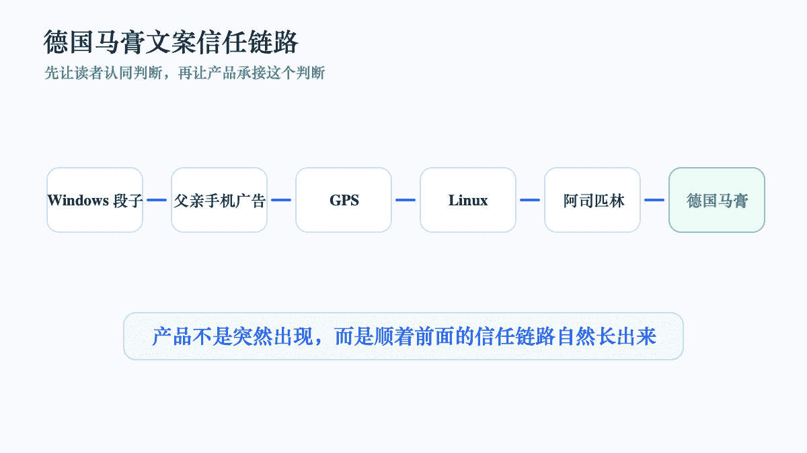

转商品时，我没有直接说“今天推荐一款德国马膏”，而是这样处理：

> 这套标准，没想到后来会在我自己身上得到验证。一个学体育的朋友拿来一罐东西，说不少德国运动员都在用。我最初并没有太在意，直到打开后抹到脖子上，才突然停了一下。

这里有三个作用：

- 体育专业背景的人物，提供了可信入口；
- “起初没太在意”，减轻了广告感；
- 使用后的意外反应，制造了体验上的落差。

最后再把霍夫曼和那种白色粉末联系起来，借用阿司匹林的历史信任，为德国马膏完成一次自然过渡。

所以，这篇内容的成交力并不来自某一句孤立的卖点，而是来自前面一路累积的认同感：开场让人停留，生活细节让人共鸣，历史案例让人相信，真实体验让商品落地。

这正是系统真正能帮忙的地方：不是替我改几个词，而是协助判断开场如何吸引人、叙事如何逐层推进、哪个案例最适合承担背书、商品如何自然进入，以及怎样把产品写成可感知的使用经验。

配图*26*：德国马膏高转化案例卡

## 07 内容跑出成绩后，怎样抓住后续机会

完成脚本只是前半程，选择投放账号同样重要。

我曾经遇到过这样的情况：《取消思考》发布后播放量超过4万，随后带动同一账号里一条原本只有1000多播放的旧视频，冲到了40多万。那时我才意识到，一个账号被某条内容激活后，可能会短暂进入更容易获得分发的阶段。

可以把它理解成账号状态被重新点亮了。

这种阶段不适合随意测试，下一条更应该选择稳妥、成熟、风险可控的内容。德国马膏也是类似的案例：6月4日发布的视频，到6月11日突然达到30.5万播放，我判断该账号正在获得额外权重。

于是，6月12日我没有安排高风险稿件，也没有继续押注未经验证的试验内容，而是投放了一条商品路径清楚、内容风险较低、具备成交潜力的德国马膏文案。最终，它获得了4.6万级播放，成交金额达到11,985。

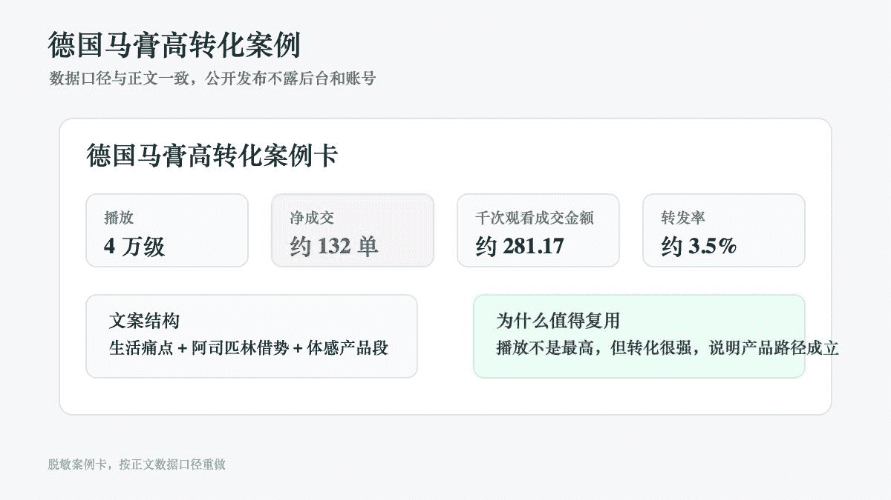

配图*27*：账号权重窗口示意图

我不能断言这一定是精准预测，平台分发永远存在偶然因素。但这个选择确实提升了成功概率。

更重要的是，我没有让这次结果停留在个人感觉上，而是把它沉淀成一条可执行规则：

**账号刚出现明显爆发后，通常会有一段短暂的状态窗口。处在这段窗口里时，后续内容应优先选择低风险、完成度高、转化链路清晰的稿件。**

下一次 Codex 参与账号安排时，就能读取这条规则。一次经验由此变成可复用的决策条件。

## 08 在我的运营体系里，Codex具体承担哪些工作

简单来说，Claude Code 更靠近内容生产，负责拆分素材、提炼开场、完成脚本和检查质量；Codex 更靠近运营后台，负责整理文件、调用已完成内容、读取账号信息、输出投放建议、生成发布页面，并把复盘结果补回规则库。

当我把账号数据交给 Codex，它会辅助识别：

- 哪些账号曾经有过爆发记录；
- 哪些账号播放一般但销售能力突出；
- 哪些账号更适合承接曝光；
- 哪些账号更适合承接成交；
- 哪些账号近期状态不稳，不适合放核心稿件。

接着，它还会把当天的内容分类：成熟成交稿、流量试验稿、风险偏高稿，或者商品承接路径已经比较清楚的稿件。两边信息合并后，再给出投放方案。

不过，我不会把所有环节完全交给自动化。需要判断的部分，先让 AI 提供分析，我来做最终决定；已经确认、重复性强的执行动作，再交给工具完成。

这也是我目前最重要的使用原则：**AI 不替人承担决策责任，它负责把已经验证过的方法，变成更稳定、更高效的执行流程。**

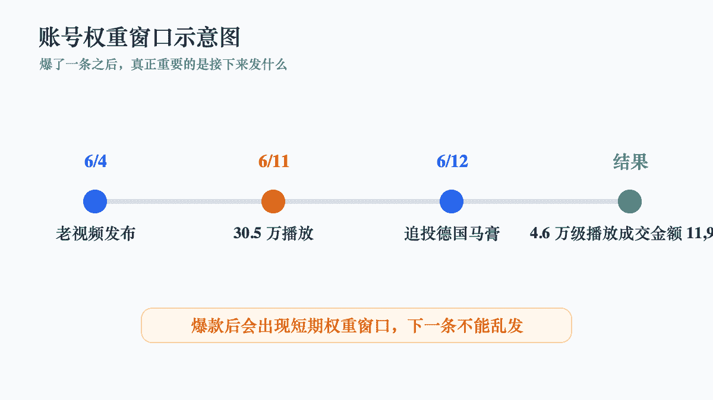

配图*28*：Claude Code 和 Codex 分工图

## 09 想搭自己的系统？从能跑起来开始

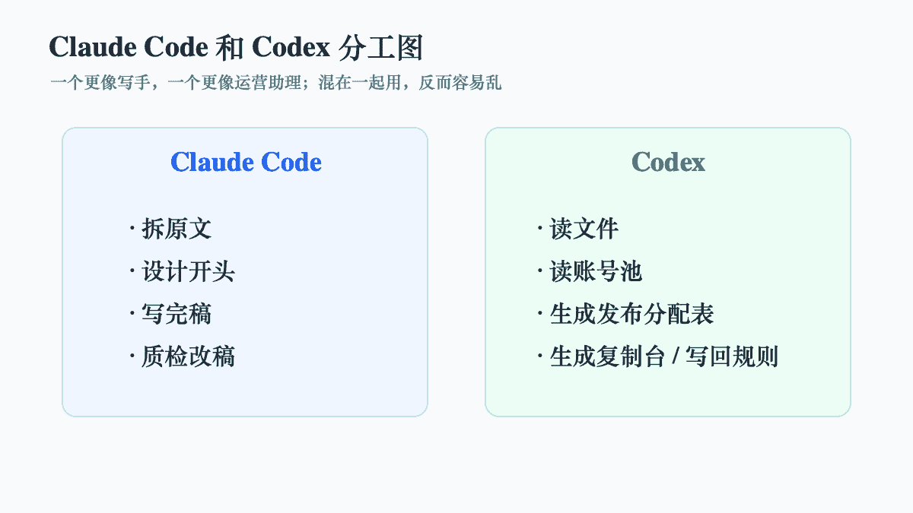

看到这里，有人可能会觉得配置太多：Obsidian、Claude Code、Codex、小 V 猫、账号池、发布面板，普通新手似乎很难一次性搭完。

其实我最开始也没有想过要做成现在这样。它是随着问题不断出现，再逐个补上的。

如果你准备尝试，建议先做一个足够简单、能够真正运行的版本。

先准备六个分类空间：

- 原文资料
- 已完成稿件
- 方法规则
- 可复用元素
- 数据复盘
- 账号信息

配图*29*：最小系统六个库

不用先花时间美化页面，先确保素材、成稿、规则和数据都有固定归处。

接着，只跑一条最小链路：

寻找参考内容 → 录入飞书 → Claude Code 分析 → 分阶段重写 → 人工把关 → 制作发布 → 结果回填。

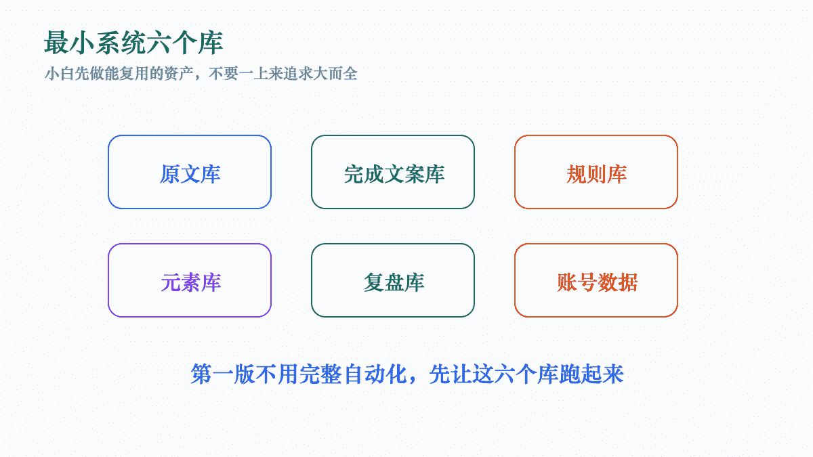

配图*30*：小白第一条最小闭环

具体的操作指令、AI 的返回形式，以及德国马膏这条案例如何从素材走到成稿，我已经在文末完整演示。照着走，不需要一开始就理解所有复杂配置。

当这条链路能够稳定运行后，再连续实践7天。连续操作一段时间，你会逐渐发现真正需要解决的问题：哪些开场总是无效？哪种表达更容易获得初始观看？什么类型的商品更容易成交？什么账号适合承接重点稿？哪些内容值得继续延展？

这些问题，就是系统下一轮升级的依据。

等基础流程稳定，再逐步接入账号安排、发布页面、数据采集、配音工具和飞书归档等自动化模块。

不要把“全自动”当作第一目标。先让 AI 替你省下一个具体环节的时间，确认有效后再扩展到下一个环节。系统从来不是一次搭成的，而是在真实项目中持续修补、逐渐长出来的。

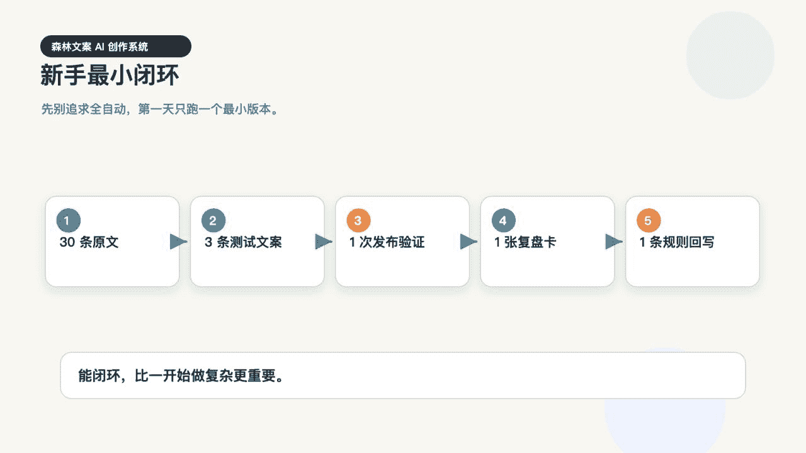

## 10 附：德国马膏案例，从素材到成稿的完整操作路径

前面讲的是思路，这一部分只讲执行。下面以德国马膏为例，把从打开电脑到完成成稿的过程完整走一遍。

### 准备环节：先搭好基础环境

需要的工具并不多：

- **VS Code**：统一操作界面。
- **Obsidian**：保存规则与素材，和项目放在同一个目录。
- **Claude Code、Codex**：安装在 VS Code 中，分别承担内容与流程工作。
- **飞书多维表格**：记录数据。
- 稳定的网络环境，以及 Claude 或 GPT Plus 会员。

安装完之后，尽量让主要动作都在 VS Code 内完成，减少来回切换。

配图31：VS Code 工作台截图

第0步：先做出属于自己的主控提示词

很多人以为提示词必须从别人那里复制，其实第一版完全可以从自己的历史对话中提炼。

打开你与 AI 长期沟通过的聊天窗口，先询问：

请回顾我们过去关于文案的讨论，归纳我最重视的结果、最反感的问题，以及我希望保持的表达风格。

AI 总结后，再继续追问：

请根据这些偏好，整理一份主控提示词，包含角色定位、创作原则、禁止事项、工作流程和检查标准。

这份结果就是起点，不必追求一次到位。随着项目数据增加，再不断修正。

我的主控提示词大致分为以下几部分：

### 主控提示词

## 角色定位

你是我的短视频商品文案共创助手，目标不是临时交稿，而是长期参与内容迭代。

优先保护原有情绪，其次升级观点，再重写表达，最后才处理字句顺滑度。

## 工作方式：分阶段推进

阶段一：分析素材并补充资料，不输出成稿。

阶段二：确定叙事结构并提交开场方案，不写完整正文。

阶段三：完成全文、质量检查和标题设计。

每个阶段结束后暂停，等待人工确认。

## 禁止事项

- 不允许只替换近义词。
- 不要把锋利观点改成没有力度的安全表达。
- 不要随意替换具有传播力的核心词。
- 先标出情绪支点，重写后如果支点减弱，就视为未通过。

## 总体原则

真正有用的不是原句，而是隐藏在原句背后的情绪结构、叙事规律和判断方法。

将它保存到 **Obsidian** 的 `01_核心规则/` 中，之后每次启动 Claude Code，都先读取这些规则。

配图32：主控提示词文件截图

接着，以德国马膏案例为例，按下面的顺序执行。

第1步：遇到参考内容，先记录，不要立即动笔

我看到一条讨论“有价值的东西为何能够免费”的热门内容，里面用了 Windows、GPS 和阿司匹林做例子。我的处理方式不是马上让 AI 改写，而是先把原文、商品、链接、播放数据和是否属于热门内容，录入飞书。

飞书用于管理项目结果，**Obsidian** 用于积累方法和能力，两者各司其职。

配图33：飞书对标收集表截图

第2步：在 VS Code 中启动 Claude Code，先分析参考稿

第一句不要直接说“帮我改”，而是让它先读取主控提示词：

开始新的内容任务，请先读取主控提示词。

读取完成后，再粘贴参考文本，并要求：

按照阶段一的规则，分析这篇内容。

这个阶段不写成稿，只处理以下问题：

阶段一：拆分与补充

1. 这篇内容真正想让用户接受的观点是什么？
2. 哪个信息点最可能让人停留？
3. 情绪峰值出现在什么位置？
4. 哪些表达承载着情绪，删除后会削弱内容？
5. 存在哪些逻辑漏洞或风险？
6. 是否能识别出同一主题下的其他变体，避免改写后撞稿？
7. 这篇素材是否值得进行完整重构？

德国马膏这篇最终提炼出的主旨是：有价值的东西要靠长期验证，而不是依靠外部保护。父亲反复被广告打扰的生活细节，则是必须保留的情绪入口。只有先完成分析，再动笔重构，才不会误伤最有价值的冲突。

配图34：Claude Code 第一步拆解输出截图

第3步：同步保存原始资料

在分析过程中，直接把参考内容写入 `02_爆款原文库/`。不要等成稿结束后再补录，否则很容易遗漏；聊天记录可能找不到，固定的资料库才能长期复用。

第4步：进入阶段二，确定结构并提交开场选项

接着发送：

进入阶段二，请读取阶段二的提示词。

此阶段只完成以下任务：

阶段二：结构与开场

1. 把原始结论提升为用户真正想说却没说出口的洞见。
2. 重新排列故事：谁负责开场，谁负责建立可信度，谁负责情绪升级，谁负责引出商品。
3. 列出保留项与调整项。
4. 设计商品承接：最后哪个案例最适合把信任带给商品。
5. 提供三个不同入口但保持同一核心的开头方案。

德国马膏这篇最关键的处理，是把原本的 Windows 趣事，落到父亲手机不断弹窗的生活场景：广告隔一阵就出现，关闭按钮小得难以点击，折腾许久后只能卸载。真实小事比抽象吐槽更容易让人产生代入。

商品承接也在这个阶段确定：让阿司匹林作为最后一个案例，因为它既有德国背景，又代表长期验证，能够顺势把信任过渡给德国马膏。

配图35：第二步三个开头对比截图

第5步：进入阶段三，完成正文并检查

选定开场方案后，发送：

进入阶段三，完成全文。

这一步会重新读取前两个阶段留下的情绪支点和结构承诺，然后继续完成：

阶段三：正文、检查与标题

- 把书面表达改成自然口语。
- 遵循“先出现人物，再带出商品”的承接方式。
- 商品部分优先呈现使用感受，而不是罗列参数。
- 检查开场力度、情绪支点、商品衔接、场景真实度等项目。
- 如果要投放多个账号，输出两个真正不同的版本，改变叙事入口和承接桥梁，而不是只替换几个词。
- 最后再设计标题。

德国马膏的商品承接可以这样写：

> 这套标准，没想到后来会在我自己身上得到验证。一个学体育的朋友拿来一罐东西，说不少德国运动员都在用。我最初并没有太在意，直到打开后抹到脖子上，才突然停了一下。

这段里，朋友的身份承担专业背书，“起初没太在意”降低销售痕迹，使用后的反应则形成体验转折。

商品部分继续落到感受：

> 刚涂开时是清凉感，过一阵，暖意从皮肤深处慢慢出来，像有人把绷紧的肌肉逐寸揉松。坐久了脖颈发僵，站久了双腿发沉，运动结束后身体紧绷。

配图36：第三步完稿和质检截图

第6步：人工审稿，确认后制作发布

AI 输出初稿后，由我进行最后判断和修改。确认内容没有问题，再把结果同步回飞书，制作视频并发布。

德国马膏这篇投放在曾经有过爆发、同时具备成交能力的账号上：播放约4万，成交132单，千次观看成交金额281元，转发率3.5%。它的播放量并非最高，但成交效率非常突出。

第7步：数据回来后复盘，并把结论补回知识库

真正值得复盘的，不是“爆了”这件事本身，而是它为什么能够完成成交。

我会把整条文案重新拆开，找到其中真正起作用的部分，再分别归档到对应的内容库里：

第一，开头提到“父亲广告软件”的内容，归入开头库。

同时补充一条规则：先用鲜明判断抓住注意力，紧接着必须接上一个与自己家人有关的真实经历，让观点不悬空。

第二，“学体育的朋友带来”这一段，归入转品库。

对应的写法是：在介绍产品时，先让一个可信、具体的人物出场，而不是一上来就由自己硬推产品。这样推荐会更自然，也更容易建立信任。

第三，产品使用感受“先凉后热”，归入产品描述规则。

第四，“最后一个案例要和产品同源”，则补充进第二步的提示词中。

很多人会省略这一步，但恰恰是这一步，决定了整个系统能不能持续变强。以后再次写马膏相关内容时，AI 不需要重新摸索，它会直接读取已经沉淀好的规则。

配图37：德国马膏复盘卡截图

这样，一条文案就完成了从“发现优秀样本”，到“提炼规律”，再到“写回自己的系统”的完整闭环。

第一次操作，可能要花上一两个小时。等流程跑熟之后，我现在处理一条内容，基本只需要15到20分钟。

## 11 最后想说

做 AI 短视频带货到第3个月，我最明显的变化，并不是掌握了某一个新工具，而是开始主动把自己的经验、判断以及工作流程，整理成一套可以不断复用的系统。

过去，我每天都被选题、写稿、发布和数据追着跑，很多事情只能靠时间和体力去堆。现在，我更像是在训练一条属于自己的 AI 文案生产线。

它当然还谈不上完美，许多环节仍然需要持续调整。但它已经能够帮助我稳定输出、降低失误、积累方法，并逐步推动收入增长。

对普通人而言，AI 真正有价值的地方，可能不是让你一夜之间变成专家，而是把你原本就会的东西，逐步整理、放大并系统化。

以前一个人做项目，往往什么都要亲自扛。现在，你可以把经验装进知识库，把创作交给 Claude Code 协作，把执行流程交给 Codex，把每次数据反馈重新写回复盘系统。

系统会在一次次使用中变得更懂你的判断，也更接近你的工作方式。

这就是我这3个月最大的收获：AI 并不只是替我写了几篇文案，它正在帮助我把一个人的短视频带货项目，升级成一套能够持续迭代、不断优化的生产系统。

如果你现在还停留在“让 AI 帮我写一篇文案”的阶段，我建议你今晚马上做一件事：

别再只把聊天记录收藏起来。新建一个文件夹，把今天生成的原始内容、最终稿、提炼出的规则以及复盘结果全部放进去。

系统，往往就是从这个动作开始成长的。

————分割线————

看完这套 SOP，很多人会产生一种“我已经懂了”的感觉。但真正开始执行时，90%的人都会在第一步停下来。

工具和教程，只能算是最基础的门槛。真正拉开差距的，是马上行动，以及你能否接触到同圈层里的最新信息。

这里不讨论空泛概念，只拆解真实商业闭环，研究如何把 AI 效率压到更高。圈子里已经沉淀了1000+个跑通的套利实战案例。

👉 查看圈子完整数字资产与入场门槛：

https://lazyso.com/insider/

添加时请备注：【实操上车】，不闲聊。