# 抖音情感口播自然流实战：从零起号到月入十万，普通人也能复制

大家好，我是金成，一名80后居家创业者。相比那些特别会表达、特别懂流量的人，我更像一个普通的实操派。进入这个圈子6年，我一直在一线测试不同项目。

之前分享过抖音AI女装玩法时，我也提到过，自己同时在做真人出镜口播。最近这段时间，我重点测试的是抖音情感口播自然流带货。今天就把这套玩法从项目逻辑、起号拍摄，到带货、直播和后续运营，完整拆开讲一遍。

这套模式对于普通人来说，入门并不复杂。真正需要突破的地方，只有一个：愿不愿意面对镜头，把内容自然地讲出来。

如果一个账号能够稳定做到每月1万元佣金，就说明从0到1已经跑通了。后面通过增加账号、提高产出、优化选品，做到更高收益，主要就是执行和运营问题。

## 一、先看实际结果

按照惯例，先放一下自己的数据。

这是6月1日到26日的线上结算数据，同时还包含一部分线下结算。本月累计佣金已经超过10万元。

所以，这次分享并不是纸上谈兵，而是可以直接拿去执行的一套流程。只要你愿意出镜、愿意持续更新，基本可以按照这个思路开始测试。

去年10月份，我曾经写过一篇关于抖音口播自然流带货的文章。当时发现部分身份证可以实名两个抖音账号，我误以为这是一种机会，结果后来发现是平台阶段性问题。

我当时用父亲的身份实名了两个账号，之后没办法正常开通橱窗。不过，带货并没有完全受到影响，可以通过个人简介挂其他账号，或者在直播时连麦到能够成交的账号。

现在回头看，如果当时就持续做口播，并且一直坚持到现在，很多人应该已经获得不错的结果了。

下面进入正题。

## 二、什么是情感口播带货？

简单来说，它是把故事、人物、商品和购买指令组合在一条视频里。

完整路径可以概括为：

**情感故事吸引目标人群＋人物设定建立信任＋商品自然出现＋引导用户购买**

具体流程是：

先通过一段正向、温暖、有情绪张力的故事吸引用户，主要面向中老年群体；接着把自己包装成故事中的某类人物，增加真实感和信任感；然后把商品融入故事后续；最后将用户引导到橱窗或直播间完成交易。

### 1. 常见的故事方向

可以从以下题材入手：

- 孝老爱亲
- 见义勇为
- 邻里互助
- 婆媳相处
- 关爱他人
- 爱心奉献
- 舍己救人
- 热心助人

这类内容的共同点是情绪明确、容易产生共鸣，而且非常适合中老年用户观看。

### 2. 人物身份怎么设计？

故事里的人物可以是：

- 懂事孝顺的子女
- 路见不平的普通人
- 经常帮助老人的热心人
- 关爱学生的老师
- 救死扶伤的医生
- 为别人付出而不求回报的普通人

不需要把人设设计得多么复杂，关键是让观众迅速理解你是谁、为什么值得相信。

### 3. 商品如何植入？

比如，视频可以这样设计：

一个人为了救落水者奋不顾身，虽然最后把人救了出来，但自己也因此呛水受寒。后来身体状态一直不好，晚上睡眠质量也很差。经过一段时间调理，他接触到一款助眠香膏，使用后睡眠逐步改善。

最后再顺势说：

“如果你或者家里人也经常晚上睡不好，可以试试看，我已经放到名字下方的橱窗里了，也可以到直播间了解。”

这就是完整的情感口播带货结构。

### 4. 为什么很多人刷不到这类内容？

因为抖音会根据用户的观看行为和兴趣标签进行分发。

情感口播内容通常是专门推给50岁以上银发用户的。年轻用户、没有相关浏览习惯的人，日常刷到的概率并不高。因此，很多人第一次听说这种模式时，会感觉陌生；但在目标人群的推荐流里，这类内容其实非常常见。

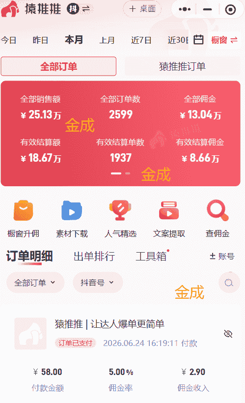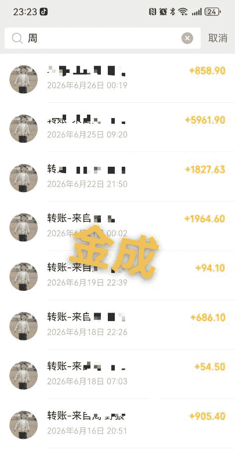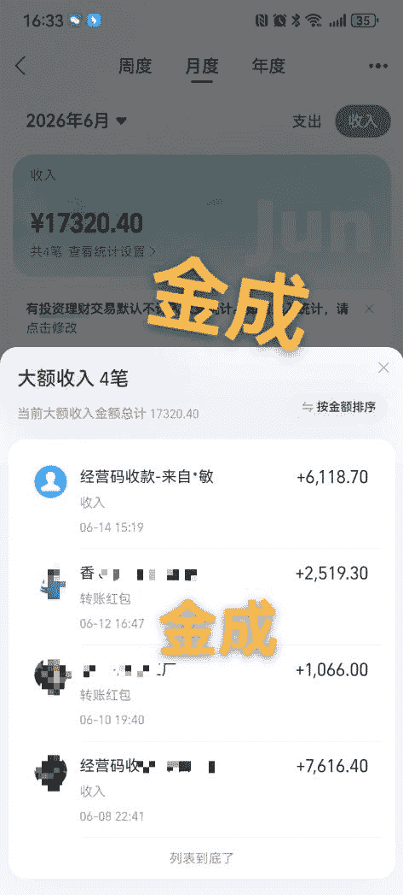

## 三、普通人怎么开始？

情感口播最大的优势，是适配商品范围很广。

只要产品对应的是中老年用户需求，就可以尝试用这种内容方式进行推广。

目前常见的高佣商品，佣金比例大多在50%以上，部分商品能够达到70%左右。商品价格一般集中在29.9元到99元之间，也有更高客单价的产品。

例如：

- 日常护理：黄芪霜
- 调味食品：各种调料汁
- 家庭清洁：爆氧粉
- 养生食品：韭菜枸杞子、黄芪党参豆浆粉、黄精五黑粉
- 口腔护理：青盐炮附子刷牙粉

下面讲具体执行方法。

## 四、拍摄前需要准备什么？

### 1. 一部手机

建议使用苹果手机。我目前用的是苹果12 Pro，已经使用了4年，拍摄完全够用。

不必一开始就购买昂贵设备，先把内容做起来更重要。

### 2. 一个手机支架

网上几十元就可以买到。选择可以伸缩、能够手持的款式即可。

在家里、户外、车内，都能使用。

### 3. 剪映提词器

可以开通剪映会员，使用提词器完成拍摄。

我的操作方式是：先用手机拍摄，再把文件传到电脑剪辑，最后通过数据线导回手机发布。

这些准备完成后，就可以开始拍第一条视频了。

## 五、如何快速完成起号？

起号不需要复杂操作，核心就是：

**找到合适的文案，照着表达，完成剪辑，然后持续发布。**

### 1. 文案去哪里找？

直接在抖音搜索相关关键词，例如：

- 孝顺
- 婆媳
- 邻里关系
- 助人为乐
- 善良
- 热心
- 情感故事

优先挑选最近一个月内点赞超过1万的内容，作为前期参考和起号素材。

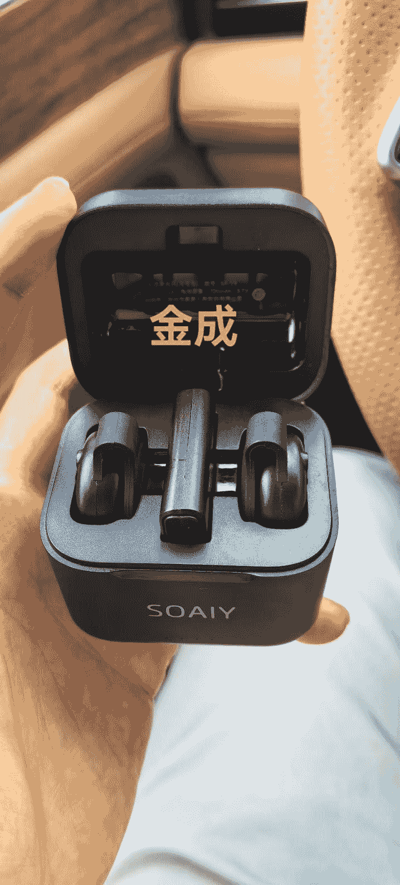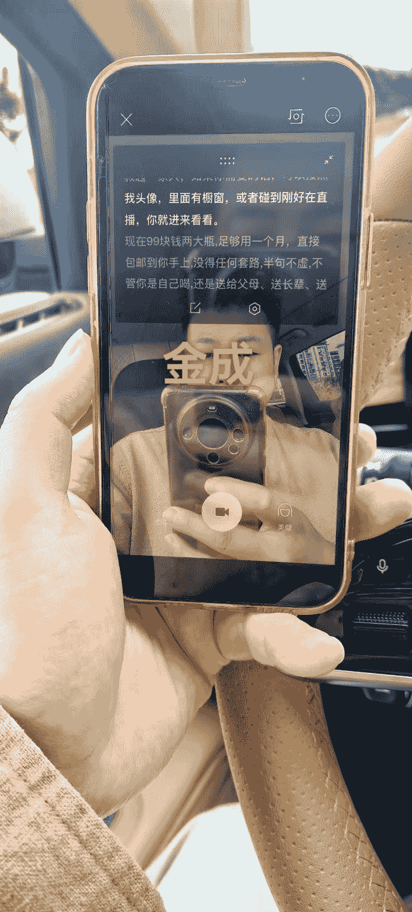

经过测试，只要你的表达能力不是特别差，通常发布到第10条左右，就有机会出现明显起量的作品。

这里说的“起量”，大致是点赞破万、播放超过40万。达到这个阶段，就可以尝试开始带货。

有一个账号可以给新手参考，里面整理了很多情感类流量文案，而且没有明显广告内容。大家可以自行提取、重新表达后再拍摄。

抖音号：小亮牙不齐。

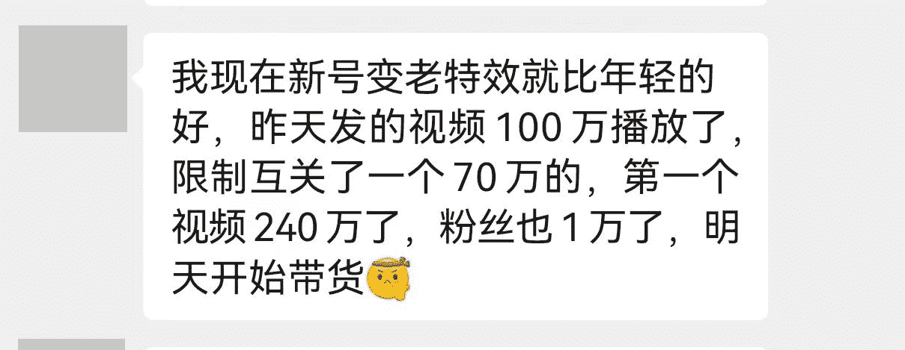

## 六、口播怎么拍才自然？

口播其实是最容易上手的视频形式。

只要是拿着手机讲内容，都可以归类为口播。你可以边走边拍，也可以坐着、站着，甚至躺着拍。不要一开始就追求特别完美，先完成第一条视频，比长期准备更重要。

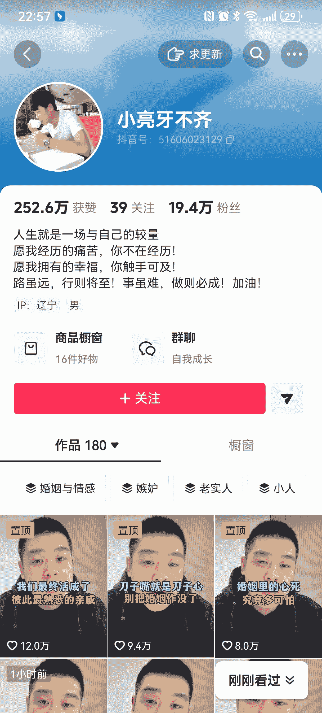

### 拍摄角度建议

可以尝试以下几种方式：

- 正面对着镜头讲话
- 身体和镜头保持45度角
- 讲话时偶尔看向镜头
- 镜头与眼睛基本平行
- 镜头略高于下巴，形成轻微俯视效果

略微俯视的角度，会让画面有一种面对面交流的感觉，也更容易通过眼神传递情绪。

具体采用哪种方式，要靠自己多拍、多看回放，找到最舒服、最自然的表达状态。

背景也不要过度布置，真实的生活环境反而更容易增强可信度。

## 七、什么时候开始带货？

当一条视频播放达到40万左右时，账号粉丝通常也会增长到2000上下，甚至更多。这个时候就可以正式尝试带货。

### 1. 先确定商品

比如近期比较热门的黄精五黑粉。

确定商品后，在抖音搜索商品名称，重点观察同行的爆款视频以及正在直播的账号。

优先寻找最近7天内出现的爆款，尤其是连续两三天仍然有增长的内容，参考价值更高。

复制相关视频链接后，可以用小程序提取文案。我个人使用的是共营助手，开通会员后会方便很多。

提取出来的内容不能原封不动照搬，需要逐句改成自己的表达方式，最好进一步加入本地方言和个人语气。

与此同时，要完成以下操作：

- 开通达人带货资格
- 将商品添加到橱窗
- 发布视频时挂上对应商品
- 在文案或口播中自然引导用户购买

整个流程和起号时找文案、拍视频的步骤基本一致，最大的区别是需要把内容改成商品相关的销售表达。

现在方言版内容通常更容易形成差异化，所以建议大家尽可能使用自己的原声，并加入自然的方言表达。

当视频获得流量后，用户会按照你的引导进入橱窗下单。你也可以绑定抖老板、猿推推等工具，方便及时查看订单提醒。

### 2. 及时维护评论区

评论区不能放任不管。

如果有人询问“怎么买”“在哪里下单”，要尽快回复并进行引导。如果出现明显影响成交的恶意或负面评论，也要及时处理。

评论区的互动，有时会直接影响用户是否下单。

### 3. 发布频率怎么安排？

每天至少更新一条。

如果视频发布24小时后数据一般，比如播放还没有超过1000，可以继续观察。部分内容并不是立刻爆发，我就遇到过发布3到5天后才慢慢增长，最后播放达到百万的情况。

如果持续观察后仍然没有起色，可以重新拍一次。第二次依然没有结果，就更换文案。

同一个商品，通常会有多套爆款表达。以黄精五黑粉为例，类似的高数据文案至少有十套以上。不要只盯着一条反复纠结，持续测试，直到找到适合自己的版本。

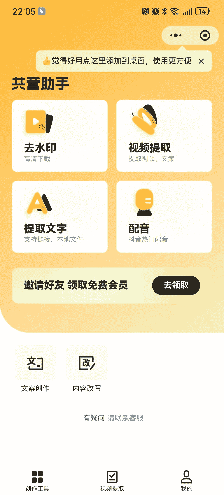

## 八、出单后如何承接流量？

### 1. 流量较慢，但已经开始出单

这种情况下，不必急着开直播。

先把评论区维护好，让用户自然进入橱窗成交即可。

### 2. 流量突然快速增长

如果视频流量来得很快，可以直接开直播承接。直播的转化效率通常会更高。

但直播时一定要注意合规，不能随意使用涉及医疗效果、疾病治疗、夸大功效等表达，否则很容易违规。

### 3. 没有样品怎么办？

以黄精五黑粉为例，它冲泡之后颜色偏黑。

前期没有实物时，可以用黑芝麻糊兑水做出类似展示效果，再把商品图片打印出来贴在背景处，先完成简单的视觉展示。同时，尽快联系商家申请样品。

### 4. 想直播但流量不稳定怎么办？

可以尝试挂播。

等样品到手后，准备一个转盘，把产品放在转盘上，再用纸张写上几个简单关键词，引导用户自行进入橱窗购买。

直播间可以播放背景音乐，这种方式就是常见的挂播。具体布置方式，也可以参考同行的挂播直播间。

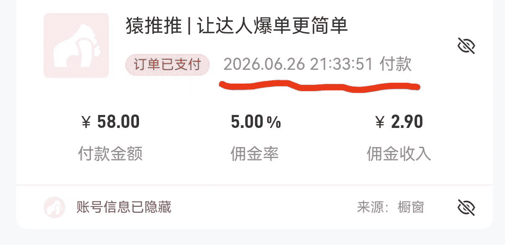

### 5. 佣金如何结算？

通常有两类结算方式。

**线上结算：**  
平台按照规定的结算周期，将佣金自动打入账户，之后由自己提现。

**线下结算：**  
当你和商家形成长期合作后，部分商家会提前支付一部分佣金。比较常见的是隔天结算95%，打到🛰️或支付宝，剩余部分再走平台结算。

线下结算的佣金比例可能略低，但到账速度更快。具体采用哪种方式，可以根据自己的资金需求和合作情况决定。

到这里，从拍摄、剪辑、发布、带货、出单，再到直播承接，整个闭环基本已经跑通。

接下来决定收益上限的，就是运营能力。

## 九、如何通过运营提高收益？

### 1. 适当增加账号

如果时间和精力允许，可以尝试做多个账号，通过矩阵方式放大结果。

比如：

- 一个账号使用变老特效
- 一个账号使用自己的年轻形象
- 之后再分别增加不同账号

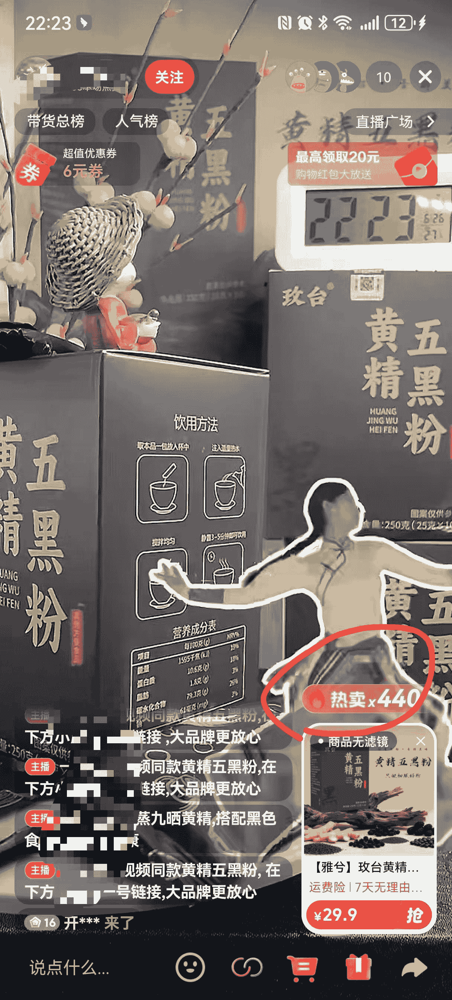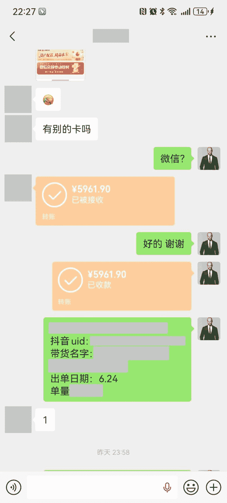

不过有一点必须注意：

同一套文案、同一个人物形象，不要同时发布到两个账号上。这样容易造成内容同质化，影响账号权重，前期积累也可能因此浪费。

### 2. 多账号可以降低风险

爆款本身是概率事件，违规同样是概率事件。

一个账号出现违规后，可能被限流、扣健康分，严重时还可能面临处罚。如果只有一个账号，收入很容易受到影响。

因此，在精力允许的情况下，至少维护两个账号，整体收益会更加稳定。

## 十、我的两个账号实战情况

这次超过10万元的佣金，主要来自两个账号。

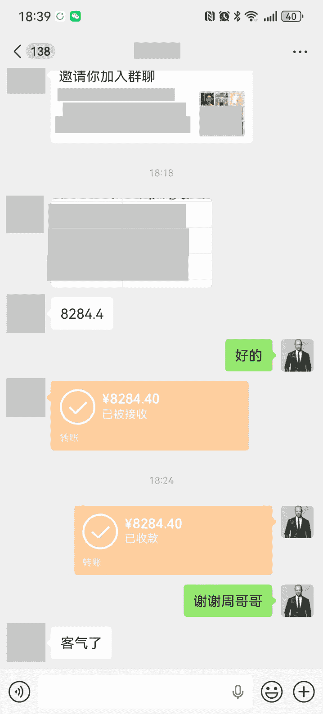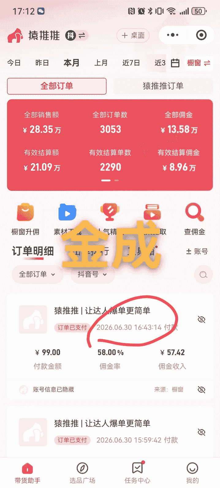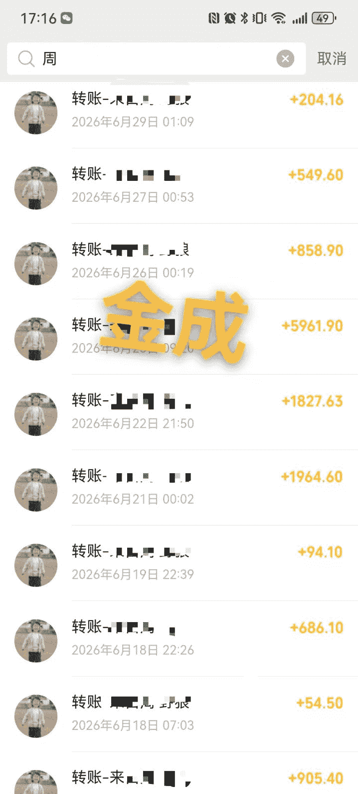

两个账号推广的商品不同，具体品类这里不展开。

先说第一个账号。

这是一个老账号，平时播放量只有几千，但一直保持更新，累计发布超过150条。后来其中一条视频播放接近300万，最终带来约5万元GMV，佣金比例达到58%。

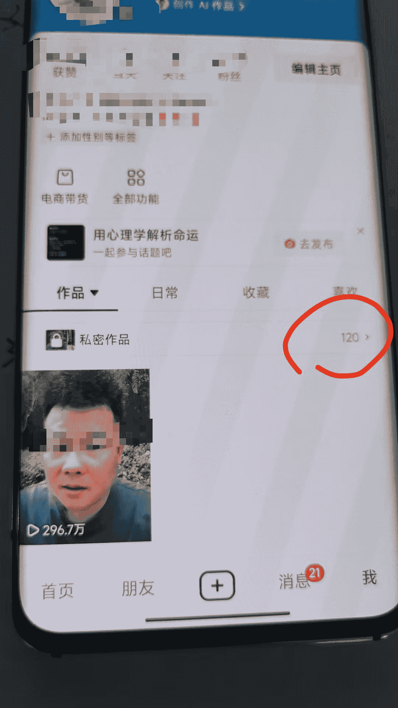

我个人有一个习惯：超过3天没有继续增长、播放又没有过万的作品，会直接隐藏。

这只是个人操作习惯，并不代表一定要这样做。很多创作者只会保留数据好的作品，我会把长期不动的内容一起隐藏，所以大家看到主页时，可能只剩一条或少量作品。

不要因此误以为别人“一拍就爆”。

你看到的是最终留下来的结果，看不到前面已经拍过的一百多条内容。爆款往往不是运气突然降临，而是大量持续输出之后，某一条刚好被推起来。

先把稳定生产内容的能力练出来，才有机会等到流量机会。

第二个账号推广的是另一款商品，同样采用单品集中测试的方式。这个账号也隐藏过100多条内容，其余大部分GMV都来自这个账号。

当天刚发布的新作品，刚开始可能只有1000播放，晚上涨到4000，第二天还会继续增长。真正跑起来的视频，一天出几十单、上百单都可能，单日佣金几千甚至上万。

如果没有出现大爆款，每天稳定出十几单、二十单，也足以维持基本收益。

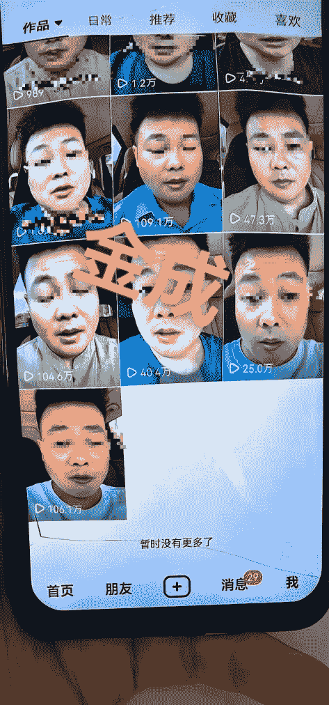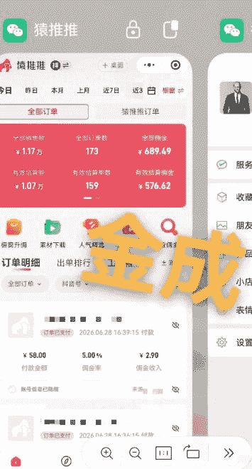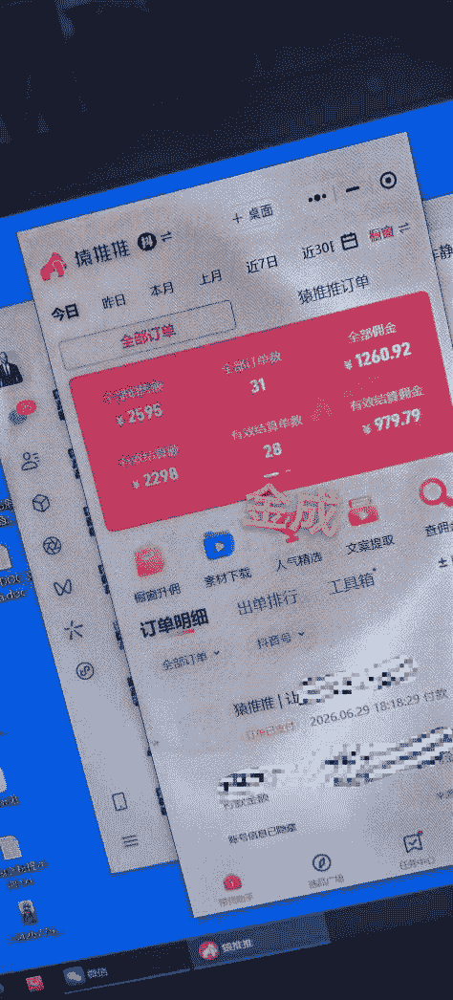

所以，这个项目现阶段的运营重点并不神秘：

**每天稳定产出，把每一条视频做好，然后持续等待机会。**

只要账号发布的作品大多能够超过1000播放，就说明基础状态不错。后面要做的，就是继续保持更新。

## 十一、爆款的核心是什么？

情感口播真正传递的，不是复杂技巧，而是情绪。

如果你能够把5分钟内容讲得有感染力，那么以后面对10分钟内容，也不会觉得困难。

表达能力是基础，持续更新是放大器。

**基本能力＋持续坚持＝爆单机会**

这类项目很像一个流量池。只要你持续把内容投进去，早晚会有作品被推上来。

## 十二、数字人口播能不能做？

现在也有人使用数字人形象批量制作口播视频。

这种方式适合小型工作室进行规模化测试，可以用多个账号发布内容，再将流量统一导入某个账号直播成交。

不过，数字人相较于真人出镜，更容易出现同质化和违规问题，整体稳定性不如真人原声口播。

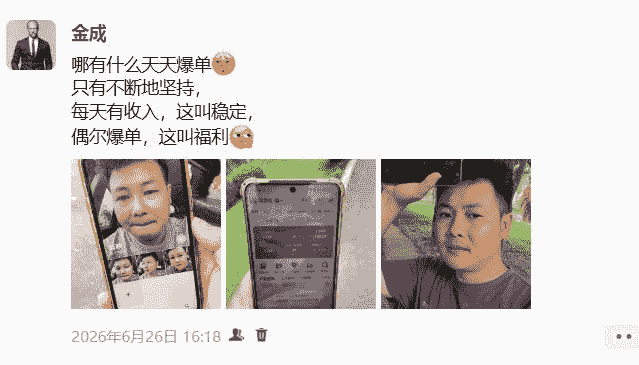

## 十三、常见问题解答

### 1. 哪些人适合做情感口播？

只要能够正常出镜、说话没有明显障碍，男女都可以尝试。

如果从年龄和经历来看，我更推荐70后、80后参与。因为这类人通常有更多生活经历，对亲情、邻里、家庭关系等内容更容易产生共情，表达出来也更有真实感。

当然，年轻人同样能做。我团队里也有00后在操作，数据并不差，只是他们更适合选择年轻化的情感题材。

### 2. 这种玩法会不会违规？能做多长时间？

违规是存在的，但更多属于概率问题。目前整体违规比例并不算特别高。

有些人不敢使用自己的声音，选择软件配音，这样一方面容易与别人高度相似，另一方面也更容易被系统判定为低质或重复内容。

因此，更建议使用自己的原声，最好加入自然的地方口音。

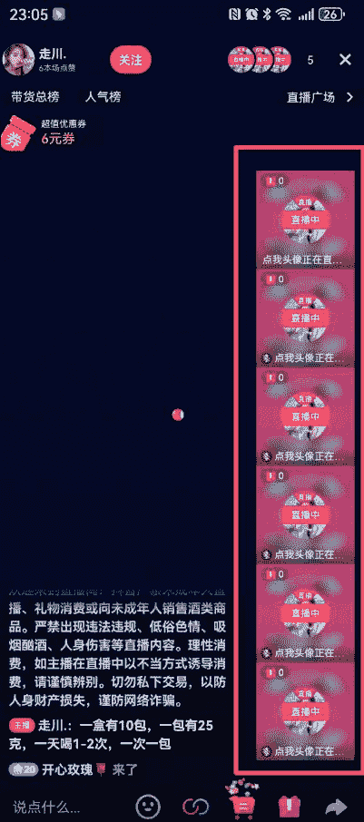

带货时，养生类商品通常佣金较高，但表达时尤其要谨慎。

不能随意宣传治疗疾病、替代药物，也不能使用夸张的功效描述。涉及中药、保健、医疗效果的词汇，都需要主动规避。

至于项目可以持续多久，我的理解是：

具体玩法会随着平台规则不断变化，但真人口播这种表达方式不会消失。

只要平台还存在，就会有人通过视频讲话、分享观点、建立信任。未来某个具体模式可能进入衰退期，但新的商品、新的内容方向还会不断出现。

掌握出镜表达、内容制作和用户沟通这些基础能力，即使以后换项目，也可以快速迁移。

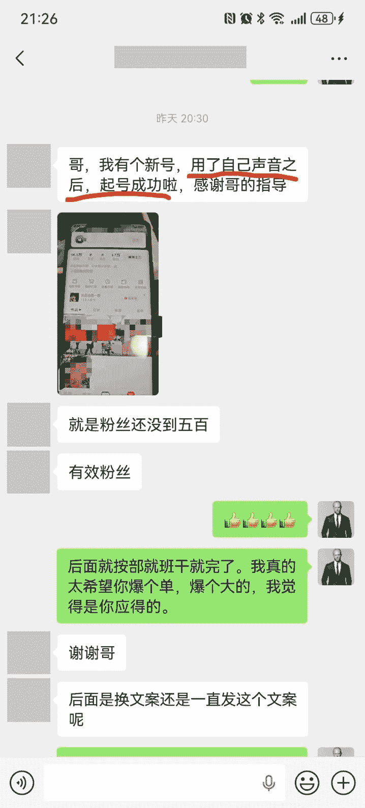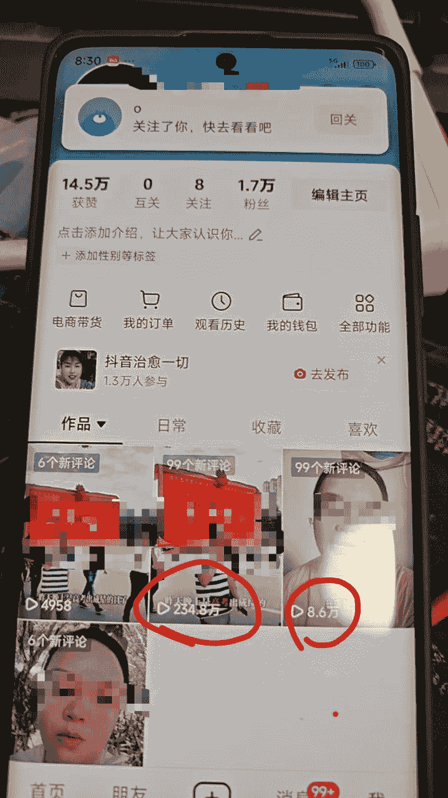

### 3. 视频一直没有播放量怎么办？

首先，不要只发几条就下结论。

有些作品当天表现一般，后面可能持续增长；有些内容即使最终没有爆，也能帮助账号积累标签。

可以从以下几个方向排查：

- 文案是否缺少情绪冲突
- 开头是否足够吸引人
- 表达是否过于平淡
- 画面和声音是否清晰
- 是否使用了过于大众化的普通话表达
- 是否坚持了足够的更新频率
- 是否选择了目标用户真正关心的题材

如果同一条文案重复拍摄后仍然没有起色，就换新的内容继续测试。

不要把一次失败等同于账号失败，也不要因为几条视频没爆就停止。这个项目的本质，就是持续拍摄、持续优化、持续等待下一次流量机会。

做内容起量的判断标准，每个人心里刻度都不一样。

我自己的理解是：真正没起量的账号有什么特征？不管你发什么，播放一直卡在五百以内动不了。碰到这种状况，先别急着换号，回头审视下作品本身够不够及格。基础分达标了，还是死活五百以下，那基本就是账号问题，直接换。

反过来，如果账号的基础流量稳定在两三千，偶尔还能冲到四五千，说明号是健康的，这时候别乱改。你就稳住现在的拍法和调性，把它跑下去，靠时间累积复利。

至于怎么去优化，角度、光线、画面质感、字幕呈现、情绪拿捏，这些细节都是可以打磨的空间。

同行永远是最好的老师。最近一直有在爆的那个人，把他锁定下来研究：他最近在讲什么内容？文案怎么写的？镜头怎么安排的？我和他之间差在哪？就用他当作标杆，争取把拍摄水准拉到跟他同一个水平。剩下的就是运气和坚持的问题了，干就完了。

**4. 上了带货后感觉流量变差了？新手踩坑3**

这是个很典型的错觉。就拿之前单纯做内容，单条四十万播放来起号来说，一旦切到带货文案，播放掉到几千，很多朋友就会觉得心理落差很大。

这是正常的现象，别慌。记住一个核心判断：不管是纯内容还是带货，只要24小时播放破千，这个号就是健康的。你要做的只有一件事，坚持日更，保证稳定输出。

**5. 新人拍摄剪辑常遇到的问题 新手踩坑4**

1. 这种口播视频本质上就是一镜到底。拍摄时难免有停顿，黄金一秒一定要剪干净，开口就要有声音，前面的卡顿、停顿全部切掉。

2. 现场口误是常态，不用纠结。心里默数1-2-3-4-5，停顿五秒，这个空档方便剪辑时快速定位，大大提高效率。

3. 剪映的提词器一次最多承接五千字。超过了就拆成两段文案，分两次拍再合成。最后用720P导出完全够用，视频又长又大，文案半小时以上的，整段读完电脑很容易卡死。

### 6. 关于货源供应链

那些头部爆款单品，供应链早就是固定的了，就那几家在做，直接找过去对接就行。很多厂家支持线下结算。实在找不到靠谱渠道的也可以找我帮忙牵线。

### 7. 账号实名与变现问题

抖音一人只能实名一个号。要多开就得找亲戚朋友帮忙实名，钱会打到对方银行卡上。所以实际操作中，我们一般会走线下供应链结算，把大头资金转到🛰️或支付宝，少量资金走对方银行卡，方便操作。

人心难测，尽量减少这种依赖。赚钱的事自己心里有数就好，别到处宣扬，尤其是赚大钱的时候别让人知道。

### 8. 能否多平台同步发？

可以同步，但主战场一定要是抖音。视频号的审核比抖音更严，文案查重也更狠，可能刚发出来几个小时就被限流了。能吃到一波流量就吃，转化有时候比抖音更快更猛，爆发力很强，但也来得快去得快，动不动就封7天、30天。

所以同步只是捡漏，有账号就发，没账号发一下也行，不用强求。快手也可以同步，但假流量很多，播放几千点赞只有一两个，评论都是无关的，这就是虚的。你只做同步，能出单就挂上，不用过多干预。

核心还是抖音为主。另外提醒一下，我们的视频时长比较长，十几分钟到二三十分钟，甚至三十分钟，文件体积很大，上传很费时间。所以不一定有精力同步到快手或视频号，我之前同步过效果也不好，账号也不够，也就没做了。

### 9. 一定要用方言

最近方言赛道很猛，尽量别用普通话了。四川话、河南话、粤语现在变现非常好。很多方言全国都能听懂，而且不容易踩违规红线，有地域首发优势，外溢后转化率很高。

## 关于新人镜头恐惧

这个话题我琢磨了两天，觉得必须写清楚，因为我就是这么走过来的。希望能帮到更多朋友跨过这道坎。

我是80后，在农村长大。小时候拍照都爱看别处，不敢直视别人眼睛。稍微漂亮点的姑娘看我一眼，我就脸红。身边有那种爱出头的同学，我既羡慕又嫉妒，甚至有点厌恶。羡慕他能自然洒脱，厌恶他风光无限。

到现在快40了，我还是社恐。人多的场合我会躲角落，怕被人发现。每次线下交流会，我都坐后排，从没坐过前三排。给孩子开家长会也是。

这不是我的错，是从小环境养成的谨小慎微和胆怯。我会说话，会表达，只是没熟练前，我潜意识里不愿意站在聚光灯下，会逃避会恐惧。

24年我第一次尝试口播出镜。第一条视频拍完，看着镜头里的自己，感觉蚂蚁在爬，极其不自在，眼神乱飘、表情僵硬，尴尬得不行。

但我还是发了。没爆，但流量正常，有点赞有收藏有评论。那一刻我才明白，我的难受全是我自己主观感受，观众根本不在意那些细节。我们看别人，也就如别人看我们一样。

从那以后我慢慢放开了。只要自己不尴尬，尴尬的就是别人。一直坚持到现在，口播视频拍了不知道多少条，说拍就拍。

想出镜的朋友，第一动机是赚钱，第二动机是突破自己。试一次你就会发现，原来自己没想象中那么重要，没人在意你镜头里的样子，数据会告诉你真相。

试一次你也会发现，原来自己也能像别人那样侃侃而谈，真诚表达，数据会证明。

第一次出镜或许没太大感觉，但这是一次勇敢的突破。平台上出镜口播的人太多，不只是带货。坚持下去，会给你未来一份满意的答案。

龙哥说的表达者红利，我很早就记住了。所以这些年我一直在多表达。每一次输出都是对自己的梳理。虽然还不够好，但回看五年前，我已经超越太多。

这么多年待在龙哥盟，觉得温暖也有归属感。到中年的年纪，思考变多，更关注内心真实感受。想回馈知遇之恩，唯一会的就是真诚分享项目。如果能启发后来者，也算是功德一件。

最后必须强调心态。

真人出镜口播带货，是普通人门槛最低的赚钱方式。

暂时没流量，是在打磨作品和累积数据。

暂时没爆单，也是有稳定收入的。哪怕每天花两小时拍剪一条，一天出十单八单也有几百佣金，积水成渊。

一旦爆单，就是生活对你的奖励。互联网最迷人的就是不确定性，只要坚持，不会饿死。爆单一天几百上千单，一次就能顶几个月甚至半年的收入。

用这种心态做事，结果会远超预期。

我现在每天雷打不动至少更三条。坚持不下桌，早晚轮到你。这是我做短视频多年最值钱的经验。

### 结语

以上很多收益截图，发出来不是为了诱惑，只是真实数据分享，还请勿误解。

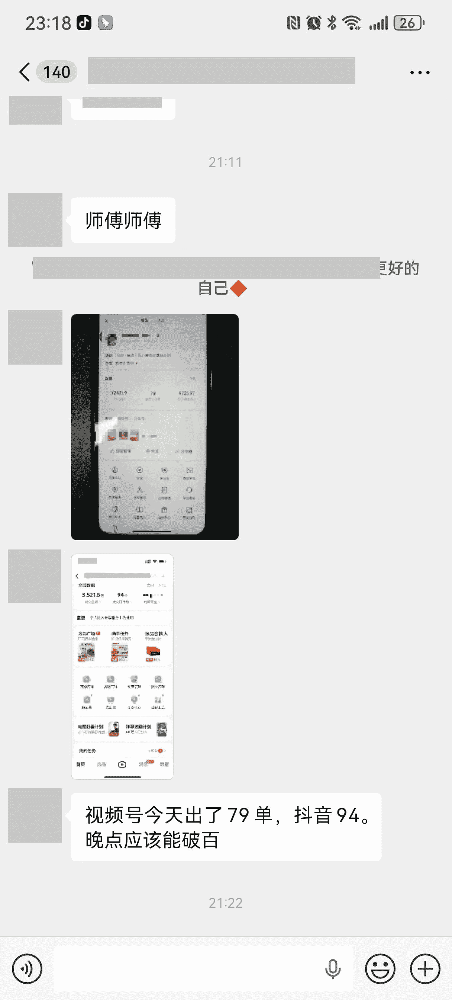

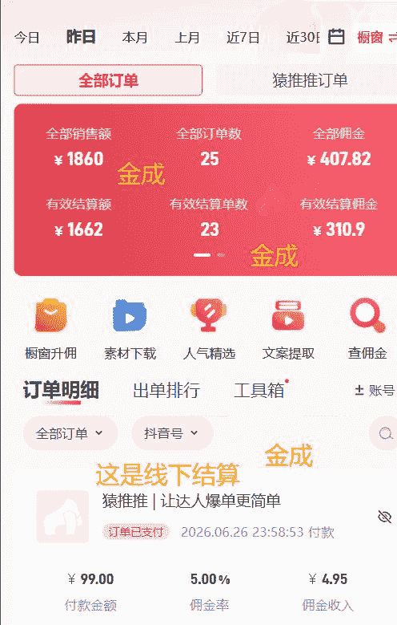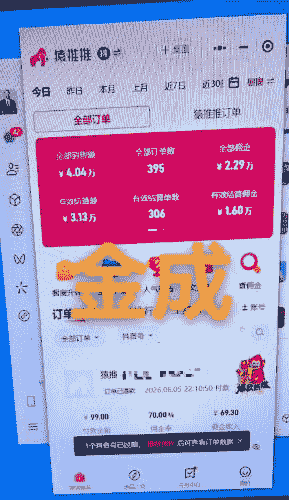

AI到处都是的时代，更要重视真人口播。

各大头部IP都是口播，金枪大叔、江湖说等等……只要平台还在，张嘴就能做。离普通人最近的就是出镜口播带货。能出镜的朋友，一定要试试，坚持下去，绝对不虚此行。

————分割线————

看完这篇SOP，你可能觉得懂了，但90%的人实操第一步就会卡住。

工具和教程是最底层的壁垒，真正的壁垒是立刻开干和圈层信息差。

如果你想看全网最新的变现打法，并且和一群执行力很强的极客一起下场拿结果，欢迎来围观我的核心私域：【懒人专属群】。

我们不聊虚的，只拆商业闭环和压榨AI效率。池子里已经沉淀了1000+跑通的套利实战局。

👉 查看圈子完整数字资产与上车门槛：
https://lazyso.com/insider/

认同价值、准备好下场的，扫码加我🛰️ lazyhelper1
备注：【实操上车】，不闲聊

