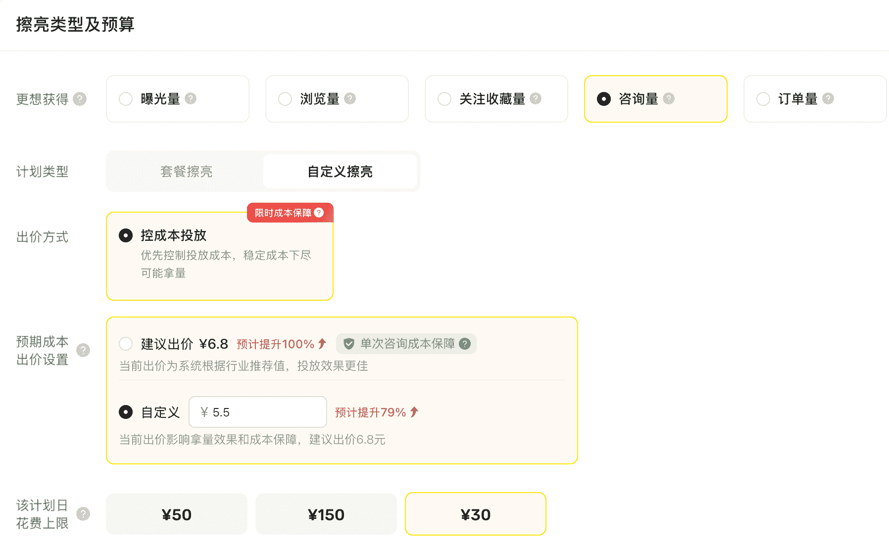
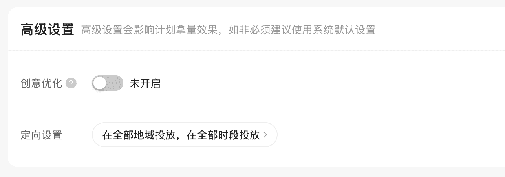
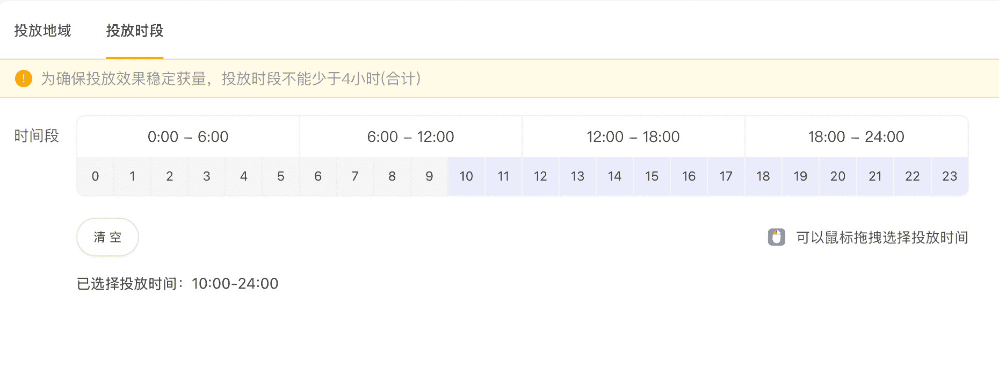
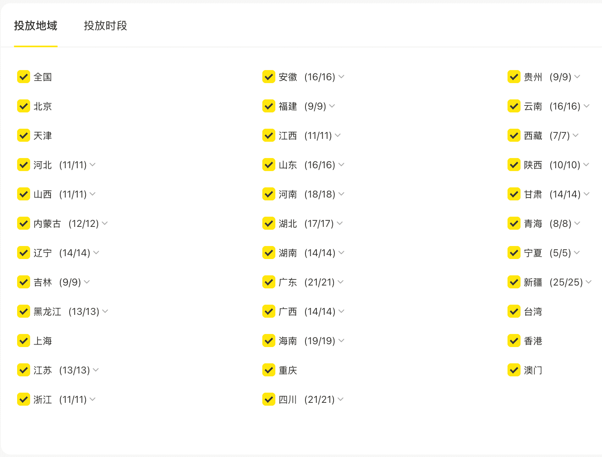
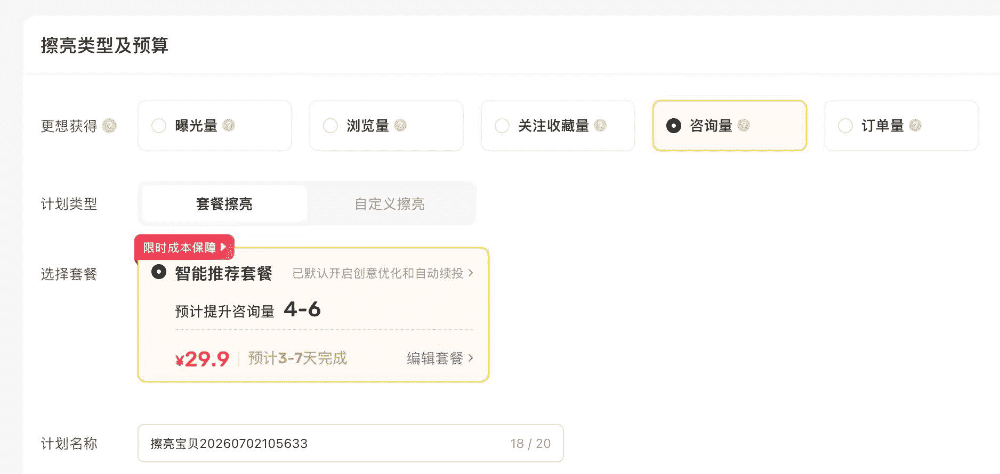
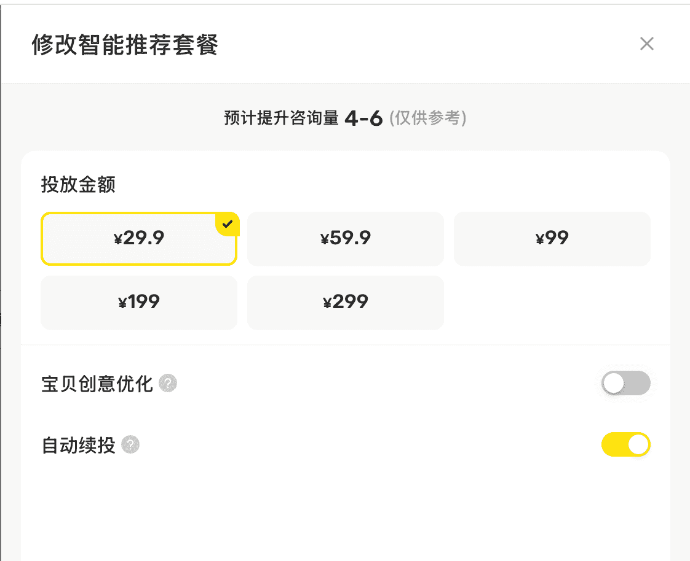
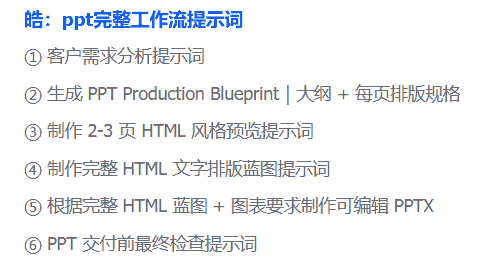
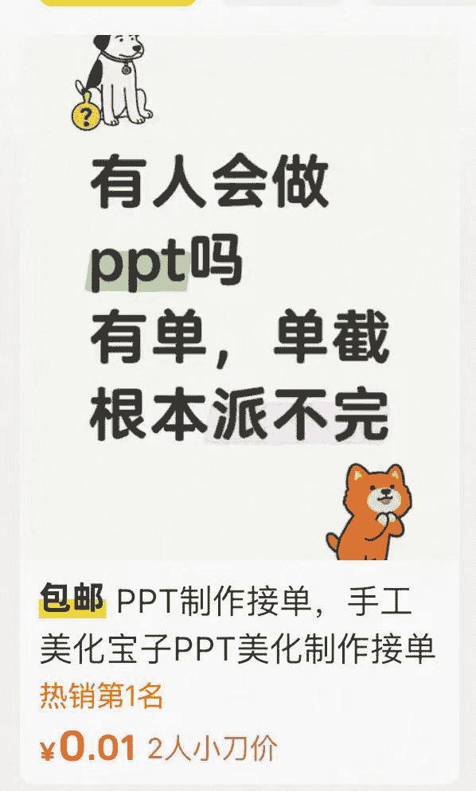
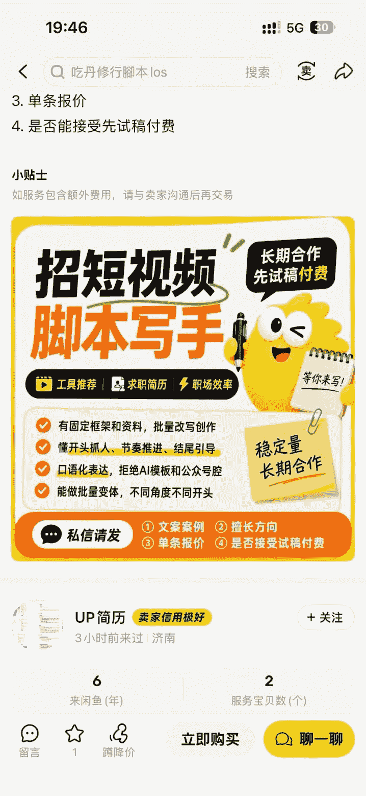

# 一个月从0到2万利润，我在闲鱼AI写作赛道是怎么打通的？附0-1实操SOP

260706 副业SC 精华

整理：👸号懒人搜索，懒人专属群精选

懒人微信：lazyhelper1

大家好，我是阿皓。

先简单报个背景：00后，做公域流量3年，4月份开始在闲鱼做AI写作服务，主攻学生群体，PPT、作业辅导这类需求。

今天想聊的不是心态鸡汤，而是我这2个多月在闲鱼里真实踩过的坑、跑通的动作：起号、选品、冷启动获取自然流量、付费放大、客服转化、写手交付，全流程摊开了说。

先声明，我在闲鱼才2个月多，离大佬还差很多。下面这篇文章，是我从0跑通1之后，把能复用的方法整理出来，给到同样想入场却不知道从哪下手的你。

整篇文章分12个部分：

- 先来看4月和最近15天的投放数据

- 为什么我现在依然看好闲鱼

- 新手到底先做免费流还是直接投流

- 选品背后的本质是选人群

- 0基础起号如何铺链接

- 如何判断一条链接值不值得养

- 自然流跑通后如何精细化补单与做付费放大

- 投流预算500/1000/3000怎么分配

- 从咨询到成交的客服SOP

- 写手怎么找、交付怎么做、资产如何沉淀

- 我对闲鱼项目的几个真实判断

- 结尾话

# 一、4月和近15天的投放数据先看

**4月整体投放情况，按净利润算ROI**

净利润ROI = 总成交金额 - 写手成本 - 投流成本 / 投流成本

4月总花费3039.41，总成交20014，算完成本后净利润ROI为4.64。

拆到3个账号来看，波动很大：最高一账号ROI到7.76，最低一账号只有1.25。这说明同样的投放，账号、链接、品类不同，结果天差地别。

**近15天投放漏斗**

很多人觉得闲鱼投了钱就会来单，其实从曝光到成交要走很长的漏斗：

用户先看到链接，决定要不要点；点进来后要不要咨询；咨询后要不要加微信；加微信后要不要下单；下单后体验好不好会不会复购。

漏斗越往下，人数越少。做闲鱼不是问“为什么咨询少，为什么成交少”，而是要先定位卡在哪一步，再针对性调整。任何一个环节掉链子，ROI就会掉。

# 二、我为什么还看好闲鱼

我一直在测试新品类，也在思考学生赛道淡季后是换项目还是深耕。我的结论是：继续深耕闲鱼，只是叠加品类过渡。

1. 流量成本低
最近试了几个新品类，客资成本能做到10元左右，最低到5.6元。同样需求在📕投放，一个线索要20-50+。品类和链接做对了，闲鱼的获客成本确实能压得很低。不是所有品都能做到个位数，但低成本流量是存在的。

2. 赛道足够宽
我现在做的是AI写作赛道，以前是学生PPT、期末作业、pre。期末季一波投放直接出了2万左右利润。6月中旬学生放假，咨询量下滑，我一度犹豫要不要转项目。后来想通了，如果一到淡季就换项目，就会一直回到0-1的循环。更合理的打法是把学生赛道当季节品，同时测试减肥、职场服务、ToB服务、AI工具等长青品类。

3. 链路短，上手快
闲鱼是搜索+推荐+成交的闭环。你发链接，用户搜索或被推荐进来，咨询，转微信成交交付。比📕的长内容运营简单很多。链路简短不等于无脑，核心在于能否持续测试链接、读懂数据、把咨询转成成交、把ROI打正。

# 三、新手该先做免费流还是投流

常见问题：直接投钱还是先白嫖流量？

我的建议：
预算有限想副业，先做免费流。
预算充足且能每天复盘止损，可以做投流。
前提是投流不是用来救差链接，而是用来放大好链接。

1. 预算低，先用免费流赛马
建议准备2-3个账号，每人最多3个号。每个号先上50条左右链接。铺量不是盲铺，是在保证质量的前提下用数量提高中奖率。我最开始就是不投钱，疯狂上链接。每天上十几二十条，3-4天后能跑出一两条有咨询的，就优先维护它，再补单、再投放。

2. 预算够，也别一上来就猛砸
可以付费，但先用自然流或小额测试筛出有潜力的链接，再投咨询。很多亏损就是因为曝光不行、点击不行、咨询不行，还硬加预算。投流必须算账：花了多少、浏览多少、咨询多少、加微信多少、成交多少、写手成本多少、净利润多少。算不清账，投流就是情绪化加钱。

# 四、选品本质是选人群

很多人盯着“什么品火”。我现在更看重“服务谁”。

你卖的不是PPT，是服务的某一类人群。关键问题是：这批人有钱吗？痛点强不强？需求急不急？愿不愿为省时间付费？复购可能性？交付成本高不高？

1. 有专业背景就从专业切入
程序员可做AI小程序、Agent、网站搭建；老师可做课件、微课、AI数字人课；写手可做📕文案、👸号文章；运营可做代运营、账号诊断。这些都是把技能产品化放到闲鱼测试。

2. 没有强专业，就选高预算人群
我一开始做英文PPT，不是英语多好，而是人群。中文PPT客户多是国内学生，预算低、成交难。英文PPT客户多是留学生，留学成本高，对重要PPT、申请材料愿意付三位数到四位数。而且交付好后，后续有作业、论文润色、海报等复购需求。表面选品，实际是选人群。

3. 服务赛道优先思考ToB和高价值
ToC也能做，但ToB一单可能顶很多ToC。同样写文案，服务学生和服务老板差异巨大。选品底层逻辑：先锁定人群，再从人群需求延伸品类。

# 五、新手0起号怎么铺链接

1. 先养号2-3天
新号别直接铺广告。每天打开闲鱼，浏览、搜索目标品类，收藏同行，点想要，买点虚拟小物，让行为更像真实用户。

2. 先抄爆款再二改
上链接前搜索品类，看同行数据：想要数>50、100，售出稳定，主图标题对你有吸引力。说明方向有需求。

3. 质量先行，再谈数量
铺量前保证四要素：标题吸引力、主图点击欲、价格锚点、详情信任感。曝光后点击率、咨询率差，系统就不会继续推。

附我常用的爆款改写提示词已在素材中。

4. 接受概率性
我并非一条就爆，是上二三十条同品类，跑出一两条有咨询，再精细化运营后放大。链接能否跑通是概率，同一链接换号也不一定都跑。

# 六、怎么判断链接好不好

主要看曝光、浏览、点击率、咨询。

曝光低于50持续2-3天，直接淘汰。
曝光高浏览低，主图标题价格需改。
浏览高咨询低，详情案例信任材料和咨询钩子需优化。
咨询高成交低，客服话术和交付预期需复盘。

筛选逻辑：观察7-10天数据，前几日曝光就弱直接砍掉。

# 七、自然流跑出来后如何补单与放大

1. 何时补单
有咨询后再补。零曝光零咨询的链接补了也没意义。

2. 精细化补单做法
目前平台查得严，要模拟真实路径：用小号搜索关键词，逛同行，对比后点进目标链接，先咨询业务细节，再下单付款。给链接提供真实行为信号。但存在平台风险，需自担。

3. 小额投放测试
有自然咨询或补单后咨询提升，再投每天30-50元看是否能跑正。好链接投流是放大，差链接投流是放大亏损。

# 八、投流预算怎么玩

闲鱼PC端超级擦亮：https://dayu.goofish.com
有代理可找绑定返点。

我的品类需要咨询到微信成交，所以选投咨询量。虚拟资料类可投曝光+浏览。

自定义计划：选1-5条同品类链接，出价80%起，2天没消耗再提到100%。日预算30-50，在线时段10点-24点。城市全国，本地服务可定向。

套餐包可先从便宜的9.9包试水。

预算多少没有固定答案，核心看ROI能否跑正。ROI能到1:3以上再放大，1:1-1:2先优化链接话术品类。投200块零咨询就停下复盘，别硬加。

小预算测法：

如果你预算不多，可以这样测：

先别急着扩大投入，先从一条有机会出单的商品页开始验证。总测试额度控制在100—200元，目的不是立刻放大，而是先确认这条链接是否值得继续做。

前期每天花30—50元即可。推广方式可以根据情况选择套餐，也可以自行设置曝光方案；如果采用自定义方式，日限额先压在30元左右。

每天固定记录一组数据：

- 实际支出
- 获得的展示量
- 进入页面的人数
- 发起沟通的人数
- 添加微信的人数
- 最终付费人数
- 外包制作费用
- 扣除全部成本后的收益

一个周期结束后，重点观察投入产出比。结果不好时，不要用“再加点预算就会变好”来安慰自己。把问题拆开看：是页面吸引力不足，还是流量不精准，抑或是沟通和成交环节出了问题。找到症结，再决定改页面、换受众，还是停止测试。

## 2. 手里有1000—3000元，资金怎么分配？

预算进入这个区间后，依旧不适合孤注一掷。

可以并行验证不同方向和多条商品页，但每一组都要提前写清楚最多愿意亏多少。比如某个方向，我会先给它500元观察额度。

如果在这笔钱用完前，已经出现了稳定的有效沟通，甚至产生付费订单，就说明它具备继续观察的价值，可以逐步提高投入。

反过来，如果500元已经花完，仍然几乎没人咨询、加微信和付款，那就不要继续硬撑，及时更换方向或重新定义目标人群。

## 3. 成功后也要慢慢扩张

即使某条商品页已经验证出不错的投入产出表现，也别把预算从50元直接跳到500元。

更稳妥的做法是分段增加，每轮上调20%—30%，同时观察获客成本、付费比例以及后端制作是否吃得消。

小额投放能赚钱，不代表大额投放也一定成立。预算上去后，流量可能变得不够精准；咨询数量增加，接待压力会随之上升；如果制作端无法及时完成，退款、投诉和差评都可能出现。

所以，推广前要把收入、广告费、人工费和售后风险一起算进去，并且提前设好停止线。

# 九、从首次沟通到付款：我的成交流程

做私域成交时，很多刚入行的人都会在客户问价后立刻甩出数字。

这样一来，谈判节奏就容易被对方掌握。客户可能拿着你的报价到处比较，最后只把你当成一个可以继续砍价的供应商。

我的处理顺序是：

**先确认任务，再判断难点；先建立专业感，最后给出报价。**

## 1. 先把任务边界问清楚

以英文PPT为例，对方来问时，我通常会先确认：

主题是什么？学校或老师有哪些硬性要求？需要完成多少页？什么时候必须交付？

是从空白开始制作，还是已经有资料需要重新整理？是否要求整套内容使用英文？是否还要准备演讲备注或口头讲稿？

不少客户只把文件发过来，却没有说明背景。这时不要急着报价格，先把任务范围、标准和时间点问完整。

否则，前期估价过低，后面很容易倒贴；报价过高，客户又看不懂费用依据，谈话自然会中断。

## 2. 判断这份需求真正难在哪里

信息收齐后，再判断影响报价的关键因素：

- 时间是否压得特别紧，例如当晚、凌晨或次日清晨交付；
- 任务是否复杂，例如专业要求多、需要英文表达，甚至还要配套稿件；
- 整理工作是否繁重，例如页数多、原始材料杂乱，需要重新搭建结构；
- 结果是否关系重大，例如答辩、期末汇报或小组展示，可能影响最终成绩。

只有明确了难点，报价才有依据，而不是凭感觉随口一说。

## 3. 让客户理解工作难度，但不要制造恐慌

如果对方要求当晚完成，可以这样回复：

“时间安排确实比较紧，而且这是英文展示稿，除了视觉排版，还需要检查内容结构和表达方式。我得先看完整要求，再确认是否能安排加急制作。”

这段话的作用不是给客户施压，而是帮助他理解：这类任务并非替换一个模板就能完成。

先让对方看见其中的时间成本和专业工作，后续价格才更容易被接受。

## 4. 用过往成果建立可靠感

当任务难点讲明白后，可以补充相关案例：

“课堂汇报、课程答辩和小组展示，这类项目我们都有处理过。你可以先把要求发来，我帮你判断怎样安排更稳妥。”

随后展示成品片段、客户反馈以及交付记录。

沟通时要保持稳定和笃定。客户往往会从你的表达方式判断是否值得信任。若碰到不熟悉的专业术语，也不必慌张，可以借助AI先理解概念、拆分任务、估算难度，再据此组织回复。

## 5. 所有信息到位后，再给价格

任务范围、紧迫程度、制作难度以及信任基础都确认后，再进入报价环节。

有人只能接受每页几十元，而我能针对部分项目报到每页上百，差别并不单纯在能力，而在于是否把客户真正购买的价值讲清楚。

客户买的不只是“做一份PPT”，还包括：

- 节省自己摸索和制作的时间；
- 在临近截止时获得支援；
- 解决不会组织内容的问题；
- 降低答辩失误、展示失分或临场翻车的概率。

当然，价格必须建立在实际成本之上，要综合考虑客户类型、任务复杂度、交付期限、制作资源和外包费用。

遇到预算极低、反复砍价，却提出大量要求的客户，放弃这类订单也是一种筛选。

## 6. 自己留用：可修改PPT的完整制作流程提示词

号：PPT完整工作流提示词

# 十、制作人员从哪里找，后端如何安排？

服务类业务想持续扩大，迟早会面对制作能力的瓶颈。

如果目前订单不多、自己时间宽裕，可以先亲自完成。

但当获客、沟通和成交逐渐占用大量时间后，后端制作就应该逐步交给稳定的合作人员。

## 1. 制作人员的寻找渠道

我目前主要从两个方向寻找合作人选：

- **在📕联系同行。** 搜索PPT、留学生作业、presentation、论文润色等关键词，找到正在提供类似服务的人后，主动询问是否愿意长期配合。

可以这样开场：

“你好，我手上有一些英文PPT和presentation需求，想了解一下你是否愿意做长期合作？”

- **利用闲鱼的自然来访。** 商品页有了稳定曝光后，常会有老师或制作人员主动联系，询问是否需要接单合作。

这类主动找上门的人里，也可能有不错的资源，逐个查看作品和沟通情况即可。

此外，也能在闲鱼或📕发布合作招募信息，让对方主动投递。

## 2. 如何判断一个人是否值得长期合作？

不要刚认识就把高金额订单交出去。

先看对方的作品、经历和擅长领域，再用小任务进行验证，重点观察：

- 成品是否符合要求；
- 是否能按约定时间交稿；
- 修改时是否配合；
- 沟通是否及时清晰；
- 收费是否与质量匹配。

合作人员并非报价越低越划算。若作品质量不过关，后续返工、解释、售后都会回到你身上，整体成本反而更高。

# 十一、我目前对闲鱼业务的几条判断

下面是我现阶段比较明确的几个结论。

## 1. 自然流量也有成本，只是成本表现为时间

很多人把自然流量理解成完全不花钱，其实它只是没有直接支付广告费。养账号、搭建商品页、跟踪表现、重新发布、维护互动、处理咨询，这些都需要投入时间。

时间充足、现金预算有限，可以优先尝试自然流量。

如果时间紧张、手里有可控预算，付费推广可能更适合。

但无论采用哪条路径，都要回到同一个经营目标：让整条转化链路最终产生正向回报。

## 2. 付费推广只能放大现有结果

本身有吸引力的商品页，广告可以帮助它获得更多机会；基础薄弱的商品页，广告只会让损失扩大。

因此，投放前应先检查标题、首图、详情展示、定价和接待流程，先把基础盘面整理好，再考虑买量。

## 3. 季节性业务必须提前准备淡季方案

学生相关需求存在明显的周期变化，期末、毕业和开学前后通常更容易出现高峰。

但假期到来后，若没有积累客户，也没有其他全年都能承接的业务补位，收入就可能突然下滑。

做得久的同行，淡季还能依靠旧客户再次购买维持基本盘。像我这样在4月才开始做的人，微信端的客户积累还不深，所以必须持续探索其他方向。这也是我越来越重视私域维护和重复购买的原因。

## 4. 别只盯着眼前收入，更要留下可复制的系统

如果一个项目结束后，只剩下“曾经赚过钱”的记忆，那其实没有形成长期价值。

目前我在这个项目中逐步整理出的东西包括：

- 选品判断流程；
- 商品页搭建流程；
- 推广投放流程；
- 客服回复素材；
- 合作人员评估规则；
- 成品检查与交付规范；
- 经营数据记录表。

把这些内容整理成文档后，未来即使交给新人执行，也能按标准推进。否则所有经验都锁在自己脑中，只要本人停下来，业务也会跟着停摆。

# 十二、结语

这篇内容是我抽时间整理出来的，难免还有不完善之处，先向大家说明。

我依然认为，近两年闲鱼对普通人仍然存在不少机会。你不必刚开始就具备很强的内容能力，也不必立刻组建团队。完全可以从一个账号、一种服务和少量商品页开始摸索。

先把页面搭出来，接触真实需求，完成第一笔交易，把后端交付走通，再逐步调整接待方式、投放策略、操作文档、业务方向和客户维护。

如果刚入场，不必急于追求规模。

先想清楚五件事：

1. 准备服务哪类客户？
2. 他们是否具备实际支付能力？
3. 这种需求是否会持续出现？
4. 能否找到稳定的制作资源？
5. 是否愿意持续记录经营数据并迭代流程？

很多答案并不是坐在桌前想出来的，而是行动后由真实反馈告诉你的。数据可能不符合预期，但它比主观判断更值得相信。

边实践边学习，先把事情做完，再追求精细。我目前也还在验证新的方向和经营方式，欢迎有经验的闲鱼同行交流合作。

这些做法，是我在投入时间、预算和精力后不断调整出来的现阶段版本。

新手可以从小规模验证开始，真正执行，才有机会获得结果。一起加油！

————分割线————

读完这套流程，很多人会产生“已经掌握了”的错觉，可真正进入执行环节时，大多数人连开头都迈不出去。

软件、资料和教程只能算入门条件。更难复制的部分，是快速行动，以及来自同行圈子的有效信息。

如果你想了解近期出现的变现方向，并和一批愿意亲自验证的效率玩家一起做项目，欢迎了解我的核心私域：【懒人专属群】。

这里不做空泛讨论，重点围绕商业链路拆分，以及如何借助AI提升执行效率。系统中已经整理了1000多个经过验证的套利案例。

👉 查看圈子数字资产详情及参与条件：

https://lazyso.com/insider/

认可这种价值交换、也准备亲自执行的朋友，可扫码添加微信（lazyhelper1）。

添加时备注：【实操上车】，不闲聊。

