# 大学毕业这一天，我终于明白：真正能穿越周期的，只有自己

260706 副业SC 精华

整理：👸号懒人搜索，懒人专属群精选  
懒人🛰️：lazyhelper1

这一年，我几乎没有在赚钱发过帖子。

不是没有东西可写，而是业务一直处在增长期，表达欲反而越来越低。很多次，我打开文档，想记录点什么，最后还是默默关掉。

但每年 418，我还是会回来交一次作业。

今年尤其特别。

这是赚钱的第十年，也是我 22 岁这一年，是我学生生涯真正意义上的收尾。

大学四年，我从一个什么都没有的普通学生，走到了稳定年利润七位数的阶段。回头看，这一路并没有什么神奇秘籍，更多是一些持续做、反复想、不断修正的事情。

这篇文章，就当作我的大学毕业答辩。

可能不够“干货”，更像一份个人成长记录。但这些，确实是我此刻最想说的话。

我曾经设想过很多种毕业方式。

也许我会因为考研成功而兴奋，弥补高考时留下的遗憾；也许我会在某座漂亮的城市做导演，拍摄属于自己的作品；也许我会在上海的写字楼里，拥有一个亲手布置的小工位。

这些人生版本，或许正在平行世界里发生。

但比起那些想象，我更喜欢现在这个自己。

## 一、赚钱的起点，是持续研究用户

过去一年，我参加了不少线下课程，也接触了各种各样的平台和项目。

后来我越来越确定，业务表面上千差万别，底层却都在解决同一个问题：

**如何把合适的内容，送到可能购买的人面前。**

这里的关键词不是“精准客户”，而是“潜在客户”。

因为今天的消费，往往不是用户提前计划好的结果。

很多人刷短视频、逛📕时，原本没有购物打算，只是被某一条内容、某一个场景突然打动，然后顺手完成了购买。

比如我自己，平时不会在淘宝主动搜索牛奶，却会因为抖音推送了不同口味的牛奶广告而下单。平台并没有等我主动表达需求，而是根据我的年龄、生活方式和消费倾向，提前把商品放到了我面前。

这就是内容电商的逻辑：先理解人，再把产品放进一个合适的场景里。

### 案例一：拖鞋卖的不是拖鞋，而是旅行体验

拖鞋本身并不是一个特别容易做差异化的商品。

但有一个品牌通过重新定义人群和使用场景，在📕卖出了 40w 单。

它投放的关键词并不是“拖鞋”“家居拖鞋”，而是：

青岛旅游、南意旅游、大连旅游、普吉岛旅游。

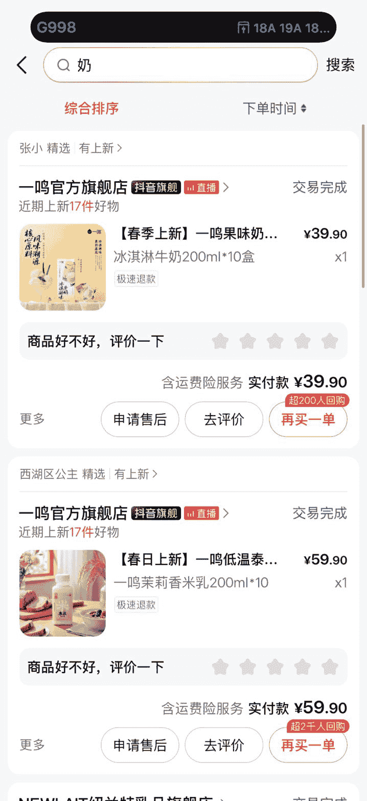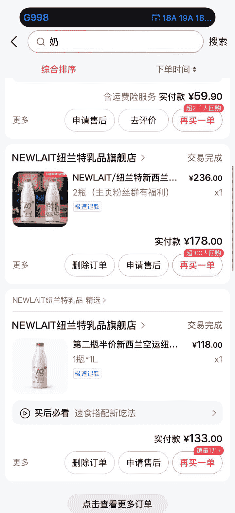

当用户搜索海岛城市、旅游攻略、暴走不累等内容时，这双拖鞋就会自然出现。

它卖的已经不是一双普通拖鞋，而是“旅行途中走很多路，脚也不会累”的解决方案。

我之所以记得这么清楚，是因为我当时只是搜索青岛美食，最后莫名其妙买了两双拖鞋。

### 案例二：玫瑰露卖的是精致生活的想象

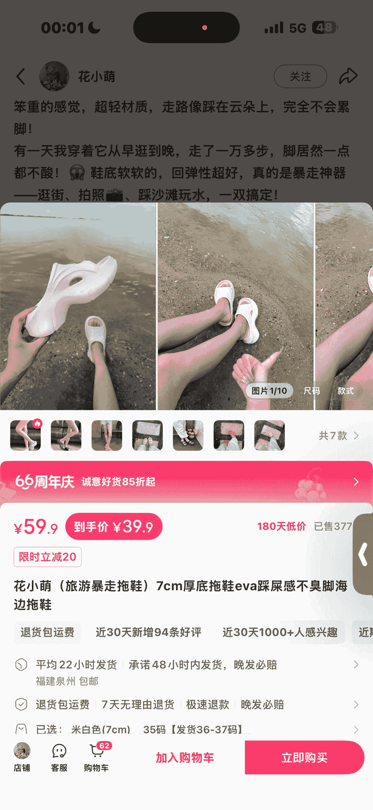

很多人第一次看到“玫瑰露”这个名字，甚至不知道它具体是什么。

但这样一瓶接近 300 元的产品，仅在📕站内就完成了 500w 的成交。

它绑定的词不是普通饮品，而是：

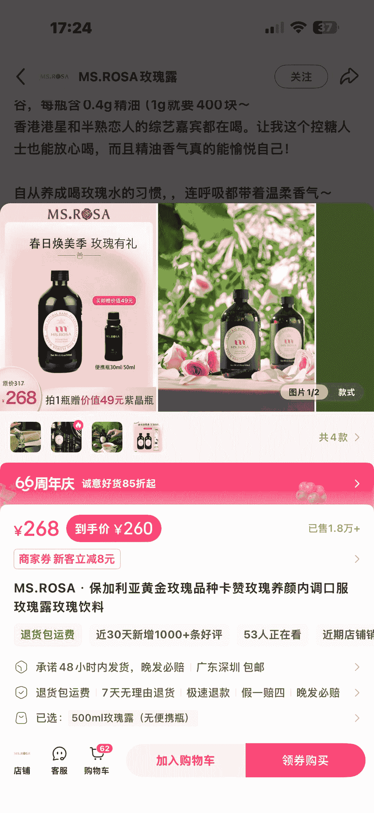

丽思卡尔顿、四季、安缦、W 酒店。

这杯水被放进了五星级酒店、贵妇生活、高级享受的叙事里。

它真正击中的，也不是口渴，而是一些女生对精致生活、体面消费和自我犒赏的向往。

住不起几千元一晚的安缦，难道还不能喝一瓶同款概念的水吗？

所以，今天做生意，拼到最后的往往不是谁更会喊口号，而是谁更理解用户。

这份理解，既决定引流，也决定成交。

这里尤其要感谢富贵老师。她的情绪营销理论，影响了我后来所有内容的底层逻辑。写这篇文章时，我刚好也在从她的课上坐高铁回来。

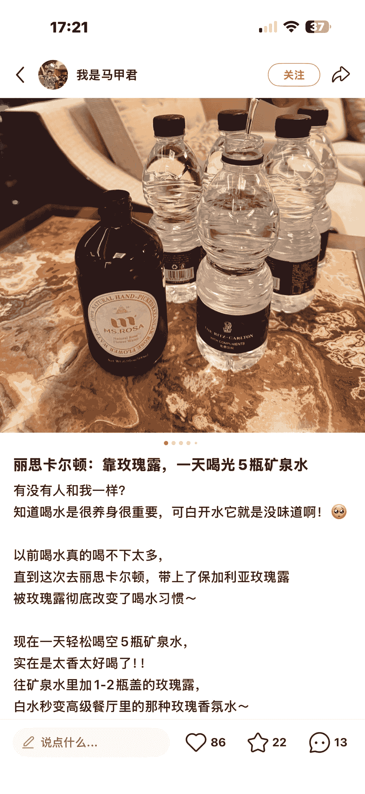

很多人都知道短视频开头要抓住痛点，但真正的问题是：你抓的到底是谁的痛点？

不少内容看起来很刺激，实际上是在对同行喊话，而不是在和真实用户沟通。

一个产品，必须面对一个具体的人。

她生活在哪座城市，受教育程度如何，消费能力怎么样，是不是容易被情绪影响，原生家庭关系怎样，处于恋爱、婚姻还是育儿阶段，有几个孩子，当前最焦虑的事情是什么——这些都应该足够具体。

你要能想象出她的样子，知道她会在什么时刻做出购买决定。

有人可能会问：我不做电商，也需要研究这些吗？

当然需要。

用户理解，是所有业务的基础能力。

比如，一个男生来问你，想给女朋友买一串手串作为礼物。

如果你做过用户分析，大概率能判断出，他可能是学生，预算有限，但又希望礼物看起来体面、有档次。

此时，你如果一直介绍手串的材质、款式和寓意，他未必真正关心。

他更想知道的是：

1. 包装是否足够精致；
2. 能不能附赠手写卡片；
3. 过去的女生收到后是否开心。

当你真正理解一个人的需求、情绪和顾虑，赚钱会变得顺畅很多。

因为你不是在把内容硬塞给用户，而是在帮一个具体的人解决一个具体的问题。

## 二、信息差只是起点，真正拉开距离的是认知和资源

什么叫认知差？

假设我们都觉得 BTC 是优质资产，于是我只拿出 3% 的资产尝试配置，而另一个人愿意投入 50%。

市场上涨时，我们都赚到了钱，也都更加相信自己的判断。

但当市场回撤 20% 时，我可能还能接受；如果继续下跌到腰斩，我就开始恐慌、自责，甚至卖出。

而另一个人，因为理解更深、信念更强，能够承受过程中反复出现的波动，直到最终拿到足够大的结果。

同一个认知，最后会因为下注程度不同，产生完全不同的人生轨迹。

做业务也是一样。

很多人的第一桶金，并不是在完全想明白之后赚到的，而是在混乱、试错甚至莽撞中意外跑通的。

赚钱里的很多项目，普通人都能靠它挣到钱。

但有人借此完成了人生跃迁，有人赚到一点小钱后，就回到原来的生活轨道。

差别往往不在项目本身，而在一个人的认知深度。

认知决定你能把一个项目做多深，也决定你愿意投入多少、承受多久、坚持到什么程度。

但认知之上，还有资源。

这里要特别感谢比高老师。今年以来，我从他那里获得的最大收获之一，就是重新理解了资源的价值。

他在夜话里讲过一句话，我一直记得：

普通人想赚 100w，通常要认真挑项目，自己跑通，再组建团队放大。

而龙哥想赚 100w，可能只需要一个想法，加上一些资源。

这句话让我想明白了一个问题：如果我想从 100w 走向更大的结果，不能只依赖自己的时间和执行力，而要逐渐拥有可以反复调用的资源。

在我看来，这些资源包括：

- 现金；
- 私域用户；
- 深层且优质的关系；
- 团队与人才；
- 稳定的渠道。

它们才是能够帮助一个人跨越周期的东西。

赚钱的本质，是不断重复有效动作。

但最难的地方，是识别什么才是真正有效的动作：什么样的业务现金流才算健康，怎样持续积累私域用户，哪些事情值得长期投入。

这些答案，不是靠想象得出来的，只能在一次次行动、反馈和试错中逐渐确认。

## 三、项目结束后，真正留下来的是什么

我高中时就开始在📕上赚钱。

那是 21—22 年，平台还没有今天这么复杂。内容不需要多精致，主页放一个🛰️号，评论区再留一个，简介里再写一次，用户加过来后完成交易，就能直接变现。

放到今天，几乎无法想象。

同样的事情，换到 26 年，无论你做外卖 CPS 还是知乎好物，都很难复制 20 年随手发布一条内容就能获得流量的结果。

我们长期依赖的闲鱼，也在 24—26 年经历了明显变化：

从随便发都有流量，到逐步限制引流；从违禁词越来越多，到平台推出超级擦亮等商业化工具。

这其实就是平台周期的缩影。

一个平台最初缺内容、缺卖家时，会极力奖励创作者；等内容和供给逐渐饱和，流量开始收紧；最后，平台会把流量本身变成商业产品。

所以，平台给你的红利，不能被误认为是你的永久能力。

窗口打开时，要尽可能放大结果；有流量的时候，要尽可能沉淀到自己的私域；能抓住多少用户，就不要只满足于赚一点小钱。

不要把钱都花在短暂的消费上，更应该用一部分资金购买长期资产。

一只香奈儿 22bag，放两年可能亏 1w；但 4w 元买下 400 个高价值粉丝，放两年后，至少有机会带来 10w 的回报。

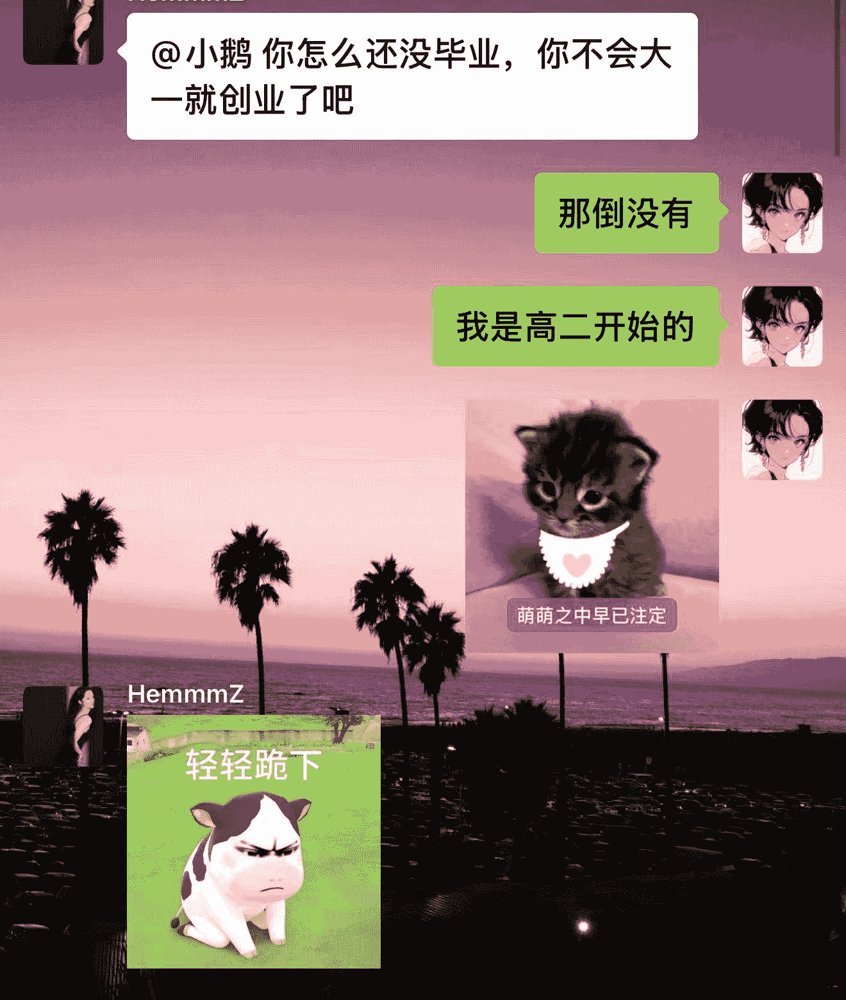

屋顶还没漏水时修补，永远比房子被淹后再补救划算。

当然，除了沉淀资产，也要思考哪些东西真正属于自己。

账号会被封，团队会解散，成员会离开，私域也会受到规则变化的影响。

看起来稳定的一切，其实都可能在某次平台调整后迅速改变。

我是在看航海家云蔓老师的分享时，找到这个问题的答案：

**真正不会被平台拿走的，是你自己。**

去年，我曾经很困惑。

当基本的生存问题已经解决之后，我继续赚钱的动力是什么？

更大的房子、更贵的车，带来的体验提升其实有限。

后来我发现，很多航海家即使已经拥有了足够多的财富，依然在持续学习，依然亲自盯业务、抠细节、解决问题。

有人把它称为使命，有人说自己还没有赚够。

书虫给了我一个更容易理解的解释。

他说，自己做业务时的快乐，和玩鹅鸭杀很像。

玩游戏时，你会通过观察和推理，从各种线索里找出隐藏的“狼”；做业务时，你则是在不断分析问题，把原本看似不可能的事情一步步做成。

我一下就明白了。

钱当然重要，它是最直接、最诚实的成绩单。

但当生存压力消失后，真正让人持续投入的，往往是另一种成就感：

自己的判断被市场验证；昨天觉得不可能的事，今天被自己完成；一个复杂项目被拆解成流量、用户、转化、交付，再逐个环节跑通。

如果创业是一场无限游戏，那么平台、账号、团队和项目，都只是某一局里暂时拥有的工具。

真正能带走的，是你理解真实世界的能力，是你对决策负责的能力，是你不断发现问题、修正判断、把不可能变成可能的能力。

## 四、别只问 AI 如何提效，要重新设计 AI 时代的业务

本文标题引用文献：albert

从广州航海家线下课回来后，我每天睁眼做的第一件事，几乎都是打开 Codex。

我先把过去几年积累的数字资产，逐步整理成自己的本地知识库。

IP 素材、项目资料、课程内容，都被重新归档。Codex 会从不同软件中把资料调取出来，按照我的要求进行整理。

我只需要告诉它目标和关键结果，它就会每天把任务安排进苹果日历，提醒我推进。

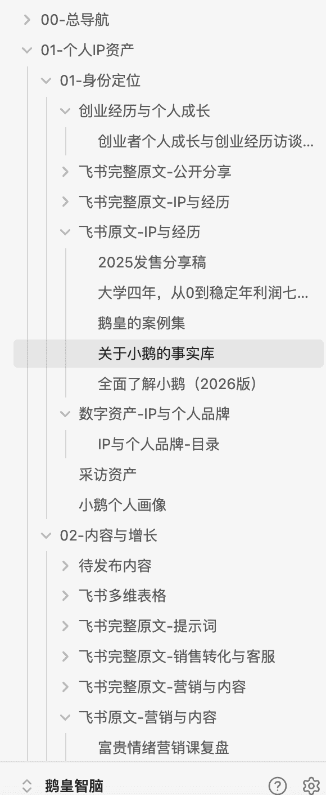

接下来，它会根据我的理论体系自动生成选题、撰写文案，再归档到飞书多维表格里，并且给素材分类。

建表、搜集数据、整理信息、归档资料，这些工作基本都是它独立完成的。

那我负责什么？

严格来说，我负责的事情非常少。

它工作的时候，我只需要坐在旁边刷刷抖音，尽量不要打扰它。

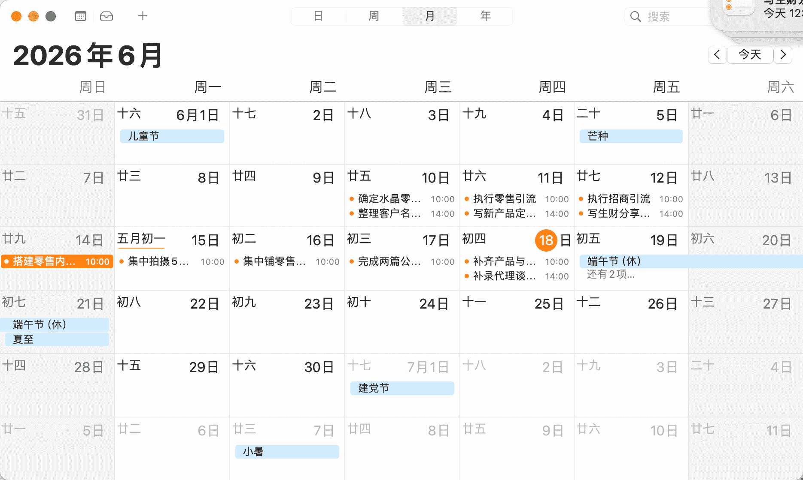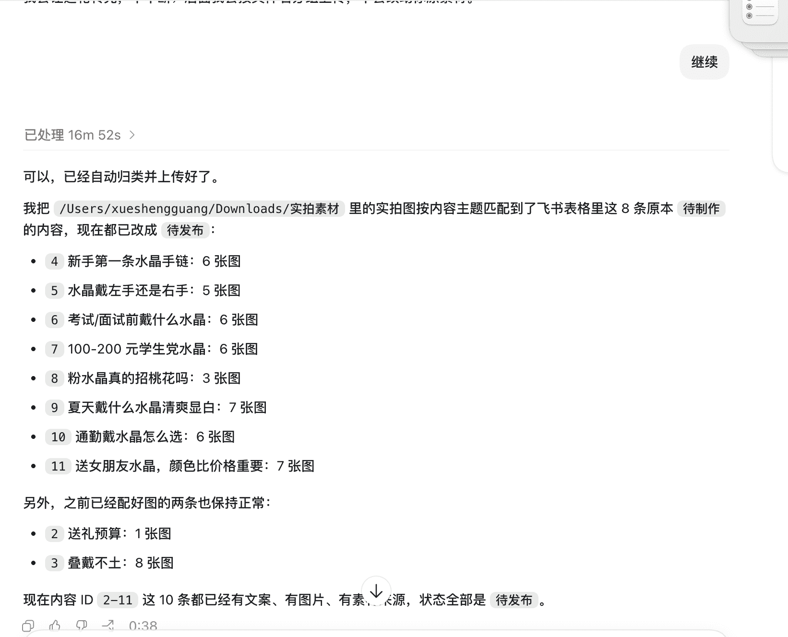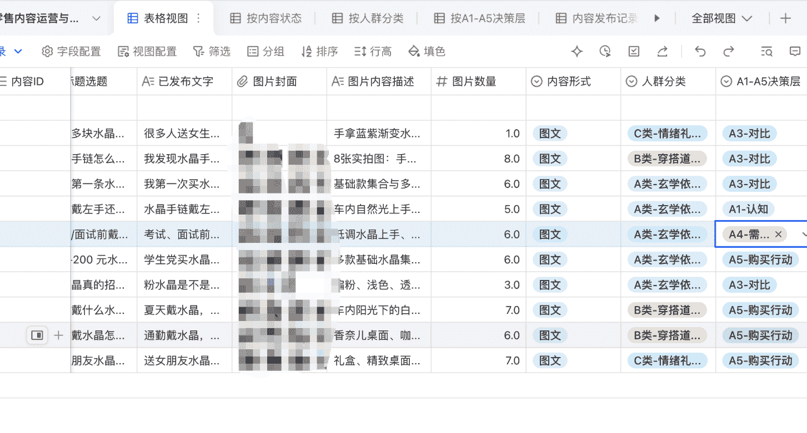

我还会把自己写👸号和朋友圈的流程，提炼成一套套 skills；再把喜欢的博主的表达方式拆解出来，也沉淀成 skills。

所有内容，都会同步到 Obsidian 和飞书，形成可持续调用的知识资产。

我很喜欢一部科幻小说，叫《带上她的眼睛》。

现在人与 AI 的协作方式，某种程度上就像小说里的关系。

我们是 AI 的眼睛。

我们替它进入现实，接触用户，运行项目，观察人的表情、情绪和反应，收集那些它无法直接获得的信息。

而 AI 像是待在深处的智脑，记住我们见过的一切，负责分析、联结、推演，再把结果反馈回来。

Albert 分享中有一句话让我印象特别深：

AI native 不是研究“AI 能帮我把现有工作做快多少”，而是重新问一遍：

**如果整个业务从头到尾都用 AI 重做，会变成什么样？**

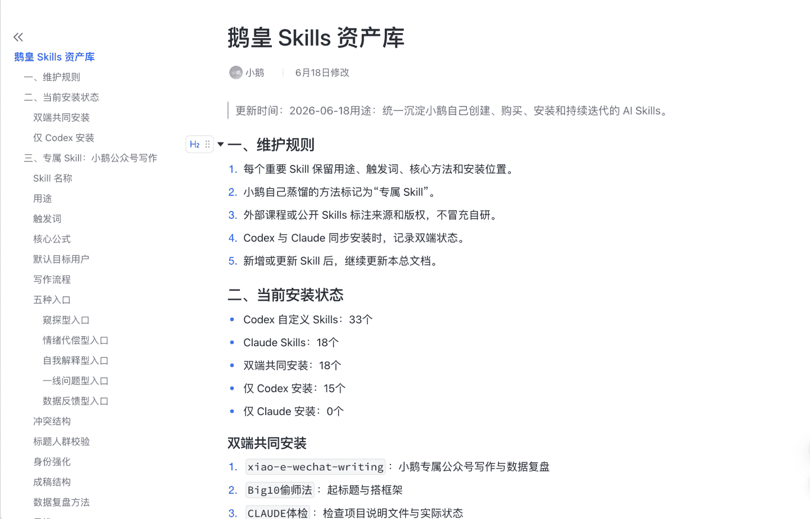

所以，在 AI 时代，最重要的能力其实不是执行，而是判断。

执行成本会越来越低。

写文案、建表格、整理资料、分析选题，这些过去需要大量时间的工作，今后都可以交给 AI。

可 AI 并不知道什么才是正确的。

它能给出很多看起来合理的答案，却无法替你判断哪些答案值得采用。

因此，人真正稀缺的价值会变成：

- 什么选题值得做；
- 哪个需求是真需求；
- 什么内容能够产生有效反馈；
- 一个项目应该继续还是及时止损；
- 一条路是在积累，还是在消耗自己。

这些判断，来自你见过多少真实用户，做过多少真实业务，犯过多少真实错误。

AI 可以提供大量选项，但最后要从中选出真正有用的那个答案，仍然依赖人的经验和判断力。

## 五、复利的力量，远不止资产上涨

我一直认为，单纯拥有现金，并不代表拥有穿越周期的能力。

如果一个人只有钱，却没有优质资产和稳定结构，那么面对系统性风险时，依然可能非常脆弱。

我对那种“一次事件导致全部归零”的情况有很强的恐惧，所以一直在思考：怎样为自己搭建一个更健康的资产体系。

什么才算好资产，每个人都有不同答案。

有人强调看懂企业，有人热衷研究高收益标的，也有人喜欢频繁交易。

身边朋友经常会分享一些令人心动的故事：有人用 2000w 实盘，一年做到 3500w；某位大佬又推荐了什么标的。

面对各种相互矛盾的信息，我选择先模拟，再用很低的成本尝试，并且先想清楚自己适合什么样的方式。

我知道自己的抗压能力和风险承受能力，并不适合高频短线。

年化 80% 的故事很诱人，但它要求你在极高密度的决策中长期保持正确。我既不擅长这种模式，也不愿意承担一次错误就造成巨大损失的风险。

所以，我更认同段永平式的思路。

### 我会反复问自己两个问题

**第一，最坏情况能不能承受？**

如果这笔钱全部损失，我的生活和情绪会不会因此发生严重变化？

如果答案是会，那么就不应该投入。

因此，不能加杠杆，也不能超过自己的止损边界。

**第二，我是否清楚自己为什么做这个决定？**

交易过程中，数字本身并不是唯一重点，更需要观察自己的心理状态。

我为什么买黄金？是不是因为某种情绪？

我为什么买 BTC？是不是因为被周围环境影响？

赚钱不一定代表判断正确，亏钱也不必然意味着判断错误。

关键是，你能不能说清楚：

为什么买，什么时候卖，什么情况出现时要承认自己错了。

低成本试错的意义，就是看清自己在真实波动中会如何反应：

上涨时会不会追高，下跌时会不会恐慌，别人赚得更多时会不会动摇。

我不需要追求理论上最高的收益率，而是要找到一种适合自己的资产结构：允许犯错，但不会因为一次错误而彻底崩塌。

过去两年的实践让我看到，复利不需要从巨额本金开始。

每天定投 500 元的基金，哪怕每天的涨幅微乎其微，只要时间足够长，也可能覆盖未来的生活成本。

几年前做过的账号，即使停止更新，依然可能收到商业合作。

一个已经沉淀完成的私域，即使不再频繁触达，每天也会有自然收入。

一个占据流量入口的工具站，也可以持续产生现金流。

复利并不只是“钱生钱”。

内容会积累，信任会积累，账号会积累，知识库会积累；一个人长期坚持的正确动作，也会在某个未来节点突然开始产生回报。

它最厉害的地方，不是让你短时间暴涨，而是时间会放大你过去的一切。

你今天的懒散，会被时间放大成长期落后；你今天的错误决策，会被时间放大成更大的风险；而你今天认真沉淀的产品、账号、用户理解和资产结构，也会在未来以意想不到的方式回到你身上。

## 六、允许一切发生，也允许自己被误解

去年，我经历过一次比较严重的人际关系困扰。

现在回头看，事情并没有那么大，但当时确实让我低落了一个月。

简单说，一个女孩是我从头带起来的。我给过她资金、流量，也介绍过资源，她的社群用户里，大约九成来自我的帮助。

后来，她认为利益分配不公平，因此产生了怨气。

我向她解释了最初的约定，也考虑到过去的情分和彼此体面，送了她一件价格不低的礼物。

但即便如此，她还是在背后说了不少难听的话，并删除了我们共同合作的课程，最后留下的售后问题也由我来处理。

事情本身也许只是一次普通的关系变化，但当时我非常困惑。

我一直在想：如果我希望避免这种事情，下次应该怎么做？

后来我得到的答案是两个字：

**接纳。**

所有人和所有事情，都像玻璃窗外慢慢滑落的雨滴。

你无法阻止它们经过，也不必强行把每一滴雨都解释清楚。

北京航海家聚会结束的那天晚上，我们一群人从小马宋老师公司的胡同里出来，准备去三里屯找地方聊天。

那晚突然下起暴雨，风很大，整个世界像是被搅乱了。我们最后进了一家狭小昏暗的地下酒吧，坐下来喝了几杯。

大家做的业务各不相同，有👸号，有实体生意，也有私域项目，但每个人似乎都有自己的难题：

流量卡住了，员工要处理，生活发生变故，合伙人出现分歧，平台规则又变了……

酒过几巡，大周哥分享了马老师曾经教给他的一句话。

它能让人在很多痛苦里慢慢安静下来：

**“这很正常。”**

进第一家酒吧时发现人满了，进不去——这很正常。

突然遇到暴雨，只能被困在地下室——这很正常。

碰到糟糕的人，经历糟糕的事——这很正常。

世界上每天都有人失去、错过、被误解，而这一次恰好发生在自己身上——这也很正常。

既然每一个选择都会导向不同的结果，那么每一种结果都有它出现的条件。

事情既然已经发生，就说明它本来就是现实的一部分。

封号很正常，收到违规提醒很正常，手机丢失很正常；有人不喜欢你很正常，被抄袭、被洗稿也很正常。

允许自己还不成熟，允许自己偶尔狼狈，允许自己不被所有人喜欢。

学会这件事之后，我的生活里少了大约 90% 的内耗。

## 七、写给这段青春，也写给赚钱

2022—2026 年，我把三年半的青春放在了赚钱里。

四年时间，飞了 72 次，坐过数不清的高铁，也经历过无数次为了考试连夜赶路的红眼航班。

萧山机场的登机口，我已经熟悉到闭着眼睛都能走过去。

很多人生第一次，都发生在赚钱：

- 第一次站上台演讲；
- 第一次组织线下活动；
- 第一次进行直播；
- 第一次拥有一段持续超过一年的恋爱；

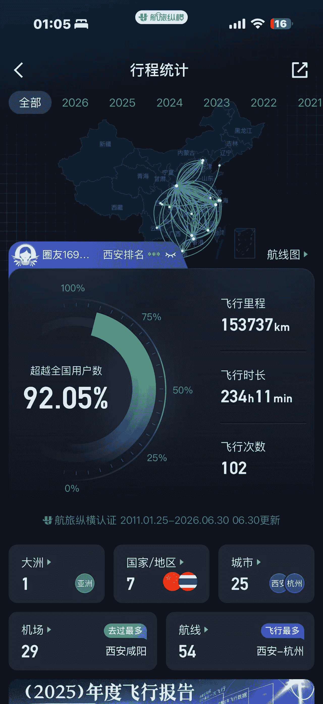

- 第一次真正换一座城市生活……

6 月 7 日，我去了广州参加航海家 AI 线下大课。

我还记得第一次去广州时的样子。

那时我只是凭着一股冲劲买了机票，一个人来到陌生城市，没有认识的人，也第一次在现场听龙哥讲话。

他说，龙哥盟想做的事情，是帮助每一个普通人赚到人生中的第一个一百万。

那时的我，根本不敢想，几个月后，自己真的会走到这句话所描述的位置。

一切似乎都从 AI 开始，从赚钱开始，也从广州开始。

6 月 8 日，是高考四周年。

我连夜赶到苏州，领取了属于自己的毕业纪念品。

这个日期是专门找人算出来的。那一刻，我确实感受到了一种强烈的命运推动感。

夜深时回望少年时代，这一次留下的不是遗憾，而是幸福的眼泪。

6 月 24 日，我拿到了双证。

这一次，真的毕业了。

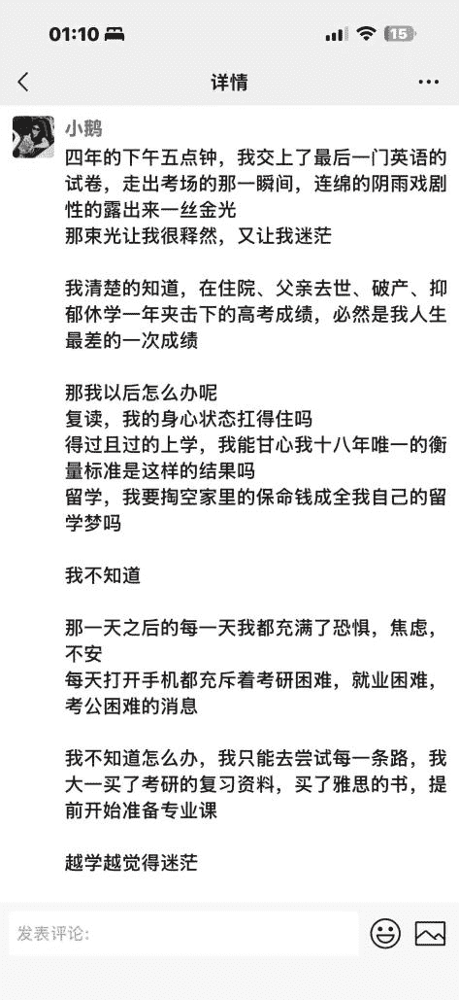

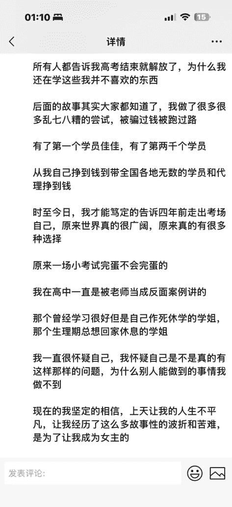

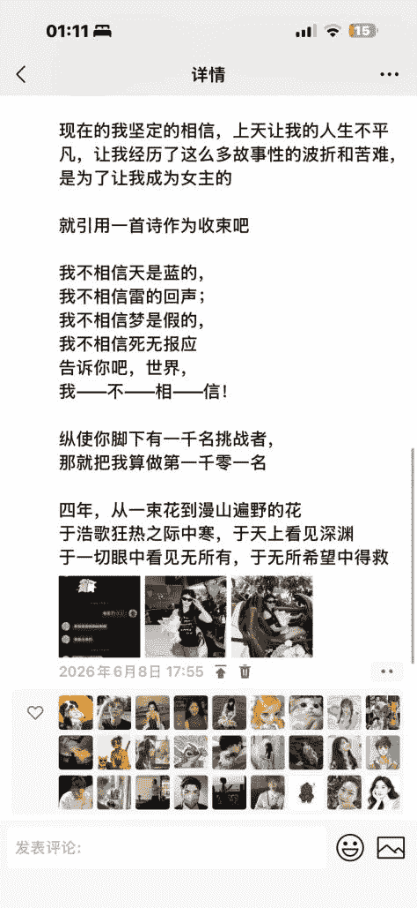

真要把一路上帮助过我的人全部列出来，恐怕写到最后也未必能写完。

龙哥的支持，不必赘述。

涛哥一直把我当作亲妹妹一样照顾：带我见世面，也带我体验各种美食，一路陪着我成长。

坤汀则像亲哥哥一样，无论大事小事，总会提前替我想到。

还有赚钱的每一位工作人员，他们认真、稳定、持续投入的状态，至今仍然让我感到敬佩和震撼。

也想感谢联合办公时并肩奋斗的伙伴，感谢西安遇见的圈友，感谢杭州那些每天一起打牌的朋友；感谢所有在线下和我深入交流过的老师、每一位学员，以及每一个曾经给过我积极影响的人。

当然，还有书虫。

谢谢你们，以不同的方式走进我的人生，并成为一份份珍贵的礼物。

到了这里，回望一路风雨，才发现：曾经以为的波澜，最终都成了从容。

————分割线————

很多人看完一套SOP，会产生一种“我已经掌握了”的错觉。可真正开始执行时，绝大多数人连第一步都很难迈出去。

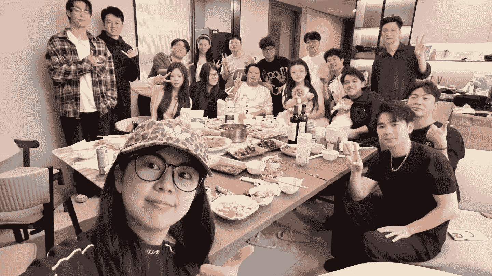

教程、工具和方法论，充其量只是入场券。真正拉开差距的，是看到机会后马上行动，以及身处高质量圈层所带来的信息优势。

如果你想持续了解全网较新的变现路径，也想和一群执行力强、愿意亲自下场的极客一起做项目、拿结果，欢迎了解我的核心私域：【懒人专属群】。

这里不做空泛讨论，只聚焦两件事：把商业模式拆开讲清楚，以及尽可能用AI提升实际效率。圈内目前已经沉淀了1000+个经过验证、跑通闭环的套利实战案例。

👉 查看圈子完整数字资产与加入门槛：

https://lazyso.com/insider/

如果你认可这种以结果为导向的价值交换，也已经准备好亲自下场执行，可以扫码添加我的🛰️：lazyhelper1。

添加时请备注：【实操上车】，不闲聊。

