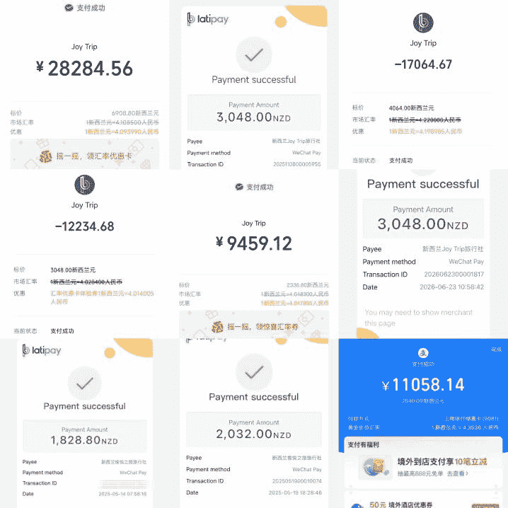
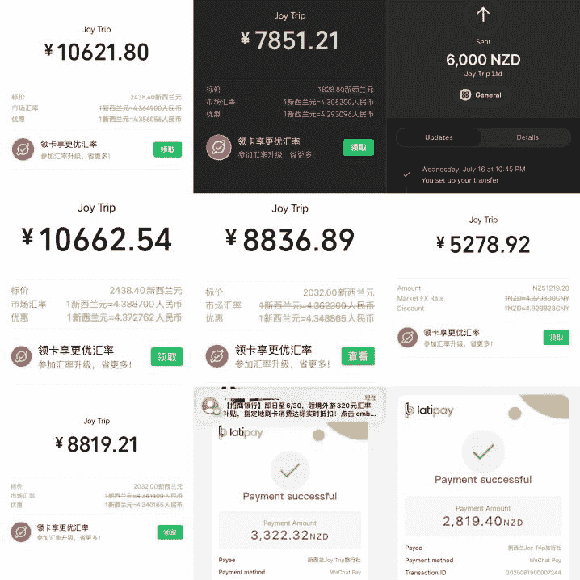
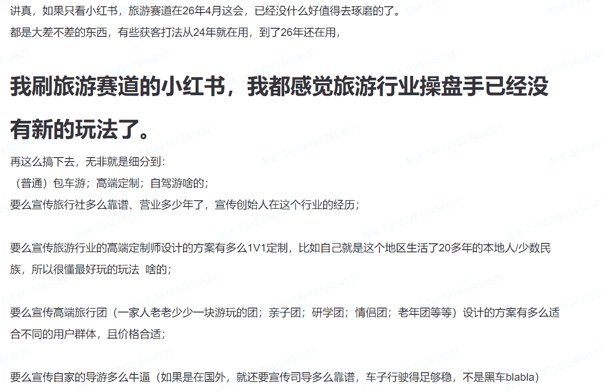
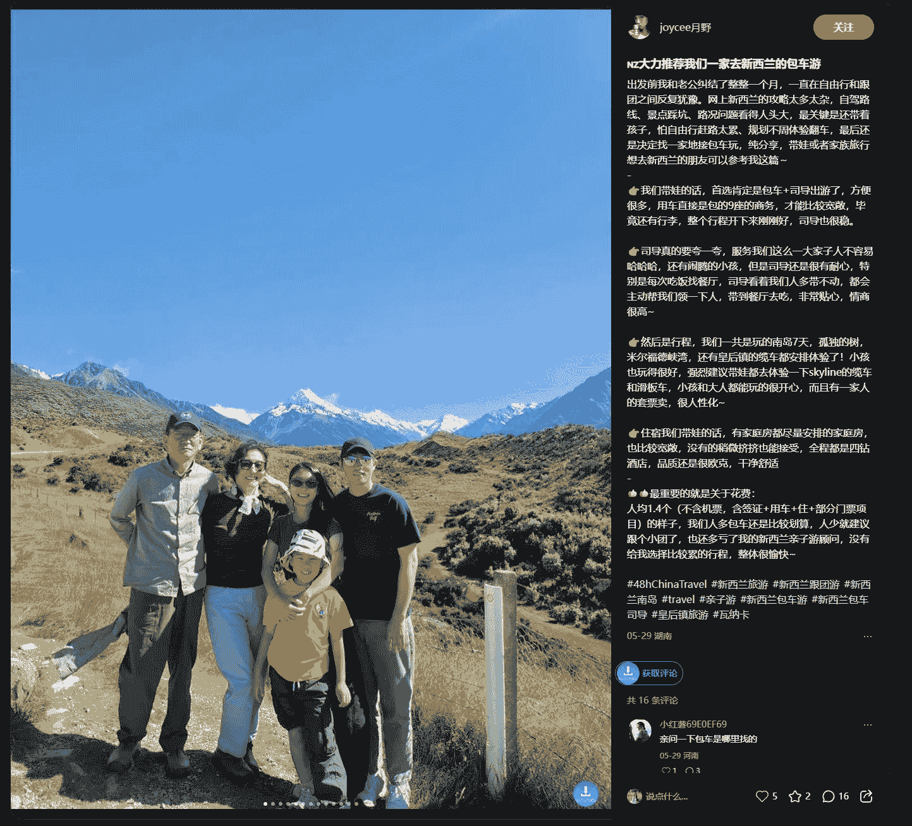
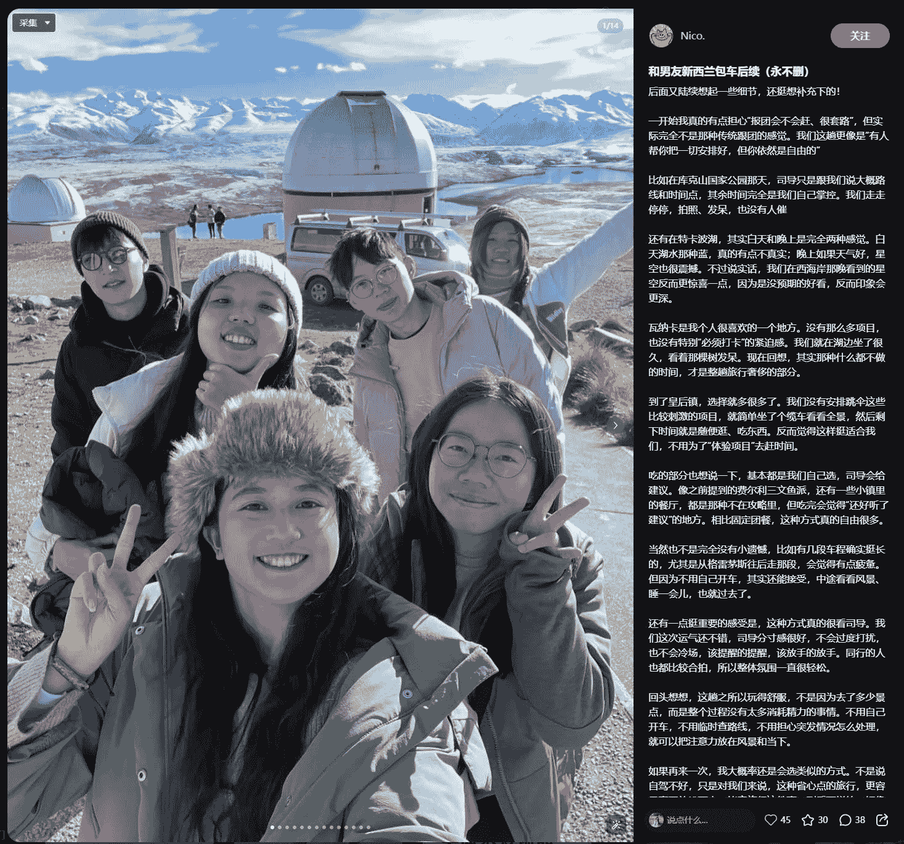
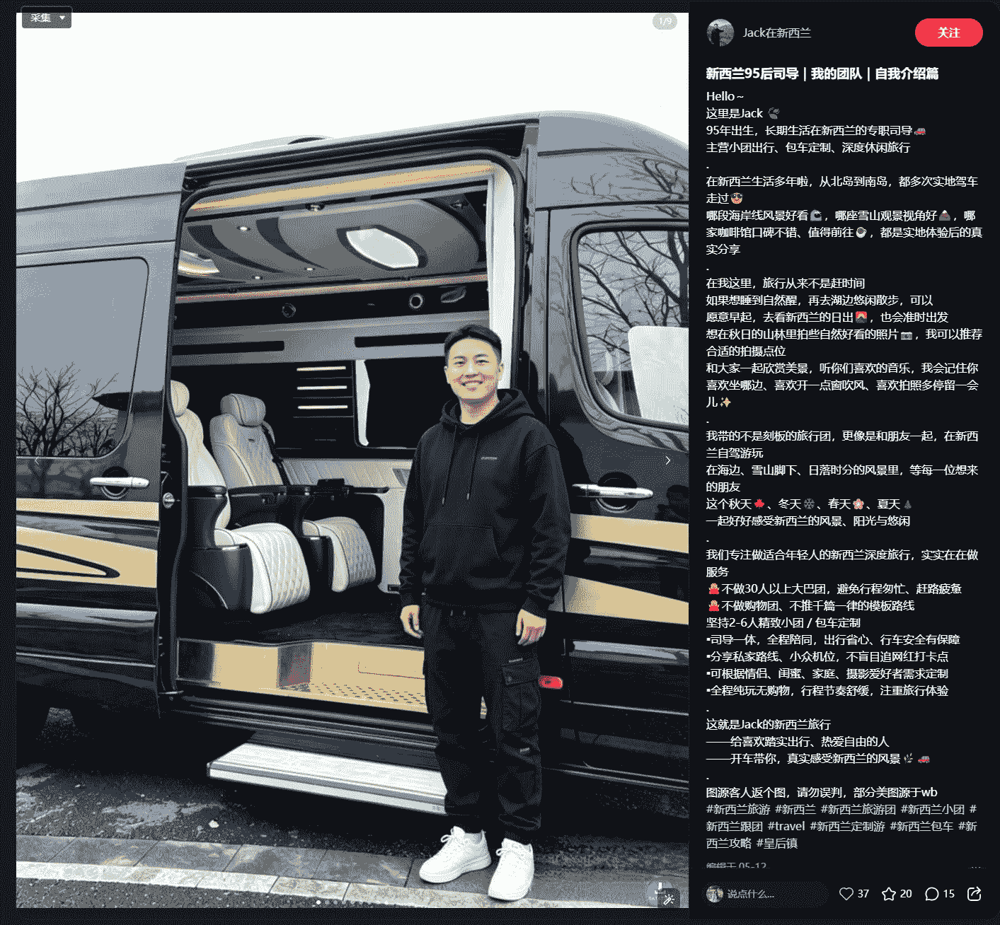

# 做了两年半自由职业、转了两次行，我最终死磕定了新西兰定制游

260706 副业SC 精华

整理：👸号懒人搜索，懒人专属群精选

懒人微信：lazyhelper1

大家好，我是龙哥盟第五期圈友碧琳，主攻📕高客单获客。

25年年初，我跟着贵人易寒老师入局新西兰定制游这个高客单细分赛道，从📕境外游获客切入创业协作，三个月内把获客到成交再到交付的整条链路跑通。一年半下来，成交转化率从5%拉到了10%。下面是部分客户付定金的凭证。

接下来是我的第一人称实录版，跳过心路历程可以直接看目录：

1. 如何判断一个赛道是否值得长期做
2. 新西兰定制游现在什么样
3. 做了一年半，我踩过的坑和破局法

## 一、从打工到自由职业

23年8月我认识易寒，跟着试了西安旅游的项目。赶上国庆高峰，用素人号发了一篇笔记就带了上万销售额，但引流太猛被封号。想去认证蓝V、做聚光投放，又没有旅行社资质，最后项目没撑一个月就停了。

和易寒聊天的过程中，我提到自己在留学公司做新媒体运营主管，还会做聚光投放。他正好手上有一手新西兰留学后端资源，于是把我介绍给一家新西兰本地留学公司做代运营。复盘可以看我之前的帖子《📕做新西兰留学，两个月从0到变现7w+的经验》。

受易寒鼓励，我把自己的投流经验写出来，也拿到了赚钱的精华帖，《📕投流，充钱就开挂：聚光投放一年烧10万的经验分享》。

23年11月30号，我裸辞了。原因有两点。

一是公司在走下坡路。工资经常拖10天半个月，投流费用让我先垫付再报销，公积金也一直没到账。辞职半年后公司就倒闭了，前同事告诉我还拖欠员工数月工资、欠合作方款项，老板都成老赖了。打工人一旦嗅到危险，得早做打算。

二是副业收入已经超过主业，有底气独立。加上快要结婚、要备婚、想解决夫妻异地，只要有手机电脑网络就能工作。

从22年起我就在做📕运营获客，这给了我底气。我明白只要能为企业带来客户，无论是回职场还是走自由职业，都能养活自己。

很多人想从螺丝钉变成创业者，这条路很难。打工是老板扛风险，自己分利润；创业要自己下场，弄脏手去真实市场里摸索。赚钱是一套系统能力，要会写、会运营、会引流、会成交。副业不一定一次成功，但失败会长出经验、判断和技能，等系统积累够了，变现能力自然就有了。

## 二、两年半自由职业的两次转行

到现在自由职业两年半，期间换了三个高客单获客赛道，转了两次行。

### 新西兰留学 2023年9月—2024年7月

佣金很高，一单能到5000块，但回款慢，短则半年长则一年半，现金流断层就放大不了。前期投放和运营的钱都实打实花出去，后期回款不确定。

24年开始内卷严重。留学申请板块，有中介不收学生申请费，靠院校返佣来赚钱。因为是零中介费申请，签单率还能看，我这边大概是7%。

可问题是，从引流到签单到申请成功到入学再到院校返佣，链路太长，每个环节都在掉人。最后能拿到佣金的只剩四分之一左右。要么申请失败，要么上了没去读，要么读了中途退学。最终我决定换赛道。

### 上海卖房单边代理 2024年8月—2024年12月

24年8月看到珍妮老师的文章《留学从业者转行去“大蓝海”，2个月卖出1个小目标的产品》，对卖房单边代理很感兴趣。珍妮是我学习📕运营的老师，她的赛道判断很准，我很信任。

加入的方式有两种：一种在家做📕导流给顾问转化；一种去上海以合伙人身份创业，自建流量或做顾问转化。分成和门槛不一样。

我选了去上海创业。我觉得线下办公的效率和氛围不一样，也不满足只会引流，想把销售这块补上。

在上海也有些成绩，比如成交一套四百多万的房子，还招募到一位代理人。但只干了四个月就停了。

公司想把我们培养成六边形战士，既会卖房又会获客销售交付，但这些能力不是速成的。销售这件事，没经验或没天赋很难迅速上手。同来的另一位代理人天赋极强，给客资就能快签单，形成了良性循环。

我在这块比较吃力，和客户交流像客服一样，靠背话术，挖掘需求和推进流程都不到位。房产销售是最卷的赛道之一，不仅要线上聊，还要约到办公室面谈，对销售能力要求更高。

中期发现公司真正需要的是能快速签单的人，签单才能带来现金流运转。我当时的销售能力撑不起来，只能硬熬。

后期才意识到，签单只是开始。房子卖得慢的话，周期长则三个月短则一年半。获客到签单要两三个月，签单到交付至少三个月，新人前半年可能零收入。

虽然没转成功，但这段经历很值。认识了优秀的创业者，学了大量房产和销售知识，少走了很多弯路。

### 新西兰定制游 2025年1月至今

24年底，易寒老师在我发《做新西兰旅游这一年：龙哥盟帮我逆转困境》前就找我，希望一起做新西兰旅游赛道。他已经把获客成交交付全流程跑通，还升级了交付端。认识久了，他搭建团队优先想到我。

当时我刚在上海，地产老板想从卖房转买房，相当于又要从零开始。不如跟着易寒去做新西兰旅游。

我选择这个赛道的理由：

1. 做过西安旅游，也做过新西兰留学，对新西兰熟悉。虽然旅游赛道卷，但出海能避开国内新疆、内蒙古等地区的极致内卷。
2. 可以回老家做，不用承担上海高昂的房租水电，生活成本低，短期没单也能扛住。
3. 易寒是我最大的贵人。他之前帮我对接新西兰留学后端，让我赚到第一桶金，也鼓励我做知识付费，让我有底气做自由职业。现在他要放大团队，我自然要跟。
4. 易寒在新西兰本地有旅行社，交付端扎实，有差异化，成交更好说服。
5. 之前两个项目利润高但回款慢，这个项目利润依然高，而且结算快，客人走完行程就能开始结算佣金。

25年1月开始入局，目前做了一年半，打算继续深耕。

## 三、判断赛道值不值得长期做的七个标准

自由职业两年半、转行两次后，我更看重赛道选择。

### 宁做高客单，不做低客单

同样引流10个人，高客单客户的单粉价值更高。成交一单虚拟资料才几十上百块，留学、定制游一单几千上万。高客单是用更少的用户创造更高价值，更快盈利，并能靠信任和专业壁垒形成护城河。低客单容易陷入价格战和利润稀释。

### 宁服务富人，不服务普通人

富人买的是体验，不在乎钱划不划算。年入500万的人花10万旅游，对他来说是5%的支出，对月薪5000的人来说100块都很计较。找没支付能力的人要10万块会把人逼死，找富人要10万，他反而会担心你太辛苦。

### 现金流健康才能建系统带团队

没有现金流，系统和团队都是空谈。留学申请赛道为了卷，往往零中介费，等学生入学半年到一年半才返佣。上海卖房单边代理先收房东2万服务费，卖出后再收尾款，好房子半年到一年才卖，现金流很差。

不同细分和地区收费模式差异很大。有的留学公司会提前收服务费，现金流更稳。深圳卖老破小，房东配合度高，回款快；上海卖千万豪宅，房东自我感觉好、决策慢，回款慢。新人最忌讳回款周期长的项目。手里有钱，心里才有底。

### 必须有壁垒，避免同质化

没壁垒的赛道，供应充足就会打价格战。易寒在新西兰本地开旅行社，这种重投入和交付差异化是抄不走的。哪怕报价高一些，专业行程设计客户也愿意选。

### 有没有贵人带你

有贵人手把手带，能省一半试错成本，站在巨人肩膀上。没有贵人，基本靠时间金钱堆出低效高风险慢增长，最后被市场迭代淘汰。

### 能否像素级模仿和跨界抄

普通人没资源去做大量验证，只能模仿已验证的模式。模仿不是抄袭，是拆解底层逻辑并复用成熟流程。跨界抄是跳出行业内卷，借鉴其他领域成功打法。易寒有一篇带来100万利润的📕笔记，就是借鉴了装修赛道的获客方法。

### 能否把非标做成SOP

非标才能拿高溢价，但难规模化。把非标做成SOP，是普通人胜出的关键。把业务共性流程拆成标准步骤，保留个性化变量，用流程替代个人经验，就能复制。

定制游是非标服务，我们把行程做了SOP。带孩子来玩优先安排接触小动物的行程，带父母来优先安排小众步道。同时把成交、交付、踩坑沉淀为案例、销售SOP、沟通模板、内容素材和知识库。

## 四、新西兰定制游行业现状

### 什么是新西兰定制游

定制游是为个人或小团体量身定制的旅行，一单一团，专车专导，不拼车拼团。旅行社根据喜好、时间和预算定制行程，人越多单价越低。

我们旅行社的新西兰定制游一团单价大概5万到15万，主要客群是带父母旅行、亲子游、蜜月。

细分有：

包车定制：提供车、司导、门票、路线规划
全包定制：包车基础上再提供住宿，也叫半包定制

### 获客卷吗

2026年大部分文旅赛道都是红海，人人都能聊旅游，门槛极低。我们做新西兰定制游这个相对蓝海的细分，正因为易寒升级了交付端，产品好、用户细分，有差异化，避免了低价同质化竞争，客户语音沟通后更愿意选择我们。

📕旅游获客的主流打法从易到难排序：

### 第三方素人种草 图文笔记

装作刚旅游回来的游客，分享体验，暗戳戳推荐司导包车。人设和种草做好就能稳定来客资，缺点是账号容易废，现在可用KOS账号+投流解决。

### 司导自我介绍 图文笔记

主打自家司导靠谱，95%是AI生成。新西兰、新疆、内蒙古都这样，KOS账号主页全是不同司导自我介绍。

### 混剪视频 视频笔记

直接用新西兰风景卖点抓人，混剪里穿插自家产品卖点，比如睡到自然醒、商务车接送、司导搬行李等细节。开头一般是接待客户、个人经历、爆款文案三类。

### IP视频 视频笔记

真人出镜做IP，难度最高红利最大。客户会因为信任IP下单，哪怕贵一点也愿意。新疆IP很多，新西兰目前竞争小得多，新疆卷度10分，新西兰4-5分。

### 适合谁进入

新西兰定制游适合会获客、想学获客的操盘手，旅行社最缺客资。

1. 会自媒体获客但没落地盘的，尤其是留学赛道操盘手。定制游和留学的客群都是中产以上，打法相通，可以降维打击。
2. 想学获客、看过教程却做不出爆款笔记的新手。偏蓝海赛道，适合练手，能快速出客资。
3. 自家产品利润不够高的操盘手。比如绑定中医馆获客，26年获客成本已覆盖不到利润。做定制游就不怕利润覆盖问题。

## 五、从业一年半复盘及卡点破解

### 卡点1：不了解新西兰路线和景点

小白最致命的问题。不懂路线景点会导致：

引流端写不出好文案，只会抄爆款，用户一眼就划走
销售端答不上细节，客户觉得不专业
交付端做不了定制，因为不知道怎么排行程

**解决办法：培训+刷📕攻略+看景点官网**

做新西兰定制游，最怕新人一上来就两眼一抹黑，连路线和景点都理不清。这个问题，团队里易寒老师直接帮我们兜底了。他会专门开定制行程的内部培训，把每天怎么走讲得清清楚楚，对新西兰的主流景点和冷门小众线路都门儿清，而且特别强调服务体验感。

易寒老师手里的东西，外面根本搜不到。比如哪些点必须提前卡点签到，哪些点可以晚到一会儿，接机该怎么安排，什么时间的航班更适合客人订，这些都是带团司导和他长期实操才积累下来的信息差。

除了老师的内训，自己快速补课也有办法。📕就是最快的入口，关键词别贪大。搜“新西兰旅游攻略”这种大词基本没用，要拆成“库克山直升机冰川徒步攻略”“皇后镇怎么玩3天”这种长尾词，时效性高，能get到真实玩法。

再就是别忽略官网。新西兰几乎每个景点都有自己的官网，找不到就去Google地图搜景点名字，页面往下拉就能看到官网链接。英文吃力就用【沉浸式翻译】插件，官网里常见问题、套餐组合、可订日期和价格都写得很清楚。

### 卡点2：投流成本飙升，单靠聚光活不下去

2025年上半年，新西兰线路还不算卷，靠旅行社蓝V用聚光投流，客资成本很低，投入产出比很舒服，只要稳定投就行。

到了2026年中，情况变了。蓝V聚光的价格一年翻了一倍，靠纯投流拿客，成本压不住，自然流不起来，基本就要被淘汰。

**应对思路：KOS矩阵+素人种草+IP视频组合拳**

我从2024年就跟着珍妮老师学📕。2025年初我只会蓝V+聚光，后面逐步学会了用素人号做种草、用IP视频做信任沉淀，把获客短板补上了。

2026年想稳定获客，单一的聚光投流肯定不够。KOS矩阵、素人号种草、IP视频三条线一起跑，效果才最大化。

至于混剪视频，我直接放弃了。混剪和IP视频的制作耗时差不多，成本相近，肯定选对转化更有帮助的IP视频。我们卖的不仅是风景和路线，更是客户对人本身的信任。

### 卡点3：销售基本功薄弱

我这种直来直去的性格，不会绕弯子也不会察言观色，销售一直很吃力。以前自评最多50分。

**应对思路：系统学销售+复盘销冠+AI赋能**

易寒老师先让我看销售书籍，感觉一般，后来让我学他花几千块买的销售课，思路才打开。搞懂销售全流程后，谈单时我会不断自问：现在到哪一步了？下一步怎么推进？用什么信息影响决策？客户在意什么？我的优势怎么突显？客户顾虑怎么解？异议处理完如何促成定金？

我把飞书CLI智能体当成工具人，把销冠课程套到新西兰业务上，输入业务方向和目标客户画像，让它生成一份直接能用的【新西兰旅游成交实战手册】。话术不成问题，客户突发问题怎么答更漂亮，也让它帮我复盘聊天记录，沉淀可复用的应答模版。

流程懂了还是不够。介绍景点时我太干巴，不如易寒老师绘声绘色。所以我旁听易寒老师跟客户的语音通话，录下来丢给飞书CLI拆解，把他的知识点抽出来沉淀进【新西兰旅游销售SOP】知识库，还单独做了一个销冠语音拆解的skill。

他讲景点的内容，我整理成配地图+讲解的飞书文档，目前已积累1万5千多字，这就是我语音谈单的秘密武器。

做完这些准备，我的销售自评能到70分了，但提升空间依然很大。

### 卡点4：双人客资销转率低怎么办

我们客资里双人占比接近50%，多是来度蜜月的年轻情侣。他们对价格敏感，我们的定制游报价往往接受不了，放着可惜。

**应对思路：小团分流+自驾定制兜底**

公司主打定制游，对价格敏感的双人客户，我们就转推合作地接社的2-6人小团产品。

如果发团时间对不上或路线不喜欢，就引导他们做自驾定制。我们收一笔定制费，负责规划行程、预订景点门票、按预算找酒店，他们只负责租车自驾。灵活度高、费用更低，好成交很多。

经过一年半的打磨，我们的整体销转率从5%提升到了10%。

## 六、致谢

感谢易寒。易寒老师是我人生贵人，把我从打工人带到自由职业，帮我对接留学后端资源，鼓励我做知识付费，又拉我进入新西兰定制游这个高客单快返佣的蓝海赛道，让行业小白也能快速打通获客-销售-交付闭环，还补上了我的销售拼图。

感谢珍妮。珍妮老师至少领先我两个段位的📕操盘手，从2024年起我一直在跟她学获客。每周她都会拆解不同赛道的打法，内容覆盖📕获客、项目调研、红海厮杀策略、高客单线上成交、团队管理等，少走了很多弯路。

感谢汐米。关于项目调研和1-10阶段搭建线上运营团队的帖子，对我帮助很大。

感谢易芝。教会我转变思维，0-1和1-10的策略完全不同，创业要算账，时间就是成本。

最后感谢龙哥盟。赚钱改变了我的人生轨迹，让我了解到大量信息差，大学毕业直奔杭州做运营，误入留学行业📕运营，在此结识了核心事业圈的每一个伙伴和贵人。

越分享越幸运，我是碧琳，欢迎想入局新西兰定制游的同行来链接交流。

祝各位赚钱圈友都能找到自己的窄门，在漫长道路上一起龙哥盟。

————分割线————

看完这篇SOP，你以为你懂了。实操起来，90%的人会卡在第一步。

工具和教程只是入门级壁垒，真正难的是立刻动手和圈层信息差。

如果你想紧跟全网最新变现玩法，和一群执行力极强的极客一起下场拿结果，欢迎围观我的核心私域：【懒人专属群】。

我们不聊虚的，只做商业闭环拆解与AI效率压榨。系统内已沉淀1000+跑通的套利实战局。

❗ 查阅圈子完整数字资产与上车门槛：

https://lazyso.com/insider/

认同价值、准备好下场干活的，扫码加我微信（lazyhelper1）

备注：【实操上车】，不闲聊

