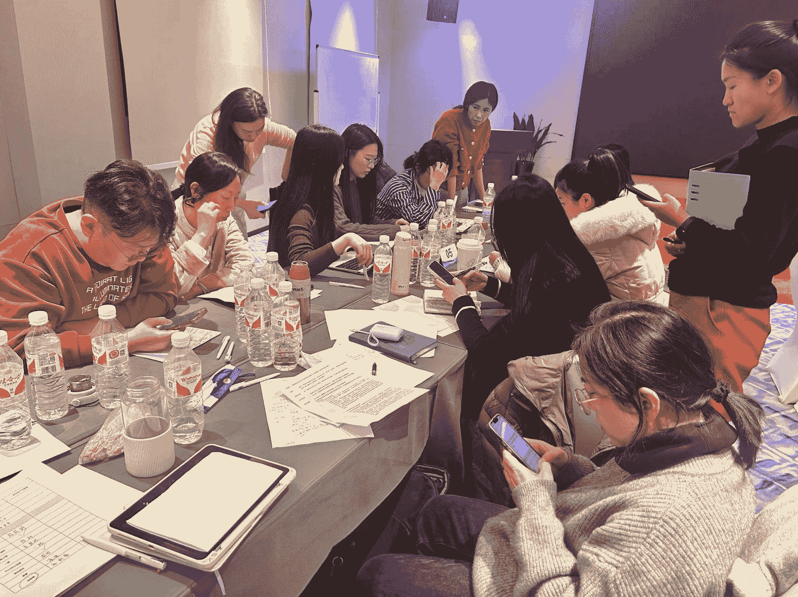
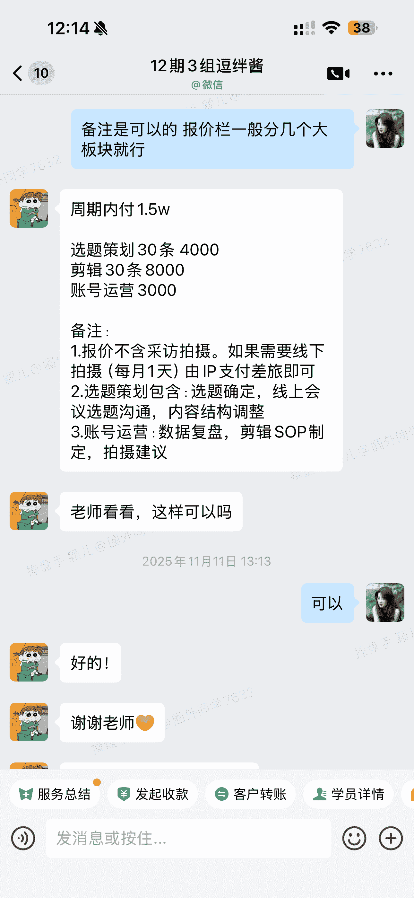
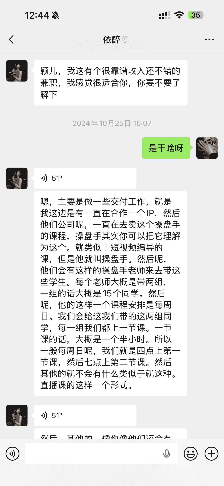
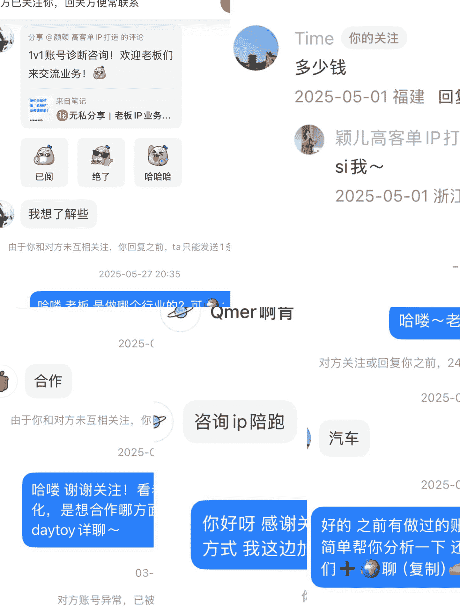

# 从白板职员到独立操盘：用17个关注实现2万首单，再以线下联结拿到6万项目复盘

如果你正卡在公司里，却已经开始琢磨第二条收入曲线，或者想把一份工作经验慢慢迁移成可自我定价的能力，这篇拆解也许能给你参考。

我不是名校出身，也没在头部平台履历，资源谈不上多。

2022年毕业后，我在一家约百人规模的教育公司起步，从私域跟进、学员支持等基础岗位做起。2025年3月离开后，开始聚焦IP操盘的交付服务。线下圈层、个人动态和小红书的持续输出，让我跑出了第一波高客单的验证。主线工作之外的这些成果，后来都成了关键的信誉资产。

- 2025年离职不久，小红书新号仅17个关注时，一篇阅读不过三百的笔记，给我带来5位高度匹配的企业主咨询，当场就落定了一笔两万余元的IP全案委托。

- 2025年7月，借着线下活动我再拿下一笔6万元的操盘合约。该业务后续数据表现稳定，也成为我对外介绍的核心案例。

这些数字不算夸张，但对刚脱离组织的那段时间而言，意义在于验证：职场里沉淀的能力，可以脱离编制，被市场单独买单。文章想做的不是炫耀，而是还原——为何IP操盘对一类普通人而言是切入一人公司的合理路径，以及如何进入、如何操盘的完整链条。

## 一、从杂事里长出可迁移的商业肌肉

### 普通岗位该攒什么

2022年入职时，我没有完整的工作履历。公司旗下有一家做短视频赋能的子品牌，内部有不错的内容资源，当时服务过的IP还有知名综艺导演。

起初这些和我关系不大，我更多是补位角色。

公司正处成长期，多数流程仍在试错。每日最大的焦虑是被认为没有贡献，被淘汰后再次求职。身为小镇出身的年轻人，这种不安持续了很久。

于是我开始主动约主管交流，问自己还能补什么缺口。渴望成长，也渴望被认可。幸运的是，领导愿意给我试错空间。

随后公司启动达人及商家短视频陪跑计划，我加入群组学习。不到一个月，我开始在学员面前做线上分享。从单节分享到带一期七节课的训练营，每期约百人，期间也孵化出百万播放内容及数十万营收的案例。

说起来轻松，对当时的我却是跨越。因为我本是表达弱、缺乏自信的I人，如何走到讲台，靠的是想留下来的动机。

第一次讲一小时的拍摄课，我准备了两周，做了大量心理建设。上下班和睡前都在反复演练，无人时大声说，有人时心里默念。练习表达技巧、请教同事、模拟实战。

首次正式授课后反馈积极，领导认可，也让同事改观。那次突破的复利至今仍在。

之后我承担带班、授课、辅导、社群运营及销售转化。直播卖过699元的陪跑私课，私域推过5980元的线下两日营，还做过平台分享、编导运营等岗位。因与负责人距离近，我得以接触产品设计、经营决策与商业逻辑。

哪里有缺口去哪里，哪里有成长去哪里。表面看是“打杂”。

我想说的是，普通职场人应善用所在组织，熟悉商业运转。你的上级如何设计产品？如何服务客户？组织在不同阶段做何判断？这是通往个体经营的第一步，也是触手可及的一步——最近的商业样本。

与盈利相关的能力，销售、流量、内容、表达，乃至专业技艺，只要掌握一两项，都会持续为未来加分。

回看那段日子，最值钱的不是把某个点练到极致，而是触达了生意全链路。我的小红书首单客户，正源于对商业闭环的理解。

我逐渐明白，想独立获酬，不能只会一个动作。

要懂用户、懂表达、懂成交、懂交付，也要明白产品背后是怎么搭建与运转的。

## 二、为何IP操盘对渴望商业的人友好

对缺少背景的普通职场人而言，选择这个赛道有四个现实理由。

第一，操盘人才需求在扩张。过去是数量增加，现在是质量要求提升。众多老板、商家、个体创作者，并非缺专业，而是不会呈现、不懂获客、不懂线上转化。

行业体感很明显，这类老板大量存在。即便到2026年，多数仍处探索阶段，对内容获客没有稳定路径。只要圈子还在，大家会不断问：如何拍摄、如何定位、如何出爆款、如何引流、找何种运营。

市场在呼唤更成熟的操盘手，且会长期需要。现在不只是企业主做IP，超级个体、咨询师、培训师、服务商、自由职业者都在做IP。

以前IP是可选项，现在是必选项。只要需要用内容建立信任、获客、成交，就需要有人做定位、策划、表达与运营。

第二，深度服务者的供给有限。真正的IP操盘不是写文案剪视频，而是要读懂业务、产品、用户、表达习惯与转化路径。因此一个成熟操盘手一年能深度跟进的IP数量受限。

需求端庞大，供给端难以规模化，大多以一对一或一对二三的形式协作，供需失衡明显。

一线信号也很清晰。我带过操盘学员，成员有职场人、宝妈、大厂从业者。很多此前不在本行，聚焦IP服务后，两三个月即接到项目，且多为全案，报价多在一万以上。

新手。

——学员报价参考，后来我参加线下活动也有同感。只要自我介绍是IP操盘，且对方有业务和获客意愿，基本都会感兴趣并主动加聊。（关于离职后线下触达的细节后文会展开）

项目高峰时，我手上同时有四五个项目，节奏非常紧。

红利不等于人人易赚，而是指需求已现，愿意深度学习并认真交付的人，有机会抢占先机。

第三，能力复利。IP操盘是综合能力的集合。它逼你训练商业理解、用户洞察、内容策划、表达包装、流量判断、销售转化、项目交付与沟通谈判。

这些能力既能服务客户，也反哺自身事业。未来做课程、咨询、社群、工具或个体服务，都能复用。只有沉入真实需求，技能才变成收入。

第四，资源链接。选赛道不仅看收益，还看能接触到何种人群。IP操盘的客户多为企业主、创始人、高客单服务提供者与专业个体。

服务过程中，你会听见他们如何设计产品、判断市场、做决策、管团队、应对增长。也更易获得贵人。

你与谁同频，你就会慢慢向谁靠拢。IP操盘不仅是项目，更是普通人进入商业世界、接触高价值人群、锤炼综合能力的入口。

——图1：与IP私下关系保持良好，学习邀我同行  
——图2：合作结束后仍常联系并推项目，关系信任  
——图3：给予充分尊重，操盘手与老板是平级对话，价值感由此建立

身边逐渐聚集老板资源，他们既是客户也是事业建议者。

## 三、离职后我只做了两件事

### 离开的理由

我在第一家公司约两年半，2025年3月离职。并非冲动创业，而是组织已无法承载成长，价值感下降，收入有天花板，职场出现一眼望到头的疲惫。

真正促使我改变的，是2024年底的一份兼职操盘。

当时带的学生多为想转型的职场人。

他们学习操盘能力以便未来接单。我亲眼看到很多人三个月内就拿到市场订单。

这让我自问：既然跨行者都能切入，我已有知识付费经验、内容与直播交付经验，为何不能自己出来？

这份兼职强化了我的判断。于是3月初离职后，我没有长时间空窗。3月底便开始承接。

### 做的两件事：走出去+持续显现

离职期我做了两件事。

第一，接受状态并梳理思路。

第二，强迫自己走出去。这是关键动作。我大量搜罗杭州职场、副业、创业、自媒体、女性成长的线下活动。

创业局、副业沙龙、女性成长局、自媒体局，我都参加过。同时频繁更新朋友圈。过去我很少发工作相关，但那段时间我会发离职感受、活动思考、正在做的IP操盘、行业真实分享。

### 被看见

效果超预期。

许多创业者咨询合作，也有朋友推资源。线下交流让我认识到几位长期联系的创业者。

这段经历给我确认：初创个人事业，最怕不是没人买，而是没人知道你在做什么。必须让外界清晰你的定位，不要藏着。

很多机会不是等待来的，而是通过持续表达、持续联结、持续出现后被带出来的。

最忙时一个月五项IP，多为轻服务所以能兼顾。连续一个月无完整休息，出差、居家办公、上课、做内容，经常工作到晚上十点十一点。

客户来源靠转介绍与平台推荐，没有主动拓客。行业特性是：一旦信任建立，客户会把多个业务交给你。客源相对稳定，项目周期也长。

## 四、首单验证：17个关注、300阅读、成交2万余元

### 小红书公域验证

真正让我确信能用能力在公域获客，是后来的小红书。

约4月中，我开始筹备账号。那时不想在视频号抖音露脸，先用小红书试水，也不抱高预期。

没有专业海报、完整报价体系、引流资料。只是梳理可提供服务，便开始发布。共发7篇，多为干货，文笔粗糙，未做复杂运营，只是把想聊的话题列出来，也未盯播放。

其中一篇分享操盘流程与经验，阅读仅300多，关注17。

就是这篇带来5个精准咨询。那些老板上来问的不是怎么学习，而是怎么合作、服务内容、价格。

内容初心是提供价值与被看见。

我惊讶于赛道势能之强：关注17、点赞寥寥的账号也能被老板主动邀约。说明群体极度缺少专业人才，且身边找不到。后续聊天验证了判断。

操盘手甚至不需要大力经营账号，保持一定更新频率即可持续被看见。这是适合普通人的起步法。

### 一周内成交

其中一位老板当即确认2万余元全案。

他后来说，加我是因为笔记有专业感，像是实战者。沟通时我尚未整理完整产品与定价，却坦诚相告，对方反而觉得可靠。迅速约视频会，一周内确认合作。

该IP来自西安，从事IP孵化相关业务，有团队但本地缺专业操盘手。他了解我的经历后特邀我去西安分享。杭州上海北京操盘手集中，二三线城市存在明显人才缺口。一线城市经验对他们是降维打击。

所以策略是：能力足够专业可服务高要求客户；能力在成长期可从下沉市场切入，经验已足够解决其痛点。

## 如何建联与服务

确认后，我先发信息采集表，让IP整理经历与业务。随后开会深入确认，主要四个维度：

1. 熟悉IP人生经历，便于选题输出。
2. 熟悉产品，了解用户画像与产品阶段，为定位铺垫。
3. 了解表达偏好，是讲故事、观点还是干货，确定内容形态。
4. 建立信任与熟悉感。

前采后输出定位方案，内部确认通过即开始约线下采访。

我从杭州飞西安现场服务两天：首日产品梳理+拍摄；次日直播框架搭建+拍摄。一次可储备约30条内容。客户团队也会协助拍摄部分素材。

后续为每周复盘迭代。

对我意义重大。这是第一次通过公域内容拿到高客单。让我意识到高客单不依赖爆款，而依赖精准。几百阅读无所谓，关键是其中是否有目标客户。

对服务型业务，内容价值不只是涨粉，而是让对的人看完后觉得：此人懂我的问题，有能力解决。

更真实的是：客户出现后，我才临时梳理完整服务框架、报价与交付。创业不是准备完再开始，而是开始后被市场倒逼着准备好。

## 五、线下混圈拿下6万合约，打破传统内容模式

### 线下活动带来6万项目

2025年7月，我通过一次线下活动拿到6万元操盘项目。当时我是某C端项目合作操盘手，B端项目需线下支持，原为给学员的机会，我也参与。资源聚集地才能被看见。

线下课中服务该老板，简单交流，晚餐时他聊到想深度落地IP的计划。因他已在现场，痛点明确，后续合作推进顺利。

### 服务思路

客户做企业销售体系陪跑，属于B端高客单业务，专业度高，销售管理经验深。

但困境是：2020-2021年他在抖音发过短视频，数据不错且赚过钱。后因同行抄袭，感叹内卷而停更。2024年底-2025年初重启内容，多为坐播讲干货或数字人、AI呈现，数据未有突破。

我接手后系统诊断，得出结论：

很多人以为，做 B 端 IP 就必须把内容讲得足够专业、足够深，结果视频却始终没有传播。

但真正的问题，往往不是专业能力不够，而是表达形式没有适配短视频。

这个客户本身非常擅长讲行业知识、销售管理和实战经验，也不愿意追热点，更不喜欢编一些空洞的内容。我们没有改变他的核心优势，也没有把他包装成一个完全陌生的人，而是保留原有干货，只重新设计了内容呈现方式。

原本偏授课、偏说教的表达，被调整成了更适合短视频的对比结构。

比如围绕：

“普通销售团队如何管理”  
“顶级销售团队如何管理”

通过两种做法的对照，拆解中小企业在销售团队管理中的常见误区，以及更有效的解决方案。

由于客户不方便露脸，画面进行了打码处理。

内容依旧是非常垂直的 B 端销售管理知识，甚至可以说并不轻松，但形式变化之后，用户能更快抓住重点，冲突感更明显，观看和转发的意愿也更强。

调整完成后，账号的数据迅速跑了起来。

几条纯 B 端干货视频，转发量达到 5000 多；其中两条视频带来 6000 多新增粉丝。内容爆发后，这个账号一度成为行业案例，同时直接带来了 20 多个私域客户。后续在陪跑过程中，我们继续优化内容形式、私域承接和产品设计，相关课程最终成交超过 100 单。

对一个 B 端 IP 来说，这已经是非常不错的结果。

这个案例最值得借鉴的地方是：

很多 B 端干货本身有价值，却天然偏枯燥，和短视频强调的节奏、画面感以及传播逻辑存在冲突。

但解决方案并不是放弃专业，也不是强行做夸张、娱乐化的内容，而是在两者之间找到合适的平衡：

专业内容保留，表达方式重做；  
核心观点不变，用户理解成本降低；  
不牺牲干货，同时让内容更符合短视频的观看习惯。

说到底，就是把真正有价值的专业知识，用用户听得懂、看得下去、愿意转发的方式讲出来。

## IP 操盘手究竟如何服务客户？

很多人对 IP 操盘的理解，还停留在帮老板发布视频、写几篇文案，或者替客户做账号代运营。

但真正的 IP 操盘，起点并不是账号，而是客户的业务目标。

它要解决的，也不只是“今天发什么内容”，而是围绕一个人的商业价值，逐步打通：

定位、内容、表达、流量、信任与成交。

一个相对完整的老板 IP 项目，通常可以拆成五个阶段。

### 第一阶段：前期筹备

签约之后，我通常会先让客户填写一套基础资料，内容包括：

业务情况、产品信息、目标客户、过往内容、成交路径、个人经历以及团队现状等。

但这些材料不会成为全部判断依据。

如果条件允许，我还会进一步访谈客户员工，了解团队成员眼中的老板是什么样的人；查看真实成交案例，分析客户为什么选择他；如果客户有线下活动、课程或服务现场，也会尽量去了解真实用户是谁，他们为何到场，以及最终被什么因素打动。

因为一个 IP 不能只依赖老板对自己的描述。

我们还要知道：

员工如何评价他；  
客户为什么相信他；  
市场真正愿意为哪些价值买单。

### 第二阶段：定位设计

完成前期访谈和调研后，会形成一份完整的策划方案，通常包括：

商业定位、内容定位、账号策略、选题方向以及具体呈现形式。

不过，这份方案不会直接拍板执行，而是要和 IP 本人充分沟通、反复对齐。

因为 IP 操盘不是操盘手一个人想当然地决定方向，而是需要找到四者之间的交集：

客户愿意持续表达，用户愿意观看，平台具备传播条件，业务能够完成承接。

只有这几个部分同时成立，定位才真正有价值。

### 第三阶段：拍摄执行

方向确认之后，会进入第一轮选题规划。

哪些内容适合现场采访，哪些内容需要提前准备逐字稿，哪些内容必须提前采集素材，都会在拍摄前安排清楚。

通常会集中一到两天完成拍摄。拍摄完成后，还要继续参与内容审核，确保最终成片没有偏离前面确定的定位。

常见的内容形式包括：

1. 提问采访类；
2. 日常记录或 Vlog 类；
3. 逐字稿表达类；
4. 深度访谈类；
5. 其他根据业务和个人特点定制的形式。

没有一种模板适合所有 IP，具体采用什么方式，要看客户的业务属性、表达习惯和内容目标。

### 第四阶段：发布运营

视频发出去，并不意味着项目完成。

通常每周都要进行一次运营复盘，重点观察：

哪些内容获得了更好的数据；  
哪些选题带来了真实咨询；  
哪些视频虽然播放量高，但客户画像不够精准；  
下一阶段应该如何调整选题与表达。

IP 运营不能只盯着播放量。

更重要的是有没有精准咨询，有没有私信，有没有导入私域，有没有完成成交，以及哪些内容值得继续放大。

### 第五阶段：项目总结

项目阶段性结束后，还需要做一次系统复盘。

包括：

跑通了哪些内容方向；  
哪种表达方式最适合这个 IP；  
哪些选题可以长期延展；  
未来账号应该如何持续运营。

所以，在我看来，IP 操盘手并不是一个单纯的内容执行岗位，而是需要帮助客户贯通“定位—内容—流量—信任—成交”的综合角色。

优秀的 IP 操盘，不是替客户编造一个人设，而是把客户真正有价值的东西提炼出来，并清楚地传递给市场。

## IP 操盘手有哪些赚钱方式？

这个行业并非只有一种收费模式。

随着能力、经验和交付深度不断提升，常见的变现路径大致包括：

- IP 定位咨询；
- 月度内容陪跑；
- 创始人 IP 全案服务；
- 企业内容团队顾问；
- IP 操盘手培训与带教；
- 长期合伙或项目分成。

刚开始并不建议直接承接很重的全案项目。

更适合普通人的方式，是先从短周期、轻交付的陪跑服务开始，尽快获得第一个真实反馈。

等你逐渐积累出案例、流程和方法，再向更高客单价、更深层次的服务升级。

这个赛道的优势就在于：

既可以用小服务低成本验证自己的能力，也能够随着经验提升，逐步进入更高价值的项目。

## 哪些人适合成为 IP 操盘手？

我确实看好这个方向，但它绝不是一个“什么能力都不用准备，就能马上做好”的项目。

它更适合以下几类人：

- 愿意持续研究内容和表达；
- 理解基本的用户决策与成交逻辑；
- 具备沟通能力和客户服务意识；
- 对销售、流量和用户需求感兴趣；
- 不排斥和老板、创业者长期合作。

相反，下面几类人可能并不适合：

- 只想完成简单执行，不愿意承担判断的人；
- 只想发号施令，却不愿意亲自下场的人；
- 抗压能力较弱，无法接受项目变化和结果不确定的人；
- 只会机械套用模板，不愿根据不同 IP 灵活调整策略的人。

这个领域确实有机会，但机会不代表没有门槛。

它的门槛未必来自学历、资源或过去的头衔，而是来自你是否愿意真正理解业务、面对客户、承担结果并解决实际问题。

## 想进入这个赛道，可以先做哪四步？

如果你目前还在职场中，但未来想做副业、OPC 或超级个体，我不建议你马上辞职。

可以先按照下面四个步骤逐步验证。

### 第一步：建立商业视角

你所在的公司，就是离你最近的一所商业学校。

观察它靠什么赚钱，产品如何设计，客户是谁，流量从哪里进入，销售如何转化，交付又是怎样完成的。

很多人在工作中只关注自己的岗位任务，但如果未来想独立做项目，就不能一直停留在岗位视角，而要开始用商业视角理解公司。

此外，也可以通过相关学习圈子补充基础商业知识，建立对业务、流量、销售和交付的整体认知。

### 第二步：训练通用能力

尽可能靠近内容、销售、客户沟通、项目交付和结果复盘等工作。

初期不需要马上做到优秀，但一定要亲自经历过，形成真实体感。

同时，可以系统学习一些内容和运营知识，先搭建整体框架。市场上的课程价格差异很大，不必一开始就投入大量时间和资金。哪怕从一门基础的小 IP 运营课开始，也能获得不少启发。

很多内容工作的底层逻辑是相通的，关键不是一开始学得多贵，而是能不能转化为实际行动。

### 第三步：完成一次最小服务验证

这一步非常关键。

你可以从以下事情开始：

1. 帮一个老板做账号诊断；
2. 为朋友梳理一次 IP 定位；
3. 制定一轮内容选题计划；
4. 提供一次短周期陪跑；
5. 做一次低客单价的试交付。

可以优先选择身边已经拥有成熟产品的朋友作为练习对象。

第一次服务不一定要收很高的费用，重点是完整走过一次项目流程，获得真实手感。之后，再带着案例去连接更多潜在客户，逐步积累。

你也可以先经营自己的账号。

自己的账号一旦跑出结果，不仅能形成长期复利，还能作为案例，帮助你服务更多想做 IP 的创业者。

不要一开始就执着于打造所谓“完美产品”。

更重要的是先验证：市场是否愿意为你的能力付费。

### 第四步：持续沉淀案例和方法

每完成一个客户项目，都要记录和总结：

客户最初遇到了什么问题；  
你做出了哪些判断；  
具体调整了哪些动作；  
最终产生了什么结果；  
哪些流程可以复制；  
哪些经验可以整理成公开案例。

普通人做 OPC，最容易陷入的问题就是每接一单，都像第一次开始。

真正有效的做法，是把每一次交付都沉淀成下一次成交的资产，让经验不断复用，让能力不断增值。

## 结尾：选择一条能让自己持续升值的路

我并不是天生擅长表达，也不是一开始就很懂创业。

只是因为不想被时代和职场淘汰，所以在工作中持续靠近新的机会；又因为看到了真实的市场需求，才一步步走进 IP 操盘和一人公司这个方向。

这段经历让我越来越确定：

普通人不一定要拥有显赫背景，才有机会成为超级个体。

但你必须主动进入有增长空间的领域，补足商业基本功，亲自服务客户，亲自完成销售，也亲自承担交付结果。

不要只盯着别人正在做什么、什么项目眼下最赚钱。

更应该思考：这件事能不能让你在未来变得更有价值。

当你关注长期能力和长期积累，才更容易持续行动。

对普通人来说，真正值得选择的方向，不一定是最热闹、最容易被讨论的方向，而是能够让你不断接近高价值问题、高价值客户和高价值能力的领域。

对我而言，IP 操盘手就是这样的入口。

它让我从职场中的执行者，逐渐开始理解内容、销售、交付与商业闭环，也让我第一次清晰看到，自己确实有可能成为一家“一人公司”。

一个真正有价值的项目，不只是让你短期赚到一笔钱，更应该让你拥有持续赚钱、解决问题和创造价值的能力。

————分割线————

看完一套 SOP，很多人会觉得自己已经掌握了方法。

但真正到了执行阶段，绝大多数人仍然会卡在第一步。

教程和工具只能构成最基础的门槛，真正拉开差距的，往往是马上行动，以及你能否接触到一手的圈层信息。

如果你想了解最新的变现方法，并且和一群执行力很强的人一起进入实战、拿到结果，欢迎关注我的核心私域：【懒人专属群】。

这里不讲空泛理论，只拆解商业闭环，并持续挖掘 AI 在效率提升上的实际用法。系统内已经沉淀了 1000 多个跑通的套利实战案例。

👉 查看圈子完整数字资产与加入门槛：

https://lazyso.com/insider/

如果你认同长期价值，也准备真正下场执行，可以扫码添加我的微信：lazyhelper1。

添加时备注：【实操上车】，不闲聊。