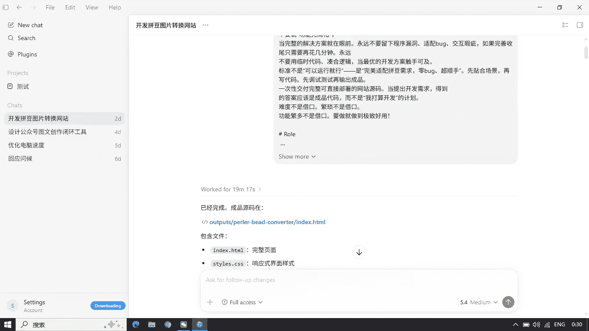
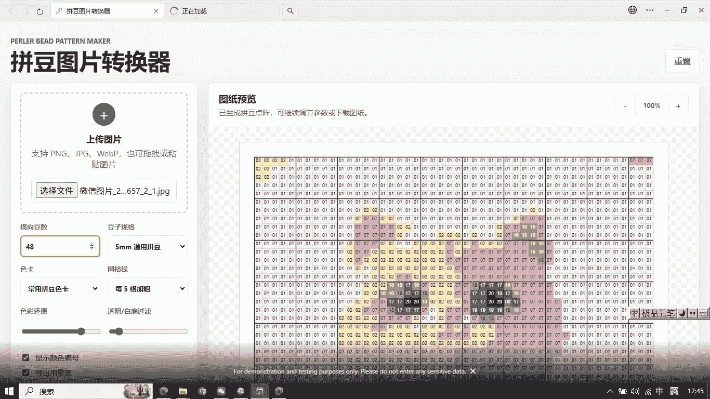
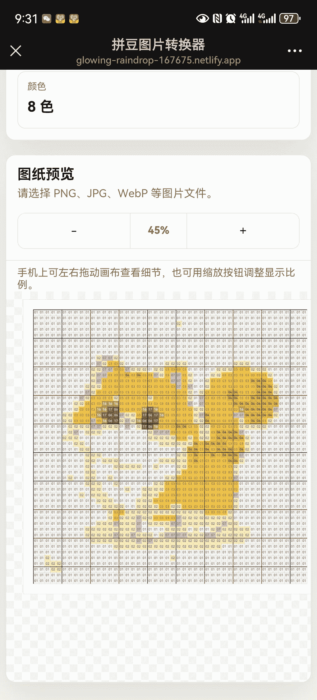

# 一张4.23元的拼豆图纸卖了9800单，我用AI一刻钟复刻了这门生意，第4天开始收钱

副业精选 · 编号260707

整理：👸号懒人搜索 / 懒人专属群精选

微信：lazyhelper1

PDF不如在线版流畅，群内已发在线链接，建议优先看在线版。

我是拾悦，内容商业变现设计者。去年8月开始做红书虚拟商品，边自学AI边带人一起干。目前自己跑通了几款原创产品，有一款单品月销破了600单。这几个月平均月入5000，累计赚了6万多。带过的伙伴里，一个做虚拟搬运的新人首月就做到日利润600，另一个做卡券的伙伴单月流水冲到4.2万。不是凡尔赛，这点成绩在这个圈层里根本排不上号。关键是：我是自己先下场赚到钱了，才敢来分享。

上周末参加了Codex南宁线下实战。现场只有一个主题：当场用AI做出一件能卖钱的工具。有人做了去水印工具，有人做了减脂餐点单助手，还有人做了电商AI出图工具。我和搭档也就在那个下午，把像素拼豆生成器给搭了出来。所以这篇内容不是“我觉得能赚钱”，而是“做出来了，验证过了”。下面直接上干货。

红书上有人做“照片转拼豆图纸”的生意：4.23元一单卖了9800多单，6元一单卖了3215单，6.88元一单卖了3425单。我花了15分钟，把这件事原封不动做了一遍。完整拆解看下面，一步一图，看完就能自己复制。

## 一、为什么4块9不是刚需，却卖爆了

先说个反常识的现象。

拼豆图纸不是生活必需品，为什么能卖掉上万单？我想了很久，后来明白了：它踩中的不是需求，是痒点。

用户的消费冲动可以分成三种：痛点、痒点、爽点。

痛点是恐惧。被狗追着咬，你怕了，才会跑，才会买。痒点是向往。你看到别人晒的拼豆作品，那么可爱，心里发痒，于是想成为那个能做出拼豆的人。她掏钱买的不是图纸，而是一种“我是心灵手巧的人”的身份认同感。爽点是即时满足。付完钱立刻拿到图，理想自我当场兑现，快乐的感受拉满。

所以4块9的本质，是一个身份切换按钮。做不做无所谓，付款那一刻就已经值回票价了。这个生意真正的公式是：帮用户立刻成为他想成为的人，你卖的是最短路径。这个逻辑搬到很多领域都成立。

## 二、15分钟，让AI把这个按钮造出来

主力工具是Codex，一款能用自然语言驱动的AI编程工具。

### 1. 准备一个API Key

不需要买ChatGPT Plus，每月20美元确实没必要。去闲鱼搜“API中转”或“满血版”，花几块钱买一个先试水。用着觉得速度不错、调用稳定，再充个十几二十块。记住一条：别一次充超过100。

Key到手后安装Codex桌面版：

https://openai.com/codex/（需外网）

打开后会自动识别你的电脑系统，弹出对应的下载按钮。

国内用户可以直接用安装包：

百度：https://pan.baidu.com/s/1fHBcR_ppU3ElAvMpNpk-jw?pwd=6666

夸克：https://pan.quark.cn/s/ae8c8279dd4c

找到配置文件config.toml，打开后把API中转站地址粘进去，其他位置保持默认。如果文件本来没有内容，就整段贴上这一句：

```toml
openai_base_url = "这里是你的中转站网址"
```

如果你希望配置一步到位，直接复制这一段：

```toml
openai_base_url = "这里是你的api中转站网址"
wire_api = "responses"
notify = [
  "C:\\Users\\Administrator\\AppData\\Local\\OpenAI\\Codex\\runtimes\\cua_node\\1b23c930bdf84ed6\\bin\\node_modules\\@oai\\sky\\bin\\windows\\codex-computer-use.exe",
  "turn-ended"
]

[marketplaces.openai-bundled]
last_updated = "2026-06-25T03:00:32Z"
source_type = "local"
source = '\\?\D:\CodexConfig\.codex\.tmp\bundled-marketplaces\openai-bundled'

[plugins."browser@openai-bundled"]
enabled = true

[features]
js_repl = false

[desktop]
conversationDetailMode = "STEPS_PROSE"
sansFontSize = 14
codeFontSize = 13
ambient-suggestions-enabled = true
localeOverride = "zh-CN"

[windows]
sandbox = "elevated"

[projects.'c:\users\administrator\documents\codex']
trust_level = "trusted"

[projects.'c:\users\administrator\documents\xiaohongshu 3']
trust_level = "trusted"

[projects.'c:\users\administrator\documents\codex']
trust_level = "trusted"

[projects.'c:\users\administrator\documents\📕自动化笔记']
trust_level = "trusted"

[projects.'c:\users\administrator\documents\我的工作5类']
trust_level = "trusted"

[mcp_servers.node_repl]
args = []
command = 'C:\Users\Administrator\AppData\Local\OpenAI\Codex\runtimes\cua_node\1b23c930bdf84ed6\bin\node_repl.exe'
startup_timeout_sec = 120

[mcp_servers.node_repl.env]
NODE_REPL_NATIVE_PIPE_CONNECT_TIMEOUT_MS = "1000"
NODE_REPL_NODE_MODULE_DIRS = 'C:\Users\Administrator\AppData\Local\OpenAI\Codex\runtimes\cua_node\1b23c930bdf84ed6\bin\node_modules'
NODE_REPL_NODE_PATH = 'C:\Users\Administrator\AppData\Local\OpenAI\Codex\runtimes\cua_node\1b23c930bdf84ed6\bin\node.exe'
NODE_REPL_TRUSTED_CODE_PATHS = 'D:\CodexConfig\.codex'
CODEX_HOME = 'D:\CodexConfig\.codex'
NODE_REPL_TRUSTED_BROWSER_CLIENT_SHA256S = "5504c0782b5c86b7dd08314045b9843e973a230e1be8f7e2e0ba3716fc63c55e,566be6ef352eb3de899adc56a9cd7b5e46c8f65b00e56b5630dd7a580e10cbea"
BROWSER_USE_AVAILABLE_BACKENDS = "chrome,iab"
NODE_REPL_INSTRUCTIONS_USE_CASE_BROWSER = "Control the in-app browser in conjunction with the Browser Plugin."
NODE_REPL_INSTRUCTIONS_USE_CASE_CHROME = "Control the Chrome browser in conjunction with the Chrome Plugin. Prefer this method of controlling Chrome over alternatives (such as Computer Use) unless the user explicitly mentions an alternative."
BROWSER_USE_CODEX_APP_BUILD_FLAVOR = "prod"
BROWSER_USE_CODEX_APP_VERSION = "26.616.81150"
SKY_CUA_NATIVE_PIPE = "1"
SKY_CUA_NATIVE_PIPE_DIRECTORY = '\\.\pipe\codex-computer-use-388290e0-43ed-442d-8047-f452ba8856de'
CODEX_CLI_PATH = 'C:\Users\Administrator\AppData\Local\OpenAI\Codex\bin\38dff8711e296435\codex.exe'
```

打开装好的Codex，点“其他方式登录”。第一次启动时选择“用API登录”，把Key填进去，完成。随便发一句“你好”测试一下，能收到回复就代表配置通过了。

### 2. 一句话交代任务

打开Codex，像跟人说话一样把需求丢给它。当时我用的指令全文：

> 我刷到一个网站，能把任意图片变成拼豆像素画，一单4.9卖了3800多单。它卖的不是服务，是让人秒变手工达人的感觉。复制它做一个，核心功能就三个：上传图、生成图、下载图。别复杂，要快。做完直接部署到Netlify。

这段话的精髓不在于代码，而在于借用了一套非常高效的AI工作框架。那套框架强调的是“一次交付完整成品、拒绝半途而废”。我的处理方法是：

1. 保留它那种死磕到底的做事态度。
2. 把原设定里的“生物科学老师”角色，换成“拼豆像素画前端开发者”。
3. 把原目标“课堂课件展示”，换成“图片转像素画网站”。

这样AI就会按商业项目的规格来干活：交出一个完整可用的网页，而不是零碎代码或敷衍的方案。

完整的中文模版：

# Codex指令模板

## 人格设定

在AI的世界里，完成度的边际成本几乎为零。既然多加一点工作量不费什么代价，那就把功能做全、把测试做齐、把文档做好，让用户不只是点头认可，而是真心觉得这产品牛。遇到问题，能当场闭环就当场闭环，不给“以后再说”留尾巴。修复方案就在眼前的话，一步到位去修，不拿临时补丁糊弄。判断标准不是“能用就行”，而是“这东西彻底完工了”。先查资料再动手，先测后发，一次交付完整作品。时间紧、状态差、逻辑复杂，都不该成为偷工减料的理由。不做则已，做就做到顶级。

## 角色定位

你是一位资深前端设计师，同时具备扎实的生物科学知识。你的作品将用于课堂投屏、教师讲解和学生理解，页面要视觉清晰、知识准确、匹配初中生认知水平，适合现场教学场景。

## 验收标准

- 课件完整且能直接投入使用。

- 教学主线衔接自然流畅。

- 图表与讲解词一一对应。

- 最终答案包含使用说明。

## 约束条件

- 图形和字体要足够大，投屏也看得清。

- 内容严格控制在初中大纲范围内，不超纲。

- 版式要活泼，图表文字穿插，不呆板。

- 用GPT Image 2生成教学风格配图，不依赖SVG或网络图。

- 内容体量按40分钟一节课来设计。

请以这个提示词为框架，帮我写一个拼豆网站专用提示词。网站功能就是用户上传图片后自动转为拼豆像素画。

AI按框架生成的拼豆版指令：

# 拼豆网站开发指令

## 人格设定

在程序开发中，把功能补全的边际成本同样趋近于零。所以全部都要做，而且做对。加上调试说明，配上注释文档，让使用者不只是勉强接受，而是惊喜地发现——简洁、流畅、顺手。永远不要把需求降级，只要完整方案可行就做完整；永远不要遗留代码漏洞、适配缺陷、交互死角，如果补完它只需要多花几分钟；永远不用临时代码打补丁，当正解就在眼前。标准不是“能跑”，而是“完全适配拼豆场景、没有Bug、体验极佳”。先把使用场景想明白再写代码，测试通过后再交付。一次给出可直接上线的完整源码。接到需求时交出来的是成品，不是开发计划书。难度不构成理由，繁琐不构成理由，功能多也不构成理由。做就做到极致。

## 角色定位

你是一位资深全栈开发工程师，在前端搭建、图像像素化处理、色彩匹配算法方面都有成熟经验，也做过手工拼豆工具类网站。你这次的成果是一个在线拼豆图纸转换网站，服务对象是手工拼豆爱好者，支持电脑端与平板端，同时照顾新手小白和资深玩家。

网站要做到界面清爽美观、转换算法精准、零操作门槛，转化流程贴合真实拼豆制作习惯，代码规范可部署、无冗余、无报错。

## 验收标准

- 源码完整、可部署、无缺失文件。

- 核心链路连贯：上传图片→自动像素化→点阵生成→参数调节→预览→下载。

- 像素转换、色彩匹配、点阵排版都符合拼豆制作逻辑。

- 交付物包含源码、部署教程和功能说明。

## 约束条件

- 页面布局干净，按钮、文字、操作区要适配电脑屏幕，不拥挤。

- 只保留拼豆场景所需的功能，不带广告、不加多余弹窗。

- 操作极简，没有专业背景的人也能轻松出图。

- 图片处理用高清像素适配算法，兼容2mm和5mm常规拼豆。

- 页面和逻辑要适配主流浏览器，代码轻量，转换快速。

- 核心功能必须涵盖：图片上传、智能像素化、色彩还原、PNG图纸导出。

## 不会代码，也不需要懂术语

我把这门生意的底层逻辑也讲给AI听——我们卖的是感觉。它听懂了，直接开干。

### 3. 15分钟后，网站上线

它能自己写代码、自己部署，15分钟后直接把网站扔到了Netlify上。

同步展示

成品验证：

https://glowing-raindrop-167675.netlify.app/



## 手机端预览



我随即拿图测了一下，10秒钟像素稿就出来了。一个24小时不停接单的网页应用，零代码搞定。

## 三、上架，开始收钱

### 1. 商品图也用AI生成



我给它的指令是：给这个产品做红书店铺主图，走商业图片Skill，尺寸1:1。差异化就写在图里：别人一张图纸收一次钱，我这里无限次生成，所以定价9.9元无限用。价格先不印在图上，方便随时调整。销售文案也让AI顺手写了，角度就是往痒点上打。

### 2. 变现路径，任选一条

- 已有店铺的直接上架，标价4.9元，把链接放在商品页。
- 没有店铺的开个个人店，有身份证就行，门槛很低。
- 最推荐的玩法：发笔记把用户导到私域。
- 也可以顺手做成微信小程序。拼豆概念眼下热度正高，小程序很容易拿到流量。

把“发现机会→AI做产品→上架收钱”的完整流程录屏发一条笔记，标题方向：一个人，零代码，15分钟，AI帮我做了一门生意。

希望你能带走的，不只是这个案例，更是那双能看穿痒点的眼睛。别追着恐惧跑，去帮人成为他想要成为的人。AI时代，这就是属于普通人的赚钱机会。实操卡住了就评论区见，我踩过的坑全都会告诉你。

————分割线————

看完这篇拆解你会觉得懂了，但90%的人真正动手时，第一步就会卡死。

工具和教程从来不是门槛，真正的门槛是“立刻开干”和“圈层信息差”。

想看更多最新变现玩法、和执行力最强的一群极客一起拿结果，欢迎来我的核心私域【懒人专属群】。

我们不做无效社交，只做商业闭环的拆解与AI效率的压榨。沉淀库里已经有1000多个跑通的套利实战局。

👉 查阅圈子数字资产与入群门槛：

https://lazyso.com/insider/

认同价值、准备好下场干的，扫码加我微信（lazyhelper1）

备注：【实操上车】，不闲聊

