# 从YouTube日入万元到视频号百万GMV：这批AI视频玩家到底抓住了什么？

> 一个圈层，500多个变现账号，400亿播放量，却在一夜之间被平台清洗；转身国内，一周内测跑出单条300万播放、单日8000的转化，21天做到100万GMV——这不是运气，而是过去一年里真实踩坑踩出来的路径。

## 01 我们经历的风口，和教训

大家好，我是龙哥。过去一年我和波妮一起带赚钱的AI视频深海圈在YouTube深耕，赶上了几波正好能用的浪。

去年年初，我们是最早一批把AI视频做成循环直播的，带着圈友开了几百个YPP账号；年中开始复刻真人形式的内容，累计播放破几十亿。下半年把半自动的工作流推开，K-pop猎魔女团那波AI视频在全网扩散，其中一半以上来自我们圈，拾风的单条冲到13亿播放，上了YouTube年度榜第13，连MrBeast都没进前十，这条最初只是我们一次作业点评的产物。

年底到年初，我们开始拓语种，英语、西语、葡语、德语同步打。四年年华的伙伴把YouTube短视频单账号单月做到将近3万美金，带货GMV做到28万美金。Seedance 2.0刚出来，第一批上手的圈友吃到明显红利。

随后平台就来了黑天鹅。从1月到4月，YouTube几乎一刀切清理非真人内容，3D、动画、游戏等匿名频道被重创，深海圈里被波及的同质化账号超200个。这是自24年底以来最重的一次打击。

但这不代表YouTube没戏，也不是AI视频没戏。很多小众赛道的AI频道依然活得很好，这波打击远不止AI，X上的动画卡通3D博主也同样哀嚎。

这次让我们意识到，过度依赖单一平台就会被规则变动牵着走。龙哥哥年前也点过，深海圈不能把自己锁死在YouTube的AI视频上，要做的是AI视频这件事本身，才有10倍100倍的可能。

所以我们没放弃YouTube，只是把定位改了：YouTube变成重要的分发和变现渠道之一，而非唯一核心。年初后，我们一边继续深耕YouTube，一边探索海外内容和AI视频的其他变现方式。

4月，我们带一小批新手测试国内AI视频引流、私域服务变现，一周内测跑出单条300万播放、单人单日变现8000的案例。

5月，我们带一小批YouTube老手从零做视频号AI短剧自然流带货，21天内测做到100万GMV。其中在我办公室操作的两个朋友，大臣教练和我女朋友，6月到现在已超50万GMV。

回顾这一路，风口踩过，坑也踩过。模型迭代、平台波动、赛道更迭都是表象。AI视频项目的本质，是用AI视频满足需求、拿到有效流量、产生商业价值的能力；变现的本质是认知和执行力。

本篇分享分三块：
1. 最近跑通的两个内测玩法，以及选项目的思路；
2. 两年里通过AI视频拿到结果的圈友都做了什么；
3. 我对AI视频趋势的判断和机会点。

## 02 最近跑通的两个小项目

都是小规模测试，量不大但体感很新，能侧面反映趋势。

### 一、AI复活亲人：引流到私域变现

逻辑很直接：做“变身成已故亲人”的爆款AI视频，引导用户加🛰️，付费生成他们自己的亲人、宠物、朋友的视频。

技术上并不难，去年就能做，核心是角色替换。关键在于它同时满足了几个点：

第一，真人+AI的形态，在纯AI泛滥的池子里更得用户和平台信赖，立意正能量，传播阻力小。

第二，爆款元素和真实需求极度契合。变身、真善美、死而复生是天然钩子，观众看到能变身别人的亲人，自然会想自己的亲人是否也能重现。需求足够沉重，以至于加🛰️、付费都显得轻，引流和转化率远高于常规内容。

第三，它代表一类引流玩法，跑通就等于掌握了爆款、引流、转化的闭环。

第四，我们有深海圈，能复制。

内测只做了一周就通了。大多数人都出了爆款，最突出的元宝圈友，单条抖音320万播放，🛰️加满到风控，单日变现8000，还在帮别人分单。

项目门槛极低，所以4月做爆后很快被跟风。

复盘大家的共同收获：克服了不出镜的心理障碍；学会像素级复刻爆款；学会用抖音、📕、视频号导🛰️；克服了不敢收费的心理障碍；最关键是明白价值不在于爆款，而在于满足真实需求。

复活亲人只是用户需求里一个被挖掘的机会。发现需求、快速响应、占领市场，比做一条“高质感”的AI视频重要太多。

只要需求有强情绪、强结果、愿意付费，AI视频就能作为入口。

### 二、视频号AI短剧带货

5月同时测了YouTube带货和视频号短剧带货。

YouTube带货目前仍不成熟，体量多靠联属营销撑着，可控性一般。平台在推联属，门槛在降，和跨境电商结合有想象空间，这次主要讲视频号AI短剧带货。

这个玩法是老圈友SZ去年3月先跑通的，他分享给我，我们再带大家做。

变现链路大家熟悉：短视频引流→直播间成交→线下供应链结算。只是把真人实拍的剧情换成了AI短剧。

我对象的一条视频重发两次合计约10万播放，卖出约2万GMV，佣金40%左右，推的是金桔零食。爆后导流直播间，真人主播代播承接转化。

本质就是真人短剧带货换成AI版，流程不变。差异点：

产能上，AI能把产量放大10倍到百倍，借助流程一个人一天能出10条短剧；

表现边界上，AI能做出真人难实现的画面，前三秒钩子+剧情堆爆点，像成堆金条、车祸、残疾、可爱小孩都能实现；

成本上，只要承担视频制作和较低运营成本，对比实拍，人力设备时间成本不到十分之一。

为什么选它测试：

AI短剧和过去YouTube AI剧情的流程几乎一致，只是时长变长，经验和工作流能复用；

成本产能对比真人工作室有明显优势，而8-12分钟的时长筛掉了大量个人创作者，形成壁垒；

变现链路风险可控，成本集中在制作，不投流，线下结算快，不受平台次月结算影响；

拓展性强，平台、选题、选品都有空间，海内外都有潜力；

我们有深海圈，市场容量还大。

5月内测数据不错，适合已有成熟AI视频经验的高手。也踩了不少坑：掉原声、掉入口、人脸跳帧、视频成本高、商品差、店铺违规、号主失联……我自己投了几万成本，跑了三十多个号、近200条短剧，估计烧了一万多条Seedance 2.0。

复盘收获：学会全套视频号带货运营和AI带货逻辑；学会复刻5-10分钟AI短剧；理解工作流和矩阵运营的重要性。

国内带货我们仍是新人，算是初步熟悉玩法，欢迎供应链、代播、号商来对接。

## 03 拿到结果的圈友，到底在做什么

项目适合我吗？多久出结果？能赚多少？能做多久？

没有人能给出标准答案，和问买哪只股票一个道理。

我可以分享几个熟悉的案例，看看他们凭什么拿到结果。

### 案例一：四年年华，YouTube单频道月入近3万美金

他9月才加入赚钱，国庆才开始做YouTube，之前是副业新人。成长路径：

小白期→实操学习期→迷茫探索期→突破期→放大期。

突破点在深海圈看到龙珠悬赏AI语言类视频，All in跨赛道迁移思路，稳定产出爆款、开新号，实现单月单频道将近3万美金。

### 案例二：大臣教练，YouTube单频道7亿播放，AI短剧带货60万GMV

00后，比四年年华更早加入赚钱，有过小项目经验。去年3月跟航海做动物故事数据一般，4月和深海圈同步发现AI复刻真人的新玩法。他很快做出过亿爆款，并做了当时很超前的自动化出图工具，实现半流程自动化，产量大幅提升。到7月时已有7亿播放，成为对标账号。

### 案例三：SZ，YouTube月入万刀，视频号AI短剧带货百万GMV

他是创业老手，经历过负债七位数。

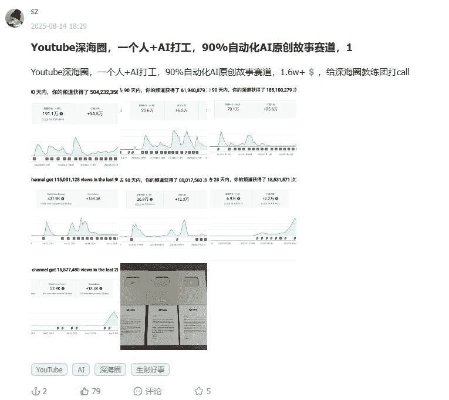

他懂得周期性和红利杠杆。去年基于超级标入局YouTube AI视频，在风向标里找到冷门易做的赛道。打出首条爆款后同步上号、优化自动化流程、扩展脚本边界，7月做到日更10个频道，单月总收益超1万美金，且在未公开的情况下深海圈都不知其内容。

今年他最早在视频号发现短剧带货，依托已有自动化工作流实现量产。当别人手搓一天一条时，他能一天出70条，单人做到超100万GMV，还是在分享给深海圈内测的背景下完成的。

这三类人分别代表：没项目经验也能出结果者、在老项目小成新项目大成者、创业老手抓红利者。

提炼共性：

新手期听话照做最重要。积累经验和能力是前提，认知同步+执行到位。四水能抓住龙珠机会，前提是已熟悉爆款制作，花了两个月才过坎。

机会来时敢做先行者。四水最早做AI语言类Shorts，大臣最早做AI复刻真人，SZ最早拥抱自动化。等别人跑通再动手，吃不到最大蛋糕，前提是有能力积累。

赛道蓝海期果断上量放大。很多人卡在精力、维护、上号麻烦、一个人干不完、不敢招人。但真有那么难吗？

月入5000美金约3.5万人民币，看起来不多。梳理瓶颈会发现：账号管理、复制粘贴式制作、剪辑流水线，这些都可以用AI解决，或用低成本人力解决。真正需要自己做的价值点很少。

Codex/Claude Code约1200元/月能覆盖大部分电脑操作需求；代剪三四十元/小时；兼职管账号统计杂务约4000元/月。多花几千就能省下自己大半时间。

若总想着项目没成时间白费，那还是上班更确定。上班才有时间换钱的确定性。项目里的失败是下一次成功的垫脚石，积累的真实经验在AI时代无法被替代，因为AI给不出未被训练过的答案，而大机会就藏在AI答不出的地方。

## 04 我眼里的趋势与机会

从两年国内外实践总结，变现逻辑正在从泛流量转向精准流量。

我们是YouTube广告分成起家，播放量为王，泛流量变现门槛低、上手快。但下一步趋势是从依赖创作者分成转向产品、服务、带货、IP的精准流量变现。

玩家越堆越多，AI的能力也在以难以置信的速度往上冲，做一条视频的成本和门槛被拉到地板上。泛流量生意越来越卷，平台的监管也越来越紧。年初在YouTube上被创收路径拖累的那次教训就很扎心：把鸡蛋全放在一个受平台支配的变现篮子里，系统性风险会瞬间引爆。

但多条线跑下来才发现，我们过去年复一年沉淀下来的核心竞争力，其实没有变。最值钱的依然是对用户在想什么的理解，对什么能爆的理解。把重心从粗放的播放分成，挪到精准流量的商业化上之后，反而是更少的播放撬动更稳的收入。

给你看两个真实的对比，很直观。

我24年在视频号发的一条AI换脸视频，属于典型的泛流量打法，播放做到1100万，分成到手大概1000块左右。

同一平台，我对象上个月做的带货向短剧，播放只有15万，GMV冲到2万，佣金拿了8000块。配图里那场直播的后台也看得到，1.5万的观播流量里就成交了3000块。

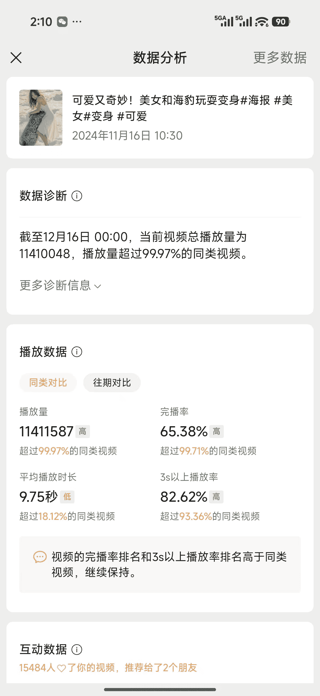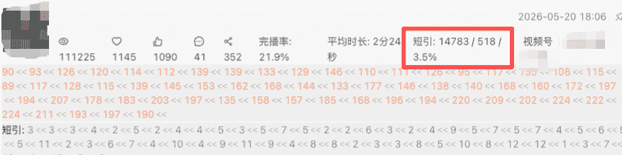

视频时长、制作成本不一样，但制作逻辑几乎是同一种手法。

这不是说平台分成这条路走不通了，无论是YouTube、X还是国内的视频号、抖音，分成这条线依然有空间，我们也在持续做。但大趋势是清晰的：泛流量的门槛和成本在持续下沉，分成模式终将向精准流量变现过渡。

### 二、赛道从吃流量的娱乐，转向能留价值的垂类

过去一年，泛娱乐方向确实很猛。

救援类、动物类、KPOP、真人复刻、语言类Shorts，都打出过爆款，也带来过不错的回报。

可说实话，这些赛道卷得太快了，往往做不了多久就会被模型和同行迭代掉。模型越来越强，复刻越来越简单，平台对同质化的容忍度也越来越低。

所以现在的思路是往下沉，往垂类里扎，找有长期IP价值和复利价值的方向。

科普、教育、游戏、音乐、情感服务、商品种草、AI自媒体、多语种内容、实拍+AI融合，都还有很大的空位。

起步点可以从脚本找，YouTube二十多年的内容库远没被搬空。

也可以从形式找，真人段子可以做成动画，街头采访可以做成角色短剧，实拍素材可以全部AI化。

也可以从语言找，英语之外，西语、葡语、印地语、阿拉伯语、日语、韩语、德语都是增量。

也可以从分发找，YouTube跑通的内容，可以分发到视频号、抖音、📕、B站，反向流动也成立。

我们之前提过一个判断公式：

> 爆款内容 = 好的形式 × 好的脚本 × 低竞争度。

放到垂类里依然成立。模型越强，形式门槛越低，脚本能力和选赛道的眼光就越值钱。下面是我现在比较关注的几个垂类方向。

#### AI瑜伽教学

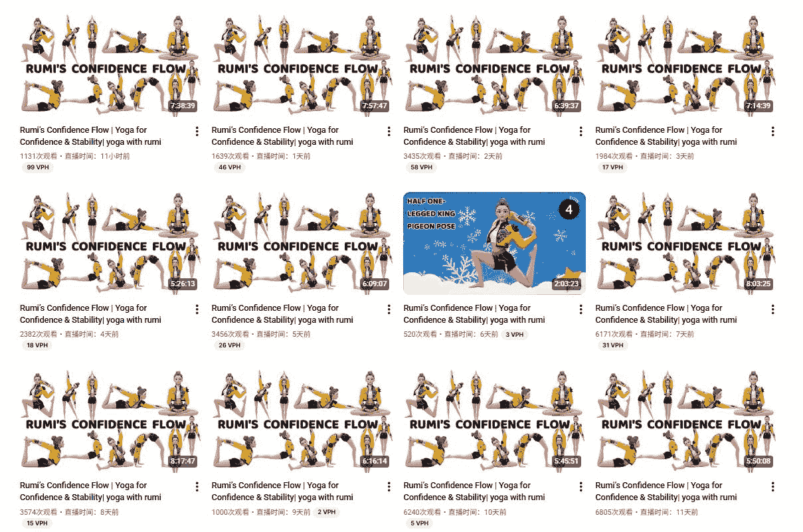

#### 各国AI养老金政策解读

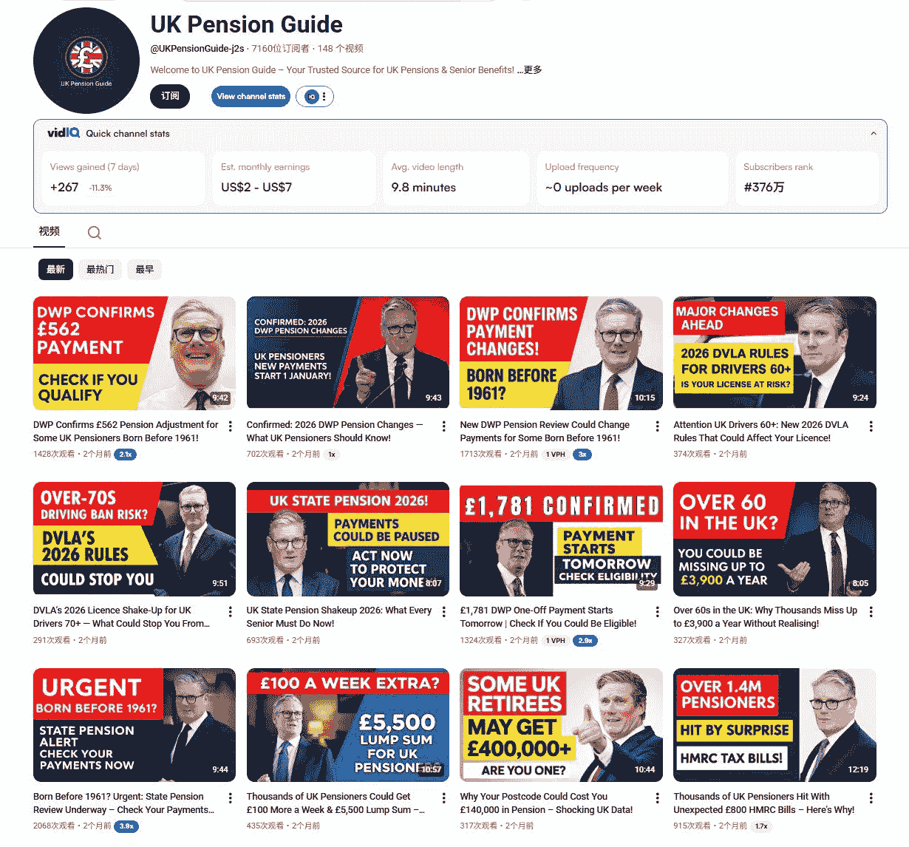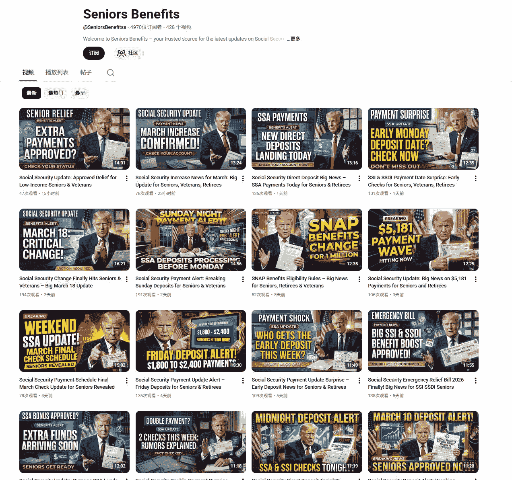

#### 真人实拍+AI视觉艺术

#### 以前拿来举例的数学AI动画科普

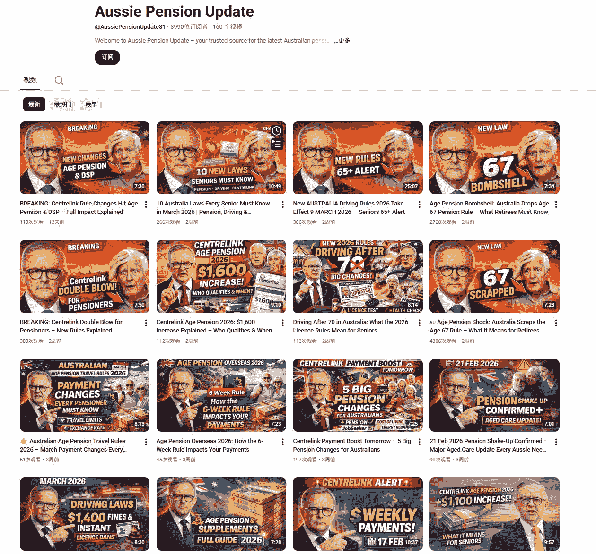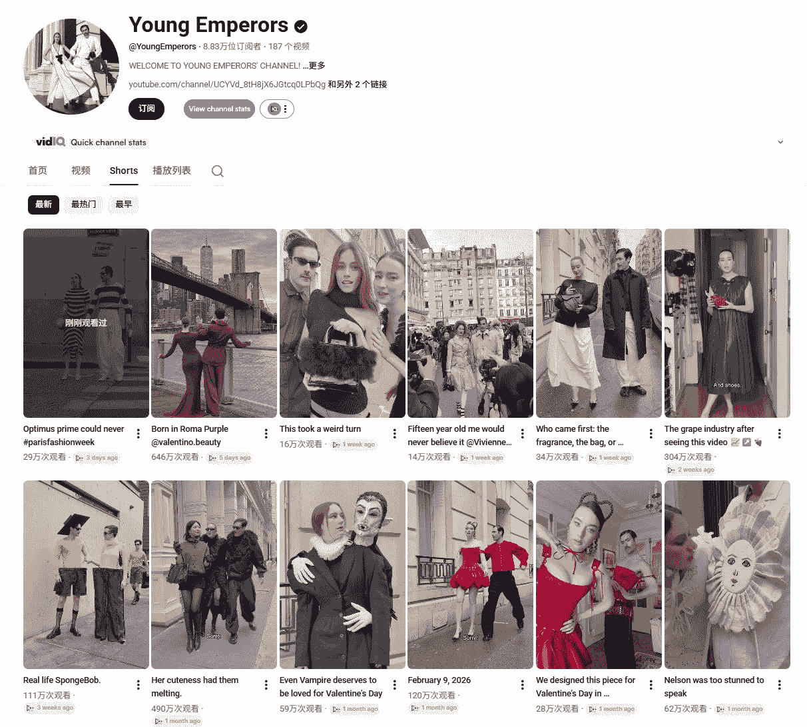

### 三、创作壁垒从会做，变成想做什么

还是举个例子。

野兽先生，应该很多人都看过。全球订阅量第一、长视频播放量第一，基本每条都过亿播放，离谱到不行。每一期背后都是上百人拍摄，场地巨大，周期可能长达几个月，最后剪成30分钟，几百万美金的制作成本砸出来，爆率自然高。

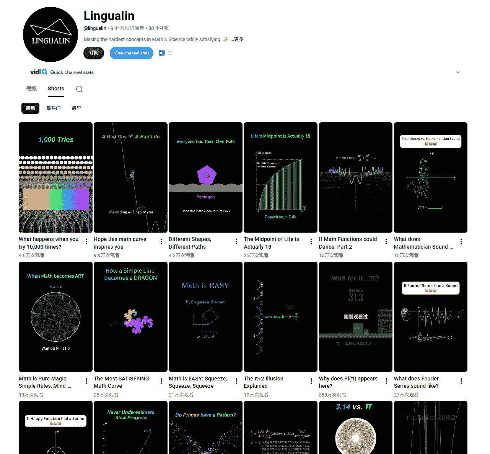

现实中能玩得起这种规模的团队一只手数得过来，国内基本就影视飓风碰过。

去年5月Veo 3出来后，我很快用低质版本做了一个模仿，虽然粗糙但很兴奋。因为我知道，随着模型进化，这类高成本的内容很快就会被AI平权。

比如最近在B站很火的一个博主，条条视频都在数百万播放。B站长视频这个体量意味着什么？最近几期的平均播放并不亚于影视飓风，而两者成本差距是千倍万倍。

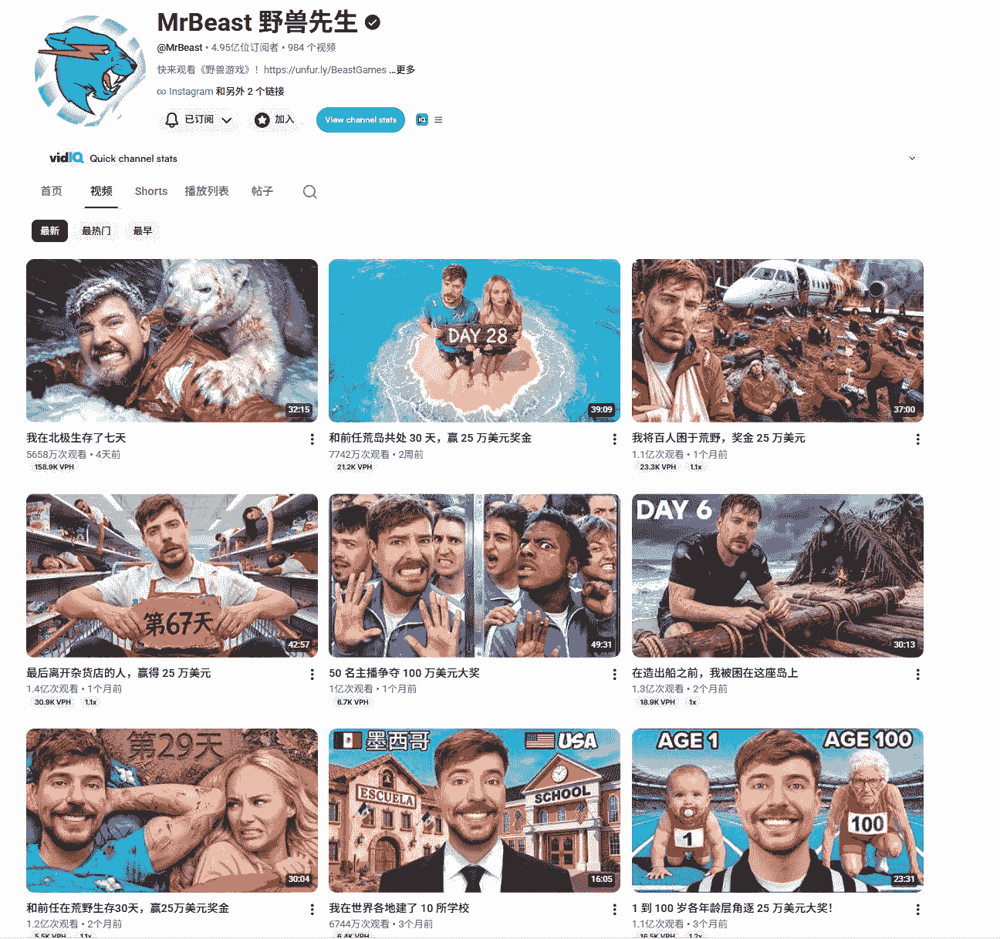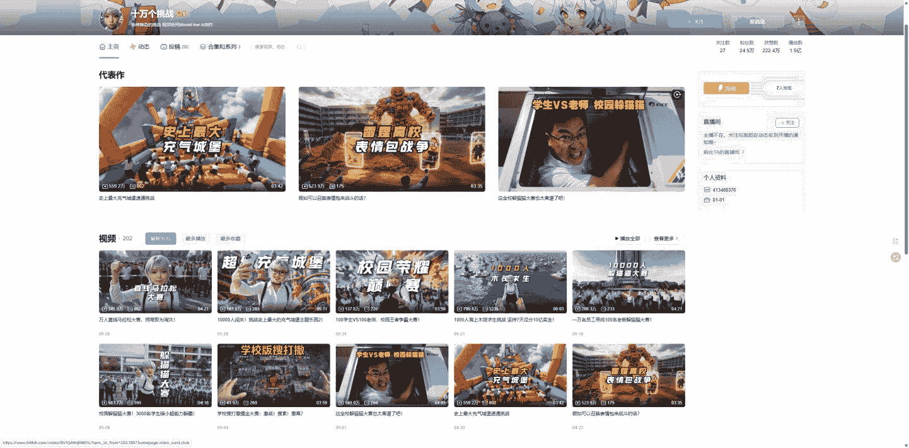

他几乎全是野兽先生的模仿，但要素抓得极准：

- 节奏极快；
- 画面极大；
- 奖励极多；
- 刺激拉满；
- 参与人数爆炸。

AI已经让普通创作者能和顶级团队在内容层面正面较量了。

壁垒不再是“你能做出别人做不出的东西”，而是“你能想到别人想不到要做的东西”。

这点我们自己也太有体感。最早用Midjourney和Stable Diffusion时，提示词得靠专门的工具站，出来了“提示词购物车”，像拼菜一样把不同模块拼成一张图，提示词工程一度是学问。结果Sora一出，全白学了，提示词直接变自然语言。Seedance 2.0也是同理。

当制作不再是壁垒，核心就回到做什么。内容判断力、执行速度、跨专业整合能力、变现设计能力，才是真正的分水岭。

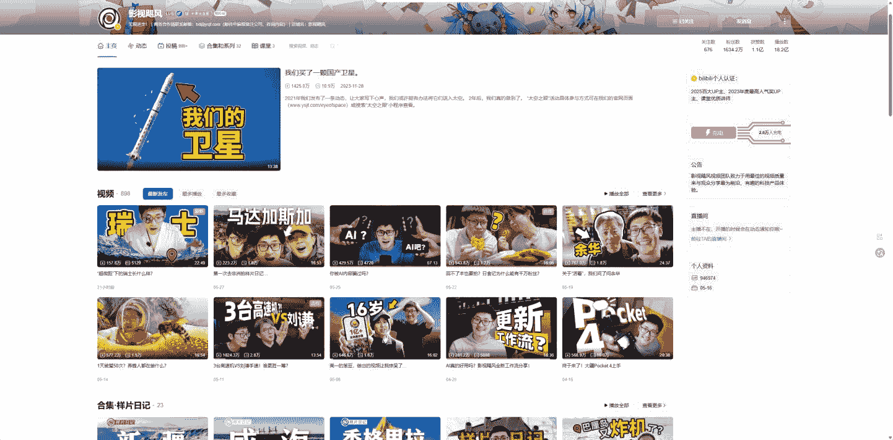

### 四、生产关系从人辅AI，变成AI辅人

近一个月重度使用Codex，感触很深。

我会不断问自己：还有什么事是AI完全替代不了的？答案越来越少。

以前我们觉得，图和视频出完必须人工过目，不然会出错。

其实AI就能审，只要规则定义清楚，AI审得又快又稳。

比如我们为了规避同质化和平台政策风险，自建了一套质检小工具，核心是提示词+案例库+规则库。命中就预警并给出建议。

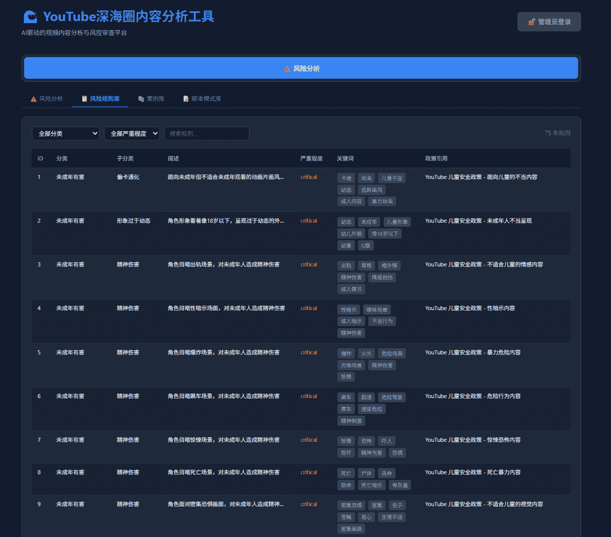

以前这是人工活，几百条视频审核组得一条条肉眼看。Gemini能读视频，但读不懂规则、不懂画面问题、不懂同质化对比。

我们把几百条人工判断沉淀成案例库和规则库后，这件事AI一小时就搞定，原来要几个人干几天。

以前觉得蓝海赛道挖掘必须人上场，AI最多做个爬虫加数据分析。但赛道的价值在YouTube上，很大程度上取决于RPM、竞品密度、制作难度、用户体量，这些都不是明面上能直接看到的数据。

于是我开始复盘人做这件事多做了什么：去找分享赛道的博主、凭经验和论坛信息判断RPM、用小号去刷不打标签的视频、靠画面判断制作门槛。

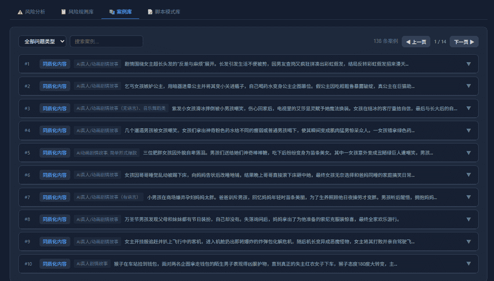

这些AI做不到吗？基本都能做。

现在我把数据挖掘工具优化了一下，建了博主库，让AI用Gemini 3.5 Flash大规模拆解教学和分享类视频，提炼赛道关键词，按相关性和播放量排序检索。挖到视频后，再用同一模型分析内容形态、制作方式、同质化程度、受众画像，来判断RPM和是否值得做。工具还在迭代，但骨架已经搭起来了。

我想说的是，到今天为止，能被AI取代的场景已经很少，前提是我们要先想明白做什么。一旦把工作量大量交付给AI，整体生产力会获得巨大的杠杆，竞争对手很快就看不见了。一步快，步步快。

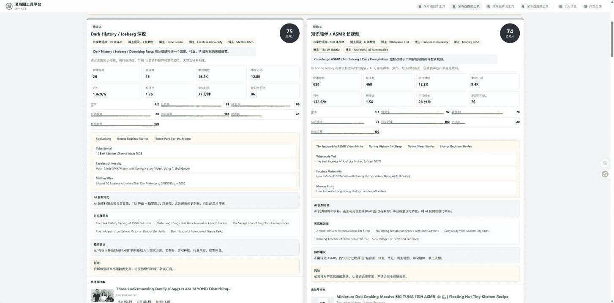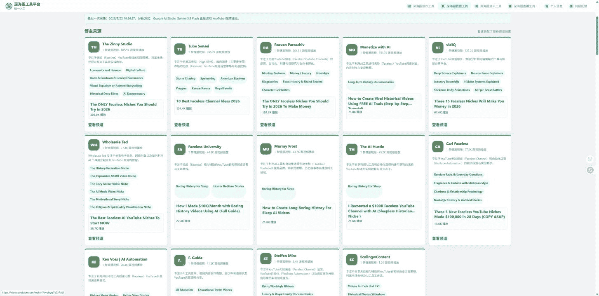

这几个月都在沉淀很久没发帖，希望这篇对你有帮助。

顺便给我们的全新社群【AI视频深海圈】打个小广告，有兴趣的可以今晚来看直播，也可以看看报名海报了解更多。

---

看完这篇SOP，你可能觉得懂了。但实操起来，90%的人卡在第一步。

工具和教程是最基础的壁垒，真正的壁垒是“立刻开干”和“圈层信息差”。

我们不聊概念，只拆商业闭环和AI效率压榨。体系里已沉淀1000+跑通的套利实战。

👉 查看圈子数字资产与入群门槛：

https://lazyso.com/insider/

备注：【实操上车】，不闲聊。

