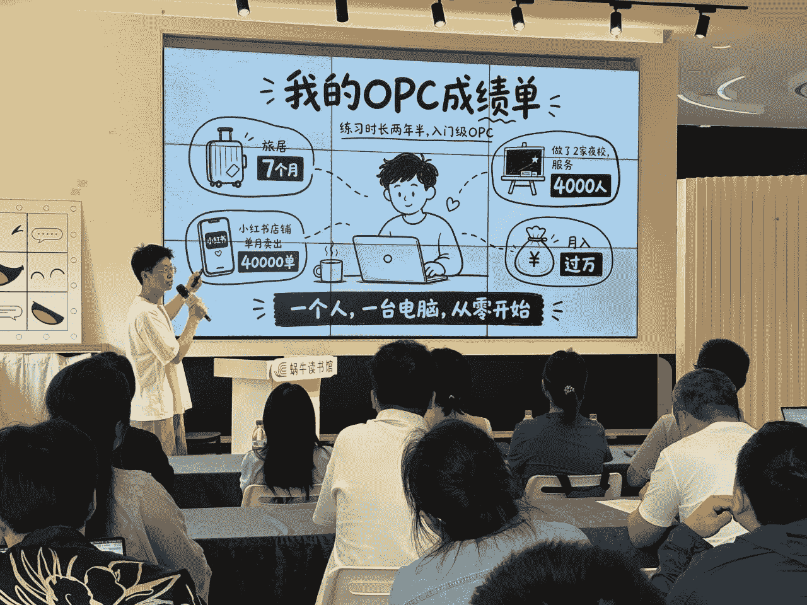
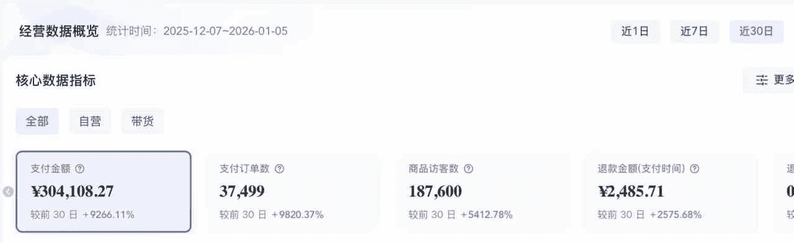
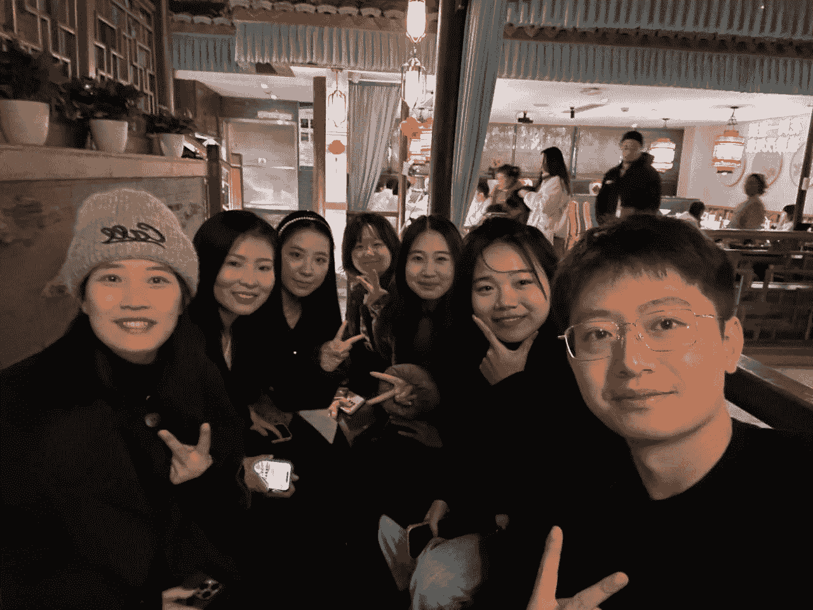
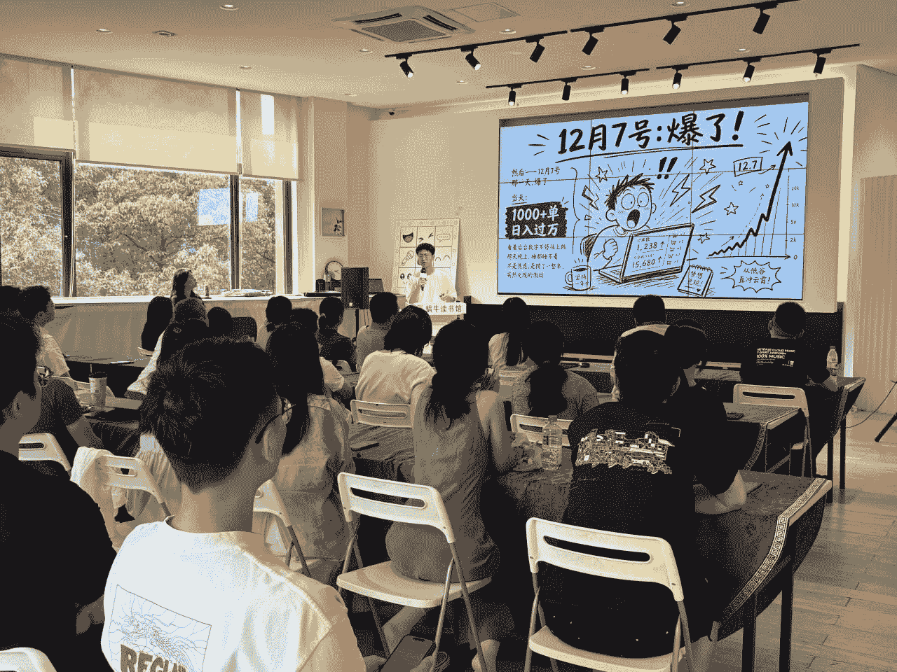
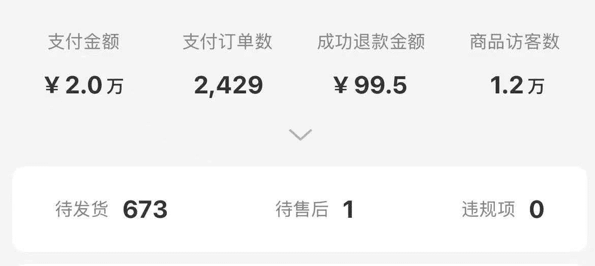
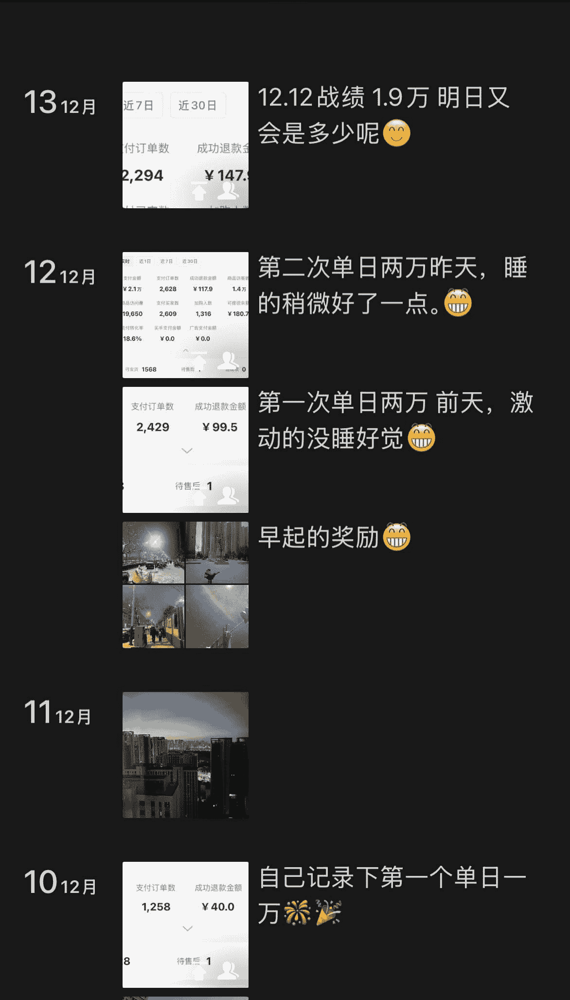
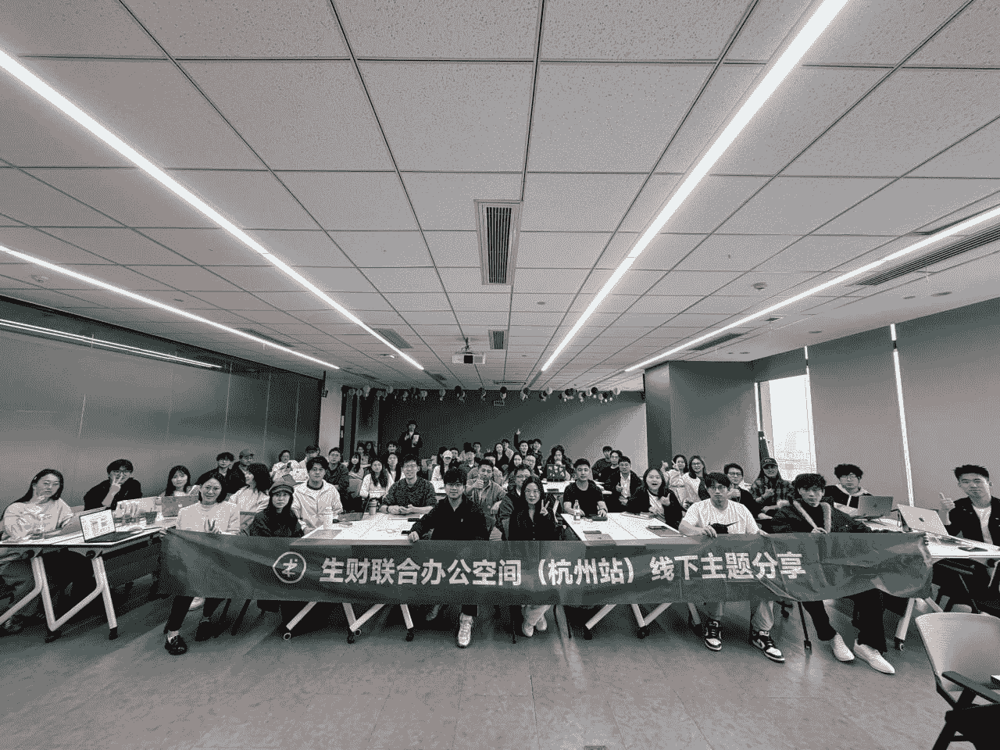

# 一人公司实录：用 5 个月 1000 条笔记堆出首个单日 2 万爆单，武一的裸辞方法论

260708 副业SC 精华

整理：公众号懒人搜索，懒人专属群精选

懒人微信：lazyhelper1

## 01｜我不是被生活逼走，是主动给自己换赛道

七天：先简单介绍下你。

武一：我现在是创业两年半的独行者在训练。过去在国企做财务，环境安稳，却越来越觉得不对劲。越待下去，我越离自己想要的样子远。于是我主动离场。

我心里的理想状态其实很久就清楚了：住在离海不远的地方，做一件自己认可的事，不为打卡上班而活。工作能养活自己，同时给我时间陪家人、去旅行、按自己的节奏生活。

现在我做的事，本质上是在练习和市场直接对话的能力。对我而言，这不只是换工作，更是在重塑一种更主动的人生操作系统。

## 02｜裸辞前先算清账，再算清心

七天：当时什么给你底气说走就走？

武一：先搞清楚自己要什么，再反推怎么做。

心里大概有一张生活蓝图，可那份工作和那份薪水明显覆盖不了。我开始做三件事自检：第一，试错成本够不够，存款能不能支撑半年到一年的探索期；第二，当时压力是否可控，工作一年半，无房贷，无情感牵绊；第三，父母健康，经济独立。

核算完觉得安全边际够了，才决定出来碰一碰。

七天：当时你真的明确方向了吗？

武一：不算完全清晰。但人就算不知道要什么，也能从不想成为什么里找答案。我很确定那份工作不是我要的，它让我情绪持续低落，甚至有点抑郁。上班不是累，是每天感觉自己在慢慢变灰，明明很年轻，却能预见到五年十年后大概率还是这样。

我不把离职归咎于上司或薪资。外部因素当然存在，上司确实一般，但核心是我不适配体制，不适应那种协作方式。

所以这不是被逼无奈的退出，而是我清楚需要另一种环境、另一套打法，才选择裸辞。

## 03｜读完《百万富翁快车道》才发现自己在慢车道

七天：不想要，更多是源自环境还是岗位？

武一：《百万富翁快车道》和《纳瓦尔宝典》对我冲击很大。它没教我某个具体赚钱术，而是让我意识到，我可以不按既定轨道生活。

从小接受的教育都在把我往慢车道推：读书、考证、找稳定工作、慢慢升职、存钱买房、过体面但不自由的日子。这条路能过得去，却给不了我想要的自由感。

以前我基本是月光，没有危机感。那之后我开始算：离开后一年最低生活费是多少，需要攒多少安全垫。于是从 2023 年 10 月起，我在上班的同时心里已经开始倒计时。

有趣的是，一旦知道自己要什么，当下的痛苦就变得能忍。

## 04｜数字游民的内核是把公司整套流程打包成自己

七天：怎么看数字游民这个概念？

武一：既是生活选择，也是商业模式。

首先是选择。你厌倦坐班、被组织安排、把时间完全让出去，才会想换一种活法。

但光想不够，要赚钱就必须落地。它不新鲜，只是把原来公司的职能从组织里剥离出来，由你个人承担。

公司以前提供品牌、产品、流量、销售、交付、财务、客服，你只负责财务核算这一块。出来以后，这些环节都得你自己走一遍：找客户、搭产品、做交付、谈成交、复盘迭代。你从零件变成了整机。

这也是职场人做 OPC 难的关键：有没有和市场直接交易的经验。公司里有人给你任务、客户、背书。出来后，你得让别人看见你、信任你、为你付费。

比如插画师会画画不等于能成为数字游民，能把能力变现、能自己获客的插画师才行。小红书上的曝光能力是基本盘。

除此之外，还有心态和自律。没有组织给你节奏感，没有同事陪你，容易焦虑，要学会和自己相处。所有环节都靠自己，任务、执行、复盘都要自驱动。

我对 OPC 的理解是：自己给自己定 OKR，并能把它跑通。我的第一个目标很简单，一年内收入不低于在职时的十三四万。最后做到了，就继续做下去。

## 05｜先旅居，才发现自己不会赚钱

七天：离职后怎么一步步走到理想生活？

武一：不是提前规划好，而是先出来，边走边补课。

第一步补认知。听播客、看书，知道世界上有另一种活法。没接触过赚钱，只知道有人靠互联网项目活下来。

第二步盘点自身。我一直比较自律，能持续学习、重复做事，觉得具备做小生意的底层素质。

第三步攒钱。我要的是能撑半年到一年的启动金。攒到后没立刻找工作，而是先去看真实世界。我相信有人不靠格子间也能赚钱，所以开始旅居：乌鲁木齐出发，宁夏、西安、成都、广州、长沙、衡阳、珠海、澳门、深圳，最后到三亚和清迈。

七天：清迈带来什么变化？

武一：冲击很大。那里很多数字游民，比如一个白人程序员，每天工作几小时，拿发达国家工资、花东南亚成本，生活很滋润。咖啡馆隔十几米就有一家，大家带着电脑工作，感觉不是逃离工作，而是在重新定义工作方式。

我还见到一群刚毕业的学生在做 Web3，准备去新加坡开公司。年纪轻轻就已经在做生意做公司，让我知道边界可以那么宽。

生活节奏也完全不同。晒太阳、锻炼、海边散步，状态明显变好。以前上班压力大，头发白了 90%，旅居几个月后恢复很多。身体和生活感找回来了。

但一分钱没赚，还被骗了。看到一个国外翻译项目，报酬 2000 美金，先交 25 美元押金。我交了，用 GPT 翻译了两天，临交稿又要续费，这才反应过来是骗局。

后来复盘：人越缺什么越容易信什么。太想赚钱就容易失去判断。

那之后我才真正开始研究互联网怎么赚钱，怎么建立自己的收入系统。没钱了，也看见了另一种样本，就决定回来认真做一个项目。

## 06｜小红书电商是第一个真金白银的项目

七天：怎么做到收入不降？

武一：先做了视频号口播带货，没卖出多少，但粉丝做到六七百。价值在于锻炼了镜头表达，第一次意识到内容能带来流量。

旅居回来后做小红书电商，航海最后一天出单，是第一个变现。回来又做了两个月，发了四五百篇笔记，总共就四五千收入，随后转做同城项目。

小红书电商反馈慢，心里会慌。需要证明自己能赚钱。

同城裂变让我第一次感受到现金流的快感。给线下瑜伽馆做老客拼团，一周挣了约 5000。之前两个月才四五千，这几天就进账几千，瞬间觉得没必要回职场。

随后做青年夜校项目，从小红书引流，把大众点评上的技能课打包。一周就把群加满，十天左右变现一万。连续两次正反馈，让我确信能继续试。

## 07｜青年夜校教会我：先聚人，再找供给

七天：引流后怎么对接交付？

武一：以前觉得要先有产品、谈好商家才能卖。青年夜校让我明白可以反着来：先做流量，有人了再找供给。

我一开始商家都没谈，就有一张课程表，甚至没写具体地址。先把人拉进群，看大家想学什么。化妆、网球、咖啡，哪个需求多就去找哪个供给。

对商家说：我给你凑 5 个人，人均 500，我们五五分。你提供场地和老师，我们负责引流。商家场地成本固定，多来人就能转化为长期课客户。

最开始主打美妆，女生需求最刚性。后来也做运动、乐器、咖啡等，只要能做体验课的实体店我都找。

498 的定价参考了赚钱精华帖和同城同行。四到六节课下来，单节不到 100，消费者接受度高；商家有增量，也能转化长期课。

定位更像是中介，把供给和需求撮合。内容不堆课程表，而是打情感点：小时候想学却没机会，长大后用几百块款待那个自己。本地项目有信任背书，店就在旁边，跑不了。

## 08｜先放流量，后补商家

七天：你是先做产品还是先做流量？

武一：先流量。我只带一张空课程表进群，先运营，收集需求，再去找商家。地址确认后再发给用户。

城市不大，大家接受度高。A 课在一个店，B 课在另一个店，我做的是组织和撮合，不是固定交付。

方法也简单，对标拆解。找到一线城市夜校爆款笔记，二创成本地版本。杭州夜校改成家乡夜校，课程表照发。三线城市没见过，会觉得新鲜。这其实是地理套利，把验证过的经验搬到供给不足的小市场。

## 09｜青年夜校从 1 月做到 9 月，赚到钱也看到天花板

七天：后来为什么停了？

武一：需要持续不断的新流量，城市体量有限，后期增量枯竭。全部流程靠自己：做内容、社群运营、谈单、对接商家，太累。算过账，不足以再雇人分担。尝试复制到其他城市，成功一家，第三家就不顺了。

今天想聊一个特别有“后劲”的故事。

一位从体制内财务岗走出来的姑娘，用一年时间，把小红书电商从零干到单品爆单4.4万单，日GMV最高冲到2万。

但如果你以为这是一篇“一夜暴富”的爽文，那就错了。真正让我触动的是她中间那段1000多条笔记、收入不到5000块的至暗时刻，以及她在爆单后说的那句：“这不是躺着赚钱，是现金流、供应链、内容力、情绪承受力全被拉起来的一次极限测试。”

先交代一下背景。

离开稳定工作后，她先做青年夜校，从1月到9月，9个月时间差不多赚回了之前一年的工资。项目挺好，但她很快发现两个问题：一是自己的能力可能不足以把它继续放大，二是这个模式太重运营，需要不停对接商家、场地、课程、收钱、交付，像一个永远转不完的陀螺。

正好也是这段时间，她真真切切感受到了流量的魔力。于是心里冒出一个想法：有没有一个更合适的项目，能让我赚得更多？

答案是：小红书电商。

不是没犹豫过。但真正让她下定决心的，是她在赚钱里看到大量帖子后得出的判断——小红书电商是少数能让普通人拿到相对较大结果的项目。

然而，接下来的五个月，是一段后来被她自己称为“虚假努力”的日子。

她发了1000多条笔记。每天找素材、改文案、去重、发布、盯数据、判断哪条有希望。不是外人以为的“随手发几条笔记就能出单”，而是高强度、重复、消耗人的机械劳动。结果呢？总收入不到5000块。

现在回头看，问题不是不努力，是方法没对上。

比如选品。她当时知道“近期低粉爆款”这个原则，但理解跑偏了。她以为“近期”的意思是“昨天还能看到这个品有新的爆款笔记”，可实际上，那个品可能一两个月前就已经爆过一轮，早过了最佳窗口期，剩下的只是尾部流量在“诈尸”。她看到的不是机会，是残影。

再比如模仿对标。她不是不知道要模仿，但内心并不当真。觉得“大概知道怎么写就行，自己改一改就好”。后来才明白，对标不是参考，是复刻。要还原到封面、标题、内容、评论区、选品逻辑，每个零件都拆开来看。

那段日子，她每天都在发笔记，量大到自己都感动了自己。但核心动作没有一个做到位。她说：“你会用数量安慰自己。今天又发了10条，我已经很努力了。但实际上，你没有认真拆解爆款，没有认真研究别人为什么爆。”

前两个月是真打了鸡血。后面慢慢平静下来，因为夜校还在跑，有现金流兜底，心里不慌，但也没放弃。她甚至还发了一条仅自己可见的朋友圈：小红书电商是我第一个深耕的项目，我一定会爆单。

这份笃定不是凭空来的。她想的是：夜校那么麻烦的事，我都从0到1搞定了，从流量到商家到课程到收钱到交付。电商再难，能难到哪去？

还有一句话在关键时候托住了她：“发小红书笔记是在给自己存钱。”有人算过，一条笔记大约值100块。她想着自己都存了1000条了，总有变现的一天吧。

真正开始质变，是9月。她不再一个人闷头干，开始主动在赚钱里链接人，经鱼丸介绍认识了一只仙、刀姐。认知一下被打开：原来不是项目不行，是自己的方法和执行出了问题。

方法有了，剩下的就是干。

后面一个多月，她每天从早八点干到晚上九十点，睡得很少。不是不困，是焦虑型早起——醒来就睡不着，干脆起来干活。奇怪的是她并不觉得被折磨，反而很享受那个过程。

然后，12月7日，爆单了。

她做的是饰品赛道。用她的话说，这个品类同时踩中几个点：有颜值、有用、让消费者觉得有便宜占，所以它爆了。

但爆之前能预料到吗？不能。她那时候还是小白，根本看不出来。

爆单那一刻，她的第一反应不是狂喜，是受宠若惊：“我不会真的要变好了吧？这种事真的会发生在我身上吗？”

毕竟前面太久了。一千多条笔记都没砸出大水花，你已经习惯了失望。突然某一天单量开始涨，而且一直涨，涨到你觉得不真实。最高一天2429单，GMV两万左右。

那天什么心情？她形容很复杂。前一周基本每天只睡三四个小时，不是不想睡，是太兴奋了，根本睡不着。半夜惊醒，爬起来看一眼后台，还在涨，看完更睡不着。

她还跑去跟一只仙说：“我睡不着觉。”对方特淡定：“都这样，这个阶段都一样，等过了就好了。爆单一开始都很激动，慢慢适应了以后，你会盼着它赶紧结束，因为真的太累了。”

爆单之后，是不是躺着收钱？

恰恰相反。她要做的事情比之前更多。

一件代发这些基础设施早就备好了，真正要盯的是三件事：一是在前端持续产出爆款笔记，让流量不坠——当自己成了最爆的那一个，就不再找对标了，而是复刻自己，反复拆自己的封面、标题、角度，一轮又一轮做相似的内容；二是全程盯售后，因为客单价低，退货成本比退款还高，基本一律直接退款；三是盯供应商，每天确认货源够不够、质量稳不稳。

还有一个外界很难想到的坎：货款。

小红书的钱不是当天到账，可能要十几二十天才结算。但供应商那边一开始要求当天结。一天2000多单，货款一万四五，逐日累加，她压了几十万进去。最紧张的时候，只能跟家里人借钱垫货款。

这就是爆单真实的样子。有效工作时间也许不长，一天也就五六个小时集中做笔记，但人从头到脚都是绷着的。脑子里永远在转：今天笔记发了吗？供应商那边货够吗？售后有没有问题？钱够不够结？这条爆款还能挺多久？下一个品什么时候能起？

做完这个品之后，她对电商的理解彻底变了。“以前以为做电商要做自己觉得好的品，后来才明白：要做市场觉得好的品。”

她那个品客单价很低。以前她也会觉得低客单价很难赚钱，后来发现：只要数量够大，低客单照样能打。

有人问她电商有没有门槛。她一开始觉得没有，开店很简单，甚至不用保证金，点开就能干。但后来她收回了这个想法：真正的门槛不是开店，是认知。

很多人会把开店流程、上架流程这些基础步骤看得很重，好像只要把店开起来就赢了。但在她看来，这些拿AI、拿豆包分分钟都能解决。真正难的是选品、笔记制作、运营干预，是理解市场、平台、内容、消费者为什么点、为什么买、为什么评论、为什么退。基础操作只是入场券。

那个品最终卖了4.4万到4.5万单。“这个品能做多久，在选品那一刻就决定了70%。我当时就知道它肯定会没流量，所以要在有流量的窗口期把该挣的钱都挣到。”

关于小红书电商最关键的是什么？她的回答也很直接：“如果你的品有周期，就要去找下一个周期的品。本质是一个测试游戏。做这个品的同时，也要测试别的品。停下来，就没有机会了。”而她观察身边做小红书电商的人，有一个规律：爆过一次的人，往往很容易爆第二次。因为方法论拿到了，复刻成功是可行的。

回头看视频号口播、同城夜校、小红书电商这几次折腾，问她哪个最能放大？她说每个都有可能，但眼下对她来说，小红书电商来得更确定、更快。但如果目标是“不累地赚三四十万”，她觉得都挺难。“没有不累的。”

那她为什么好像永远不掉进低谷？她的答案是：“因为我知道这是规律。从一开始就知道它不会是一条直线上升的路，起伏才是常态。所以我允许自己低落，但手不能停。”

为什么不怀疑自己？她自己也说不太清。可能是做成的事情多了，哪怕不大，但一件件都能成，就建立了一种“我能做成”的信念。再加上尊重规律——人性的规律、商业的规律，只要你遵守，再给它时间，加上执行力，结果不会太差。

她对负反馈的定义也很特别。她不是不怕被拒、不怕数据差，而是提前就预设了多种结果：笔记可能爆，也可能很平；电话可能答应，也可能拒绝，还可能说再考虑。当任何一个结果发生，都在预期之内。“它符合我的预期，所以它就不叫负反馈。”

这个心态其实也是“一人公司”的核心。

她给自己做过一个总结：以前是个财务，只负责公司里某一个环节。但这些项目做下来以后，流量、成交、交付、供应商、售后、现金流、用户沟通，全都亲手碰过一遍。哪怕有些项目后来不做了，能力却沉淀下来了。所谓一人公司，不是一个人轻轻松松赚钱，而是把自己当成一个公司去经营。项目会变，能力不会丢。

如果这个阶段一定要提炼一个关键词，她给的答案很简短：接纳。

心态上接纳，行动中算好账，花钱买试错时间，找到正确的方法，坚持执行，复盘，迭代。

创业本身就是不确定的。一个从高度确定性环境中走出来的人，要如何和不确定的市场碰撞，中间经历了什么，心态如何调整——这些，可能比“我做了什么项目”更重要。

看完这篇复盘，也许你会觉得“我懂了”。但90%的人一到实操就卡在第一步。

不得不提醒一句：工具和教程只是最低级的壁垒，真正的壁垒是“立刻动手”和“圈层信息差”。

如果你想看当下全网最新的变现玩法，想认识一群执行力极强的同路人一起拿结果，欢迎围观我的核心私域：【懒人专属群】。我们不聊虚的，只做商业闭环拆解和AI效率的极限压榨。系统里已经沉淀了1000+跑通的实战局。

👉 查阅圈子完整数字资产与上车门槛：https://lazyso.com/insider/

认同价值、准备好下场干活的，扫码加我微信（lazyhelper1），备注：【实操上车】，不闲聊。

