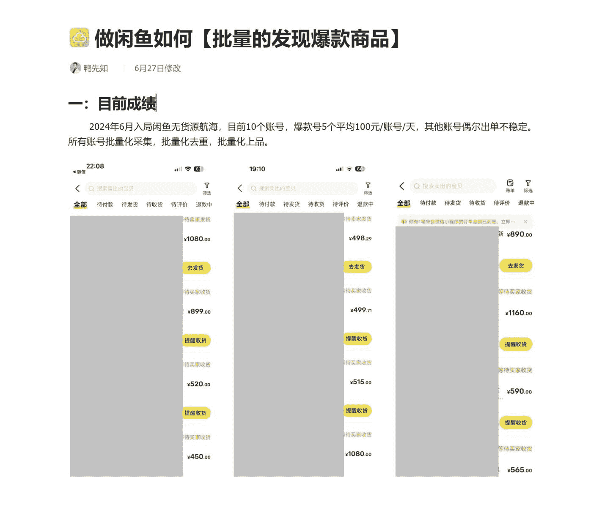

# 从 AI 定制变现十几万，到重新回到闲鱼：我如何用 3 个标准筛选一人公司项目

我靠AI定制做到十几万，却把项目收了：一个人做生意，我现在只用这三条来验货

大家好，我是鸭先知。

过去一年半，我把市面上能玩的工具基本都上手过：闲鱼、RPA、Coze、飞书多维表格、n8n、Obsidian、Cursor、Claude Code、AI编程、智能体定制。

其中一部分确实变现了。

早年在闲鱼做高客单实物时，觉得选品、上架太耗时间，就自学RPA，把“找爆款→飞书表格整理→自动上架”这套链路做成了半自动。

后来又接了不少Coze智能体、飞书自动化、AI编程的定制单，累计下来也有十几万的体量。

所以这篇不是否定AI，也不是抬闲鱼。自动化、工作流、大模型这些红利，我都吃到过。

只是今年我做了一个反直觉的选择：把大部分定制业务砍掉，把注意力重新拉回闲鱼。

很多人会觉得奇怪，大模型、智能体、流程自动化听起来多有想象力，闲鱼却像老派搬砖。为啥要从热度高的赛道退回看似没科技感的生意？

因为我想复盘一个更本质的问题：一个单人项目，到底值不值得长期投入。

## 先说感受：能赚钱不等于能长久

我以前也把“有收入”和“能做长期”混为一谈。

比如智能体定制，单价不低。客户要一个工作流、一个智能体、一个自动化小工具，几千上万的订单常有。

但做久了会发现几个坑。

第一，容易变成高级的外包。表面上是AI，内核还是定制服务。每个人的业务不一样、流程不一样、理解程度不一样。你要反复沟通、搭方案、做系统、改bug、录教学、做售后。一单结束，下一单又要从零开始。

如果没有产品化、模板化、知识库化的沉淀，本质上就是用更贵的工具，换一种方式卖时间。这和我想做的高自由、低依赖、可累计的一人体系相差很远。

第二，技术换代太快。这一年里从RPA到Coze，从Cursor到Claude Code，新工具层出不穷，你上个月刚熟练的打法，下个月可能就被平台功能覆盖了。如果你的护城河只是“我会某个软件”“我会搭某个流程”，那你永远在追车。

工具当然要学，但工具该为业务服务，而不是让人被工具绑架。我更想把精力放在更慢变的底层能力上：表达、成交、判断、系统搭建、资产复用。

第三，没现金垫底，长期主义容易变形。现在我成家立业，有家庭开销。IP、知识库、工具产品这些都很美好，但从0到稳定变现中间总有空窗。如果那段时间没稳定进账，心态就会乱：写东西急着卖，做产品急着收钱，做IP急着迎合，决策越来越焦虑。

对普通人而言，现金流不是低欲望，而是战略地基。地基不稳，再高的楼都会晃。

## 我为什么把闲鱼当成基本盘

闲鱼在很多人眼里土、low、没格局。我却越来越把它当成防御性资产。不是因为它终极，而是因为它稳定。

第一，它能持续产生现金。我的目标很现实：先把家庭开销兜住。有了这层保障，我做公众号、知识库、工具、陪跑时心里才踏实。

第二，它能和自动化结合。我不是纯手工卖货。之前就是被选品和上架折磨，才去学RPA。现在的链路是批量抓取爆款、飞书表格管理、批量改标题详情、AI辅助写文案、RPA定时上架、同行价格与类目监控。它是一个很好的实操场，用来练自动化、数据、选品和商业闭环。

第三，它适合家庭分工。单人公司不等于单兵作战。账号成熟后，客服、成交、发货、售后可以交给爱人，我负责选品分析、工具迭代、流程设计、内容沉淀和知识产品化。这样项目就变成了家庭现金系统。

第四，它不断产出真实案例。我写东西越来越讨厌空话。真正有价值的是：我碰到什么问题、怎么判断的、踩了哪些坑、用了什么工具、最后结果如何、可不可以复用。闲鱼每天都在提供这类素材：选品、定价、同行拆解、客服话术、自动化、工具开发、学员复盘……这些都能变成内容、SOP、模板。

第五，它能沉淀为可复用资产。选品表、同行表、标题库、话术库、下拉词方法、AI选品指令、飞书模板、RPA采集脚本、知识库、插件、学员操作手册……这些不会随一单结束而清零，而是越积越厚。这就是我说的“一次投入，多次变现”。

即使我在智能体定制时也尝试沉淀：每单录交付视频，既是客户教程也是自己的案例；用AI把问题整理成复盘写入Obsidian；高频需求就尝试脱敏做成模板或标准化服务。思路是对的，但定制属性太强、售后太重、需求太散，很难形成轻量复利。所以选战场比努力更重要。

## 现在我只看三条来决定做不做

过去我很容易被风口带跑。一火就学，学完又换。后来发现，勤奋不等于有效。现在我判断一个单人项目是否值得长期投入，只问三件事。

第一，能不能带来现金流？这是第一关。不是短视，是现实。没有进账，长期规划都会变形。特别是肩上有家庭责任时，先问：能不能赚钱？多久能回本？能不能覆盖日常开支？试错成本多高？能不能小成本先验证？闲鱼的性感度不高，但它能稳住生存线。

第二，能不能沉淀下来？如果一个项目做完就归零，优先级会被我调低。我现在更偏爱能留下东西的项目：案例、内容、SOP、模板、话术、知识库、工具、产品、信任背书。定制单也能沉淀，但需要从劳务交付升级为资产沉淀，而这很难在重定制、重售后的场景里实现。

第三，能不能带来更长的自由？如果一个方向越做越忙、越做越重、越离不开人手，我会警惕。纯定制就是典型：每单都要从零沟通、从零开发、从零交付，时间被锁死。反之，如果项目能让流程更标准、交付更轻、内容更厚、工具更全、知识库更深、信任更强、成交更顺滑，那它就值得加码。

这也是我重新加仓闲鱼的原因：它不完全靠卖时间，而是能长出自动化和产品化。

## 关于“见路不走”

很多人问我不追风口的原因。我用“见路不走”来形容。

我理解的不是看见机会就躲，也不是刻意反潮流。而是看案例时，先不问“他怎么做的我能不能抄”，先问“他成功背后的底层逻辑是什么”。

比如小红书起号，表象是平台红利，底层可能是强痛点、真实案例、持续高密度输出、稳定的私域承接、解决确定性需求。动作会过时，平台会变，工具会被淘汰，但原理更长寿。

拆完原理后，再结合自己的处境重构。我的处境是：有家庭责任有现金压力，擅长系统化与工具化，不适合高频社交与重售后，手里有闲鱼实操盘，有AI自动化和知识库能力，想要低依赖、高利润、高自由的一人体系。

别人的路径可以拆解，不能照搬。适合自己的路，终究要自己走出来。

## 给同样在折腾的人三句话

如果你在做副业、学AI、玩闲鱼、接定制、做IP，先别追最新热点，问自己：

现在最缺的是现金，还是长期资产？现金不稳就先打地基，找一个稳定可验证的生意。

你现在做的事，忙完会留下什么？如果什么都没留下，你就是在卖时间。要把交付、成交、踩坑都变成可复用的资产。

这个方向是让你更自由，还是更重？越做越依赖自己、越难抽身，就要控制规模或尽快产品化。

## 我现阶段的打法

现在我的顺序是：闲鱼保现金 → AI和自动化提效 → 真实项目出案例 → 案例出内容 → 内容建信任 → 信任卖知识库、工具、陪跑 → 工具与知识库降交付成本 → 最终形成轻团队、高利润、高自由的个人系统。

这条路未必适合所有人，但适合现在的我。

这篇不是说闲鱼比AI强，也不是叫大家都回去卖闲鱼。我想说的是：单人创业别只追热度，别盲抄案例。一个项目能不能长期做，至少要过三关：现金流、资产沉淀、自由度。

如果一件事只会让你更忙更重更依赖个人交付，哪怕当下赚钱也要谨慎。如果它能稳住现金，同时沉淀内容、案例、工具、知识库和信任，那就值得all in。

对我而言，闲鱼不是终点，是根据地；AI也不是终点，是杠杆。终点是把现金流、工具、内容、知识、产品、信任拧成一股绳，形成可低依赖、可复制、可自由的一人公司系统。

这就是我现在理解的“见路不走”：不是不走，而是别走进拥挤、错配、养不活长期自由的路。适合自己的路，只能在实践中长出来。

————分割线————

看完会觉得懂了，但实操第一步就会卡。工具和教程只是入门，真正的差距是执行速度和信息层级。

如果你想看最新的变现打法，和一群执行力强的伙伴一起落地，欢迎来我的核心私域【懒人专属群】。我们只拆商业闭环和AI效率。内部已沉淀1000+跑通的实战案例。

👉 查看圈子数字资产与入场门槛：

https://lazyso.com/insider/

认同价值、准备下场的，扫码加我微信（lazyhelper1）

备注：【实操上车】，不闲聊

