# 45 天、零投放、垂直小号做到六位数营收｜5·13 新规后，高客单商家该怎样在🛰️上做获客

260702 副业SC 精华

整理：👸号懒人搜索，懒人专属群精选

懒人🛰️：lazyhelper1

先说明定位，这篇笔记是给手握中高客单、靠后端服务成交的老板看的。想靠广告分成吃腾讯流量的朋友，这套打法帮助有限。

更适合的是：手上已有至少四位数客单的产品，有成熟交付能力，想用👸号拿精准线索、直接后端成交的人群。

## 一、👸号正在洗牌，退场的是谁，红利给谁

龙哥此前做过判断：深耕垂直小号，机会很大。

我们做👸号代运营四年，出过不少爆款，对🛰️的内容传播和转化路径算比较熟。看到这个判断后，第一时间就开了新号实测，验证成功了——全新账号，无人设、无投放，45 天营收六位数。

如果你同样手握高客单产品，正在找更稳、更准的获客方式，可以参考。

以上是公司内部跑通的经验，不同行业账号差异大，具体操作请结合自身调整，给到大家参考启发。

### 1.1 正在被清出去的三类人

5·13 新规后，一人一号实名、不可绑管理员、注销后身份证或被标记、重注册无流量，群控买号基本失效。平台现在查的不是是否用了AI，而是内容质量是否达标。质量不过关直接被判定为垃圾，阅读量归零。过去靠多更博眼球的逻辑已不成立，平台完全可以让你一分钱流量都拿不到。

这两年不少老板都遇到过：请短视频IP团队代运营，月费六位数，实际执行是一个应届生，一条剪辑收一两千，效果惨淡。

这三类人退出后，机会留给了谁？

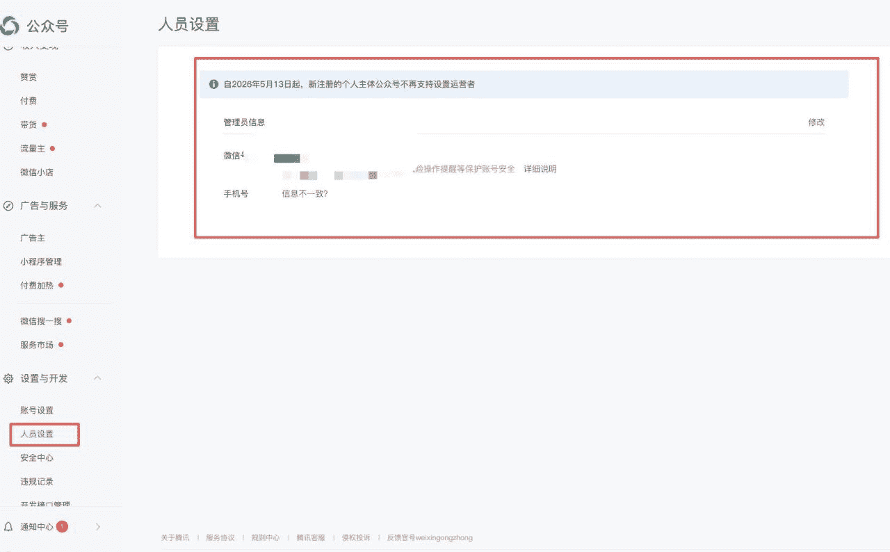

### 1.2 红利落在谁手里

1. 有高客单产品 + 具备专业内容输出能力的主理人。

不需要大流量，不需要网红人设，甚至不用立人设。下面会用自家账号做案例，你会发现它看起来就是一个普通的盈利账号，没有包装，没有IP，阅读量也不高。但45 天做到了六位数营收。

并非个例。

我们服务过一家企业投融资赛道的客户，👸号同样无任何人设，单篇阅读常在 5000 以内。就是这样一个不起眼的号，支撑了公司千万级营收，90%以上的客户及资方几乎全来自这个号。

不做大V，垂直小号靠专业内容和精准获客，就能撬动后端生意。

2. 懂平台规则 + 懂内容商业逻辑的操盘手。

AI 相当于是无限复制的士兵，能打向任何战场。但打哪里、何时进退、合规边界、选题是否有效、转化路径是否最优、如何提升线索质量，这些决策AI做不了。将军比士兵重要，士兵可复制，将军的判断力不可复制。

这两类人群的结合，才是👸号下一阶段最大的红利。

无论是已在做但踩坑的老板，还是观望想入局的老板，后面会分别给出应对思路。

在此之前，先完整复盘我们自己的号——怎么起号、经历了哪些阶段、哪些内容带来客户、最后为何被封，全部摊开说。

不过先交代一下，这个六位数营收来得并不轻松。

## 二、适合走👸号高客单获客的老板画像

先说适合度，并非所有行业阶段都适合走这条路。

### 2.1 基本门槛

1. 产品客单价至少四位数。

👸号获客的特点是量小但极准、链路短、线索质量高。投入产出比只有在客单价足够高的情况下才划算。

2. 产品和交付已验证。

不是刚有想法、还没成型。必须有成熟服务流程和成功交付案例。高客单老板看完内容会审视账号专业度再决定是否联系，接不住就白投。

3. 核心客群是25岁以上的决策者。

主要用户是18-25岁，👸号相对抖音、📕不是优选，这个年龄段行为习惯与👸号生态匹配度低。

### 2.2 适配度高的赛道

从自身及服务客户经验看，适配度较高的是：地产、留学、移民、国学、健康、家庭教育、律师、高端家装、企业咨询、品牌策划等。

共性：客单高、决策周期长、需先建立信任、团队有专业积累可输出内容。这些老板普遍不想长期依赖直播或投流，想要一条稳定长期的获客渠道。👸号正符合：无需持续出镜，不投流也有量，长尾效应强，一篇优质内容可持续数周甚至数月带来线索。

如果与你业务吻合，下面内容会更有参考性。

## 三、我们这个号的实战全记录

号是今年4月中旬起的，B端获客定位。到6月初因违规导流被封，约45天，期间产生六位数营收。但这个结果依赖三个前提，缺一不可。

### 3.1 六位数背后的三个前提

1. 内容投入足。

文章选题、框架基本由我亲自操刀，单篇构思至少30分钟起步。高客单获客里内容就是门面，没有捷径。

2. 销售投入重。

前期几乎所有成交客户都由我一对一跟进，每个高客单客户跟进不少于2小时——电话沟通、出方案、腾讯会议共享屏幕展示过往客户后台数据。代运营客户还需单独输出几千元定制的方案和样稿，销售环节非常耗时。

3. 案例库够新、够多。

公司代运营四年，在地产、家庭教育、健康等赛道都有落地案例，单客户运营一个季度流量增长十倍的达标率约90%。这些是成交的底气，客户不会为名头买单，要的是真实交付成绩。

因此六位数背后是持续的内容投入、深度销售、以及四年积累的案例背书。不是发篇文加个🛰️就成交，线索进来的闭环同样关键。

下面是账号期间的一个成交案例。

背景交代完，看起号路径。

### 3.2 冷启动期 4/23-5/9 约两周：无波澜

4月23日发首篇，基本保持日更。阅读量十几、二十几、三四十，最高五十几。点赞转发多为零或个位数。

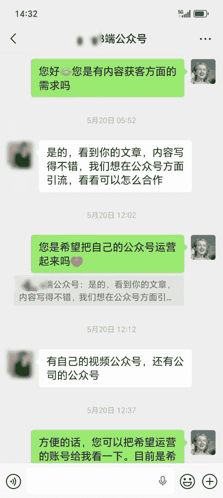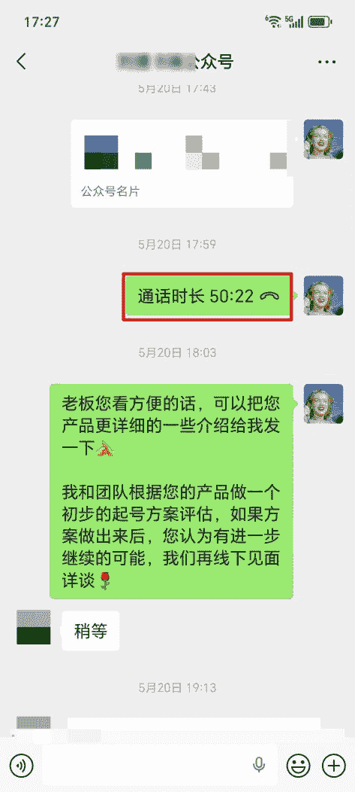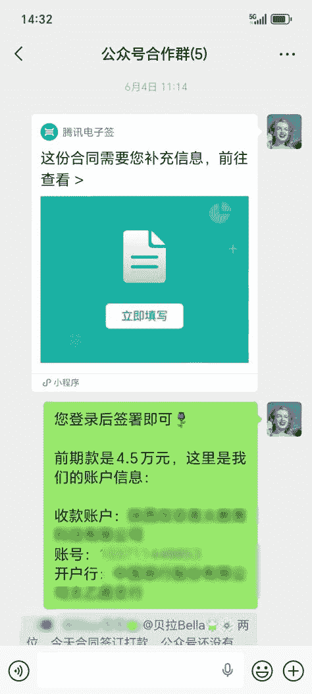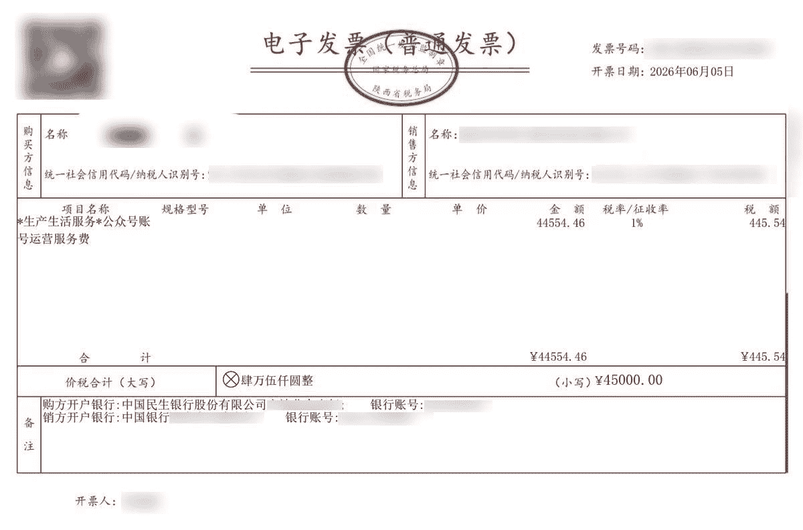

仅看数据，两周很容易焦虑。

但高客单号的冷启动目标不是流量，而是铺内容。老板在联系你前一定会把账号翻一遍，看你发了什么、判断力如何、行业理解是否到位。只有十篇以上高质量专业内容，他才会觉得“这人懂行”而主动加你。

所以这阶段看似沉寂，实则在为后续成交蓄水。

### 3.3 第一次破圈 5/10-5/12 第三周：流量来了

5月11日蹭OPPO热点出一篇爆款，阅读量达1.4万。

带来部分19800客单的顾问式咨询咨询意向，但大客户代运营方向尚未进来，正常，因客单更高决策更重。

5月12日发拆解情感咨询赛道文章《靠情感咨询年入1.5亿》，阅读量9567，转发960。

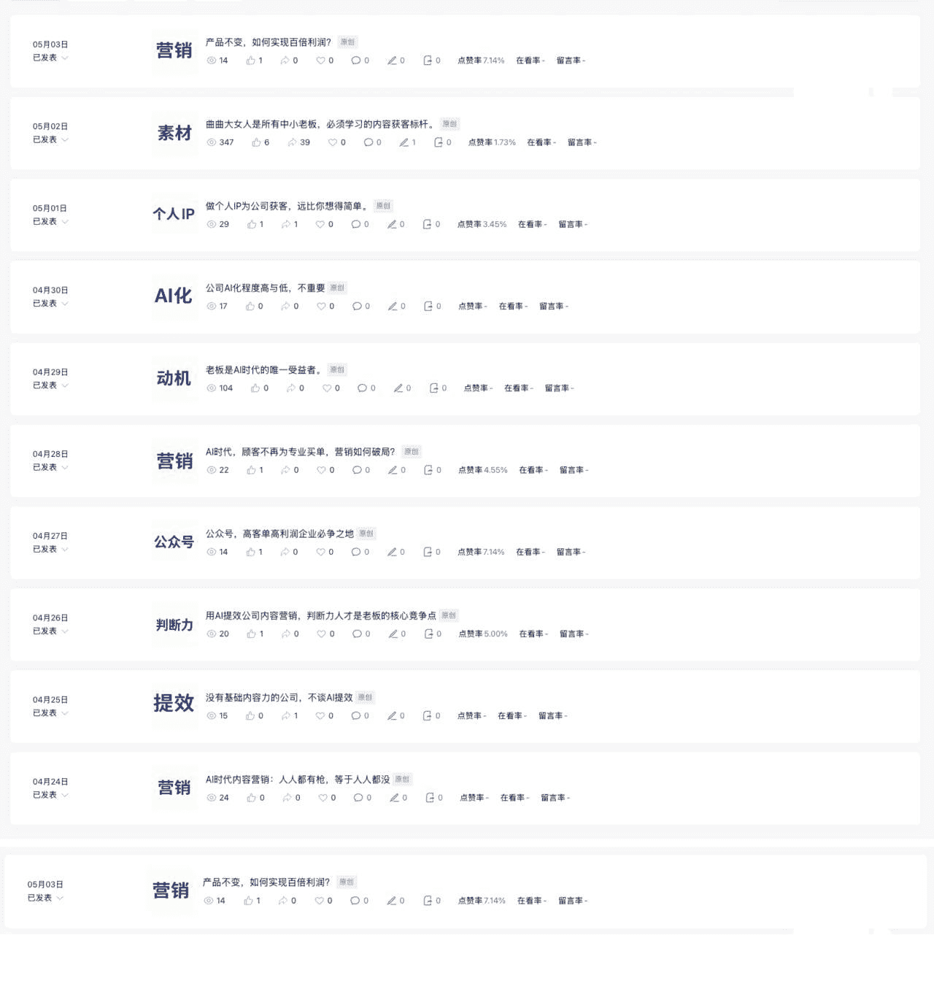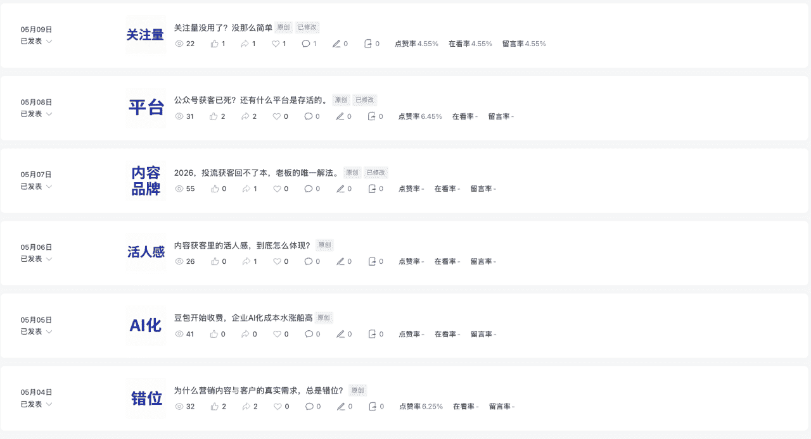

转发960意味着什么？在👸号相当于收藏，且为纯自然流量，未投流未宣传。

该文最终成交两单季度咨询。

一个观察：对高客单👸号而言，转发和收藏的价值远大于点赞。老板群体很少点赞，常见动作是转发到公司群学习，或看完直接加🛰️。老板在合作前会默默关注一段时间看后续内容。因此不要过度关注点赞，转发和收藏才是信号。

### 3.4 高客单成交启动 5/16起：线索质量极高

5月16日发《平均阅读量2000+的👸号，一年营收千万》，阅读量两千多，成交首个代运营客户，后续累计带来两单代运营。

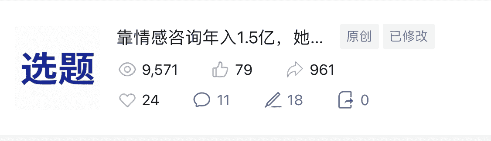

阅读不高为何能成交？账号已积累近一个月专业内容。看到这篇的老板往前翻十几篇，发现方向专业、判断精准，自然建立信任。高客单成交靠的不是单篇，而是账号内容厚度。

5月20日发《曲曲年入1.5亿：永久封禁直播》，阅读量11721，分享226，收藏62。带来代运营和咨询双向客户。

此阶段进线量不多，单篇精准添加约十几人，但质量极高。

截图可见，加来后直接问价格、服务范围、合作方式，无“是否收费”“先免费试试”等拉扯，对话干净：报价，接受就推进，不接受就观望。

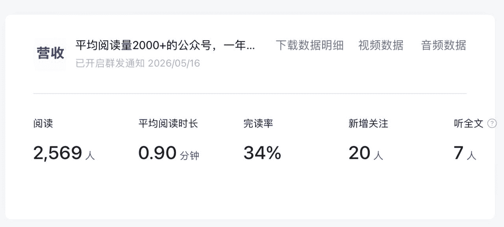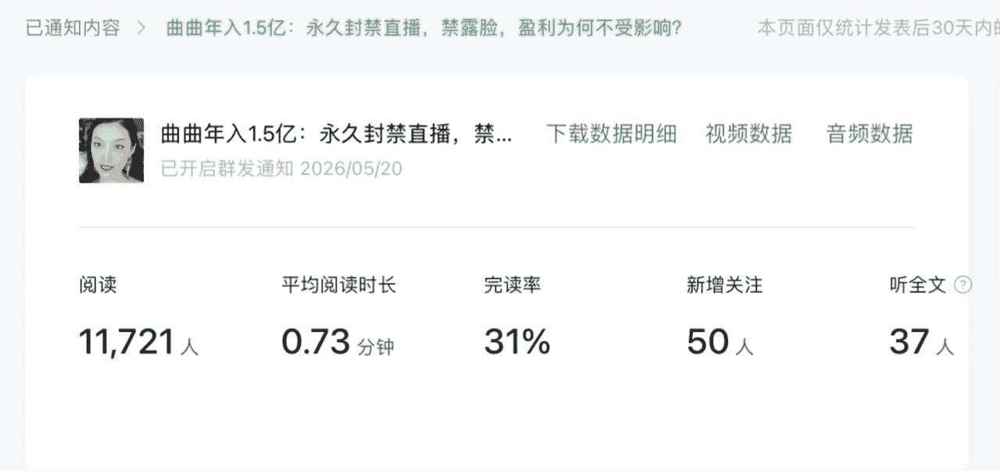

这就是👸号高客单获客的特点：量不大，极精准，无需筛选。来的人都是看过内容认可专业、以明确需求进来，销售成本极低。

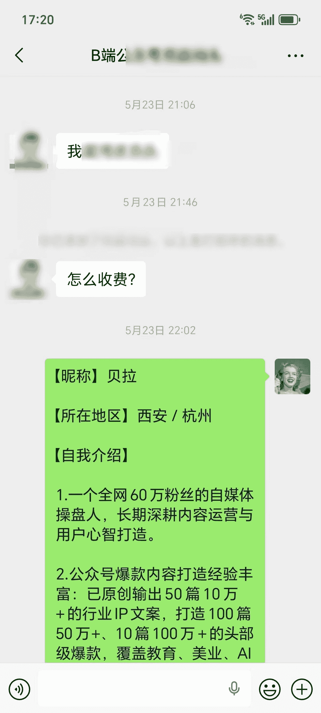

### 3.5 被低估的SEO长尾

除单篇破圈外，号做了关键词布局。

健康、房地产等核心关键词目前已有大量账号占据🛰️搜索前三。即便无新爆款，仍会通过搜索持续带来精准客资。

👸号的另一个能力被低估：不仅靠推荐，搜索流量同样能带来长期精准线索。

### 3.6 号因违规导流被封

后续将讲号为何暂时停更——违规导流被封。涉及当前规则变化，内容较多，单独成章。

先说结论：即便被封，号在45天内已验证一件事——垂直小号+专业内容+高客单产品，无需大流量即可带来精准线索后端变现。前面提到的投融资客户也用相同逻辑。

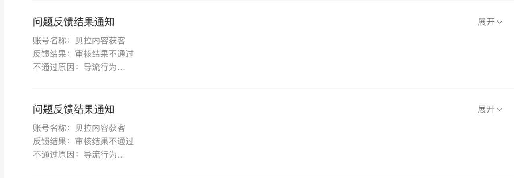

关键在“垂直小号”：小而精、不立人设、不追粉丝，靠专业度和搜索长尾持续获客。

## 四、👸号规则剧变

账号成功到死亡的经历，完整映射了这一轮规则演进。变化很多，且多为隐形坑。

### 4.1 导流路径基本被堵死

号前后被查三次，每次调整均被封，平台逐步关死所有路径。

1. 第一次：文末、文中、评论区置顶放跳转链接。最常见方式，过去能用，直接判违规导流封号。

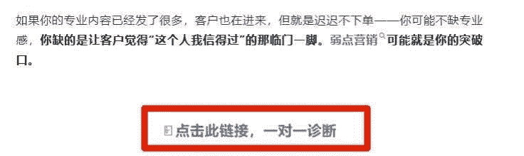

2. 第二次：关注后自动回复弹二维码。文章内无链接，改为关注后自动回复二维码，用户主动关注。也被封。

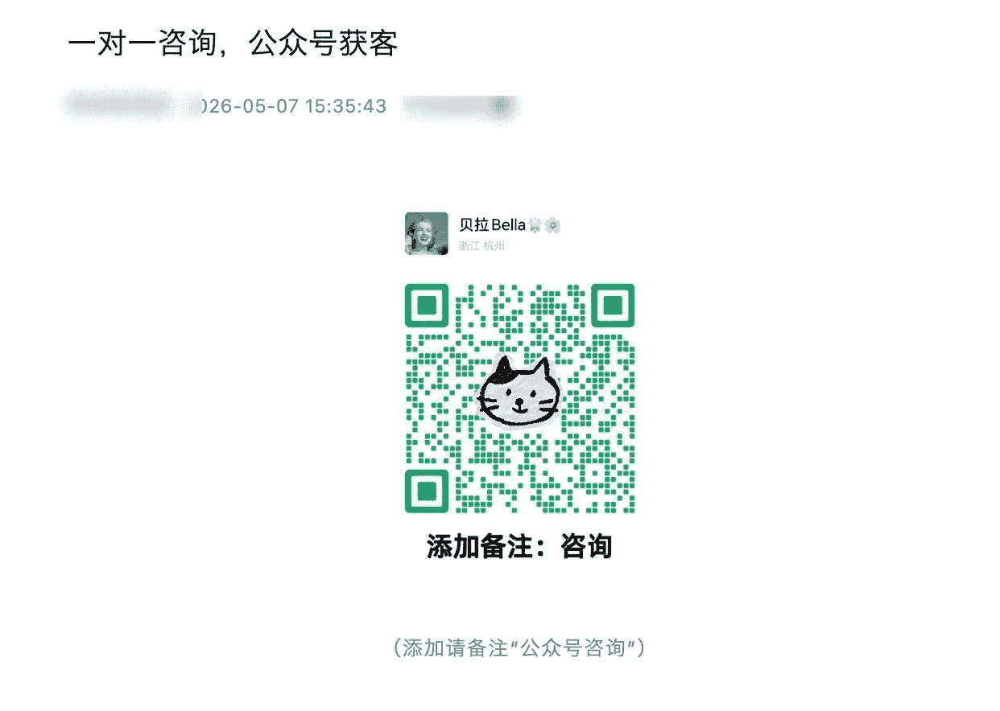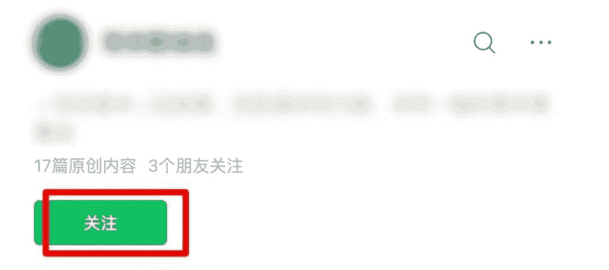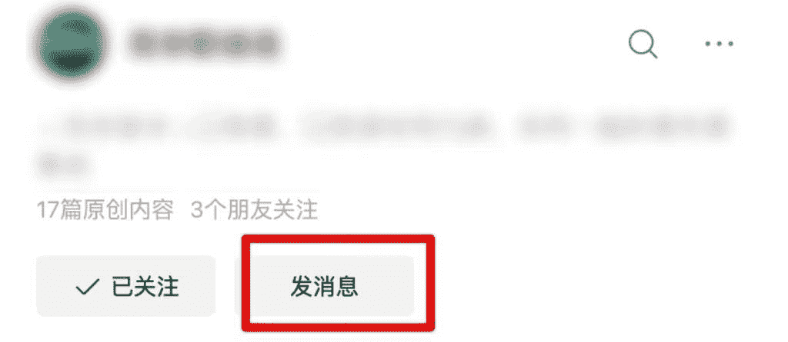

3. 第三次：底部菜单放联系方式。甚至不用自动回复，仅在菜单设置“咨询”按钮，点击出联系方式，常规商务合作做法，也被封。

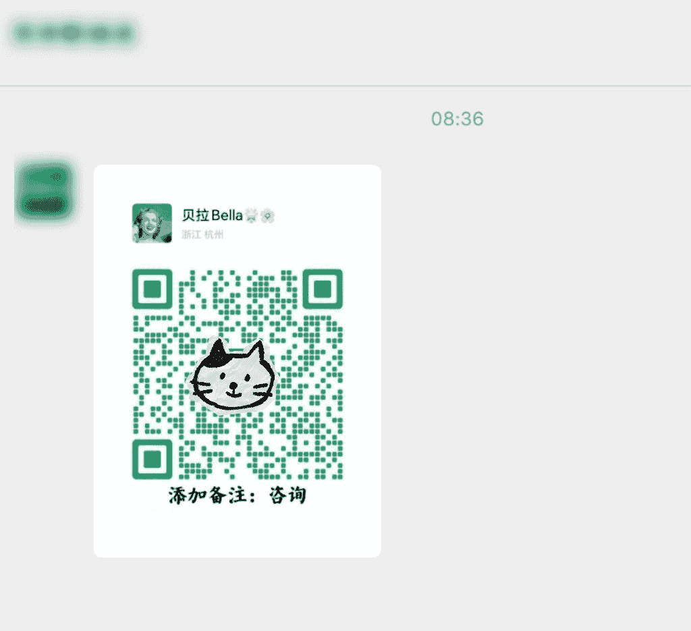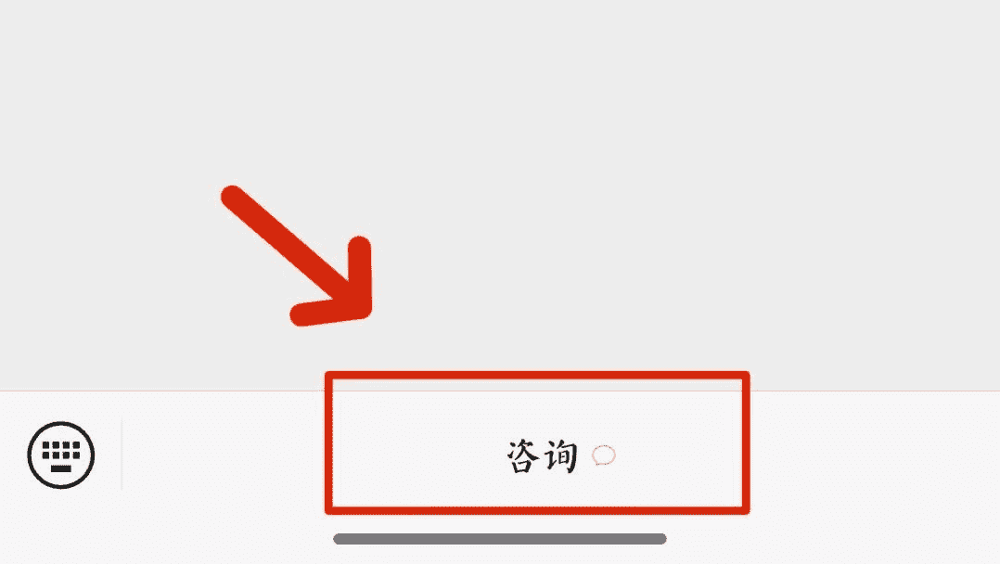

三条主路径全断。很多人会问小程序、阅读原文能否绕过。平台不是查不出，是查与不查的问题。流量不大时可能放过，一旦触发，任何花样都能被查到。

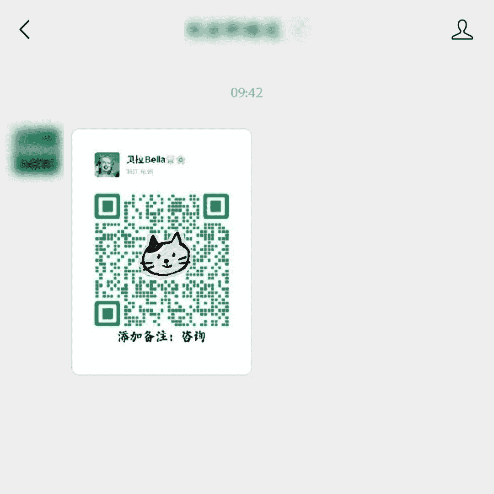

也常有人举例别人违规引流未被封。审核具随机性，有些账号只是暂未被检，检到即死。想做长期生意的，不要用幸存者偏差忽视风险。

### 4.2 账号检测功能：最大痛点

后台的“账号检测”功能逻辑已变。

过去只有收到违规通知才算危险，现在主动标记。

特点：

1. 审核滞后。不是即时判定，而是过一两周甚至更久才标记。我们一篇流量涨到1.1-1.2万时才被判定违规，非常突然。

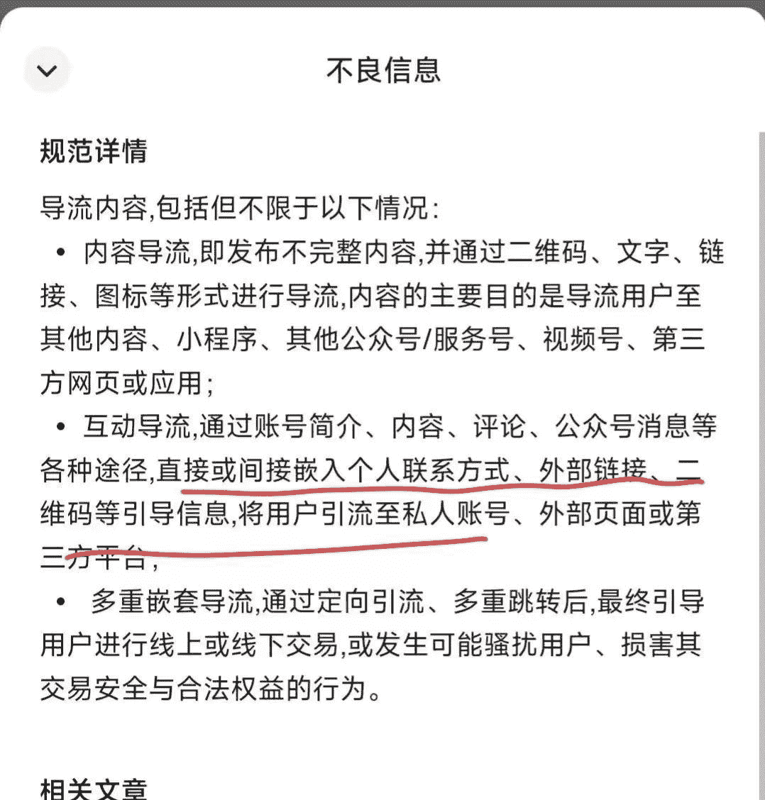

2. 批量判定。一查就是多篇同时出问题，打开后台可能看到七八篇被标记。

3. 删文无用。很多老板第一反应删文，但检测记录仍在，短期批量删文反而会被视为内容大面积问题，触发更严审查。

部分账号记录会自行消除，部分长期挂着，不确定性极大。

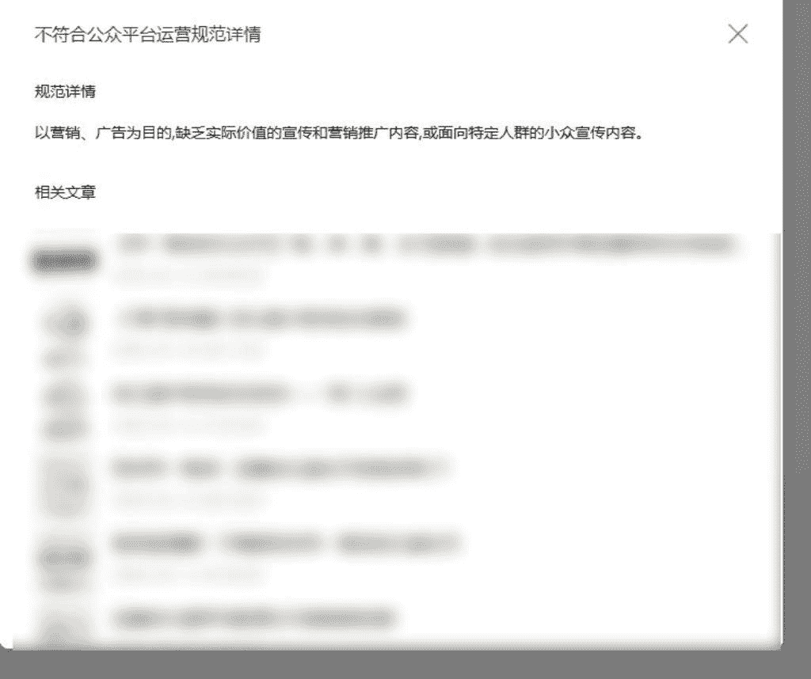

以上为后台检测违规示例，具体条例见官方通告。

### 4.3 流量滞后是双刃剑

与检测滞后对应，👸号流量本身也是滞后推送。

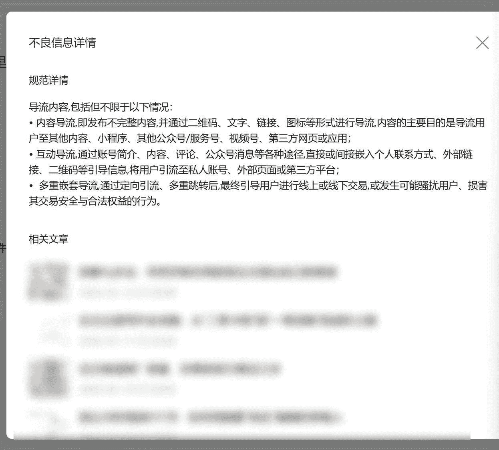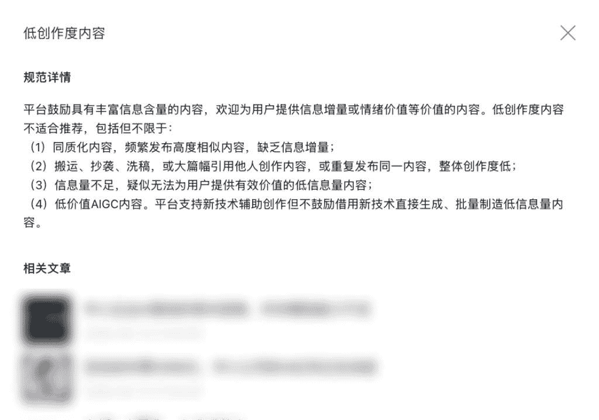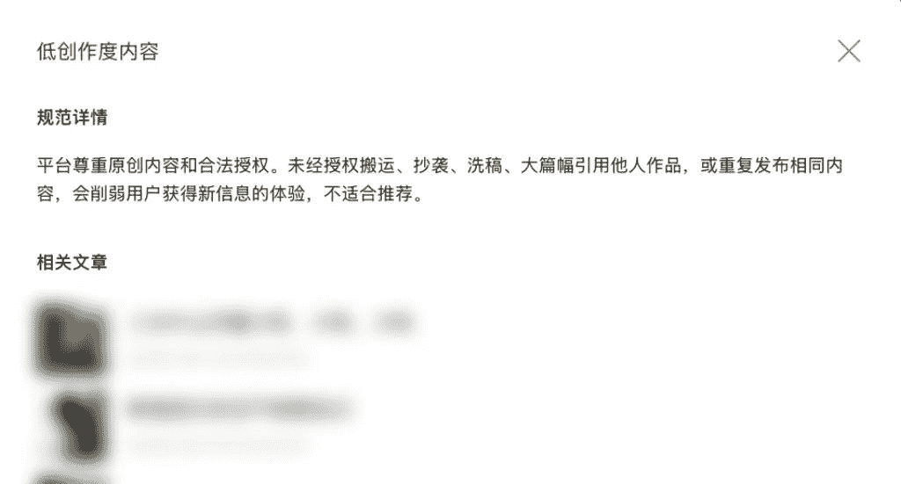

客户案例：健康赛道一篇文章发后三天阅读不到3000，按旧经验已判定不行。结果三周后单日流量突至6.8万。👸号现在是慢推流、多次推流，若每批反馈尚可，会持续推数周。

对高客单老板是利好：用户分批、持续而来，每批都是平台认为匹配度高的人，线索极度精准。不是一天涌入几百人，而是每天稳定进来几个高质量潜在客户。

这件事的另一面更棘手：你很难快速判断一篇文章究竟能不能留住。别想着三天就给内容判生死，至少给它两到三周的观察期，持续盯着长尾数据表现，月底再来做总结复盘。

更麻烦的是滞后性。账号检测滞后，流量释放也滞后。很可能一篇文章流量正处在爬坡期，爬到一定量级后触发了更严的复核，反被判定为违规。在这个时间差里，你可能已经按同一套思路连发了好几篇，后续内容同样埋着雷。所以一个内容方向在没有被足够长的时间验证为安全之前，千万别急着放大做。

### 4.4 5·13新规：账号正从耗材变成稀缺资产

五月十三号之后，👸号在账号管理上动了几下大手术：

- 实名一人一号，管理员绑定机制被砍掉了。过去能买别人的号，把自己公司的人绑成管理员来运营。现在发文必须由账号本人扫码确认，群控养号的成本一下子高了非常多。
- 注销后身份证会被打标。以前号废了就注销重开，但我们自己测以及客户的反馈都显示：同一张身份证注销后重注册，新号基本拿不到推荐流量。申诉流程能走通，流量就是不来。需要说明的是互联网规则随时在变，你看到这篇时可能已松动，这里说的是文章发布当下观察到的真实情况。
- 买号的风险被放大。👸号不像别的平台可以改实名，你买到的本质是“借用别人的身份发文”，对方随时能自助注销或冻结。做高客单的业务，没人会把核心获客管道压在这种不稳定资产上。

这几条叠加起来，账号的价值被抬高了。做高客单的团队，👸号一般就两三个在用，撑死不超过五个。每废掉一个，补回来的时间成本和冷启动成本都在变高。

### 4.5 审核逻辑已经换了

这是很多老板最容易误判的点。

现在文章会被标 AI 生成，一部分老板的反应是：平台在打击 AI，我要把痕迹藏好。

方向错了。

平台判断的不是“你有没有用 AI”，而是“你的内容质量到没到线”。两者是完全不同的事。

实际上后台是明确鼓励用 AI 创作工具的，讲清楚来源标注的文章照样能拿到上万自然阅读。

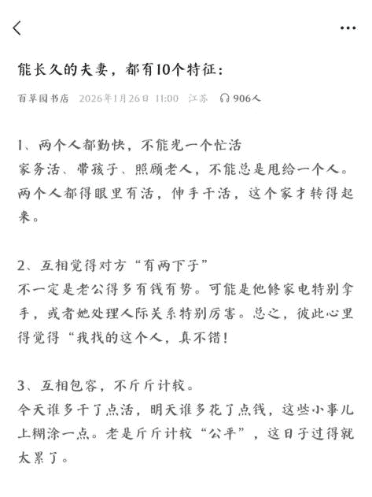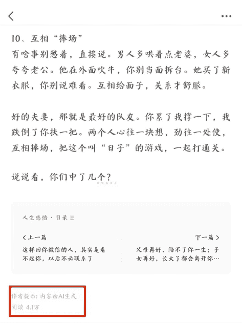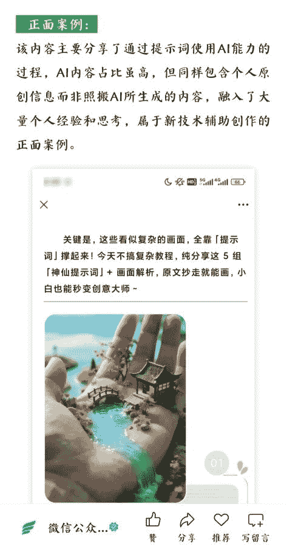

平台真正审的是套路化和模板化。AI 用本身没问题，问题在于你批量生产出来的东西读起来千篇一律，用同一个框架套来套去，就会被归为低质，限流甚至违规。

还有一个不太被注意的变化：数字类内容的审查明显更严了。比如“百万”“千万”这类关键词，近半年爆款里几乎看不到了。以前“一年五千万”“月入百万”这种标题能出十万加，四年前我们也做过。现阶段只要内容里数字对比太多、具体收益写得太细，很容易被判定为网赚风险。

👸号和抖音、视频号在这点上完全不一样。同一句话在短视频端没事，到了👸号就可能触发。

用个类比来理解现在的机制：

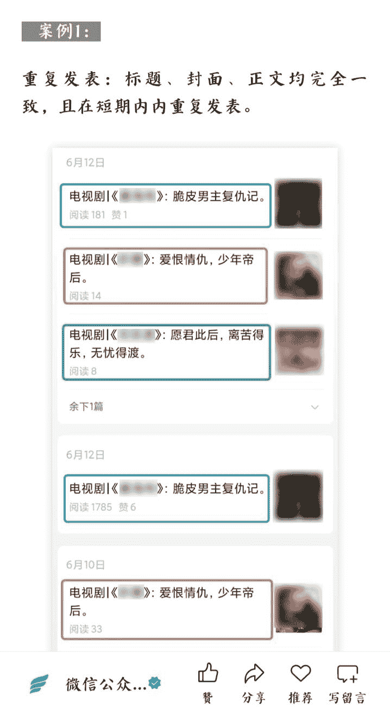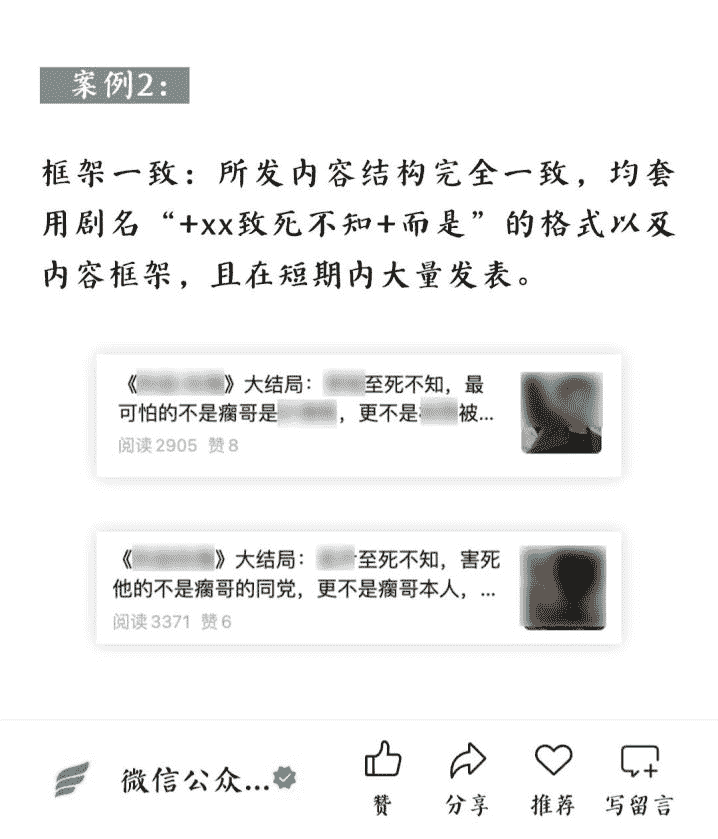

就像一间全员补课的班级，平均分被拉到很高。AI普及后，内容整体水位也在抬升。平台是在倒逼所有人用 AI 把质量做上去，为平台带来更好的用户和广告主，而不是允许你用 AI 去偷懒铺量。

AI 只是个工具变量，决定结果的始终是使用者对内容、对商业、对规则的理解。这点没变。

## 五、已经在做、已经踩坑的老板

先说第一种状态。你已经在运营，但因为导流或内容问题被标记了，现在该怎么做。

### 5.1 废号流对高客单就是死路

有些老板想：号废了就批量起号呗，五十个一百个，总有漏网的。

我们跟踪的客户里真有人这么干。六十来个号上线，一个月下来大概**80%**直接被后台警告违规导流。批量起号在做低客单、靠流量主变现的场景里还能玩一玩，做几千到几万的高客单服务，这条路完全走不通。

原因很直白：废号流注定不会沉淀内容体系，你只想快速铺量、快速发营销文、快速转化。而高客单客户不会看一两篇推销就付款，他要看到的是你账号整体的专业厚度。废号流没时间积累这种信任。

而且生命周期极短：可能日更甚至一天两三更，第二周平台就回溯判定历史文章有问题，号直接凉。就算撑过两周，这号能带来几个精准咨询？能成交几个？算下来不划算。

### 5.2 删文不是解法，改才是

看到检测里挂了几篇问题文章，第一反应是删掉。前面也说了，删文记录还在，短时间内集中删还会触发“内容大面积异常”的标记。

更稳妥的做法是分情况处理：

- 导流硬伤，比如文末留链接、二维码、文内出现“加我🛰️”“找我聊聊”这类明确话术，把这些点位去掉或改写即可，文章主体可以保留。
- 内容问题，比如被判“模板化营销”“推向特定领域小众营销”。这块判定有弹性，通过内容改写、表述优化后可以申诉。
- 整篇就是硬广营销稿，改不动就设为仅自己可见。但注意频率，一次处理两三篇，分批操作。

### 5.3 申诉有用，关键在方法

被判违规就认栽的想法不对。

我自己这个号也反复被判导流，每次都会申诉，目的不是争输赢，是弄清楚问题边界。

合作客户里通过申诉恢复流量的也有。思路大致如下：

1. 先厘清被判的具体原因。是导流？模板化？网赚风险？不同原因申诉策略不一样。
2. 对已定性的事实别硬拗。你确实放了链接、确实放了二维码，就承认并说明已做了哪些修改。
3. 对弹性判定可以讲理。比如“模板化营销”，你可以解释内容逻辑、受众定位、写作意图，附上修改前后截图，看能不能恢复。

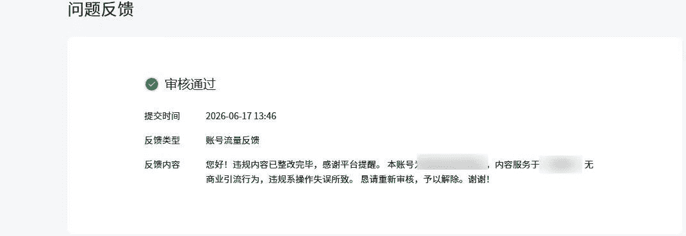

4. 无论申诉成不成功，都要搞清楚一件事：你的赛道和👸号怎么共生。申诉通过说明方向修正对了；申诉不通过说明对平台规则的理解还差口气，需要回头重新想，别直接开新号。

现在账号这么金贵，在没搞清病根前就开新号，新号大概率重蹈覆辙，再废掉一个。

### 5.4 最后还是要回到内容

号救回来以后，同时进行的重头戏是内容本身。

我们自己号在被判违规期间是每三天复盘一次，每个账号过一遍：哪篇有问题、提示词怎么调、下一波方向怎么定。

高客单内容没法用通用型 AI 智能体模板凑合。电商推广的模板在这里不适用，必须按你的行业、你的客户画像、你的赛道做精准提示词调优。看起来只是“写篇文章”，实际工作量很大。

## 六、还没入局、想重新开始的老板

第二种状态：你没做过或停了一阵子，现在想进来。

### 6.1 先接受持久战

现实是冷启动一般要一个月到两个月。内容能力强的团队能压缩到两周左右，我自己这个号大概两周开始起量，但大部分团队的正常节奏就是一到两个月。

值得打这场持久战的原因：

1. 距离用户最近。🛰️是高频生态，客户从阅读到下单可以在一个生态内闭环。相比📕、抖音的多平台跳转，流失更少。
2. 长尾流量扎实。前面说的流量滞后，另一面就是长尾效应：一篇好内容能持续几周甚至更久带来咨询，不是打一波就走。
3. 客资质量高。来的人很多是直接问价格、问方案，不需要大量教育。高客单的利润能覆盖长期投入。

### 6.2 内容先做三类测试

入局后先搞清楚三个问题：

1. 你行业里什么选题、什么表达能拿到推荐？
2. 什么内容既有曝光又能带来精准咨询？有阅读不等于有客资，得找到兼顾两者的方向。
3. 什么内容是服务已关注用户的转化型内容？它可能不爆，但能把关注者推向成交。

我们内部配比是 631 模型：60% 流量内容、30% 流量+客资内容、10% 纯转化内容。具体拆解另文展开。

特别提醒：这三类测试别只看短期数据。流量和审核都是滞后的。你可能连续两周按一个方向发，结果两周后首篇被判定违规，后续同思路的内容全带隐患。

所以每个方向在验证“既有流量又安全”之前，至少给两到三周观察期，确认安全再放量。

### 6.3 转化端：🛰️小店是最合规的闭环

个人🛰️导流基本被卡死，那怎么成交？

目前最安全的是🛰️小店。把引流品挂在小店里，文章引导到小店下单，整个链路都在🛰️内。

引流品设计要匹配客单。

比如我们的代运营产品客单在几万，客户不会为 9.9 的 PDF 买单，他们更愿意花 600 买一次一对一咨询判断合不合适。

可 19800 的顾问产品，客户就会买跟他行业强相关的资料包。

我们也测过 29.9、39.9 的低价引流品，3000 阅读能有 15-20 单，但后端向高客单的转化还在跑数据。说明引流品不是随便挂一个就行的，不同客单价、不同内容类型挂什么品，转化差异很大，需要持续测试优化。

### 6.4 过渡期的替代方案

有些赛道暂时上不了小店，能先用的过渡办法，但不保证安全，也别当长期方案：

- 视频号联动。把🛰️二维码放在视频号主页，文章里引导去看视频号扫码。
- 双号联动。A 号发内容不违规，引导关注 B 号，B 号置顶放联系方式。

我们和客户都试过。审查现在很严，联动被查封的风险是真实的，A 号被牵连 B 号一起掉，损失很大。能走小店就走小店，走不了就先用过渡方案，同时尽快找长期合规路径。

### 6.5 流量分配正在被平台主动控制

现在连大号都不稳。有些头部博主一篇十万加，下篇几百，是常态。这不是偶然，是平台在调控供给和需求。

这意味着别再赌爆款。更靠谱的是稳定输出高质量内容，结合 SEO 关键词做长尾布局，让每天都有精准搜索流量进来。

大号流量不稳，对垂直小号反而是机会：专业度够，照样能拿到精准客资。

## 七、这个赛道最后留给谁

困难是真实的：导流被封、检测滞后、审核变严、账号变贵。

但同行也在承受同样的压力。靠批量废号导流的，正在被一波波清退；靠 AI 模板铺量的，质量上不去连流量都拿不到；只做内容没有高客单承接的，打不了大流量，变现撑不住也会离开。

退场后留下的是谁？是有专业内容能力、有高客单产品、有交付能力的团队。

现在用👸号推荐功能就能感受到：推荐的内容越来越准，很多阅读量不高但写得扎实。平台在奖励真正有质量的创作者，哪怕粉丝不多。

对高客单来说，这是最大的利好。你不需要拼粉丝量，不需要追十万加，甚至不需要做人设。持续输出行业内的专业干货，把关键词布局做好，让有需求的人能搜到你。来的人少，但来一个就是一个精准客户。

平台变难了，投机者离开，真正有能力的人迎来最好的窗口。

————分割线————

看完这篇 SOP，你以为懂了，实操时 90%的人卡在第一步。

工具和教程只是基础壁垒，真正的壁垒是立刻执行和圈层信息差。

如果你想看全网最新的变现打法，并和一群执行力强的极客一起落地变现，欢迎围观我的核心私域：【懒人专属群】。

我们不聊空话，只做商业闭环拆解和 AI 效率压榨。系统内已沉淀 1000+ 跑通的实战案例。

👉 查看圈子数字资产与入场门槛：

https://lazyso.com/insider/

认可价值、准备下场干的，扫码加我🛰️（lazyhelper1）

备注：【实操上车】，不闲聊

