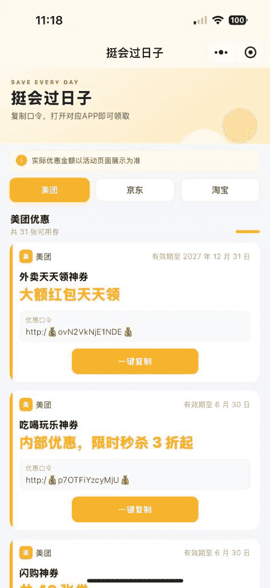
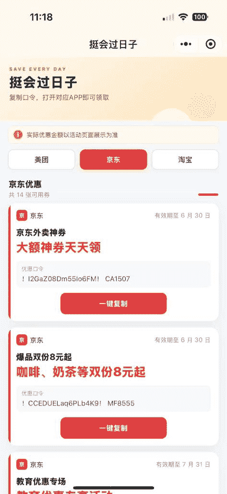
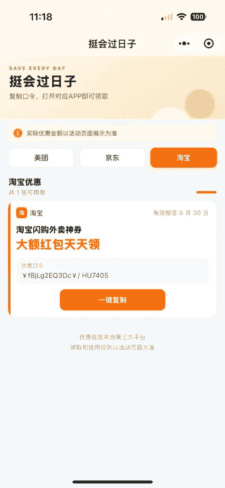
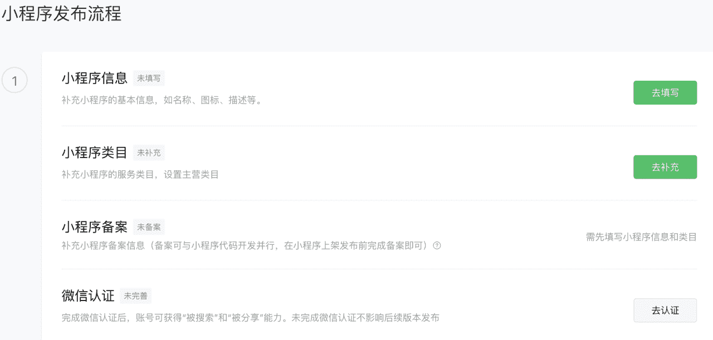
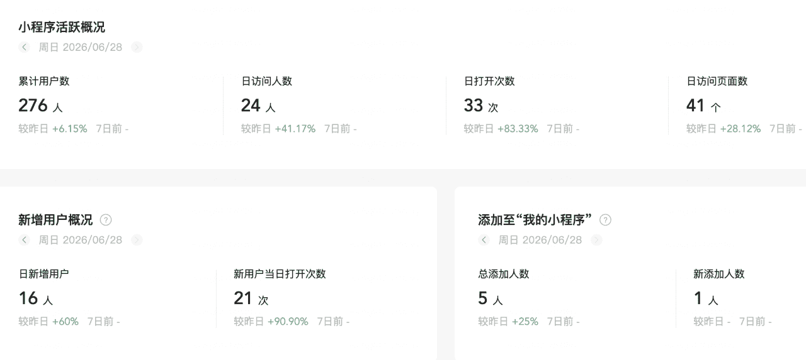

# 3 小时 Codex 撸出一个优惠券小程序，我掉进的 5 个坑
作者：龙哥

去年底跟 CPS 小航海，靠优惠券的成交我倒了 4000+。有次朋友半夜要吃药不好意思找我要链接，我才恍然大悟：与其每次私聊甩链接，不如做个随时能打开的工具放那儿。

于是我让 Codex 帮我搞，第一版优惠券小程序【挺会过日子】就这么在 3 小时左右跑了出来。上线 7 天，没做大规模投放，注册用户快 300 了，也已经有真实订单回流。

今天把思路、做法和踩坑全摊开说说。

## 一、为什么要做

### 1、做这件事的理由
1）CPS 优惠券确实能变现；2）身边人真有需求，不想每次都喊我发券；3）市面上外卖券做烂了，非外卖的高频低频券还是一片空白。

### 2、瞄准谁

1）不知道外卖每天都能领券的人；
2）不知道除了外卖，还有一大堆券能领的人；
3）想一站式薅多个平台外卖券的人。

说白了就是白领、大学生这类群体。

### 3、第一版只解决一个问题
我没想着一上来就做功能拉满。第一版的核心只有一条：用户能不能顺利领到券。

围绕“能不能领到券”来做 MVP，验证需求成立后再加功能，而不是自己感动自己堆一堆没人用的东西。

## 二、成品长什么样

打开小程序 -> 一键复制 -> 去打开对应 App -> 自动弹券 -> 下单抵扣。就这么简单。

## 三、3 小时怎么花的

### 1、第 1 小时：只梳理，不写代码
先用刘小排老师在【超级 AI 大航海】里提到的 SPEC 方法过一遍需求：

我要做一个：……用一句话把想法大概说清楚……

请你别急着写代码，像个苏格拉底一样一个问题一个问题地问我，每次给带编号的选项，直到我们能凑成一份完整的 SPEC，包含：

- Problem Statement
- Proposed Solution
- Technical Constraints
- Non-goals
- Success Criteria

实操下来发现 Codex 容易跑偏，还会扯到上架、审核这些事。于是我又加了约束：只围绕 MVP 问。问题越问越多时我就直接打断，问它现在的问题是否还在 MVP 范围内。

关键点：Codex 推演时是可以随时打断的，前期别想太多，连界面长啥样都不用先定，能力很强。

### 2、第 2 小时：让 Codex 写 PRD 并开工
需求定了就让它出 PRD，我人工再过一遍。确认没问题就开始写代码。

Codex 写得比我想象的快，核心页很快就有了，还顺手给我生成了一套本地后台。后台看着挺爽，但也提醒我：AI 很容易过度交付，第一版要的是验证，不是功能齐全。

### 3、第 3 小时：调细节、真机测、修跳转
提示文字居中、文案微调、Logo 弄一下、跳转逻辑理清。

最要紧的是别只在云端测。复制粘贴这种功能，云测成功≠真机成功。我拿真机测完打开美团，券确实弹出来了，才算心里踏实。正式上线前我又自己跑了一遍，确认 OK 才开始推。

## 四、踩过的 5 个坑

### 1、起名比写代码更磨人
这是最大的坑。个人主体做小程序，名字卡得要死。试了十几个“xx 神券”“xx 领券”“xx 省钱”全被拒。最后只能用【挺会过日子】，北方人能get到梗的意思。基本等于放弃搜索流量了，只能靠传播。

我个人的体感是审核优先级大概是：
商标 > 公司主体 > 个体户主体 > 个人主体。
优惠券赛道大厂多，词被占满，主体弱更难过。仅供参考。

### 2、备案和认证顺序别搞反
官方写的是先备案再认证，实际操作是先认证再备案。因为第一个名字大概率不过，一旦先备案了，后续改名又得重走流程，我就白等了好几天。

正确顺序：
1. 小程序基本信息
2. 小程序类目
3. 🛰️认证
4. 小程序备案

### 3、真机测试必须做
🛰️云开发没问题，真机可能直接崩。页面适配、点击反馈、跳转路径都要在真机上再过一遍。

### 4、第一版别急着做后台
我根本没想做后台，Codex 直接做了，还做得挺像样，结果我被分心去调后台。后来才发现🛰️云开发前半年就能顶上，19.9 元/月，后面再考虑要不要自建后台。没后台也能靠发版更新内容，虽然慢点但够用。

AI 很会“多做”。不明确说只做 MVP，它会把管理后台、扩展功能一并给你，看着很香却分散注意力。

### 5、逻辑别搞复杂
第一版只保留一条主流程就行。我的产品可以做成跳转 App 领券，也可以做小程序内领券，但第一版只选一种，别混合。先上线让用户反馈，再迭代。

分类、数据统计、领券排行这些后续再说，用户会告诉你什么有用。

## 五、上线只是开始，推广才是关键

我的推广节奏很笨但有效：
1）上线先丢给朋友测，覆盖不同机型；
2）第二天群聊+朋友圈再推一波，顺便收反馈；
3）放到👸号封面图里推，屏蔽噪音；
4）用户多了再逐步上公域。

现在一周将近 300 用户，后台能看到真实订单了。

## 六、总结

想做小程序不必把功能想全。先找一个真实的小痛点，用 AI 快速做出最小可用版本，上线让市场说话。

对普通人而言，上线不是终点，而是第一次真正开始。

————分割线————

看完 SOP 你以为懂了，实操 90% 的人卡在第一步。

工具和教程是最不值钱的，值钱的是立刻开干和圈层信息差。

我们不谈概念，只拆闭环，只压榨 AI 效率。内部已沉淀 1000+ 可跑通的套利实战。

😂 查圈子资产和上车门槛：
https://lazyso.com/insider/

备注：【实操上车】，不闲聊

