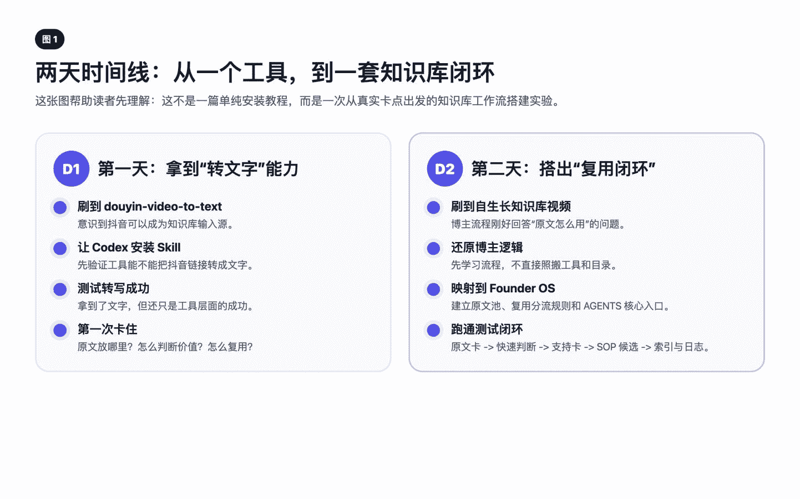
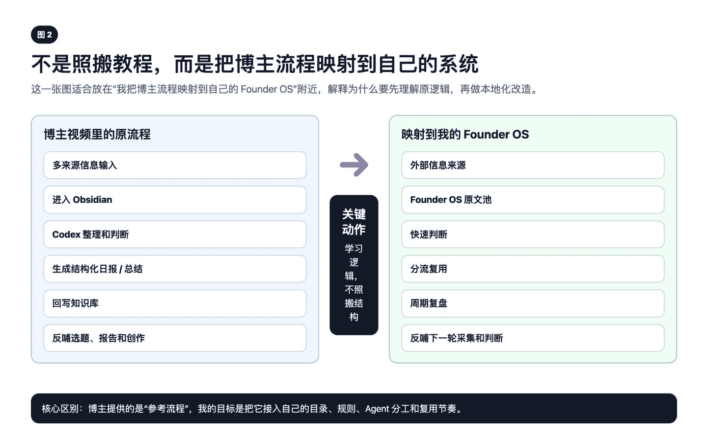
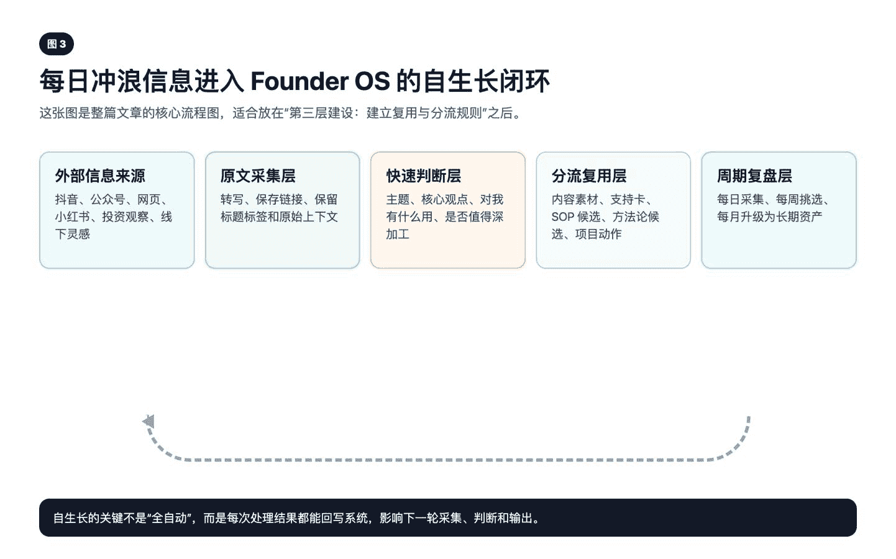
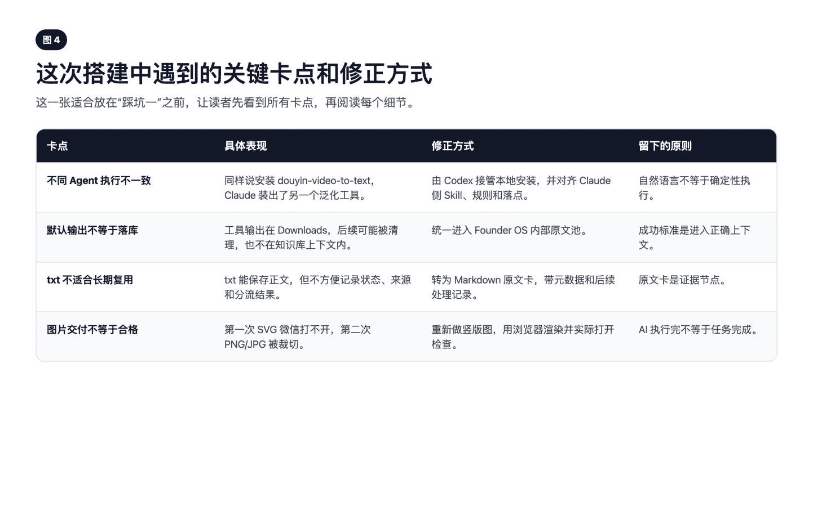
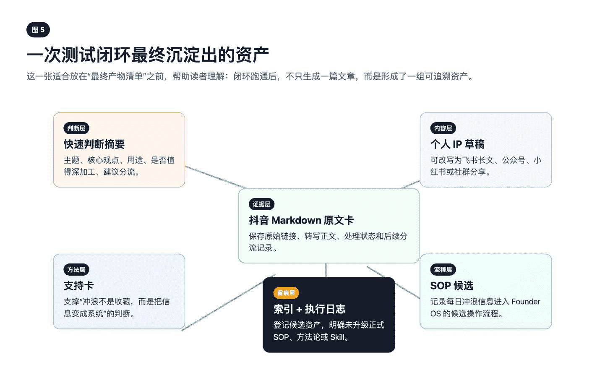

# 两条短视频，帮我搭出一个会自己生长的个人知识库入口

260713 副业SC 精华


懒人🛰️：lazyhelper1

从抖音转写 Skill 出发，最后落地成 Founder OS 里一套每日信息复用循环的完整实战。

必须先说明：「Founder OS」并不是某个能直接下载的成品软件。它是我给自己这套知识库加工作台起的代号。通俗讲，就是把信息摄入、项目推进、内容生产、AI 协同统一调度起来的私人操作系统。

### 这篇分享适合谁

适合以下几类人：

- 信息量很大，但大多数内容都在收藏夹里吃灰的人。
- 已经在用 Obsidian、飞书、Notion、语雀或本地资料库，却迟迟没让这些资料二次发挥价值的人。
- 希望靠 AI 来清洗抖音、👸号、📕、网页长文等外部信息的人。
- 正在做个人 IP、👸号、📕、社群分享，急需把日常输入变成创作弹药的人。


- 已经开始接触 Codex、Claude、ChatGPT 这类智能体，却发现“工具就位”和“流程成型”完全是两码事的人。
- 对一键收藏不甘心，想让信息进一步长成内容、方法、SOP、项目动作和长期判断依据的人。

如果只想抄一段安装命令，或者求一个全自动脚本，这篇文章会让你失望。我更想呈现的是真实搭建过程、踩过的坑，以及可以照着复制的工作流方案。

### 我到底想解决什么

真正想回答的，不是“怎么把抖音视频变成文字”，那个命题太单薄。

真正的问题是：

每天在信息流里撞见的内容，怎么顺利进入我的资料中枢？进来之后，凭什么判断它值不值得？如果值得，又要怎样才能转化为内容素材、支撑资料、SOP 备选或方法论备选？最后，这些加工产物如何再次喂给系统，让整个库越来越厚？

一句话，要打通的是这条链路：

信息出现 → 保存底稿 → 评估价值 → 归入对应出口 → 沉淀为可长期使用的资产。

### 看完能带走什么

至少能带走 5 样东西：

1. 一套真实跑通的流程，专门解决“每天冲浪的信息怎么进知识库”。
2. 一套把抖音短视频加工成 Markdown 原文卡的操作思路。
3. 一套判断外部内容值不值得继续投入精力的评估标准。
4. 一套把信息分发成创作素材、支撑卡、SOP 备选、方法论备选、项目动作的做法。
5. 一组能直接复制给 AI 的提示词。

这一路也踩了不少雷：

同一句指令给不同智能体，产出可能天差地别；工具把结果丢进 Downloads，不等于它进了知识库；txt 虽然留下了文字，却不适合当长期卡片；AI 交出图片，不代表图片能直接使用；规则写在文档里，也不等于整个链路已经自动转起来。

这篇文章不打算秀一套无懈可击的系统。它更想原原本本记录一件事：一个日常刷到的灵感，是怎么一步一步长成可复用的知识库工作流。

## 完整目录

1. 为什么要写这篇记录
2. 信息输入失控的起因
3. 第 1 天：遇到 douyin-video-to-text 这个 Skill
4. 卡点：原文到手，下一步空白
5. 第 2 天：刷到“Codex + Obsidian 自生长知识库”
6. 先让 AI 还原博主的做法
7. 将博主思路装进我的 Founder OS
8. 搭第一层：给原文找一个固定落点
9. 搭第二层：定下“原文沉淀规则”
10. 搭第三层：定下“复用与分流规则”
11. 为什么核心规则必须写进 AGENTS.md
12. 坑一：同句话，不同 Agent 各干各的
13. 坑二：工具输出成功 ≠ 已经入库
14. 坑三：txt 适合存字，不适合做知识卡
15. 坑四：AI 交付文件也必须验收
16. 最后测试：拿一条视频走完整链路
17. 最终交付清单
18. 可直接复制的提示词
19. 这套方法的适用与不适用
20. 下一步：暂不扩大自动化
21. 结尾：我搭的是外部大脑的入口

进入正文前，先用一张图理清真实发生顺序：



这张图里最重要的拐点在于：第 1 天只回答了“能不能转写”，第 2 天才是“转写之后如何利用”。

## 为什么要写这篇记录

最近两天，我完成了一个看起来不大、回想起来却非常关键的试验。

起因是我在抖音划到一个能直接转写视频成文字的 Skill，顺手让 Codex 帮我装好。第二天，又碰到一条讲“Codex + Obsidian 搭建自生长知识库”的视频，刚好填上了我前一天留下的疑问：转出来的字，到底该往哪里用？

两条短视频就这样连成了一次真实的知识库工作流搭建实验。

起初我觉得自己只是在装工具。做到后面才意识到，问题根本不在工具，而在信息如何进入系统。

每天要消化的内容太多：抖音、👸号、📕、网页文章、行业动态、投资观察、AI 工具案例……每一则刷到时都被觉得有价值，但只要一键收藏，大概率就永远躺在角落里。

我缺的不是收藏更多，而是让新的信息真正流入系统，并按流程运转：

出现 → 留存原文 → 评估价值 → 分流向不同用途 → 最终产出内容、方法、SOP、项目行动或长期判断。

下面这份记录，就是我怎样把这个想法搭成一个能跑通的测试链路。

## 背景：信息输入为何失控

我每天都接收大量外部信息。

抖音上有人分享工具、拆解流程、展示 AI 工作流；👸号里有行业观察、成长类文章、商业观点和项目复盘；📕上能看到热点选题、用户原话、使用场景、对标案例；网页文章里则有教程、产品案例、行业报告、政策信息；此外还有线下冒出来的灵感，像开会时的临时想法、刷手机时突然意识到的问题、做项目时撞见的可沉淀经验。

过去的毛病在于：信息往往只到“我觉得有用”那一步。当时觉得价值很高，先存下来，之后就像丢进黑箱，过几天自己都不记得存过什么。

等到真要写东西、做项目、复个盘，才开始翻找：之前是不是见过类似案例？视频去哪了？观点是哪篇文章提的？当时到底觉得它哪里有用？

收藏只是缓解了怕遗漏的焦虑，并没有解决二次利用。所以对我来说，知识库要解决的不是“放哪儿”，而是“怎么再用”。

一条内容进入系统后，至少要回答这些问题：它讲什么？来自哪里？对我有什么价值？适合放进哪个模块？能不能变成创作素材？能不能提炼成方法？有没有可能成为 SOP 的候选？会不会影响某个项目的下一步？

如果这些问题全都没有答案，资料只是从一个平台搬进了另一个文件夹，始终不是我的资产。

## 第 1 天：遇到 douyin-video-to-text 这个 Skill

第 1 天的起点非常简单。

我在信息流里刷到 douyin-video-to-text 这个 Skill。它做的事很直接：丢一个抖音链接，它就能把视频里的语音转成文字。

我的第一反应不是“哇，工具挺酷”，而是：如果以后刷到的优质视频都能这样留下文字版，抖音就不再只是娱乐场，它也能成为知识库的内容入口。

我把需求发给 Codex：“帮我装一个 douyin-video-to-text 的 Skill。”

安装和依赖配置很快就完成了。随后我用一条真实抖音链接做测试。

那会儿我给自己定了个很小的目标：只验证转写是否可行，先不碰入库。

这个克制是故意的。很多人搭系统时总想一步到位搞自动化和沉淀，可第一步应该是先确认工具底层能不能干活。

测试结论：能。视频内容确实被提取成了文字。

工具算是装上并跑通了，但紧接着，一个更麻烦的问题浮出水面。

## 卡点：原文有了，却不知往哪放

当内容真的变成文字后，我才发现麻烦才刚刚开始。

第一件事：这些文字放哪？

放进 Downloads？那只是临时文件夹，我习惯定期清理，而且它不在知识库的主工作区内，Claude、Codex、Obsidian 插件未必会主动读取。

放进 Obsidian？那又该进哪个文件夹？每日总控？素材区？内容输出区？方法论区？还是某个具体项目下？

退一步说，就算原文放好了，后续呢？

一条信息被保存后，至少还要过好几道筛子：它有没有价值？值得当下就深加工，还是先放着？适不适合变成内容素材？能不能做成支撑卡？有没有 SOP 的潜力？要不要进方法论库？会不会改变某个项目的下一步计划？

从这时起，我看明白了一件事：装 Skill 只是最外层，真正的难点在于把工具输出接到自己的知识库工作流里。

换句话说，缺的并不是“转写能力”，而是“外部信息进来之后该怎么处理”的规则。

第 1 天结束时，链路没有闭环。我手里只有转写文本，却不知道怎么用。

所以我没急着往下走。规则没想清楚就硬做，系统只会在混乱中越堆越乱，停下来反而更合理。

## 第 2 天：刷到“Codex + Obsidian 自生长知识库”

第 2 天，刷到另一条抖音，主题是“用 Codex + Obsidian 搭一个会自生长的知识库”。

这条内容正好戳中我前一天的痛点。我手里已经握有“抖音转文字”的能力，但不知道转完怎么进入系统。视频里讲的，正是信息进 Obsidian 后，交给 Codex 去整理、归纳、写回，从而让知识库越用越厚。

我看完的判断是：这根本不是某个工具的介绍，而是一整条工作流。

大致可以画成：

信息源头 → 进入 Obsidian → Codex 处理 → 形成结构化结果 → 回写知识库 → 喂养下一轮输出

它真正启发我的是：信息不应该只是被“存下”，而是要进入一个循环。原文只是循环的起点，后面还应该连着整理、评估、分流、复盘、输出和回写。

因此我没有急着让 AI 替我设计规则，而是先让它回到视频原文，把博主到底做了什么拆解清楚。

## 我没照搬，先让 AI 还原博主流程

这一步被我视为整次实验的关键。

人一旦看到“好像很有用”的教程，最容易犯的错就是照搬：对方用什么工具，我就装什么工具；对方建什么目录，我也建什么目录；对方自动化的地方，我也照做。

可实际情况是：每个人的库结构、工作方法、内容来源、输出目标都不同，照抄只会水土不服。

我让 Codex 先别动我的方案，只做一件事：回到视频转写原文，把博主的流程理出来。

当时用的提示词大意是：“请回到这条抖音的原始内容，先不要为我设计方案，先整理博主讲的自生长知识库流程，让我看清楚它的处理逻辑。”

好处是，我先把别人的完整逻辑吃透，而不是捡几个动作就上手。

最后提炼出的博主核心流程：

1. 打通 Codex 和 Obsidian；
2. Obsidian 充当知识库的容器；
3. Codex 当整理和执行助手；
4. 信息来源分成线上自动收集、线上手动收藏、线下灵感捕捉；
5. 外来信息进素材库后，Codex 生成结构化日报或总结；
6. 总结文件再回写到 Obsidian；
7. 库里内容继续为选题、报告、思维导图、内容创作供能；
8. 用每日、每周、每月的节奏推动库不断长大。

我把这套理解成一句话：自生长知识库不等于自动收藏，而是让信息不断流进、不断被整理、不断被写回、不断被再次调用。

这句话很关键，它把我的注意力从“装工具”拉回“设计流程”。

## 把博主流程映射进我的 Founder OS

我没有直接复制博主的目录和工具清单，而是先把他的逻辑翻译成与自己系统匹配的版本：



这里的核心不是复制对方的工具组合，而是把流程思路放进自己的目录、规则、Agent 分工和复用节奏里。

看懂博主后，接下来不是照搬，而是做映射。

博主用的是 Codex + Obsidian；我的组合是 Founder OS + Obsidian + Codex + Claude。

我们的起点并不一样。我的库已经有一套固定结构，像 01_每日总控、02_输入箱、05_内容输出、07_方法论库、08_素材库。如果直接把内容塞进 Obsidian 的某个文件夹，只会破坏已有秩序。我要做的是按照 Founder OS 的骨架，重新梳理信息流。

最终，博主的逻辑被我映射成：

外部信息源 → Founder OS 原始信息池 → 快速评估 → 分类复用 → 周期性复盘 → 反过来影响下一轮的采集与判断

这个映射很关键。它让“自生长知识库”从一句概念，变成能在我这里落地的具体工作流。

**第一层：外部的信息源头**

现阶段我锁定的渠道包括：抖音信息流、私人👸号阅读、网页文章、📕热点、投资观察、线下灵感/语音速记。

不过 V1.0 没有全部打开。最先启用的只有两路：抖音转写出来的原文、个人👸号文章原文。原因很简单——先把一条链路跑顺，再去接其他管道。

**第二层：原始信息池**

原稿统一进：

- `08_素材库/每日冲浪原始采集/抖音转写原文`
- `08_素材库/每日冲浪原始采集/👸号文章原文`

这一层定位成“证据层”。它既不是成稿，也不是正式的 SOP 或方法论，只是把外面的信息用可持续复用的方式留下来。

**第三层：快速评估**

原始内容进池后，先别急着深加工，先回答几个基础问题：

- 它能否用一句话说清主题？
- 最关键的观点是什么？
- 对我有什么实际用途？
- 是否值得进一步打磨？
- 建议被送到哪个分类？

这一步不为了写稿，只为了判断要不要继续投入力气。

**第四层：分类和二次利用**

评估为值得处理后，再按去向分：

- 内容素材
- 资料卡
- 支撑卡
- 可能成为 SOP
- 可能成为方法论
- 项目下一步动作
- 仅作归档
- 拿不准就先进输入箱

**第五层：周期性复盘**

不是每条内容都要在当天被加工到很深。默认节奏如下：

- 每天：采集原稿 + 做快速评估
- 每周：挑出 3～5 条最值得深挖的内容
- 每月：判断它们要不要升格成内容系列、SOP、方法论或项目资产

这才是我想象中的“自生长”：不是让自动化脚本乱跑，而是在一个有边界的体系里，稳步增长。

## 第一层建设：先把原文落点定下来

整体结构想清楚后，第一件上手的事就是固定原文落点。如果这一步暧昧，后面的复用一定乱。

最初，工具把内容默认丢进 Downloads。但我很快觉得不对劲：Downloads 是临时目录，随时可能被我清掉，而且它不在 Founder OS 工作区内，后续 AI 也不一定能稳定读到。

于是定下原则：所有打算长期保留的每日冲浪原文，必须进入 Founder OS。

最终目录定为：

- `08_素材库/每日冲浪原始采集/抖音转写原文`
- `08_素材库/每日冲浪原始采集/👸号文章原文`

这里还藏着一个容易被忽略的区分：我自己日常看的👸号文章，要进“每日冲浪原始采集”；但是👸号项目里需要关注的对标账号、爆款稿、赛道材料，以及自动抓取的原文，不能混进来，它们要走👸号项目自己的采集体系。

为什么要分这么细？因为同样是👸号文章，用途完全不同，落点也必须跟着变：

- 个人获取信息的端口 → 每日冲浪原始采集
- 👸号项目的业务端 → 👸号项目原始采集

这么一分，后面才不会变成一锅粥。

## 第二层建设：建立“原文沉淀规则”

原文落点敲定后，我请 Codex 起草了第一份规则：

`每日冲浪与外部信息原文沉淀规则_V1.0.md`

这份规范要回答：外部信息进来后原稿怎么存；抖音转写如何变成 Markdown；私人👸号内容和项目👸号内容怎么区分；每日总控在其中承担什么角色。

定规则的过程中，有几个决定很关键。

**原文长期保存用 Markdown**

工具可以先产出 txt，但进入 Founder OS 之前，我要求它转成 Markdown 原文卡。原因在于：Markdown 与 Obsidian 的相性最好，Claude、Codex 后续读取也更顺畅；Markdown 能带 frontmatter，可以把处理状态和后续流向记录在文件里。

于是流程调整为：

抖音链接 → douyin-video-to-text 转写 → txt 临时产物 → 转为 Markdown 原文卡 → 存入 Founder OS 原始信息池

卡片至少携带一组基础元数据，我自己用这 9 项：

- source_type
- platform
- source_url
- aweme_id
- capture_date
- status
- processing_state
- related_project
- created_by

有了它们，以后翻到任何一张卡片，都不用靠记忆猜身份，它自己就能说明来源、状态和处理到哪一步。

**每日总控只做记录，不装长原文**

每日总控这个文件，不应该被塞成长篇大论。它的定位更像一条时间轴与摘要索引。

里面可以写：今天收集了什么、原文保存在什么路径、快速评估结论如何、值不值得深加工、下一步动作是什么。

但完整原文，应该回到素材库去。

## 第三层建设：建立“复用与分流规则”

“进得来”只是第一层。我更在意的是第二层：进来以后怎么被再次使用。

于是有了第二份规则：

`每日冲浪信息复用与分流规则_V1.0.md`

它要解决的问题：原文进系统后，怎么评定价值？怎么决定要不要继续处理？怎么分发到内容素材、资料卡、支撑卡、SOP 备选、方法论备选或项目动作？又如何用日/周/月的节奏，让库持续成长？

我把默认处理动作分成三层：原文层、判断层、复用层。

**原文层**

只存放原始材料和基础元数据。它不做价值判断，不负责写稿，也不会自动升格成正式方法。

**判断层**

只问一个问题：这条信息对我到底有没有用？

判断模板很简单：

- 一句话主题
- 核心观点

拿到一条外部信息，我会先自问四个方向：它对业务打法、内容产出、方法论底层、认知升级、投资判断分别能产生什么作用；做到什么程度才值得投入时间；最终归到哪一个归类；下一步该如何推进。

**复用层**

只有确认值得继续投入后，才会把这条内容推入复用层。出口选项包括：仅做归档、作为创作素材、建立参考卡、建立论据卡、流程规范候选、方法论候选、项目级动作，拿不准时先放进暂存箱。

这一层的关键边界是：候选不等于定稿。再有吸引力的一条输入，也不能因为看起来合理就直接升为正式流程或正式方法。必须先以候选身份保留，经过多次真实使用检验后，再考虑转正。

把原文沉淀与复用分流合在一起看，完整闭环可以收敛为五层：



我判断每条冲浪素材时就沿着这张图走：先进入原文池，做一次快速权衡，再决定是否进入复用，而不是一开始就做深度加工。

**为何要把核心规则写进入口文件**

搭建过程中，我给自己定了一个硬性要求：核心规则不能只留在说明文档里，必须直接落进 AGENTS 入口。

原因很简单，代理进入 Founder OS 的第一站就是这份入口文件。若里面只写“详见某规则文档”，执行时很容易出现：代理忘了去读、读了但理解偏差、只读入口没读正文、上下文过长导致关键约束在执行时丢失。

因此我要求把最核心的执行约定直接沉入入口文件，涵盖：三层处理、快速权衡、归类出口、每日/每周/每月复盘节奏、候选与正式的分界。详细文档负责展开，入口文件负责让代理用最短路径知道怎么做。

这件事带来一个认知：规则不是装饰性的说明，而是给执行者减少弯路的操作约束。若规则只躺在深层文件里，没有稳定触发，就等于没有进入系统。

在展开细节前，先把这次搭建里最容易卡住的点整理成一张表：



这些坑单独看都不致命，但合起来说明一个结论：AI 工作流不能只看是否生成了结果，还要看是否进入了正确的上下文、是否可被验证、是否可被复用。

**坑一：同一表述，不同代理给出不同结果**

最典型的例子是 Claude 与 Codex 对 douyin-video-to-text 的理解差异。

我让 Claude 也装同名能力，结果它装出的是一个更泛化的社媒转写工具。这提醒我：自然语言指令不等于确定性执行。

对人而言“安装 douyin-video-to-text”很明确；对代理而言，可能被理解为：装同名工具、找功能相似的工具、装更通用的转写器、按现有生态挑另一个包。

最后由 Codex 主导这件事，做法是：

1. 先确认 Codex 侧已安装并测试通过的正确工具；
2. 检查 Claude 侧装的是否一致；
3. 不一致就清理掉 Claude 侧不匹配的工具；
4. 把 Codex 已验证的 Skill 对齐到 Claude；
5. 让两边读取同一套规则，使用同一套落点。

启发是：多代理协作时，别默认它们对同一句话的理解一致。工具、规则、落点必须显式对齐。

**坑二：工具输出成功，不等于进入知识库**

另一个关键坑是默认输出目录。

douyin-video-to-text 能把视频转成文字，但最初输出在 Downloads。工具视角看已成功，知识库视角看还没成功。

Downloads 只是临时落脚点，过几天清理就没了。更重要的是，后续我会在 Obsidian、Claude 插件或 Codex 工作区继续处理，如果原文不在 Founder OS 内部，就很难成为系统的一部分。

于是我重新定义成功标准：不是文件生成了，而是文件进入了正确位置，并能被后续流程调用。

这件事让我意识到：知识库里最关键的不是生成文件，而是文件进入正确的语境。

**坑三：txt 能存文字，不适合做长期卡片**

第三个坑是格式。

工具默认生成 txt，优点是简单，能保存文字，但不适合做长期知识卡。

后续我需要的不只是正文，还要记录：原始链接、平台、视频 ID、采集时间、处理状态、是否已提炼、是否已分流、生成了哪些后续产物。用 txt 也能写，但结构不够清晰。

Markdown 更合适。所以我决定：txt 只作为工具中间产物，进入 Founder OS 的长期原文，一律生成 Markdown 原文卡。

原文卡可以这样长：

```
---
source_type: douyin
platform: douyin
source_url: ...
aweme_id: ...
capture_date: ...
status: collected
processing_state: pending
related_project: founder-os
created_by: ...
---

# 标题

转写正文...
```

当这条素材完成复用验证闭环后，原文卡会被回写：

```
processing_state: 已完成复用测试闭环
```

并补充：

- 快速权衡摘要
- 分流结果
- 生成产物路径
- 后续处理记录

这样原文卡就不再只是文本保存，而是整条处理链路的证据节点。

**坑四：AI 交付文件也必须验收**

还有一个很典型的小坑是流程图。

我让 AI 把“每日冲浪信息自生长闭环草图”导出成🛰️能打开的图片。第一次它生成了 SVG，🛰️打不开。要求改成 PNG/JPG 后，第二次虽然格式对了，但右侧和底部都被裁切。

这说明 AI 生成了文件，不代表交付合格。只看文件是否存在、大小正常容易误判。

真正要验收的是：用户能否打开、内容是否完整、有无裁切、是否符合使用场景。

后来我重新生成竖版🛰️长图，做法是：不用系统缩略图转换、重新生成竖版 HTML 图稿、用浏览器完整渲染、截取完整长图、实际打开 PNG/JPG 检查、确认从标题到“闭环含义”都完整。

总结一句话：AI 执行完不等于任务完成。真正的完成是交付物被验证过，且用户能直接使用。

这个原则适用于所有 AI 交付：脚本要跑过、文件要读回、索引要能搜到、图片要能打开、规则要能触发、状态要确认无误标。

**最终测试：用一条真实视频跑完整闭环**

当原文规则、复用分流规则、入口规则都写好后，还差最后一步：用真实素材跑一次闭环。

规则写好不代表系统跑通。所以我用“Codex + Obsidian 自生长知识库”这条抖音素材，跑了一次完整的每日冲浪信息复用测试闭环。

测试链路为：抖音原文卡 -> 快速权衡 -> 分流决策 -> 内容素材 -> 支持卡 -> SOP 候选 -> 原文卡回写 -> 方法论库索引更新 -> 执行日志

第一步：调阅原文卡
原文卡在 08_素材库/每日冲浪原始采集/抖音转写原文，包含原始链接、视频 ID、采集日期、标题、标签、转写正文、处理状态。

第二步：快速权衡
结论是：这条素材值得深加工，但只能进入候选级。原因：与 Founder OS 建设高度相关；提供了“多来源输入 -> AI 整理 -> 回写知识库 -> 周期复盘”的参考流程；已帮助我完成原文沉淀规则、复用分流规则和个人 IP 内容素材。但仅有一条样本，不能直接升级为正式 SOP 或正式方法论。

第三步：分流决策
被分流为三类：内容素材、支持卡、SOP 候选。
内容素材进入 05_内容输出/02_知识库版本/AI 成长记录
支持卡和 SOP 候选进入 07_方法论库/04_AI 协作方法

第四步：生成支持卡
主题：真正有用的冲浪，不是收藏，而是把信息变成自己的系统。
作用是以后写文章、做分享、讲知识库建设时可快速调用。它不是正式方法论，只是一个候选支持材料。

第五步：生成 SOP 候选
主题：每日冲浪信息进入 Founder OS 复用闭环。
记录了输入、适用场景、不适用场景、操作步骤、输出标准、升级条件、风险边界。它也不是正式 SOP，因只用一条素材跑通，按规则至少需再用 3-5 条不同来源素材复验才考虑升级。

第六步：回写原文卡
补充快速权衡摘要、分流结果、生成产物路径、后续处理记录。以后打开原文卡就能看到它已完成复用测试闭环。

第七步：更新索引和日志
方法论库索引新增 MT-C01 支持卡候选、MT-C02 SOP 候选。
执行日志记录：未升级正式 SOP、未升级正式方法论、未创建正式 Skill、未启用自动定时任务、未写入个人档案、未标记任何内容为已发布、未修改 .obsidian。

这一步让人安心，因为系统不只是产出物，也留下了边界。

跑完后留下的不是单一文件，而是一组关联资产：



这张图解释了为什么叫闭环：原文卡是证据层，快速权衡是判断层，内容草稿、支持卡、SOP 候选是复用层，索引与日志负责留痕。

**最终沉淀清单**

1. 抖音 Markdown 原文卡：保存转写内容、来源链接、处理状态及后续复用记录。
2. 每日冲浪原文沉淀规则：规定外部信息如何进入 Founder OS。
3. 每日冲浪信息复用与分流规则：规定如何判断价值、如何分流、如何复用。
4. AGENTS.md 核心规则入口：让 Agent 进入后直接看到核心规则。
5. 个人 IP 知识库版草稿：主题“真正有用的冲浪，不是收藏，而是把信息变成自己的系统”。
6. 支持卡：同上主题，作为未来文章、演讲的论据支撑。
7. SOP 候选：主题“每日冲浪信息进入 Founder OS 复用闭环”。
8. 方法资产索引记录：让候选卡能被检索。
9. 执行日志：记录本次测试做了什么、没做什么、边界在哪里。
10. 🛰️版流程图：图形化流程，便于理解与分享。

**可复用提示词**

安装 Skill：帮我安装一个叫 douyin-video-to-text 的 skill。
测试转写：请转写这个抖音链接，先不要落库，只输出文案。
原文入库：请把这个抖音链接转写成 Markdown 原文卡，进入每日冲浪原文池。
只判断价值：先不要深加工，只告诉我这条信息对我有什么用。
理解教程：请回到这条抖音原文，先不要设计我的方案，先梳理博主讲的自生长知识库流程。
映射体系：请参考博主流程，映射到我的 Founder OS，先输出流程图和设计草图，不要立刻写入本地。
生成流程图：请把流程整理成适合阅读的图，图片需能在🛰️打开，不能用 SVG，生成后请自己打开检查完整性。
建立规则草案：请基于流程，起草一份每日冲浪信息复用与分流规则草案，先输出确认，不要直接落库。
写入 AGENTS：请把规则文档最核心的执行内容提炼，直接写入 AGENTS.md，不要只放路径。
跑测试闭环：请基于今天这条 Codex + Obsidian 自生长知识库抖音素材，跑一次每日冲浪信息复用测试闭环。
限定候选边界：本次只做候选级测试闭环，不要升级正式 SOP/方法论/Skill，不要标记已发布，不要写入个人档案，不要启用定时任务。
读回校验：请读回校验原文卡、支持卡、SOP 候选、索引更新和执行日志是否存在，并说明哪些仍是候选状态。
每周回顾：请回顾本周每日冲浪原文池，挑出最值得深加工的 3 条，按内容素材、支持卡、SOP 候选、方法论候选、项目动作分别建议。

**适合人群与不适合人群**

适合：信息输入量大、想做个人 IP、已在使用 Obsidian/飞书/Notion/本地知识库、希望用 AI 辅助整理、想把资料变成长期资产、愿意维护轻量规则而非追求一键全自动的人。

如果你常觉得刷到过有用内容却找不回、收藏很多但写东西用不上、不知道资料该放哪、日常输入没变素材，这套方法可能适合你。

不适合：只想要一键全自动、不愿维护规则、希望 AI 替自己做所有判断、不区分原文/草稿/候选/正式、还没想清知识库入口就急着做自动化的人。

尤其是最后一点，若连原文放哪、状态如何标记、分流出口是什么都没确定就上自动化，很可能自动制造混乱。

**下一步为何不立刻做大自动化**

博主视频提到自动抓取、定时日报、自动整理，但我不会马上照搬。

没有验证过的自动化，只会自动制造混乱。现在仅用一条素材跑通测试，还不够。

接下来想用 3-5 条不同来源素材继续验证：抖音、👸号文章、网页文章、📕。每条需回答：能否顺利进入原文池、快速权衡是否有效、分流是否合理、支持卡或 SOP 候选是否可复用、索引能否稳定更新、有无误升级/误发布/误写个人档案。

问题被多次验证后，才考虑自动化，如每周自动回顾、自动挑选素材、自动生成待确认分流建议、自动提醒候选复验。但这些必须建立在稳定规则上，否则自动化是放大器，会把混乱放大。

**结尾**

回头看，我做的看似都是小事：装一个转文字 Skill、测一个链接、把 txt 转 Markdown、建几个目录、写两份规则、生成一张流程图、跑一次测试闭环。

真正有价值的是，我第一次把“冲浪信息”接入了自己的知识库系统。

以前冲浪就是冲浪，觉得有用就收藏。现在我有了新路径：这条信息能否进原文池、对我有什么用、适合分到哪、能否变内容素材、能否变支持卡、有无 SOP 候选价值、是否影响项目、需不需要留到周复盘。

这才是想要的资料库：不是堆资料的仓库，而是能持续吸收、判断、复用、进化的外部大脑。

这两条抖音视频，一个给了信息入口，一个讲清了信息进入系统后的生长方式。我做的就是把两者接起来：抖音转文字 -> Markdown 原文卡 -> 原文池 -> 快速权衡 -> 分流复用 -> 支持卡与 SOP 候选 -> 周期复盘。这就是这次搭建的最小闭环。

它还不完美，也不是正式 SOP，但已经跑通一次。下一步会用更多真实素材验证，若稳定再升级为正式 SOP，未来甚至变成稳定 Skill。

一句话总结：真正有用的冲浪，不是收藏信息，而是把信息变成自己的系统。

很多人看完那篇 SOP，第一反应都是：我会了。可真等到自己上场，九成人连第一关都迈不过去。

你以为缺的是工具、是教程？不，那只是最浅层的门槛。真正把人拉开差距的，只有两点：你能不能立刻动手，以及你身边有没有一手信息的圈子。

如果你想知道当下最新的变现路径，想和一群执行力爆表的极客一起真刀真枪地做出结果，欢迎来我的核心根据地：【懒人专属群】。

这里不讲正确的废话，只做商业闭环的硬核拆解，只聊怎么把 AI 的效率压榨到极致。里面已经沉淀了 1000+ 被验证过能跑通的套利实战案例。

想查看社群的完整数字资产和上车条件，点这里：https://lazyso.com/insider/

如果你想清楚了、也准备好下场干活，直接加我🛰️：lazyhelper1，备注【实操上车】，闲聊勿扰。

