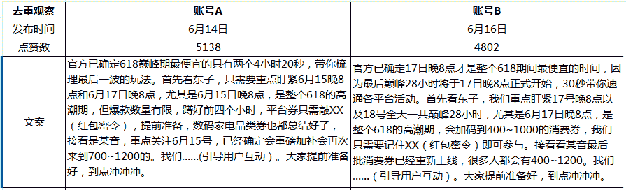
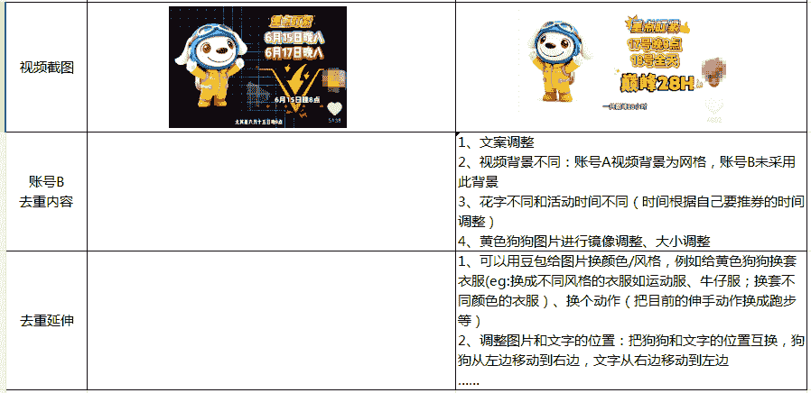
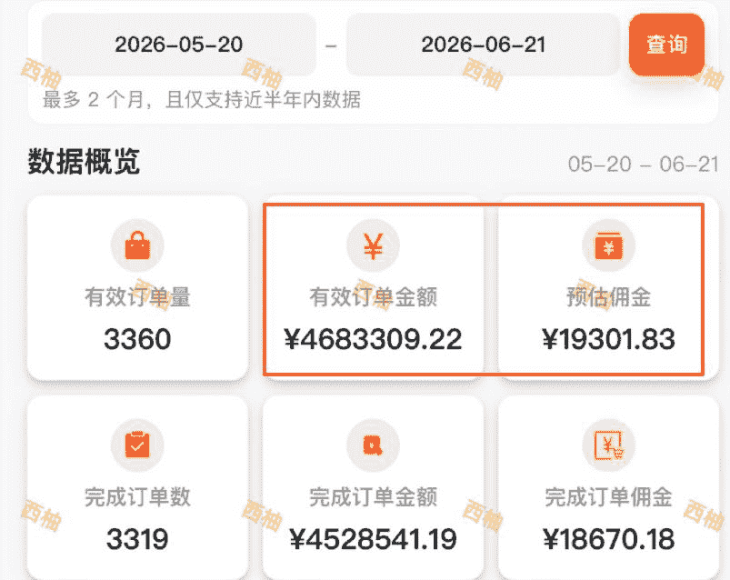
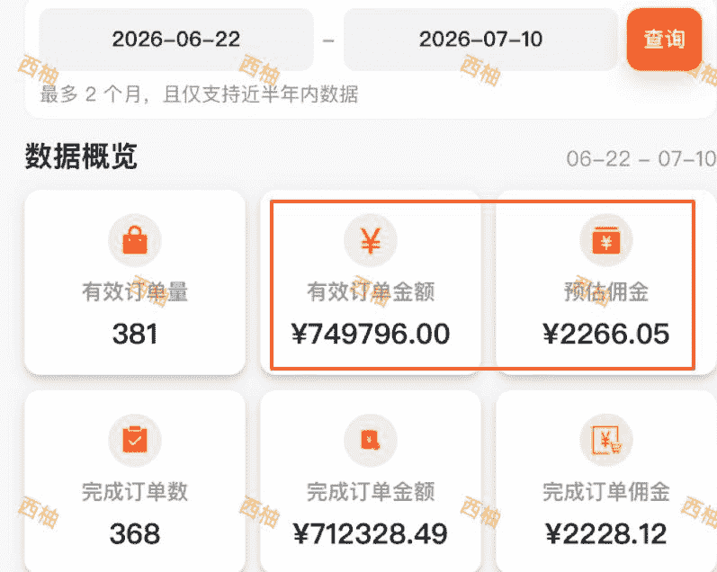

# 四年赚钱潜水党，靠抖音自然流 CPS 实现 0-1 突破，GMV 破 400 万复盘

260713 副业SC 精华

整理：👸号懒人搜索，懒人专属群精选

懒人微信：lazyhelper1

大家好，我是西柚。2022 年我就进了赚钱，前四年基本就是个吃瓜观众。

早期报过不少航海，开局还挺认真，后面慢慢就掉线了。项目看过一堆，最终都卡在“只看不做”。一度我也怀疑自己是不是天生缺执行力，后来才发现，是缺少正反馈在推着我走。

这次参加抖音自然流 CPS 第四期航海，我彻底把自己拉出来了。0-1 跑通，GMV 超 400 万，最终冲到本期排行榜第二。这次经历让我重新找回了做副业的底气。

今天把这趟破局的完整过程梳理出来，给同样在赚钱里徘徊很久没跑通的老朋友，也给想入局抖音 CPS 的新朋友作参考。方法并不高深，无非是跟着航海节奏，坚持日拱一卒的实操。

整体分享分为五块：

- 一、我加入赚钱四年来的状态轨迹
- 二、从全员限流到 GMV 飙升的逆袭全记录
- 三、踩过的坑与提炼的心得
- 四、我对项目的理解和新手入场建议
- 五、最后的话

## 一、四年来的轨迹

2022 年入局赚钱，第一期航海报的是视频号带货，正赶上红利期，勉强把 0-1 做到位，赚了 800 多佣金。没摸到手感，缺乏正反馈后就松懈了，三天打鱼两天晒网。

后面又报了几期，头两期还能跟上，后面要么主业太累，要么状态不对，大多在划水。

赚钱里 AI、YouTube 带货这些项目我也翻过，觉得门槛高、离自己远。除了视频号带货攒了点剪映基础，我基本就是个小白。

## 二、从限流到爆发的 21 天

这期抖音 CPS 航海的报名说明里写着：适合普通人，技术要求低，重执行，容易有正反馈。这点打动了我。当时我正好工作空窗，有点时间，就想搏一把。

开航前我先把上期航海的手册预习了一遍，也看了几篇精华帖。没开始做之前，例子里展示的视频看起来有点懵。

第一次直播后，我对大促红包都不清楚，就照着手册做了一条曼波视频，结果小爆了，出了 7 单，佣金 12 元。

接下来几条曼波视频全被限流，改做特效口播推 618 券，还是限流。换号再发，依旧限流。排除号问题就是内容问题了。花两三个小时做一条，结果一发违规，真的有点泄气。那段时间群里也有人反馈限流，不是只有我。

第二次直播时，德华分享了他的起步经历，第一条就爆了，让我觉得继续做还是有机会。海宇教练提到当时流量好的类型，其中有一种是汇总抖音、京东、淘宝等多平台大促攻略，带用户领券，能避开前期只推京东容易违规的风险。我照做，阅读从之前的 500 以下拉到基本稳定 500+，也出了几条破千破万的，虽说流量泛，但开始有单了，当时累计佣金只在 200+ 左右。

第三次直播，菜菜篮子讲了找对标的思路：看账号的异常值，高于平均值的视频就值得抄。我信了多平台的方向，继续更。结果好不容易流量回暖，又赶上高考限流期，阅读从千级掉到百级。教练说高考后会恢复，果然恢复后迎来第一次转折，有条视频冲到 20W+。

后来我刷到一条同行的口播爆款，又看到它的曼波版本。我判断会火，就立刻复刻。制作时看着点赞从 1000 多涨到 4000 多，验证了判断，我的版本最终跑到 50W+。爆款可以再爆，我把这条 50W+ 的视频微调再发，阅读又到 30W+。

本期航海航行期是 5 月 20 日到 6 月 9 日，共 21 天，榜单统计到 6 月 21 日 618 结束。结营时我的 GMV 只有 9W+，连前 50 都没上。真正的爆发在结营后第 22 天起，靠爆款持续推，GMV 一路从前 50 冲到二十几、十几，最后定格在第 2，GMV 达到 469.2W。

整整 32 天做了 53 条视频，出了 4 条 10W+ 爆款：50W+、30W+、20W+、10W+ 各一条。

## 三、踩坑与经验沉淀

### 1、紧跟航海节奏，把交流群用起来

除了第一次直播看回放，其余都是当天看。限流时直播给方向，告诉大家当前什么类型吃香；没反馈时看到其他船员从零起步的成绩，会觉得自己还有机会。优秀船员现场拆解的方法，真的很管用。

航海群也是信息枢纽。有天我视频发不上去，群里一问才知道是平台在控量。助教会同步当前跑得好的风向，船员也会分享实战经验，比如新号前期流量好，我换新号发，确实前几条数据比老号好。这期航海就像在大海上航行，教练和群友的分享就是灯塔，告诉你正反馈在哪。

### 2、把有限精力押注在表现好的账号上

618、双 11 这类大促出单概率高。多账号操作时，我会把重点放在数据表现好的号上，提升成交概率。

### 3、找对标与去同质化的实践

刚做多平台攻略时，我想着在对标上改一点，结果改违规了，费力不讨好。

后来我开始 1:1 抄：文案基本照搬，只换图片素材、表情包，文字微调、花字换一下。

但我的第一条 20W+ 爆了后，我简单改图改字重发，阅读只有 3W+ 还被限流，提示原创度不足。仔细一看是同行先一步模仿我的爆款发布，导致我的二发被判定相似。这也解释了为什么有时 1:1 抄了还是数据差：同质化太严重，爆款一出跟风一堆，流量就被分完了。

于是我总结了几条小白复刻爆款又不易被判重复的做法：

#### 3.1 起步阶段，多刷对标，先抄后超

这在抖音 CPS 上通用。先抄对标，快速拿到正反馈，避免原创没手感把自己耗没。抄的维度包括文案、语速、配乐、素材方向。

多刷也会让你看到当前什么在跑，看到同行同时运营多个号，有的飞有的闷，更能建立合理预期。教练说得对：你看到的爆款都是幸存者，但在持续执行面前，你也能成为那个幸运的。

#### 3.2 我选对标的具体标准

##### 3.2.1 看异常值
学菜菜篮子的方法，对标账号里那条数据明显高于账号平均值的视频，就值得模仿。比如平时点赞几十，突然一条上千。

##### 3.2.2 看新鲜度
对标账号粉丝最好低于 5000，粉丝基数越小越容易复刻。视频发布时间 7 天内最好，越新越好，别去抄 10 天前的老视频，我抄过就被限流了。

##### 3.2.3 看增长势能
不只抄已经爆的，也抄增长快的。比如刷到时点赞 1000，几小时后涨到 4000，跟进玩家还少，能抢到先机。

##### 3.2.4 选高互动的
互动数越高越值得抄。2000 互动的脚本天花板通常高于 1000 互动的。

#### 3.3 执行中边做边整理去重

新手容易把爆点改没，或改完被限流。可以观察同一脚本不同账号的改法，同一账号不同视频的改法，学它们怎么降低重复度。

中期我把所有对标文案整理成一个“历史对标文案库”，把账号和点赞都记进去，能清楚看到改写规律和手感。下面是我常用的去重手段。

##### 3.3.1 文案调整
参考文案库换几个字眼；或者以视频 A 为主干，融入视频 B 的片段，做融合版；也可以让 AI 帮忙改写。

##### 3.3.2 图片去重

## 四、对项目的思考与建议

### 1、收益拆解与反思

这次航海 618 期间主要做泛流量，GMV 468W+，佣金 1.9W+，佣金率 0.41%。

618 结束后 6 月 22 日到 7 月 10 日，我又发了 10 条，其中 10W+、9W+、5W+ 各一条，GMV 74W+，佣金 2000+，佣金率 0.3%。比例下降是因为其中一个品类商家下调了佣金。顺带提醒一句，定向推品前一定要先看佣金比例，不然血亏。

 

目前我主要靠推荐流量，搜索流量少，观众不精准。导致 618 期间佣金率只有 0.41%，比搜索流为主的船员低。泛流量需要大爆款拉动，GMV 才能上去，而大爆款可遇不可求，只能靠数量堆概率。

618 后即便有几条 5W+，佣金也有限。基于这些数据我认为：

#### 1）在新手期，GMV 的正反馈比死磕高佣产品更重要。
刷对标会发现，曼波、特效口播、真人出镜都有跑得好的。每个号体质不同，别人能跑的高佣口播，我在不同号上发就违规。起步时先找到适合自己号体的内容型，跑通 0-1，比一上来追高佣更实际。

#### 2）跑通 0-1 后再迭代，效率更高。
后面再去定向推高佣品、提升用户精准度，收益会更好。

### 2、下一步优化方向

作为新手第一次 0-1，我已经很满足了，也给了我继续深耕的信心。接下来想做两件事：

- 1）提升剪辑效率，现在一条视频要 1-2 小时，太慢了。
- 2）探索定向高佣品和精准流量，提升单价。

同样在做抖音 CPS 的朋友，欢迎交流。

### 3、给新手的入场建议

我刚开始一路限流，不知道改哪里、什么类型好。没有教练的方向、优秀船员的案例和群里实时信息，我可能早就退了。因此我建议新手最好通过航海入场，自学手册摸索的跑通率更低。而且航海通常卡在大促节点，收益窗口更好。

## 五、写在最后

以前我觉得自己没行动力，看见项目就卡在第一步。这次刷新了认知：我不是没行动力，只是缺正反馈。

刚接触项目总觉得信息过载、很难。下场把手弄脏，从最简单的开始做，边做边解问题，会发现没想象中难；边做边迭代，第一条很糙，后面逐渐变好，都是慢慢来的。

项目做着做着，正反馈会推着你往前。关于正反馈机制，可以看怡然老师的《做项目总是三天打鱼两天晒网，怎么让自己坚持下去》。

最后感谢赚钱、感谢教练和助教、感谢同行圈友的分享和往期精华帖，也感谢@吴泽承 老师和@小武 老师在成帖过程中的帮助。感谢坚持到正反馈到来的那段时间的自己。运气当然有，但持续的执行力，才让人有机会成为那个被运气眷顾的人。

————分割线————

看完这篇 SOP，你觉得你懂了。但 90% 的人一到实操就会卡在第一步。

工具和教程只是最低级的壁垒，真正的壁垒是"立刻动手"和"圈层信息差"。

如果你想看全网最新的变现玩法，并且和一群执行力极强的极客一起下场拿结果，欢迎围观我的核心私域：【懒人专属群】。

我们不聊虚的，只做商业闭环的拆解与 AI 效率的压榨。系统内已沉淀 1000+ 跑通的套利实战局。

👉 查阅圈子完整数字资产与上车门槛：

https://lazyso.com/insider/

认同价值、准备好下场干活的，扫码加我微信（lazyhelper1）

备注：【实操上车】，不闲聊

