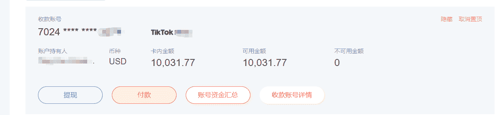
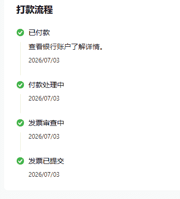
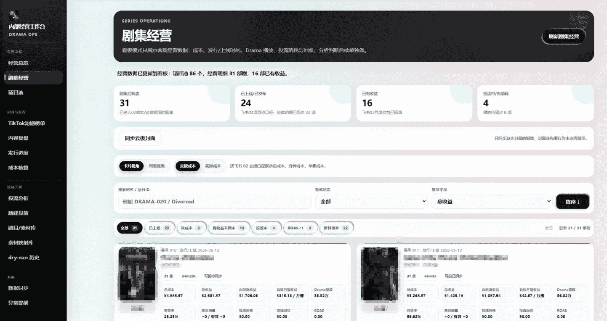
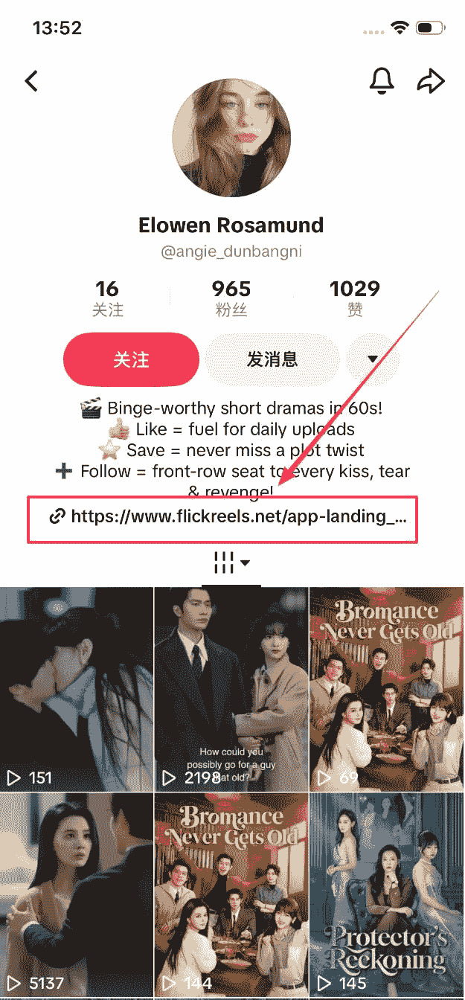

# 海外 AI 漫剧实战复盘：从平台准入到剧本生产，我们如何跑通第一轮回款

做海外 AI 漫剧接近一年，我们在4月至5月间拿到了一笔约1万美元的结算。

这笔钱谈不上惊天动地，却有一个重要意义：从账号申请、协议绑定、内容制作，到作品分发和收入回收，我们终于把整条路径完整走了一遍。

今天不聊“轻松月入多少”的故事，只记录真正做项目时遇到的现实问题，以及我们后来形成的处理方法。

## 一、先校准认知：这不是按键赚钱的项目

不少人把海外短剧想象成“让模型自动出片，然后等待收益”。实际落地后会发现，它更接近一门内容供应链业务：

- 前端需要持续供稿；
- 中间要匹配合适的发行渠道；
- 上线后还要通过数据判断是否值得加码；
- 最后才能进入结算与复盘。

这几个部分彼此牵连，单独做好其中一项，并不能保证整体跑通。

我们团队同时具备研发和内容制作能力，因此从进入这个方向起，目标就不是试做几条素材，而是搭建一条相对完整的生产链。团队规模也从早期的少数成员，逐渐扩展到十多人。

最初，我们尝试过国内短剧平台。问题在于，国内项目经常受到审核排期、题材变化和上线节奏影响。一项内容从立项到正式发布，周期可能拉到数周；如果制作完成后才遇到审核调整，前期投入就可能被迫重做。

后来收到 TikTok Drama 的官方邀约，我们才把重点转向海外市场。

真正进入后才明白，出海远非字幕翻译这么简单。企业资质、收款主体、合同关系、内容规范、分发策略、数据分析以及团队协同，都需要重新建立方法。

## 二、平台准入：先把基础设施搭牢

海外渠道并不只有一个选择，除了 TikTok 原生内容形态，还有 TikTok Minis、海外短剧应用，以及 YouTube、Facebook 等社交平台。

这里以 TikTok Drama 原生渠道为例，重点说说申请阶段最容易出现偏差的部分。

入驻地址：

https://drama.TikTok.com/

官方帮助页面：

https://drama.TikTok.com/help-center/detail/6a0ed419cdee5b04e989024c

如果页面提示当前区域暂不可用，通常需要切换网络环境或更换注册地区再尝试。

### 1. 企业材料怎么准备

香港主体可直接提交 NNC1。

大陆主体通常需要先准备英文版营业执照。翻译件可以找具备资质的服务商办理，然后把中文原件、英文译本以及翻译机构证明整理成一个 PDF 一并递交。

这里有一个非常容易忽略的细节：企业英文名称必须和后续收款账户登记名称保持完全一致。名称出现差异，后续结算可能被退回或延迟。

其他材料建议这样处理：

- 法人身份证正反面合并在同一份 PDF 中；
- 代表人证明可使用营业执照或银行证明；
- 地址证明通常不是首次提交的必选项，但若审核退回，可能被要求补交，此时可准备身份证扫描件。

常规审核大约需要2至3个工作日，申请集中时可能延长。

### 2. 收款账户如何衔接

企业资料通过后，再进入付款账户验证。

如果使用第三方支付机构，可申请美元收款账户，并以企业英文名开户。无论选择哪家服务商，核心原则都是：平台企业信息、收款账户信息、合同主体名称三者保持一致。

如果使用企业自有美元账户，一般需要提交银行开户证明，文件中应能看到企业英文名称。涉及 SWIFT Code 时，建议以开户银行提供的信息为准，搜索结果或模型回答只能用于交叉检查。

### 3. 合同并非形式步骤

在 TikTok Drama 的流程里，协议不仅代表合作关系，也关系到后续作品提交和收益结算。

受邀机构通常需要先交作品给商务团队评估，再依据评估结果匹配合同。协议申请后，平台会把文件发送到登记邮箱，因此邮箱必须确保能够正常收件。

企业完成签署后，平台还需要回签。后台显示协议生效后，后续内容关联和收益处理才具备基础条件。

另外，收入不能只用播放次数来推算。观看深度、广告价值、平台补助、独家状态、首发属性、内容形态等，都会改变最终结算结果。也就是说，入驻阶段就应该理解规则，而不是等到收款时才发现口径不同。

## 三、内容生产：别把模型当成自动导演

我们在制作端花的时间最多，踩过的坑也最集中。

早期主要依靠人工推进，后来逐渐发现：缺乏清晰的制作规范时，模型并不会自动修正混乱，反而会让错误更快扩散。

选题方向含糊，故事就会失焦；人物设定没有固定标准，画面资产就容易前后漂移；脚本没有经过校验，镜头拆解必然反复返修。

因此，我们把实际工作中的经验整理成内部流程，并逐渐沉淀到自研工具“云极”中。它的价值不在于替团队做所有决定，而在于减少重复操作、统一制作步骤、保留版本记录。

目前，一条漫剧内容大致会经历：

**市场样本研究 → 方向筛选 → 故事设计 → 文本撰写与调整 → 镜头规划 → 角色及场景资产 → 画面与动态内容制作 → 审片修订**

模型可以提高执行速度，但每个关键节点仍然需要人工审核。

### 先解释三个常见概念

- **一卡**：通常指作品首次设置付费门槛的位置，常见区间在第7至第10集附近。
- **钩子**：用来促使观众继续观看的设计，例如突发冲突、身份反差、秘密揭露或高浓度情绪台词。
- **抽卡**：批量得到多组角色、环境、封面或关键画面候选，再挑出最适合进入后续流程的版本。

### 先确定内容红线

海外分发前，合规边界必须提前写进制作规范：

1. 不鼓动针对种族、肤色、国籍、性别等群体的歧视和敌意。
2. 避免没有叙事必要的残酷、血腥和强烈不适画面。
3. 不制作裸露、明确性行为、露骨暗示及低俗擦边内容。
4. 不得未经授权合成政治人物、艺人或知名知识产权形象。
5. 涉及未成年人的内容，不得包含虐待、色情、暴力或犯罪情节。
6. 不把暴力控制、情感操纵和极端猎奇包装成值得效仿的行为。
7. 不展示容易被现实模仿的犯罪教程，也不鼓励自残或自杀。

## 四、研究样本：先看市场已经验证了什么

进入新赛道时，最大的风险之一是自我感动。

创作者觉得新鲜的设定，未必符合当地观众的观看习惯。因此，我们不会仅凭个人偏好立项，而会先观察平台上正在获得持续曝光的内容。

具体做法包括：专门刷同类账号，观察 TikTok Drama、海外短剧应用及投放素材库，重点记录哪些作品持续获得推广、哪些片段在完播、互动和评论上表现突出。

我们通常从五个层面观察：

### 1. 内容类型

先区分受众方向，例如男性向、女性向、强女主、甜宠、复仇、狼人、豪门、战神或超自然设定。不同类型背后对应的用户期待并不相同。

### 2. 故事母题

同一受众内部，也要继续细分。女性向可能围绕契约关系、隐藏身份、真假身份、反击和禁忌关系展开；男性向则可能偏向逆袭、都市能力、归来复仇或灾难求生。

### 3. 人物连接方式

观众是否愿意持续追看，往往取决于角色之间是否存在足够强的拉扯。例如地位落差、误认、旧怨、利益绑定、爱恨转换、保护关系等，都可以成为连续推进剧情的动力。

### 4. 情绪触发点

很多海外短剧并不依赖复杂世界观，而是靠直观情绪留住人：遭到羞辱、被亲近者抛弃、秘密曝光、弱势方突然翻盘等。情绪表达越明确，越方便剪成短素材进行测试。

### 5. 分发适配度

还要判断作品是否具备传播条件：

- 起始画面是否足够醒目；
- 开篇几集是否有持续变化；
- 角色关系能否快速做成封面卖点；
- 付费节点前是否留下强烈疑问；
- 整个故事能否被压缩成一句清楚的宣传语。

研究样本的目的，是提炼已经被市场验证的结构和情绪，而非复制某一部作品。

## 五、选题方法：从关键词走向故事机制

看到“狼人”“豪门”“大女主”等热门标签后，不能直接开做。真正需要拆解的，是标签背后的受众需求与情绪回报。

我们会先确认：

- 这类内容服务哪一群人？
- 观众最期待哪种情绪释放？
- 主角一开始处于什么劣势？
- 开篇用什么事件迫使观众继续看？
- 开头几集能否形成递进变化？
- 首个付费节点前，是否有足够强的未知信息？

如果这些问题还没有答案，项目就不应该急着进入制作。

我们常用的思考模型是：

**选题方向 = 目标受众 + 已验证母题 + 高张力关系 + 反复触发的矛盾 + 可延展的情绪回报**

故事随后可以按这样的顺序搭建：

**主角处境 → 外在阻力 → 隐瞒或误解 → 矛盾加码 → 阶段性反击 → 新问题出现**

完成这一步后，题材才真正具备进入文本、镜头和投放测试的条件。

## 六、案例：水果拟人内容为什么能快速吸睛

近期连续多日占据榜单的水果拟人内容，很适合用来观察“旧情绪+新外壳”的组合方式。

它的剧情内核并不陌生，仍然可能是背离、隐瞒、家庭矛盾、情感报复等。但角色被替换成水果、动物或其他拟人形象后，内容的观看感受发生了变化。

### 第一层：先用视觉差异争取注意力

真人短剧里的争吵、背弃和家庭纠纷已经非常常见。拟人角色带来的陌生感，可以在信息流中制造识别差异，让用户愿意多看几秒。

### 第二层：让夸张情节更容易被接受

当离谱情节发生在真人身上，观众可能会产生冒犯感或疲劳感；换成明显虚构的拟人形象后，观众更容易把它理解成夸张叙事，心理压力相对更低。

### 第三层：降低视觉制作压力

写实角色对脸部、服装、动作和前后统一要求很高，任何细节漂移都可能破坏沉浸感。非写实拟人角色天然拥有更大的容错范围，对小团队来说，更适合快速验证方向。

但这种模式也有隐患。新奇外形很容易被持续升级，今天是水果，过几天可能变成昆虫、食物或宇宙生物。如果只追逐刺激，不顾故事连贯性、平台尺度和长期系列化能力，流量可能来得快，消耗得也快。

这类内容真正值得借鉴的，不是某一种具体角色，而是下面这套组合：

**熟悉的情感矛盾 + 强辨识度的视觉外形 + 虚构角色带来的心理缓冲 + 相对轻量的制作方式 + 高频事件推进**

可以进一步整理为选题评估表：

| 观察项目 | 典型表现 | 判断重点 |
|---|---|---|
| 受众 | 偏好高情绪、低理解成本、快节奏内容的人群 | 更适合广告分发，还是付费观看 |
| 外观变量 | 水果、动物、昆虫等非写实角色 | 能否迅速形成记忆点 |
| 情绪底盘 | 隐瞒、背离、反击、亲密关系矛盾 | 是否属于市场已验证的需求 |
| 推进方式 | 每集安排新的事件或信息变化 | 开头阶段能否持续制造追看理由 |
| 制作门槛 | 不追求完全写实 | 小规模团队是否能稳定供应 |
| 长期风险 | 外观刺激不断升级 | 是否会触碰审核边界或失去故事价值 |

参考样本不等于照着重做。可以借鉴的是情绪路径、关系张力、节奏组织和回报机制，具体人物、情节和表达方式仍需重新设计。

## 七、文本生产：先把创意整理成团队资产

方向确定后，我们不会马上进入画面制作，而是先整理出一套可供多人协作的文字资料。

目前团队常见的三种入口如下。

### 方式一：从创意描述开始

适合只有题材和大致设想、还没有成型文本的情况。

我们会先补齐受众、角色关系、主要矛盾、情绪回报、开场事件以及首个付费节点前的疑问，再交给工具继续整理为：

- 项目策划说明；
- 角色档案；
- 故事总览；
- 分集安排；
- 开篇正文草稿。

输入越具体，后续结果越容易进入修改阶段。只有“写一个拟人角色复仇故事”这种模糊指令，通常很难得到稳定产出；如果前面已经限定冲突方向、节奏密度和悬念位置，初稿质量会明显改善。

### 方式二：提供参考视频

适合手里已有同类样本的情况。

工具主要帮助我们提炼叙事节拍：开场如何建立注意力，人物怎样碰面，矛盾如何升级，关键节点前怎样保留信息缺口。

这里分析的是组织方式和情绪推进，不是把原作品换几个名字重新写。

### 方式三：导入已有文本

如果手中已有完整故事，但存在节奏松散、角色动因不足、开篇吸引力偏弱或段落连接不顺等问题，可以把文本导入后进行针对性处理。

相比从头到尾人工重做，先定位问题，再让工具提供几种调整思路，效率更高。最终采用哪一种，仍由编剧和导演根据人物逻辑、冲突强度及商业节点进行取舍。

## 八、真正耗时的，不是初次产出，而是反复修整

项目推进后，我们发现单纯追求“能不能写出来”意义有限。更高频、更影响效率的，其实是后续修改。

常见任务包括：

- 对某一集重新组织；
- 补足前后段落的连接；
- 根据导演意见调整；
- 改动局部对白与情感强度。

在这个阶段，工具承担的是资料流转、版本留存和重复劳动压缩；人物动机是否可信、矛盾是否有力度、关键节点前的信息缺口是否足够吸引人，仍然需要资深创作人员把关。

这也是我们在做内部工具时最深的体会：真正有价值的，不是功能列表越长越好，而是能否把团队每天重复发生的动作整理成稳定、可追踪、可复用的工作方式。

海外 AI 漫剧没有所谓“按一下就出结果”的捷径。它更像一项长期经营：平台规则要弄懂，内容方法要沉淀，数据反馈要持续分析，生产流程也要不断修正。

第一笔回款只是证明路径成立，远远不能代表项目已经成功。后续能否持续产出、稳定分发并控制成本，才是真正决定这门生意能走多远的部分。

AI漫剧这个赛道做得越久，我越有一种强烈的感受：它并不像外界想象的那样，输入一句描述就能自动吐出一整部片子。真正能够稳定出活的团队，赢的从来不是某个惊艳的单点，而是把整条链路管理得足够顺——从选题判断、剧本构建、镜头拆解、人物资产、画面生产、中途质检、后期加工，一直延伸到发行、结款与买量。

以下是我把这套全流程拆开揉碎后的复盘，希望对正在入局的同行有一点参考价值。

**镜头拆解：决定返工率的第一道闸口**

很多新团队拿到剧本后，第一反应就是赶紧去生图、生视频。我们当初也走过这条路，后来被无数次返工教育明白了：AI漫剧里最常见的返工，其实根本不在生成环节，而在最开始的镜头定义环节。

同样一行剧本文字，落在不同的执行人手里，脑补出来的画面可能差着十万八千里。拿“女主角冷笑一声，转身离开”举例——此时应该怼脸拍特写，还是带半身的近景，或是给一个远远的背影？她的冷笑里藏着愤怒、压抑，还是早已盘算好的反击？镜头里要不要切男主的反应？这些细节不分清，生图的人、做视频的人、剪辑的人按各自想象行事，最后拼出来的片子一定是散的。

我们目前的解决办法是：把每场戏的剧本拆成一张“镜头作战表”。不需要格式多漂亮，但每一镜都必须注明——故事发生在什么环境、哪些角色在场、角色此刻的情绪与动作是什么、画面焦点放在哪、景别用特写/近景/中景/远景、要不要配台词或画外音，以及这镜头存在的目的，是为了推动剧情、制造矛盾，还是放大爽点。

其中最关键的原则是：拆镜头不是把台词逐字翻成画面，而是重新判断哪些画面值得让观众看到。短剧前几集的钩子、冲突、反转、付费点前的悬念，每一个都是留住用户的开关，必须拆得足够细；普通过渡戏则可以大胆简化。否则就算画面再精美，用户照样划走。

还有一层要考虑的，是生成端的承受力。如果一镜里人物过多、动作层级太杂、人物逻辑太乱，AI生成时大概率翻车。我们惯用的办法是把复杂动作拦腰拆开，让每一镜只负责一个主要动作或一种情绪，人物一致性和画面稳定性都会有明显提升。如今这套拆解动作已经在云极里固化成流程，但工具终究只是把拆镜头的工序标准化，真正决定质量高低的，还是编剧是否想清了节奏、情绪和画面焦点。

**人物资产：先把“脸”钉在设定里**

镜头方案落地后，紧接着要处理的是人物、场景和道具。这一步看起来不如生成视频那么“炫”，却恰恰是观众最容易挑刺的地方。我们见过太多案例：上一集还是长发及腰，下一集忽然变成齐耳短发；前面刚出场的气场御姐，后一个镜头看起来像没毕业的学生；同一个男主换了一场戏，整张脸都仿佛换人了。

要摆脱这种尴尬，不能靠每集临时捏角色。现在的做法是，把主要人物沉淀成一套固定设定库：主角、反派、关键配角都要写清楚年龄定位、发型、五官特征、气质类型、衣服体系、身份标签、常用神态和贴身道具。到出图和生成视频时，团队不是在凭感觉形容“一个漂亮女主”，而是全员共用同一套人物设定卡。

人物设定也绝不是越密越好，主次不拆清会把自己拖垮。男女主和核心反派必须严控，因为他们是观众的记忆锚点；路人、服务生、围观群众则没必要做太重，不然资产维护的负担会迅速膨胀。

我们还会把人物设定直接挂到分镜上。某一镜里会出现谁、调用的是哪一张设定卡、服装状态有没有改、情绪是愤怒、隐忍还是反击，尽量都记录下来。这样导演、出图、后期接收到的信息始终是同一个版本；出了问题时，也能快速判断是设定卡的问题、镜头方案的问题，还是生成参数的问题。

当然，前期工作做得再足，也不能保证百分之百不“变脸”。我们的态度是抓大放小：重要角色高标准严要求，边缘角色允许适当放宽。倘若每个背景板都追求绝对一致，生产效率会被拖到让人崩溃。

**画面生产：静态与动态，都是前期准备的兑现**

镜头方案和人物设定都确认完毕，才真正进入图片与视频的生产。这一步看起来最像“AI创作”，但在我们眼里，它只是对前期准备的一次总验收。前面偷过的懒，会在这一环节加倍讨回来。

日常生产视频，我们主要靠三种路径：静态图驱动、多要素参考、首尾帧补全。三种没有谁比谁高级，只看场景合不合适。

静态图驱动，是先产出一张相对稳定的关键帧，再让模型跟着它动起来。它的强项是画面可控，适合人物特写、情绪戏、简单动作；弱点是碰到复杂动作或大幅度运镜时容易飘，而且一旦画面涉及“回头”这类没有对应设定卡的角度，人物一致性就保不住了。

多要素参考，是把人物、场景、动作、风格同时作为约束条件丢给模型。如果既要角色形象锁定，又希望动作接近某段参考，还想让场景氛围和参考图对得上，我们就会选它来加强控制。它的参考维度更丰富，适合拿来打磨关键高光镜头；但前期的参考素材必须理得清清楚楚，否则模型同样会抓不住重点。Seedance 2.0目前支持九张参考图和十五秒以内的音频参考，相当于人物、场景、道具等元素加起来不能超过九个，音色参考不能超过十五秒（听说2.5版本已经开放到五十个素材）。

现在全要素参考是我们用得最多的一种。遇到多人物同框时，我们会额外做一张站位示意图，直接在图上标出每人所在位置，甚至用箭头画出角色的移动方向，画面因此不容易乱。用过即梦的朋友都知道，它的全要素参考要求把每张图单独@出来才能识别。我们在创作端做了要素匹配：前面拆镜头时，已经为每个分镜配齐了需要的人物、场景、道具和台词，人工介入后只需核对台词是否够本地化、引用项有没有遗漏或错配。

首尾帧补全，是先定义某一镜开始与结束时的画面，再让模型推算中间的运动轨迹。它适合有明确起止状态的转场、动作结果镜头。优势是头尾出品可控，劣势是中间过程一复杂就需要反复筛选，而且和静态图驱动一样无法维护人物统一。所以我们通常只拿它做空镜、转场或运动衔接。

三种路径的选法很朴素：情绪特写、简单动作，交给静态图驱动；复杂动作、风格参考，交给多要素参考；有明确起止状态的，交给首尾帧补全。我们不会强求每个镜头都上最复杂的生成方式，而是挑最稳妥、成本最低的路走。

还有一条很重要的认知：别指望一次生成就能落地。AI漫剧的生产本质是“筛选—修正—再筛选”的循环。有的镜头一次就过，有的镜头需要改提示词、调动作、换景别，甚至把一个大镜头拆成几段小的。我们最深的体会是：生成视频不是越花哨越好。短剧观众真正要的是看得懂、情绪准、节奏快，没有人在意每一秒是否炫技。动作太满、人物太多、调度太挤的画面，往往越容易出错。小团队前期的聪明做法，是先啃下关键镜头，再慢慢加复杂度。

**中途质检：让返工停在小单元里**

初剪片段出来之后，要安排一轮过程性检查。这轮检查不看“美不美”，只看有没有硬伤：穿帮、人物漂移、节奏拖沓、平台审核风险。

我们的习惯是把问题描述得很具体：是第几集第几镜变了脸，还是哪段动作看起来不自然；是字幕和画面不同步，还是叙事太慢；画面该重出一张图、重跑一条视频，还是剪辑处裁几秒就能带过。把问题半径缩到最小，才能避免返工像滚雪球——一小块瑕疵，根本不需要整集推倒重来。

需要特别说明的是，这轮检查并非最终上线审核，而是生产途中的抽检。图片、视频、关键镜头出来之后，先看人物稳不稳、动作顺不顺、剧情接不接得上，再决定把问题退回给资产、镜头方案还是生成环节。

**后期三件套：剪辑、字幕与配乐**

中途修完问题，才进入精剪。这个阶段素材基本能用了，但离真正的成片仍有距离。AI漫剧最终还是要回到短剧的底层逻辑：节奏够不够紧、冲突是否被剪出来、观众能不能在前三秒看懂发生了什么、每集片尾有没有让人继续追的钩子。

所以剪辑绝不是按时间顺序把镜头拼在一起，而是一次二次创作。我们重点盯四个位置：开场三秒有没有钩子、冲突戏有没有前置、过渡戏有没有压缩、付费卡点前有没有悬念。同一堆素材，剪得松还是剪得紧，观众看到的是两部戏。

字幕问题在海外发行时尤其突出。翻译准确只是及格线，还要照顾阅读速度、断句节奏、画面遮挡和本地化习惯。字幕太长、太书面，或关键信息出现得太迟，观众很可能还没来得及理解剧情，手指就已经划走了。

配乐与音效看两点：情绪是否贴脸，版权是否安全。情绪层面，BGM不必从头铺到尾，在关键冲突、反转、打脸、悬念处托住氛围就够了；版权层面，我不建议直接从剪映的音乐库里取歌，最好用AI生成无版权BGM再贴进去，否则一旦被认定侵权，下架只是开始，还可能触发违约赔偿。

如果作品计划上YouTube，还得再多一分防人之心：当一首“无版权”歌把你的作品带火之后，建议你先一步去把自己的音乐完成登记注册，否则容易被海外版权抢注者盯上，拿版权反过来投诉你，导致视频被下架、收益被回收。我们现在会优先选可商用授权的音乐，并把来源和授权记录留好。音乐在短剧里顶多是加分项，版权一旦出问题，审核、下架、举报、收益结算全被拖下水——这片区域，保守永远好过冒险。

把整条生产链串起来看，我的结论始终是：AI漫剧不是一句咒语召唤出来的成品。稳定产能来自选题判断、剧本结构、镜头拆解、人物设定、生成筛选和成片质检的协同。云极真正提供的价值，就是把这些动作固化为流程，让工作室从手工作坊模式，逐渐走向可协作、可复盘、可提效的工业化产线。

**发行：内容完成只是上半场**

先快速认识几个常用词。

独家，指一部剧在特定平台、特定地区或特定时间段内只授权给一个渠道，分成、补贴或推荐资源通常更好，但代价是合同期内不能给其他平台。非独家，指同一部剧可以同时或分批授权多个渠道，灵活度高，但单家平台给的资源和分成往往没那么优厚。IAA是广告变现，用户免费观看，平台靠广告营收，创作方按播放量、广告展示、有效观看等口径分成。IAP是内购付费，前几集免费，后续通过充值、解锁、买全集付费，很多短剧平台早期更偏爱IAP，回款逻辑更直接。二轮剧，指完成首轮发行后，再授权给其他平台或地区继续分发，虽然不是首发资源，但能持续吃长尾收益。RPM指每千次播放或有效曝光产生的收入，是IAA模式里的常用指标。保底，则是平台或合作方先给一笔基础费用，保证创作方有回收底线，播出表现超过约定后继续按合同分成；不同平台的保底条件、结款周期和授权规则差异很大。

TikTok Drama Center 的发布教程，官方文档写得很完整，我直接放链接，不在这里占篇幅：https://www.TikTokdramacenter.com/help-center/detail/6a0ed4301b7d0404ef4782f7

很多人以为短剧剪完就算功成身退，这是极大的误会。内容制作完成只是上半场，能不能顺利发行、以什么模式上线、能不能按时结款，商业验证才刚刚开始。

海外短剧的分发路径相当多：TikTok端原生、TikTok Minis小程序、昆仑万维、麦芽、点众、枫叶、畅读等出海短剧App，以及YouTube、Facebook等社媒阵地。不同渠道的合作模式、收益口径、反馈周期都不一样，发行不是简单把片子传上去就完事。

比如有的平台坚持独家，开出的分成和推荐位确实更香，但这也意味着合同期内这部作品不能再发给别的渠道。反过来，非独家虽然单家条件不够抢眼，但多平台组合起来的总回收，未必输给独家。所以签约前，不能只盯着单个平台给的好处，还得看这部剧后续还有多少分发空间。

渠道收剧的口味也千差万别。有的平台对精品项目走“保底+分成”路线；有的平台自己不做直接播出，而是做渠道聚合——你把剧授权给它，它再分发到下游合作渠道，最后统一对账。不管哪种方式，合同里都会明确授权范围、分成比例、地区、期限和结算方式，签约前必须逐条读透。

从商业角度看，剧集做出来后，制作成本已经沉没，后续唯一能做的是通过发行把内容价值尽可能多收回来。这里涉及的不只是发到哪，还包括选择什么模式、什么时候上、先发哪个渠道、后面能否转免、还能不能进入更多渠道。

举一个常见的组合玩法：假设一部剧选择IAP模式，平台一般会设置前几集免费、后续付费解锁，有些平台在上线一段时间后会转免，比如T+14转为免费。如果这部剧拿的是非独家授权，就可以先协调几个IAP平台错开首发时间，付费周期结束后再进入IAA平台，借助广告赚第二波，最后放到YouTube继续吸收自然流量。当然，每一步都要对照合同、平台规则和授权范围，不能默认手里的片子可以随意分发。

多国家发行也是海外短剧的一大特点。TikTok Drama这类平台，对英语源语言的剧集会提供部分字幕翻译或本地化支持；市面也有机构专门做配音和多语言适配，让同一部剧有机会在多个国家进行多轮测试。但多地区发行不是翻译完就能直接上。封面、剧名、剧情简介、字幕、配音、文化禁忌，每一项都要重新推敲。比如部分中东地区对宗教议题、女性着装、亲密场景、暴力表达相当敏感，前期没有排查，后期发行时很可能被要求修改，甚至直接影响上线。

我们现在的标准动作是：每部剧进发行前先过一遍清单——剧名、封面、集数、字幕、成片格式、版权材料、合同绑定、目标地区、首发平台、商业模式、上线窗口、后续转免计划。任何一项没对齐，后面都可能变成审核卡顿、上线延迟或收益归因混乱。很多项目做不出来，不是内容的问题，而是卡在交付、审核、授权和数据回收这些环节。

所以我对发行的理解已经彻底改变：它不是生产之后的附属品，而是海外短剧这门生意里真正能构成壁垒的能力。发行做得好，还能持续带回市场反馈——哪类题材更容易过审、哪个地区更吃哪种人物关系、什么封面点击更高、哪个平台结款更快，这些情报最终都会汇入下一轮选题和创作。

**结款：播放量是面子，现金到账是里子**

从我们目前的测试看，回款速度相当喜人。7月3日在TikTok Drama提交发票与结算申请，7月7日就到第三方账户了，中间还因为验证问题卡了一天。算下来，正常结款大约三个工作日。

如果说发行是商业验证的开场，那结款就是验证这门生意能否成立的关键。做内容的人很容易被播放量、榜单、点赞、评论带着走，但真正做经营时，目光最终要回到收入、回款周期和成本结构。

播放量只能说明内容被看见了，并不代表钱已经落袋。平台收益、广告回收、自然流量收益、投流归因收益、合作方分账，这些表面都叫“收入”，但各自的来源、周期和可信度差别巨大。混在一张表里看，很容易高估或低估一部剧的真实盈利能力。

每部剧从立项起，人工与算力成本就在持续燃烧，但平台分成和结算往往需要一到两个月才能到账。中间如果数据更新慢、账期又拖，团队的现金流压力会沿着生产链条向上传导。

以TikTok为例，结款一般是对公美元打款。平台每个月固定日期生成账单，机构确认账单后，需要向TikTok开出发票，发票审核通过后再进入打款流程。这也是我为什么反复提醒：企业信息、合同主体、收款账户必须填准，它们影响的不是一个小字段，而是实打实的入账时间。发票模板我这边有现成的，需要的朋友可以找我拿。

如果公司走国内银行的美元公户收款，银行可能还会要求补充合同、发票、业务证明等材料，到账节奏进一步拉长。完整跑过一次，你就会明白海外短剧远不是“播放一起来就有现金”的生意，账单、发票、审核、银行入账，每一环都有它的时间成本。

到账金额也不能孤立地看。它必须和制作成本、算力支出、人力投入、投流消耗放在一起算，才能判断一部剧是回本、亏损，还是暂时只回来了一部分现金流。所以我们后来会给每部剧单独建台账：上线时间、平台账单、实际到账、投流消耗、制作成本，逐项记录。否则项目一多，播放表现看着都还行，哪部赚钱、哪部还没回本，根本说不清。

结款这件事给我的最大启示是：播放量是面子，回款和利润才是里子。只有当成本、收入、周期、归因都能算清楚，这个项目才算真正从内容创作转型为内容生意。

**买量：小预算先试水，用数据验证内容**

海外短剧做到发行之后，买量是绕不开的一环。无论IAA还是IAP，内容上线后想要快速拿量、验证广告回收或付费转化，都离不开投放。

但现阶段我对买量的态度很克制：它既是放大器，也是验货机。一部剧的题材、封面、前几集节奏、付费卡点本身不行，投放只会让问题暴露得更快，绝不会凭空把它捧成爆款。

我们目前正在测TikTok端原生的IAA模式，这是官方最近放出的内测功能。整体跑下来，有赚也有亏，ROAS在0.5到1.25之间波动，收益高度依赖剧集内容。TikTok Minis小程序端的IAA付费也还在测试，等有结论再更新。不过有一点越来越明确：海外短剧买量不是“素材丢进去、预算加满、坐等回本”的躺赢局，而是一个持续对账、持续复盘的过程。我们要借助投放回流的数据，反向验证题材、素材和发行决策是否有问题。

投前，我们至少检查三个条件。

第一，剧里有没有能剪出钩子的素材。身份反转、强羞辱、强保护、复仇打脸、禁忌关系、阶层差、误会反转，这些高情绪密度的情节，天然比平铺直叙更适合做投放素材。第二，前几集能不能接住点击。很多素材点击不错，用户进来之后却迅速流失，根因是素材承诺和正片内容脱节。投放素材不能只负责骗点击，它要与正片前几集的心理承接和付费卡点形成呼应。第三，后面有没有回收路径。IAP要看付费点和解锁节奏，IAA要看有效播放和广告收益，不能拿曝光量当单一指标。如果没有收益回传，买量就只是在买热闹。

素材侧，我们不会只剪一两条“看起来最炸”的视频，而是按素材矩阵来跑：不同卖点、不同剪辑风格、不同文案方向同时投进流量池，最后拿数据选出真正能打的素材。

这就是我在这套体系里的完整复盘。单个环节拿出来，似乎都有迹可循；但当它们被一环一环扣在一起，才真正构成AI漫剧这门生意的护城河。

普通人能不能入局海外短剧和AI漫剧？我这些年被问过太多次，结论始终是：能，但基本盘不在“全覆盖”。

很多人一开始就陷入误区，觉得必须同时搞定写台本、生图、剪辑、买量这一整串动作，结果连第一步都没迈出去。实际上，这门生意的结构更接近于一条内容组装线；你不需要做那个把所有零件都抓在手里的人，只要在一个岗位上交付得够稳定，就能吃到肉。本篇我会拆三块聊：怎么用低成本广告测试去验证内容值不值得推、项目一多以后真正的麻烦出在哪，以及不动自制、不碰发行的前提下有哪些更轻的切口。

**壹｜买量不是放大器，是探针**

每次新剧上线前，我们不会急着铺量，而是先备好几个方向的测试物料。目标很单纯：用有限的预算买出信号，看哪种抓人点、哪类观众结构、哪种情绪模式容易冒头。

测试库一般包括这么几类——一个是开场三秒内制造事端的冲突片段，例如被当中折辱、遭遇背刺、身份错位、命悬一线；一个是关系拉扯类内容，靠男女主对抗、血亲纠葛、追查仇人、真假身份、阶层不对等来撑张力；一个是高能瞬间合集，把扬眉吐气、终极翻盘、底牌揭晓、硬核实力展示、情绪顶点塞进去；一个是悬念向短片，永远把观众摁在“她是谁”“真相会不会戳穿”“接下来要出事”的关头；另外还有原生截取和精华重组两种——前者直接用成片的前几集或关键段落测承接力，后者把多个爆点串联在一起，专项服务点击和留存。

第一轮测试的核心是“小步跑”。某一两条素材跑不出数据，不意味着剧本身垮了；我们要做的是在无数种剪法里找有没有一个相对占优的方向。哪怕赢面只有一点，也足以成为后续加码的依据。

进入加投阶段，我看数据从来不看单点。点击率反映的是切片本身够不够勾人，2秒和6秒留存检验的是前几帧能不能留人，完播率交代了叙事节奏，消耗和单次点击成本负责衡量买量效率，最后钱能不能回来、能回多少，还得看总账。单抓一个数很容易骗自己：点击亮眼但6秒和完播双双崩塌，大概率是噱头过头；点击平平无奇但留存、回收同步稳住，这类素材反而是做二剪和变体的好苗子。

每次投放结束后，对账最不能省。我们不看单一ROAS，而是把盘子拆开来看：Drama后台总流水、Ads归因部分、自然流量推算、广告支出、前端素材表现，各自独立核算。举个例子，我们做过一部寻亲题材的项目，5月Drama后台总账约2600多美元，其中Ads归因约900多美元，自然流估算约1700多美元。不这么分账，很容易把自然增长误当成广告效果，判断也就跟着跑偏了。

具体到Campaign层面，内容的差异会赤裸裸显现。同是美国、英语、IAA模式，同类周期里有的剧ROAS能压到1左右，有的只能到0.8上下。投流从来不是撒钱就能滚大的万能杠杆，它更像一根探针，让你尽快知道哪些剧、哪些卖点、哪些人群还有戏。

更妙的是受众数据还会反哺创作。我们试过一部女强向的剧，拆分后台人群后发现画像明显向45岁以上倾斜，尤其是55岁以上的女性观众。这个发现直接改变了我们对封面的选择、第一幕该抛什么冲突、人物关系怎么设计，连英文对白风格也跟着调了一版。数据如果只是躺在后台截图里，就失去了它真正的价值。

常见的盲区还有一个：广告素材和剧集脚本必须形成反馈回路。我们每次跑完，都会把表现最好的物料拆开复盘，看用户真正买单的情绪是什么——是被人踩到脚底后的反扑，是查清旧案的痛快，还是强保护、越界关系、家庭对峙带来的代入。这个结论会直接被带到下一轮选题、前几集的设计和免费转付费的章节卡点上。

一句话概括：对做内容的人来说，投流的意义不在于买量本身，而在于提速验证。它告诉你题材还有没有空间、哪个卖点扛打、哪些国家或人群更对口、哪条素材线值得追加投入。但对起步阶段的新人，最忌讳的就是一上来重仓。先把题材、物料、受众和回款口径这几件事用小成本试明白，再考虑放大，走起来才稳。

**贰｜规模一上去，卡脖子的就是数据闭环**

AI漫剧刚启动时，看起来拼的是创意和画面，等盘子铺开，本质就成了一个小型内容工厂。台本、分镜、角色资产、出图、出片、审核、分发、投流、回款、复盘……所有工序同时高速运转。那时真正的瓶颈不再是谁精通哪个AI工具，而是工序和工序之间的交接是否严丝合缝。

一个项目从提笔到见用户，中途要过选题、台本、分镜、角色资产、图片、视频、成片审查、提报平台、正式上线、广告投放、回收结算等好几道关卡。任何一步缺失记录，之后都会以更高昂的隐性成本找回来。

早期团队在乎的只有“能不能把剧做出来”“画面质量行不行”“叙事紧不紧凑”。等手上并行着十几二十部戏，麻烦的根源全变成那些最基础的问题：这个项目眼下卡在哪个节点？导演确认过了吗？上架了没有？制作耗费多少人力物力？买量花了多少钱？平台的钱回来了吗？千播收入是多少？

这些事如果不在发生时记下来，刚开始无所谓，一旦几十部作品同时推进，就会变成吞掉利润的管理黑洞。因为每部剧的背后不单单是一个成片，还牵着一条项目状态、人员分工、成本记录、发行进展、收入数据的链条。

我们自己现在的做法是靠飞书表格体系来统筹。项目做深以后，一个剧从来不只有一个名字，它会同时顶着中文名、英文名、项目ID、TikTok Drama Work ID、投放素材目录、发行状态、账单、广告数据等多重身份。这些信息一旦分散在会话流、文件夹和各自私人的Excel里，一开始还能靠人脑记忆，数量起来后必乱。

应对办法是把不同维度的数据拆进不同的表：排期规划表、收支统计表、上线跟踪表、投放数据表、竞品参考表。内容team只管制作进度和审核状态，发行同事维护提报、上架和后台信息，投放同事负责Campaign、素材和消耗，财务和运营最后补录入账单与回款数据。各管一段，最后依靠唯一的项目编号把它们咬合起来。

这套系统的意义不在表格本身，在于让所有管理问题变得有迹可循。某部剧数据不错但迟迟没回款，我们能顺藤摸瓜去看它有没有开账单、有没有走开票流程、是否还处在结算周期内；某部剧ROAS持续走低，我们会接着翻它的素材表现、上线时间、题材类型、制作成本去做交叉判断；某部剧一直发不出去，也能立刻定位到是成片审查没通过、提报环节卡住，还是后台资料不齐。

再往后，我们把飞书里的数据通过MCP端口接到Codex或者Claude Code上，由AI自动做经营看板和数据体检。哪些内容已经上线但成本是空的，哪些产生收入却找不到对应广告记录，哪些项目滞留在生产环节太久，哪些缺Drama后台信息需要补录——这些都会自动亮红灯。AI的角色由此延伸到项目管理和经营复盘，而不只是用来写台本或做画面。

这也是我后来最深的体会：做AI漫剧的团队，光有生产效率远远不够，管理效率才是生死线。没有项目台账、成本口径和统一数据闭环，剧做得越多，漏洞就越多。最后你会发现，不是团队没有能力做内容，而是内容、资金、数据、责任四者无法对齐。

**叁｜不用做完整闭环，单点照样能活**

上面讲的是一条从入驻、创作、发行到收款、投放、管理的完整路径。但对大多数刚进场的人，强行把自制、自发行、自投流一把抓并不明智。这个行业本质上是一根供应链，里面散落着大量单点机会。

常见的切入方向大致有五类：受托制作、流量分销、画风重制、台本资产交易，以及YouTube等平台的长尾运营。它们的共同点是都不要求你一人兜底发行和投流风险，但都要求你在某个环节具备稳定的交付力。

**1\. 受托制作**

这个角色可以理解为“代工接单”。发包方给方向，我们按需生产。和自产自销相比，代工赚的是制作服务费，不需要承担后续发行、买量和回款的不确定性。

流程通常是：收剧方先丢过来试做台本、题材范围、人物设定、参考画风、验收标准，我们再按这些要求做出一段样片，可能是前几集，也可能是指定片段。样片通过后，双方再敲定报价、周期、交付格式、返工次数和验收口径，接着才进入量产。

这模式对新手很友好，因为入门不要求发行能力，也不用自己扛投放预算。但它对稳定性的要求极为苛刻。发包方真正在意的，不是你偶尔做出一条惊艳样片，而是能不能按节点、按标准源源不断出货，并且出了返工需求能第一时间锁定问题。

我们自己实操下来会盯三个点。其一，试做阶段必须把风格和验收标准钉死，角色面部一致性、画质观感、字幕、单集时长、分辨率、交付规格都要白纸黑字；其二，报价时别只盯着模型调用成本，执行导演、质量审查、剪辑、返工、项目统筹全都要折算进去；其三，合同要提前锁定版权归属、素材使用边界、付款节点和返工责任。圈内比较常见的结算结构是334——合作达成先按分钟数付30%作为预付款，成片验收完再付30%，最后30%或者40%等发行后结清。好处很实在：代工方不用全额垫付算力和人力，发包方也留住了约束质量的筹码。具体怎么分还要以合同为准，口头承诺不做数。

受托制作更像一门“手艺活”。它没有自产爆款后那种无限想象空间，但现金流清楚、账好算，更适配那些具备内容能力、懂得调教AI工具、也有管理小团队经验的人。普通玩家如果没有发行渠道，先从分包、样片、某个环节的外包服务入手，远比一上来就自制加自投稳得多。不过我也提醒一句：别打算永远只当代工。前期的订单可以用来练手艺、对标准、养现金流，之后再转向自制和自发行，空间才打得开。

**2\. 流量分销**

这个玩法更贴近有账号矩阵、精通混剪或者手里握着私域流量的人。版权方给你授权，你围绕原剧做二次创作、短视频切片，再通过主页挂载链接、锚点或口令的方式引流到对方的APP或小程序。多数情况下，是以机构身份拿到专属锚点、独立链接或口令，系统再把转化归因到对应账号名下做分账。海外短剧APP普遍在用这套推广逻辑。

这里的关键不在“拿到剧就有钱”，而是你有没有能力持续剪出高点击、高转化的切片。同一部戏，每个受众敏感的点都不一样。我们通常要拆出不同版本：受辱开局、身份逆袭、男主回头追妻、女主一路反击、亲情纠纷等等，靠账号矩阵反复试，找出最能引流的那一类。

这条路上有两个大坑。第一是授权不干净，随手拿别人的片子就剪，随时会被追责；第二是归因规则模糊，锚点、链接、口令、后台数据的结算方式必须在合作前谈死，不然忙到最后对不上账。

- 锚点推广

- 链接推广

- 口令推广

**3\. 画风重制**

也就是把市面上已存在的短剧转化成一版新的视觉形态。真人向3D转、国内剧转成海外仿真人，或者直接把原镜头语言打散，再用AI画面重新表达，都属于这个范畴。这种方式比较直接，吃的就是视频理解能力和AI生成能力的红利。

具体操作上，我们会先用Gemini、千问这类视频理解模型把原剧逐段过一遍，将场景、景别、角色动作、表情、道具、对白全部拆开，再按这些信息重新组织提示词，丢给视频模型重新生成。最大的优势是省掉了剧本和分镜这两层工序，出片速度很快。

但要强调，前提永远是版权干净。最好是版权方正式授权做重制，或者你本人就是原剧版权拥有者。否则这不是捷径，而是把自己埋进雷区。画风重制真正的价值在于盘活已有内容资产，让它适配新平台、新语种、新视觉风格；而不是把别人的戏换个皮就当自己的作品。

**4\. 台本资产交易**

这一行的门槛明显更高。不少成熟平台已经明确表示不收“AI直出的剧本”，但那些刚切入AI漫剧赛道的小型团队确实又缺选题、缺故事骨架、缺分集大纲、缺可以直接开工的分镜脚本。

所以我个人觉得，与其卖一份干巴巴的裸剧本，不如打包成“可直接投产的台本资产包”。里面应该包含：选题逻辑拆解、人物档案、故事总纲、分集大纲、前三集完整正文、付费点排布、分镜参考、角色资产说明、可视化难度评级。

这样一组东西，对生产团队来说才真正有用。它不是一段文字，而是能让生产线直接转起来的内容半成品。

**5\. YouTube与社交长尾**

另有比较常见的是YouTube及其他社交媒体上的长尾发行合作。版权方把剧交给运营团队，运营方负责翻译、配音、封面标题、频道上传、Shorts切片、日常维护，最终按YPP广告分成或其他权益做分配。

这个套路看起来轻松，细节却不少。频道归属算谁的、Content ID纠纷谁来处理、同一部剧能不能开多个频道分发、语言和区域授权怎么划分、收益里先扣哪些项目再分成，这些都必须提前落在纸面上。

对多数小团队而言，YouTube回款不快，但胜在长尾足够长。尤其那些完成过首轮发行的老剧，只要授权边界清晰，用长视频、Shorts、多语言版本继续吃后续流量是很划算的。

**最后两句**

回到最初的问题：普通人现在上不上车？能，但别从完整闭环开始。闭环的背面是内容判断、生产能力、发行资源、投放经验还有现金流承压能力，这个组合对新手太重。更聪明的路径是：找一个自己有优势的环节切入，先赚到手那些确定性更高的钱，再慢慢往上下游延伸。

————分割线————

看完这套方法论，你大概率觉得自己已经懂了。可一到实操，九成的人会停在第一步。

工具和资料只是最浅层的门槛，真正的护城河是“说干就干”和“第一手情报差”。

如果你想知道全网最新的变现玩法，也想和一群执行力强悍的同行一起真刀真枪拿结果，欢迎进入我的核心私域圈子：【懒人专属群】。

这里不灌水、不空谈，只拆商业闭环、只谈怎么把AI的效率榨到极致。库内已经沉淀了1000多组跑通的实操套利案例。

👉 想翻阅圈子完整数字资产及了解加入方式：
https://lazyso.com/insider/

觉得值得、也做好了开干准备的，直接扫码加我微信（lazyhelper1）
暗号：【实操上车】，闲聊勿扰

