# 从零开始，我用 Codex 跑通了 6 套 AI-Native 工作法

260716 副业SC 精华

整理：👸号懒人搜索，懒人专属群精选

懒人🛰️：lazyhelper1

坦白讲，我在 2023 年初就开始使用 GPT，却一直没有真正接触 AI 编程。那些术语听起来复杂，门槛也像是专门为程序员准备的。

直到参加航海家的线下课，我才发现，很多事情并没有想象中难。最麻烦的一步，可能只是把 Codex 安装好。

从 6 月 8 日到 7 月 8 日，我用一个月时间摸索 AI-Native 工作方式。一个完全不懂编程的人，也能逐渐建立起自己的自动化工作流。现在已经做到四天消耗 20 亿，最近还准备挑战日消耗 10 亿。配图里那台 7 月 6 日注册的 20 倍新号，就是这段实践的记录。

从广州回来之后，我几乎每天醒来第一件事就是打开 Codex。最初当然是兴奋。

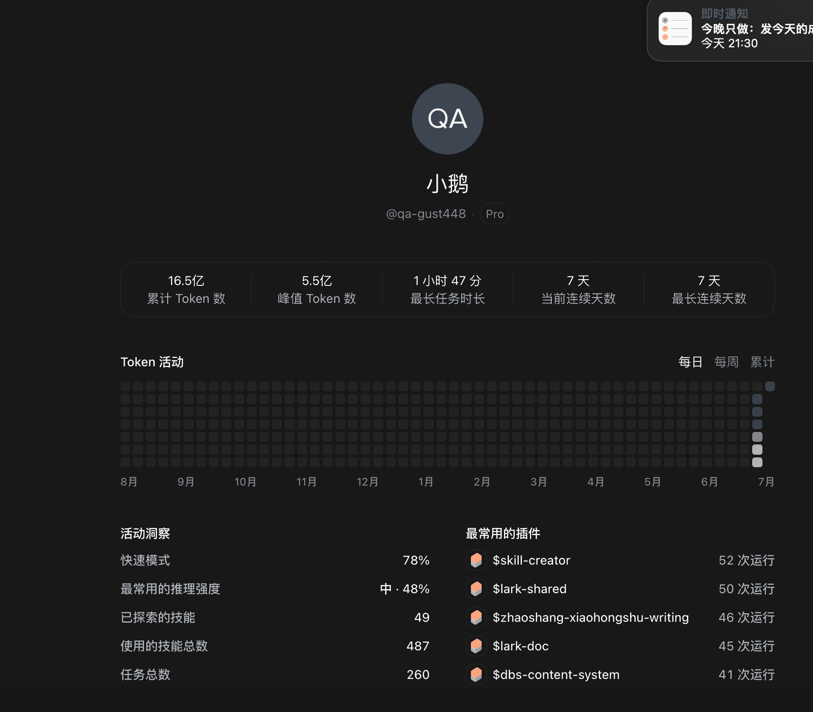

以前需要自己查资料、写文章、设计图片、搭表格、整理文件，现在只需要交代清楚目标、边界和权限，后续步骤就能持续推进。

可是使用越深入，我越觉得这件事不只是“省事”。

甚至有些让人不安。

因为越来越多的数字化动作，正在变得没有门槛。写作、制图、整理、改版和批量处理，都不再天然构成优势。真正稀缺的，开始变成一个人的想象力、取舍能力，以及对结果的判断。

当你拥有足够清晰的参照样本、真实可靠的素材，以及明确的验收方式，很多工作都能快速完成。

过去我依赖写作能力、设计能力和执行速度建立起来的差异，会逐步变薄。

以后真正拉开距离的，不是谁更会操作工具，而是谁知道该做什么、为什么做，以及什么时候应该停止。

有了 Codex 之后，这一个月我连续启动了 10 个📕账号，覆盖好物、商业、水晶、汽车、AI、美妆等方向，起步都比较顺，陆续也有线索和商单出现。

最戏剧性的一个瞬间，是我在东京找了一位陪拍。第一次见面，她就说昨天刚刷到过我的内容。

而我其实是一个很懒的人，自己的👸号都经常断更。短短一个月，我完成的工作量，几乎抵得上过去创业六年的积累。

这也让我越来越确定：关键从来不是工具能做多少，而是你是否知道什么值得做，能不能找到合适的参照，是否理解目标用户，能不能从大量“看起来都对”的答案里，挑出真正有效的那一个。

这篇文章不准备罗列 Codex 又增加了哪些能力。

我更想复盘的是：当数字化执行变得廉价之后，我为什么要搭建下面六套系统，以及哪些东西必须牢牢留在人手里。

先明确一个边界：

AI 能够完成搜索、写作、绘图、建表、归档和流程处理，但它无法替人进入真实关系，无法替人核验现场，也不能替人承担公开、交付和结果带来的责任。

人的工作并没有消失，只是从“亲手完成每一步”，转向现实中促成事情发生，再把真实信息带回系统。

准备阶段并不复杂：安装 Codex，开启必要权限，连接飞书 CLI，再在本地配置 Obsidian。遇到安装问题，直接让工具协助排查即可。

真正有价值的部分，始于安装完成之后。

# 关键成果 1：给自己建立一座事实档案馆

我以前看过焦波老师的知识库，觉得非常震撼。真正动手之后才发现，搭建过程没有那么复杂。通过简单的自然语言指令，就能把飞书云文档、Get 笔记、Flomo 等地方的内容集中到 Obsidian。

但资料汇总并不等于理解现实。

AI 擅长处理逻辑，却不会自动拥有真实经历。它可以把已知信息拼接成一套流畅解释，却不知道某位客户为何迟迟不下单，也不知道一次成交失败背后究竟发生了什么，更无法凭空知道某个决定让我付出了怎样的代价。

事实必须先由人亲自经历、观察和核实，然后才适合交给模型整理。

否则，推理越完整，越容易让人把“合理推测”误认为“已经发生”。

我给系统设置的不是普通的整理要求，而是一条证据边界：

- 只能使用我提供的原始材料；
- 将亲身经历、他人转述和公开信息分开；
- 每个结论都留下出处；
- 缺乏依据的部分标记为待核实；
- 不允许为了让故事完整而自行补写。

操作时，我不会一次性导入全部资料，而是先拿一小部分测试。随后回到聊天记录和原始文档，检查人物、时间、数字以及因果关系。

如果发现猜测被写成事实，就回到证据层重新处理；如果资料不足，就补充信息，或者明确保留未知。

公开内容很快就会失去稀缺性。

大家可以调用相似的模型，查找相似的资料，安装相似的工具，也能找到相似的参考账号。模型越强，最终产出越容易趋同。

真正难以复制的，是一个人曾经经历过什么，接触过哪些客户，做过哪些业务，为哪些决定交过学费，最后从这些经验里形成了怎样的判断。

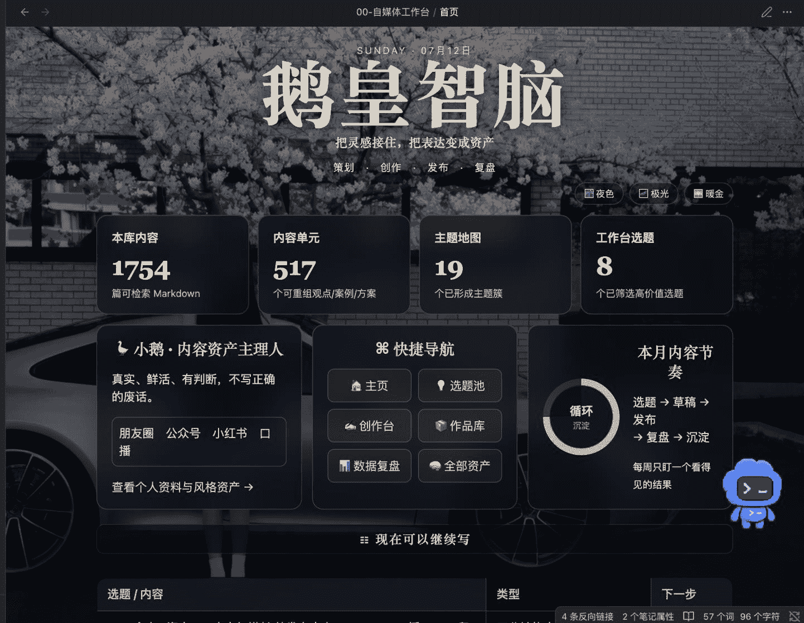

这些内容原本一直存在于我身上，只是分布在朋友圈、聊天记录、课程资料、飞书、Flomo 和各种零散文档中。

它们没有被系统化，Codex 就无法调用。

所以我搭建 Obsidian，并不是为了做一份漂亮的资料目录，而是把过去几年用时间、资金和真实业务换来的经验，转成模型可以长期读取的私人背景。

# 00-总导航

# 01-个人IP资产

## 01-身份定位

**创业经历与个人成长**

- 创业者个人成长与创业经历访谈…

- 飞书完整原文-公开分享

- 飞书完整原文-IP与经历

**飞书原文-IP与经历**

- 2025发售分享稿

- 大学四年，从0到稳定年利润七…

- 鹅皇的案例集

- 关于小鹅的事实库

- 全面了解小鹅（2026版）

**数字资产-IP与个人品牌**

- IP与个人品牌-目录

- 采访资产

- 小鹅个人画像

## 02-内容与增长

- 待发布内容

- 飞书多维表格

- 飞书完整原文-提示词

- 飞书完整原文-销售转化与客服

- 飞书完整原文-营销与内容

- 飞书原文-营销与内容

- 富贵📕原始文件

我之所以一定要把个人资料分层存放，是因为行业资料只能帮助我理解外部世界，不能伪装成我的亲身经历；而我的私人记录能够帮助 Codex 认识我，也不该被后来读到的一篇文章轻易覆盖。

目前系统中有 486 个有效内容单元、17 张主题地图和 34 份选题装配稿。

这些数字并不重要。重要的是，过去散落各处的经历、观点和判断，现在终于能够被再次找到、组合，并服务于新的内容。

**实际应用场景｜把零散经历加工成可信的个人 IP 内容**

适用情况：我想写大学创业时拿到第一单的经历，但相关资料分布在飞书、Flomo、朋友圈和聊天记录里。

我提供给模型：原始文字、截图、时间线，并设定硬性要求：只依据原始记录；区分亲历、转述和公开信息；缺少依据的地方必须标出待确认。

模型负责：提取人物、时间、数字和因果关系，制作带出处的事实卡，再组装成文章草稿。

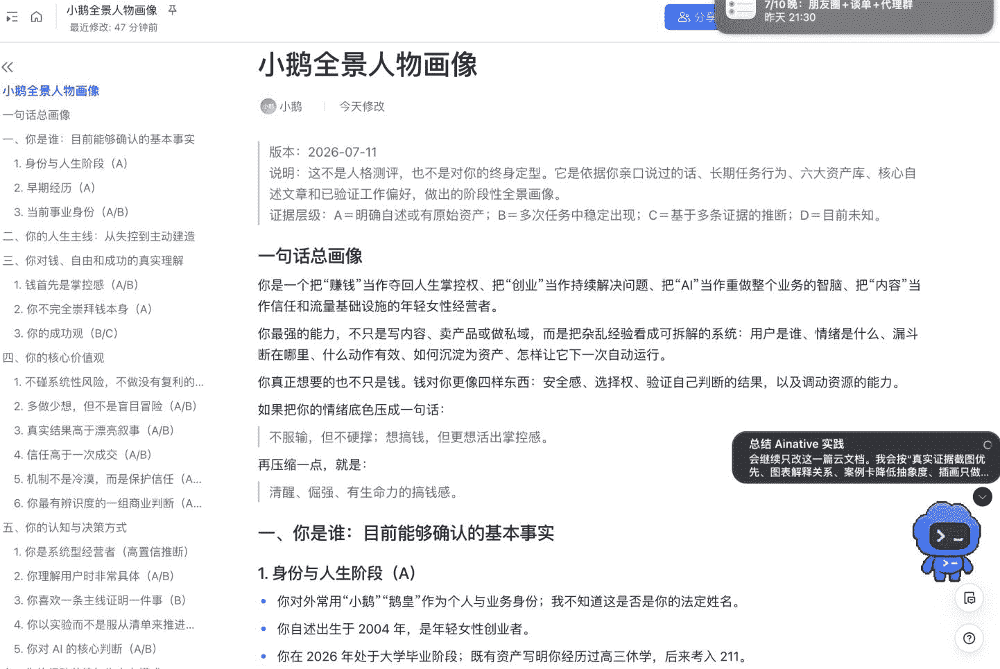

我负责：逐项回到原记录，删除没有根据的推断，补齐证据，并决定这段故事最终要传达的判断。

验收方式：所有关键事实都能找到出处，没有虚构内容，同一批素材还能继续用于👸号、📕和口播。

# 关键成果 2：把写作方法变成可调用的 Skills

第一件事，是拆解我长期关注的博主。

我不是让模型笼统地“学他的风格”，而是输入一批长期追踪的内容，让它观察其中稳定存在的规律：

- 选题偏好；
- 开头如何进入；
- 段落如何推进；
- 情绪如何变化；
- 常用表达；
- 哪些写法明确不能碰。

这些规律被整理成第一版 Skill。

第二件事，是把每次修改过程继续写回系统。

最初的版本只能让产出靠近参考对象。后续不断出现的“太像老师”“没有本人感”“只是学到了表面”等问题，才真正帮助我把外部方法转化成自己的判断体系。

我的要求通常是：

先别急着写文章，只从样本里提取重复出现的稳定规律；把选题、开场、结构、情绪、语言和禁用项分开；所有判断都要回到样本，不要把偶然出现的写法误当成通用规则。

使用时，我会把参考原文、模型草稿以及自己的合格版本并排比较，判断它究竟掌握了结构关系，还是只复制了口头禅。

如果我拒绝了一版，就继续追问：刚才为什么没通过？能否把这个理由改造成下一轮能够执行、能够检查的规则？随后把规则补回 Skill，再用相同任务重新测试。

还有一条很重要的边界：

如果内容变得更像参考博主，却越来越不像我；或者为了增加“真实感”开始编造不存在的现场，我不会继续修辞，而是先调整 Skill 的限制条件。

| 原始反馈 | 转化后的判断规则 | 复测方式 |
| :--- | :--- | :--- |
| 太像老师 | 先进入具体现场，再展开观点 | 开头是否出现人物、动作或对话 |
| 缺少个人气质 | 优先读取我的经历与合格稿 | 是否包含只有我能提供的经历和取舍 |
| 只学到了外壳 | 借鉴组织方式，不照抄表面元素 | 是否解释了参考内容为何有效 |

如果这些判断只停留在聊天窗口里，每次都要重新检查和拒绝，我就会成为整条流程中最慢的环节。

所以每次调校结束，我都会把“为什么不通过”继续追问到底，再把答案写入对应的 Skill。

这不是收集工具，而是把只能存在于脑中的标准，变成未来可以直接调用的资产。

很多人都能用同一位博主做出一份初步拆解，但只有真实互动、持续修改和长期反馈，才能让这套规则逐渐带上我的个人特征。

真正具有区分度的，不是“像不像某个博主”，而是长期积累下来的通过记录和淘汰记录：

什么才算像我，什么只是学会了口癖；什么是平台适配，什么只是简单缩短；什么是真正有观点，什么只是把正确话说得很完整。

**Prompt** 往往只能解决当前一轮任务，Skill 才能让判断持续增值。

文章会过时，但判断可以不断生成新的文章。

**实际应用场景｜把参考博主的方法转成自己的写作模块**

适用情况：我想借鉴某位博主的📕方法，但不想只学几句口头表达。

我提供：参考样本、合格稿、失败稿和退稿理由，并要求先拆规律，不立即写正文；每条规则都必须有样本依据，同时把我的修改意见改造成可执行、可检查的约束。

模型负责：提取选题、开场、节奏、情绪和禁用范围，写入 Skill，再用同一选题测试。

我负责：确认它学到的是组织逻辑，而非表面语气；指出哪些地方缺少我的经历；禁止通过虚构现场来制造真实感。

验收方式：同类任务再次运行时，曾经反复出现的问题明显减少，并且新的修改意见会继续沉淀为规则。

# 关键成果 3：让内容进入批量生产状态

我用社媒助手导出参考内容，再交给 Codex 处理，最终沉入飞书多维表格。

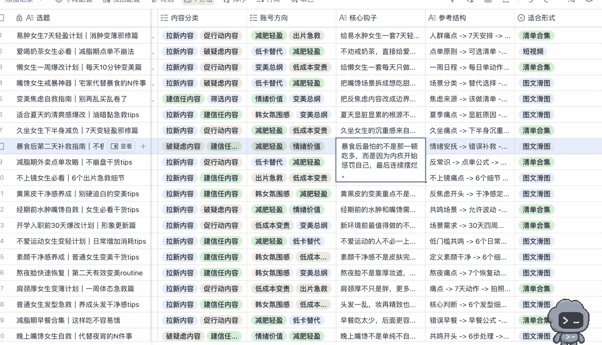

这 100 条内容并不是输入一句话就凭空生成的。

具体过程分成四段：

1. 将参考内容导出成 Excel，并按主题拆分；
2. 把选题、标题、核心钩子、参考结构、平台、状态等信息拆成 19 个字段；
3. 生成 100 份独立 Markdown，同时制作封面和内页图片，再写入飞书多维表格；
4. 由我重新通读，判断哪些地方需要调整。

流程跑通，只代表生产完成，并不代表方向已经被市场证明。这批内容当时并没有被直接视为已发布、已转化的成果。

过去需要多人协作完成的选题、写稿、整理和归档，现在都可以被压缩到一套自动化链路里。

只要参考充分、结构稳定、真实素材可调用，就具备批量制造的条件。

但真正的风险也随之暴露出来。

第一轮生成的 100 条 AI 创业内容，形式上没有问题：字段齐全、结构完整，也顺利进入内容库。

可是仔细检查后发现，内容集中在融资、SaaS 和硬科技。

问题不在生产能力，而在于我一开始没有把真正想触达的人群说清楚。

我真正想写的，是普通女生、年轻创业者和一人公司正在面对的现实问题：第一单如何拿到、客户如何验证、交易如何完成、服务如何交付，以及现金流如何维持。

于是，原有的 100 条内容全部备份，整体推倒重来。

| 第一轮产出 | 调整后的方向 |
| :--- | :--- |
| 聚焦融资、SaaS、硬科技；产出完整，却吸引了错误人群 | 面向普通女生、年轻创业者和一人公司；讨论第一单、客户验证、成交、交付与现金流 |
| 生产完成，不等于方向成立；数量只会把前面的选择放大 | 生产完成，不等于方向成立；数量只会把前面的选择放大 |

重新制作时，我给出的约束是：

可以借用参考内容中已经被验证过的表达方式，但不能照搬它的读者和议题。每条内容都要先说明最终会吸引哪类人；如果答案再次偏向科技创业，就暂停继续生成。

我重新检查少量内容后，发现方向依旧跑偏，于是立即停止，备份原批次，先重新定义读者和主题，再开始后面的制作。

这件事让我更清楚地看到：

模型不会因为产量增加，就自动更接近正确答案。

当方向正确，规模能把有效动作放大 100 次；当方向错误，它也会非常认真地把错误复制 100 次。

所以，参考账号只能告诉我市场上已经存在一种怎样的表达方式，不能替我决定应该服务谁。

我必须自己回答：

- 参考内容为什么能够成立？
- 它吸引来的读者是不是我真正想要的人？
- 哪些表达结构值得借鉴？
- 哪些观点、定位和人群不能照搬？

批量生产真正放大的，是生产前的选择。

过去选错方向，可能只损失一篇文章；现在选错方向，系统一夜之间就能生产出整批错误内容。

**实际应用场景｜围绕一个成熟表达框架制作 100 条内容**

适用情况：已经找到可借鉴的内容结构，准备服务一类明确人群。

我提供：参考表格、目标读者、业务目的、私人素材库和禁用边界，并要求拆成 19 个字段；每条都写清楚会吸引谁，偏离读者定位时立即停止。

系统负责：批量生成 100 份 Markdown、封面和内页图，再写入飞书多维表格。

我负责：先抽查少量结果，确认方向没有问题，而不是因为“已经做完 100 条”就默认成果有效。

验收方式：每条内容都能回到参考依据和真实素材；如果首批结果偏离定位，就保留原批次、修改规则，再重新生成。

# 关键成果 4：成熟的 AI，需要学会自己推进

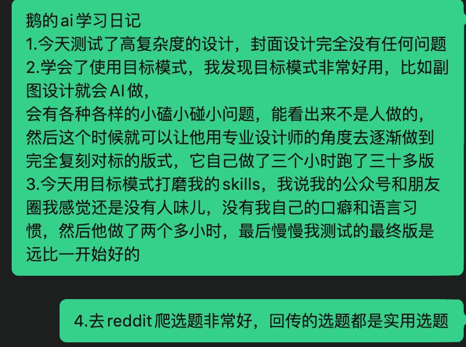

现在，我不再逐张告诉模型该怎么修改，而是提前交代参照、目标和验收方式，再让它自行循环优化。

这是我实际跑通的一条流程。

**第一步：先研究参考作品，定义“好”的样子。**

我不会只说“做得更好看一点”，而是要求拆解视觉重心、信息层级，以及整组页面成立的原因。

参考作品只负责提供方向，哪些设计逻辑值得吸收，仍由我决定。

**第二步：先做出初稿，让差距显形。**

首稿不需要一次到位，它的意义是暴露当前理解与目标之间的落差。

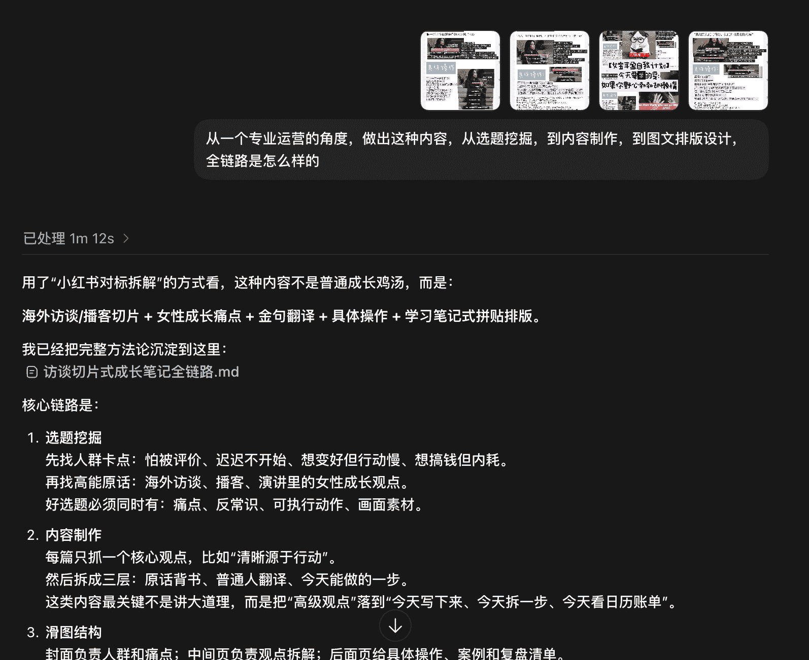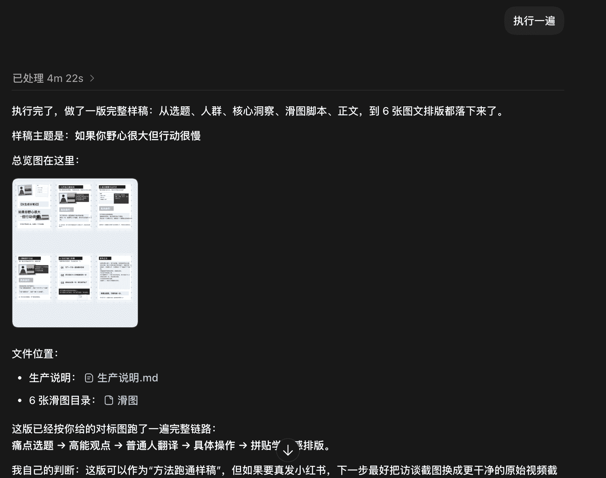

**第三步：进入目标驱动模式，开始连续优化。**

我会要求它持续拿目标和参考作品进行比较，从专业设计角度检查视觉重心、信息层次、资料质感和手机端阅读体验。

如果发现问题，就自行修改、再次检查；没有达到门槛，就继续下一轮，不要每一步都回来等待人工遥控。

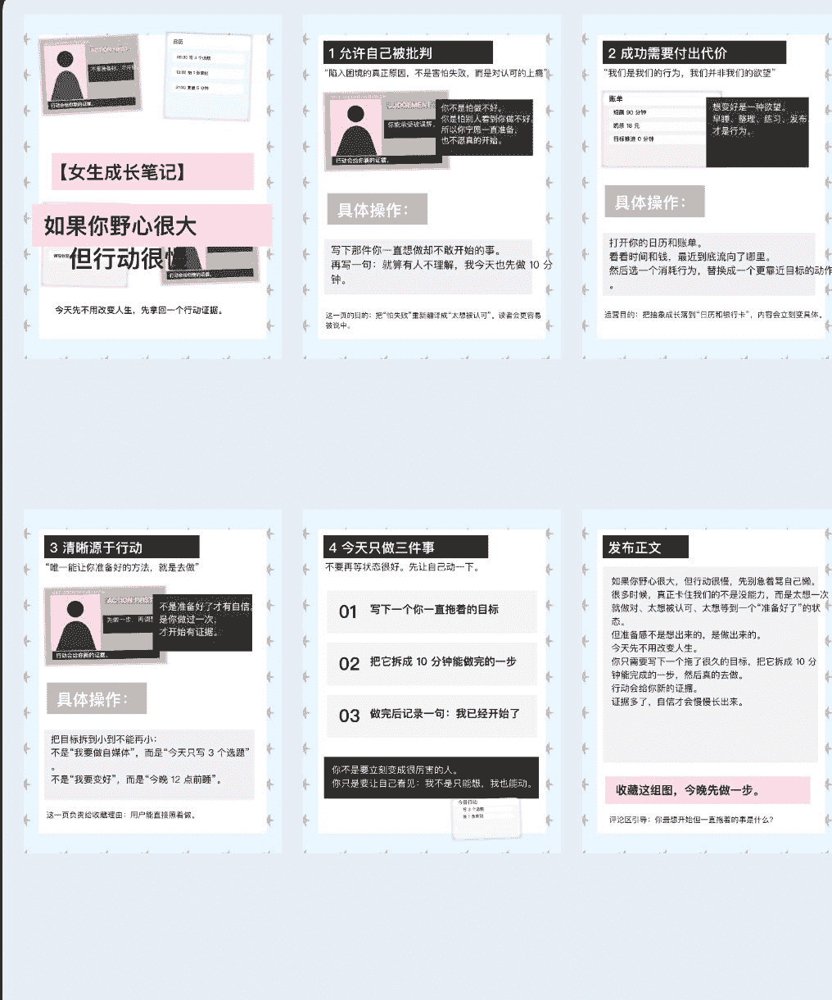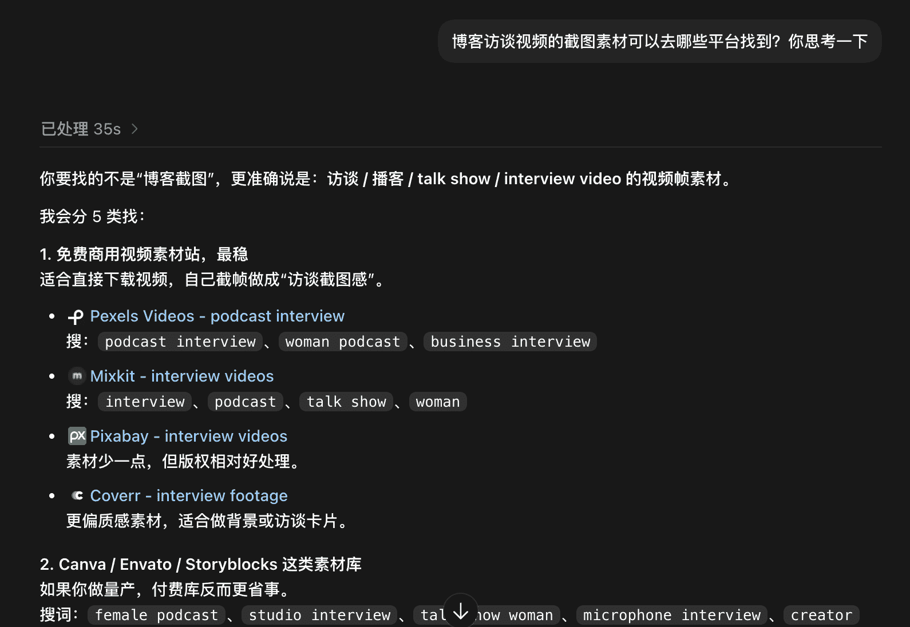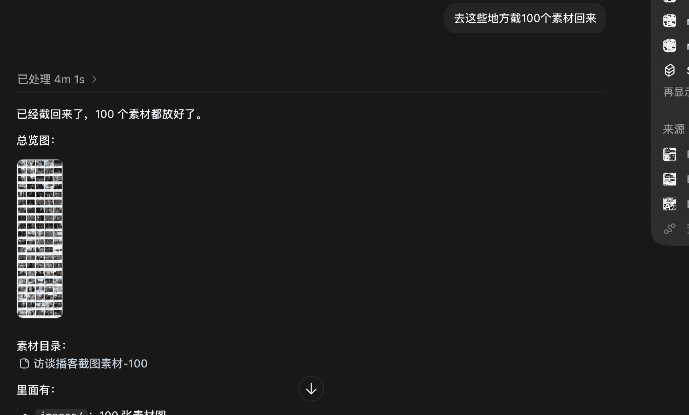

在这套约束下，它连续推进了 40 多轮。

这不是随机更换模板，而是在同一个目标下反复比较、定位问题和修正细节。人不需要亲自推动每一次微调，但始终掌握目标、素材、验收和停止权。

**第四步：由人决定何时结束。**

版本从 v1 推进到 v42，之后又继续收敛到 v48。

最终是否成立，不以模型自己宣布“完成”为依据，而是看成品是否真的符合要求：

- 首屏是否能够迅速形成视觉重点；
- 六页之间是否有顺畅的阅读节奏；
- 证据、观点和行动是否被统一到一套表达中。

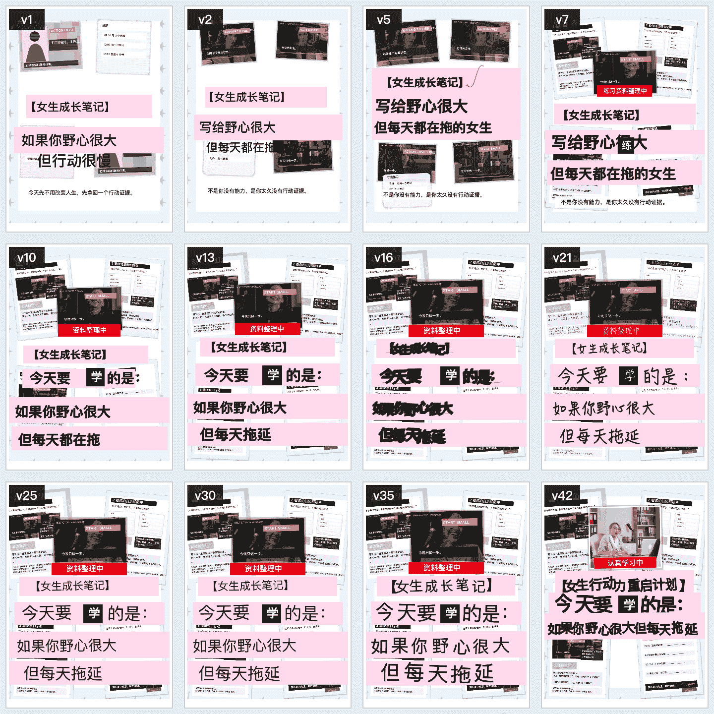

**第五步：把过程中的有效经验保存下来。**

我留下的不只是最终图片，还包括参考分析、有效改动、失败原因和验收标准。这些内容会被整理为 Skill，为下一轮任务提供起点。

**第六步：替换主题，继续调用。**

下次只需要换掉主题、素材和具体参考作品，其他流程仍然可以沿用。

系统负责重复执行，人继续负责选择方向、提供真实信息，并完成最终判断。

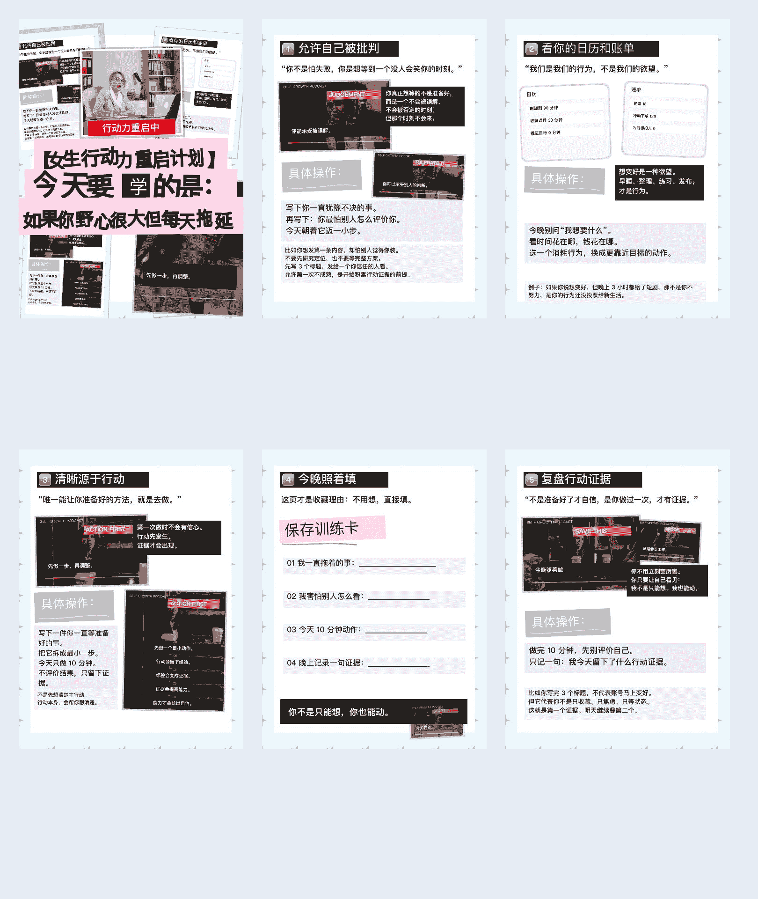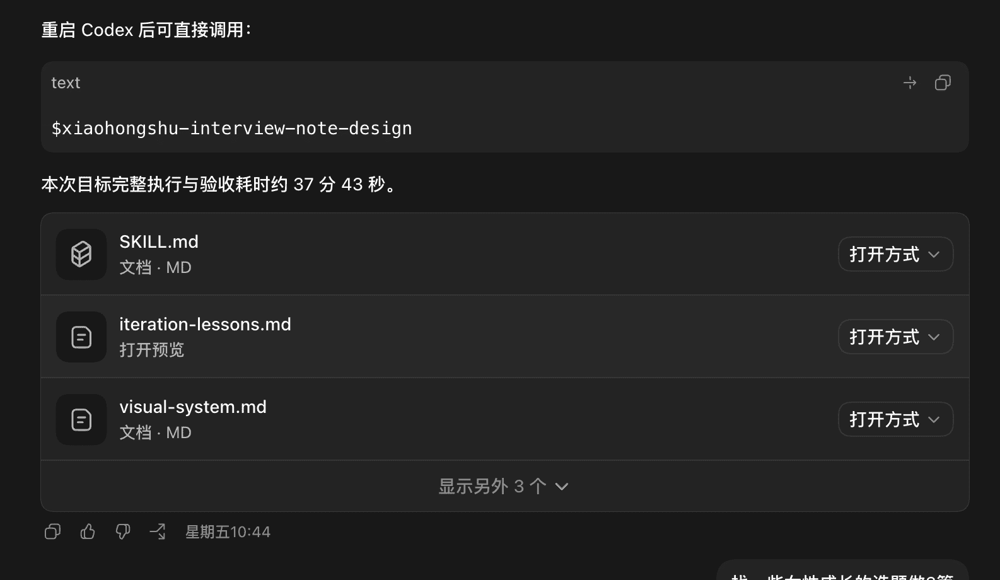

所以，“成熟的 AI 要学会自己推进”并不是把决定权交给模型，也不意味着模型突然拥有了审美。

真正的前提是：人先把目标、参照和专业要求讲明白，再让模型承担大量重复的比较、修改和自检。

**实际应用场景｜让模型从首稿持续打磨成专业设计稿**

适用情况：已有清晰的页面目标和参考作品，但不想再逐张说明标题放大、图片左移等细节。

我提供：参考图、真实素材、每页任务以及验收条件，并要求它进入目标模式，持续从专业设计视角检查，直到整体满足要求。

系统负责：从 v1 开始反复自检和修改，推进到 v42，再收敛到 v48。

我负责：核验事实，设定审美方向，决定何时足够好，也决定哪些高完成度方案仍然不能使用。

验收方式：页面重点明确、阅读节奏统一；本轮有效修改、失败原因和检查条件都被保存到 Skill，之后更换主题仍可继续使用。

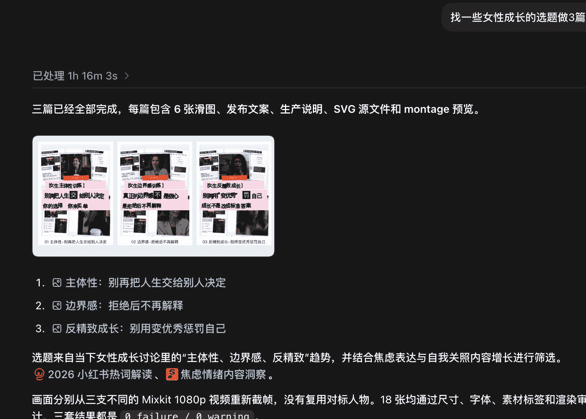

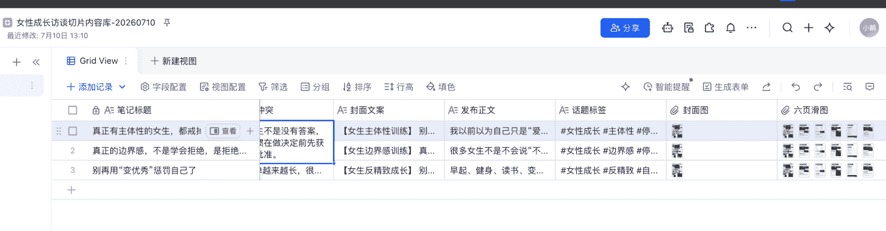

---

**关键成果 5：让系统反过来安排我的工作**

过去我也做过很多计划表：一次排满十天，周一做什么、周二做什么，手机里充斥着提醒。

通常坚持几天之后，新想法、临时任务和状态波动就会把计划打散。最后我开始怀疑，是不是自己的自律能力不够。

这一次，我没有立刻让 AI 替我制作日程。

我先让它研究真实用户如何使用苹果日历，哪些安排方式只是看起来勤奋，哪些结构才有可能长期运行。

我先把📕、Reddit、X 上被刷屏的苹果日程玩法通盘梳理了一遍，想知道大众实际是怎么落地的。

我的出发点是：平台上最吸睛的方案，不等于能用得久。我需要模型先把看起来很饱满但容易崩的方式，和结构简单却能长期维护的方式并排分析，再挑出真正值得留下的原则。

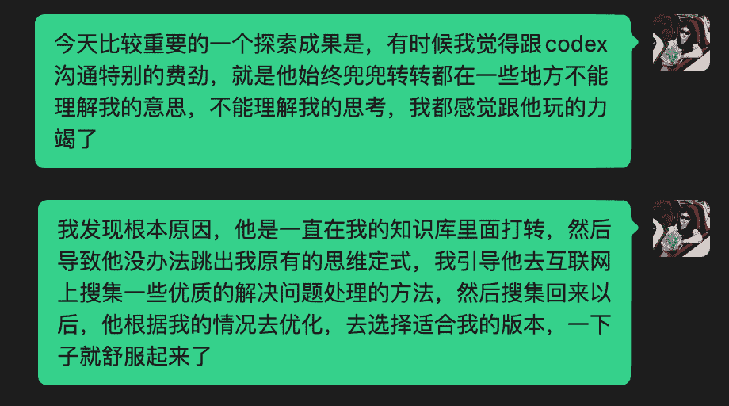

这一轮梳理没有给我一份可以直接抄作业的模板，而是一套取舍的判断依据。📕很爱把一天塞满、用数十种颜色做区分，视觉上很完整，维护成本却很高。更持久的经验反而克制得多——日历只负责时间线，提醒负责具体事项，日历不能变成待办的垃圾桶，每个被重点圈出的时间块都必须对应一个可验收的产出。

但这仍然是别人的使用习惯。它能回答“一般怎么玩”，答不了“我该怎么玩”。于是下一轮，我把自己的 ENTP 描述、StrengthsFinder 报告、往期排期翻车的原因、当下的状态波动一起喂给模型。

结合我的 MBTI、我的盖洛普，以及你对我做事偏好的所有认知，帮我推演一套真正适配我的时间用法。

我把“适配”拆成四条可自检的问题：

1. 我能不能清晰看到日、周、月分别交付了哪些成果？
2. 每天可以发散，但能不能收敛到一个核心交付物？
3. 掉到低谷时，系统能不能直接给一个最小启动动作，而不是让我重新排计划？
4. 每周沉淀的东西，能不能用来做取舍、做验证、规划下一步方向？

性格标签只提供线索，决定系统形态的，是我过去为什么会失败、我能坚持到哪一步、什么算达标。

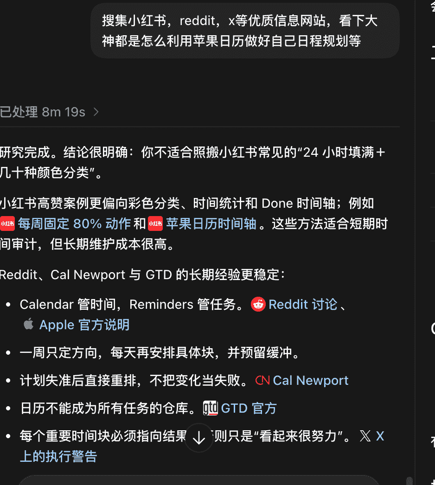

第二版示意图看上去已经很饱满，但它仍是模型基于当时信息给出的中间稿，不是终稿。

图中模型仍把核心结果块塞进 Calendar。回到真实工具里核对后，我追问了一句：

日历里不应该只放无法移动的硬性节点吗？

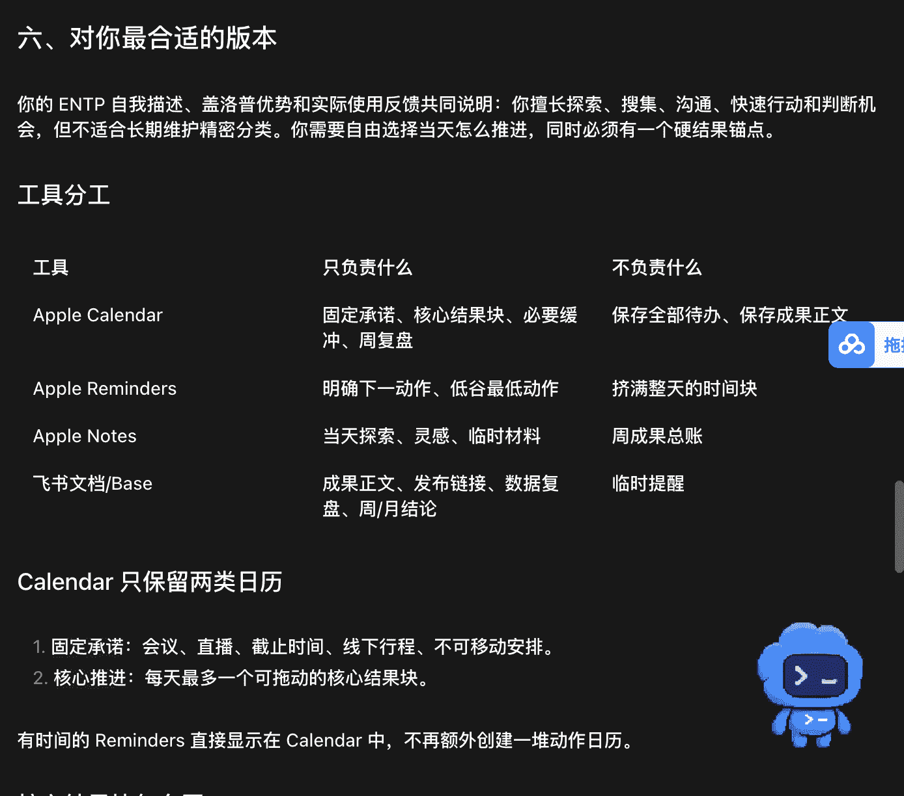

这句话重写了整套工具分工：

- **Apple Calendar**：只上课接送、会议、线下活动等时间不可挪动的硬性承诺。
- **Apple Reminders**：直接告诉我今天要启动什么动作，以及低谷时的保底动作。
- **Apple Notes**：承接当天的发散、灵感和临时素材。
- **飞书文档与 Base**：汇聚成果正文、外部反馈与周月复盘结论。
- **Obsidian**：仅收纳已验证、值得长期复用的数字资产。

我的判断是：如果打开日历后还要分辨哪些是承诺、哪些是任务、哪些是成果，这个设计本身就在增加认知负担。日历只需要告诉我哪些时段不可动，提醒事项应该直接告诉我今天该做什么。

最终真正固定的，不是每日几点做什么，而是月度方向、周度成果和日度一个核心结果；具体推进路径可随状态实时调整。

如果我一眼看不清今天重点，低谷时还要重排，完成时没有可查验的成果证据，这套系统就算逻辑完整也没有通过。让模型教我工作，不是把自主权交给模型，而是我先划定研究范围，提供真实的自我观察，定义失败标准，再用实操感受持续验收纠偏；模型负责把判断翻译成规则和下一步。

这套分工已落地，正在做 7 天试运行；还不能提前写成长期有效。

**实战｜以 MBTI、盖洛普和翻车记录重建工作系统**

触发场景：我习惯把日程塞满，却总被新想法和状态波动打断，传统计划对我无效。

我给模型：请结合我的 MBTI、StrengthsFinder，以及你对我习惯的了解，为我设计适配的日程方式，并落到苹果日历/提醒/备忘录。

模型执行：重新划分工具职责，日历收硬性承诺，提醒承接当日核心动作和低谷保底动作，Notes 承接发散，飞书记录结果，Obsidian 沉淀已验证资产。

我负责：定目标、指出不适配之处、用真实执行结果持续改规则。

验收标准：先试跑 7 天，检查每天是否看得懂、做得动、留得下成果证据。未跑完前，不把它写成长期方案。

**关键成果 6：给模型一点反馈**

我很爱创造。

但批量产出几十条内容后，我不喜欢逐条搬运、发布、归档。

若发布只是生产的行政收尾，它必然被拖延。

于是我把发布重新定义为把判断送进市场的动作。

在上线前，我总觉得标题会吸人、观点会共鸣、案例会建立信任。

可只要内容还躺在本地文件和飞书表格里，这些都只是假设。

真正公开后，阅读停留、收藏评论、私信咨询、成交，才会告诉我：我想象的用户是否真实、我选的对标是否带来对的人、我认为重要的判断用户是否在意。

| 阅读/停留 | 收藏/评论 | 私信/咨询 | 成交 |
| :--- | :--- | :--- | :--- |
| 验证注意力 | 验证价值感与共鸣 | 验证信任 | 验证行动意愿 |

所以每条内容只验证一个假设。

不是追求日更，而是：这一类人群，会不会被这个痛点或判断吸引？

这也是最终发布需要人拍板的原因。

内容涉及身份、事实与承诺。模型可以准备上线材料，但是否符合我的判断、是否涉及风险、是否适合此刻公开，必须由我决定。

例如这类指令：从飞书发布池取 1 条待发内容，准备 6 张配图、标题与正文；提交前必须暂停等我确认；提交后返回笔记管理页，以页面真实状态为准。没有公开链接，不允许记录为发布成功；一旦出现账号风险，立即停止定时任务。

我的操作：模型准备好后，我亲自核对内容是否符合身份、事实与承诺，再决定继续、修改或暂停。那次页面仅显示审核中，系统就只能回填审核中；后来发现账号与平台风险，我直接删除了两个定时发布任务。

分工边界：模型可以执行连续操作，但何时停止、什么事实可以记录、什么内容有资格公开，始终由人决定。

一次真实的发布链共六步：

1. 从飞书发布池读取 1 条待发内容。
2. 下载并上传 6 张配图。
3. 填写标题与正文。
4. 人工确认后提交。
5. 返回笔记管理页核查真实状态。
6. 页面显示审核中，飞书就只记录审核中。

后台提交成功、平台审核中、生成公开链接，是三个不同事实。最后一步不是模型会不会点，而是人能否对事实负责。

近一个月，有条📕内容后台已提交，但平台回读状态仅为审核中。没有公开链接，我就不承认它已发布。

后来发现账号与平台风险，我主动撤掉了两个定时任务。

自动化并非越多越好。

没有刹车的自动化，只是在加速制造错误。我为自动化设置了四道刹车：

- 状态不明，不记成功
- 出现账号风险，立即停止定时任务
- 最终发布保留人工确认
- 自动化不得越过事实、身份与权限边界

发布后真正有价值的，不是把状态改成已完成，而是把反馈回流到系统：市场反馈修正判断，有效判断进入 Skills，新案例与用户语言回到 Obsidian，下一轮方向重新进入目标与日程。

这条回流目前尚未完全稳定。大批量生产可行，真实发布、数据回收与淘汰机制仍是下一阶段重点。

但认知已改变：

内容不是生成完就结束。只有进入真实世界，接受反馈并改变下一轮生产，它才算完成。发布不是收尾动作。

发布是判断第一次接受现实检验的场域。

**实战｜让发布反馈反向修正下一批内容**

触发场景：飞书内容池已有待发稿件，我要把内容推向平台，并用真实反馈检验既有判断。

我给模型：打开📕创作后台，不要使用 MCP，模拟人工点击完成发布。

模型执行：取稿、填写发布信息、回读平台状态并写回飞书；遇账号风险立即停止。

我负责：发布前最终确认，判断事实、身份与权限边界，必要时随时切断链路。

验收标准：发布后记录停留、收藏评论、私信咨询和成交，分别验证注意力、共鸣、信任与行动意愿，再把结论送回下一轮选题与生产。

**最后**

这个月，我做了很多围绕模型的事情。

沉淀真实上下文、把纠偏写进 Skills、批量生产对标内容、让模型围绕专业目标自我迭代、重设日程、把发布变成市场实验。

去掉所有工具名称，我真正做的只有一件：

把可标准化的数字执行交给机器，把人留在真实世界：见人、做事、核对事实、形成判断、承担结果。模型没有让我停止思考。

它只是迅速拿走了过去靠勤奋、熟练和时间堆出来的优势，逼我更早面对：如果执行不再稀缺，我凭什么做得更好？

我的答案不是更会写提示词。

而是更真实地进入世界，见用户、做业务、付学费、拿反馈；再把这些经历变成上下文，把取舍变成 Skills，把模糊的感觉变成标准，把每次发布变成下一次判断的证据。

我们是模型的眼睛。

我们替它去真实世界生活，看到表情、情绪、犹豫、欲望和那些未被说出口的需求。

它可以替我们记忆、连接、执行和放大。

但决定看向何处、相信什么、放弃什么、最终承担什么结果，始终属于人。

我觉得这很可怕。

但也很公平。

当可标准化的数字执行不再构成壁垒时，真正值钱的，是一个人亲身经历过的世界、发生过的事实，以及由此形成的判断。

————分割线————

看完这份 SOP，你可能觉得明白了。但 90% 的人实操第一步就会卡住。

工具和教程是最底层的壁垒，真正的壁垒是“立刻开干”和“圈层信息差”。

如果你想看全网最新的变现打法，并和一批执行力极强的极客一起下场拿结果，欢迎围观我的核心私域：【懒人专属群】。

我们不谈概念，只拆商业闭环和 AI 效率压榨。系统内已沉淀 1000+ 跑通的套利实战案例。

👉 查看圈子完整数字资产与上车门槛：

https://lazyso.com/insider/

认同价值、准备好实操的，扫码加我🛰️（lazyhelper1）

备注：【实操上车】，不闲聊

