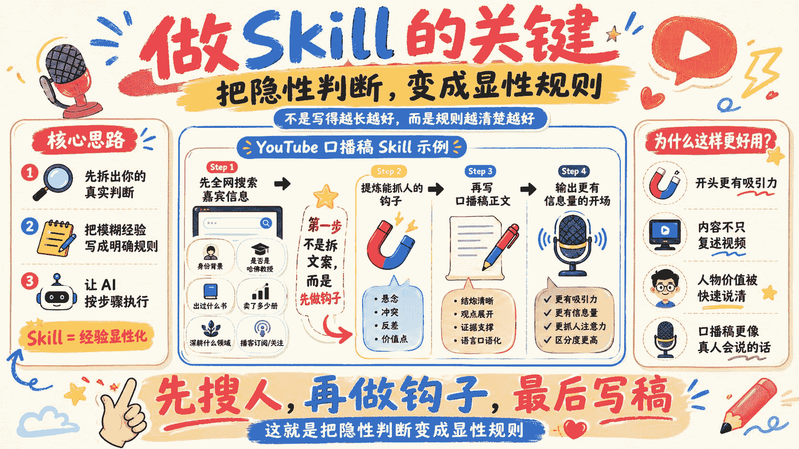
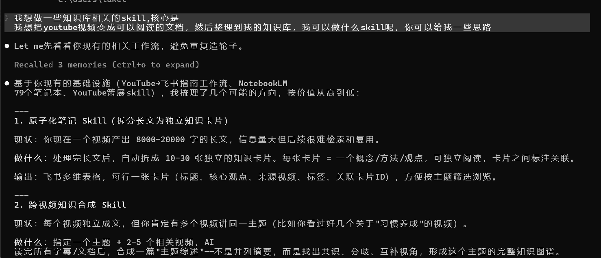
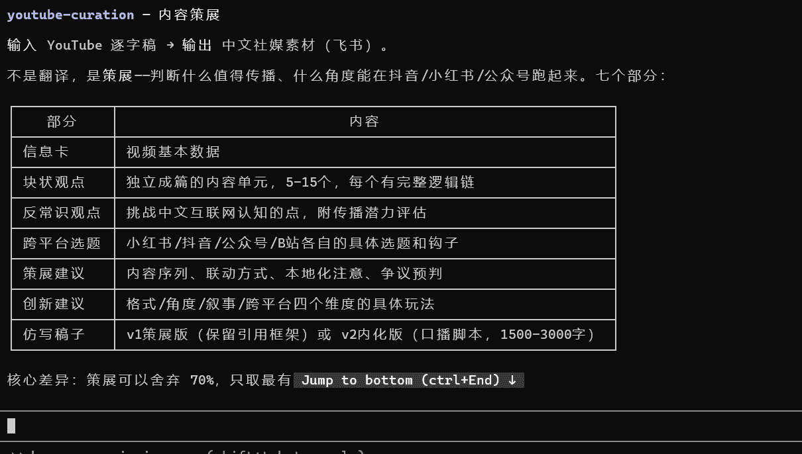
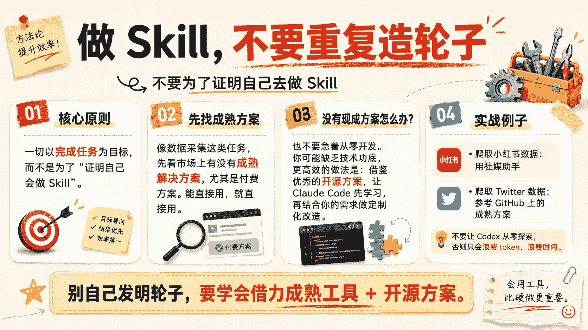
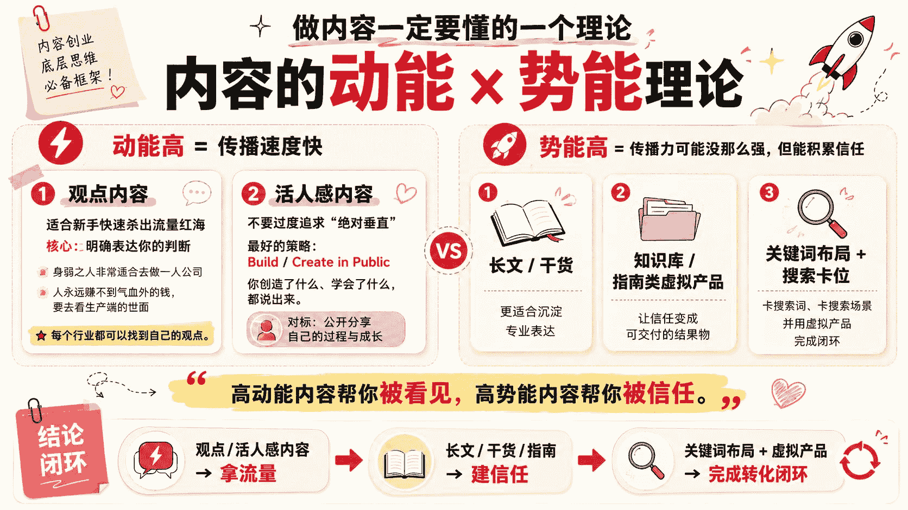
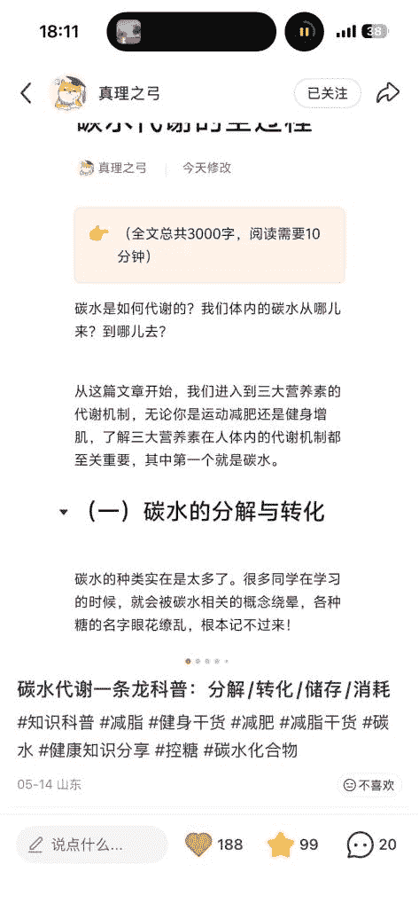
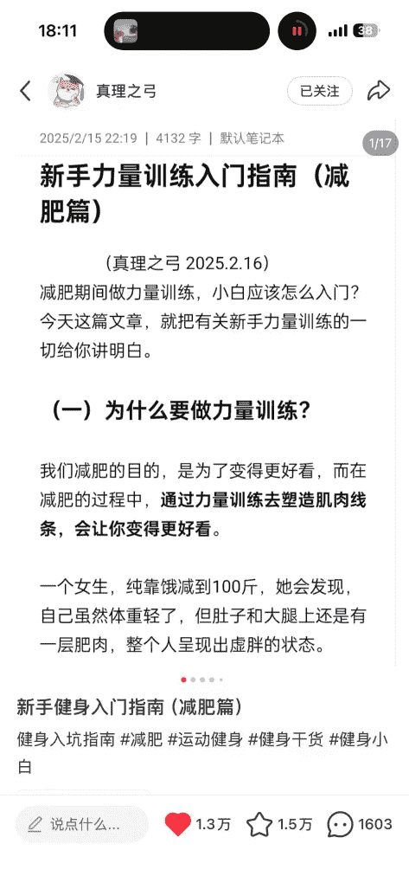

# 如何用 **Skill** 原创虚拟产品！**11000** 字说清楚

最近AI圈的新名词一个接一个：Agent、Harness工程、Skills、Vibe Coding……很多人光是追概念就追得头晕。更麻烦的是，很多人对Claude Code和Codex这类工具存有偏见，总觉得那是程序员才能碰的东西，只是个写代码的插件而已。

其实，这两个工具早就超出了编程的范畴。就算你完全不会写代码，照样能用它们来提效。它们不仅能生成代码，还能接管你的电脑，比如帮你把杂乱的桌面整理得井井有条。所以，千万别把这两款工具的能力边界想窄了。

这篇文章我想聚焦一个话题：怎么用Skill来原创虚拟产品，顺便搭一个属于自己的内容虚拟产品工厂。我会拆解长文Skill、笔记Skill、指南Skill的设计思路，以及它们之间怎么协同配合。

在我看来，2026年做虚拟产品，完全可以用Skill这条新路径重新跑一遍。如果你想知道怎么原创Skill、怎么用它重塑工作流，这篇文章值得你读完。拥抱AI，不妨从拥抱Skill开始。

## 01 别人的Skill，为什么到你手里就不灵了？

Skill翻译过来就是“技能”，听起来很高端，实际上并不复杂。你可以把它理解为：给AI智能体配置一种能力模块，让它能够执行某个具体任务。

把AI智能体想象成一位新入职的员工。这个员工很聪明，但如果没给他分配权限、没给他配套工具，他什么也做不成。你授予他的那部分能力，就是Skill。

所以Skill本质上是对任务和场景的高度打包。举个例子：你是个内容创作者，天天要写标题，那你可以做一个“标题Skill”，它专属于你，任务非常明确，就是帮你起标题。

这也是Skill最典型的特征：它面向的是重复性劳动。只要某件事你反复在做，它大概率就能被封装成一个Skill。

我讲一个自己真正用过的例子。当时我要做课件封面图，📕上有种很流行的版式：左边放课件缩略图，右边是拼接图，也就是“左缩略图、右拼图”。我把这个需求原原本本告诉Claude Code，说我想拥有这样的一个Skill。结果它自己就动手做了，最后做到：我只要给它一个PDF，它就能按这个版式生成封面图。

这个场景看上去很小，但特别解决问题。

所以，第一步是要给Skill祛魅，尤其是对网上那些Skill教程祛魅。你不需要知道配置文件里每个字段的含义，不需要了解触发条件的语法，更不需要去看YAML、JSON、Markdown Frontmatter这些文档术语。你唯一要做的事情，就是打开Claude Code或Codex，用你跟同事交接工作时的语气，把你在脑袋里已经跑通的流程完整说出来。剩下的技术细节，AI会全部接手。

为什么可以这样？因为Skill文件的本质，就是一份结构化的规则文本。而大模型被训练得最多的能力，正是把大白话转成结构化文本。

所以，“写Skill配置”这件小事，本来就该交给AI自己来干。你亲自去写，才是最低效的方式。你只要给出“好”的定义就行，至于怎么变成可执行的规则，那是AI的事。只要这个分工成立，技术门槛就消失了，剩下的只是认知门槛。

这里我想指出一个很多人忽略的现象：市面上一大堆教你做Skill的教程，为什么越看越让你觉得自己学不会？因为这些教程的作者大多是技术出身，他们的思考方式和表达习惯都是技术人的习惯。技术人一看新工具，第一反应就是翻文档、查参数、摸底层原理，然后才肯动手。这在写代码的领域是优秀习惯，但在教普通人用AI时，却成了一堵人为砌起来的高墙。

这些技术人写教程时，往往会不自觉地把自己那套钻研路径当成标准答案：先介绍Skill文件的内部结构，再逐个字段讲参数类型，再讲触发条件的几种写法，最后给一堆约束规则。没有技术背景的普通人，可能看到第三行就想退出了。不是他们学不会，而是那些东西可能一辈子都用不到。

更聪明的打法，是先让AI随手搭出一个能跑的粗糙版本，马上用一次看看，然后把你的不满告诉它，让它继续迭代。这样循环五六次甚至十多次，你就能得到一个让自己眼前一亮的成果。

## 02 Skill和虚拟产品，到底是什么关系？

要回答这个问题，先拆解一下虚拟产品的构成。📕上的虚拟产品，基本由图片和文字两个元素组成。比如原创指南类产品就是文字配图片；课件是图片的集合；知识库是文章的集合。这些形态，AI其实都能搞定。

Skill能做的，不只是产出文字，它还能帮你搭网站，虚拟产品能有的形态，它几乎都能做。更重要的是，Skill本身就是一个虚拟产品。因为一个能帮你干活的Skill，背后是你的经验沉淀；而你的经验，对很多人来说恰恰是需要的东西。近两年流行的“蒸馏”概念，也是从Skill时代开始被大家挂在嘴边的。

所以现在完全可以说是Skill的黄金时代。

换个角度说，Skill就是虚拟产品，因为它就是你经验的外化。而且📕官方现在也鼓励大家发Skill，你搜一搜就能看到，已经有不少博主在上面发布原创Skill了。

但这里有个提醒：别去重复造轮子。市场上早就堆满了📕封面图Skill、👸号排版Skill，你再做一遍没有任何增量，既赚不到钱，也拿不到客资。真正值得你做的，是那些跟业务强相关的Skill。举个例子，我认识一个雅思老师，她把自己批改作文的经验沉淀成Skill，在📕上推广，一个月卖了600多单。

这600多单带来的，不只是前端的收入，更是一批精准客资。说到底，虚拟产品就是客资，获客成本几乎为零，平台甚至还会倒贴钱给你，这种性价比哪找去。

那有人会问：这些事用提示词不也能做吗？我为什么非要Skill？这里得说清楚，提示词和Skill有本质区别。

### 两个决定性差异

#### 差异一：交付的“结果物”不一样

什么叫结果物？你用提示词让AI写一篇📕笔记，AI在对话框里吐出一段文字。这段文字就算质量很高，它也只是一个中间产物，离成品还差好几步：你得复制出来、找地方保存、调整格式、配封面图、检查敏感词，最后手动传到📕后台。

提示词给你的只是一个不错的开端，离成品还远着。

用Skill做同样的事，画风完全不同。丢一个标题或需求进去，它自己把稿子写了、版式排了、再送进飞书或本地文件夹。等你打开飞书，一篇排版完整、拿来就能直接发布的笔记已经躺在那里。你剩下的事只有一件：决定用不用、改不改。其他琐碎步骤，全部消失。

很多人做内容半途而废，根本症结不在写，而在写完之后的那些琐碎杂事。这些杂事单拎出来没什么，可积少成多之后，那股摩擦力会把你的内容系统一点点拖停。Skill存在的意义，就是把杂活全部收走，让你只做简单的判断：这篇能不能发，那个地方要不要改；这个方向值不值得继续，那个角度是不是该换。

#### 差异二：提示词的稳定性太差

提示词还有一个先天短板，就是稳定性。

想象一个画面：你和AI聊得正欢，气氛热络，它喊你兄弟，你叫它哥们，话题也聊得深，它基本知道你想要什么调调。可就在第三十一分钟，它冷不丁来一句“你好，今天有什么可以帮你？”你心里顿时一沉——窗口满了，刚才攒下的语境、风格、默契，全部被清空。

这个现象被称作上下文溢出，它是对话式交互绕不过的天然边界。所有大模型都有个上下文窗口上限，一旦对话过长，旧内容会被悄悄截掉，模型也在你毫无察觉时忘了前文。

拿提示词写长东西，你永远在跟这个限制对抗。你让它写长文，它写到一半就忘了自己前头说了啥。角色人设塌了、观点立场飘了、连人称都乱了套：第一段还“我认为”，中场成了“作者认为”，末了又变成“有人认为”。你只能拆成几段让它写，再手动缝合。等拼好通读一遍，能明显察觉前后像是两个人写的，接缝处逻辑断裂，整体有种隐约的缝补痕迹——这种“AI味”就是这么来的。

归根结底，提示词这种交互方式，天生就管不好长文本的一致性。问题不在AI智商，而在于对话这个容器，压根装不下长篇大论。

Skill却完全不受制约。它倒没有魔法能突破窗口上限，关键是它的机制根本不靠记忆前文来维持一致性。每次执行任务，Skill都会把规则文件从头到尾重新读一遍。

第一段跟第七十段为什么能保持一个风格？不是AI记住了前面写了啥，而是它每写一段，都受同一套规则管束。对话记忆可以清零、可以切断、可以溢出，但规则永远在。规则是刻在Skill文件里的，每次执行都会重新载入、重新生效。

就算你写七万字，开头和结尾之间唯一的不同，只该是话题的推进。风格、语气、术语体系、质量标准，自始至终一个样。

这就是提示词撑不起规模化生产的根源。AI再聪明，也架不住对话式交互本身就不是为大规模产出准备的。它能做出一次精彩的成果，但没法保证第一百次、第一千次还能跟第一次站在同一个质量水平上。

商业生产从来不讲“偶尔超常”，它要求你每一次都拿得出东西，哪怕是凌晨两点，哪怕你状态不在线，哪怕你已经连轴转了好几天，结果都要稳在某个水准以上。工业化的关键，从来不是某一回的耀眼，而是可预期、可复制的稳定。而稳定这东西，Skill从设计起点就刻在了骨子里。

## 03 怎么原创属于你的专属Skill？

前面说过了，原创Skill不需要写代码，也能做出生产力级别的工具。具体该怎么做？

### 第一步，确定场景

先问自己三个问题：

- 有没有一件事，你每周都要跟AI重新说一遍需求？
- 有没有一件事，你做得比很多人都专业，但每次都要从头向AI解释判断标准？
- 有没有一件事，你心里已经有一套固定流程，闭着眼睛都能说出步骤？

拿前面的课件封面图来说，做课件类虚拟产品的人，每天都要发📕笔记，每篇都自带固定封面版式：左课件缩略图，右三张内容图拼接，3:4裁切。以前的做法是去设计工具里手动拼，一张花三五分钟，十张就是半小时没了。这就是典型的重复劳动：动作固定、规则固定、耗时耗力，还容易质量不稳定。这种情况，就该做一个Skill。

### 第二步，一套普通人能上手的原创方法论

很多人之所以迟迟不动手，不是不想做，而是需求没那么清晰，脑子里只有一个轮廓，嘴上又讲不明白。其实没关系，你先让Agent给你一个粗糙初版，后面边用边改就好。

拿我自己来说，我做过一个帮助生成YouTube口播稿的Skill。起因是看到不少博主都在做“聊聊我从某条YouTube视频里学到的东西”这种内容，也就是最近很火的Learn in Public玩法。这个Skill干的活很具体：把一条视频变成口播稿。难的是Agent一开始并不知道“好”的标准。我的办法是给它找几个顶级样本，三个就够。把三篇典型口播稿丢给它，让它自己拆、自己学，最后总结出一套内容模型。

这种思路放到任何内容的工业化生产上都成立。很多人内容做不好，差就差在这里：找对标的质量，决定了你产出的天花板。每个人心中的“顶级”都不一样，所以有人做Skill效果好，有人差，关键就在对标选得好不好。找对标没有捷径，只能靠不断刷、持续学。品味嘛，多半是拿时间堆出来的。

对标搞定后，新的烦恼又冒出来：信息茧房。你心里默认所有人都知道Huberman，可现实是，没几个人知道他；你觉得Naval、Dankoe无人不晓，其实大家一脸懵。既然不认识，自然不会点开视频。那怎么解决？

解决办法很简单：在写逐字稿之前，让AI先全网查一下嘉宾的底细。他在哪所大学任职，写过什么书，有什么亮眼贡献，统统查清楚。Huberman是斯坦福教授，Dankoe是YouTube百万粉博主，这些标签一旦写进开头，观众立刻就能判断这个人值不值得看。

接着就跟AI来回磨合，磨到它能达到你的要求，这个Skill就算成型了。

口播稿Skill做完后，我又补了一个YouTube知识点整理Skill。它专门负责把一个视频的核心知识点梳理成稿。AI有重新编排信息的本事，你可以让它根据你的意图来整理，反正大家都不爱看生肉字幕。

这里有个我自己的心得：别急着给Skill画边界。人的创造力可以借AI放大，所以我会主动问它：“这个YouTube策展Skill，你觉得还能怎么改进？”把问题交给它，它会提议很多思路，你再凭判断挑几个吸收进来。

它当时就提醒我，用户想要的恐怕不只是知识要点，也不只是一篇有深度的文章，还想要能直接用的操作清单和实践SOP。我一听有道理，就让它加进去。说白了，我的角色就是判断：哪些建议该收进来。Skill的主体构建，反而是AI在干。

你可能会注意到，我手里的每个Skill都对应一个具体场景，而且只负责一件事。很多人做Skill最容易踩的坑，就是贪心。总想要一个覆盖📕全流程的“全家桶”，选题、写稿、作图、发布全塞进去。这种Skill要么做不出来，要么做出来也是废物，因为各环节标准不一，搅在一起只会互相打架。

所以一个Skill只做最纯粹的一件事。封面图Skill只管封面图，标题Skill只管标题，正文Skill只管正文。任务越聚焦，命中就越准，输出也越稳。

一个全包的Skill，产出的内容很可能是废稿，因为你没有插手空间。哪怕开头不满意，也改不了。但拆开用就完全不同：标题Skill给你20个标题备选，正文Skill给你6篇底稿挑选，你想怎么改都行。

等Skill攒得够多，你还能把它们串成一条专属流水线，这就是你的护城河。整条流水线被拆成不同模块，想怎么搭就怎么搭，就像拼乐高。到那时，你就不再是单兵作战，而是有一支Skill军团在给你打配合。

以后干活很可能是这样：同时开一排Claude Code窗口，一个窗口一个Skill，并行推进。这个窗口在起标题，那个窗口在处理封面图PDF，第三个窗口已经在写第三篇正文了。你坐在中间不用碰键盘，只负责看结果、提意见、收尾。那种从容感，跟以前埋头苦干的日子比，简直不是一个维度。

最后再叨叨一句：慎重复造轮子。我见过满大街都是同一类Skill，👸号排版、📕封面图、做PPT，重复率惊人。你不是不能再做，而是没必要。这些赛道已有大量成熟方案，从零再做等于在没增量的地方浪费时间。真正值得投入的，是那些长在你业务核心上的Skill。

总结一下，原创专属Skill其实可以分成两步。

**第一步：锁定要做的Skill**

打开Claude Code或Codex，在对话框里粘贴下面三个问题，逐个回答：

1. 有没有一件事，我每周至少做一次，而且每次都要重新跟AI说一遍需求？（排除偶然行为，只盯着每周都出现的重复劳动）

2. 有没有一件事，我做得非常专业，但每次都得从头跟AI解释判断标准？（你有自己的一套方法论，却一直没办法一次性灌注到对话里）

3. 有没有一件事，我已经形成了固定套路？（第一步做什么、第二步看什么、最后输出什么，心里都清清楚楚）

在三个答案里，挑一件最让你心烦、最耗时、每次开始前心理负担最大的，先拿它开刀。

**第二步：把流程直接说出来**

打开对话框，对AI说下面这段话：

「我想做一个Skill。这个Skill要做的事情是[一句话描述核心任务]。我平时做这件事的流程是这样的：……」

接下来，把流程说完，发送。AI就会给你一个初版，你只管试，然后提意见。来回几轮，你的专属Skill就会越来越顺手。

2026年，虚拟产品的牌桌已经换了玩法。与其继续手动折腾，不如让Skill替你干活。从今天开始，拥抱你的第一个Skill吧。

1. 先选定切入角度，具体要看目标用户和平台的判断逻辑

2. 再确定发布形式，如果碰到流量起不来的情况就转做动能型内容抢曝光，如果碰到信任度不足的情况就转做势能型内容做沉淀

3. 随后搭建生产体系，这一步的核心在于把AI味祛除和规模化复制

4. 最后沉淀为可复用的可售卖形态。帮我封装成一个可迭代的Skill。

## 04 用AI跑通你的内容-虚拟产品自循环工厂

讲完Skill怎么原创以及Skill如何和虚拟产品挂钩后，很多人会问，现在用AI做虚拟产品简直太容易了，那真正的瓶颈到底在哪？

其实虚拟产品本身早已不是门槛，真正决定你能不能变现的，是📕上的笔记。没有笔记带来曝光，再好的商品也无人知晓。可现实是，大部分人的笔记连基础流量都没有，于是开始怪平台偏心。

问题不在于平台，而在于创作视角。只盯着成交、只靠堆量发商品笔记，省时省力，却永远做不起来IP，赚的也只是前端一次性收入，后端复利几乎为零。投放停，订单停，随时面临限流风险，根本体会不到虚拟产品该有的长尾效应。

想在📕上持续赚钱，就必须先搞清楚平台要的是什么样内容。先给你上一个判断模型：内容的动能-势能模型。

我们绝大多数人起盘时都是零基础，无流量加持。一直发纯卖货笔记，基本等同于放弃流量。要换思路，做用户真正愿意看的内容。

### 动能型内容

动能型内容的特点是传播快、上手快，能迅速拿到自然流量。从虚拟产品变现的角度，你需要做的有两类。

第一类是观点型内容。你要有明确的立场，但不是一味的标题党，而是要垂直而鲜明。📕上不少账号就是以观点为主线贯穿，再在评论区做软性转化。

第二类是活人感内容。别让账号一眼就被判定为商家号。你可以发案例复盘，比如用户使用你的产品服务后的真实变化；也可以发里程碑，比如做到第100单、第200单时的复盘感受；还可以做Create in Public，把你做这个产品的初衷、踩过的坑、为什么开始讲清楚，让人感受到一个真实的人在运营。

### 势能型内容

势能型内容不求爆发，但求沉淀。发布初期数据可能平淡，前三天几乎没声量，但一旦被搜索到和被收藏，信任积累的速度是动能内容的数倍。

典型的势能形态是深度长文、系统化指南和知识库合集。用户看完一篇500字观点文，内心反应大概是“有点道理”。用户看完一篇2万字的逻辑闭环、信息密度极高、需要反复停下来做笔记的深度指南后，反应会变成“这人是真的把这个领域吃透了”。信任是靠时间堆出来的。深度内容拉长了用户与你的共处时长，四十分钟停留在你一篇作品里的体验，本身就是最强的信任背书，不是任何广告语可以替代的。

势能内容还有一个被严重低估的优势：搜索长尾。

观点文的生命周期很短，大概三天。吃的是信息流的即时推荐，像烟花一样亮一下就消失。

而一篇标题关键词精准、结构清晰、覆盖完整的深度长文，曝光周期是以年为单位。用户随时会搜索入门问题、进阶问题、避坑问题，而平台搜索和搜索引擎都偏爱停留时长高、内容扎实的文章。这就是长尾。

动能内容负责冲锋，势能内容负责建防线。你用动能去抢高峰，用势能去长抓精准需求。

举个例子，有博主深耕减脂主题，不靠个人鸡汤，而是用原理+案例有理有据地拆解。这种内容既能拿流量，也能直接让用户认可专业度，进而产生购买意愿。

有些产品不需要反复强调功能，而是靠优质内容改变消费决策。📕支持长文和一键排版，成本很低。

这里要注意，选题不要过大。要切具体问题和具体场景。很多人的长文没流量，就是因为选题太空。用户不认识你，你写职场沟通底层逻辑很难被信服，课题太大，当前的身份背书撑不住。

要从最小可行切口入手，比如有8年广告营销经验，就写“怎么写一份让客户不退回来的brief”。极具体的场景，活人感强，干货更易吸收，信任转化率更高。

那么如何把动能和势能与AI结合起来？

### 长文Skill的设计逻辑

这个Skill主要解决AI写长文的AI味问题。AI味主要来自两点：素材堆砌和句式节奏。AI习惯写短句，二十个短句连起来，读感像PPT大纲，断裂感强。

真正沉浸的深度阅读需要长句来承托信息厚度。一个句子里同时承载因果、转折、递进，多用逗号串联，形成文字的流动感。所以设计时要限制短句占比，并加入章节重点控制。

同等字数下，篇幅不能平均分配，否则节奏太平。6000字分5章，就不能每章1200字。可以让第三章放量到2000字做重点展开，形成起伏。这样的长文才能积累势能和信任。

我按这个逻辑设计并测试后，已稳定产出上百篇高质长文。

### 笔记Skill的设计逻辑

笔记Skill解决的是动能问题，直接产出可发的笔记。核心难点只有一个：彻底去除AI味。

过去靠找对标笔记手动学习，效率低。现阶段借助Skill+飞书CLI，可以规模化。做法很简单：建一个飞书文档作为活的对标库。

把你在📕上刷到时被吸引到的笔记全部截图放进去，不用分类，不用打标签，持续累积。

Skill里写死一条规则：执行写作前，必须完整读取这份文档。AI不是在模仿单篇，而是在持续吸收一个越滚越大的优质语料池。

比如要写“我为什么要做XX指南”，直接把同类型优质笔记丢进文档，让AI基于这个池子仿写，效果很稳定。

对标还有一个关键方法：伤其十指不如断其一指。别让AI综合六篇风格，综合出来往往是四不像的平均值。正确做法是把一篇吃透，拆解它的钩子结构、过渡逻辑、收尾呼应，把完整的叙事动力链条学下来。

把六篇拆成六个独立模型，Skill就拥有六套写作策略。用时可指定，也可让AI自动匹配。

### 指南Skill的设计逻辑

从字数看，3000-8000字是长文，8000字以上到7万字属于指南/攻略/知识库。这类内容既能单独售卖，也能作为钩子低转高。📕上此类型非常多，万物皆可指南。

多数人卡在资料很多但表达不出来。指南Skill就是为了解决内容工程化问题。

它先问你是否有基础资料和方法论，收集后不会直接开写，而是自动去全网补全，比如你要做日本旅游攻略，它会自动搜索YouTube相关内容来扩充深度。

配置分三层：
第一层，风格蒸馏。把你写过的一篇优质长文喂给AI，提取句式、节奏、态度、用词，形成你的写作神态。

第二层，外部信息融合。将公开资料作为原材料喂入，YouTube字幕、推文、👸号文章、📕笔记都可，AI用你的风格重组。
第三层，负向约束。字数门槛至少2万字，输出格式、章节结构全部固化，强迫AI用长句承载知识密度，避免短句堆砌。

出来的内容像是一个真去过、真研究过的人写的，而不是维基百科搬运。

有了这套，长文Skill积累势能和信任，笔记Skill获取动能，指南Skill承接转化，这就构成了一个内容-虚拟产品闭环工厂。核心只需打通Claude Code/Codex与飞书即可。

————分割线————

看完SOP，你以为懂了。实操时90%的人卡在第一步。

工具和教程是最劣质的壁垒，真正壁垒是立刻开干和信息圈层差。

如果你想看全网最新变现打法，并和一批执行力极强的极客一起下场，欢迎进入我的核心私域：【懒人专属群】。

我们不做空谈，只拆商业闭环和AI效率压榨。内部已沉淀1000+跑通的套利实战。

👉 查看圈子数字资产与入场门槛：
https://lazyso.com/insider/

认同价值、准备实操的，扫码加我🛰️ lazyhelper1
备注：【实操上车】，不闲聊

