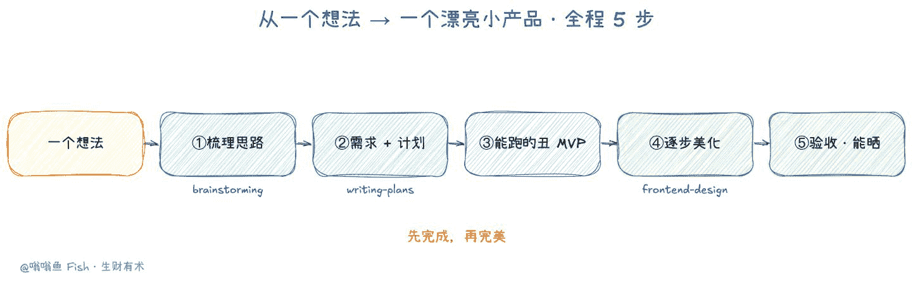
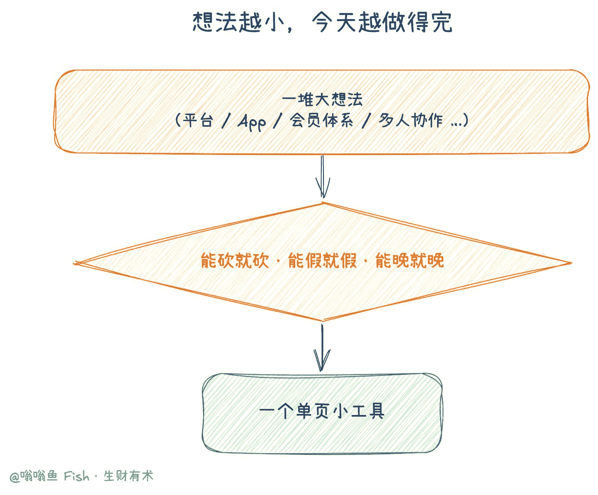
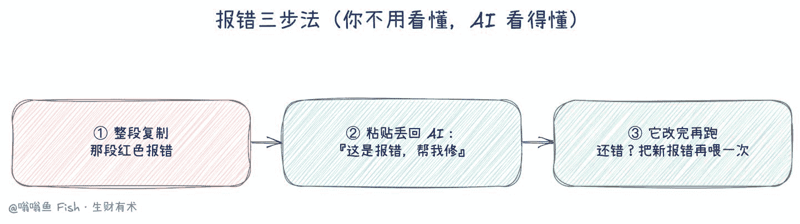
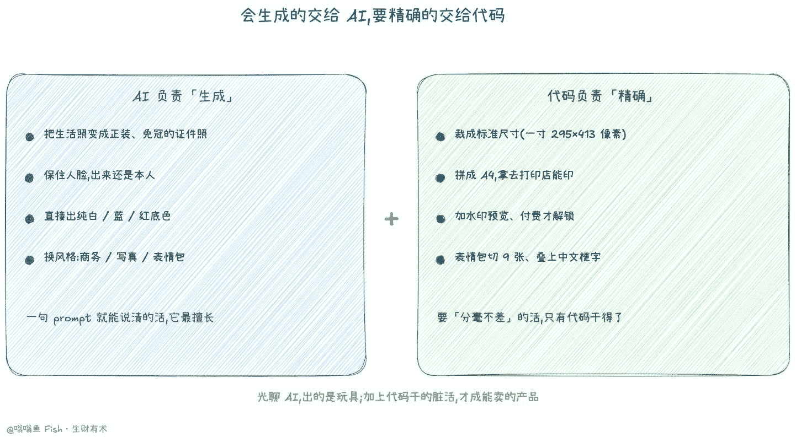
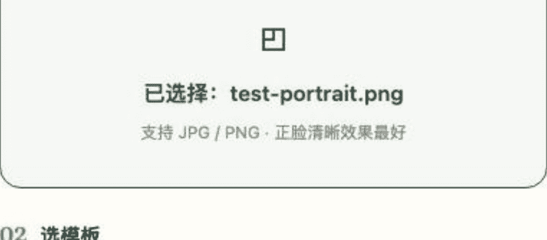
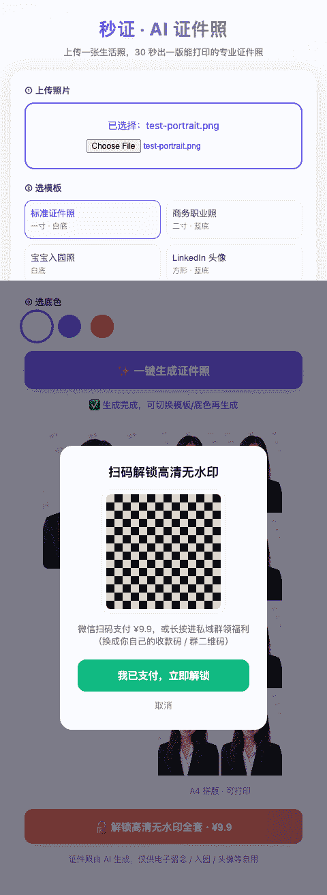
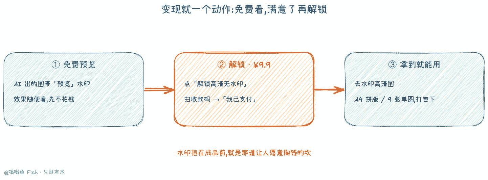
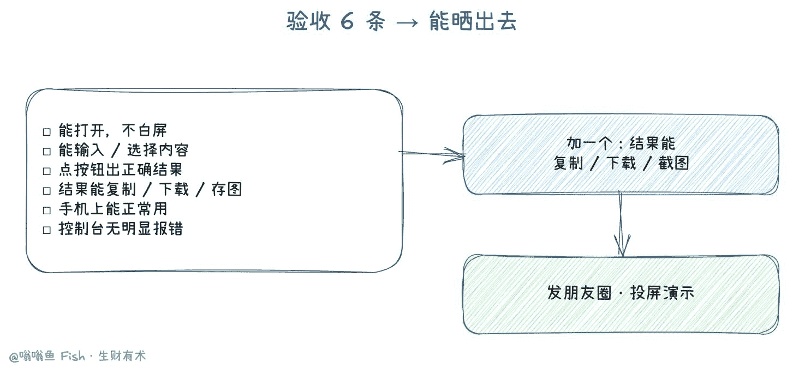
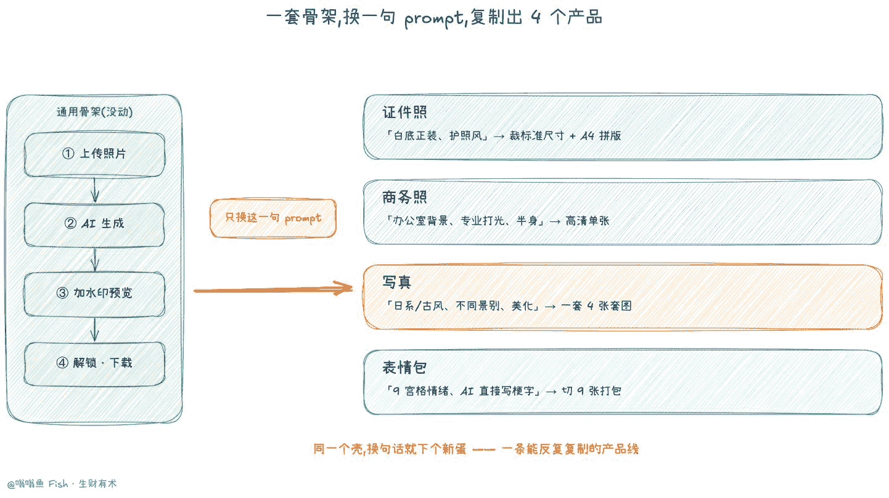

# 【实战复盘】3 小时、零手写代码，做出一个已在收款的产品：全流程喂饭级拆解
作者：龙哥

260721 副业SC 精华

我是嗡嗡鱼 Fish。

先说背景：我写代码超过十年，操盘过数十个出海站，在赚钱做过多期 AI 编程航海。按常理这该不算稀奇，但这次正好相反 —— 这次成果我一字未敲。因为用 AI 上瘾后，手动写代码的欲望几乎为零，老派的纯手工开发已经明显落后于 AI 协作开发。像 Claude Code 这种产品里，大部分逻辑都是 AI 自行撰写、自测、迭代。于是“不写代码，只做指令，照样做出产品”的路径，被验证是可以平移给非技术人用的，这也是我想重点分享的。

赚钱 6-7 月 AI 实战月期间，我先做了 90 分钟的线下分享，随后带 11 位伙伴现场 3 小时闭环。每个人在当天都跑出了可用的 AI 小产品。

6.28 当天，12 人围坐，主题是 Codex 做产品的思路与打法。我演示的案例，3 小时搭建、已上线、第二天即产生收入 —— 拾光肖像馆。用户上传生活照，系统输出证件照 / 商务形象照 / 写真组图 / 表情包等多种成品。

地址 shiguangzhao.com，手机直开即可免费试用。

传一张自拍，会得到四类结果：证件照、商务照、写真、表情包，均来自线上正式功能。现场我抛出问题：“你觉得这玩意儿写了多少行？花了多久？” 大家可以不用猜。

答案是：手写代码为零。AI 生成了七百多行，我只负责下指令、复核、让它自测自修。若剔除 UI 打磨，核心路径约一个半小时即可通。

但整体感受并非 AI 多快，而是“做什么、怎么做”的判断无法外包，必须由人把关。

多数人卡住，表面是想得大，根因是需求说不清。描述越模糊，AI 越容易迷路。后面会展开。

因此这篇复盘不做流水账。我把线下验证的方法，及从一个模糊点子到可售卖小产品的完整闭环，拆给你。看完就能开工。

## 本篇适合谁，如何阅读

适合这些情况：有想法落不了地、用过 Codex/Claude Code 却没产出完整项目、想做能变现的 AI 小工具又担心技术门槛的人。完全无需编程能力，我现场带的 11 人里多数没碰过 Codex。

全文共十章，可按需跳读：

- 一、先看成品长相
- 二、心法：先完成再迭代
- 三、没灵感时怎么办
- 四、保姆级 SOP，可直接抄 prompt
- 五、技能清单
- 六、Codex 专注篇
- 七、Demo 到上线
- 八、变现实测
- 九、线下回顾
- 十、行动清单与排期

想直接抄作业，请跳第四章。

### 一、先看结果：3 小时、零手写、可收款

先放成果。

拾光肖像馆 shiguangzhao.com：上传生活照，保留人脸特征，生成四类成品：

| 场景 | 处理方式 | 市场对标 |
| --- | --- | --- |
| 证件照 | 生活照 → 正装免冠、纯白/蓝/红底、A4 拼版可打印 | 线下照相馆 30 元起 |
| 商务形象照 | 生活照 → 精致正装、办公背景、杂志级光影 | 求职/LinkedIn刚需 |
| 写真套图 | 一次出四张、同风格异姿、精修 | 📕 9.9 元/张常见 |
| 表情包 | 自拍 → 9 宫格 9 情绪 + 中文梗 | 社交刚需 |

底层一套代码，增加风格只需新增生图 prompt，当前已扩到 8 种。

- 用时：3 小时
- 手写行数：0，全部由 AI 生成并迭代
- 是否收款：已上线，9.9 元解锁高清，第二天即有订单，凭证见文后
- 是否可复刻：可。11 位非码友当天 3 小时均自制 AI 产品

朋友圈发一下功能，第二天进 4 单。金额不大，几杯奶茶钱。发前我也忐忑，看到真实到账才安心。

收款账本实拍：晒后订单自动进来。想说明的是：从想法到可打开、可使用、可收款，3 小时可走完，且无需手写代码。

### 二、一句话心法：先交付再打磨

整场分享我反复强调的一句：

完成比完美重要，慢进比原地纠结更可贵。普通人做产品最大的障碍有三：想得过大、怕不完美、不知道如何启程。对症三招：

- 先跑通，再美化。先让“上传→点一下→出结果”通顺，哪怕用假数据、界面简陋，再谈优化。别一开始卡在配色、支付、商业模型。
- 能砍就砍、能假就假、能晚就晚。现场手册的口诀。今天目标只做可演示的最小版。登录、支付、后端、数据库、账号全部砍掉。想法再大，今天只做最小切片。
- 不知下手？先动。不会就问 AI，当队友用。报错别怕，整段丢回给 AI 修并解释。沟通多了就有驾驭感。动起来永远比犹豫好。

做得快的，往往是舍得砍、敢先试的人，技术好坏其次。

从概念到成品的路线图

### 三、没思路怎么办：先把想法聊清楚

现场有人工具齐全却卡在第一步：不知道做什么。给这群人。

- 最省事的做法，把下面开场白整段丢给 AI，填入你的模糊想法：

你是一名资深产品经理 + 全栈工程师,擅长把模糊想法变成"今天就能做出来的小工具"。我想做一个小产品,主要靠你帮我写代码。我现在的想法(哪怕很模糊都行):\_\_\_\_\_\_\_\_\_\_\_\_\_\_\_\_\_\_\_\_\_\_\_\_\_\_先别写任何代码,按下面来:1. 如果我的想法有不清楚的地方,先【一次性】问我 3-5 个最关键的问题, 等我回答后再继续,不要自己瞎猜。2. 帮我把想法收敛成一个"输入 → 处理 → 输出"的单页小工具; 如果想法太大,帮我砍到里面最小的那一个工具。3. 然后输出一份大白话的需求文档(PRD), 并给一份验收标准(最多 5 条,让我能自己检查做没做对)。

它会先反问 3-5 个关键问题，你老实答，想法就逐渐清晰，比空想快。

- 再省力点，装 superpowers 包里的 brainstorming skill。装上后它不会直接写代码，而是访谈你：为谁用？解决什么？最小做到什么程度？聊天中思路自然出来。装法见第五章。
- 最好的点子往往来自自身痛点。你最清楚自己想解决什么。从工作中重复、低技术含量但耗时的工作入手最顺。
- 实在想不出来，直接挑表里一个：

| 题材 | 输入 → 输出 |
| --- | --- |
| 文案改写器 | 一段文字 → 多个吸睛版本 |
| 起名器 | 姓氏/喜好 → 名字清单+寓意 |
| 运势 H5 | 一键 → 翻牌解读 |
| 简历润色 | 粘贴简历 → 优化版 |
| 卡片生成 | 词表 → 可打印卡片 |
| 报价单生成 | 填数字 → 整齐清单 |

想法太大就层层拆小，拆到一句话能说清。

### 四、保姆级 SOP：从点子到可售产品

下面是我做拾光肖像馆时对 AI 说的核心指令。换产品只需把“证件照”换成你的关键词。每步踩坑也一并写清。

没装工具先花五分钟：Codex 到官网下载，用 ChatGPT 账号登录；Claude Code 在终端执行 `npm install -g @anthropic-ai/claude-code`。

装好后新建空文件夹启动，所有文件集中管理。之后你只需三件事：说清需求、挑毛病、把报错丢回。

#### 第 0 步 · 选品：先验证是否有人付钱，再问能否做

很多人先问 AI 能否实现，顺序反了。先问：是否有人正在为此付费？有人在卖且有成交，需求已被市场验证。

证件照、AI 写真、宝宝入园照、求职照，这类线下一次一两百起，📕 9.9 的 AI 写真热销，刚需明确。我做的就是用一套生图能力打包这些需求。

需求一直存在，变的是门槛。去年零基础碰到报错就停；到 Codex/Claude Code 时代，“人话输入、AI 干活”才真正落地。门槛消失，大多数人还没动手，现在入场正好。

提醒：想法过大如“做个📕平台”，就只做平台里最小的一个小工具。若一句话说不清需求，继续砍。

#### 第 1 步 · 需求澄清：先对齐，别急着写码

> 我要做一个能在📕上卖的「AI 证件照生成器」网页工具,目标用户是求职者和宝宝家长。先别写任何代码,先帮我把需求理清楚:1. 核心功能有哪些?2. 用户从打开到拿到证件照,操作流程怎样?3. 哪些是今天 3 小时能做完、能现场演示的最小版本(MVP)?哪些先砍掉?4. 靠什么卖钱?用一份大白话的需求文档(PRD)回答我。

先让它出文档并提问，确认后再继续。

常见跑偏与纠偏话术：

- 它直接写代码：“先别写代码，先按要求出 PRD。”
- PRD 里出现登录/数据库：“今天不做，删掉，只留最小版。”
- MVP 列七八项：“只留 1 个核心，其他标‘后续’。”

#### 第 2 步 · 方案：技术栈自行锁定，别让它乱选

> 基于上面需求,技术栈:纯前端单页 HTML(一个 index.html,内联 CSS 和 JS),不要后端、不要框架、不要构建工具,浏览器双击就能打开。先别写代码,先给我:写技术文档、项目结构。

零基础最怕 AI 自选高级框架，配环境、构建、打包会把人劝退。纯 HTML 双击即开，最小阻力。

技术文档出来后，后续选型不会跑偏。项目结构与分步计划你能看懂：图放哪、结果放哪。分步计划是防 AI 失忆的清单。

#### 第 3 步 · MVP：先让主流程跑起来

> 根据技术文档、项目结构、分步开发计划，开始写第一版 index.html。要求:能上传照片、能选规格(一寸/二寸)和底色、点生成后可以裁成证件照尺寸并拼成 A4 一版多张、预览加水印。这一版先用上传的原图占位(还不接 AI),把整条流程跑通就行,样式朴素没关系。

第一版丑没关系，关键“上传-生成-出结果”通了。这步只求通顺。

#### 第 4 步 · 核心能力：AI 生图 + 代码做裁切

先说前提：需一个图像 AI 接口，如 gpt-image 类，需申请 key，可能付费。可选 apimart.ai 中转、阿里通义万相、火山豆包、即梦。不会申请就把“协助我申请 xxx 平台图像模型 key”丢给 AI。

拿到 key 后接入：

证件照效果：AI 负责生成正装人脸 shiguangzhao.com 线上样张

本环节踩坑最多，总结如下：

- 坑1，生图是抽卡。首版蓝底发灰，脸变了。解法在 prompt 加英文约束：solid pure blue，keep the person clearly recognizable as the same individual。两句可直接抄。不满意再抽，属常态。
- 坑2，原图必须作为输入传给接口，光靠描述无效。各家传参方式不同，让 AI 查文档实现，别自己啃。
- 坑3，出图需 10-50 秒。加轮播等待文案：“AI 正在分析五官、换装、打光、精修”，把等待变期待。

⚠ 报错处理：复制完整报错，回复“这是报错,帮我看看怎么修:<贴报错>”。通常是参数或尺寸问题，一分钟可修。

口诀：复制-丢回-重跑。

另外说实话：好看的图不值 9.9。值钱的是稳定出图、精准裁剪、标准尺寸、免费预览带水印、下载需付费。每一步都是转化钩子。

AI 负责生成，代码负责裁切。

#### 第 5 步 · 美化：指令越具体，改得越准

> 把界面美化成能直接发📕的专业风格:渐变标题、卡片式布局、上传/选模板/选底色分成清晰三步、生成按钮有质感、点下去有"生成中"转圈动画、出结果时淡入揭晓、证件照带相框阴影、手机上也好看。

先跑一版感受，再继续迭代。

挑毛病的原则：

- 模糊：“再好看点”“有点丑” —— AI 不会懂。
- 具体：“标题更小，放大一倍”“主按钮太灰，换暖橙”“卡片太挤，加间距”“手机上按钮溢出”。

三要素：位置、问题、期望效果。

再进一步。上面改完会整齐但仍有 AI 感。想要更高级，我第二轮明确风格：“数字摄影工作室，杂志感，暖纸底 + 墨绿赭金配色 + 衬线大标题，避免蓝紫渐变和系统字体”，再加“现有功能不许丢”。用 frontend-design skill 优化，约 5 分钟。

第一版 最原始

第二版 整齐优化

第三版 数字摄影工作室调性

## Studio Portrait · 2026

# 全拾肖像馆

上传一张随手拍，AI 为你出证件照与商务形象照

- 证件照

- 商务形象照

### 01 上传照片

点击或拖拽

已选择：test-portrait.png

支持 JPG / PNG · 正脸清晰效果更好

### 02 选模板

- 标准证件照  

  一寸 · 白底

- 商务职业照  

  二寸 · 灰底

- 宝宝入园照  

  白底

- LinkedIn 头像  

  方形 · 蓝底

### 03 选底色

AI 直接生成对应底色

✦ 一键生成

你能想象吗？一个完全不懂设计、不会写代码的普通人，靠几段话，在几个小时内做出四款能在线收钱的AI图片工具，还真的被人扫码付款。这不是标题党，而是一套已经被验证过的完整作业路径。

它的核心逻辑并不复杂：一个网页、一次AI生成、一个上传动作、一个预览水印、一个九块九的解锁按钮。上传→处理→加水印→付费下载，这条链路一旦跑通，你完全可以复制到无数个场景里。

### 第一件事：先让页面“能跑”

别一上来就追求复杂架构。从做demo的第一分钟起，守住一个原则——单文件HTML，一次生成。所谓单文件，就是所有代码、样式全部塞进一个网页文件，服务器都不用配，打开就是产品。

这个阶段的美丑根本不重要。先保证页面能打开、能传图、能调AI、能出结果。骨架立住了，再谈修饰。很多人的通病是第一步就想做出80分的成品，结果连20分的原型都憋不出来。快才是王道。

### 第二件事：审美不够，抄作业来凑

当你的页面从“能跑”升级时，会经历一个有意思的进化过程：第一版纯属能用，第二版虽然整齐但一眼就能看出是AI生成的，第三版才终于有了“杂志感”。这不是天赋，是反复迭代磨出来的结果。

如果你实在没有美学细胞，最简单的路子就是——抄。我的收藏夹里常年躺着几个设计参考站，用的时候挑一张看得顺眼的，截图扔给AI，告诉它“照着这个感觉来”，比自己憋半天的形容词高效得多：

- Godly：全球顶级网页设计案例集，先让你明白“高级感”是什么；
- Land-book / SaaS Landing Page：落地页画廊，能按行业筛选，配色偷一张的，排版抄另一张的；
- One Page Love：专门收录单页网站，技术栈天然匹配；
- Mobbin：真实App和网页的界面截图库，手机端设计重点看它；
- Awwwards：设计奖项网站，直接让AI学习获奖作品的元素表达。

配色字体这种事也别自己发明。调色盘用Coolors，按空格键就能随机刷出整套配色，挑中一组，把五个色值直接甩给AI；字体去Google Fonts里选，告诉AI标题用哪个、正文用哪个，单文件HTML一行代码引入，问题就解决了。

组件更不用挨个描述。跟AI说“用Tailwind CDN、Shadcn UI或daisyUI写”，它自然就懂——这些都是AI最熟的组件库，一行引入，出来就是现成的好看模样。

还有个作弊级别的工具：开源项目screenshot-to-code，GitHub上7万多星。把你喜欢的网页截图丢进去，它直接给你还原成完整HTML前端页面。

### 第三件事：把收费设计成“解锁”

有了产品，怎么收钱？答案简单粗暴：免费版出的图全都打上预览水印，下面放一个按钮，写着“解锁高清无水印 ¥9.9”。用户点击后弹出收款弹窗——其实里面就两样东西：一张收款码，一个“我已支付，立即解锁”的按钮。点完水印消失，下载按钮出现。

为什么先这么干？因为接支付接口要申请、要审核，流程太长。这恰恰体现了“能砍就砍”的硬核智慧——连支付系统都能砍。等产品验证出真正的需求，再去接正规支付也不迟。

解锁后给什么，也藏着心思。证件照给单张加A4拼版，直接送打印店就能出片；写真给四张高清单图；表情包切成一格一格的九张图，存进手机就能当🛰️表情发。打包下载这种小事，让AI用JSZip一行代码搞定。

用户拿到手就能直接用，这“最后一米”的交付感，就是人家愿意掏钱的原因。说白了，不付钱就卡你高清无水印图，妥妥的“奸商”逻辑。

### 第四件事：让AI自己验收自己

验收这件事，不需要你亲手操作。把标准告诉AI，让它一条条自查，没过就当场返修，直到全过为止：

1. 页面打开不白屏；
2. 上传和输入交互正常；
3. 点击按钮后结果正确；
4. 结果至少能复制、下载或保存其中一种；
5. 手机浏览器能正常使用；
6. 控制台无明显报错。

六条全过，就能上线。更狠的是，我每完成一步，都会让AI用自己的浏览器去实操测试——打开页面、上传照片、点生成、截图给我看。这个能力来自Codex和Claude Code里的浏览器操作功能，也可以调用第五章里的专项skill实现。

### 第五件事：一句话复制出更多产品

整个框架跑通之后，最爽的阶段来了。一个“上传→AI处理→水印预览→付费解锁→下载”的骨架搭好后，换一句prompt就能再造一个新产品。

以我的亲身体验为例：最初只做证件照，后来顶部加了一个用途切换Tab，变成“证件照 / 商务形象照”。证件照走原流程；商务形象照则是选风格——现代办公室、高级灰、户外——让AI把你一张普通生活照变成精致的半身商务照，再配上“优雅正装、背景虚化、专业打光、人脸不变”这类描述，同样走水印预览和解锁下载的路径。

我就是用同一套代码，分别复制出了证件照、商务照、写真、表情包四个产品。技术上不过是改一段prompt字段的事。

四个产品全是线上版本的真实样张，而且出自同一张自拍照。复制之前有个纪律：先让AI单独实测一张，一分钟就能判断这效果值不值得做，免得白改半小时。

但换prompt有四个坑，提前帮你踩过了：

**坑一：prompt别自己硬写。** 如果你不知道怎么写风格描述，很简单，去网上找一张你想要的成品效果图，比如古风照片，扔给Codex：“帮我反推这张图的生图prompt，我要放到图生图工具里用。”这一句话，就让AI帮你把风格描述全部搞定。

**坑二：保真和美化恰好相反，差别就在一句话。** 证件照要“像本人”，写keep recognizable，轻美化就够。但写真要是写“完全保持不变”，就等于把炸毛、油皮、瑕疵、曝光全部原样传承。正确写法是“保持认得出是本人，但拍到最好看”，再加上磨皮、修发型、提气色。我用一张炸毛油光的自拍实测过，出来的古风写真还是同一个人，但状态直接翻倍。

**坑三：套系图必须拉开景别。** 写真四张不能用一个prompt跑四遍，否则张张雷同。要分别指定：特写拿花贴脸、半身侧身撩发、全身倚靠、大场景远摄。

**坑四：“AI写不了中文字”已经被AI自己推翻。** 表情包没个“笑不活了”“我哭死”这种中文梗字就没灵魂。第一版AI生成的中文确实又丑又错，缺笔画、糊成团。但AI自己解释说：是模型没选对。它推荐了Gemini 3.5 Flash，试下来又快又好，价格还便宜。

### 第六件事：把产品挂到公网上

到这一步，产品还只在你电脑本地。让它能被人用手机打开，有四条路：Cloudflare的Page或Worker；Vercel免费额度；自己的VPS；以及轻量免费的平台——这期推荐Netlify，永久免费的静态托管，零门槛。

只要你注册好Netlify账号，剩下全部交给AI——它会自己操作浏览器完成部署，生成一个公网链接。把链接往群里一发，就能收到朋友们“哇”声一片的反馈。

### 第七件事：给AI装上skills

这可能是让AI产出质变的关键：skill。简单说，它就是别人把一套专业本事（设计、测试、构思方法论）打包好的文件，装进你的AI，它立刻获得这门手艺。安装方式就一句话：把GitHub地址发给它，剩下的它自己会搞定。

这套SOP里真正用过的skill包括：

- web-access（联网调研）：动手做表情包之前，让小助手去📕扒了一圈真实玩法和定价，直接改变了产品的定位；
- frontend-design：第5步美化的主力，去掉AI味的重构十分钟完成；
- browse（无头浏览器）：验收环节靠它，每做完一步就让AI自己打开页面、点一遍、截图，全程开发截图都是它干的（用的是gstack套件）；
- excalidraw手绘图：这篇文章里所有手绘概念图都出自它，一句“画成手绘风流程图”直接出图；
- humanizer-zh（去AI味）：页面文案、引流笔记、👸号、📕，一股机器味的时候丢给它过一遍，瞬间像人话。

还有一些这次没用但值得收藏的：

- find-skills：专门帮你找skill的skill；
- superpowers：写实施计划、头脑风暴的开挂技能包；
- ui-ux-pro-max：内置50+风格、161套配色、57组字体，没灵感时直接让它给你整套设计系统；
- 📕图文卡片：一句话生成📕风格图文卡片和封面组图，引流配图轻松搞定；
- baoyu-skills：内容创作的“全家桶”，📕图、👸号封面、配图、图表、压图全都有；
- 花叔skill集合：21个实战验证的中文内容创作技能，覆盖选题到发布的全流程；
- 归藏自媒体封面Skill：专攻📕和👸号封面；
- 归藏PPT Skill：一句话生成网页PPT；
- 卡兹克写作Skill：这个人写👸号的整套方法论，口吻、节奏、禁忌词全打包。

其中特别推荐gstack套件里的design-shotgun：让AI一次性出多版不同风格的页面，并排展示给你挑，选中哪张就让AI顺着继续开发。想逛更多，上lobehub.com/zh/skills按分类找，GitHub还有awesome-claude-code清单，5万多星，更新勤快。

记住两条原则：用到哪个装哪个，skill不是越多越好。装多了会占对话上下文、浪费token。只用第四章的prompt模板，照样能把产品做出来。

### 第八件事：Codex玩家专属技巧

如果你是Codex用户（活动现场一半人用它），这几条值得记住：

1. 项目没想清楚？先开计划模式。它会带你一步步把方案定下来再执行。中途想插话就点“引导”，不打断当前工作；有不确定的想法，用fork分叉个副本去试，主线不乱。

2. 给AI建立规则记忆：项目根目录建一个AGENTS.md（必须大写），用大白话写下你的要求——“别用框架”“界面走简洁风”，它每次都会遵守。也可以在做完某件事后补一句：“把这条加到项目的AGENTS.md。”全局偏好则写在设置→个性化→自定义指令里。Claude Code的对应文件叫CLAUDE.md。

3. 聊太久感觉它变笨了，用“/”压缩上下文。Codex里对应操作不复杂，Claude Code则用/compact，聊久了准用得上。

4. 嫌它动手前总要请示？权限改成“自动审查”——让它自己判断风险，没风险直接执行。有把握的直接开“完全访问”，不然装个依赖都要按十次确认，能烦死你。

5. 流程跑顺了，就把自己的操作方式固化成一个skill。比如你每周用同一套步骤出内容、出日报，跟它说：“把以上步骤和标准整合成一个skill。”之后一个斜杠命令就能复用整个流程。

### 第九件事：从demo升级成真正的产品

Netlify上的免费链接，足够拿去朋友面前“炫耀”了。但如果你的AI工具要绑定域名、正经收钱，就还得再迈一步。

为什么要做生产版本？因为demo是在我自己电脑上跑起来的，它依赖本机的脚本和密钥，别人拿到链接也用不了。真正上线卖钱，必须有“交给陌生人也能用”的交付版本。很多人做了半天却收不到钱，问题大多出在只走完了前半段。

生产版里，我还给产品加了一整层商业落地页文案：样张墙、价格、FAQ、隐私说明，全都是新增的。单独的AI工具看起来像玩具，用户不可能信任；必须让人先看到效果，再加上引导语，一步一步建立信任，他们才肯扫码掏钱。

具体走三步：

1. 买域名。shiguangzhao.com（拾光照）就是我的例子，几十块一年，腾讯云、阿里云、Cloudflare都能买。
2. 域名挂在Cloudflare做解析。
3. 租一台小服务器（VPS）。我用的是Hostinger最低配，一个月几十块；阿里云、腾讯云常年有99元一年的VPS。装个免费宝塔面板，点点鼠标就能完成部署。

上线后还有两个实用细节：

一是图片压缩——首页六张样张全是AI生成的PNG原图，加起来7.7MB，首屏慢到不行。让AI把图压一压，它自己转成WebP并缩尺寸，7.7MB变100KB，首屏瞬间提速。转什么格式、怎么批量改、引用怎么更新，它全知道。

二是让AI扮成5位不同领域的专家，把整个落地页从头到脚挑一遍刺——文案、转化、视觉、技术、法务，逐项审过再改。

一套代码，一句prompt，一整套可复制的赚钱玩法。AI时代最值钱的技能，从来不是你会什么，而是你能不能把自己想做的事，变成一句指令，让AI替你完成。动手吧。

我把一套“多评委质检”流程跑通了，效果挺直接。

做法是让 AI 拆成 5 个职能不同的审查角色，对着同一个产品页面开小会：一位盯销售力度，一位管文案调性，一位看图片能不能打动用户下单，一位专门找合规和隐患，一位负责查证信息是否经得起推敲。最后全部意见再汇总到“CPO”这一角色手里做终审。它只给了 3 分，满分 10 分，确实有点丢脸，但被点出来的问题条条扎心，也条条值钱：

之前 AI 自己顺手编的漂亮话，比如“累计交付超 12000 件”“用户满意度 4.9 星”，统统被挖出来清掉，换成了有据可查的实打实信息；评价文案也调成了人话版本，还特意留了一条四星、带点小毛病的评价——全是五星反而显得刻意；“看后即焚”这种签不了保证书的说法，改成了我们真能兑现的描述。老老实实按着这份整改清单过完一遍，才敢提交。

这套审查机制本身也是 AI 按分工生成的：先把它拆成 5 个互不相干的审核单元，让它们各自给结论、彼此交换看法，最后再根据产品推广上的短板统一修订。

到了真靠它收钱那一步，还有一环很多人会忽略：支付必须接通官方校验；收款码、客服号、注册主体，每一项都不能是空壳。验证期能省则省，可一旦要转正式运营，这几关躲不掉。

### 没营业执照的个人怎么接支付？

这个问题我得单独拎出来写，因为线下就有圈友当面问我：东西做好了，没有公司主体，支付渠道到底从哪入手？估计这也是不少人的死结。我把两道最快能跑通的个人通道先摆出来——费率政策变动大，签约前记得再去官网确认一遍——XorPay、虎皮椒，个人注册就行。

其他可选的路也一起列出来了：

| 去向 | 代表 | 费率 | 一句话点评 |
|---|---|---|---|
| 个人聚合通道（免执照） | XorPay | 🛰️ 0.5%、支付宝 0.38% | 走官方服务商链路，资金不过平台手，直接结到你卡上，独立开发圈评价最高 |
| 个人聚合通道（免执照） | 虎皮椒 | 1–2% 区间 | 官方服务商链路 |
| 个人聚合通道（免执照） | 蓝兔支付 | 1–2% 区间 | 当下只支持个人注册 |
| 个人聚合通道（免执照） | 易收米 | 1–2% 区间 | 官方服务商链路 |
| 跨境收单（免执照） | Creem、Lemon Squeezy | 4–5% | 代收全球货款，税也帮你处理；卖激活码可以直接上架自动交付 |
| 正式商户号 | 🛰️支付/支付宝商户 | 0.6% | 资费稳、通道硬，但要有执照，属于最终归宿 |

判断标准只看一条：资金必须由🛰️/支付宝官方直接清算到你名下卡里（即直清、不碰资金）。凡是先进别的平台户头再转手给你的，跑路风险高，别碰。

拿到收款权限后，让 AI 照支付服务商给的开发文档，直接帮你把链路接上。

再给一条加餐路径：这套页面代码能顺手改成🛰️小程序。优点有两个：一是能开通🛰️流量广告位，多一份被动进账；二是用户在小程序里能直接唤起🛰️支付，扫码都省了，成交链路更顺。注意，小程序收款要求商户资质，个人主体不行，得个体户或公司。

## 八、这类产品怎么定价、怎么卖？我实地测过

做表情包生意前，我先让 AI 挂登录态去📕翻了一圈二手真实情报：谁在卖、开价多少、留言区都问些什么。几条有分量的结论直接摊开讲。

### 价格锚点：📕高赞帖的行情

| 产品 | 实测价 |
|---|---|
| AI 写真电子版 | 9.9 一张 |
| 6寸带框写真 | 29.9 |
| A4 带框写真 | 49.9 |
| 证件照（对标线下门店） | 线下 100–700 |
| 宠物拟人定制 | 100 起步/张（靠同一套代码就能扩） |
| 表情包 | 🛰️表情商城基本没收益，有从业者三套作品合计才收约 700 块，一半还是熟人捧场；但适合当拉新诱饵 |

参考这个锚点，我给拾光肖像馆的定价就压在 9.9。

### 留言区等于需求清单

爆款帖的留言区，反复被顶起来的问题就是“怎么打印”“能不能做大人款”“水印怎么去”“哪个软件做的”。博主多数只给提示词，至于裁尺寸、除水印、拼版印刷，全留给用户自生自灭。这正是我们的 AI 工具能弯道超车的地方。

比如那条 2000+ 赞的《0 元入园照》，168 条留言里高频词就是“水印怎么去”“怎么打印”。这些没人接住的需求，恰好就是工具的发力点。

销售路径上，国内验证过能跑的：免费内容当鱼饵，留言区一堆人喊“求资源”，统一回一句“进群领”，把流量收进自己的池子再慢慢转化；轻产品也有人直接在留言区挂链接“9.9 解锁”。我的那几单还是朋友圈随手晒出来的，连帖子都没发，有更多数据了再来同步。

合规这里强调一句：平台正在严打纯 AI 批量笔记和无证卖虚拟资料。对外话术写“自用、电子留念、入园、头像”没事，但别夸口“官方认可的标准证件照”；引流内容要留点真人气，别整成生硬广告。

## 九、这场线下活动，我亲眼确认了几件事

前面是完整方法论。回到活动本身，不吹“圆满成功”，只说亲眼见到的。

### 1\. 11 个人都在 3 小时内交付了自己的作品

3 个小时，11 位圈友各自上手 Codex，全部做出了能跑的产品。这是最实在的信号：这套玩法在我身上成立，在普通人手里同样成立，当天下午就能出成果。

我也观察到一条规律：开干前就想清楚“这工具帮谁、打什么痛点”的人走得更顺。动手前花五分钟想明白“你究竟要替谁解决什么事”，比急着写第一句 prompt 重要得多。是否是普遍规律我不敢下定论，现场看就是如此。

大家的具体项目各不相同：有人做 TikTok 脚本工具，有人做英语发音评分器，有人做📕热点挖掘机，都是从自己手头真实需求长出来的。有人会前已开发到一半，现场接着完善。行动力最强的一位，我台上还没讲完，他已经照着思路开写了，等我下台，他的小工具跑通了。

一个小遗憾：当天忙着逐桌答疑，没来得及统一收齐成果截图。这块我确实没做好，下一场一定把大家的产出都沉淀下来。

### 2\. 全场最惊艳的一幕：把圈友照片现场丢进去出图（已获授权）

成片出来的瞬间，一桌人全喊“哇”。之前大家心里还在打鼓“AI 到底行不行”，眼见着熟人的自拍被炼成专业成片，对 AI 产品的信心一下就立住了。

当时就是拿一位圈友授权的照片现场演示，同一张自拍一次生成四张。

### 3\. 3 小时零代码，完成度比大多数人想象得高

能出多种风格图、能收钱，这种完整度超出大家对“零基础、3 小时”的认知。但它真不靠天赋，就是照前面“先跑通、再打磨”的流程一步步走。

 

### 4\. 现场被翻牌最多的难题，和我当时的解法

先说反直觉的：3 小时里，几乎没人被工具卡住，卡人的全部是“怎么向 AI 提问”。而这恰恰是我最想传递的能力：工具到了下一个版本，按钮位置就换，追着按钮学，永远追不完；学会提问，才是稳赚不赔的本事。那场分享我只教道，不教术，授人以鱼不如授人以渔。

最典型的一问来自一位圈友：“怎么让 AI 帮我在📕抓赚钱热点？”我反问他：通下水道算不算赚钱热点？除蟑螂呢？保姆护工呢？都算，可跟你有什么关系？你这问题宽得像海，AI 只能回你一层表面滤镜。嫌 AI 答得浅，有没有一种可能，是问题本身太模糊？想拿到好答案，先学着把问题收紧。

没有人比你更清楚自己的业务，你描述不出细节，AI 更不可能凭空补全。

好比老板说“给我做个高大上的页面”，一百个人眼里有一百种“高大上”，员工听到只想翻白眼。AI 虽然不会暗自骂你，但模糊的需求只会换来不靠谱的产出。

现场教的路径很短：把问题说细、把目标说清、把背景素材备足、别把 AI 捆得太死。说到底就是练“会提需求”，即 AI 的 harness engineering——缰绳交到你手里，你得学会驾驭。

其他被反复追问的技术问题，连同我的回答一并放在这：

- Codex 装不上？Mac 上基本一路顺畅，Windows 会有各种随机毛病。有条件直接换 Mac，省下大量折腾时间。
- Codex 订阅去哪买？ChatGPT 订阅有三条路径：一是美区 Apple ID 进 App Store，用礼品卡；二是 Google Play 绑国内 Visa 直接订；三是虚拟卡充值。全不行还有第四条：找靠谱代充，省钱省事，就是要每月来一次。
- Claude Code 怎么防封号？别贪便宜走灰色渠道，出事的大多是共享号、低价号。老老实实订正规号，思路和 ChatGPT 一样。
- 做好的工具怎么收钱？第七章一整章都在讲这个，个人没执照也有的解。
- 有 AI 是不是就能躺平？想多了，方向、验收、拍板都得你来，人才是握着方向盘的那位。
- 魔法问题，私聊。

订阅这环节再展开一点，礼品卡、虚拟卡的坑我都趟过，身边人也在用这些：

- 美区 Apple ID+礼品卡，最让我放心：注册美区 ID，买礼品卡充余额，再到 App Store 直接订阅，走苹果官方计费，信用卡风控基本碰不到。买卡认准正规渠道：
  - Pockyt Shop 有美区 Apple Store、Google Play 礼品卡，支持🛰️/支付宝  
    https://shop.pockyt.io/pc/home
  - MTCGAME 支持银联买 App Store 卡  
    https://www.mtcgame.com/zh/itunes-gift-cards
  - OYUNFOR 有 App Store、Google Pay 礼品卡  
    https://www.oyunfor.com/#googtrans(tr|zh-CN)
- Google Play 绑国内 Visa，最省事：双币 Visa 卡直接下订，绑上了就是最省心的一条。
- 虚拟卡，折腾一点但胜在稳定：
  - 飞扬卡平台（我在用，最推荐）  
    https://feiyangka.com/
  - Roogoo https://h5.roogoo.store/dashboard
  - Bybit https://www.bybit.com/
- 代充，纯懒人模式：前几种搞不定就交给靠得住的代充，每月手动一次，其余不用想：

  - 出海铺 https://www.chuhaipu.com/
  - 书虫 https://www.gpt001.com/

## 十、给想动手的人：行动清单 + 时间表

先算一笔启动账：AI 编程工具的入门订阅大约每月百元出头（两家都以官网现价为准）；做生图的话再加图像 API 费用，按量计费，验证阶段花不了几个钱；域名每年几十块，服务器年付 99 封顶。

凑起来两三百就能开干，比报任何课都便宜。

但拦下许多人的恰恰是这些零头：20 美金的订阅费嫌贵，100 块的收款认证犹豫，几十块的域名还要想两天。真想干成一件事，别在入场费上跟自己讨价还价。

钱聊完，上干活清单，六步：

1. 选题：先问“有人愿意在上面花钱吗”，再问“AI 能不能做出来”。
2. 对 AI 开口：别上来就说“帮我把产品做厉害”。换成“我要服务哪类人、他们是什么场景的什么痛点、先给一个最小方案解决这一步，请拆解开发步骤”。
3. 先跑通最小闭环：用假数据把输入到输出的链路走一遍，先能用，再论多好。
4. 分工：生图交给 API 调度，需要精算的（尺寸、排版、计数、收款）让 AI 落代码。
5. 卡壳三步法：把报错全文复制给 AI，再跑一次；同一错误卡两次就换策略，别较劲；对话太长会让 AI 变笨，用 Codex 的 `/compact`。
6. 砍需求：账号登录、支付后端、用户体系，验证期全砍。先交付一个能现场演示的丑陋版本。纯代码完成后，让 AI 帮你挂免费托管，依旧是“先完成后完美”。

### 给你的节奏参考

| 阶段 | 时长 | 这个阶段产出什么 |
|---|---|---|
| 0 选题 | 约1小时 | 一句话讲清“我在做的小工具” |
| 1 需求（出 PRD） | 按需 | 一份对齐过的需求说明 |
| 2 技术方案 + 计划 | 按需 | 技术选型和分步计划（还不写码） |
| 3 MVP | 半天 | 能跑“输入→按钮→输出”的粗糙版 |
| 4 核心功能 | 按需 | 把假数据换成真功能 |
| 5 美化 | 按需 | 有成品相，手机上也顺眼 |
| 6 验收 + 可传播 | 按需 | 验收清单过一遍，能复制/下载/分享 |

选题没把握就回第三章再挑一个。需要出图的记得先备好生图平台的 API key。要登录、建数据、做 App 的功能嫌重就先全部跳过。别在开局就给自己叠难度。

## 最后

11 个人的作品或许还不够亮眼，但每个人都从零走到一个能打开、能运行的最小成品。这套方法能不能复制给普通人，是我操办这场活动最想验证的事——结果已经写在脸上：成立。

对刚起步的人来说，先扎进一个真实的小问题，交付那个“粗糙但能跑、丑但管用”的初版，已经是给未来铺路。能做成一件事，它的意义就够大了。

如果你也动心了，别等“学完”再动手。72 小时内先做出一个最小版本。那股子热乎劲一旦泄掉，你再也不会打开它。无论做得多丑，直接丢来这篇帖子的留言区，每条我都会看，尽量一条条回你，看看卡在哪。

写代码还行，轮到写长文就绞尽脑汁。这篇稿子碍事地写了一两周，越拖越长，想交代的都交代了，但难免有遗漏。这场局能落地，要谢谢组局官花生结果：找场地、拉人、前后张罗都靠他；也谢过赚钱，谢过每一位到场干到最后一步的圈友。

- 福利1：我把“从一个想法到一个小产品”的做法，整理成 PDF《从一个想法做出漂亮小产品》，离线收藏或转赠都方便，帖子附件和评论区都能下载，自取。
- 福利2：这套项目的完整源码我也打包了，当作看完本文的收尾礼物。你可以拿去做参考，代码全出自 AI 之手，写得不好请骂它，哈哈。同样在附件和评论区，自取。

我的赚钱主页：[嗡嗡鱼 Fish 的主页](https://scys.com/personal/3765450?number=176681)，欢迎来串门，一起把手上的想法做成真东西。

## 帖子福利下载

- 福利1 · PDF：《从一个想法做出漂亮小产品》
- 福利2 · 源码包：拾光肖像馆-源码分享版.zip（配好 apimart key 即可运行，含说明）

————分割线————

看到这，你可能觉得自己已经会了。但九成的人一旦真上手，还是会停在第一格。

工具和教材从来不是真正的护城河，护城河是“马上就做”和“圈层情报差”。

这里不吹水，只拆落地闭环、压榨 AI 的生产率。库里已经沉淀上千个跑通的路子。

⚠ 查圈子完整资产与进门条件：

https://lazyso.com/insider/

注明：【实操上车】，不闲聊。

