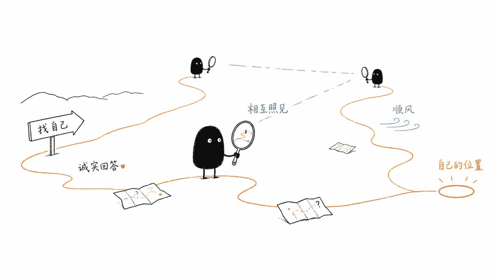

# 4000 万营收后我辞职了，用五条死路才摸到自己的节奏
作者：龙哥

各位好，我是龙哥。在教育赛道做增长，入行两年把公司从零拉到4000 万年营收。离职后转做AI企业服务，带着两只鹿一路旅居，现在落脚无锡。

ENTJ、巨蟹、乙木日主，这些标签只是帮你更快get我的底层特质，也方便进入后面的故事。

先说个扎心的判断：离开组织前，我以为自己足够硬核。成绩摆在那，方法论也全在我脑子里，换个擂台重新打一遍应该问题不大。

事实给我上了一课。

去年3月底，我结束了奋斗五年的职场生涯，带着不回头的心态开启探索。一年下来最大的体感是：赚钱里能看到的99.9%是成功案例，而成功之前的挣扎期、失败的沉默期，才是大多数人真正走的路，也是最终能成的关键。

所以我把这一年的翻车记录摊开。给刚进场的人一个现实预期，也给那些还没到自己心里预期的人一点共鸣——看到别人也摔过，你是不是会松一口气？

## 对自由的想当然，全碎了

我以为裸辞后会发生：

- 收入立刻翻几倍；
- 项目一挑一个准，天花板高又合拍；
- 时间精力完全自主，想做就能出结果。

实际上遭遇的是：

- 反馈缺位带来的自我怀疑与迷茫；
- 精神松绑后的注意力涣散与浅尝辄止；
- 账上没稳定现金流带来的匮乏感；
- 把组织赋能当成个人能力，边界彻底混淆；
- 反复0到1消耗耐心与自信。

一条就够让脱离系统的前职场人内耗数月，我全中了。

但我不想讲避坑指南，我想讲把这些坑当成自知的地图，才是真正的破局口。

这一年最困扰我的问题是：能力、经验、想赚钱的劲儿都有，为啥赚不到大钱？

最近转向AI企业服务后，我慢慢有了答案：

创业本质上是找自己。在实战里看见ego、觉察模式、在转向里补全自己，你才会有那种被命运推一把的感觉。认清自己后，钱会自然跟上。

## 这一年失败拼出的一张自画像

下面这些事，表面是做过、停过、废掉的尝试，回头看更像一张找自我的路线图。每一次都在照出一面：有的看清能力，有的剥离执念，有的拆掉平台幻觉，有的找到真能量。

### 1. 海外AI网页：看清了反馈耐受度

源起于离职前报的一期Web航海，差点因搬家放弃，是那期志愿者Penny的一句鼓励让我坚持打卡并上线两套站，第二个站上线当天就有自然流量。

“速成AI+把脑洞变现品+即时正反馈”的叠加，直接把我拉进坑。

这一块我前后上线15个可用产品，另有3个夭折。从凭兴趣反复打磨、上线没动静，到学会找需求、快验证MVP、拿到第一笔美金，花了近半年。

复盘感受：零基础做海外产品很难，会有一段真空期——没信号、没方向、做得越多越不确定。更折磨的是，你会看到别人晒单。那时是鸡血，焦虑时就是刀。

脑洞作品有：T人F人沟通解码器、屎上最强姐妹记账小程、技能五子棋、她们的圆桌跨时空对话、牛马划水日常等，玩性大于商业。

### 2. 📕博主：剥离表达的错觉

朋友做全职自媒体，数据稳定，她总说我很合适。离职初期的表达欲很强，“旅居自由职业”也有话题，我就上了。

结果：持续更新失败、垂直人设失败、内容变现失败。

真正给我带来涨粉和收入的反而是AI产品相关内容，我自己做的IP几乎没起色。

这件事让我明白：表达冲动不等于内容生产力，想说不等于能做持续输出。有些赛道再光鲜，若不符合底层特质，比如我不爱模仿、情绪感知偏弱，就不该硬走。学会放弃和学会选择一样重要。

### 3. 摆摊文创：破除兴趣变现执念

纯兴趣。北京不让摆摊，我觉得能摆等于自由，能卖自制物等于双重自由。

我做了冰箱贴、云南甲马、沉香手串，在大理摆过一次、徐州摆过两次，成本千出头，没回本，后来都送人了。

过程很享受，容易心流。卖不掉会失落，但不伤创作热情。

结论：有些喜欢只适合自我滋养，不必上纲上线成事业。三分钟热度也有三分钟的收获。想上头就赶紧做，不然抓心挠肝。但别再给它挂赚钱KPI，就当体验。

### 4. 投放代运营：剥掉平台光环

老本行，做了五年。大理的朋友邀请，我正缺社交满足感就答应了。

给朋友投放和给公司投放完全不同：责任感更重、新品冷启动更慢、花朋友的钱压力大，首次合伙又没先谈清楚分账……一个月后我主动叫停。

看见了好几层：我擅长投放但不爱它；职场时考虑职业图谱，有选择后它就不是优选；我的投放能力高度依赖预算、品牌背书、团队协同，这些抽走后心理负担大于乐趣；我总高估精力，把进程想得太顺；给别人高预期会压垮自己，给自己高预期会失落焦虑。

核心结论：我需要自己的事，而不是参与别人的事。哪怕后者更稳、更快。

### 5. 📕虚拟货：照见创造者

复盘Web出海后发现，比起海外我更懂国内。📕卖货全链路数据可查，用户反馈即时，意义感更强。

只做了一个多月，却实打实赚钱了。首品上架四天出单，第二品十分钟出单。店铺已关，但搜索占位内容还在持续带来被动收入。

我完整跑通AI从选品到内容运营的全流程，也梳理出一套新品从验证到快出单的方法。

但运营的琐碎让我极度痛苦，和同行聊过，大家都说痛，差别在于忍受阈值。我忍不了。

这像一面镜子：照亮我创造与需求验证的兴奋点，也放大我厌恶重复经营的痛点。我的天赋在0到1的开荒破局，不在1到100的维护经营。

## 用一年的试错画出的创业画像

这些杂事没有白费，拼出了一张清晰的画像：

角色定位：创造者、开荒者、问题定义者，而非长期重复经营者。

需要补位：经营者、执行者、稳推进、重细节的人。

能量来源：0到1创造、解决问题、即时反馈。

能量黑洞：重复动作、漫长等待、意义缺失。

可带走的能力内核：需求洞察、产品化思维、系统搭建。

平台给的假象：大额投放预算、成熟品牌背书、完整团队支持。

决策偏好：兴趣驱动、反模仿、要意义感。

决策陷阱：过度理想化、高估精力、为关系让步。

金钱观：平等开放，金钱是验证反馈的工具，不是抓取目标。

天命方向：用AI+产品化能力，为真实业务解决真实问题，在持续创造中把经验变现。

方向对上了，关系就反过来了，从我推项目变成项目推我。每一次转场都让我更懂自己，也更确信不会再回职场，因为不会无路可走。

## 为何落点在AI企服

这个赛道同时闭环了我的底层需求：

- 职场积累的B端资源利于冷启动，快速拿到案例，消解漫长等待与意义缺失；
- 五年业务理解让我能快读懂新企业新流程，契合问题定义与系统搭建；
- AI实战经验让我能结合企业卡点给出轻量高效方案，满足创造与解决，同时用技术规避重复；
- 它持续产出新问题、新工具、新协作方式，契合兴趣驱动与意义感。

5月29日确定方向，到现在一个半月，已签2个企业单，找到资源合伙人，MVP跑通。之前没体会过的顺风推背感出现了，人和事总在预期前出现。

听起来玄，逻辑很实：在足够了解自己、破除旧执念后，时机与能力对齐了。

## 如果你在找方向，直接抄这3个动作

### 1. 从有用到有感，重建决策罗盘

离职后我开始常用“我喜欢/不喜欢”。职场时更多问有没有用、能不能涨、上司认可。离开后才明白，不喜欢的事消耗的是你，喜欢的事会让你在失败后还想再来。

先别急着问能不能赚大钱，问：

- 做这件事我能量上升还是枯竭？
- 我是被目标推着走还是被好奇牵着？
- 我是在证明还是在成其为我？

行动：记能量日志，每天5分钟。兴奋标记+，想逃标记-，平静可持续的单独记。坚持两周，自知会明显提升。

### 2. 创造先于抓取，让钱成为回声

一年体感：越抓钱钱越远，越专注创造钱反而到。不是不重钱，而是钱是价值的回声。你先创造出被使用、理解、付费的理由，钱才有落点。

行动：做最小交付，3天内做出一个可被反馈的最小版本：一个清晰问题、一个小工具、一篇复盘、一个省时模板、一个给具体对象的方案。发给3个真实用户，问：你看懂解决了什么？在哪用？愿付出什么？

### 3. 方向藏在旧经验的重组里

AI企服不是凭空想的，是旧经验重组的产物。过去5年增长投放的打法、对业务流程的理解、一年AI做产品MVP的积累，加上我确认的偏好：爱创造、爱解题、爱0到1搭东西。

很多人离职想彻底推倒，其实没必要。职场不是白给的，苦、项目、坑、成果都是土壤，只是要拆开重组。

行动：拿张纸写三列：真正做出结果的事；做这些事用到的核心能力；做这些事时的状态。然后拆开重组。

创业这件事，最终项目在选我。每一轮试错都在刮掉平台滤镜，露出原本的自己。当我看见自己，路就亮了。

真正的方向感来自你对自己的持续诚实。

希望你也在弯路里，找到属于你的那条路。

[PRE*]

—— 小鹿 🦌 于无锡

做能力盘点的习惯里，我会额外留一栏做自问：脱离原有载体后，这项技能是否仍能自立成体。大量新赛道开局的逻辑，并非从“我想去哪”出发，而是先盘清“我手里到底有什么”。

### 4 现场碰面：走出自我消耗的办法

这并非单纯的交友建议，而是我过往多次转向的共同线索。

近期的体会尤其清晰：抽空去现场很重要，要跟同行者来到同一空间。宅在房间里反复思索，多数困局其实解不开。思维容易被自己困住，不断质疑自我的价值、判断的准确性，担心别人已在兑现收益，自己却还在原点徘徊。可一旦走出门，与活生生的人对话，听他们怎样拆解案例、如何收拢结果、怎样度过低谷期，会发现现实远比脑内演练复杂。

原来他人也是试探着推进的。原来那些看上去很稳的人，也曾长时间没有回响。原来被我视作独有焦虑的东西，大多数人都走过一遍。线下最大的回馈，不只信息落差，更是状态落差。有人带来底气，有人带来资源，有人打开新视角，甚至有人仅仅安静地坐在对面把你说完，你便忽然抓住下一步的抓手。创业很容易滑向内耗自噬，别独自硬撑。进入有生命力的群体里，目睹他人的韧劲，再与之进行能量互换与碰撞。

**行动建议：**

若尚无着手点，赚钱的龙珠局、航海聚会，或是约一个本地同好喝杯咖啡，都是门槛极低的切入。从参与一场现场聚会，到尝试自己发起局，期间会涌现许多意料之外的果实。先把自我消耗的闭环打破，换一次真实的状态对流。

### 5 捕捉顺向感：当局面开始主动牵引你

转型做AI企业服务后，这种体感最强烈。

以往操盘多个项目，都有很强的推动感。每一天都要逼自己产出内容、布网、外链、经营店铺。如今回看做AI企业服务，第一次出现反向的牵引感：并非我单向用力，而是项目也在带我前行。合适的人会接踵而至，新增的契机自然浮现，客户的痛点会把我推向下一阶段，每一次交付又反过来澄清我需要补强的模块。

当一件事情同时契合过往积累、现有人才、兴趣点、可用资源与市场开口，它就比强行拼凑的方向省力得多。

**行动建议：**

可拿这五条来校准是否顺向：

- 是否调用了真实存量能力，而非空想？
- 投入时是更具兴奋感，还是走向耗竭？
- 面对的是外部真实需求，还是仅自我感动？
- 是否在创造可累积的价值，而非在重复性动作里损耗？
- 是否会自然牵引合适的人脉、资本与机会靠近？

若以上五条有三条以上成立，它多半不是凭空出现的灵感，而是旧有经验自然生长出的新分支。

### 我们的叙事才起步

这一年想说的就这些：

创业并非直线，更不是成败的单一判定，它更像自我探寻的过程。你越清晰地认识自己，越明白边界在哪里，越坦诚面对偏好与恐惧，就越能落在真正适配的位置。而盈利，或许只是抵达彼处后，外部给出的确认。

写下这些，并非因为我已抵达什么终点，而是因为此时正走在一条被自我审视校准过的路上，首次尝到那种被局面推动的贴背感。这条路的起点从不是一个完美蓝本，而是反复对自己诚实的回答。

若你也在迷茫里打转，希望这份寻找自我的坐标能提供一点参照。创业的本质，并不是孤立地找项目，而是在人群中相互照亮，继而各就其位。

有相近经历或不同体悟，欢迎在评论区展开。说不定下一个方向，就在彼此的叙事里发芽。

————分割线————

读完这份SOP，你大概会觉得概念已通。但九成的人一旦落到执行，第一步就卡壳。工具和教程只是基础护城河，真正的分水岭是立刻行动与圈层信息差。

我们不做空谈，只拆商业闭环与AI效率压榨。内部已沉淀1000+跑通的套利实操案例。

🦌 查看圈子完整数字资产与上车门槛：

https://lazyso.com/insider/

备注：【实操上车】，不闲聊

