# 做**B**站好物跑通**0-1**后，从选品**-**制作**-**发布，我把**AI**接入到了每个环节，让所有的数据资产化。

先交代一下背景。我之前做界面设计，现在自己接单，同时在一门和哔哩哔哩好物推荐有关的课程里当第二期成员和义工。赶在618，我把整个项目从零到一跑了出来，但受限于产能，成绩一般，眼下正想方设法提效。

过去一支视频要磨30天，熟练后也要十几天，现在基本一周出一支，每天工作半天左右，后期还能更快。改变来自我把模型接入了制作全流程。

这门生意的本质，说白了就是CPS加内容，用数量换概率。想放大，要么提效，要么把账号矩阵铺开。我观察下来，做得好的同行基本都占其一。这也是我下决心用模型提效的原因。这里特别感谢Lynn、葱哥和书野，我的很多思路都受他们启发。


先说你能拿走什么。一是几个现成的技能包：项目归档、参数采集、筛品规则、素材归类等；二是用资料库调教模型产出内容的思路；三是一个离线可用的PPT批量套版工具，附带PPT图片转HTML技能和PPT制作规范技能；四是用自然语言设计A-Roll画面的思路；五是发布前的物料指令，包括标题、简介、标签。

这篇文章更适合那些还没怎么用过Agent、没在业务里接入模型，也不知道如何自己搭技能的人。我平时主要用Codex，偶尔用CC接国产模型。我的定位是，把模型当成一个项目助理，让它们处理重复劳动，我则把省下来的精力投入决策。

模型目前替我解决三类事：机械重复的操作、把信息整理成可复用资产、把每轮过程沉淀下来用于下次启动。下面以Codex为例，但Prompt换到其他Agent也适用。要注意，这些技能都还只是基础版，需要每个人在真实场景里不断迭代。

这篇文章的脉络是：项目策划助手、项目目录建立、内容抽取与改写、商品规格获取、PPT制作与参数批量替换、资料制作与整理、A-Roll剪辑思路、标题简介标签的生成。

一、项目策划助手

做项目时最难的往往不是具体问题，而是不知道今天该干什么。尤其是刚开始，目标怎么定、SOP怎么拆，都很容易卡住。我是P人，天生不擅长规划，所以做的第一个工具就是策划助手。灵感来自书野教练分享的生产计划。

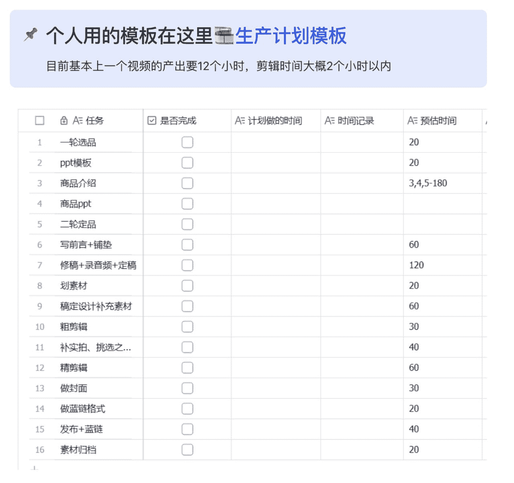

我先把生产计划按自己的项目流拆细，列出从启动到交付需要的全部物料，把动作尽量拆小。这个过程能帮我看清：哪些环节值得提效、哪些环节最耗时、哪些流程需要重新设计。完成迭代后，整体效率提升非常明显。

后来我碰巧用了AI龙哥，最开始只是想聊心态问题，发现它给的建议比市面上很多模型更实在，就开始聊项目。它能指出很多我没留意的细节，还会给出立刻可以执行的行动方案，相当落地。

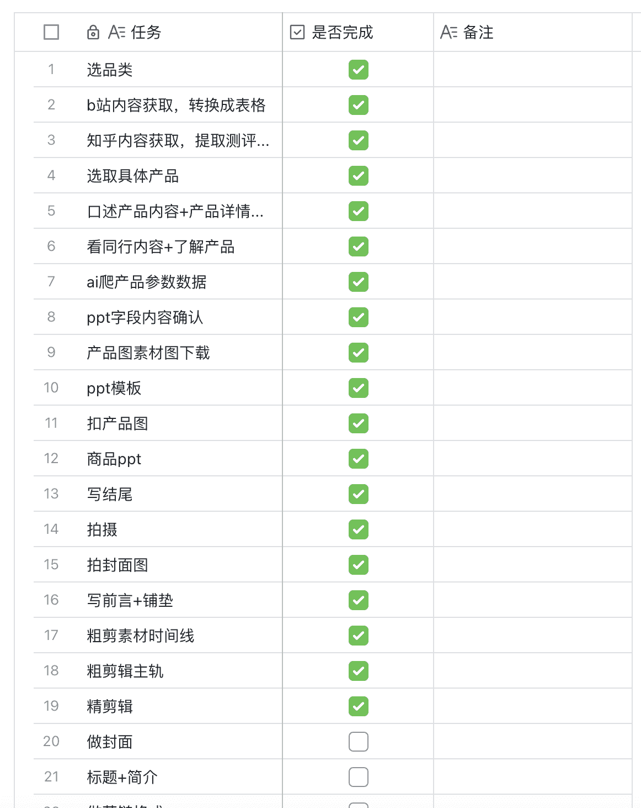

使用经验有三：一是把问题、手头资源、实际条件都尽可能详细地告诉它，信息量越大，回复质量越高；二是聊完一定要把对话完整导出，让模型整理成Markdown文档，再作为后续输入；三是可以搭一个技能，让Codex直接打开网页端的AI龙哥去问项目问题。

我自己不擅长排期，所以会把所有聊天记录交给模型，让它拆解每周和每日任务。这个Agent叫“工作规划秘书Agent”。Mac用户还能让模型自动同步到提醒事项或日历；Windows用户也可以试试常用日程软件，看能不能打通。总之技术细节全交给模型处理。同时我会在本地搭一个Obsidian资料库，把这些内容存起来，具体参考AI大航海手册。

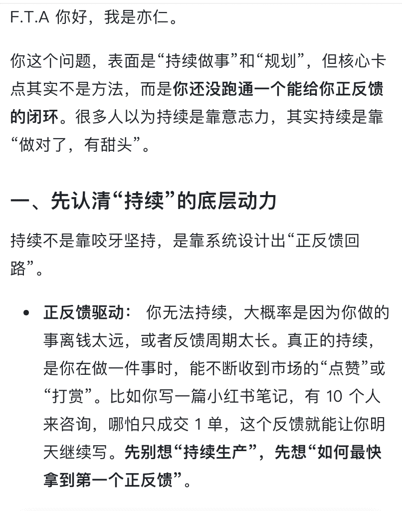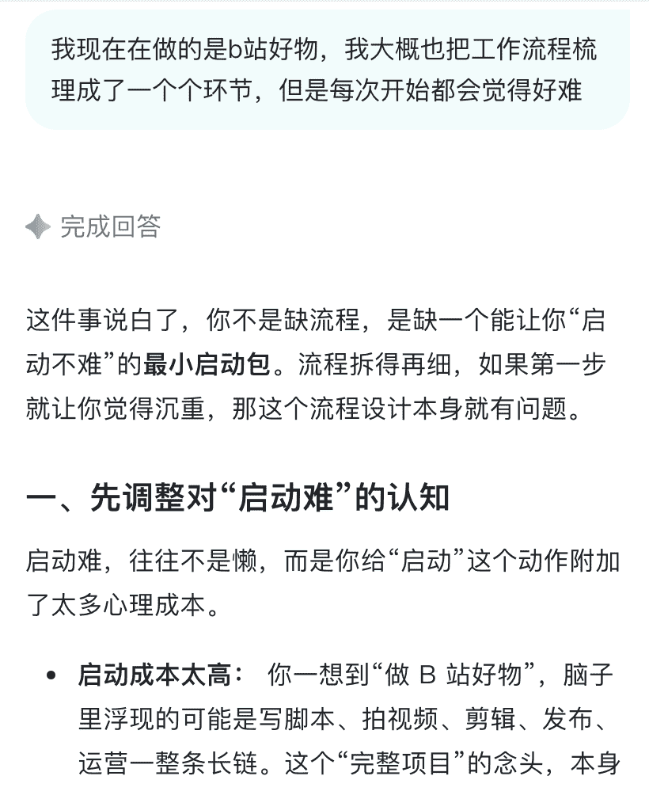

二、项目目录建立

视频项目的资料量很大，压缩包、表格、视频、图片堆在电脑里很容易乱。为了复用，我照着影视飓风的视频项目目录结构搭了自己的体系。方法很直接：把这套目录截图发给模型，让它照着建立并记住。如果你有自定义结构，调整完再丢给它记住即可。之后我只要输入项目名，模型就会自动建好目录。对应Prompt：“素材归档命名Agent”。

三、筛品

在京东联盟筛品，我会先把几十款商品批量放进选品车，再一键导出所有链接信息，得到一张Excel表。

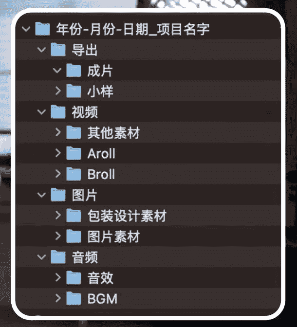

然后我把表丢给模型，配好筛品规则。规则可以围绕佣金、销量、品牌等维度展开，具体筛多少款、优先级如何，都由自己定。筛完之后，让模型梳理整个筛选顺序，它会自动总结出一份筛品SOP；我也会放一份示例，方便你按自己的要求调整。模型筛品虽然不够完美，但第一轮可以淘汰绝大多数商品。如果还剩下个别不合适，可以二次筛选让它补充备选；也可以直接在表格里按价格、品牌排序，自己手动替换。

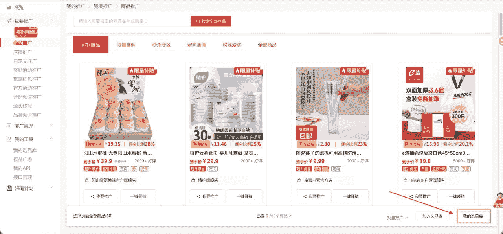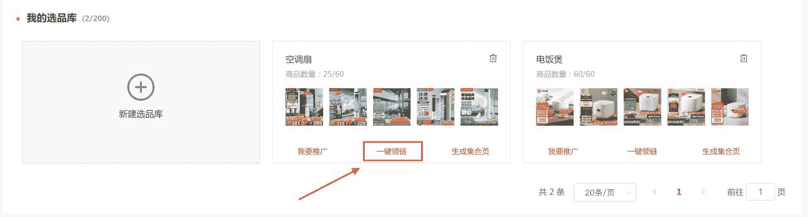

这样，几十款商品很快能缩小到10-20款。我有点选择困难，以前总在筛品上浪费时间，现在设置好规则让模型做取舍，省下大把时间。Prompt见附件。

四、商品规格获取

筛完品，我会把结果汇总到飞书文档或本地资料库，也可以直接生成Excel。很多人在参数获取上踩坑。我第一次让模型爬参数时触发了京东风控，账号被冻结了一天，之后所有页面都变成风险验证页，效率骤降。后来经过三轮磨合：第一轮，让模型模拟人工操作绕开风控，并要求它后台运行、不抢占屏幕焦点，这样我能同时干别的事；第二轮，因为不同品类参数差异很大，我会提前列好需要的字段，先告诉它；第三轮，许多参数在京东详情页图片里，网页上拿不全，就让它读取图片内容来补全。最后改用本地OCR，基本一轮就能取完，个别缺失手动补一下或留空。如果Codex直接操作浏览器效果不好，Windows用户可以用opencli，让模型以视觉方式操作浏览器。官网：https://opencli.info/download；浏览器插件：https://github.com/jackwener/opencli/releases；本地安装：npm install -g @jackwener/opencli；检查：opencli doctor。对应Prompt：“商品详情页参数采集Agent工作说明”。

五、资料整理

资料整理同样交给模型。一批商品十几二十款，网上下载的压缩包、视频、图片非常多，文件名还经常带商品标题。我会先把筛品表投给模型，告诉它下载目录，让它按命名规范自动归类到项目目录里，省去手动拖拽。对应Prompt：“素材归类整理”。

六、内容生成与改写

模型写稿的通病是有一股机器味。我的对策是沉淀本地资料库。前期如果没有优质文稿，可以分三步：先到知乎或B站收集科普内容存档；再对着商品详情页，按自己的说话习惯讲一遍，录下口述素材；如果手头有写得好的人气文案，也可以作为参考素材存下来。最后把这些材料全部交给模型，分别说明用途，让它生成一版完整文案。初稿一般不能用，但可以把逻辑框架立起来。之后我会手动改写，调整卖点顺序，加入个人风格，形成真正会用的稿子。然后让模型对比改后稿和初稿，生成一份差异报告，重点看结构、节奏、口语化程度。多对比几次，资料库越来越厚，模型就能生成专属写作技能。实际使用中还可以微调：如果它总说“不要怎样，而要怎样”这种AI腔，就明确禁止；还能给它固定一个产品讲解模板，写进Prompt。核心就是通过人机对比，让模型逐渐贴近你的表达习惯。另外，生成的口播稿可以同步拆出蓝链文案。

七、PPT与参数批量替换

PPT批量替换是我投入精力最多的一块。最早我做的是Figma的插件尝试。书野在直播里提过“稿定设计”会员可以批量替换画板里的固定文字参数和样式，但Figma的插件市场没有免费现成的。我作为设计师，以前也遇到需要批量改文字的设计稿，但不会开发，只能等现成工具。有了模型就不一样了，我把功能需求、操作逻辑、期望效果一点点描述给它，第一版就基本能用，后面修了几个小bug。不过用下来还是偏手动，要建画板、换商品图、调尺寸，只是省掉了大量无脑复制粘贴。

后来看到“星空海绵”分享的用HTML做PPT方案，虽然网页上能改字，但版式不够好看，每页还要截图。于是我做了一次二次开发。先出一个MVP：把HTML源码交给模型，说明我提供固定版式和一张Excel表，让它自动替换文字、图片并批量重命名。界面很粗糙，但核心流程跑通了。第二版是根据真实使用不断修bug，比如图片导出不符合要求、文字字段遗漏等。

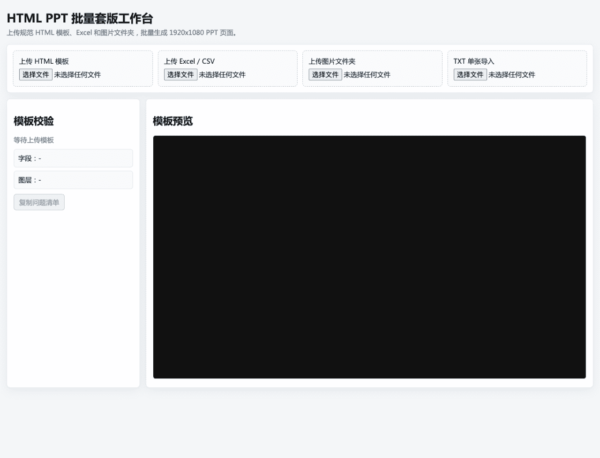

为了规范化，我定了两个规则。HTML写入格式规则，是为了让模型生成的HTML满足网站导入要求。模板生成上，我懒得手作，就把布局需求和以前手写的模板发给GPT，让它生成SVG图片；再把SVG放进Figma，用Codex读取画板内容，转成HTML版PPT模板。如果SVG确定无误，直接给模型也行。Excel导入规则：表格每行放一个商品。

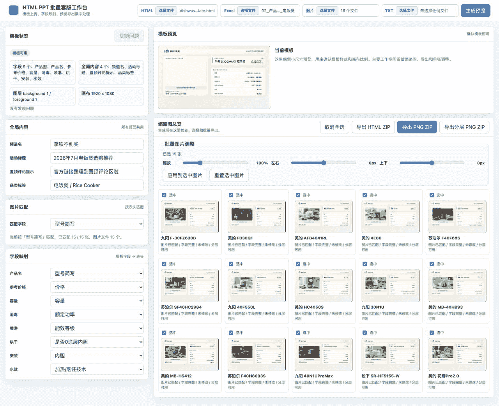

第一行或自动识别到的表头是字段名；第一列默认作为商品名，也可以在前端选择图片匹配字段；模板字段和表头完全同名时自动匹配；不同名时去字段映射区手动选择。图片从本地文件夹上传，不放进Excel。匹配方式上，默认优先选“型号简写、产品型号、型号、产品名”等字段，也可以手动指定；图片文件名需要与该字段内容标准化后完全一致。这就是我的制作思路，你可以按自己的逻辑把这些模型串成专属工作流。

源码下载地址：https://pan.quark.cn/s/5639a3e3a013。把文件发给Agent工具后，输入以下Prompt：“请读取我上传的完整HTML-PPT-Batch-Workbench-Delivery交付包，帮我在本机解压、检查Node.js LTS、启动html-ppt-workbench-local本地工具并确认浏览器可打开；同时把html-ppt-workbench-local/docs/HTML-PPT批量套版工具使用说明.md、html-ppt-workbench-local/docs/PPT-Figma转HTML模板Skill说明.md、html-ppt-workbench-local/docs/好物PPT制作规则总结.md作为当前项目的长期规则/Skill知识学习并保存，之后凡是帮我生成、转换、检查HTML PPT模板或好物PPT，都必须遵守这些规则，最后告诉我本地启动方式、访问地址、安装结果和规则保存位置。”

八、A-Roll剪辑思路

最后聊A-Roll。最近很多人问怎么用模型做A-Roll剪辑和画面设计。我的做法不是让模型直接剪，而是用自然语言描述画面需求。GitHub上有个项目叫hyperframes，地址是https://github.com/heygen-com/hyperframes，一键安装。

```
git clone https://github.com/heygen-com/hyperframes.git
```

这里有一段完全通过口述指令生成的画面效果，直接看感受更直观。

以上就是这次分享的全部内容。每个环节都不复杂，核心是让模型接手重复劳动，把数据沉淀成资产，然后你把注意力放在决策上。希望这套思路能帮你做出更多自己的技能，让项目越做越顺。

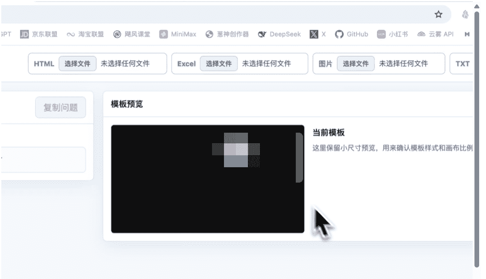 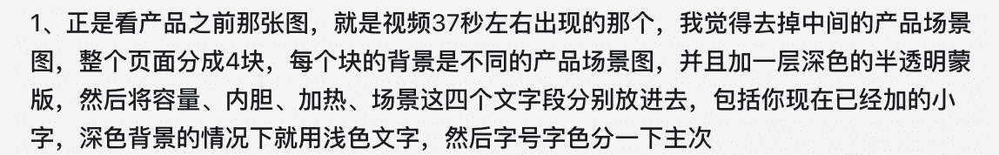 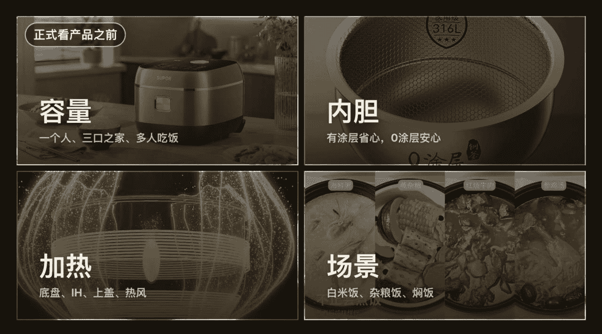

这个想法其实是从我亲手做过一次开始的，当时全程自己搞，耗时间耗心力。最近在准备新片子的时候，我就琢磨能不能把剪辑这块交给 AI 来扛。试了一下，感觉还挺能用的。因为我本身剪辑经验不多，对镜头感和画面感也没那么敏感，所以先把我现在跑通的这套路子整理出来分享下：

1. 先拆解优秀案例：

2. 再结合自己的素材做初版方案：

3. 综合参考后，生成属于自己的定制脚本：

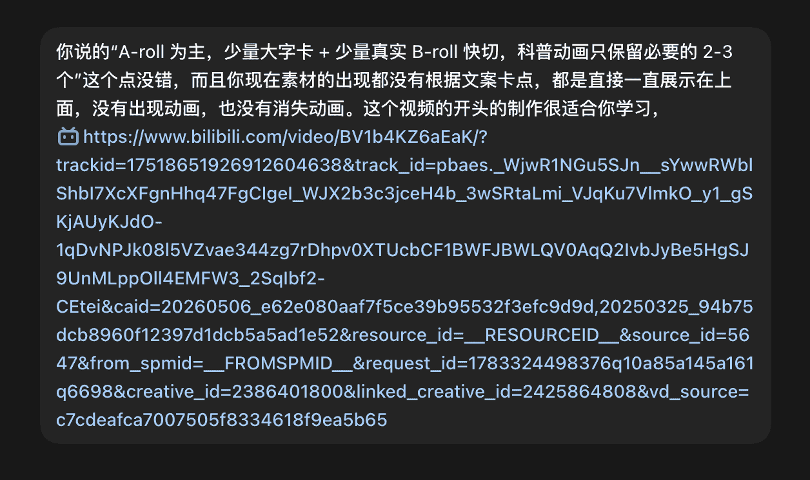 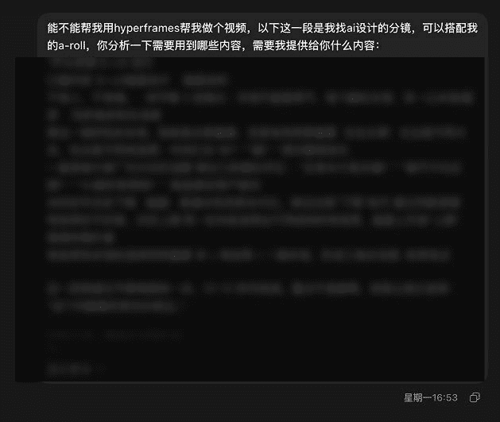

4. 样片过审与细节“口喷”微调：

光看文字分镜很难有体感，我的做法是直接让它先出一版能看的样片。出来之后第一感觉就能出来了。通常首版都会有点糙，用不起来。这时候我会用最直接的“口喷”方式来改：

- 逐秒指出问题：现在 AI 识别画面内容的能力还不够强，我会明确说视频第几秒哪里不对、哪段素材要换掉。

- 给出精准参照：手头有能用的参考图，就直接说“第几秒参考这张图”，把图片名字改好一起丢给它。

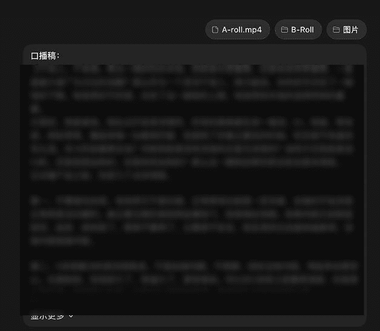

5. 素材替换与反复打磨：

剪辑过程中会发现，分镜里用到的很多图根本不是想要的。

- 手动筛选替换：第一轮整理素材库的时候，我对自己的图已经很熟悉了，剪的时候就能随时挑图手动换掉。

- 让 AI 补图：部分不合适的图，直接让 GPT 重新生成一份。

另外一个小建议，字幕这块别让它来做。还是导到剪映里自己做。尽管有人说新模型的字幕能力升级了，可以试试，但我个人还是习惯用剪映来保证效果。

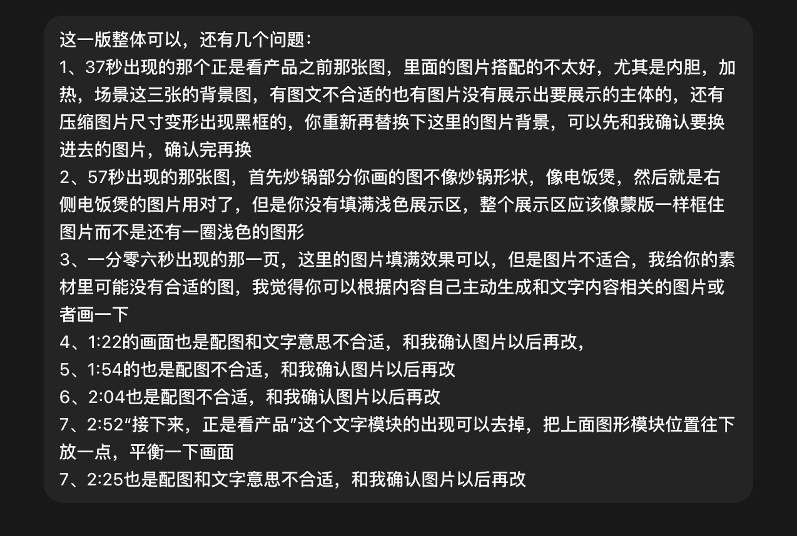 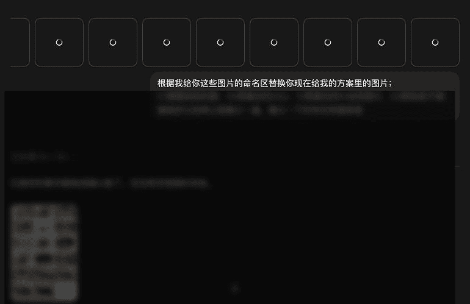

## 四、发布与反馈：让内容进入下一轮循环

### **1、视频标题、简介、标签的制作**

这个 Skill 的灵感，来自我两周前去星神线下分享会时听到的内容。当时分享了怎么打磨视频标题，怎么找对标参考才能拿到更好的自然流量。

回来后我就想把这个环节也用 AI 跑通。具体的打法是这样：

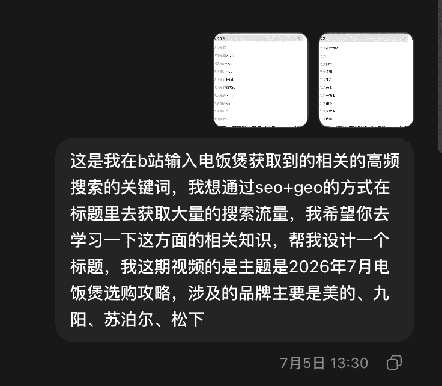

1. 搜索与筛选：让 AI 开一个无痕浏览器，帮我搜索目标产品，看下拉框里都推荐了哪些词。

2. 提取关键词：把排在前面的内容挑出来，把它们的关键词抓出来。

3. 融合生成：把这些词融合起来，生成最终的标题。

这样后期发片会省很多事。你也可以往里面喂一堆爆款标题，让它学习爆款的写法。现在这个 Skill 还在内测，大家可以根据自己的体量再做调整。

### **2、接下来要做的（设计评论+回复）**

之前我用过葱哥的网站流，整体产出我看了下，里面有个功能我觉得很香，目前我还没接入。

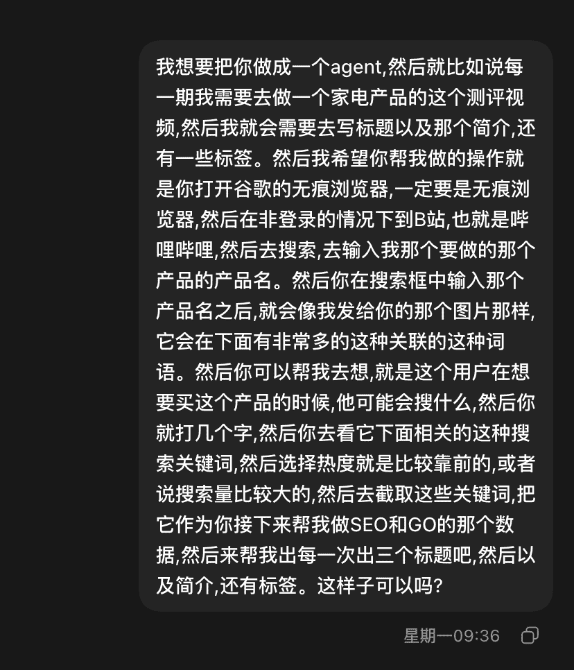

就是自动设计评论和回复：一次能生成 10 条评论和对应的 10 条回复。真的很省心。

我现在的设想是：

1. 用我的口播稿，再配上合适的提示词，让 AI 帮我批量设计评论和回复。

2. 我之前试过让 AI 帮忙出问题，效果还行，但需要再手动润色一下，提示词还要再调。

## 总结

我觉得用好 AI 的关键，就是想办法把它嵌进自己的工作流里。

1. 拆解工作流：把流程拆得越 SOP 越好。

2. 尽可能偷懒：把重复、低价值、纯体力活都丢给 AI，把自己的时间留给决策、审核和迭代。通过不断迭代你的知识库，让 AI 的能力也跟着升级。

我强烈建议大家去看《AI 大航海》的这两块内容：

- 第一部分：与 AI 对话

- 第二部分：如何用 AI 搭建个人知识库

对大部分人来说，这两块都非常实用。

最后祝大家都能爆单！当所有环节都能用 AI 完成之后，最后一步就是把它们串联成系统——就像聪哥上周说的那样，做成一套闭环，才能真正提效。

也特别感谢聪哥、书野、星神、凌风，之前的交流给了我很多思路和启发。

谢谢大家！

————分割线————

看完这篇 SOP，你可能觉得自己 get 了。但 90% 的人一到实操就会卡在起步。

工具和教程是最不值钱的壁垒，真正值钱的是“立刻开干”和“圈层信息差”。

如果你想第一时间看到全网最新的变现打法，并和一批执行力强的极客一起实操出结果，欢迎来看看我的核心私域：【懒人专属群】。

我们不谈概念，只做商业闭环拆解和 AI 效率的极限压榨。体系里已经沉淀了 1000+ 跑通的套利实战案例。

➡ 查看圈子数字资产与加入门槛：

https://lazyso.com/insider/

认同价值、准备好下场的人，扫码加我🛰️（lazyhelper1）

备注：【实操上车】，不闲聊

