# 深耕小红书电商三年后，我总结出普通人抓住下一波机会的三个关键词：AI、情绪、矩阵

大家好，我是小刀。

在进入小红书电商之前，我主要做抖音项目，曾经靠半无人直播，一个人一年做到过 1000 万 GMV。后来，随着 2022 年底抖音半无人直播的红利逐渐减弱，我在 2023 年转向了小红书电商。

到现在，我已经在这个平台持续做了三年，也陪伴不少学员从零开始，完成了小红书电商的第一笔盈利。

很多人都会问：

小红书电商从 2023 年发展到 2026 年，已经三年多了，现在还有机会吗？普通人还能不能做？当前真正有效的玩法到底是什么？

今天，我会从三个方面来讲：

1. 这几年小红书电商的流量和玩法如何变化；
2. 2026 年普通人更容易拿到结果的三个关键词；
3. 选品、笔记和运营的具体执行方法。

---

## 一、从 2023 年到 2026 年，小红书电商的玩法发生了什么变化？

### 2023 年到 2024 年上半年：百货混剪是主流

小红书电商刚开始兴起时，普通人最容易上手的方式就是混剪。

当时，很多抖音上已经验证过的百货产品，只要把素材重新剪辑，再发布到小红书，就能带来不错的流量和订单。用户竞争压力没有现在这么大，出单相对简单。

不过，那时小红书的电商商业化还处于早期阶段，平台用户对“在小红书买东西”这件事还没有完全形成习惯，整体消费人群规模并不算大。

所以在 2023 年，一个店铺能够做到十几万元销售额，已经是很不错的成绩了。

这个阶段更适合当作副业，先赚一些额外收入。

### 2024 年上半年到 2025 年上半年：养生、功效类产品崛起

到了 2024 年上半年，小红书图文流量在养生、功效类产品上的倾斜越来越明显。

很多人通过抠图、换背景、重新组合素材的方式做内容，再去推广具有功能属性的产品。

不过需要提醒的是，当前功效类产品的审核和竞争都比过去更严格，这里主要是给大家提供一个过去的玩法思路，并不代表现在适合直接照搬。

### 2025 年下半年至今：实拍图与 AI 内容快速增长

从 2025 年下半年开始，AI 图片和 AI 文案的使用越来越普遍，内容生产效率也大幅提升。

现在的 AI 生图能力已经很强，对于不熟悉相关工具的人来说，很多图片甚至已经足够接近真实拍摄效果。

目前比较常见的打法主要有两类：

1. **纯 AI 图片**  
   通常适合小挂件、装饰品、趣味型产品等。这类内容容易获得短期流量，但生命周期往往偏短。

2. **AI 封面配合实拍内容**  
   这是目前更推荐的方式。用 AI 提升封面吸引力，再通过实拍素材增强真实感，稳定性通常会更好。

当然，这并不意味着混剪已经彻底失效。到现在为止，混剪仍然会阶段性爆发，只是它在整体流量中的占比已经下降。不同时间段、不同品类和不同内容形式，表现都会变化。

例如最近一段时间，部分混剪内容的流量又出现了回升。

从内容表现来看：

- 长期积累能力：图文通常优于视频；
- 基础流量数据：视频往往优于图文；
- 商品转化效率：图文往往更占优势。

因此，究竟采用混剪、实拍、AI 图文还是视频，并不存在固定答案。关键是看产品本身适合什么内容形态，以及同类爆款目前采用了什么方式。

对新手而言，最快的起号方法通常不是凭空创新，而是找到同类爆款，研究它的内容结构，再进行高质量模仿和改造。

从商业规模来看，2026 年的小红书电商，整体赚钱能力已经明显高于 2023 年。

虽然平台上的竞争者增加了，但用户规模和电商消费池也同步扩大了。2023 年，一个店铺做到 10 万+ GMV 已经很亮眼；到了 2026 年，一些普通玩家通过“一店三号”的方式，甚至可以做到一周 GMV 突破百万。

---

## 二、2026 年普通人做小红书电商的三张牌：AI、情绪、矩阵

## 第一张牌：AI

AI 在小红书电商中的主要用途，集中在两方面：

- 制作商品图片；
- 生成和改写笔记文案。

目前比较常用的 AI 图片裂变方式，大致有四种。

### 1. 元素重组

把图片 A 中的某些元素，与图片 B 中的元素进行组合，生成一张新的画面。

### 2. 产品替换

保留爆款图片的整体场景、构图和氛围，但把其中的产品换成自己的商品。

### 3. 局部调整

只改变画面中不影响核心表达的部分，例如产品数量、摆放方式、局部装饰等，以此提升内容差异度。

### 4. 改换场景

保留商品主体，但更换背景、货架、材质、角度或空间环境。

实际使用时，通常不会只采用一种方式，而是把多种方法叠加起来使用。

例如：

- 改变产品数量和排列方式；
- 参考其他爆款的货架结构；
- 同时调整背景、货架材质和倾斜角度；
- 进一步修改物品的摆放位置和视觉重点。

这种方法的核心是：手上有一张对标图片，再结合自己的产品图，通过 AI 进行重新创作。

当然，也可以完全让 AI 自由生成画面，比如直接要求它把某个发饰放到模特头上。但这种“完全无参考”的生成方式，爆款概率往往低于基于成熟爆款进行改造。

简单来说，有对标，成功率通常更高；完全凭空创作，试错成本会更大。

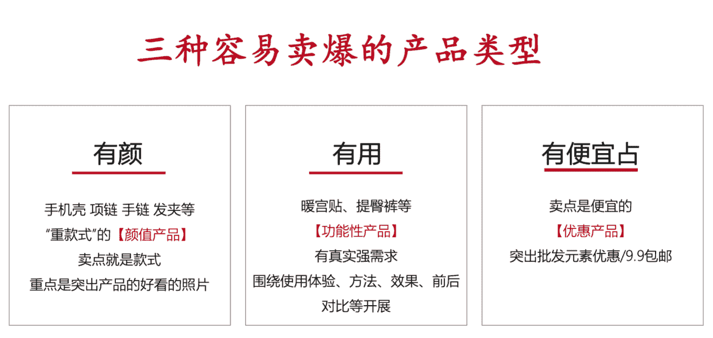

---

## 第二张牌：情绪

“情绪”不仅可以用来写文案，也可以帮助我们判断产品。

### 1. 用情绪来选品

近几年，很多并没有明显实用功能，但能让人感到开心的低价产品持续走红。

比如：

- 小马挂件；
- 包包挂饰；
- 香薰；
- 小玩偶；
- 抱枕；
- 各类可爱、治愈型小物。

这些商品的购买理由，往往不是“必须使用”，而是用户看到之后觉得可爱、喜欢，产生了即时消费冲动。

这类产品价格通常不高，决策成本低，很容易因为一瞬间的好感而下单。

### 2. 用情绪写内容

进入图文流量时代之后，标题和正文的重要性明显提高。

过去做混剪，很多时候只需要视频加几个标签，不一定要写完整正文。但现在，图片只是第一步，文字还要进一步解释产品、制造情绪、增强信任，并推动用户购买。

目前常见的情绪型内容模板包括以下几类。

#### 模板一：销毁退货商品

例如“我会亲手处理掉每一个退回来的产品”。

通过销毁、垃圾桶等画面，让用户产生“这个商家很负责”“这个店主很有原则”的感觉，进而增强对商品品质的信任。

#### 模板二：温柔的退货信

用手写信、退货留言等方式引发好奇与感动，让用户愿意点开内容，并自然进入产品种草环节。

#### 模板三：被抄袭

“我的产品被抄了”这一类内容，能够激发用户的正义感和支持心理。

即使真实情况未必如此，这种内容结构也容易引起围观和互动，但使用时仍要注意平台规则与事实边界。

#### 模板四：闭店清仓

例如“店铺要关了”“最后一批清仓”等，通过限时、低价、捡漏等信息，刺激用户尽快下单。

类似“2 元店清仓”“老店倒闭处理”的表达，即使用户知道不一定真的闭店，也常常会忍不住点进去看看。

#### 模板五：故事与第三方背书

比如：

- 有人一次性购买很多；
- 顾客主动回购；
- 老人、朋友或路人推荐；
- 某个真实故事带出产品。

这类内容的重点是引入第三视角。

如果商家自己说“我的产品很好”，用户未必完全相信；但如果旁边的人表示“我昨天买过，确实不错”，可信度就会明显提升。

这种内容尤其适合养生茶、手串、功能型用品等需要建立信任的商品。

还有一种常见方式，是用“爷爷累了”“准备关店”等故事制造情绪，再叠加清仓福利，形成“情绪刺激+价格紧迫”的组合。

需要注意的是，一条笔记往往不只使用一种模板。情绪、福利、故事和信任背书可以叠加，内容的爆发概率通常会更高。

当然，不同内容类型的表现也不一样。

情绪冲突类内容往往流量很大，但不一定带来同等比例的成交。因此，实际运营时不能只追求曝光，还要结合产品属性和转化目标进行搭配。

---

## 第三张牌：矩阵

现在开通小红书店铺的门槛相对较低，个人店铺也可以采用“一店三号”的模式，也就是一个店铺号关联三个子账号。

更建议的操作方式是：

先用一个账号跑通产品，确认它能够持续出单、数据表现稳定之后，再把子账号挂上去，让四个账号同时推广同一个产品。

这样做有几个好处：

- 增加产品的曝光入口；
- 提高内容测试效率；
- 分摊单账号流量波动；
- 尽可能吃到一个爆品的更多流量。

过去，个人玩家做矩阵会受到内容制作效率的限制。现在有了 AI 的帮助，图片、标题、正文和素材裂变都能更快完成，因此个人做矩阵已经变得可执行。

所以，2026 年小红书电商的机会，不只是平台用户增加，更在于 AI 降低了内容生产门槛，矩阵放大了单品的流量上限。

---

# 三、想做好小红书电商，绕不开三个基本功

无论采用什么玩法，最终都离不开三个环节：

1. 选对产品；
2. 做好笔记；
3. 持续运营。

---

## 一、选品：重点关注“正在起量”的商品

### 1. 新手选品的核心逻辑

对新手来说，最稳妥的方法通常不是寻找完全没人做的产品，也不是直接进入竞争最激烈的赛道，而是寻找已经出现热度、但竞争尚未完全固化的商品。

换句话说：

- 纯蓝海，往往缺少市场验证；
- 纯红海，竞争和成本都太高；
- 正在起量的产品，通常更值得测试。

### 2. 选品的三个参考维度

可以重点观察三个指标：

- **近期**：最好是近 7 天出现明显热度；
- **低粉**：发布内容的账号粉丝量尽量在 1000 以内；
- **爆款**：单条内容或商品能够达到 1000 以上销量。

这些数字并不是绝对标准，最重要的是进行横向比较。

例如，一个产品是昨天刚开始爆，另一个已经热了半个月，那么优先测试前者。

如果暂时找不到特别新的产品，也不用因此停止行动。可以在手头能够找到的商品中，选择相对更新、竞争更小的那个。

关于“近期”，还可以进一步分成三个层级：

1. 最近半个月仍然有热度；
2. 最近有新的小账号靠这个产品起量；
3. 这个产品本身刚刚出现，相关账号也都处在早期。

第三种情况通常最适合新手，因为它说明：

- 产品已经被市场验证；
- 正在快速增长；
- 头部账号尚未形成；
- 竞争格局还没有完全固定。

不过，刚开始选品时，不可能每次都找到完美商品。选品能力需要通过持续实操逐步提升。

只要一个产品符合基本标准，就可以先测试，同时在过程中不断寻找更好的方向。

### 3. 关注“24 小时加购”

除了近期、低粉、爆款之外，“24 小时加购”也是一个很有参考价值的数据。

如果一个商品在 24 小时内新增加购超过 100 次，说明它近期具备一定吸引力，值得重点研究。

但不能只看加购数量，还要把它与总销量放在一起比较。

例如：

- 总销量 10 万，24 小时加购 1000：说明商品当前仍有热度，但不一定是最近才爆发；
- 总销量不高，24 小时加购却快速增长：更可能代表商品正处于起量阶段。

因此，判断产品是不是刚刚爆发，关键是看“24 小时加购量与总销量”的比例。

比例越接近，越说明最近的增长贡献更大。

从新手执行难度来看，一个刚刚起量、总销量尚未过高的产品，往往比已经卖了很久的大爆款更容易切入。

---

## 4. 新手可以优先考虑的三类产品

在小红书上，比较容易获得流量的商品，通常有三个方向：

### 第一类：好看、有颜值

这类产品本质上是在“卖画面”。

比如手链、耳饰、戒指等，如果产品本身不够好看，文案再精彩也很难弥补。

很多时候，一张有吸引力的图片，配上简单标题和短文案，就可能完成种草。

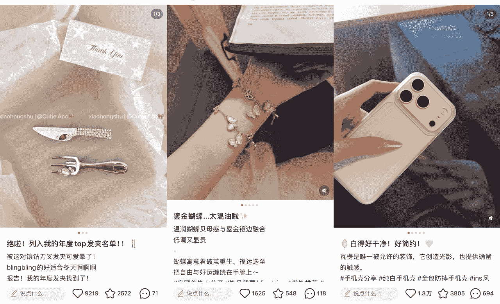

因此，做颜值型产品，对审美能力要求较高。平时喜欢关注穿搭、饰品、家居和漂亮物件的人，往往更容易找到合适的内容角度。

### 第二类：具备明确用途

这类商品能够解决用户的某项需求。

可以从以下五个角度理解：

1. 基础功能；
2. 情绪价值；
3. 具体痛点；
4. 玄学需求；
5. 季节场景。

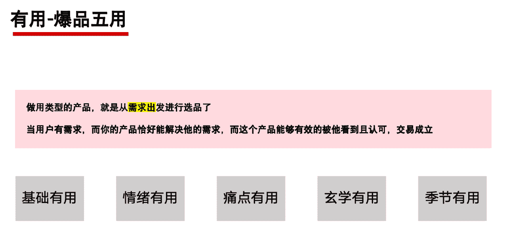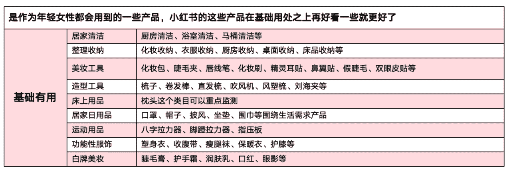

其中，痛点类和玄学类内容比较容易涉及违规表达，不建议新手一开始就挑战。

情绪价值类产品前面已经介绍过，基础功能类则更适合新手从日常用品中寻找方向。

### 第三类：便宜、容易产生占便宜心理

价格低、购买门槛小、用户觉得“买了不亏”的商品，也比较适合小红书转化。

综合来看，以下方向更值得新手关注：

- 潮玩；
- 家居百货；
- 个护家清；
- 美妆工具；
- 运动用品；
- 基础服饰。

### 关于女装

女装确实容易起量，但售后压力也非常大。

供应商的报价往往由两部分组成：

- 商品成本；
- 运费成本。

比如一件衣服总成本 19 元，可能由 15 元商品成本和 4 元运费组成。

一旦发生退货，供应商可能只退回商品成本，运费部分就会直接变成损耗。

如果产品退货率较高，运费损失会快速累积。再加上服装类经常需要承担运费险，一单可能还要额外支付约 4 元，这些都会压缩利润。

如果确实要做服装，建议优先考虑：

- 通用款；
- 不挑身材；
- 不太挑版型；
- 客单价较低；
- 不依赖高运费险成本的产品。

例如一些基础款短裤，就比强风格、强版型的服装更适合作为测试方向。

### 关于内衣

内衣在平台上仍有需求，但竞争相对激烈，已有不少头部账号持续布局。

同时，这类产品的基础数据可能没有那么快起量，起号周期相对较长。

如果选择内衣方向，最好做好持续输出至少一个月的准备，并保证素材质量稳定。

### 关于手机壳

手机壳不太建议新手一开始尝试。

这个品类更新速度非常快，几乎每天都会出现大量新款。没有工厂、供应链或成熟爆款支撑的普通玩家，很容易陷入不断跟款、不断测试，却难以形成优势的状态。

---

## 5. 产品测试与垂直问题

小红书的运营逻辑，往往是先大量测试，再集中打爆单品。

在找到一个数据表现不错的产品之后，不建议继续平均分配精力，而是应该围绕这个商品持续生产内容，把它的流量尽可能吃透。

在假设笔记质量没有明显问题的前提下，可以参考以下测试数量：

- 视频笔记：大约测试 10 条；
- 图文笔记：大约测试 20 条。

如果达到这个数量仍然没有订单或明显数据反馈，可以考虑放弃该产品。

至于账号是否必须垂直，前期不需要过度纠结。

一个账号在没有真正打出爆款之前，通常还没有形成非常明确的标签。因此，初期可以先围绕有机会的产品进行测试，优先级应当是找到爆品，而不是为了垂直而垂直。

---

# 四、笔记怎么做：先模仿，再优化

对于新手而言，最有效的方式通常不是从零开始原创，而是找到已经验证过的爆款笔记，进行结构化模仿。

之前提到的各种内容模板，看起来方法很多，但如果直接靠理解去落地，往往比较困难。

更实际的做法是：

1. 找到同品类爆款；
2. 拆解它的封面、标题、内容结构；
3. 保留真正带来点击和转化的核心元素；
4. 用 AI 修改次要信息；
5. 根据自己的商品进行重新组合。

很多人会担心：已经爆过的内容，用户会不会看腻？重复使用还能不能拿到流量？

从平台推荐逻辑来看，一条内容能够爆发，通常说明它的封面、标题和表达方式符合用户偏好。

但对于新手而言，很难一开始就判断：到底是封面里的哪个元素、标题里的哪句话，或者正文中的哪个情绪点推动了数据增长。

因此，前期越接近成熟爆款，越容易保留有效元素，减少无效试错。

当然，模仿并不等于完全复制。正确的方式是保留爆款框架，再替换产品、场景、细节和表达，使内容形成新的组合。

现在，笔记正文和标题的生成，基本可以交给 AI 完成。人需要做的，是提供产品信息、用户需求、对标素材和内容方向，再对 AI 产出的内容进行筛选、修改和审核。

总结一下：

- 选品决定你有没有机会；
- 笔记决定你能不能获得流量；
- 运营决定你能不能把流量变成稳定收益；
- AI 提升效率；
- 情绪增强点击与转化；
- 矩阵放大单品结果。

这就是 2026 年普通人做小红书电商，更值得关注的三个关键词：**AI + 情绪 + 矩阵**。

我们基本会按三个阶段来用不同的指令去打，实操中灵活切换。

第一阶段就是纯 1:1 复刻，跨品类搬运也好，原模原样抄也好，我这有一套可以直接拿去用的指令，复制即用。

笔记量还不大的时候，日常写稿用豆包就基本够用了。

等到要批量抄作业的时候，我们现在的组合是 爆文雷达 + 飞书多维表格 + tomemo。流程是这样：先用爆文雷达筛对标的爆款笔记；第二步每天把爆款标题正文导下来，挑出要抄的；第三步丢进多维表格统一改写；第四步写完后同步到 tomemo 键盘，多设备都能用。

图片同理，前期就老老实实 1:1 学。

我常用的笨办法是图片拆解，四张视角一起看，大图中小图全视角，照着模仿。

等你再熟练一点，能从一张封面里分辨出哪些元素是促爆的、哪些是拖后腿的，就开始做保留和替换，有爆款元素就留着，非爆款元素就换掉，这就是进阶的创新。

比如卖眼镜和卖手链，可以共用同一个内容壳子：才 x 块，却被当成高价礼物。封面形式也一样：纸袋里装满产品，俯拍。

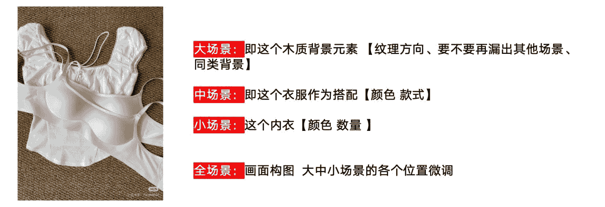

我前面提过的那些情绪向笔记，都很适合横移到别的品类去用。

熟练度上来说，现在一天稳定产出 30 条 AI+实拍混搭的笔记，对我来说是常规操作。

## 📖📖 运营关键点

运营里最要命的就两块：

1. 商品链接的维护
2. 笔记评论区的节奏

### 📖 1、商品链接建设

先说链接，因为链接直接决定转化。我们一般会把销量控在 10 到 100 之间。

对测评期已经出单的链接，建议补三个带图好评，最好配三张图，文字 20 字以上。优质的好评会沉到笔记评论区里，对转化有直接加成。

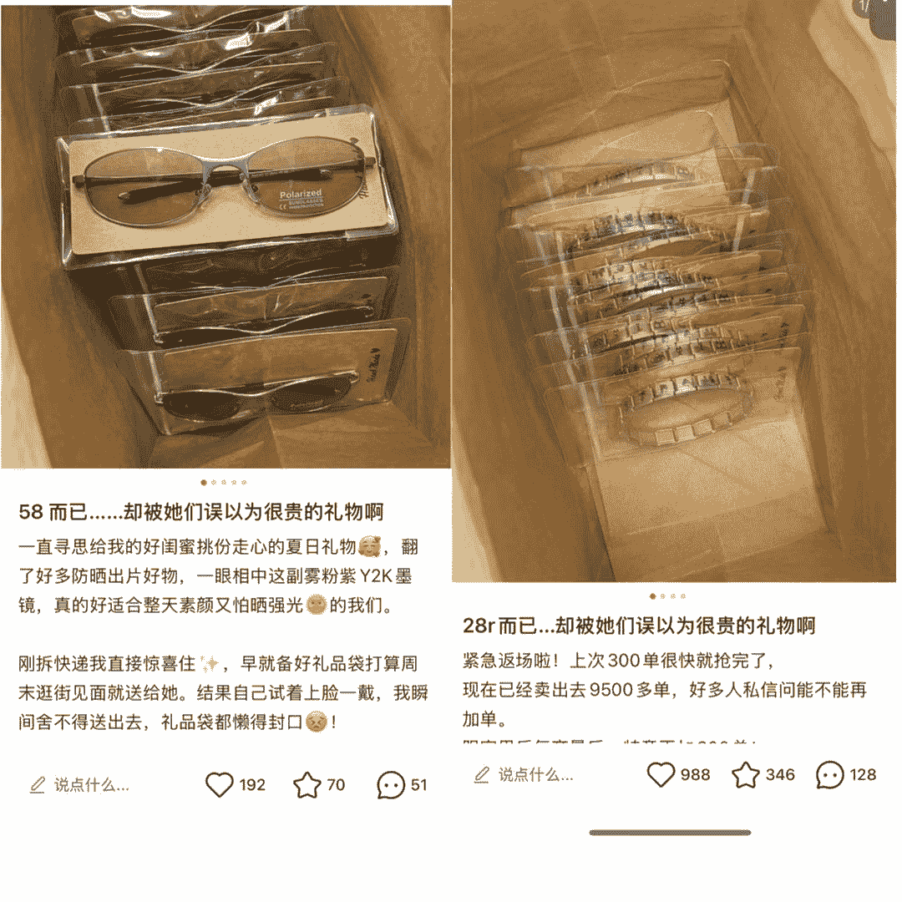

### 📖 2、笔记评论区运营

小红书的推流是 CES 体系，评论权重非常大。笔记能不能炸，评论区能不能带起来是关键。把人工干预玩明白，爆文率能提升 30%-50%。

常用的一招是抽免单或发惊喜回馈券。

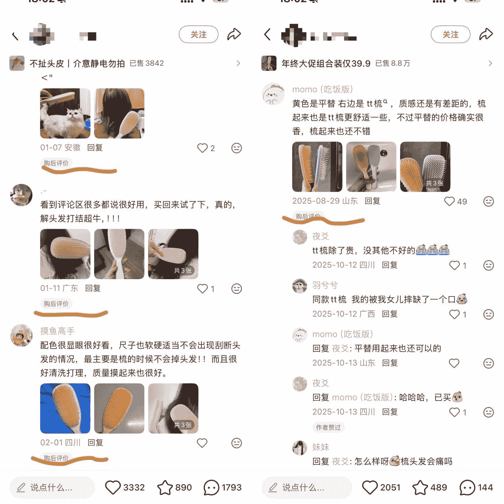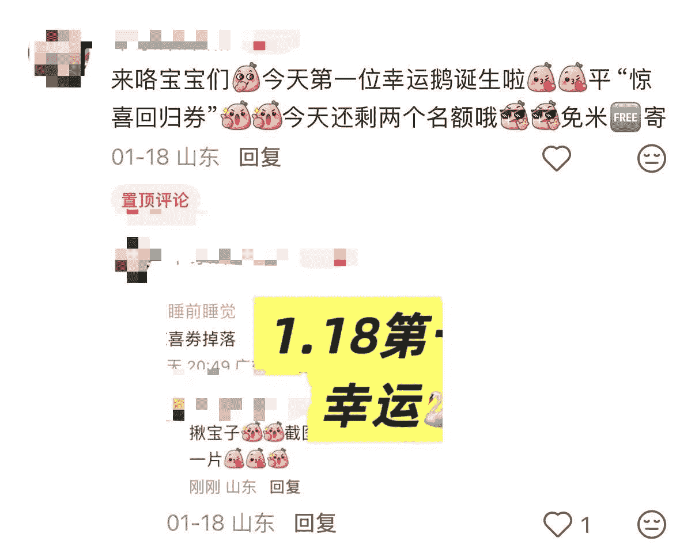

这类话术有一定风险，用的时候多换表达，降低被判定概率。

人工干预讲究快，得常盯数据。手机端用千帆，进【数据-内容】选【实时】，电脑端千帆【数据-笔记-我的笔记】选实时数据按发布时间排，就能看到今天笔记的出单情况。设置好后基本每天都能看。

当天数据有延迟，看不到也不用慌，等会再刷。发了笔记出单却不知道是哪篇，以笔记的“小眼睛”数据为准即可。

除了引导评论，还有几种布局可以一起做。

**01- 蹲反馈类**

让感兴趣的人去评论区蹲反馈，提升互动。带动一个人蹲，就可能带动整篇流量。

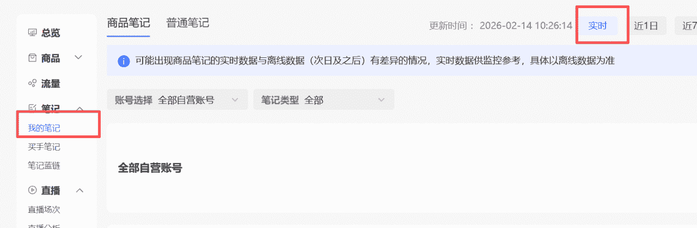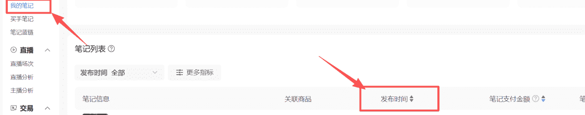

比如这种话术：

1. 关于我刚打开小红书就花了 9.9💰这件事
2. 已下单 莫辜负
3. 买了，姐妹们蹲我反馈
4. 完脾气不好，要是质量不好我回来骂你
5. 哇趣，这个有意思，买了买了，姐妹们蹲我

可以先自己埋一条，后面假装收货后晒反馈，这样评论和复购都会跟上来。

**02- 搬运同行高赞评论**

同行点赞高的评论说明共鸣强。用户看完笔记最爱逛评论区，一条有趣的高赞评论就能带动点赞和回复。

可以去小红书同款、抖音同款的点赞视频评论区里挖。

### 📖 3、笔记裂变运营

发笔记不是盲发，要看平台数据和自己账号数据，对表现好的内容模型做裂变。

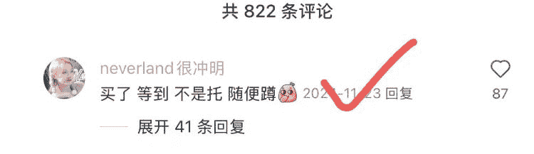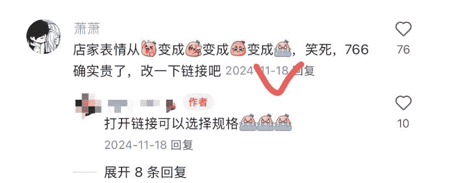

建议每天定三个点查数据：上午 9 点、下午 2 点、晚上 6 点，看自己笔记和同行笔记的表现。

再统一一下小红书电商的基础认知。

### 📖 1、开店门槛

现在小红书个人店铺，只要实名认证就能开。大部分类目前期免保证金就能上架，提现时再交即可。

规则上现在更建议做“一拖三”：一个店铺号带三个子账号关联，一组号打一个品。

小红书整体吃自然流，大部分品的利润撑不起投放。

小红书卖货核心是写笔记带货，笔记带货仍是主流。

和传统认知不一样，小红书现在是单品打爆。账号在一个品上有流量，就持续围绕这个品写不同角度的笔记。

我这里有完整的开店教程。小红书电商教程-店铺&账号开通【训练营】

### 📖 2、要不要投放

这是大家最纠结的问题。现在起号是不是必须投？

我很确定，我们自营带学员都是纯自然流起号。

投放什么时候用？

一是品已经爆了，想放大，本身一天卖 5 万，想冲到 8 万。

二是你已经非常熟练，想缩短起号周期。原本两周能起号，现在想一周起号，就可以用投放加速人群探索。

总结一下，新手别投放，纯自然流就够了。

### 📖 3、货源问题

现在 90% 的品都能在 1688 上找到。

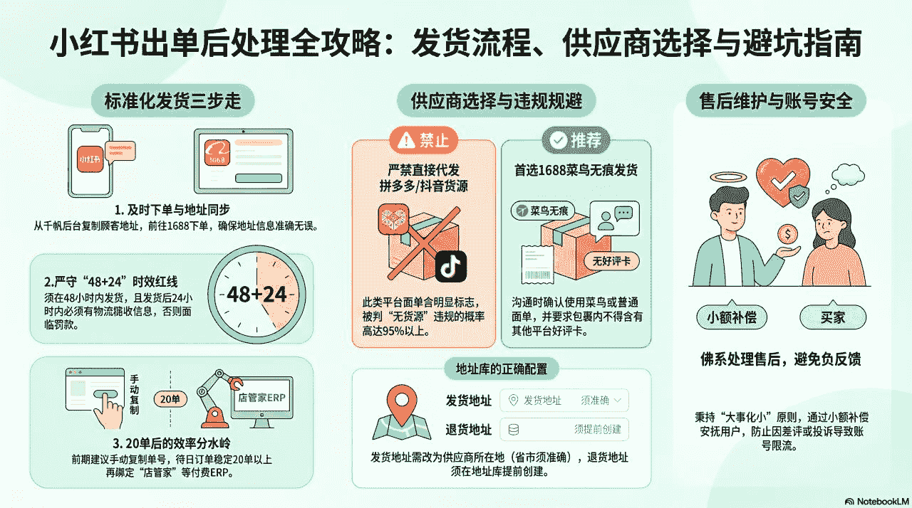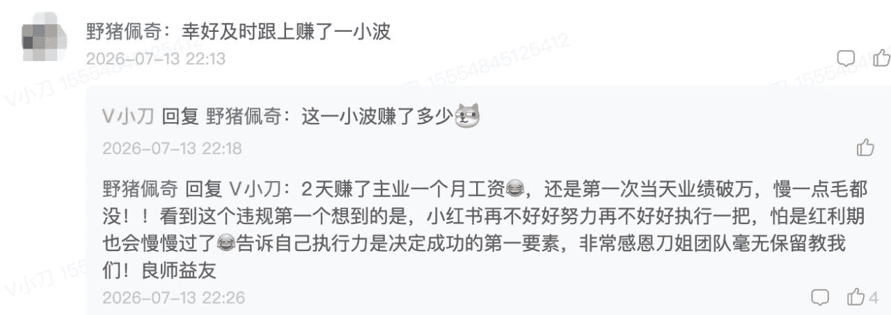

有些人觉得拼多多可能更便宜，但拼多多商家代发很难谈，还是建议走 1688。

这里有一份供应商沟通的文档，平时不常聊供应商的可以学一下。

供应商沟通话术&注意事项 供应商沟通话术 & 注意事项 【小刀轻创工作室】

我觉得 26 年依然是做小红书的最好时机。

从 23 年到 26 年，玩法和规则一直在变，但用户池和天花板在不断变大。

每年都有两波红利，比如上周的个人售卖玩法，平台很快管控了，但很多人已经快速赚了一笔。

再比如去年年底的 0.1 元玩法、高低价玩法、惊喜盒子玩法。

整体来说，小红书电商是长线生意，要跟着平台变化，用平台鼓励的方式拿结果。

抖音已经很卷了，但依然有人赚钱。小红书只要平台不说停，就有无限机会。

最后分享一个最近感动的反馈。是之前月薪 3000 多的一个小伙伴，做小红书后给我发的信息，我觉得很有力量。

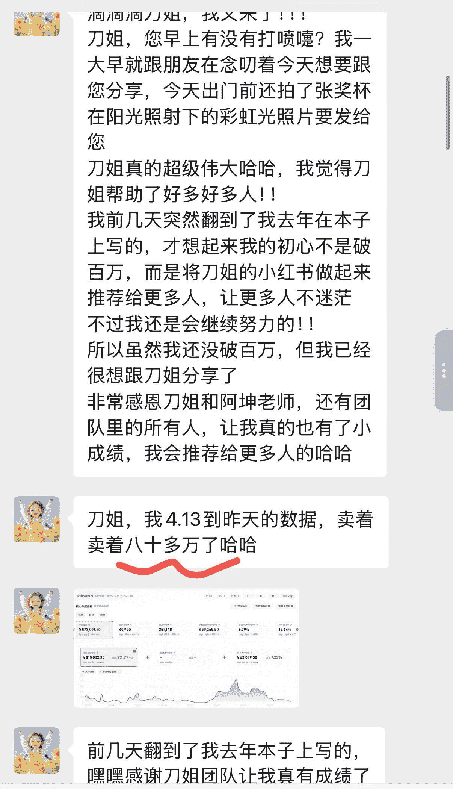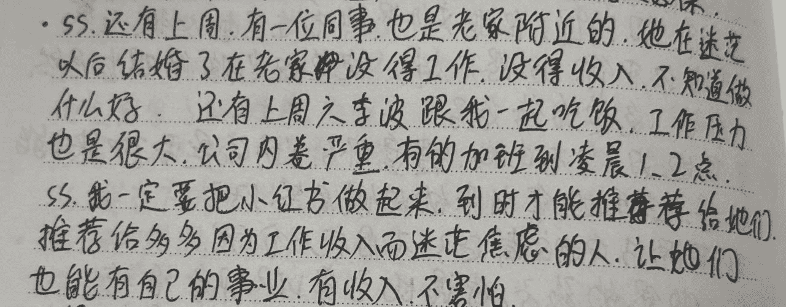

这是她当时在日记本里写的话。

我知道大家现在可能焦虑、迷茫、困惑，但这些都会随着行动消散。

我 23 年开始做小红书，24 年 3 月下定决心提着一个箱子从北京回济南扩大项目。

当时住酒店找场地，第一个济南员工面试时场地都没定，到现在已经有近 50 个并肩作战的小伙伴。

不是想显摆，是想告诉大家，当年我提着行李箱一个人来时，也充满未知。

但路在脚下，迈出一步，四面八方都是前方！！！

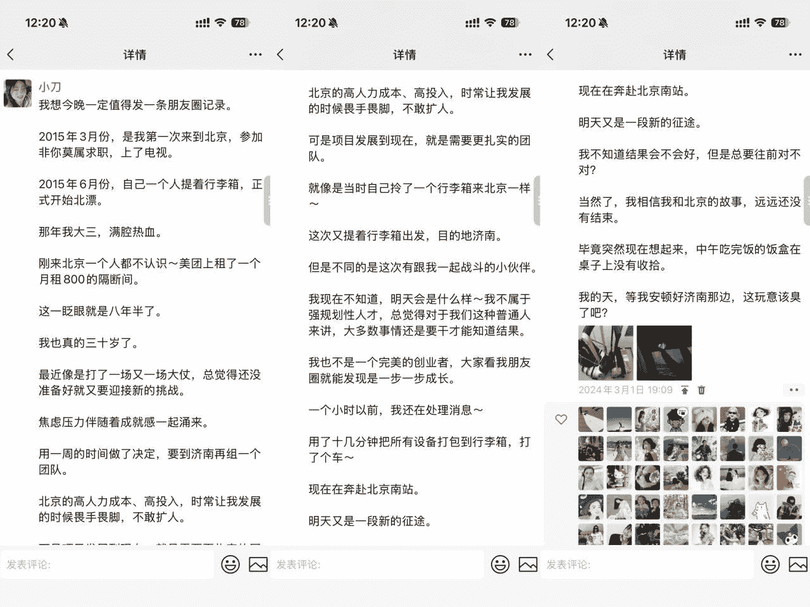

希望大家无论做小红书还是其他项目，都能拿到想要的结果；希望大家想退缩的时候，这个逆袭的经历能给你一点力量。

最后最后，分享一段话。

以上，共勉。

————分割线————

看完 SOP，你会觉得懂了。但 90% 的人实操第一步就卡住。

工具和教程只是最低级的壁垒，真正的壁垒是立刻动手和圈层信息差。

如果你想看全网最新变现玩法，和一群执行力极强的极客一起下场，欢迎围观我的核心私域：【懒人专属群】。

我们不聊虚的，只做商业闭环拆解和 AI 效率压榨。系统里已沉淀 1000+ 跑通的套利实战局。

💰 查阅圈子完整数字资产与上车门槛：

https://lazyso.com/insider/

认同价值、准备好下场干活的，扫码加我。

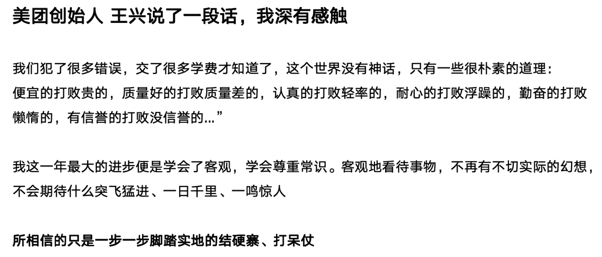

# 微信（lazyhelper1）

备注：【实操上车】，不闲聊

