# 一年时间，我是如何通过 AI 业务变现，做到 10 人 +AI 业务工作室

260723 副业SC 精华

整理：公众号懒人搜索，懒人专属群精选

懒人微信：lazyhelper1

大家好，我是绿子。

过去十二个月，我从一名普通的职场人，走到现在带领十来人 AI 业务团队的状态。现在工作室月流水稳定在二十万上下，小红书曾冲上主题热榜首位，闲鱼上若干链接的加购意愿已过万。回头看，过去一年前我只是在公司打卡的普通人，2025 年才真正把身家押在 AI 变现这条路上。

今天把这一年的实操路径和团队搭建经历摊开讲。

## 为什么 2025 年我会入局 AI 写作

团队做的并非只有写作，而是当前需求旺盛的 AI 业务线。业务本质相通，下面以写作为例拆解底层逻辑。

第一，我看的是复利，而不是短期现金流。能赚钱的项目很多，但多数是重复劳动，干三年和干一年没本质差异，每单都从零开始。能长期投的项目，必须有越做越厚的东西在沉淀：私域存量、个人 IP、客户关系、品牌资产。代写客户沉到私域后复购意愿强，且可延展到电商、求职、职场关系等品类。所以做事前我会自问：若闷头干三年，什么都不想新点子，仅靠执行，是否会让自己越来越难被替代？若不会，那只是生意，适合赚一笔撤离。

第二，投入是否匹配自身禀赋。项目前期需要哪些硬软条件？手里有没有现成资源？启动门槛多高？多久回本？是否只能依赖单一渠道？利润能否满足预期？

第三，常被忽略的痛苦类型。长期做任何事都有难受的点，关键是这种难受是否能扛十年，并从中提炼出意义。如果核心日常是你本能排斥的，比如追流量、促成销转、跑交付，再赚钱也撑不住。我在职场最煎熬的阶段就是做私域代运营，那时的工作内容与当下状态严重错位，极度消耗人。

现在这个方向，是现阶段最契合我的，后续仍在向上走。

今天分三块展开：

- AI 变现方式与可落地的案例
- AI 如何在流量、转化、交付三端降本提效
- 从个人到工作室的组建经验

去年期末季，一个研一学生找我们做一篇两万字的实证作业，要求跑数、做回归、出图，报价 400 元。我们一位大专文科背景的同事，用 Claude 花了五小时交付，顺利通过。三年前办这事，得找研究生耗一周，收费至少一千。

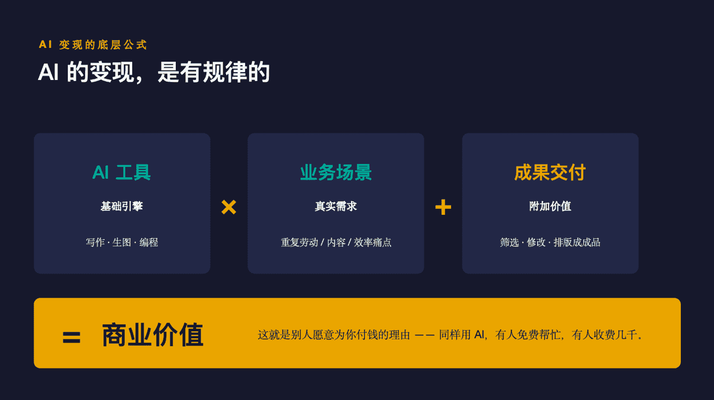

**AI 变现底层公式**

[AI 工具] × [业务场景] + [成果交付] = [商业价值]

工具是引擎，场景是真实痛点，交付是加工增值。工具人人可得，场景遍地都是，真正能收钱的是中间的加工环节。同样面对人工智能，有人白嫖帮忙，有人收几千，差就差在加工。

**AI 技能五大能力矩阵**

门槛逐层升高，壁垒和利润也水涨船高。能变现的 AI 方向大致五类：内容制作、视觉设计、视频制作、编程工具、办公提效。但要强调的是，技能不等于懂原理，而是能稳定交付一类成果。

**AI 变现五阶台阶**

第一层，卖服务。直接接单最快，我们就是从这里起量。【直接卖服务给个人消费者。典型案例：AI 代写、AI 生图、AI 视频等】

第二层，卖产品。把熟练的事标准化成可复售资产。

第三层，做教学。把走通的路输出，但必须基于真实案例。

第四层，做账号。以流量形成复利。

第五层，交付解决方案。高客单价的系统闭环。

横轴是杠杆，纵轴是天花板，越往上越脱离时间交易。

几个可直接上手且全年有需求的例子：PPT 制作，毕业答辩与年中年终汇报需求大；诉状书尤其是离婚诉状书，需求稳定；抄写类作业与思想汇报，复购率高，旺季寒暑假，客单价小几百，月入过万可行，需注意平台禁词。

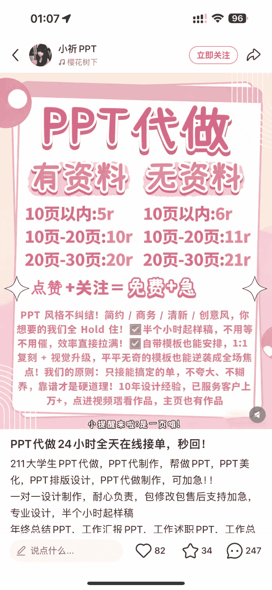

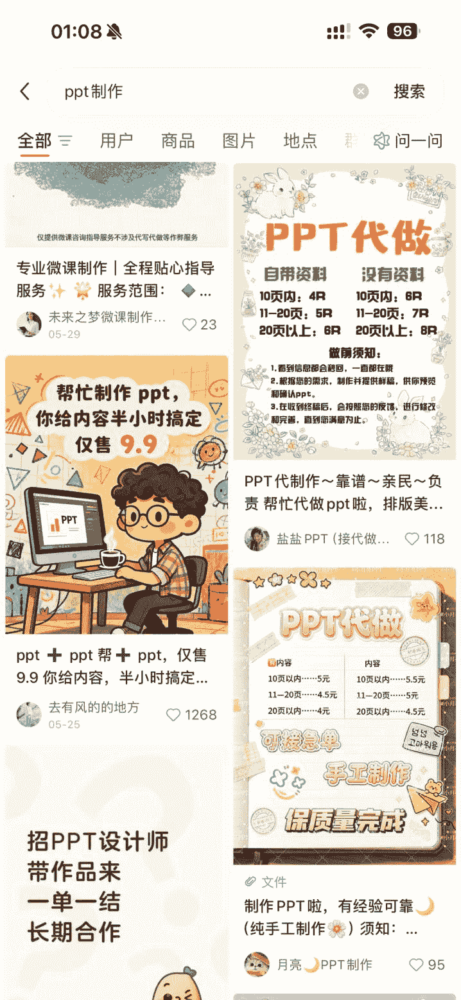

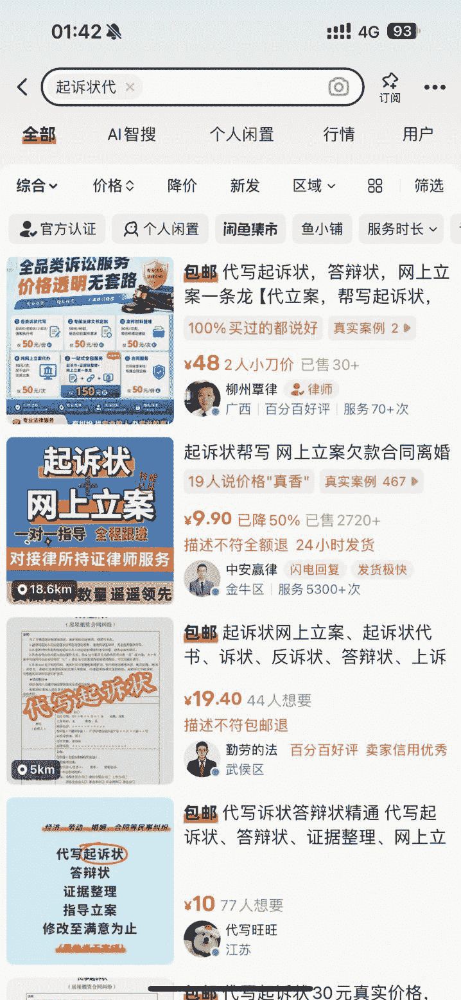

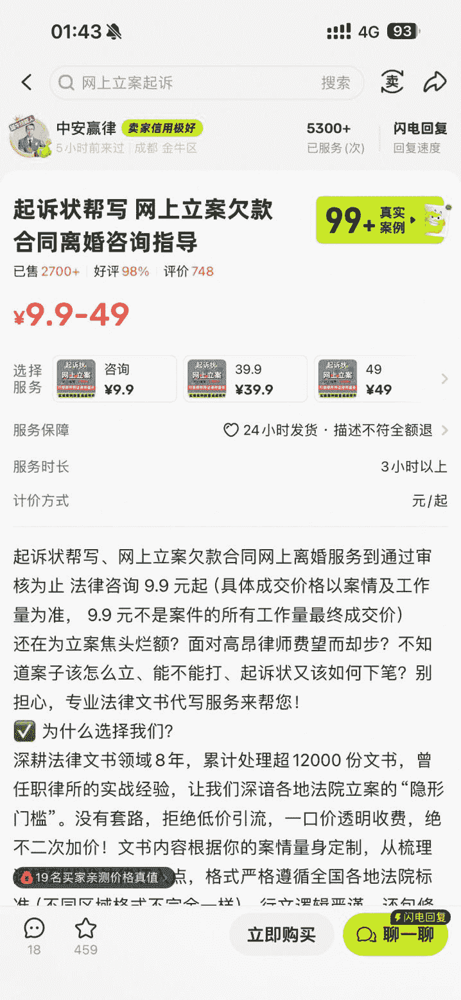

谈单与后端资源搭建

谈单先立价格体系，建立信任与成交效率，再补专业知识提升沟通质感。后端可按类型找人：电子版内容写手首选小红书、BOSS；手写抄写类可去大学生互助群、校园墙招募，效率高。

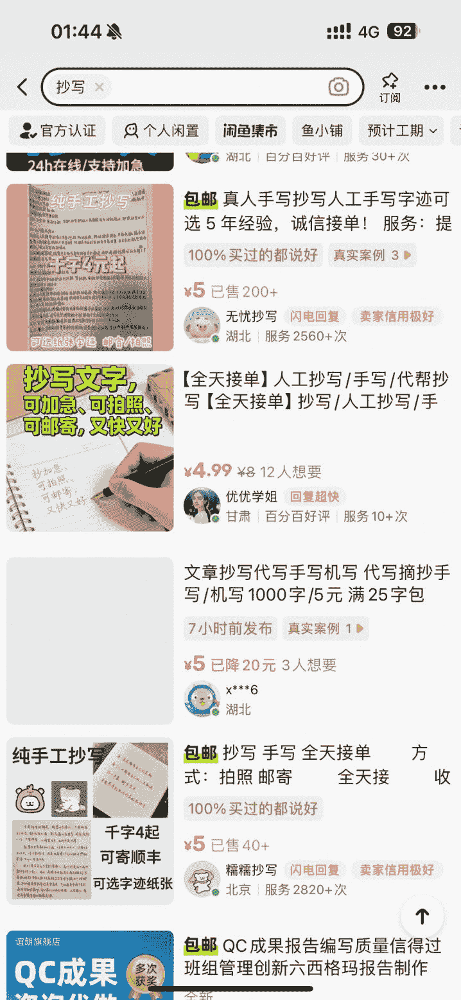

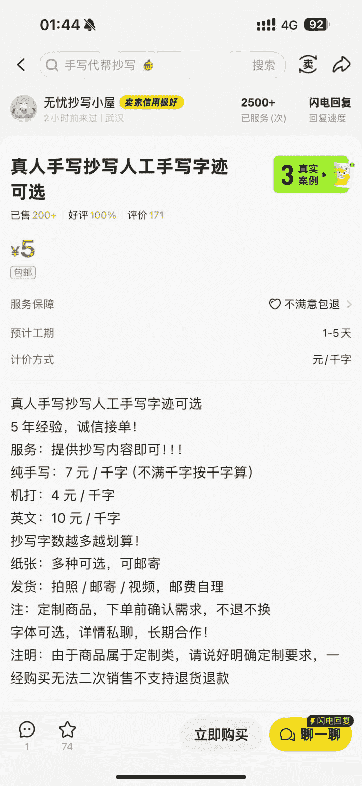

商业起点：出卖时间还是搭建资产？

卖服务启动快零成本，当天学第二天可接单。但收入天花板被个人工时锁死。卖产品是造资产，做一次可无限次售卖，睡觉也在卖。门槛在于需求挖掘与转化能力。

先用服务活下来，再用产品放大。不要一上来就憋大招，也别永远用时间换钱。

增长需要两根杠杆：流量复利与知识输出。教学建权威，账号建流量池，二者互哺。教学必须基于自己真实穿越案例，否则翻车。账号定位清晰，分享工具、案例、技巧，流量起来后广告、社群等变现自然跟进。

金字塔顶端是交付整套解决方案。客户买的不是单点，而是业务闭环。例如给电商团队搭建定制化 AI 文案与图片生产流程；给教培机构做 AI 课件+自动化招生内容体系。这层考验业务理解、沟通与交付能力，客单价最高。

普通人如何起身？看核心优势。文字感强切 AI 文案、小红书脚本；审美好切 AI 头像、海报；懂逻辑会代码切爬虫、自动化工具；有行业背景切 AI+垂直领域，如教育教案、职场 Excel 分析。

**商业操作系统：五大核心能力**

需求洞察、产品包装、交付能力、传播推广、持续迭代。五齿轮循环运转，越转越顺。

整体蓝图：横向五大能力矩阵，纵向五阶阶梯，底层五大核心能力。从一个点切入站稳台阶，再补齐齿轮，即 0 到 1 路线。

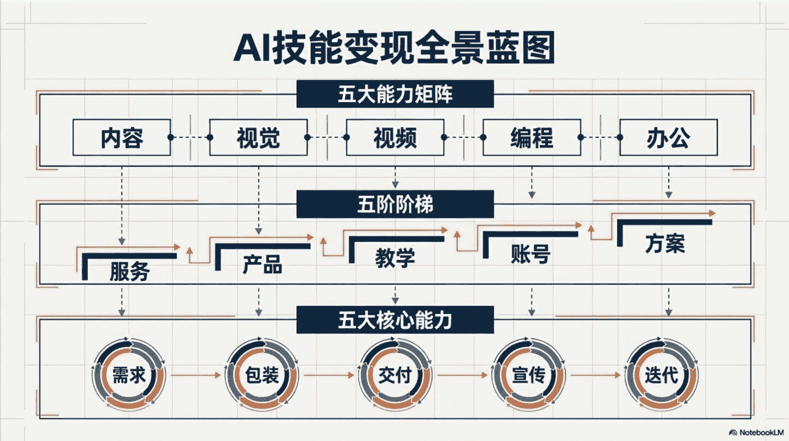

### 为什么现在仍是窗口期：三个亲眼看到的信号

信号一，同行洗牌。平台规则变动，论文类目受限，行业重新洗牌，普通人有机会在动荡中上位。

信号二，客户认知反转。2024-2025 年客户会问“是否 AI 写”，需要解释。2026 年已有约三成客户直接要求“可用 AI 但不可明显”。从排斥到接受再到期待，是规模化的前提。现在可公开讲“AI+人工双重把关”。

信号三，成本断层。2024 年万字稿纯人工成本 300-500 元，2026 年 AI 主力+人工校对降至 50-80 元。成本降五分之一，客单价仅降约 30%，差价即利润。

不会交付怎么办？做流量与转化，交付外包。小红书、BOSS 上写手、剪辑师、PPT 美化师充足，先外包自己慢慢理解交付。工作室关键一步是老板从最能干活变成会分配活。

模块一结束，接下来进入模块二：AI 如何真正降本提效。

### 模块二：AI 如何帮助业务降本提效

AI 重塑的是完整生意三环节：流量、转化、交付。

流量端：需采集同行或异业爆款的时序数据，感知行情，横向做头部品类，纵向打细分赛道。采集方式为抓取链接投进插件，分时段看数据。

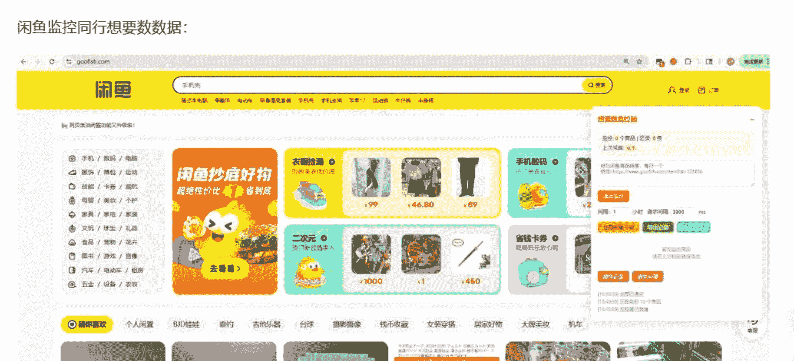

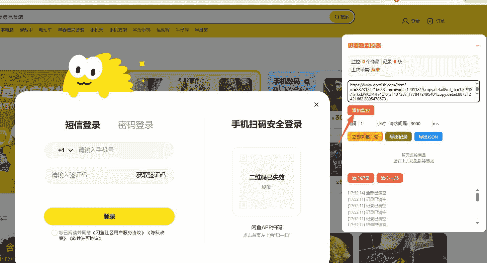

转化端：最大误区是把客服当答疑。客服是销售，转化率 20% 提到 40% 等于流量翻倍。

团队在转化端的用法：

1. 用对工具保价格优势。CC Pro Max，800 元成本带来 2W+ 回报。
2. AI 销售话术库。成交与流失对话导出拆解，AI 整理归类生成变体，沉淀为 SOP。
3. AI 报价助手。将需求结构化，结合价格规则自动出方案，快速判断需求与推进成交。
4. AI+会员分层运营。设计新人礼、召回方案、复购策略，AI 出活动与话术。

合格客服 SOP 至少含六模块：首响话术、需求确认清单、标准报价表、逼单/异议处理、风险话术、售后跟进。

交付端：AI 主力加人工校对，人效提升 5-10 倍。

普通人从何起步？看优势匹配能力切入台阶，把五大核心能力补齐。窗口仍在，关门时间各有判断。

从选题到交付整条线，现在基本可由模型承接：自动搭框架、撰写初稿、生成短视频、制作配图、汇总成报告。人的精力只保留在终审、润色和做风格微调，主体产出已转移到 AI。

这直接把新人的上手时长压下来了。过去带一个新人要两周，现在有标准化流程，三天就能开工。

下面是我验证过的几个落地场景——

【案例一】AI 做图
客户预算 100 元，要两份图文小报，A4/A3，具体要求图文结合。
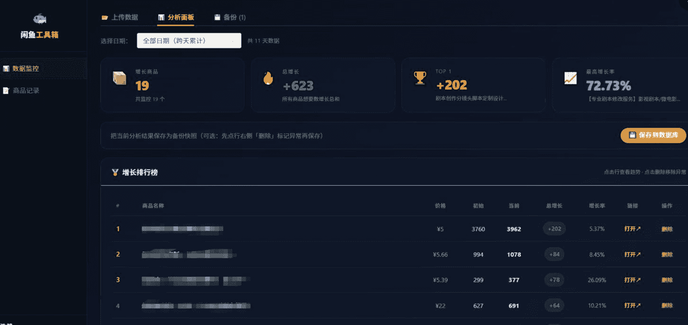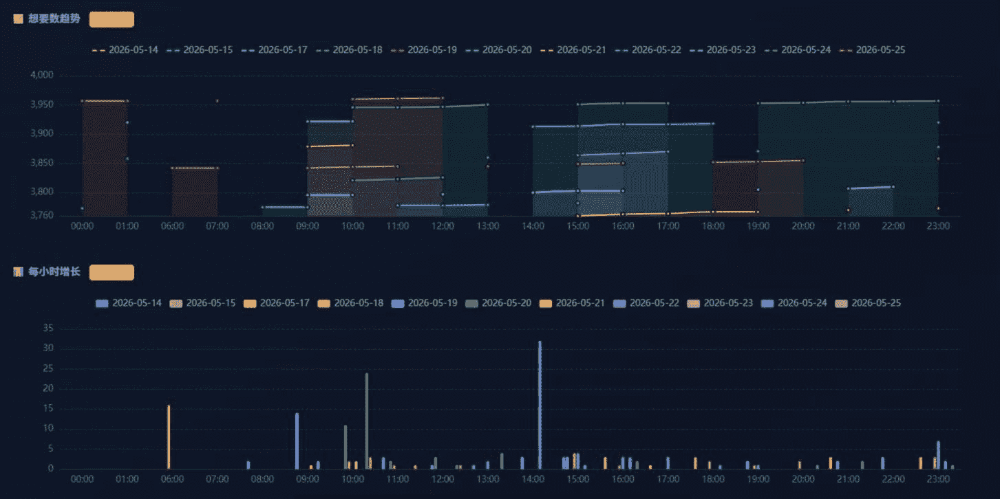
内容怎么产出？靠 Skill 触发生成。
呈现效果在我的打法里属于常规操作。

【案例二】AI 做思维导图
客户出价 100 元，根据指定英语课文出一张导图。
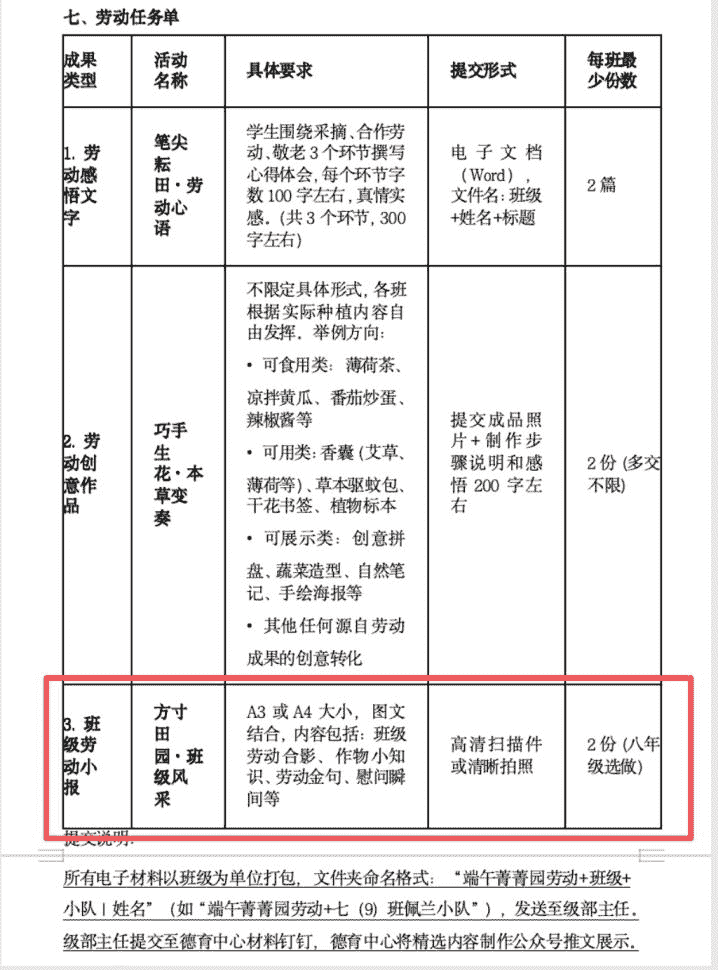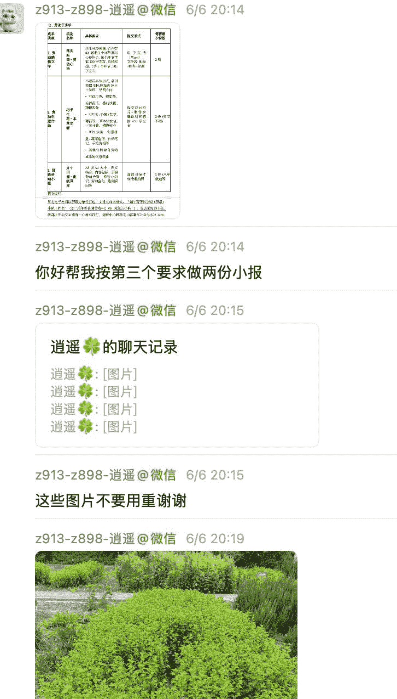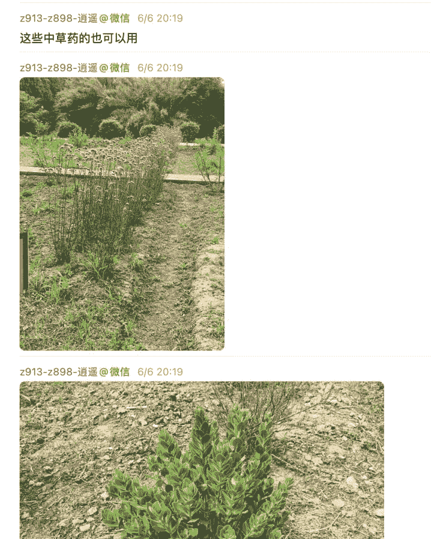
生成路径同样是 Skill 驱动。
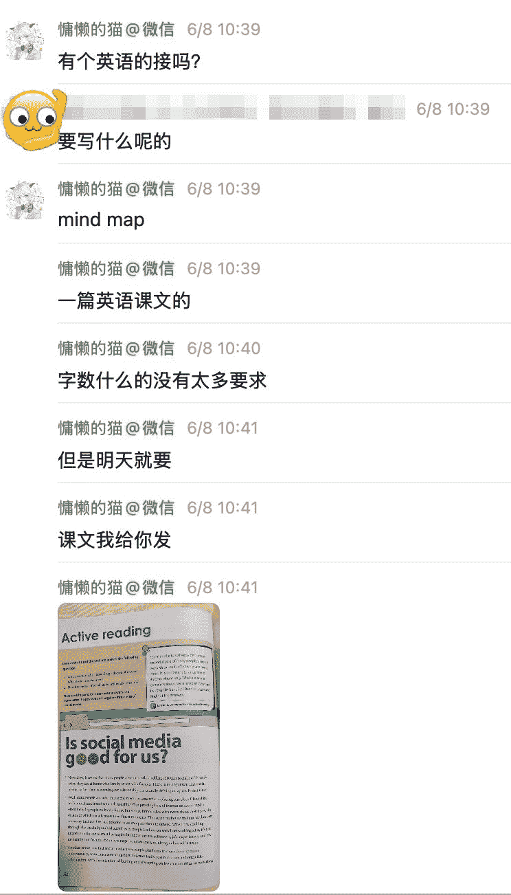

【案例三：一个标品订单的成本拆解】
品类：本科结课论文，1.5 万字，含实证分析。
客单价 1500 元。
[内嵌电子表格 - 无法获取表格信息]
提醒一下，这里是毛利，不是净利。扣除房租、固定人力和风险准备后，净利率基本能落在 50%—55% 区间。

##### 2.4 模块二收口：生意底层公式
模块二聊了转化与交付，我想留一个总公式：
生意 = 流量 × 转化 × 利润率 × 复购。
绝大多数人死磕流量，喊着要爆款要上热，客服转化只有 15%，毛利 30%，复购几乎为零。流量越大，漏斗越漏。

AI 的价值在于，它能让你把四个环节同时提到 80 分以上。过去单兵作战做不到，必须招会制图的、会聊单的、会算账的，现在单兵就能把四块兜住。

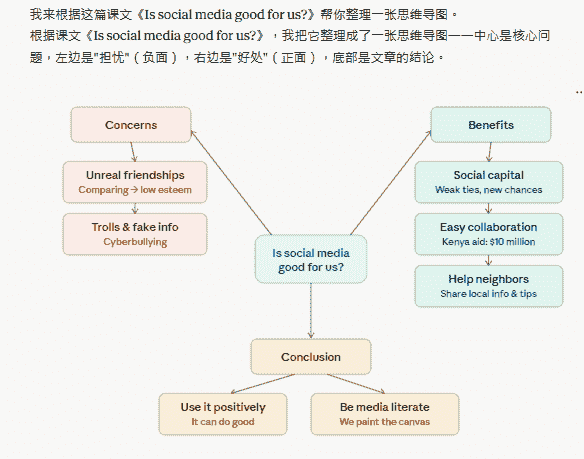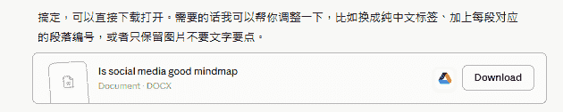

#### 模块三：从个体到工作室的实战路径

##### 3.1 工作室升级三阶段
阶段 1：独自作业。自己扛流量、销售、交付。
阶段 2：标准化外包。自己只管流量、销售。
阶段 3：团队化。自己只做决策、产品和增长。

我招第一个线下员工的契机很简单：流量运营仍要我做，谈单却占用了太多时间。谈单其实不难，我打开 BOSS，两天就筛出合适的人。
前提是我的流量相对稳定，我对增长有把握。

很多人不敢扩编，怕养不起。我的起步打法是轻模式：低底薪 + 高提成。

收入本质是：收入 = 你的时间 × 单价 × 接单量。
当这三项都接近天花板，再努力也提不上来时，你就会卡住。

##### 3.2 什么信号说明该组队了
去年我一个人 7 点起床干到凌晨两三点，连续两月，实在扛不动。

值得往团队走的信号：
1. 你成了瓶颈。订单塞满，日工 15 小时以上，消息淹没，开始丢单差评。要排到凌晨 1 点，说明咨询量已到上限，这是硬信号。
2. 收入稳定，不是脉冲式。连续 2—3 个月利润平稳，最差月份也能覆盖工资和个人开销。一两次爆单不算。
3. 工作可拆解可 SOP。售前客服、发笔记、销转、派单、交付都能写成标准步骤交出去。讲不清流程就别招人，否则双重负担。
4. 账算得过来。招来的人能帮你多赚或省时间，价值明显大于成本，就该招。

反过来别急着做重：
公域流量脆弱，封号、规则变动随时来。在现金流没跑稳前保持轻：远程兼职、不租办公室、不养全职、用矩阵分散风险。第一年能兼职就兼职，别早早重资产。毛利薄时扩张只是多养几个人多赚一点点，不如先做产品、提价、复购。

从 0 到 1 的顺序：先做减法。把自己的活标准化，能写 SOP 才能交出去。角色要三级跳：自己做 → 教别人做 → 系统自己转。

第一个人怎么找，来了怎么用。工作室的核心是系统不依赖你个人。招人是解放自己，不是绑住自己。核心信息要隔离，员工学会就走也没问题。

##### 3.3 实操卡点与解法
**解法一：10 人以下怎么搭**
【先招谁】
起步只招执行岗。流量我自己能搞定，交付一对一太耗我，必须先把交付手解放出来。
【招不到人】
别纠结线上线下，先看人。BOSS 和本地招聘群效果最好，注意 BOSS 不支持异地执照。
【坦诚招人】
我曾怕别人觉得民房办公不靠谱，撒谎说公司在装修。后来直接说实话：现在在民房，业务在跑，来就来，不来就走。越坦诚，留下的人越靠谱。
招聘打法：一个岗面十个人；三天无薪试用，不合适立刻止损；筛选标准是学习速度快、较真，而不是现有能力强。
薪酬：底薪 + 提成 + 奖金。底薪保障生活但别太高，提成强挂钩产出，奖金挂钩超额目标。员工要能算清今天做这件事能赚多少钱。
现金流警告：最凶的是扩招和扩场地。别为显得正规租办公室，别为以防万一提前招人，按订单量招，宁可自己累点。用提成撬产能，比盲目加人安全。

**解法二：用人靠 SOP**
SOP 的核心是把你脑中的判断变成别人能照做的步骤。检验标准：新人看 SOP 不问你就能上手 80%。
我们沉淀了四类 SOP：
1. 转化端 SOP：客服全流程话术库、客户分层跟进、成交未成交话术。
2. 交付端 SOP：写手招聘培训考核、交付流程、质量把控 查重+终审+售后。
3. 管理端 SOP：订单流转、数据复盘机制。

**解法三：三个血坑**
坑 1：押单一业务。年初一店单月 8 万+，平台打压，3 天归零。横向拓品类，纵向拓平台，闲鱼小红书抖音公众号都要有。
坑 2：企微风控。代写类易被封，客户群直接失联。做法：群里放两个企微主体，小群交付，关键客户加私人微信做保险。
坑 3：只靠个人强。个人能把流量转化交付打满分，但团队要的是系统能力。怎么让没判断力的人也能做出 80 分决策？怎么让流程不依赖具体的人？业务要能离开你照样跑。

最后说一句：AI 改变的不是某个行业，而是让普通人用一个人的能力完成过去一个团队的事。但 AI 不自动带来收入。真正赚钱的是懂需求、懂交付、懂商业闭环的人。

从一个人起步，把服务跑通、流程沉淀、团队搭起，这就是 AI 时代普通人拿牌的路径。

————分割线————

看完 SOP 你会觉得懂了，但 90% 人实操会卡在第一步。工具和教程是最低壁垒，立刻动手和信息差才是壁垒。

如果你想看全网最新的变现打法，和一群执行力强的极客一起下场，欢迎看我的核心私域：【懒人专属群】。
我们只拆商业闭环和 AI 效率压榨。系统内已沉淀 1000+ 跑通的套利实战。

👉 查阅圈子数字资产与上车门槛：
https://lazyso.com/insider/
认可价值、准备下场干活的，扫码加我微信（lazyhelper1）。
备注：【实操上车】，不闲聊。

