# 【油管直播——完整数据分享】两个 0 播账号，坚持直播 3 个月，双双达标 YPP

## 【油管直播实战复盘】两个从零起步的账号，坚持三个月直播双双达到 YPP 准入

260723 副业 SC 精华

## 我的油管经历

大家好，我是龙哥。2025 年 11 月进入赚钱圈，过手的是油管 AI 视频赛道。

2025 年 12 月，首个 YPP 顺利通过。

紧接着就撞上了限流和同质化天花板，2026 年 1 月，YPP 被收回。

转而去攻长视频。

2026 年 4 月，长视频数据已经满足门槛，可 YPP 申请再次被拒，理由仍然是同质化。

在迷茫之际，4 月加入了深海圈。

4 月底报名深海圈的油管直播项目，第一次吃到正向反馈。

到 7 月底，我手里在跑的 3 个油管直播号，有 2 个已经达标 YPP，一个拿下高级，一个拿下初级。跟顶尖玩家比起来不值一提。

但鉴于不少圈友正准备入局直播，或正卡在 0 播的瓶颈期，我把这份 0 播账号的完整数据拿出来，供大家参考。

油管直播最大的痛点，就是直播间一直 0 播，断断续续 0 播。这篇内容，我就用自己两个从 0 开始的账号数据，来推演一套直播推流的时间线。

## 为什么做油管直播

直播给账号带来的三层价值：

- 拿 YPP：油管竖屏直播时长同样计入长视频观看时长要求。
- 创收：竖屏直播收益偏低，但横屏直播的收益和长视频相近；达标的直播号本身也能作为资产出售变现。
- 养号：相比剪辑发布长视频，直播在时间成本上更轻，养号效率更高。

## 0 播就该放弃吗？

## 我的数据全景

深海圈第一期直播内测周期是 4 月 27 日到 5 月 20 日。

内测结束时的状态很糟：

7 个账号，5 个老号 2 个新号，5 个号全程 0 播，只有 2 个老号有少量流量。

内测后我精简到 3 个号持续运营，到 7 月 20 日的数据如下：

## 0 播要熬多久才会推流？推流时间线拆解

内测结束后复盘时，我怀疑推流和粉丝量强相关。

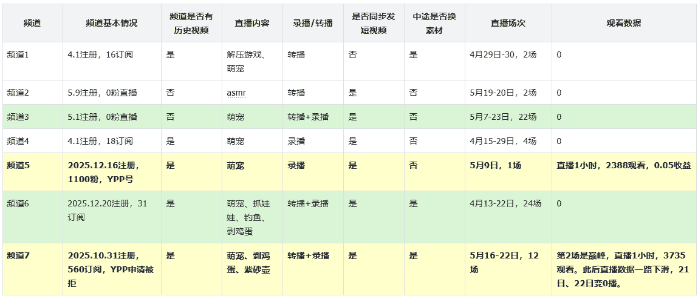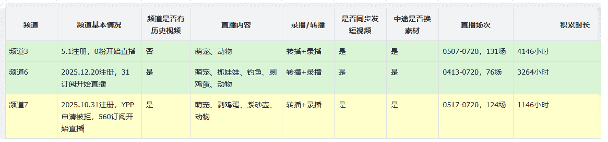

内测期间有流量的 2 个号，粉丝都已经 500+。

而数据特别好的圈友，基本都是用做过 Shorts、粉丝基数大的老号来开播。

为了验证这个假设，我用两个账号做了对照。

账号 1，5 月 1 日新注册，0 粉起步，持续开播，从未中断。

账号 2，2025 年 12 月 20 日注册，起播时有 31 个订阅。内测结束后多次断更，用发短视频的方式养号，再恢复直播。

## 账号 1：全程不断播的数据截图

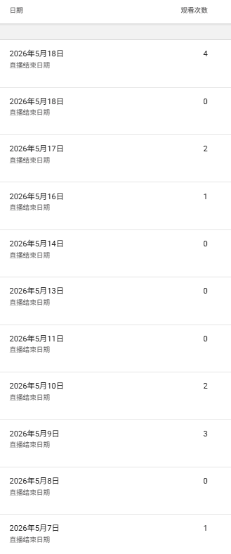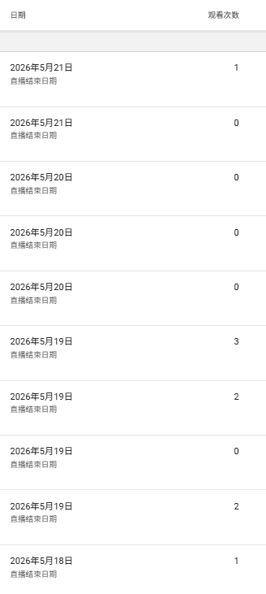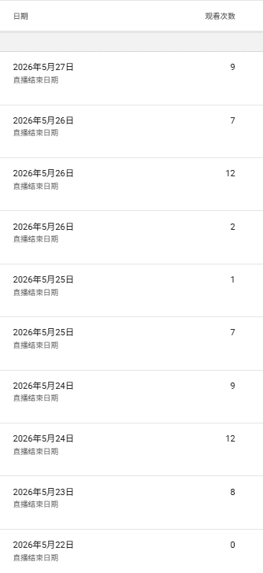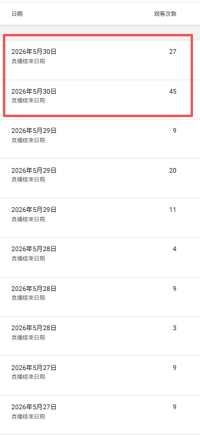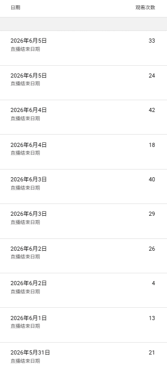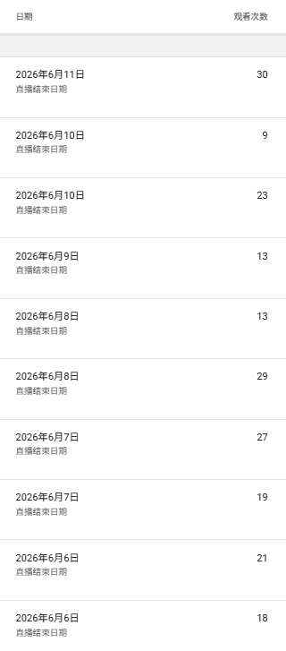

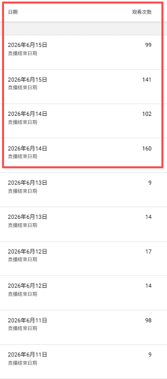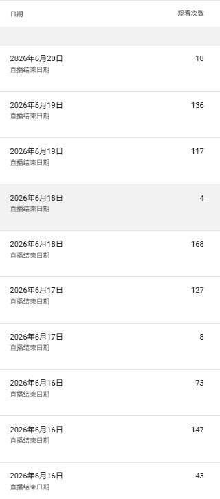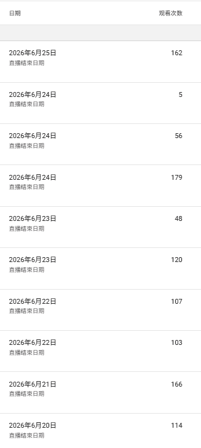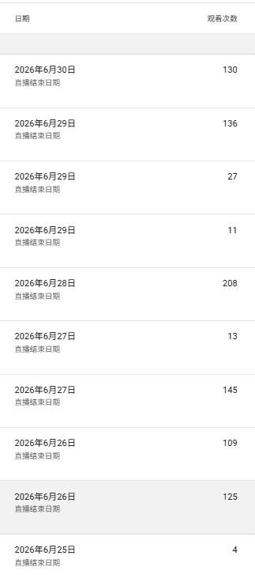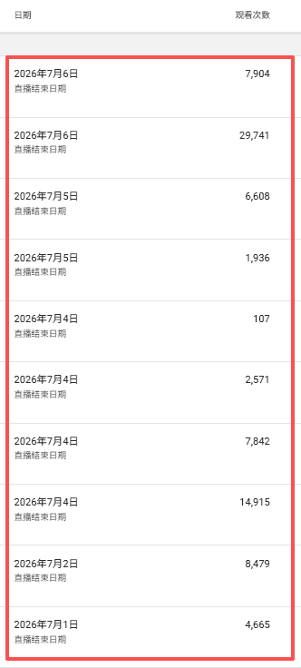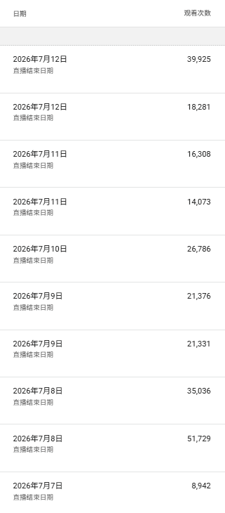

## 账号 1 推流时间线

- 5 月 7 日起播，一直 0 播。
- 5 月 30 日，直播回放开始以长视频形式被展示，每场回放约 1000+ 展示，播放 10-20 个左右，但直播间依旧 0 播。
- 6 月 14 日，直播间首次出现少量推流，当时订阅数约 50。之后单场观看稳定在百级左右。
- 7 月 1 日更换赛道后迎来小爆发，观看量从前一天的 130 直接跃到 4464，翻了 40 倍。
- 7 月 19 日，直播累计时长达到油管 4000 小时门槛。

## 对照组 账号 2：断播养号后再重启的数据截图

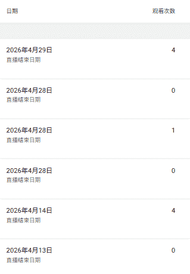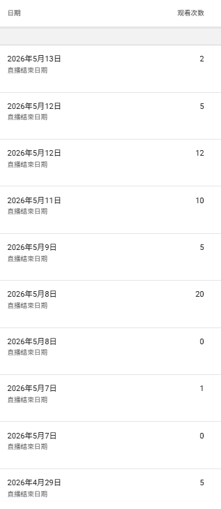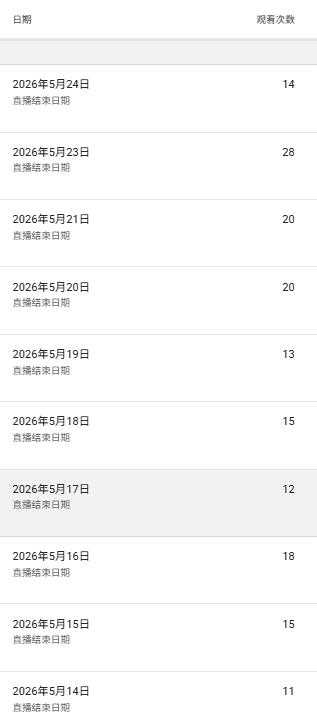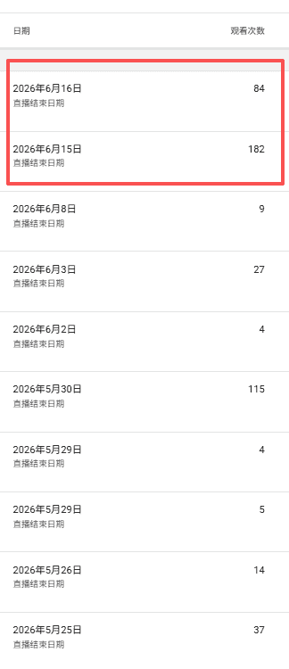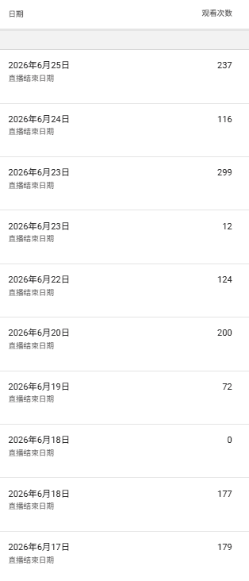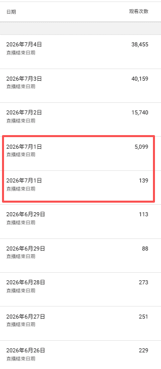

## 对照组 账号 2 推流时间线

账号 2 起步不纯净。2025 年 12 月 20 日注册，曾发长视频，数据多数被隐藏。31 订阅起播。

内测结束后多次停播，期间发短视频养号。

- 4 月 13 日起播，持续 0 播。
- 5 月 8 日，直播回放开始有长视频展示，直播间仍 0 播。
- 6 月 3 日停播。
- 6 月 15 日恢复开播，受账号 1 的启发测试恢复效果，直播间果然开始推流，单场观看在 100-200 区间。
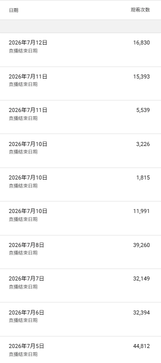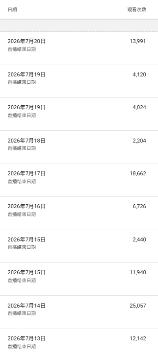
- 7 月 1 日同样更换赛道迎来爆发，第一场 139 观看，第二场直接 5099 观看。
- 7 月 19 日，直播累计时长达到 3000 小时门槛。

## 时间线总结

- 0 粉也能申请开播权限。
- 大约 20 天后，直播回放会开始获得长视频类推流。
- 大约 40 天左右，直播间本身开始被推流。

## 中途断流 0 播，还能回来吗？

能回来。

开播初期出现流量，再消失是常见现象。我的经验是坚持 7 天左右就能恢复。

例如 6 月 4 日直播间观看 1 万 6，次日开始 0 播，实际是回放带来的一点数据。连续播了 7 天 13 场，到 6 月 11 日直播间流量恢复正常。

## 影响直播推流的关键因素

基于实操，我总结出三点：

1、账号活跃度决定是否推流。持续活跃 40 天以上的账号，直播间才会打开推流阀门。参考账号 1 的数据。
2、赛道选择决定推流质量。起初我选能复刻的选题，比如剥鸡蛋，数据平平。后来发现选海外用户少见、有本土特色的内容，如中国美食直播，数据明显更好。切换赛道后数据立刻提升。
3、基础粉丝量决定冷启动速度。内测期一上来就有流量的，多是做过 Shorts 的老号。油管直播起初主要推给订阅用户，所以老号先天优势明显。

很后悔当年把自己的 Shorts 老号删了。

## 我用的工具

直播工具：深海圈直播工具。感谢曹教练，工具体验非常顺滑。

录播工具：

https://github.com/ihmily/DouyinLiveRecorder/releases 感谢萧炎大佬分享，录播很稳。

深海圈直播工具自带录播功能，圈友也可直接使用。

特别感谢邵先森教练、轻舟教练。

在深海圈项目前，我一直想做油管直播却无从下手，正是邵教练和轻舟教练把我带进了门。轻舟教练让我理清了直播技术逻辑，邵教练手把手带我从 0 到 1 跑通录播 VPS 全流程。

一点微末经验供参考，祝各位圈友月月入万刀！

————分割线————

读完 SOP，你可能觉得懂了。但 90% 的人第一步实操就卡住。

工具和教程只是基础门槛，真正的门槛是立刻动手和圈层的信息差。

我们不空谈，只拆商业闭环和 AI 效率。社群内已沉淀 1000+ 跑通的套利实战。

👉 查看圈子数字资产与入群门槛：

https://lazyso.com/insider/

备注：【实操上车】，不闲聊。

