# 从 YouTube 新手到单条视频破亿播放：我这一年做 AI 内容的真实复盘

过去一年，我经历了两次从零开始运营 YouTube，也两次成功开通 YPP；两个频道累计订阅超过 10 万，总播放量超过 2 亿，其中一条 AI Shorts 更是冲到了 1 亿播放。

但结果并不只有成功。

靠短视频开通的两个 YPP，后来分别因为儿童相关问题和内容同质化被取消。如今，我正在从 Shorts 转向长视频，重新摸索一条更稳定、更合规的内容路径。

所以，这篇文章不是“如何快速靠 YouTube 赚钱”的教程，而是一次完整的项目复盘：我如何从一个完全不懂 YouTube 的新手起步，如何跑出破亿播放，为什么两个 YPP 最终没有保住，以及如果重新开始，我会继续做什么、坚决避免什么。

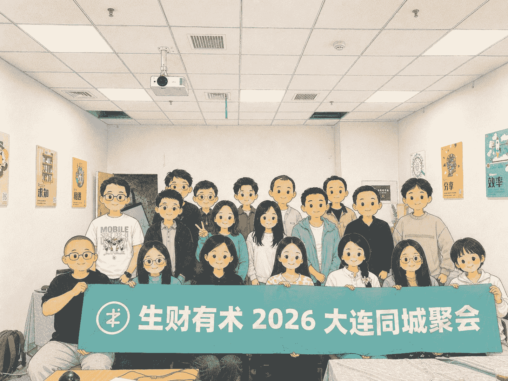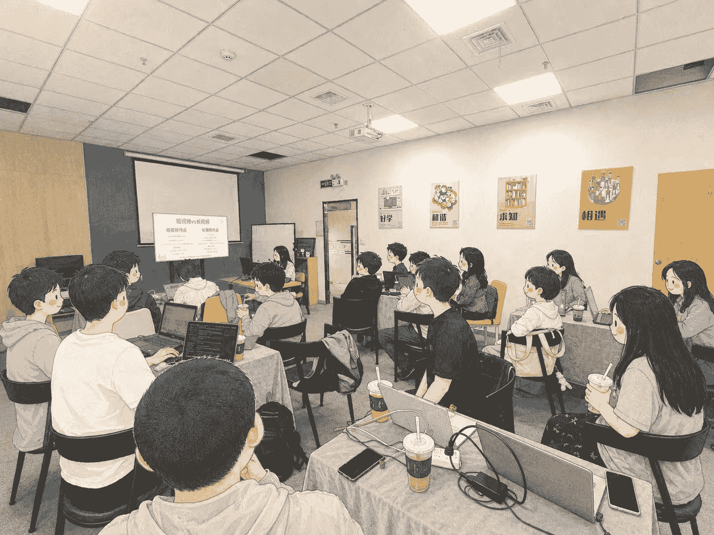

## 一、1 亿播放与两次失去 YPP，构成了我这一年的全部经历

### 1.1 接到分享邀请时，我第一反应是犹豫

当杨哥邀请我做 YouTube 运营分享时，我其实并没有特别兴奋，更多的是不安。

因为我很清楚，自己的经验并不是一套已经被验证、可以稳定复制的成功方法。两个通过 Shorts 开通的 YPP 都已经被取消，而我正在尝试长视频，也还处于早期探索阶段。

另一方面，赚钱里有很多真正厉害的项目操盘手。和他们相比，我的成绩并不算多么突出。

后来杨哥的一句话让我改变了想法：只要一个项目真正做过、拿到过结果，就一定能总结出一些对别人有帮助的东西。与此同时，公开分享也可能带来新的资源和连接。

我逐渐意识到，复盘并不是为了证明自己多成功，而是把结果背后的选择、执行、判断和代价全部摊开来讲。

成功经验可以让别人少走弯路，失败经历则可能直接帮别人避坑。尤其是 YouTube AI 视频这种变化快、门槛相对低、规则又不断调整的项目，失败案例往往比单纯的成功故事更有参考意义。

### 1.2 真正难的，从来不是把 AI 视频做出来

现在制作一条 AI 视频，技术门槛并不算高。

图片可以用 AI 生成，视频可以通过文生视频工具制作，剪辑和发布也有成熟流程。只要愿意花时间学习，大多数人都能完成。

真正拉开差距的，是工具之外的判断：

- 哪些赛道仍然值得进入？
- 什么样的账号适合作为参考？
- 对标时到底应该拆解选题、节奏，还是画面？
- 新手应该从 Shorts 还是长视频开始？
- 数据差时，问题究竟出在账号、赛道还是内容？
- 为什么视频能正常发布，却可能无法通过 YPP 审核？
- 平台规则变化之后，曾经有效的方法是否还安全？

因此，我想分享的并不是一套简单的“AI 视频生产教程”，而是一个真实账号从启动、增长、爆发，到限流、调整和失去创收资格的完整过程。

这其中有 69 天开通 YPP、单条视频破亿的经历，也有流量断崖、账号风险和两次失去 YPP 的代价。

工具只决定你能不能把内容做出来，赛道判断、内容差异化、数据分析和风险意识，才决定这个项目能走多远。

### 1.3 如果只看结论，先记住这五点

**第一，AI Shorts 依然有机会，但“复制粘贴”越来越危险。**

过去那种反复套用相同提示词、照搬爆款脚本、批量生产相似视频的方式，正在面临越来越高的同质化风险。

AI 可以帮助创作者提高效率，但不能替代内容本身的改编、创新和差异化。

**第二，YPP 只是阶段性结果，不是账号的保护罩。**

成功开通 YPP，只代表账号暂时获得了广告分成资格，并不意味着之后一定安全。

视频能够上传成功，不代表长期符合平台政策；别人的视频可以爆，也不代表你照着制作就不会出问题。

**第三，Shorts 更适合入场，长视频更适合长期经营。**

短视频容易获得反馈，涨粉速度快，适合新手快速测试赛道。但它的 RPM 较低，也更容易陷入同质化。

长视频启动慢、前期可能长期没有播放，却拥有更高的 RPM、更强的搜索和长尾价值，更适合沉淀长期内容资产。

**第四，爆款有运气，但绝不是完全靠运气。**

热点、算法和观众情绪确实会影响一条视频能否爆发，但选题、对标、开头节奏、内容改编和更新频率，都能提升内容被推荐的概率。

运气无法复制，但提高“撞上运气”概率的方法可以复用。

**第五，从第一天就要把合规放进流程。**

版权、儿童安全、暴力、动物伤害和内容同质化，都不应该等到申请 YPP 之前才检查。

更稳妥的顺序应该是：

> 先理解规则，再开始生产；先排除风险，再放大流量。

---

## 二、从 69 天开通 YPP 到单条破亿：我的四段经历

回头看，我并不是一开始就找到正确赛道，然后一路顺风做到 1 亿播放。

更真实的过程是：尝试一个方向，获得一些流量，遇到问题，再切换赛道，最后重新理解平台和内容。

下面按照不同阶段，分别讲讲当时的背景、结果、动作、问题和复盘。

---

## 2.1 第一阶段：69 天开通第一个 YPP，微创新比纯模仿更重要

### 2.1.1 起步：从达人秀类 AI 视频开始

2025 年 6 月 11 日，我发布了第一条 YouTube 视频。

那之前，我几乎没有 YouTube 运营经验，接触 AI 视频也才两周左右。

当时选择的是达人秀相关赛道，视频通常控制在 15 到 20 秒，每天更新一条。

刚开始做的时候，一条视频往往要花两三个小时。图片效果不满意，就不断重新生成；提示词不精准，就反复修改。

那时我没有急着追求数量，而是把更多时间放在画面质量和制作流程上。

### 2.1.2 结果：69 天开通 YPP，单条视频获得 3600 万播放

从发布第一条视频，到达到高级 YPP 的门槛，我用了 69 天。

这期间，我第一次完整跑通了从选题、制作、发布到获得流量和变现的闭环。

频道早期每天大约有 5 万到 10 万播放，普通视频一般在 2 万到 3 万之间，表现好的可以达到 10 万左右。

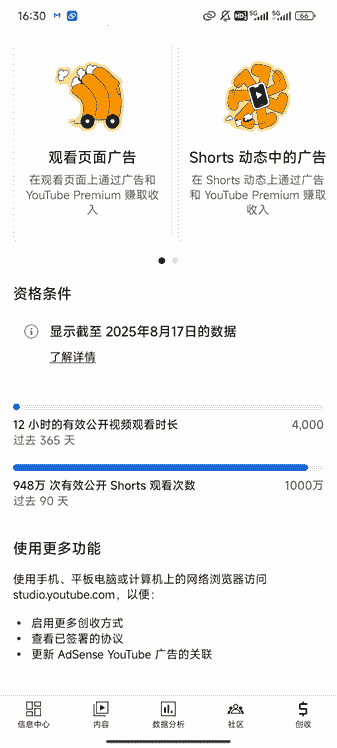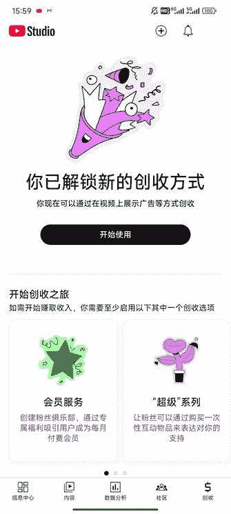

真正推动频道跨过门槛的，是一条千万级视频。

它发布初期只有 100 多万播放，过了一个多月后又获得了一轮推荐，最终涨到 3600 万。更重要的是，这条视频并没有在爆发后迅速归零，接近一年后依然能够持续获得长尾流量。

开通 YPP 后，频道每天大约有几美元收入，RPM 约为 0.03。

虽然金额不高，却让我第一次确认：一条已经发布的内容，能够在不继续投入制作时间的情况下，持续产生收入。

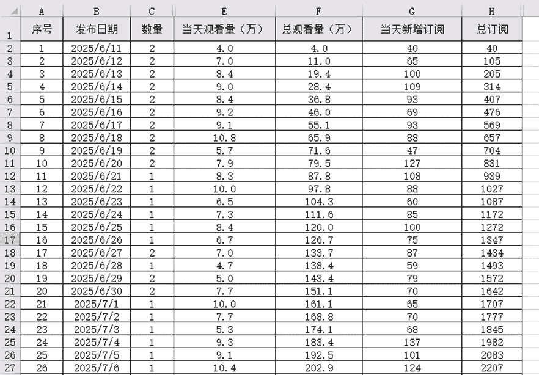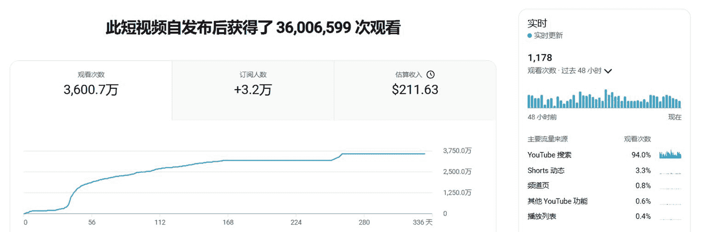

这次经历带给我的最大信心，不只是“我开通了 YPP”，而是验证了这条路径确实能被普通人跑通：

AI 生产内容，YouTube 分发流量，YPP 完成变现。

### 2.1.3 关键动作：保留爆款结构，但加入自己的变化

后来复盘那条帮助我开通 YPP 的视频，我发现它并不是完全照搬对标作品。

整条视频用了 4 张关键帧图片，其中有 2 张是按照我自己的想法重新设计的。

当时我还没有系统总结出“差异化”这个概念，只是觉得对标内容可以做一些调整。

但正是这种小幅改动，让视频保留了原有内容经过市场验证的部分，同时又没有与原作品完全重复。

对标可以帮你找到方向，微创新则决定观众为什么愿意再看一遍。

### 2.1.4 第一个教训：能上传，不等于绝对安全

开通 YPP 后，达人秀赛道的流量开始下降，我又尝试了印度故事、耶稣相关视频等方向。

其中一些视频也取得了百万甚至千万播放，但当时我没有意识到，内容中出现的儿童形象和危险情节，可能已经触及 YouTube 的创收政策。

10 月 23 日，我查看收益后台时发现，第一个 YPP 被终止，平台给出的理由是“鼓动对未成年人的不受欢迎的关注”。

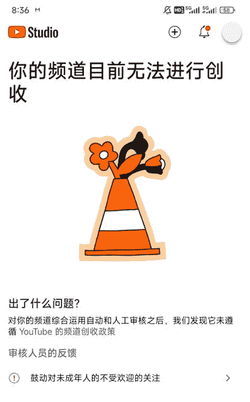

那一刻我才发现，自己之前一直混淆了两件事：

视频能够正常发布，并不代表它长期合规；别人做过并且获得了高播放，也不意味着你照着做就一定安全。

没有立刻受到处罚，只能说明风险暂时还没有暴露，不代表内容没有问题。

### 2.1.5 如果重新开始，我会先做合规检查

如果再做一次第一个频道，我会从发布第一天就建立风险排查机制：

- 上传前检查儿童、暴力、动物伤害和版权问题；
- 不因为对标视频表现好，就默认它没有风险；
- 定期复查已经发布的内容；
- 对无法判断的选题，宁愿放弃，也不抱侥幸心理。

第一次失去 YPP 让我明白，合规不是申请收益时临时补上的步骤，而应该成为日常内容生产的一部分。

这一阶段的核心经验是：

> 爆款不是简单复制出来的，而是在成熟方向上做出有效改编后产生的；YPP 也不是开通后就能永久保有，长期收益建立在持续合规之上。

---

## 2.2 第二阶段：14 天开通第二个 YPP，单条视频冲到 1 亿播放

### 2.2.1 起点：黑猩猩内容遇上 Sora2 红利

第一次失去 YPP 后，我花了大约一个月重新调整方向。

2025 年 11 月中旬，我注意到有人利用 Sora2 制作 AI 视频，并在短时间内完成 YPP 申请，于是决定尝试。

通过关键词搜索，我找到了黑猩猩相关内容。

这类视频往往只有十秒左右，Sora2 的文生视频能力又比较强，只要根据对标视频倒推出提示词，就能较快生成具有观赏性的画面。

制作效率明显提升后，我每天发布 5 到 6 条视频，日均投入时间大约 1 到 1.5 小时。

### 2.2.2 结果：14 天达到门槛，一条视频超过 1 亿播放

第二个频道的增长速度远超第一个。

运营到第 14 天，频道累计观看量达到 2900 万，并满足高级 YPP 的申请条件。

开通收益后，连续 8 天每天收入都超过 80 美元。与第一个频道每天几美元的收入相比，这让我第一次看到 AI Shorts 在短期内快速放大收益的可能性。

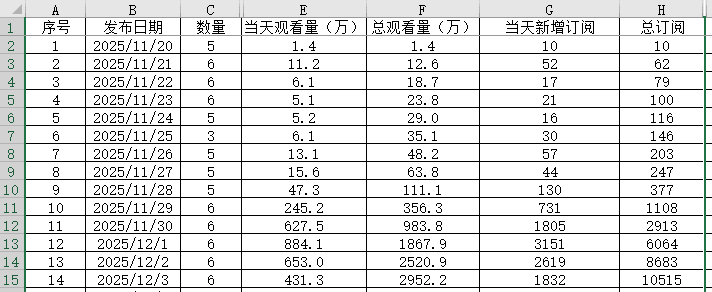

其中一条视频在发布约 20 天后突破 1 亿播放。

这个结果看起来很遥远，但它确实发生在一个制作并不复杂、每天投入时间只有一两个小时的频道上。

不过，播放量和收入之间的差距也非常明显。

这条视频前 6000 万播放发生在开通 YPP 之前，因此没有产生广告收益；YPP 开通后新增的约 4000 万播放，RPM 约为 0.02，最终收入为 571 美元。

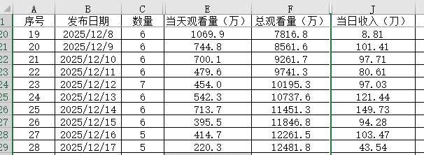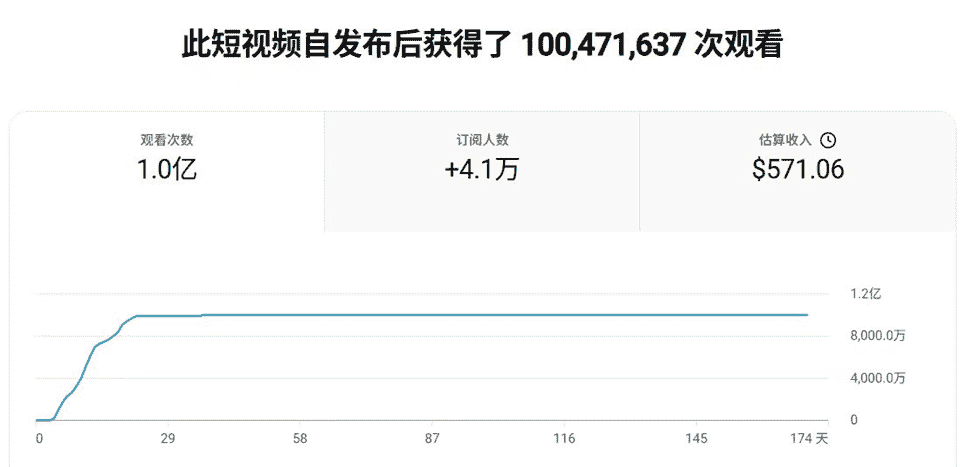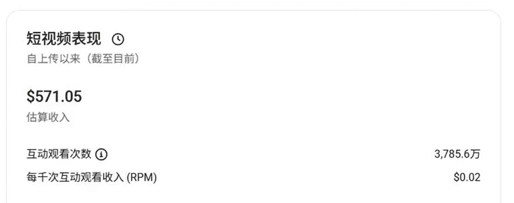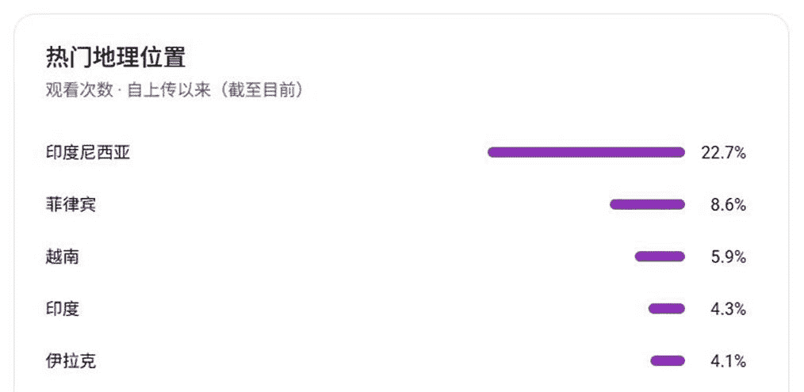

这组数据让我看清了 Shorts 的两面：

它可以在很短时间内制造极大的播放量，但高播放并不等于高收入。

### 2.2.3 为什么增长这么快：多个条件同时出现

这一阶段并不是因为我掌握了某个绝对有效的爆款公式，而是几个因素叠加在了一起：

- 黑猩猩内容不依赖语言，全球观众都容易理解；
- 动物拟人、反差和夸张情节很适合 AI 表达；
- Sora2 降低了视频制作成本；
- 每天 5 到 6 条更新，增加了测试样本；
- 赛道正处于热度期，平台流量和观众需求同时存在。

高频发布的意义，并不是不断制造重复视频，而是增加测试机会。

只有样本足够多，才能判断问题究竟出在选题、画面、前三秒、脚本，还是账号本身没有获得推荐。

### 2.2.4 第二个教训：平台变了，旧方法不能硬撑

12 月 18 日，YouTube 算法调整后，频道流量突然大幅下滑。

此前每天约有 200 万播放，调整后只剩下 1 万左右，限流持续了 9 天。

与此同时，越来越多同类频道因为内容相似度过高而失去 YPP。

我的频道当时还没有被处罚，这让我产生了侥幸心理。我知道直接拆解爆款、反复套用相同提示词已经存在风险，却舍不得删除已有内容，也不愿意放弃当时高效的生产方式。

后来我尝试用 AI 对脚本进行二次改写，但流量依旧不稳定。

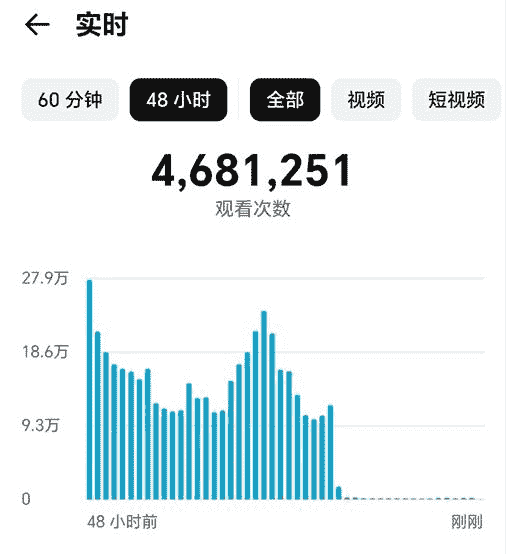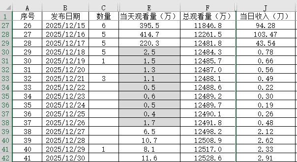

以前一条视频拿到 3 万播放并不难，后来很多视频只能获得几千播放。频道每隔一段时间就会发生一次流量腰斩，收入也从每天几十美元降到了几美元。

2026 年 2 月 24 日，第二个 YPP 最终因为同质化内容被取消。

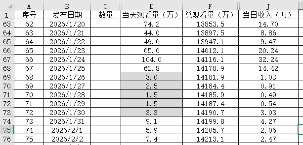

这一次我没有第一次那么震惊，反而有一种压力释放的感觉。因为在收到通知之前，我已经长时间处于“账号什么时候会出问题”的焦虑里。

### 2.2.5 如果重新来过，我不会继续拿账号安全下注

如果重新做这一阶段，我仍然会追热点、尝试新工具，也会保持较高的测试频率。

但我不会继续直接复用提示词，更不会因为一种方法短期有效，就把它当成可持续能力。

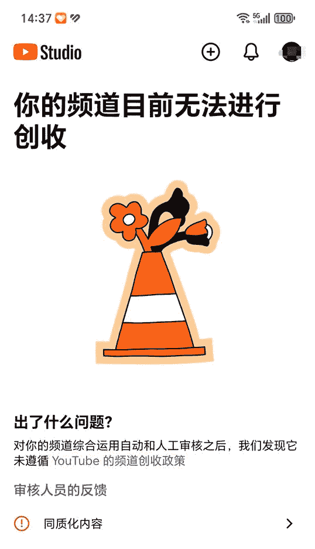

当 12 月 18 日第一次出现明显限流时，我应该立即做三件事：

1. 停止继续生产高度相似的内容；
2. 对已发布视频进行风险排查，处理高风险作品；
3. 重新设计脚本、角色、情节和镜头语言。

平台规则发生变化后，继续坚持旧模式并不是执行力强，而是在不断累积隐患。

这一阶段让我明白：

> 热点、工具红利和高频测试能够快速放大成绩，但只有及时适应规则，流量才有机会转化为长期收益。

---

## 2.3 第三阶段：有 2600 万播放，却主动放弃申请 YPP

### 2.3.1 转向 K-pop，并尝试打造自己的角色 IP

2026 年 2 月开始，Seedance2.0 又带动了一轮 AI 视频热潮。

到了 3 月，我利用第一个被取消 YPP 的频道重新尝试 K-pop 方向。

视频时长大约在 10 到 30 秒之间，内容主要分为两种：

- 参考已经验证过的爆款形式；
- 在爆款基础上重写故事和内容。

制作流程也比最开始简单了很多：

先用 Google AI Studio 拆解对标作品并改写脚本，再用香蕉、即梦等工具生成角色图和首帧图，最后通过即梦生成视频并剪辑发布。

这一次，我不再只做表层复刻，而是开始设计固定角色 IP，希望通过持续出现的角色，增强频道的统一感和辨识度。

更新频率保持每天一条。

### 2.3.2 结果：24 条视频带来 1100 万播放，停更后又涨到 2600 万

一个月内，我发布了 24 条视频，累计播放量达到 1100 万。

但就在这个阶段，YouTube 开始明显整治 K-pop 同质化内容，大量相关频道被取消 YPP。

考虑到潜在风险，我选择暂停更新。

没想到停更约两周后，其中一条视频又获得了新一轮推荐，播放量涨到 1500 万，频道累计播放达到 2600 万，重新具备申请 YPP 的条件。

但这一次，我没有提交申请。

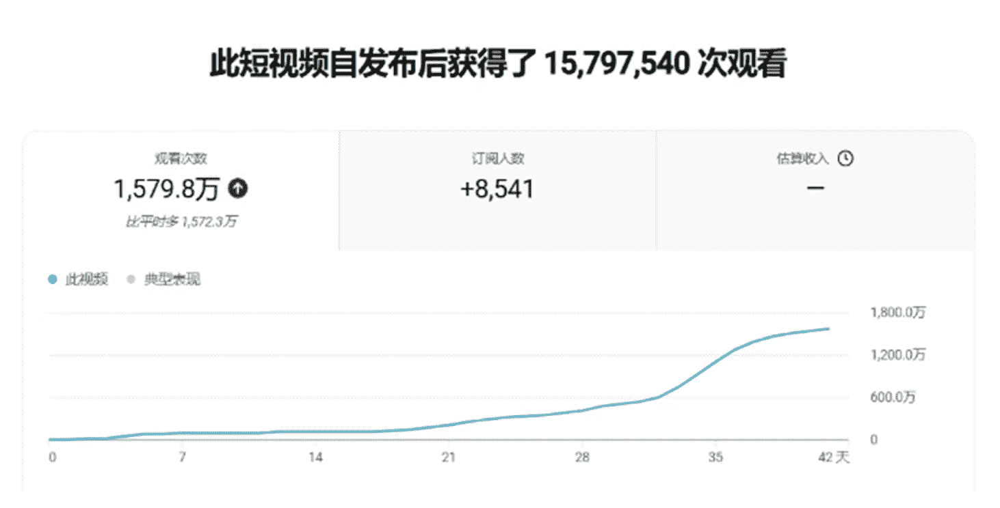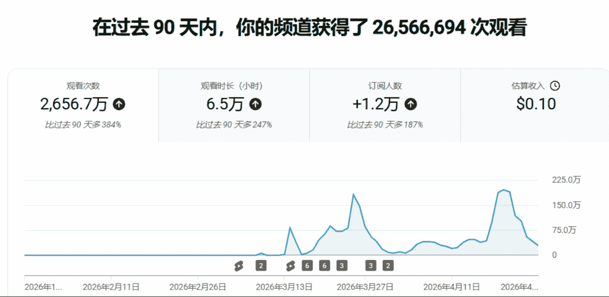

### 2.3.3 内容方式开始改变：从复制形式，到重新表达

这一阶段，我开始真正意识到改编的重要性。

我不再只是替换画面，而是尝试调整故事脚本、人物关系和情绪发展；也不再每条视频都更换角色，而是通过固定角色塑造频道风格。

这意味着我开始从“看到爆款就复制”，转向“理解爆款为什么有效，然后用自己的方式重新表达”。

### 2.3.4 第三个教训：流量大，不代表适合长期投入

K-pop 赛道的吸引力很强。

它拥有成熟 IP、庞大粉丝群和持续不断的话题，但风险同样集中：

- 版权边界不够清晰；
- 角色与内容高度集中；
- 创作者大量涌入；
- 很容易陷入模板化和同质化。

我一开始只看到了这个赛道的播放潜力，却没有充分评估它能不能长期经营。

有流量的赛道，不一定是安全的赛道；能爆的方向，也不一定适合做成长期项目。

### 2.3.5 如果重新选择，我会把政策风险纳入赛道评估

以后判断一个赛道，我不会只看它最近能不能出千万播放，还会考虑：

- 是否严重依赖受版权保护的 IP；
- 同类账号是否已经高度模板化；
- 是否有机会建立独立的角色与内容风格；
- 即使达到 YPP 门槛，能否经受长期审核。

这一阶段最大的教训是：

> 不是所有达到门槛的账号，都值得立刻申请 YPP。长期安全，比短期开通更重要。

---

## 2.4 第四阶段：开始做长视频后，我才真正理解什么叫“0 播”

### 2.4.1 从追求即时反馈，到积累长期资产

经历两次 YPP 被取消后，我开始重新思考 Shorts 的价值。

短视频确实容易获得反馈，也更容易快速涨粉，但它对热点和发布频率依赖较高，RPM 较低，而且很容易落入同质化竞争。

长视频的启动速度更慢，前期可能连续发布却没有播放，但它通常拥有更高的 RPM、更长的生命周期，也更有机会沉淀为可持续积累的内容资产。

因此，从 2026 年 4 月开始，我把主要精力转向长视频。

### 2.4.2 现实结果：28 天只有 900 次观看

截至分享时，长视频还没有跑出明显结果。

单条内容大多只有几十到一百左右的播放，距离高级 YPP 所需的 4000 小时观看时长，还有很长距离。

但 Shorts 和长视频，本来就不是同一种增长逻辑。

短视频追求的是快速测试、快速反馈和高频分发；长视频更看重选题深度、观看时长、内容质量和长期积累。

短期没有播放，并不一定意味着方向错误，也可能只是长视频项目的正常起步阶段。

---

## 三、最后的总结：我真正学到的，不是如何做出一条爆款

这一年里，我做出过 1 亿播放，也两次失去 YPP；经历过流量暴涨，也经历过账号几乎失去价值；见过 AI 工具带来的效率红利，也亲身承担了同质化和政策变化的代价。

如果让我重新开始，我依然会使用 AI，也依然会从 Shorts 入门，但做法会完全不同：

- 先判断赛道是否值得长期经营；
- 对标爆款，但不直接复制；
- 在脚本、角色、情绪和镜头上做出真实改编；
- 从第一天开始检查版权与平台政策；
- 出现限流信号时，及时停止并调整；
- 不把 YPP 当成项目终点；
- 用 Shorts 做测试和获客，用长视频沉淀内容资产。

AI 降低了内容生产的门槛，却没有降低判断的重要性。

真正决定一个频道能不能走远的，不是你一天能生成多少条视频，而是你能不能在流量、创新和合规之间找到平衡。

爆款可以带来机会，合规则决定你能不能留下来。

短内容和长内容，根本不是同一套节奏。

通常情况下，短视频发布后几天内就能看出推流情况；长视频则可能要等上7天，甚至更久。短视频拿到1万播放并不稀奇，但对长视频来说，能够达到这个数字，已经说明内容具备一定竞争力。

#### 2.4.3 关键动作：接受长视频的延迟，用小规模测试替代反复内耗

在这一阶段，我逐渐调整了自己的测试方式：

- 同时运营多个账号，每个账号先连续发布2—3条内容；
- 至少等待一周再做判断，不因为前几天没有播放就马上停掉；
- 每隔两三天更新一次，把更多精力放在选题、脚本和包装上；
- 重点查看封面点击率、平均观看时间以及流量来源；
- 对有数据反馈的方向继续迭代，长时间没有反馈的内容暂时停止。

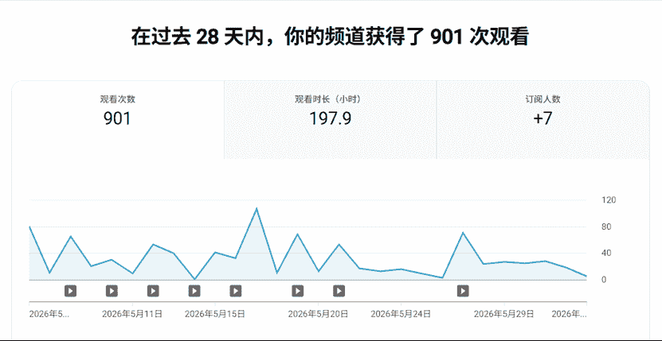

长视频不是靠单纯增加发布数量就能解决问题。

标题与封面负责让观众产生点击，开头决定观众是否愿意继续，脚本和内容质量则决定他们能够停留多久。

#### 2.4.4 踩坑：把短视频的反馈速度套用到长视频

长期做短视频之后，我很自然地把短视频的判断方式带到了长视频上。

视频发出去几天还没有播放，我就开始怀疑账号是不是出了问题；一条内容只有几十次观看，也会让我觉得这个方向没有机会。

实际上，长视频的推荐启动更慢，验证周期更长，标题、封面和开场对结果的影响也更明显。

如果用短视频的耐心标准来要求长视频，最容易出现的结果不是做出爆款，而是在内容真正获得机会之前就主动放弃。

#### 2.4.5 复盘：如果重新来过，我会更早接受长视频的慢节奏

如果再做一次，我会提前准备多个方向，用不同的内容形态进行并行测试，而不是因为一条视频的表现，就决定整个频道的成败。

同时，我会把更多时间放在三个关键问题上：

1. 选题是否对应了真实而明确的需求；
2. 标题和封面能不能让观众产生点击；
3. 开头是否足够有吸引力，让观众愿意继续往下看。

长视频目前还没有给我带来足以展示的成绩，但它让我重新认识了内容创作本身。

这一阶段最重要的结论是：短视频拼的是验证效率，长视频考验的是内容耐心；短视频通过增加发布次数提升爆款概率，长视频则需要时间让内容价值逐渐显现。

## 3、1亿播放并非神秘公式：我为什么能够跑出来

真正拿到1亿播放后，我最大的收获不是掌握了某种“爆款秘方”，而是开始看淡爆款本身。

以前看到别人做出几千万、上亿播放，我总觉得他们一定掌握了某个普通人不知道的技巧。

等到自己真正经历一次后，我才发现，爆款既有偶然因素，也存在可以拆解的条件。

那条视频能够达到1亿播放，确实离不开运气。

它可能碰巧赶上了合适的热点、平台分发和观众情绪。假如换一个发布时间、换一个账号，甚至只是换一批最初接触到它的观众，最终结果都可能大不相同。

但复盘之后我发现，这次成功并不是某个单独动作带来的，而是对标选择、热点属性、AI适配度、工具效率以及发布节奏共同作用的结果。

这些因素无法保证下一条视频继续破亿，却可以帮助我们减少无效尝试，提高遇到爆款的机会。

### 3.1 原因一：找到了两周内发布、已经破亿的参考样本

当时，我通过关键词搜索寻找赛道和参考对象，看到一条发布不到14天、播放量已经超过1亿的视频。

这条视频的特殊之处在于，它并非来自一个拥有庞大粉丝基础的频道，频道订阅量甚至低于3万。与此同时，频道其他视频大多只有几万到几十万播放，唯独这一条远远甩开其他作品，成为非常明显的异常值。

它至少说明了三件事。

#### 3.1.1 这个热点仍然处于上升阶段

Shorts的趋势变化很快。

几年前出现过一条1亿播放的视频，只能说明当时市场喜欢这个主题，无法证明今天继续做仍然有效。

而一条不到14天就快速破亿的内容，则说明当前观众仍然有需求，平台也仍在向相关内容分配流量。

过去的爆款说明曾经有效，最近的爆款才更能说明现在有效。

#### 3.1.2 高播放可能来自内容本身，而不是账号体量

寻找参考视频时，不能只盯着播放量，还要把频道粉丝数、日常播放表现和爆款数据放在一起比较。

大频道通常拥有更多粉丝、历史积累和账号权重。它们的视频即使获得高播放，也可能有频道基础带来的助力，并不适合新账号直接参照。

对新手而言，更值得研究的是“小频道里的大爆款”：

账号本身订阅量不高，其他视频表现也比较普通，但某条内容却突然突破千万，甚至达到上亿播放。

这种反差说明，视频的增长更可能由选题、内容和推荐机制推动，而不是依赖原有粉丝。

真正值得寻找的，不是最强大的频道，而是普通频道中最异常的那一条内容。

#### 3.1.3 这个方向已经被市场提前验证

很多新手选择题材时，首先问的是“我感不感兴趣”，却没有确认“观众是否真的愿意看”。

把这条视频作为参考，相当于通过真实数据验证了几个关键问题：

- 这个题材有稳定的观看需求；
- 这种表达方式能够吸引并留住观众；
- 小体量频道也可能突破原有流量层级；
- 平台最近仍然愿意推荐这一类型的内容。

当然，市场验证不等于照着制作就能复制结果。它真正提供的价值，是让我们优先测试一个已经被证明有机会的方向，而不是从完全陌生的领域开始摸索。

对标的意义，不在于提供一个可以直接照搬的模板，而在于缩小试错范围。

### 3.2 原因二：题材容易理解，更适合跨语言传播

我最终选择了黑猩猩相关内容。

它最明显的优势，不是故事信息有多复杂，而是观众几乎不需要额外学习成本。

动物、人物、动作和情绪本身就能完成大部分信息传递。即便没有完整对白，观众也可以很快理解画面中发生了什么。

这对短视频尤其重要。

观众刷到一条内容时，通常不会耐心等待复杂的背景说明。如果前几秒仍然无法理解内容，他们很可能直接划走。

黑猩猩具有很高的视觉辨识度。当它出现在人类生活环境中，做出接近人类的动作，或者与真人形成明显反差时，画面天然会产生荒诞感、冲突感和好奇心。

与此同时，这类内容对语言的依赖较低。即使没有复杂台词，来自不同国家的观众也能理解其中的冲突、反差和情绪变化。

适合短视频的热点，不能只满足“有人看”，还要尽量做到让不同文化背景的观众都能迅速看懂。

### 3.3 原因三：题材本身适合借助AI强化画面

并不是每一种内容都适合交给AI制作。

有些题材依赖真人表演，有些依赖新闻背景，还有些需要大量对白来推动情绪。即便能够用AI生成，也不一定比真实拍摄更有优势。

黑猩猩题材则非常适合AI。

动物拟人、夸张动作、超现实环境和荒诞转折，恰好都是AI比较擅长呈现的视觉元素。现实中拍摄困难、成本高昂，甚至很难实现的画面，AI可以在较短时间内生成出来。

观众观看这类内容时，也不会把“完全真实”当作第一要求。

更重要的是，视频能否在几秒内制造足够强烈的视觉刺激，并让人产生“后面还会发生什么”的期待。

因此，AI在这里不只是替代摄像机，而是在放大这个题材原本就具备的视觉张力。

真正适合AI的选题，不是“它也能做”，而是“用它来做更划算、更有优势”。

### 3.4 原因四：Sora2降低了验证想法的成本

当时，Sora2正处于关注度较高的阶段。

在早期制作AI视频时，我通常需要先生成关键帧，再进行图生视频，还要不断修正角色、场景和动作。只要其中一个环节出现问题，整条内容就可能无法使用。

Sora2让流程变得简单许多。

我先通过Google AI Studio分析参考视频，反推可能使用的提示词，然后交给Sora2生成画面，最后进行简单剪辑并发布。每天投入大约1到1.5小时，可以完成5—6条视频。

生产效率提升之后，我不再需要把所有期待压在一条内容上。

过去一天只能验证一个想法，现在一天可以同时测试5个。即便其中4条表现平淡，只要有1条数据较好，就能沿着这个方向继续迭代。

工具红利的真正意义，不只是让制作变快，而是让试错变得更便宜。

但这种优势不会永久存在。

当越来越多创作者使用同样的工具、类似的提示词和相同的参考方式时，效率优势就可能转化为内容同质化。

工具可以在短期内提高生产速度，却不能长期替代创意和差异化。

### 3.5 原因五：持续测试，让我等到了机会出现

第二个频道并不是一开始就有好表现。

刚开始发布的四五条视频，播放量只有个位数，有些甚至完全没有播放。

后来，我在同一个Gmail邮箱下重新创建频道，数据才逐渐恢复正常。

第一天有1.4万播放，第二天上涨到11万，随后几天又明显回落。

如果只看最初几天，我很可能会认为这个频道没有前景。

但我没有因为几条内容表现不佳就停下来，而是继续发布、继续测试。到了第7天，数据重新抬头；第10天开始，频道每天的播放量进入百万级；第14天累计观看量达到2900万。

持续更新无法保证一定出现爆款，但停止更新一定会让爆款失去继续发生的机会。

算法也不会因为创作者辛苦、发布数量多，就自动奖励流量。

持续发布真正的价值，是不断增加选题、算法和观众偏好同时匹配的可能性。

爆款不是努力本身的奖品，而是“恰好匹配”后的结果。持续更新，就是给自己增加更多次匹配成功的机会。

### 3.6 从1亿播放中总结出的6个可执行动作

#### 3.6.1 把近期爆款放在优先位置

尽量研究过去1—2周发布、目前仍在快速增长的内容。

旧爆款只能证明过去曾经有效，最近的爆款才更能反映当下仍然存在的流量机会。

#### 3.6.2 重点关注小频道中的异常爆款

同时对比频道订阅量、平时的视频表现和爆款播放量。

一个频道越普通，单条内容的数据越突出，就越值得深入拆解。

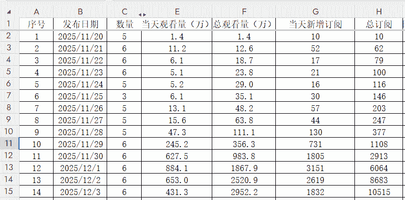

#### 3.6.3 优先选择观众一眼能理解的题材

尽量选择不需要复杂背景、不依赖长对白，仅通过画面就能传达冲突和情绪的内容。

#### 3.6.4 判断AI是否能够放大内容优势

AI应该用于完成现实中难以拍摄、制作成本很高，或者能够显著增强视觉冲击的内容，而不是为了使用AI，强行把所有题材AI化。

#### 3.6.5 借鉴内容内核，但重新设计表达

可以参考原视频的核心冲突和情绪方向，但人物关系、场景设置、动作设计、镜头语言以及最终结局，都应该重新构思。

#### 3.6.6 通过高频测试积累样本，再用数据做选择

表现良好的方向继续改编和迭代，长期没有反馈的方向及时调整。

发布不是简单地完成任务，而是在进行一次次实验。

这6个步骤依然无法保证下一条内容必然爆发。

它们真正能做到的，是减少无目的试错，把一次偶然的成功转化为一套能够反复执行的方法。

运气无法复制，但提高成功概率的方式可以复制。

## 4、YouTube运营的核心：从选题到变现的完整闭环

做YouTube一年后，我越来越清楚地意识到，AI生成视频只是整个项目中的一个步骤。

工具解决的是“怎样把内容制作出来”，而运营还要回答更多问题：

应该做什么、参考谁、怎样分析数据、什么时候坚持、什么时候换方向，以及最终如何完成变现。

一条更完整的YouTube运营链路应该是：

选择赛道→寻找对标→拆解内容→发布测试→分析数据→放大有效方向→排查风险→申请YPP。

### 4.1 为什么做YouTube：让同一份时间持续产生价值

我选择YouTube，其中一个重要原因是它的广告收益主要取决于视频流量。

不需要直播，也不一定要通过带货赚钱。只要内容持续有人观看，就可能持续产生收益。对于不擅长实时表达的i人来说，这种模式相对友好。

此外，YouTube还具备几个明显优势：用户规模大、流量相对稳定、变现方式多、推荐机制成熟，内容形式也足够灵活。

李笑来老师在《财富自由之路》中，将个人商业模式概括为三类：

- 一份时间只能卖一次，例如上班、接零工；
- 一份时间能够卖多次，例如写书、制作课程；
- 买入其他人的时间，再将其出售，例如创业和投资。

YouTube更接近第二种模式：一份时间，有机会被重复出售。

我第一个频道那条3600万播放的视频，在发布近一年之后仍然保有长尾流量。

这说明，一条视频不只是一次性劳动成果，也可能成为持续带来价值的长期资产。

不过，长尾收益并不等同于稳定收益。

账号可能被限制流量，YPP可能被取消，平台政策也可能发生变化。

YouTube提供了让时间重复产生收益的可能，但能否持续，最终取决于内容质量和平台合规程度。

### 4.2 如何选择赛道：流量、兴趣和投入产出要同时成立

选赛道不能只看自己喜欢什么，也不能只看别人获得了多少播放。

我通常从三个方面判断一个方向是否值得做。

#### 4.2.1 热度决定有没有流量机会

首先要确认，这个方向近期是否持续出现百万级、千万级播放的视频。

过去曾经爆过，并不意味着今天仍然有效。Shorts变化很快，三个月前的爆款参考价值可能已经下降，最近1—2周的数据更值得关注。

#### 4.2.2 兴趣决定能不能坚持下去

这里的兴趣不一定意味着特别热爱，至少要达到愿意长期观察、分析和制作的程度。

如果每完成一条内容都觉得煎熬，即使赛道有流量，也很难保持稳定更新。

#### 4.2.3 投产比决定项目能否持续

不能只看内容的播放上限，还要计算每条视频的制作成本。

我曾经尝试制作30—40秒的印度故事类视频，其中部分内容可以达到百万播放，但每条视频往往需要安排15—20个分镜，制作耗时很长。即使流量不错，整体投入产出比仍然不理想。

有流量、做得出来、还能长期更新，这三个条件同时满足，才是适合自己的赛道。

### 4.3 如何建立对标库：刷内容、搜关键词、借助数据工具

确定Shorts方向后，不建议马上开始制作，第一步应该是建立一套自己的参考样本库。

#### 4.3.1 通过持续观看发现参考对象

在YouTube上持续浏览目标赛道，遇到感兴趣的作品就点赞并订阅相关频道。随着操作行为积累，平台会逐渐推荐更多相似内容。

这种方法适合培养内容直觉，但一定要主动记录，否则刷过之后很容易什么也没留下。

#### 4.3.2 使用关键词和标签进行搜索

直接搜索赛道关键词或相关标签，再按照发布时间筛选近期内容。

关键词搜索的好处是目标更明确，也更容易找到刚出现的新作品和小型频道。

#### 4.3.3 让数据工具帮你缩小范围

Viewstats可用于查看热门频道和视频，SocialBlade可以辅助了解频道收益情况，Google Trends则适合比较不同关键词的热度变化。

这些工具不能替代自己的判断，但能帮助我们更快锁定值得研究的样本。

### 4.4 哪些参考视频最值得拆解：近期、小频道、异常高播放

并不是所有爆款Shorts都适合普通创作者模仿。

我通常会寻找同时具备以下特点的内容。

#### 4.4.1 发布时间较新

优先查看最近1—2周发布、已经达到千万播放的作品。距离现在越近，越能说明观众当前仍在关注这一方向。

#### 4.4.2 频道粉丝基础不大

粉丝超过10万的频道，往往具备较强的账号权重，其高播放不一定适合新账号复现。订阅量在5万以下的中小频道，更接近普通创作者能够参考的起点。

如果一条短视频的播放量远超频道粉丝数，就更符合“低粉爆款”的特征，也更有研究价值。

#### 4.4.3 单条内容明显超出频道日常表现

如果一个频道的大多数视频只有几万到几十万播放，唯独某一条突然达到千万甚至上亿，那么这条内容就值得重点拆解。

需要研究的不是表面上的画面，而是它为什么能够突破频道原本的流量水平：

- 它选中了什么主题；
- 前三秒如何制造冲突；
- 观众为什么愿意继续看；
- 情绪如何一步步推进；
- 哪个画面形成了强烈反差；
- 哪些元素可以被重新设计。

找对标，不是去寻找最有名的大账号，而是寻找普通频道里最不普通的那条视频。

### 4.5 短视频和长视频该如何选择

短视频和长视频并不存在绝对的优劣，它们更适合不同的阶段和目标。

\[内嵌电子表格 - 无法获取表格信息\] 对刚开始做内容的人来说，可以先从短视频进入，先积累选题、找对标、制作和运营账号的基本经验。等流程跑通之后，再根据自己的能力、资源和目标考虑长视频。

短视频适合快速进入赛道，长视频则更适合长期沉淀。

### 4.6 数据应该怎么看：播放量只是结果，不是答案

播放量能够告诉我们内容最终取得了什么结果，却不能直接说明问题出在哪里。

有效复盘的关键，是结合不同指标，找到具体环节的原因。

#### 4.6.1 通用指标：流量来自哪里，观众看完做了什么

无论是长视频还是短视频，都需要关注流量来源、互动数据、观众画像、收入以及RPM。

**（1）流量来源与互动表现**

**（2）观众画像**

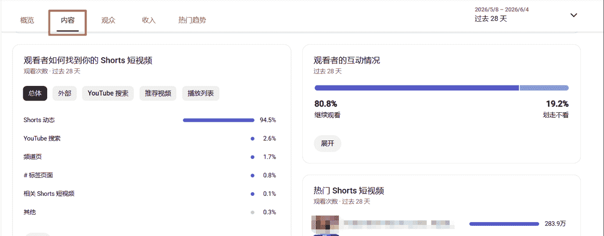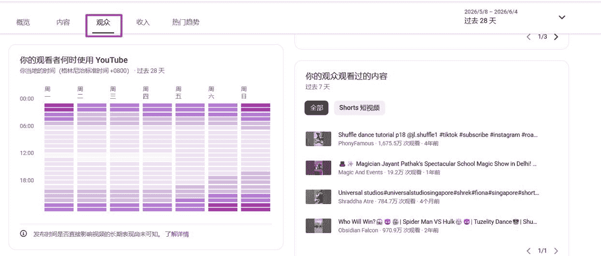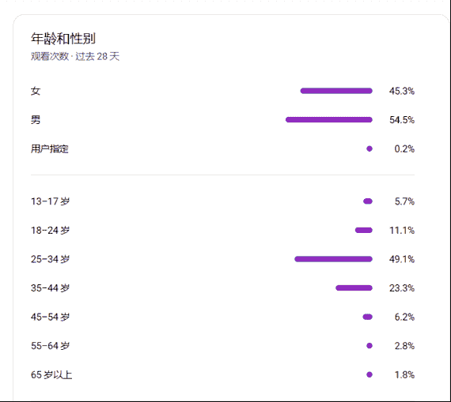

**（3）收益与RPM**

这些信息可以帮助判断：平台将内容推给了什么人，这批观众是否真正感兴趣，以及他们对应的商业价值如何。

#### 4.6.2 Shorts重点关注观看比例

短视频首先要解决的是观众会不会马上划走，然后才是他们究竟看了多长时间。

我会重点查看平均观看时长百分比，以判断观众愿意停留多久、完整看完的比例有多高。如果开头铺垫太慢，就需要通过删减和提速，让前三秒更紧凑，从而改善留存表现。

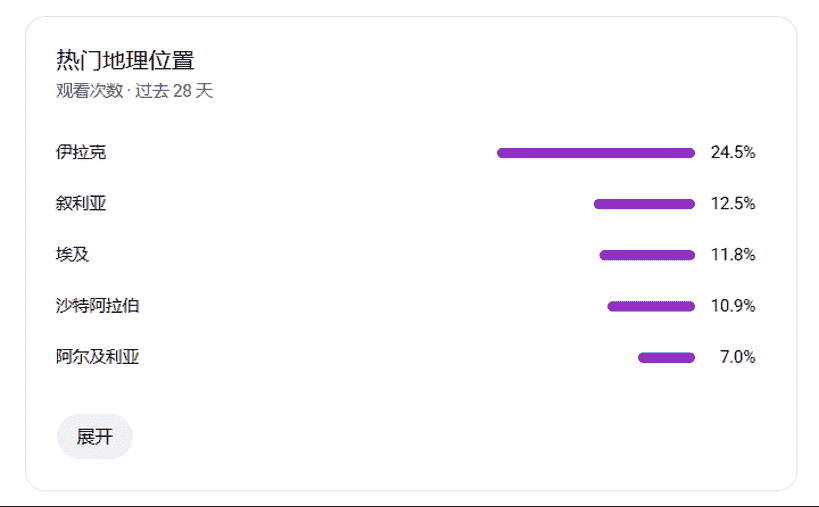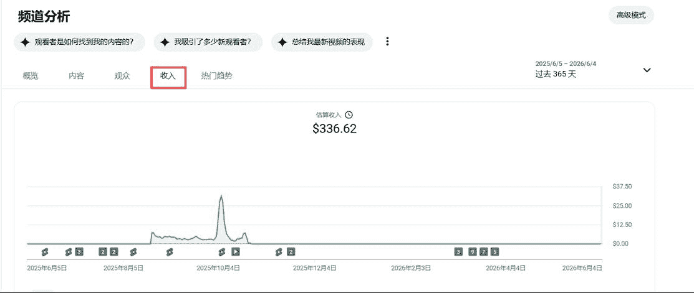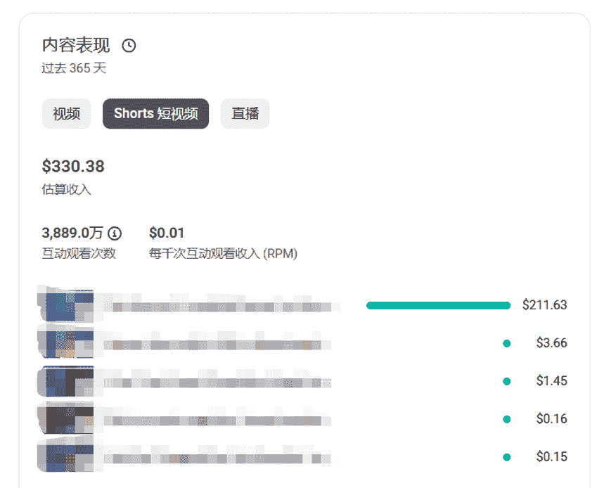

#### 4.6.3 长视频重点观察点击率和留存

长视频的第一道门槛，是观众是否愿意点击，因此要关注封面点击率。

产生点击之后，还要继续分析平均观看时长、平均观看百分比以及流量来源。如果曝光量很高但点击率偏低，问题通常出在标题或封面；如果点击率不错，却很快流失，则更可能是开头设计或内容质量存在问题。

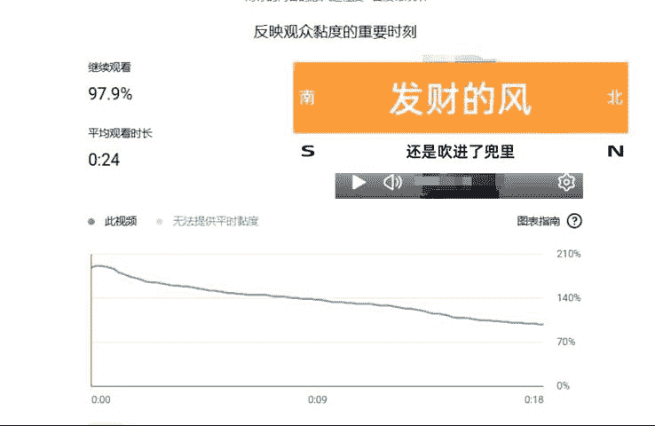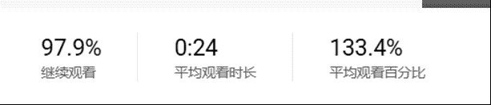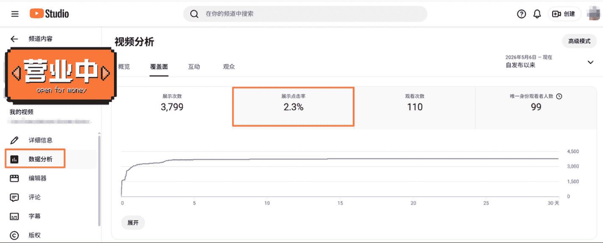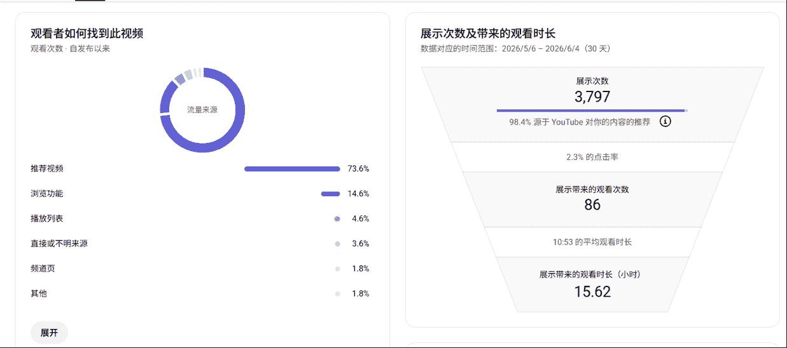

数据不是用来简单给视频判定好坏的，而是帮助我们明确下一条内容该优化哪个环节。

### 4.7 YPP如何开通：达到门槛只是拥有申请资格

#### 4.7.1 YPP的开通门槛

YPP包括初级和高级两个阶段，Shorts与长视频分别有对应要求，满足其中一项即可进入相应阶段。

#### 4.7.2 YPP申请流程

YouTube YPP的申请步骤如下：

#### 4.7.3 需要留意的细节

- 达到高级YPP要求后，要在YouTube Studio内接受相关创收条款，并手动开启广告功能，否则视频不会产生广告收益；
- 当数据接近门槛时，可以提前在淘宝购买平信，确认收件地址能够正常收信，避免PIN码邮件无法送达；
- 填写收款地址时，建议在地址后附上联系电话，方便邮政工作人员联系；
- PIN码通常需要约21天送达。如果长时间未收到，可以先联系当地邮政网点查询，再根据AdSense页面的指引申请重新寄送；
- 绑定银行卡之前，最好先向开户行确认是否支持接收境外汇款，招商银行卡相对更推荐；
- 同一个收款人只能拥有一个AdSense账户。需要注意，AdSense和Ads并不是一回事：前者用于接收广告收入，后者服务于广告主投放广告。

此外，开通YPP只是获得了变现资格，并不代表频道从此就安全无忧。

YouTube会持续审核频道内容，如果违反创收政策，即使已经获得的资格，也可能被取消。

这是我两次失去YPP之后才真正明白的道理：

播放量决定你有没有机会获得变现资格，内容合规则决定你能不能持续获得收益。

## 5、这次实操使用的工具：从寻找对标到发布内容的一整套流程

为了把线下分享讲得更顺，我提前把要用到的站点、提示词模板和操作步骤整理进飞书文档，标题是“6.6-youtube AI视频实操和工具分享”。为避免现场被注册登录拖住，我提前把即梦、千问、Google AI Studio 这些工具的入口发到群里，让大家先完成激活。

真正开干后，新手最容易卡的不是点子，而是整条链路的细节：账号登陆失败、视频源解析不了、提示词触发审核、画幅比例不对、人设前后不统一，任何一个小环节出问题就会让整个制作流程断掉。所以这次分享的重点不是罗列工具，而是帮助大家先把一条最基础的生产线跑通：找对标→拆解视频→改写脚本→出图→出片→剪辑优化→上架测试。

### 5.1 选赛道与找对标：YouTube、Viewstats、SocialBlade、Google Trends

工具的使用不从生成开始。动手前先要判断做哪个赛道、参考谁的内容。这个阶段主要用四类工具。

#### 5.1.1 YouTube：捕捉最新的真实市场反馈

- 网址：youtube.com

YouTube 本身就是最大的素材库，可通过首页推荐持续刷目标赛道，也能用关键词和标签检索，再按近期发布筛选。

#### 5.1.2 Viewstats：快速定位热门视频和频道

- 网址：https://www.viewstats.com/

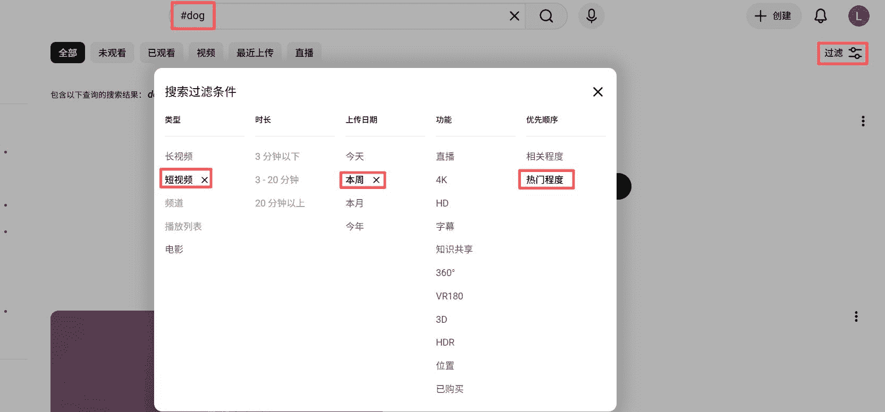

#### 5.1.3 SocialBlade：查看频道收益情况

- 网址：https://socialblade.com/

#### 5.1.4 Google Trends：横向比对关键词热度

- 网址：https://trends.google.com/trends/

工具只是帮我们更快找线索，是否值得投入，最终要看最近真实的播放数据。

### 5.2 对标视频下载：Yt1ss、硬核去水印小程序

找到参考后，需要把视频保存下来，方便后续拆解和剪辑对照。

#### 5.2.1 Yt1ss：网页端下载

- 网址：https://yt1ss.pro/zh-cn199/

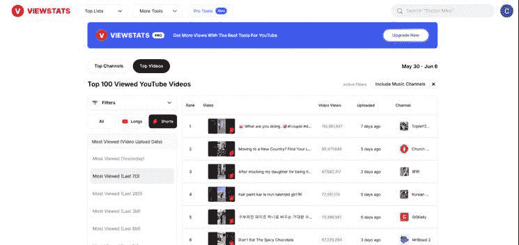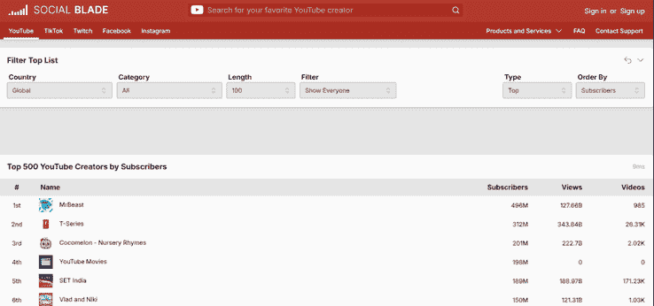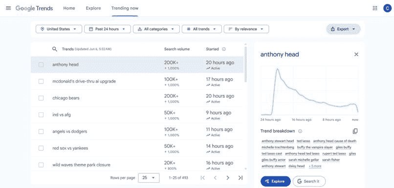

- 优点：免费、可选清晰度、短长视频都可、支持单独导出音频、文件以标题命名。

#### 5.2.2 硬核去水印小程序：手机端下载

- 微信搜索即可使用

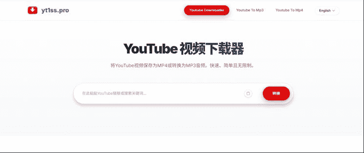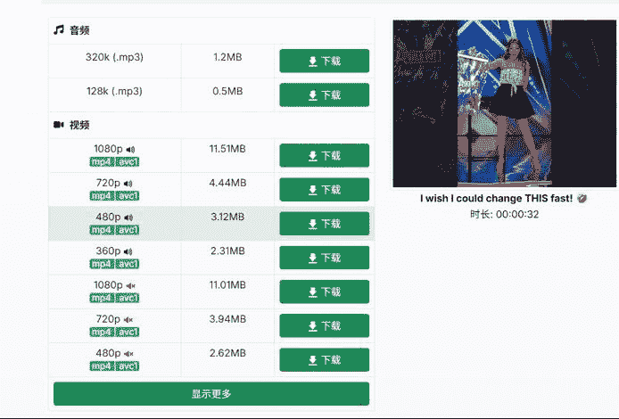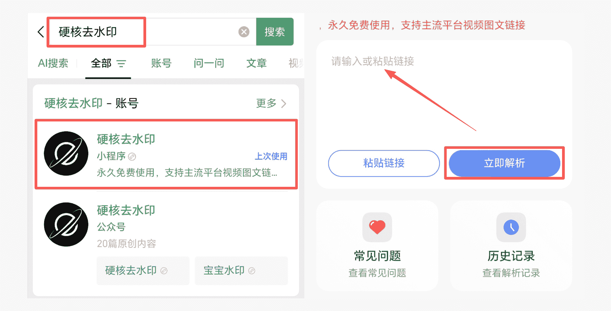

- 优点：国内网络可用、免费。

特别说明：下载对标是为了研究选题、脚本、镜头和节奏，不是去水印后直接搬运。YouTube 对版权和重复内容审核严格，直接搬运易触发版权主张，也会伤害频道推荐。对标可以拆解，素材不能挪用；内核可借鉴，成片不能复制。

### 5.3 脚本拆解与改编：Google AI Studio、DeepSeek

脚本拆解是整条流程的核心。AI 能出画面，但视频能不能成立主要看冲突、情绪和故事结构。

#### 5.3.1 Google AI Studio：直接读取 YouTube 视频

- 网址：https://aistudio.google.com

本次实操以它为主，可直接粘贴 YouTube 链接完成：

- 视频内容概括；
- 故事结构拆解；
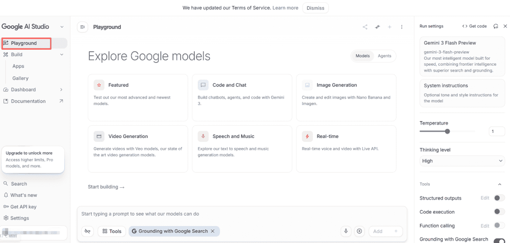
- 核心冲突提炼；
- 人物动作分析；
- 分镜脚本生成；
- 改编方向建议；

若视频过长导致解析失败，可先下载再以附件上传。使用技巧是分轮对话：

- 第一轮拆原片；
- 第二轮提炼情绪与冲突；
- 第三轮敲定人物、场景、结局的改写方向；
- 第四轮输出新分镜与提示词；
- 第五轮排查敏感违规风险。

#### 5.3.2 DeepSeek：作为备选改编工具

- 网址：https://www.deepseek.com/

现场部分伙伴无法访问 Google 服务，我也准备了替代方案。

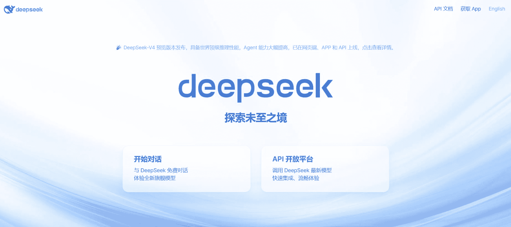

我会先提供拆解后的提示词，让大家用 DeepSeek 等国内模型完成脚本改写，再生成图、视频提示词。关键不是让模型同义替换，而是重构表达：

- 换人物关系；
- 换故事场景；
- 换冲突来源；
- 调节情绪节奏；
- 换动作设计；
- 换故事结局。

### 5.4 图片生成：即梦

- 网址：https://jimeng.jianying.com/

想固定人设和场景时，可先出图再图生视频，可控性更高。提示词可先由 Google AI Studio 初稿，再人工优化。本阶段主要产出两类图。

#### 5.4.1 角色图：保持形象统一

做系列或角色 IP 时，先确定发型、服装、年龄、表情和画风。角色越稳定，后续一致性越好，频道辨识度也更高。但为避免同质化，单频道最好运营多个不同角色 IP。

#### 5.4.2 首帧图：掌控场景与风格

首帧是用户刷到时的第一眼。制作时重点关注：

- 主体是否足够突出；
- 画面是否有冲突感；
- 风格是否契合内容；
- 情绪是否一眼可懂；
- 是否留下悬念。

首帧的任务是定调和留人，而非单纯好看。

### 5.5 视频生成：即梦、千问

- 即梦：https://jimeng.jianying.com/
- 千问：https://www.qianwen.com/

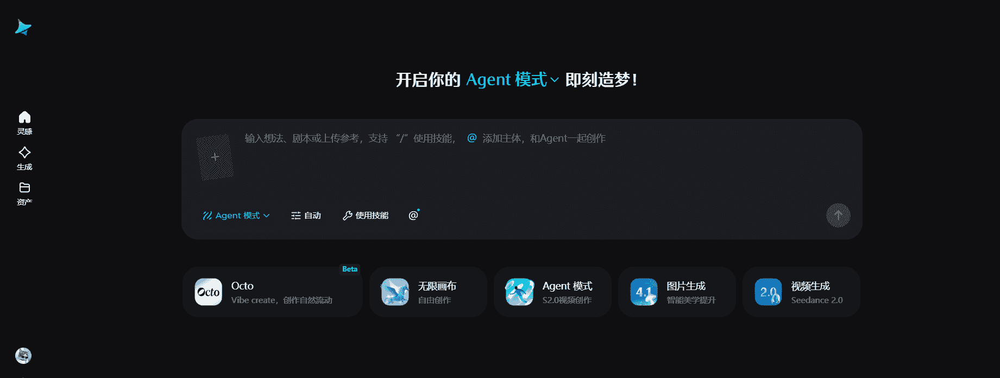

#### 5.5.1 文生视频：快速验证创意

无需提前准备图片，直接输入提示词生成。适合测试动作、情节和视觉概念，速度快，但角色和场景一致性相对弱。

#### 5.5.2 图生视频：把控人设与首帧

先确定角色图和首帧，再生成动作。流程更长，但人物、服装、场景可控性更高，适合系列内容和固定 IP。

#### 5.5.3 工具选择看四个维度

线下以即梦为主，考虑到排队和积分问题，我也准备了免费额度充足、生成较快的千问作备选。选工具不只看一次效果，更要看能否稳定产出下一条。

### 5.6 剪辑优化：剪映

- 剪映6.0免安装版：
- 链接:https://pan.baidu.com/s/1WViTa99yj-gXruodcrpjLw?pwd=7ek2 提取码：7ek2

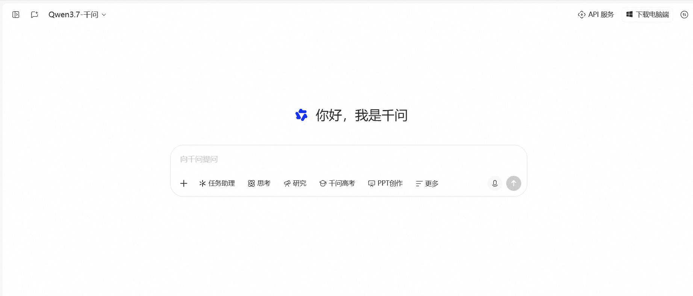

AI 原片通常不能直接发，需要基础加工。剪辑目的是解决明确问题，而非堆特效。

#### 5.6.1 加快开头节奏

删掉无效停顿，把最具冲突和视觉吸引的画面前置。Shorts 前三秒很关键。

#### 5.6.2 删除明显瑕疵

AI 视频易出现变形、动作错误、画面跳变，可通过裁剪、缩短镜头或替换片段降低影响。

#### 5.6.3 提升画面质量

清晰度不足时可用剪映提升至1080P。画质只能改善观感，无法弥补内容吸引力不足。

#### 5.6.4 添加音乐、音效、字幕

是否添加取决于对标形式。无对白的视频可用音乐音效强化节奏；信息量大的视频字幕更友好。60秒内短视频音乐选择自由，长视频需注意版权。

#### 5.6.5 把封面放在视频第一帧

YouTube Shorts 封面多在手机端选择，我习惯把封面画面放在第一帧，降低选择成本并提高可控性。

剪辑的本质是清除影响用户继续观看的障碍。

### 5.7 频道创建与发布：YouTube

最后一步是建频道并发布。

#### 5.7.1 登录并创建账号

进入 https://www.youtube.com/ 用 Google 账号登录。无账号则按提示填写姓名、生日、性别、密码、手机号，完成验证并设置 Gmail。

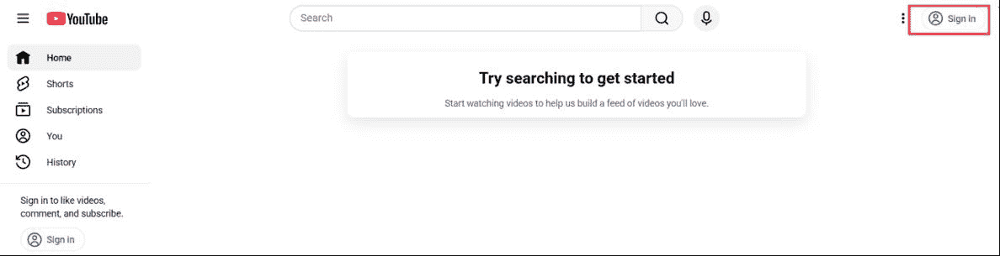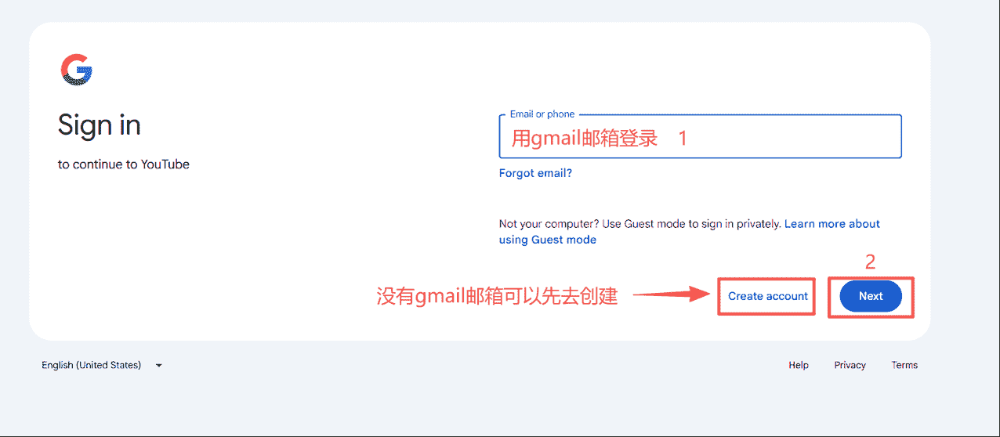

#### 5.7.2 创建并装修频道

点右上角头像，填写频道名和标识名。完成后设置头像、封面图和简介，可参考对标并用 AI 辅助生成。

【AI 生成频道名提示词示例】

你是一个资深YouTube运营专家，我现在要创建一个关于【达人秀变身】赛道的频道，需要你帮我想10个简洁、好记的英文频道名字，以下是一些名字的参考:【xxx,xxx,xxx,……】（将模板中的【】替换为你的赛道和对标频道名参考）

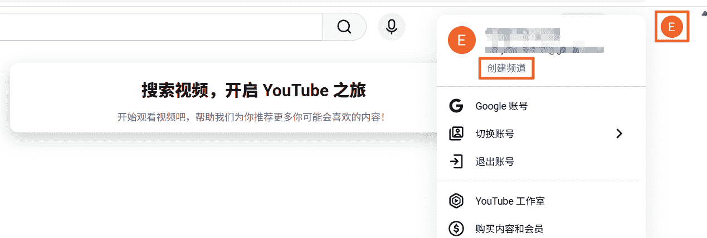

#### 5.7.3 完成基础设置

进入 YouTube Studio，频道设置中把国家地区改为美国，高级设置选“非面向儿童”。同一 Google 账号可在“高级设置—管理 YouTube 账号—创建新频道”下添加多个频道。

#### 5.7.4 上传并发布视频

上传后填写标题和话题。标题可参考对标或 AI 生成，话题优先选相关且热度高的。确认详情和发布时间后发布。

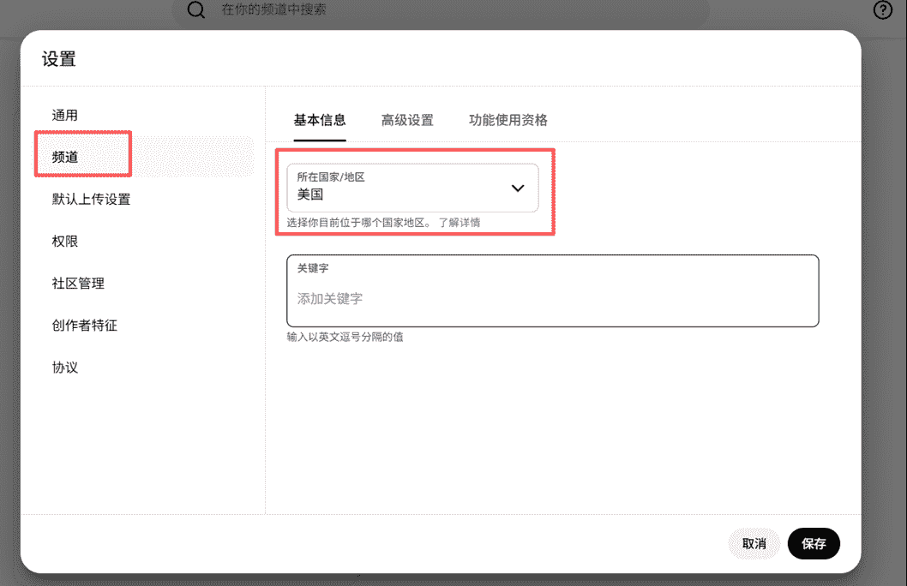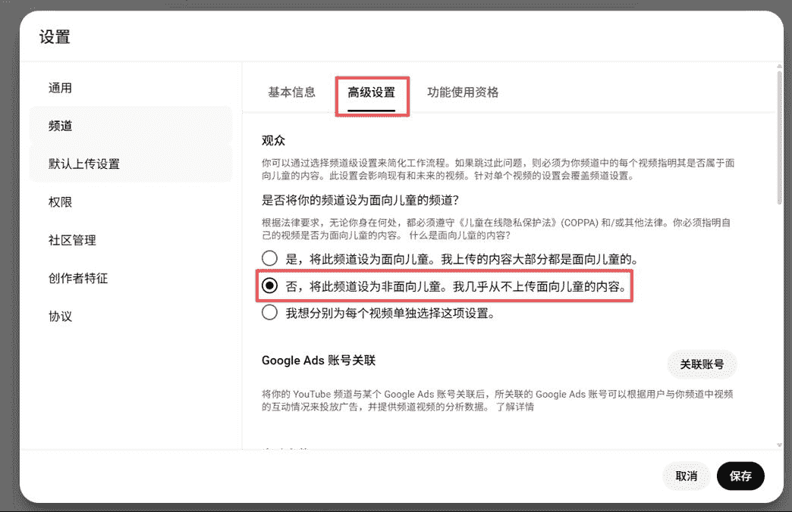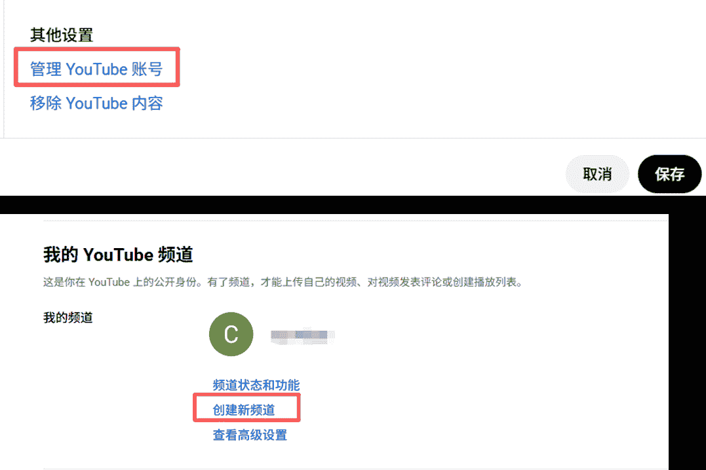

## 6 若现在带新手从零开始，我会这样安排

如果重来做 YouTube 短视频，我不会一开始建很多账号，也不会同时测多个完全不同的赛道。新手需要的不是一份看起来完整却执行不了的复杂体系，而是一条能尽快闭环的最短路径：选赛道→找对标→拆脚本→改编脱敏→生成图片→生成视频→剪辑发布→数据复盘→合规排查。先跑通一次闭环，再根据数据决定是否多开频道。

### 6.1 第一步：先锁定一个赛道，不要贪多

初期最常见的误区不是缺方向，而是方向太多。今天动物爆就做动物，明天 IP 火就转 IP，后天新工具出来又换内容。结果每个方向都做几条，都没攒够数据。

选赛道可先自问四点：

1. 近 1-2 周该赛道仍有千万播放作品吗？
2. 除头部大号外，普通频道能跑出百万播放吗？
3. 自己能否稳定产出该类内容？
4. 单条的时间和工具成本能否承受？

前 14 天只测一个方向。目的不是方向一定对，而是变量稳定数据才有可比性。新手最怕的不是选错，而是没等到有效反馈就换路。

### 6.2 第二步：收集 10 个低粉爆款频道

确定赛道后，不要只收藏播放最高的视频。建一个 10 个频道的对标库，重点找：

- 粉丝 <3 万，近 14 天出现千万播放的频道；
- 日常播放几万到十几万，近期出现千万异常值的频道；
- 近 1-2 周持续更新且新视频仍有流量的频道；
- 内容形式适配当前 AI 工具和制作能力的频道。

记录时保留关键信息：

[内嵌电子表格——无法获取表格信息]

长期记录有助于训练对异常数据的判断力，区分大频道的常态与真正值得研究的低粉爆款。

### 6.3 第三步：拆解 20 条近 1-2 周的爆款

从对标库挑选 20 条近期爆款拆解。不是写“这条很搞笑”，而是回答：

- 前 1-3 秒出现了什么？
- 为何用户没划走？
- 核心冲突是什么？
- 人物/动物/物体关系？
- 情绪如何变化？
- 哪个画面反差最大？
- 结尾有反转/满足/悬念吗？
- 哪些可改编，哪些不可照搬？

可用 Google AI Studio 辅助，但别全信。AI 能描述，判断是否能留住人靠自己。拆完后按共性归类：动物拟人、危机救援、身份反差、弱者反击、荒诞行为、意外反转、强视觉奇观等。

拆解的目的是看懂一类内容为何成立，而非学会复制一条视频。

### 6.4 第四步：连续 14 天每天发 1-3 条 Shorts

拆解后尽快进入发布。很多人把时间花在准备上，却迟迟不发第一条。没有真实数据，准备只是猜测。

建议前 14 天每天发 1-3 条。时间紧至少 1 条，链路顺畅可到 2-3 条，但别牺牲基本质量。14 天目标是获取可对比的数据，而非立刻开通 YPP。测试时每次只改一个变量：开头画面、角色、冲突类型、时长、情绪走向、结局。若每条都不同，数据好也无法归因。前 14 天是采样期，不是冲刺期。

### 6.5 第五步：为每条视频建立数据记录

发布后别只刷播放。播放是结果，需记录从发布到反馈的全过程。可建简单表格：

[内嵌电子表格——无法获取表格信息]

刚发几小时无流量别急着删。Shorts 反馈快，通常 1-3 天见效，但也可能一周或一个月后重新推流。长视频观察周期更长。

复盘关注规律：哪些开头更易获得播放？完播率更高的是哪些？哪些内容易涨粉？哪些方向持续无反馈？数据是为了让下次调整有依据。

### 6.6 第六步：跑出数据后拆解内核并迭代

当某条数据明显高于均值时，拆解其有效内核：如一眼可懂的危险场景、身份反差、弱者反击、开头即展示结果、结尾情绪满足等。保留内核，改变表达：换人物、换关系、换场景、换动作镜头、换冲突起因、重排情绪、改结局。

同一脚本在同一频道最好只用一次，避免同质化；可改编后发到其他账号。微创新保留有效机制的同时提供新体验。复制的是结构，不是画面。

### 6.7 第七步：达标前先排查风险再申请 YPP

这是最需要提前做的。很多人接近门槛就猛增频率冲刺，但数据越近门槛越需要停下来自检。

排查重点：

- 是否使用有版权的视频、图片、音乐、字体；
- 是否含儿童遇险、伤害等高风险情节；
- 是否出现暴力、动物伤害、色情、仇恨、虚假信息；
- 是否大量模板雷同；
- 是否重复使用同一提示词或脚本；
- 是否因播放高而不舍得删风险视频。

可让 AI 辅助筛查，最终以 YouTube 官方政策为准。宁可放弃一条高风险爆款，也不要赌上频道变现资格。

### 6.8 前 90 天分四阶段推进

为降低难度，可把前 90 天分为四个阶段：

[内嵌电子表格——无法获取表格信息]

时间仅供参考，有人两周达标，有人三个月仍在验证。关键是数据是否持续正向反馈。

## 7 失去 YPP 两次后总结的避坑清单

两次被移出 YPP 后，我最大的体感是：
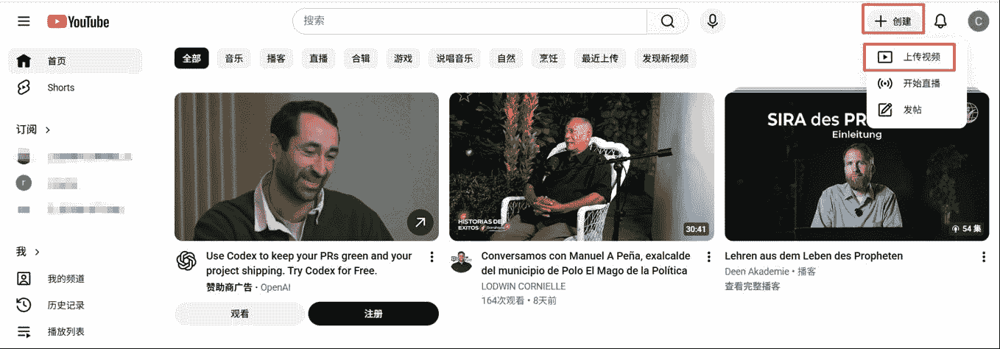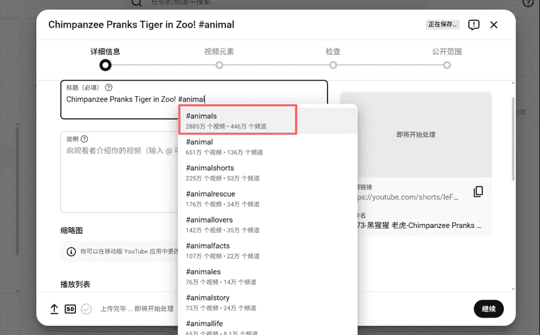

拿到 YPP 的那一刻并不可怕，可怕的是拿到之后还能不能一直合规地赚到钱。

我做了两次频道，也丢掉了两次 YPP。表面看一个是儿童安全，一个是同质化违规，根上都指向同一种误判：

把“暂时没被处理”，当成了“这件事没问题”。

### 第一次丢掉 YPP：踩到儿童安全红线，本质是合规意识太薄

第一个频道刚通过 YPP，达人秀赛道流量断崖，我便换方向做了印度故事、耶稣故事。

有几支片里出现了孩子被追、遇险、等待救援的桥段。我自己的逻辑是：最后孩子都获救了，并没有真的受伤，应该算安全。

YouTube 的判断逻辑不是看结局圆满不圆满。它看的是：未成年人是否被置于危险、恐惧、可能受伤的情境里。就算最后被救了，过程本身就可能触发更严的审核。

当时我犯了两件事：

#### 以为能正常上传就等于合规

视频可以发出来，只说明它躲过了上传时的初筛，并不代表它符合社区准则和变现政策。平台完全可以在后续复审、申请 YPP 或抽查时把问题捞出来重新判定。

#### 以为对标能爆，自己复刻就安全

播放量高的对标，未必通过了创收审核。它可能根本没申请 YPP，也可能正在被限流，只是观众看不出来。能发 ≠ 合规，能爆 ≠ 能安全抄。

如果重来，我会直接避开所有让儿童处于危险、暴力、惊吓、救援戏码中的情节。最稳的做法是，彻底不碰任何真人儿童或拟人幼崽形象的视频。

### 第二次丢掉 YPP：被同质化拖垮，本质是爆款复刻上瘾

第二个频道是我效率最高的阶段：找爆款 → 用 Google AI Studio 反推提示词 → 用 Sora 2 生成近似内容。流量来得快，风险也埋得很深。

- 多条作品共享相似提示词；
- 人物、动作、叙事结构几乎不变；
- 能按模板批量产出；
- 创作价值体现在复制热门套路，而不是重新设计内容。

YouTube 现在打击的不是 AI，而是批量化、重复度高、用通用模板堆出来的低差异内容。政策核心是：有没有原创价值，观众是否能明显感受到每条视频的不同。AI 不是原罪，机械复制才是。

平台收紧后我也尝试用 AI 二次改写脚本，但底层结构没有动。表面改了，内核没变，这就是第二次被取消 YPP 的直接原因。

如果重来，我会保留对标里验证有效的情绪与冲突点，但重新设计人物关系、场景、动作细节、镜头语言和结局。同一脚本绝不重复使用，也不会把“换个角色、换个背景”当成原创。

### 共同的坑：侥幸心理

第一次丢 YPP，我没意识到风险有多大。第二次，我是明知风险还在赌。

那段时间算法在调整，同类频道大面积因同质化被清。我自己的流量从日均 200 万跌到 1 万。我清楚信号来了，却还在说服自己：

其他人被清了，我可能不会；这几条播放高，删了可惜；再改编一下就能蒙混过去。

回头看，第二个 YPP 的真正杀手不是政策，是我舍不得割掉高播放的沉没成本。

YouTube 复查时，往往会重点看播放最高、最新发布、观看时长占比高的视频。你最舍不得删的，往往就是平台最关注的。账号最大的危险，从来不是看不到问题，而是看见了却还在侥幸。

### 版权这条红线，不能靠运气

版权主张和版权警告不是一回事，严重程度完全不同。

[内嵌电子表格——无法获取表格信息]

频道 90 天内累计 3 次未解除的版权警告，账号和关联号都有被封的风险。注意，删除收到警告的视频，通常并不会自动解除警告。

别把“先发了再说”当成策略。

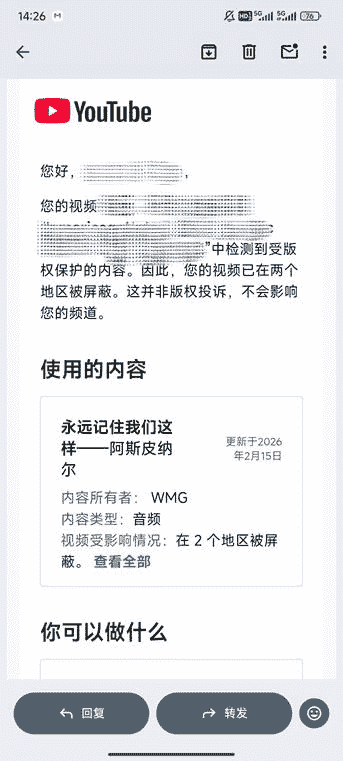

上图是我因达人秀音乐问题收到的版权主张

长视频要重点自查四类素材：视频片段、图片素材、音乐/音效、字体。其中视频和音乐最致命。

影视剧、综艺、短剧、他人的视频片段，哪怕简单剪辑也不等于有权使用和变现。音乐建议用 YouTube 自带的免版税音频或正规免版权源。

下面是我常用的免版权渠道汇总：

| 类别 | 视频素材 | 图片素材 | 音乐/音效素材 | 字体素材 |
|---|---|---|---|---|
| 1 | Pexels pexels.com | Pexels pexels.com | Freepd freepd.com | 100font 100font.com |
| 2 | Pixabay pixabay.com | Pxhere pxhere.com | Freesound freesound.cn | 站长字体 font.chinaz.com |
| 3 | Mixkit https://mixkit.co/ | CC0 图片网 cc0.cn | 耳聆网 ear0.com | 自由字体 ziyouziti.com |
| 4 | 爱给网 aigei.com | Pixabay pixabay.com | 淘声网 tosound.com | 字体搬运工 font.sucai999.com |

大部分可免费下载，爱给网、Freesound、耳聆网、淘声网每日有免费额度。

短视频 1 分钟内的音乐风险相对小，通常只会触发版权主张，常见处理是部分地区禁播，但开通 YPP 后收益仍可能被分成。

版权看的不是你从哪里下，而是你有没有使用权。

### 除了版权和同质化，还有这些高频违规点

脚本和成片要重点排查：暴力或危险行为、动物伤害、色情或性暗示、仇恨言论、虚假信息、危险挑战、误导性标题封面、影视音乐人物肖像版权。

我曾因动物伤害内容收到违规警告，视频被移除。首次违规可参加政策培训，完成培训且三个月内不再违规，警告会解除。

降低风险的做法：写完脚本后让 Google AI Studio 过一遍创收政策合规性；把 YouTube 官方政策整理进 NotebookLM，不确定的地方直接问。AI 只能筛查，不能兜底，最终判断仍在创作者。

合规不能指望平台兜底，必须在发布前主动排雷。

### 0 播和限流，先排查原因再下结论

#### Shorts 0 播
我第二个账号最初发了 4-5 条 Shorts，播放个位数甚至 0。在同个 Gmail 下新建频道测试发布后，播放恢复正常。

#### 长视频 0 播
长视频 0 播更常见，不要一两条就判定账号废了。我做法是：同 Gmail 新建频道测试、让 0 播号冷却一周再试、用 2-3 条视频做数据探测、暂停长期无反馈的频道，集中资源做有初始播放的。

#### 视频被限流
达人秀时期大部分视频过万，也有一两条发布后两天播放卡在两三百。尝试删后重发，部分恢复。但如果重发仍无改善，就要怀疑内容与频道受众不匹配或同质化严重。

播放异常是结果，账号状态、内容匹配度、受众偏好才是排查方向。

### 两次失败后，我记住的三个提醒

第一句：**YPP 不是免死金牌。** 通过审核只是当下达标，后续会复查，也并不代表全站内容都符合变现要求。

第二句：**平台会复查，别靠侥幸。** 没被处罚不等于没风险，只等于问题还没被发现。

第三句：**别爱上自己的账号。** 播放量和粉丝都是沉没成本。发现问题就该改，发现在沉没成本上舍不得，是最贵的执念。

两次丢掉 YPP，表面是儿童问题和同质化，深层是规则理解不足，再加上明知有风险仍心存侥幸。

### 8、线下实操：把第一条 AI 视频真正跑通

这场分享不只是讲运营，我还带了现场实操。对新手而言，知道流程和亲手跑一次是两回事。

AI 视频每一步看起来简单，实操却很容易卡：Google AI Studio 打不开、提示词触发敏感词、参考图识别失败、比例不对、不会剪辑发布。

实操的目标不是做出惊艳的作品，而是把完整链路跑通一次。第一条视频的意义，在于把“我不会”变成“我做过”。

#### 我提前做了哪些准备

线下最怕浪费时间在注册登录上。我提前整理了飞书文档「6.6 YouTube AI 视频实操和工具分享」，包含对标视频、制作流程、拆解改编提示词、常用工具清单，方便现场即查即用。

分享前一天我把即梦、千问、Google AI Studio 的链接发到群里，提醒大家提前注册登录，减少现场排队和找回密码的时间。

考虑到部分同学无法使用海外工具，我准备了 Google AI Studio 拆解后的分镜提示词。无法使用时，可直接用 DeepSeek 等国内工具改编，再生成图和视频提示词。

视频生成主用即梦，另测试了千问作为备用，有免费额度，速度快，适合现场快速试错。线下不是比工具强弱，而是给每个卡点准备第二条路。

#### 现场流程

实操分为三段：把对标变成脚本，把脚本变成画面，把画面变成成片。亲手走一圈，卡点才会被看见。

#### 现场最容易卡住的细节

大家的问题都很具体，都是第一次做 AI 视频的真实坑：

Google AI Studio 无法拆解视频：点左上角 Playground 粘贴链接，1小时以上的长视频解析常失败，可下载后附件上传分析。

提示词写了 9:16 还是 16:9：提示词写不改比例。以即梦为例，需在参数区手动选 9:16。参数能解决的别交给提示词。

视频生成失败：多因提示词含敏感词或危险行为。可手动删改，也可让 Google AI Studio 做提示词脱敏。

需要四宫格参考图：即梦上传含真人人脸的图片易失败，用四宫格可规避。

人物开口说话：提示词里明确人物、台词、语言、语气、说话顺序。需要英文台词时，额外加“只能说英文，不能说中文”。

封面放第一帧：YouTube Shorts 封面需手机端设置。提前把封面帧放在视频第一帧，设置更方便可控。

#### 很多同学做出了第一条 AI 视频

这次最有满足感的，是大家真的跟流程做出了自己的第一条 AI 视频。人物可能不自然，有 AI 感，节奏也需优化，但意义在跨过从 0 到 1。

很多同学不是没能力，只是把 AI 视频想得太复杂。跑通后会发现，它就是一串可拆解的步骤。

#### 反馈

活动后大家在聚会页面和群里分享了收获：

“非常有料，既给思路又有实操，很有启发。”

“内容条理清晰，逻辑严密，还有实操，基本掌握了 AI 视频制作流程。”

“浅夏老师完整拆解制作方法，从初创到第一笔收益，再到短长视频全链路，干货密集，对新手友好。”

“从 0 到实际操作学到不少，对 AI 视频的认识也更清晰，学到一项新技能。”

“干货满满，从 0-1 手把手教，不会的问题能立刻得到帮助，线下体验太好。”

“之前被某个环节卡住就搁置了。这次看到老师也默默努力很久，跑通过程和心路历程，自己也没理由过早放弃。”

“引导特别好，现场氛围棒，学到之前没了解的 Shorts 内容。”

也有同学晒出发布数据：一条视频收获 1115 观看和 15 位订阅。数据不大，但说明方法真的被用起来了。

为了这次分享，我准备了近 100 页 PPT、工具清单、提示词、飞书文档和备用方案。看到群里不断出现“感谢浅夏老师无私分享”“没有随随便便的成功”，才觉得所有的准备都值了。

一次好的分享，价值不在于有多少人记住了要点，而是是否有人听完就真的去做了。

### YouTube AI 视频并非人人皆宜，却是锻炼内容能力的绝佳沙盘

有人问我现在做 YouTube AI 视频还值不值得，我不会用一个简单的 yes 或 no 来回答。

机会是真实存在的。

我用 69 天拿下第一个 YPP，14 天就拿下第二个，最高单条播放冲到 1 亿。这一连串结果说明，普通人靠 AI 工具在 YouTube 爆发出流量的可能性依然存在。

但另一面同样残酷：

两个 YPP 都被撤回，流量可能一夜归零，Shorts 播放高却不一定能变现，长视频常年 0 播放，起号周期极长。

只盯着机会会高估回报，只盯着风险又会错过一次宝贵的内容与运营训练。

### 9.1 若你追求稳定副业，这条路大概率不合适

YouTube AI 短视频最显著的特征就是不确定性。

你可能连发十几条都沉寂，也可能下一条直接破百万、破千万。

频道可能很快过审 YPP，也可能过审后因版权、儿童安全或内容同质化被取消。

它和上班完全不同，投入一小时并不等于有一小时的确定产出。

如果你现在急需稳定现金流，无法忍受几个月无反馈，也不愿花时间研究平台规则，那它就不该作为主副业来押注。

它能给你爆款，却给不了你稳定。

### 9.2 更适合能不断试错的人

做 YouTube 必须接受一个事实：很多答案只能在发布后才知道。

制作前你无法保证哪条会火，也无法靠看几个教程就找到属于自己的赛道。

能坚持下来的人，往往在重复做同一套事：

- 盯着近期爆款；
- 拆解结构和钩子；
- 结合数据改写方向；
- 高频发布做测试；
- 接受流量起伏；
- 学习规则并严格执行。

这件事考验的更多不是技术多强，而是能否承受不确定。

**YouTube** 奖励的从不是一次准备到完美，而是持续迭代后依然愿意调整的人。

### 9.3 别把 YPP 开通当成终点

刚入局时，我把 YPP 当成了唯一的目标。

只要订阅和观看时长达标，就觉得项目跑通了，甚至以为会开始睡后收入。

等到 YPP 被取消两次后我才明白：开通只是拿到变现资格，真正的运营才刚刚开始。

更长远的衡量标准应该是：

- 内容能否持续产出；
- 频道定位是否清晰；
- 每条视频是否有差异化；
- 收益是否过度依赖单条爆款；
- 政策变动时能否快速响应。

能开通证明你上过门槛，能留住才证明方法可复制。

### 9.4 即便没赚钱，积累的能力也不会白费

单看收入，这一年只能算平平。

我尝过流量和收益，也经历过限流、被取消资格和重来。

但过程中沉淀下了可迁移的硬核能力：

#### 9.4.1 选题判断力
用真实数据而不是个人喜好去判断市场在看什么。

#### 9.4.2 对标拆解力
从低粉爆款和异常数据里，找到普通人可复制的路径。

#### 9.4.3 脚本结构力
把视频拆成冲突、情绪、人物、动作、结局，再重新设计表达。

#### 9.4.4 AI 制作力
从素材生成到剪辑发布全流程闭环，并能按需选工具。

#### 9.4.5 数据复盘力
通过点击率、完播、停留、互动定位问题环节。

#### 9.4.6 规则敬畏力
把版权、儿童安全、同质化、创收政策纳入生产流程。

这些能力换到国内任何内容平台，选题、制作、测试、复盘的底层逻辑都依然通用。

赚钱是结果，能力才是长期资产。

### 9.5 1 亿播放的光鲜背后，是更长的暗流

1 亿播放是我这一年最刺眼的成绩。

但若只讲这个数字，复盘就不完整。

它背后是：

- 起初的长期 0 播与剧烈波动；
- 日更发布和无数次 A/B 测试；
- 因效果不佳反复调优提示词；
- 前 6000 万播放零收益；
- 日流量从 200 万跌到 1 万；
- 两次失去 YPP 资格；
- 2600 万播放后不敢申请；
- 转做长视频后再次遭遇 0 播。

这些不是为了渲染难度，而是想说：任何看似一夜成名的结果，都有大量未被看见的消耗。

别只羡慕数字，要先评估自己是否能承受数字背后的波动。

### 9.6 给新人的三点起步建议

如果你看完依然想试，我建议先做到这三件：

#### 9.6.1 先发 10 条再决定适不适合
别在工具和教程上过度纠结，先跑通从制作到发布的完整链路，拿到真实反馈。

#### 9.6.2 先当训练营，不要先算账
前期目标是把选题、对标、制作、复盘练熟。把希望全押在快速开 YPP 上，很容易因波动而放弃。

#### 9.6.3 从第一天就把合规放进流程
不要等播放快达标时才去查版权和安全。合规不是最后的门槛，而是贯穿始终的底线。

### 9.7 总结

这一年，我既享受了 YouTube 与 AI 带来的红利，也为规则理解不足付出了代价。

过去我以为爆款 + YPP = 跑通。

现在我更倾向于认为跑通的标志是：能持续找选题、持续做内容、持续读懂数据，并在规则变化时及时调整。

感谢组局官杨哥邀请我分享，并对这篇复盘提出宝贵修改意见，也感谢当天参与实操、交流的圈友。

近 100 页 PPT、近四个小时的分享加实操，给不出一条稳赢的捷径。

但如果能让一个准备入场的人看清机会与风险，让一个已在路上的人少踩一个坑，让一个卡住的人重新愿意尝试，这次分享就有了价值。

爆款会退潮，账号会震荡，政策会变动。真正留下的是持续创作、数据敏感和规则敬畏的能力。**YouTube AI** 出海，短期靠执行力，长期靠系统力。最后也欢迎大家多参加赚钱大连的线下活动，一起赚钱有术！！！

————分割线————

看完这篇 SOP，你可能觉得自己懂了。但实操时，90% 的人会卡在第一步。

工具和教程只是入门级壁垒，真正的壁垒是“立刻开干”与“圈层信息差”。

如果你想掌握全网最新变现打法，并和一群执行力强的极客一起落地拿结果，欢迎了解我的核心私域：【懒人专属群】。

我们不做空谈，只做商业闭环拆解与 AI 效率榨取。内部已沉淀 1000+ 跑通的套利实战案例。

👉 查看圈子数字资产与入场门槛：

https://lazyso.com/insider/

认同价值、准备立刻行动的，扫码加我微信 lazyhelper1

备注：【实操上车】，不闲聊

