# 离开总行这一年：我把5条路走了一遍，才算想明白，选路就是选日子

260709 副业SC 精华

整理：公众号懒人搜索，懒人专属群精选

懒人微信：lazyhelper1

先自我介绍一下：我是纳豆，93年摩羯座INFJ，目前坐标深圳。去年4月，我从银行总行走了出来，之后一直全职折腾自己当老板这条路。

如果你期待看到“一个人靠创业年入百万”的爽文，现在可以关掉了😂 我不是那种光鲜的大佬，也没有特殊的创业天赋。我不过是个从公司里走出来、想做点小生意的普通人。

这个选择之所以可行，多少要感谢AI和这个足够开放的环境。工具越来越顺手，外部限制越来越少，普通人这才有了试错的空间。

我不觉得自己很厉害，只是顺着浪花往前游了一步，换了一种和办公室生活不太一样的活法。

在赚钱有术，很多朋友可能见过我的名字。之前我发文复盘过抖音CPS，那段经历是16天跑出50万GMV，还担任过一季助教。帖子被收进精华，我也因此拿到传术师身份。

不过那个CPS项目只能算我探索路上的一个横截面，不是故事的终点。

这篇文章想讲的，是我从银行总部一路走到自由工作的完整地图。里面有高光，也有低潮，有反复纠结的日子，也有什么都没做成的时候。

现在我主要做小红书虚拟电商，用个人IP带动销售。最近30天的数据见图。

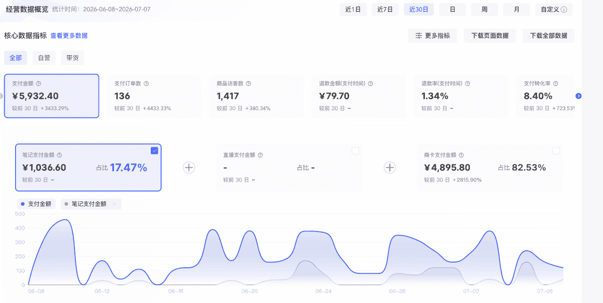

最开始店里只有一个SKU，现在扩展到6个。

收入并不惊艳，但对我来说，有自有产品、有信任我的用户、有每天雷打不动的动作，这就让我看到了一条可持续前进的路。

更重要的是，我把“用户反馈-产品设计-内容生产-成交转化-产品迭代”这个闭环跑通了。

这篇复盘，我特别想写给三类人：还在职场里存粮的人，对副业心动但迟迟没迈步的人，以及已经出来却还没有方向的人。

## 一、在总行时，我其实是个“精神开小差”的员工

表面上看，我跟任何一位银行职员没区别：开会、写报告、推流程、跟兄弟部门battle。加班不推，出差不躲，朋友圈偶尔发部门宣传。

但只有几个亲近的朋友知道，我骨子里不算安分。

我心里非常笃定：这个地方不会留我到最后。银行本身是份体面的工作，稳定、有上升通道，适合很多人，但我要的不是它。对升职我没执念，对头衔也没兴趣。当一个人能精确预判自己未来十几年的活法，那种感觉不是安心，而是窒息。

于是那几年我一直活在分裂里：白天扮演合格员工，晚上和周末把精力分给我真正感兴趣的事。

2024年，工作满5年，我30岁，觉得是时候做个了断了。

一开始我跑到赚钱有术找副业，心态像个饿汉扑到自助餐上，每期航海至少选两个项目，还同时去学短视频IP操盘手，精力被切得七零八落。结果多数航海都变成“打卡换押金”的流程，连门都没摸进去。

但那段日子也没有白过。我收获了一种模糊的直觉：有些事上手就来劲，有些事做两天就想拖延。这个直觉后来成了我最重要的判断工具。

## 二、退完所有群那天，我心里安静得不像话

2025年初，我正式辞职，退掉了上百个工作群。

在那之前，我已经做了很长时间的铺垫。

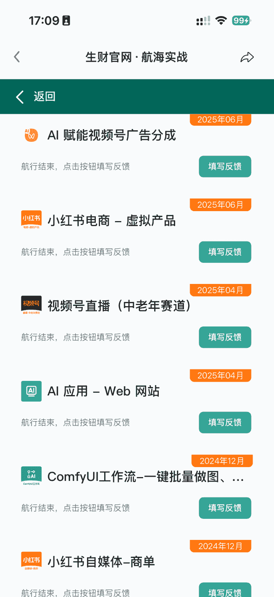

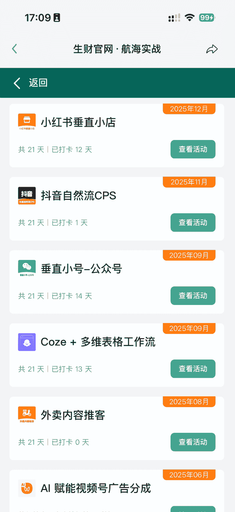

经济上，我确认自己不会马上饿肚子——5年工龄给我存了一笔舒服的过渡金。能力上，我事先补齐了短视频IP操盘这块短板，从公司离开后可以立即开工，不至于在职业空窗期手忙脚乱。心理上，这个决定在我脑子里排演了无数遍，我早就在等这天。

提离职那天，我约了部门负责人单独聊完，回到工位直接走流程。没有在群里发告别小作文，也没有挨个致谢，按下退群键的那一瞬间非常干净。

周围人的反应有点意思。多数人以为我要跳槽，或者闷声发大财了。没人往“自由职业”这个方向想。在他们看来，我就是那个沉默、按部就班的同事，怎么会突然裸辞？

可我不是一时冲动。离职对我而言不是逃跑，而是一个筹备了很久的节点终于到了。不是“我受不了啦”，而是“我准备好了”。当时的心情不是开心，不是焦虑，也不是解脱，而是平静。像走进考场前做完所有复习的考生，心里只剩执行。

我还跟自己说：大不了过几年混不下去，再回职场混口饭吃。

## 三、不断试错后，我才明白：选方向，就是选生活

离开总行后，第一站是短视频IP操盘手。

起步很顺，半年内做了多个项目，全网跑出千万流量，覆盖青少年教育、实体加盟、银行培训、身心灵疗愈等领域。后期我以项目负责人身份带过小团队，事情推进得很快。

但我又一次主动踩了刹车。不是做砸了，而是我不想再做。帮别人做号让我提不起热情，管团队也不是我喜欢的角色。我做这件事的目的很明确，就是用最短的时间完成从职场人到自由职业者的过渡。既然过渡完成，就该去下一站。

我真正想当的是超级个体，不是换个工位的打工人。

这段经历教会我第一个判断：一个方向好不好，不看天花板有多高，而看它跟你当下的状态对不对得上。刚出职场时，我需要的是“有活干、有收入、不焦虑”，IP操盘手恰好给了我这三样。所以哪怕不够喜欢，我也会认真做完，因为那个阶段需要它。

之后我在赚钱有术进入高密度试水期。AI视频、抖音自然流CPS、小红书实物电商、视频号带货、小红书虚拟电商……有的跑出了成绩，有的只是浅尝辄止。

抖音自然流CPS【双十一期间】

做了几个千粉视频号

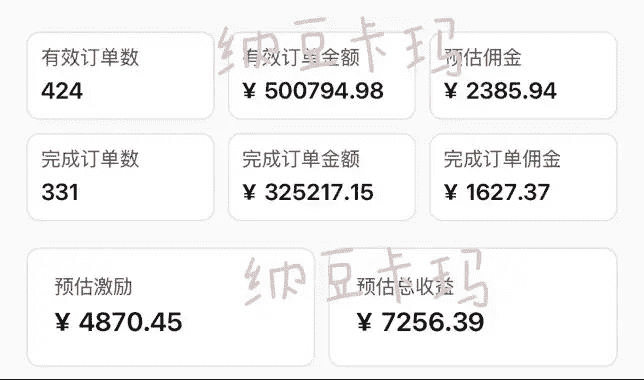

做了2个月的家居号【已暂停】

第一家小红书店铺【部分拍摄素材】

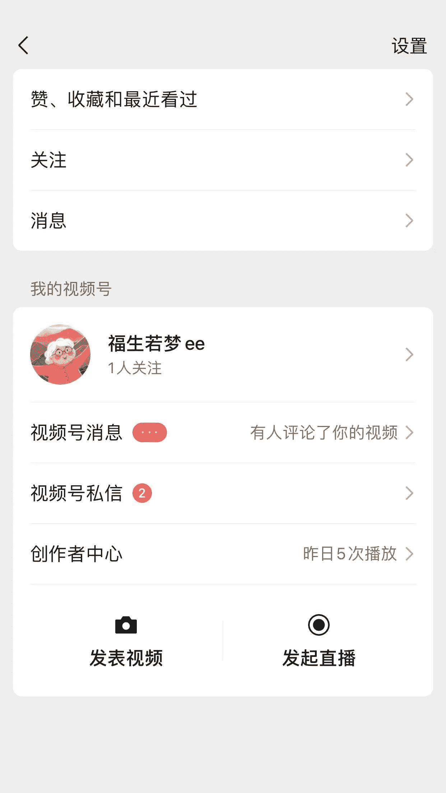
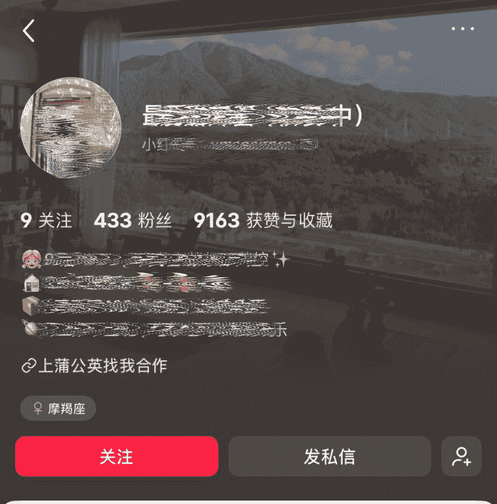
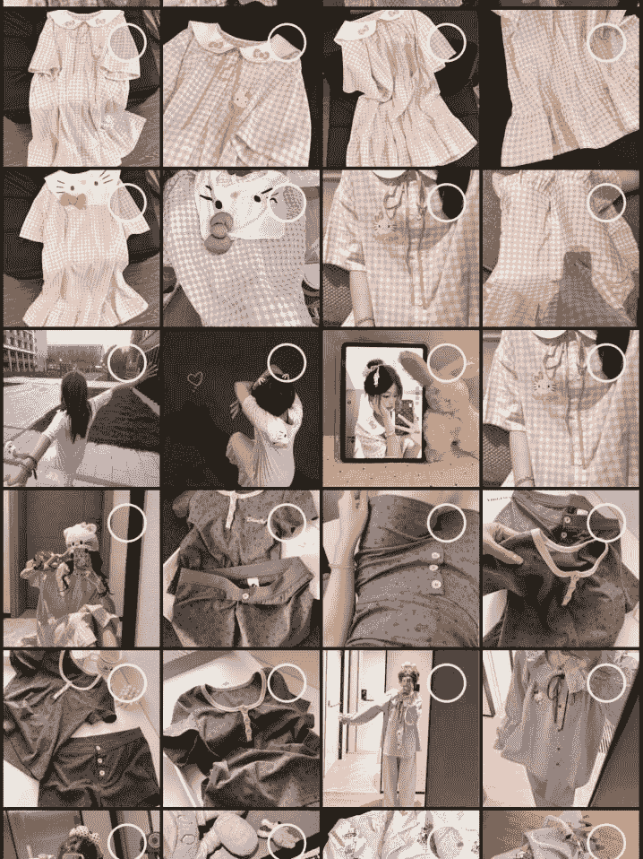

其中数据最亮眼的是抖音自然流CPS。那篇复盘被我发在赚钱，拿到精华，很多人就是在那时候认识我的。

现在回想入场时机，很巧。当时我小红书电商一直没起色，正犹豫要不要在双十一前换品类。刷到怡然教练的招募帖，认真评估了一下：这个项目和我的操盘经验高度契合，又是短平快打法；就算不成，也能在我迷茫期给一记强心针。于是报名。

结果大家都知道了：16天航海，3个抖音号，81条视频，3条破万爆款，GMV累计超过50万。

具体细节在那篇精华帖里都有，我不重复讲。

但项目结束后，我没有继续深耕。原因不是它不好，相反它给我的数据和反馈都超过预期，还托住了当时状态很一般的我。只是我追问自己：不为了赚钱，我真的热爱这个行业吗？答案是否定的。

更关键的是，这个方向想做大，几乎必然要走矩阵路线：多账号、批量内容、团队作战。那不是我想活成的样子。

我想走的是个人IP方向，用内容去表达，把品牌和信任积累在自己名下。而CPS拼的是执行力和信息差，一条视频的生命周期极短，今天爆了明天就可能归零。

权衡之下，我选择回到自己更擅长、也愿意长期投入的领域。

双十一结束我就没再碰CPS。年底搬家加过年，节奏彻底停掉，期间零零散散看过小程序等方向，但都没有真正启动。

也正是那段时间，我一个转弯想明白了：选方向，本质上是在选自己打算怎么过日子。有些玩法来钱快，但那个速度我hold不住；有些玩法有复利，但前期反馈慢到磨人；有些玩法天天要跟陌生人高频率说话，对社恐型人格是种消耗。

没有必须做的方向，也没有绝对不能碰的方向。一个人在不同阶段的心力和目标不同，只要能接住你当下的需要，就是好方向。这种判断不是坐在屋里拍脑袋想出来的，是在不断行动中试出来的。

今年年初，我去参加了条形马老师的年度复盘活动，回来后反复和AI讨论，从人生愿景一直聊到日常安排，终于把思路理清。我决定正式启动小红书个人IP+虚拟电商。

## 四、从两单到6个品：没人看见的时候，我在做这些

进入AI时代后，表达本身就是存在感。“公开地学，公开地做”，这两句话对我的影响非常大。

以前我脑子里也会冒出各种想法，但总觉得不够成熟，不好意思拿出手。AI出现后，表达的门槛被拉低了不少——我只需要掏出真实的经历和判断，剩下的梳理和打磨可以交给它。

我很喜欢看别人把自己学习、转行的过程晒在网上，那种状态充满生命力：一个人做着自己喜欢的事，表达欲和行动力都会自动涌出来。

所以今年4月，我开始卖自己的虚拟产品。

第一个月很打脸。我结合自己的银行经历，做了一个帮助银行人突破职场瓶颈、实现转型的笔记库。每天更新，图文、视频轮着来，一个月涨了四五百粉，产品只卖出两单。

如果只看结果，这一个月毫无疑问算失败。

但坚持更新让我收获了一条关键情报：我原本以为受众会是“想转型的银行人”，但后台找过来聊的人，更多是准备入行、正在面试、或者刚进职场想成长的新人。

这个发现把我的运营思路整个掀翻了。

以前我设计产品，习惯从“我想说什么”出发，我自己是转型过来人，就想做转型主题。可真实用户告诉我的是另一套逻辑：工作多年、想彻底转型的人，改变成本太高，决策周期太长；但正在求职、想入行或者刚入职场的人，我的经历正好可以直接帮到他们。

所以5月开始，我的产品定位彻底换了个方向——不再死磕“转型”这一个场景，而是思考同一批人，在不同阶段分别会需要什么。

同时，我在AI大航海和几个付费课程里，搭建了一套高效的内容生产AI流程。

笔记库我用的是Obsidian。在这之前，我试过印象笔记、石墨、飞书，学习碎片撒得到处都是。

选它有两个原因：第一，所有内容都存在本地文件夹，安全可控，打开就能写，不用等同步；第二，它有个Claudian插件，能直接连AI大模型，在编辑器里就能和GPT、Claude对话。这相当于给笔记库装了一个AI入口。

AI帮我承担两块工作：架构和内容。

架构是指知识库的层级结构，我让AI帮着设计，并且随业务变化不断调整。

内容方面，AI主要做三件事：

一是采集素材：吞下大量优质职场对标内容，然后整理、分类，拆出它们的结构和表达模板。

二是沉淀个人资产：把我以前写的公众号文章、日记、项目复盘全部放进去，让AI做索引和关联，旧内容随时可以调出来用。

三是生产符合个人IP属性的内容：把对标素材和自己的业务情况结合起来，用我的语气写稿。

内容生产是一个四步循环。

第一步是输入与仿写。把优质对标内容喂给AI，同时告诉它我的业务和语言风格，让它先照着对标的框架、结构和模型写一版。模仿不是目的，目的是在模仿里找到自己的声音。

第二步是数据沉淀。发布不是终点。每周我会把发布数据和店铺经营数据一起倒回知识库，让它们指导下一周的内容策略。

第三步是迭代与裂变。自己的爆款是最宝贵的原材料。每周用AI分析爆款特征，再通过这些特征裂变出新的选题方向，一篇爆款能裂出好几个选题，每个选题都能单独测试。

第四步是用用户反馈来推动产品决策。后台有人咨询，我就把这些信息记录到知识库，标出用户画像、问题类型和职业阶段。当类似咨询够多，就触发判断：这个需求值不值得做一个新产品？

如果值得，我会用Skill快速搭出产品，先上架，再根据真实反馈迭代。

如果产品放上去一直没人问、没人买，就迅速微调或者下架，省下时间去别处找机会。

知识库能持续长大，靠两个引擎。

第一个引擎是复制自己的爆款做裂变，这是基本盘，让内容质量和转化效率保持稳定。

第二个引擎是采集小红书平台上正在爆的跨行业母题，这是增量盘。我并不会只盯职场内容，其他行业的爆款，底层逻辑往往是相通的。把母题拿过来，用自己的行业视角重新翻译、重新测试，这方法也给我供了不少爆款。

两个引擎同时转，笔记库才不会枯竭。整天抱着旧内容会坐吃山空，整天盯着别人的爆款会丢掉自己。

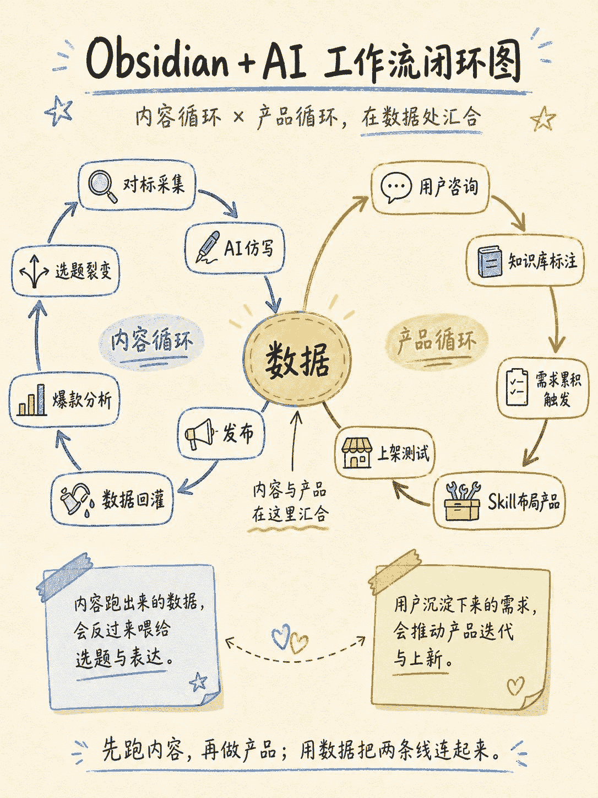

两边合起来，才能持续产生“有我的印记、又恰好被市场需要”的内容。

这套循环让我从来不缺选题，也让我能坚持每天更新。

产品定位调整后，新品上架很快就出了第一单，客单价99元。那一刻我很确定，方向对了。

后面跟着后台客户的真实反馈，我连续加了好几个品，都是围绕同一类人群。店铺从1个品到6个品，不是我在办公室里规划出来的，是在跟用户一来一回的互动里长出来的。转化也是自然而然发生。

我得出一个核心结论：做虚拟产品，不是先做一套完美的资料再去找客户，而是先钻进真实用户的问题里，用他们的反馈反推需求，再一步步长出产品矩阵。产品必须迭代，但在需求真正长出来之前，你必须先“在场”。

所以除了迭代产品，我还给自己立了一条铁律：坚持日更，且不允许用“水内容”凑数。😂

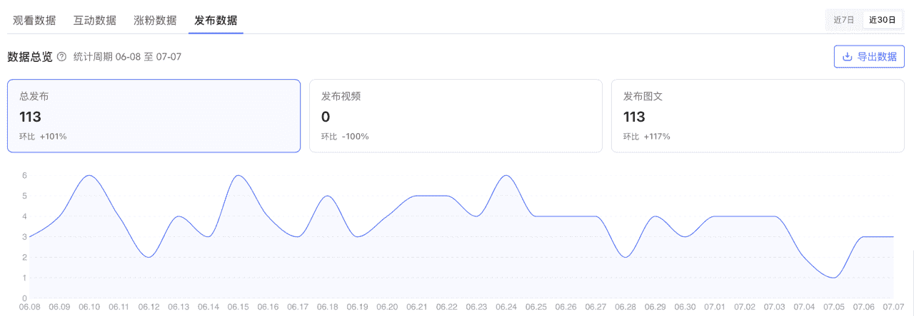

立这条规矩时，我底气并不足。那时店里只有一个转型产品，转化很差，4月总共卖了2单。如果只看数据，实在找不到每天投入的理由。

但我的想法很朴素：既然决定做一件事，就先把必要动作固定下来，不要被情绪牵着走。情绪这东西最不能倚仗，今天高兴就更新，明天低落就断更，这种节奏什么也成不了。

日更在那会儿看起来挺傻。每天跟账号较劲，内容发出去，销售数据毫无反应。但它逼着我直面一个躲不开的问题：今天发什么？给谁看？拿哪个产品去接？

这个问题不会因为我不更新就消失，只会因为我的拖延变得越来越大。拖久了，店铺就会变成又一个“试过但放弃”的项目。我不想再放弃，之前做小红书虚拟电商已经放弃过一次，这次不能再走老路。

更重要的是，我写的方向是自己真正想说的。职场经历、生活感悟、求职方法，这些素材长在我身上，怎么挖都挖不完。所以日更对我来说不是折磨，不是“我不得不坚持”，而是我真的有话想讲。

当你的选题库里装的都是自己走过的路、摔过的跤、做过的决定，你根本不需要每天绞尽脑汁编内容，只需要诚实地把发生过的事说出来。这样的表达，天然没有表演感。

这个阶段，我心里还有一个更底层的信念：不要给自己留退路。

“大不了回去上班”这句话，到了第二年我刻意再也不说。不是怕回不去，是我太清楚自己的性格：只要心里留着一条舒服的后路，遇到困难时我很容易就会想躲进去，没法在这件事上用尽全力。

选择太多，反而会让你在每条路上都不敢全押。因为潜意识里总觉得：做不成也没关系，还有plan B。

这种心理上的安全出口，表面是保护，实际是在不断抽走你的专注力。

所以我告诉自己：别再把“放弃”当选项。先把该做的动作做完，一直写、一直卖、一直验证，手边能用的工具全都搬出来。再对自己说——这件事，我必须做成。

回头去看，4月那两单就像一颗种子。当初只觉得难堪，现在才明白，那是我和真实用户建立的第一次连接。后面的6个品、陆续多起来的订单，都是从那一刻开始长出来的。

## 五、我选方向的判断框架

如果你问我：怎么判断一个方向要不要做？看赛道空间？看当前热度？看毛利高低？

这些我都会看，但都不是放在第一位的东西。

我会用经典的“三圈理论”来整理自己的思路。

回到最初的目的：我从公司出来，不是为了找一份工资更高的活儿，而是想拥有直接面向市场赚钱的能力，自己支配时间，做自己喜欢的事。在这个大前提下，还要兼顾商业变现的可能性和方向的长期性。

所以我一直想找的，是一个在做的过程中，能让我越来越靠近理想状态的方向。

具体怎么筛，我通常分五步。

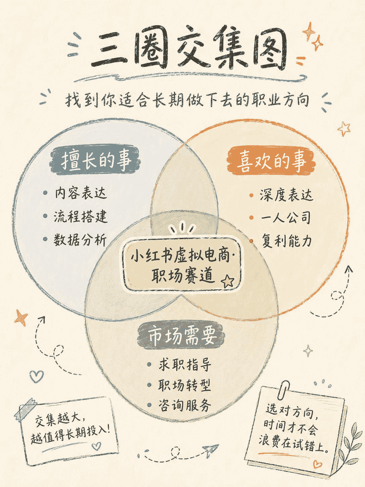

## 别再问“哪个项目赚钱”了，先问这五个问题

很多人都问过我：怎么选项目？什么赛道有前景？说实话，这个问题我过去也纠结了很久，直到我把自己做过的每一件事拿出来复盘，才意识到——选项目的本质，不是看哪个最赚，而是看哪个你能坚持最久。

我有一套自己的判断标准，分五步，分享给你。

### 第一步：它让你离理想生活更近吗？

这是底层逻辑。我之前做过抖音CPS，数据确实漂亮，但那套玩法做大了就必然走向矩阵运作，意味着要堆号、做内容流水线——那不是我想要的状态。

我真正想做的是个人IP，是深度表达，是靠自己一个人把品牌和信任一点点垒起来。所以哪怕数据再好，我也停了。

反观现在做的小红书虚拟电商，前期只卖出两单。但这件事方向是对的：它有复利，能和用户建立真实连接，做越久积累越厚。

### 第二步：你的能力能撑住吗？

抖音CPS所需要的能力，几乎和我之前做短视频IP操盘手时的积累完全重叠，所以我上手快、出结果快。

但小红书虚拟电商需要的内容表达和用户洞察，一开始我并不擅长。可我发现，这是我很乐意去补的方向——能力的匹配度不是静态的，关键在于你愿不愿意为它长出新能力。

### 第三步：做的时候，你是兴奋还是拖延？

这个标准听起来简单，但极准。

我现在写东西、做内容，不需要任何自我说服，坐下来就能进入状态。但一想到要碰供应链、搞售后，我本能地往后拖。身体是不撒谎的——你的状态，早就替你回答了。

### 第四步：它满足你当下的阶段需求吗？

刚辞职那会儿，我最需要的是“有事做、有进账、心里不慌”，IP操盘手正好填上了这个空缺。

等稳定下来，我的需求变成了“有积累、可持续、有表达欲”，所以我把重心切到了虚拟电商。每个阶段要什么，就去做什么，而不是死守一个项目不放。

### 第五步：最坏的结果，你扛得住吗？

每个项目开始前，我都在心里画好了一条止损线。我试过的这些互联网项目，没有任何一个能让我亏到伤筋动骨——因为成本可控，边界清晰，超出承受范围的，我压根不碰。

五步走完，你会发现：那个适合你的项目，未必是利润最厚的，但一定是你心甘情愿做得最久的。

---

## 自由职业一年半，我悟到的那些事

如果问自由职业最核心的能力是什么，我的答案是——持续解决问题的能力。不是某一项技能，而是那种不管出什么问题，你都能想办法把它磨平的能力。

尤其你是一个人在战斗，引流、成交、交付这三件事，缺一不可。

引流，是让人找到你；成交，是让人信任你并付款；交付，是把承诺的服务给到位。任何一环掉链子，整个商业闭环就转不起来。再往深走，你想放大规模，还得碰团队管理、财务分配；卡住了，得有关系网络兜底。从单点突破到全面开花，这条路绕不过去。

但光有能力还不够，更考验人的，是如何管理自己的状态。下面这八条，是我亲身趟出来的经验：

### 1. 主动屏蔽一切抓取注意力的东西

娱乐八卦、热搜、短视频信息流——它们不只偷走你的时间，更会带走你的情绪。情绪一旦被裹挟，状态就会悄悄下滑。自由职业没有上司盯你，但有算法随时想套牢你。

### 2. 早睡早起，每天保持运动量

有时候一整天不出门，精力攒着没法释放，晚上就翻来覆去睡不着。

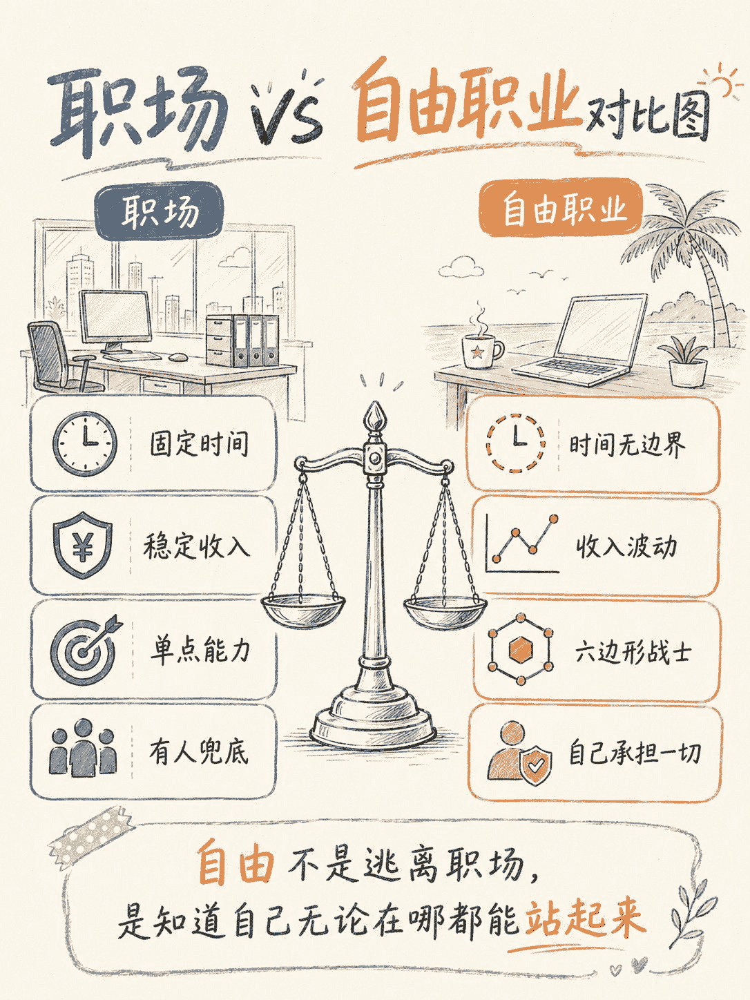

我的习惯是：不出门的日子就跳操半小时到一小时，把身体能量消耗干净。精力管理从来不是靠意志力，而是靠物理消耗。

### 3. 报个兴趣班，保持和真人的社交

连续几天不开口说话、不和人面对面交流，状态会不知不觉地萎靡。

画画、跳舞、健身都行，最好选那种能产生互动的。既学了东西，又接了人气。每个月再约朋友吃顿饭，逛逛街，沾沾烟火气。

### 4. 给日常建立秩序感

“自由”如果没有边界，很快会变成混乱。我每天花十分钟理房间，逼自己一周做几顿饭，保持每周运动三到四次。刻意在生活上多花点时间，不让自己整天钉在电脑前。

### 5. 列出月计划和日计划

月计划管大方向，免得忘了重要的事；日计划管小事，做完一项划掉一项。每周还给自己放两天假，该休息就休息，硬撑着反而效率更低。

### 6. 所有重复性工作，全部SOP化

封面怎么做、客户咨询怎么回、产品怎么快速上架——全都写进标准流程里。

上班的时候不管效率多低都得在工位上坐满八小时，领导只看结果，没人教你怎么做。现在不同了，每个日常任务都值得沉淀成SOP，把人从重复劳动里解放出来。

### 7. 不执念结果，只死磕过程

我不给自己定“这个月必须赚多少”的目标，而是先把时间排好：哪个时段做什么事。

想让客户下单，核心不是催促，而是把对方所有顾虑都搬走。带着“解决一切问题”的心态去做事，结果自然会找上门。

### 8. 没有回头路，只有“一定能成”

回想上班的时候，什么任务都敢接，无非是被老板逼着必须交付。自由职业也一样：不是办不到，是想办到就一定办得到。别因为怕走弯路而停在原地，等你迈出去了就会发现——四面八方都是往前走的可能。

归根到底，自由职业的自由不在于你人在哪里办公，而在于你能不能选择做什么。

如果你为了“当自由职业者”而选了一个自己并不喜欢的方向，每天靠意志力硬扛，那和在职场里熬有什么区别？无非是收入更不稳定、心里更没底。那不是自由，那是另一种更累的上班。

所以，我现在选项目的标准，不看赛道天花板有多高，也不看品类毛利有多少，就问自己三句话：

做这件事的时候，我的状态好吗？我愿不愿意每天为它投入三四个小时？它有没有让我觉得自己在变成更好的人？

三个答案都是“是”——那剩下的，就交给时间和执行力。

选项目，就是在选一种活法。

自由不是逃出职场，而是你清楚地知道：无论身在何处、发生什么，你都能独自面对一个又一个问题，持续把问题解决掉。

回头看看这一年多，我觉得自己最大的贵人，还是我自己。

是那个最忙的两年里也没忘记心里那颗自由种子的人；是那个愿意反复付费学习、项目推翻重来、方向换了又校准，却始终没有停止追问“我到底想做什么”的人。

如果你还在职场里犹豫，或正在自由职业的路上跌跌撞撞——先成为自己，再在持续的产出中，吸引同频的人。

最后，别给自己留退路。最差的结果，无非是回去找工作；但万一，你这一走，就再也回不去了呢？

————

看完这篇，你可能会觉得“我懂了”。但说实话，90%的人一到实操，第一步就卡住了。

工具和教程只是最浅的壁垒，真正的分水岭在于“立刻开干”和“圈子里的信息差”。

如果你想看全网最新的变现玩法，和一群行动力拉满的极客一起下场实操，欢迎来我的核心私域：【懒人专属群】。这里不聊虚的，只做商业闭环拆解和AI效率压榨。系统里已沉淀1000+跑通的实战项目。

😂 查看完整圈子资料与上车方式：

https://lazyso.com/insider/

认可价值、准备好动手的，扫码加微信（lazyhelper1）

备注：【实操上车】，不闲聊

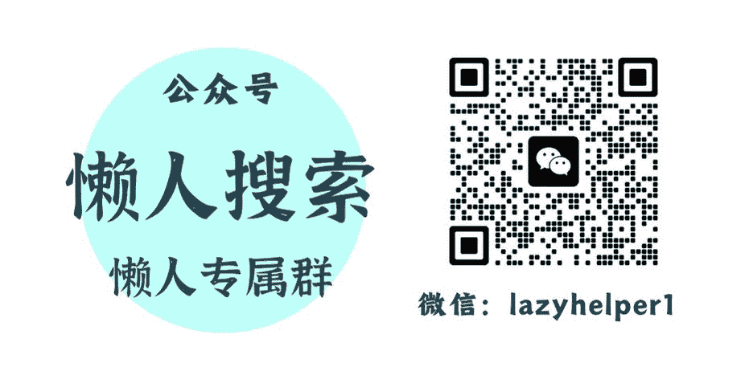