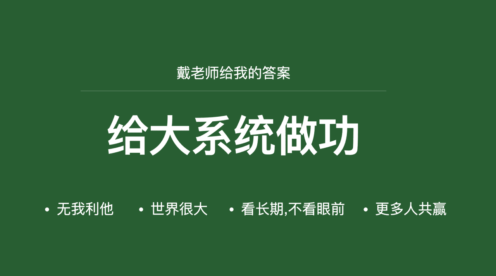
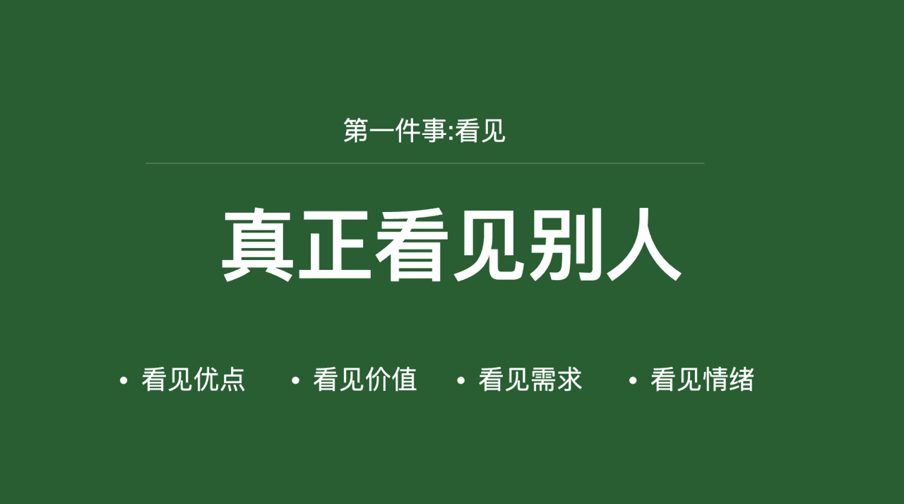
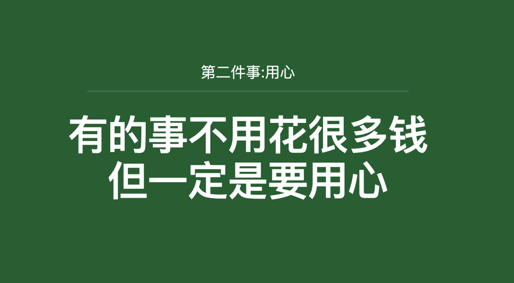
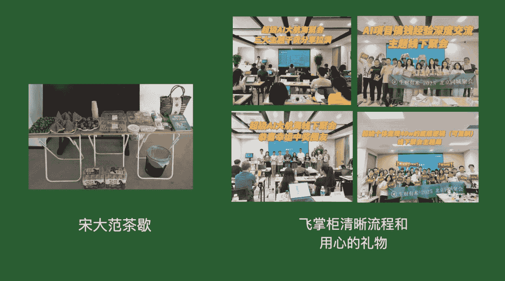
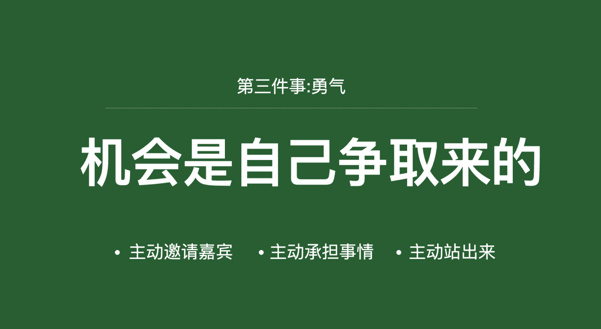
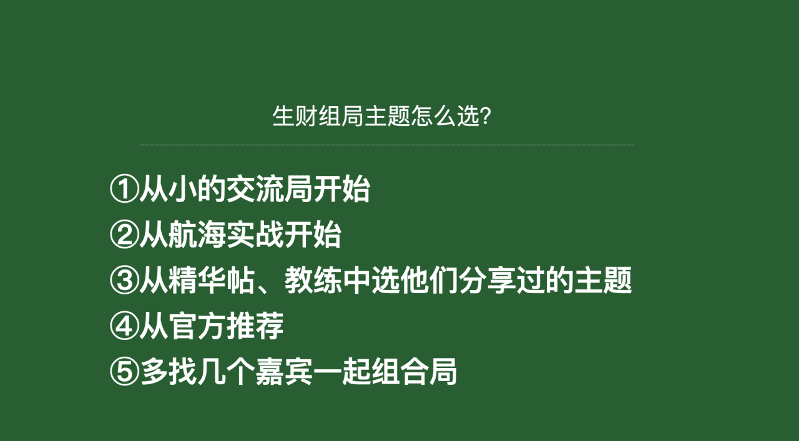
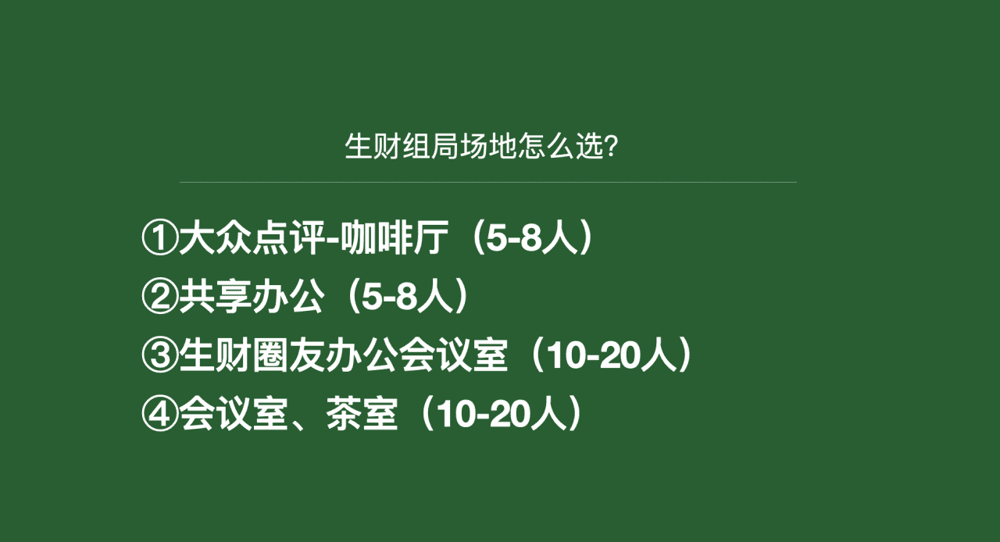
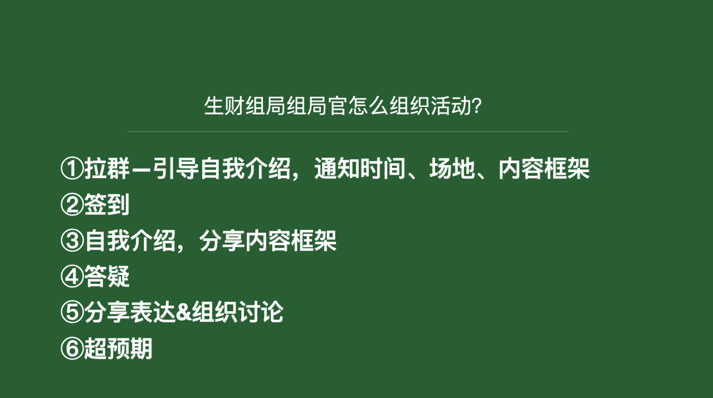

# ('新人组局**10** 条实战经验心得', (7, 25))

新人组局，别等“准备好了”才开始：10条从0到1的实战心法

大家好，我叫咏舒，常驻北京，在赚钱已经待了整整六年。

2020年，我刚进赚钱没满一个月，就被这个圈子点亮了。那时我受邀分享精华帖，随后又成了北京同城聚会的夜话官。第一次真正被“看见”，我看到了更开阔的世界，也看见了一群躬身利他的人。从那以后，我学会了感恩，也坚信：单靠个人，能做的事终究有限；赚钱这样的大系统，才是不断托举我们向上的底座。

这些年，我反复参与组局，也带过不少组局官培训，最大的感受是：成全别人，到最后都是在成全自己。我原本是个一说话就紧张的i人，正是因为一次次走出去、一次次张罗活动，才慢慢撬开了自己的壳，也练出了察言观色的能力。业务上有了突破，身边还聚起了一群同频靠谱的朋友。

常有人问我：组局费时、费力、还烧脑，为什么还要坚持？因为我尝过被点亮的滋味，所以也想去做那一点光，去照亮那些还站在起点踟蹰的人。上周（7月5日），海明在北京张罗了一场面向新人的组局培训，现场不少圈友被点燃。那场活动结束后，我们沉淀出一些可以复用的打法，今天分享给你。

**1. 一场组局的好坏，不在于谁更专业，而在于是否让每个人都“看见了自己”**

培训现场，有位圈友在企业财务领域干了十几年。她本来觉得自己的积累又冷门又无趣，不敢上台。哪知道，大家一个接一个追着她问怎么给个体户报税、怎么算年化利率、香港账户数据回传有什么风险……她随口讲出的“常识”，被好几个人当成干货记下来，连她自己都惊了。

另一个做小程序出海业务的程序员，创业多年，实战经验很扎实，却始终觉得自己的故事没什么好讲。结果互动环节，一堆人围上来问出海实操，他当场就有了开一场分享局的冲动。

很多新人热衷于追逐高大上的概念，反而把自己日积月累的实操经验当成了背景板。可圈里人缺的，正是这些能落地的真东西。所以组局者最该做的，不是做讲师，而是做“挖宝人”。海明在现场就没让大家走“简历复读”流程，而是提前私聊、现场抛问题、引导大家互相追问，一点一点把人身上的宝藏露出来。

**2. 动手之前，先把规则和边界立清楚**

新人办活动容易慌、容易耗，根源多半是没摸清规矩，而不是能力不行。比如“能不能请圈外朋友来讲？”“活动能不能收费、AA怎么算？”“哪些动作会踩线？”心里没数，手脚就被绑住了。

所以那场培训特意留了半小时，大家一起读组局手册。规则写得很清楚：圈外朋友不能随便上台分享；公益局和商业局要分开；品牌价值观不能丢；主题和嘉宾邀请也要按流程来。先读规则，再当场答疑，新人的疑问当场就被清空了。心里有了底线，也知道出了问题能找谁，自然就不会乱，也不会怕。

**3. 最重要的心法：利他到底，利己只是副产品**

想让一场局又长久又受欢迎，起点一定是“我能给别人什么”，而不是“我能捞到什么”。

我曾是一名设计师IP教练，有段时间流量怎么都做不上去。回头一看，根子在于我总想着自己怎么涨粉、怎么变现，从没认真想过能给对方带来什么。后来戴老师给了我很深的触动：他不懂AI，却不急着闭门自学，而是直接张局、请懂行的教练来分享，大家在成长，他自己也跟着学得飞快。

我照着他的思路，免费开了一期文创训练营，把原本几千块的学费全免了。结果不但吸引了央美博士、一流设计师来共创，团队还拿下了全国前十的文创奖项。这件事让我彻底明白：利他从来不是口号，而是所有行动的起点。当你卸下功利心，先帮别人解决问题、给圈子创造价值，口碑、人脉和影响力反而会不断回流。

**4. 聪明人都在借平台的势，而不是消耗平台**

个人能力再强，也硬不过一个好系统。最聪明的做法，是给赚钱这个大系统“做功”，而不是消耗它的品牌信用。我们在线下办的每一场活动，从某种意义上就是在为赚钱这个招牌背书。把活动做好、把口碑维护住、把正向价值传递出去，这都是在为平台加分。你对系统认真，系统也会把你牢牢托住。

戴老师每次有外地嘉宾过来，都自己掏钱接待、替大家张罗交流，圈里有口皆碑，去年还被平台评为了榜样老师。还有圈友刘智行，一直踏踏实实利他、持续给圈子供能，从月薪3000的普通公务员，做到了月入十几万的创作者，还登上了平台大会的讲台。

这看上去像是运气，其实是圈子最朴素的规律：持续为大系统做加法，和更多人一起赢，小个体最后反而能拿到大结果。

**5. 一边向上学，一边向下帮，这是组局里最快的成长通道**

向上学的最高效方式，不是刷帖，而是直接把优秀的人请到面前。帖子只能给你文字，面对面的交流才能让你看清对方的格局、决策方式、谦卑和发心。

去年我请林途从外地赶来北京分享公众号矩阵打法。他一大早从石家庄坐高铁过来，还拎着河北特产，整场保持谦和，对每个问题都认真回应。那种近距离的触动，真的不是看多少篇精华帖能比的。后来我自己的公众号文章，单篇突破了3.4万阅读量。

向下帮，关键在用心点亮每一个普通人。就说这次活动里的虫子，她理财年化收益能做到15%，这个本事很多人需要，但她自己不知道怎么讲出来。飞掌柜先帮她把优势点亮，我们又陪她一起梳理内容结构，最后她自信地上了台。在陪别人成长的过程里，自己的组织力、共情力和影响力，也被一块儿拉了起来。

**6. 把“四个看见”吃透，口碑基本稳了**

一场活动能不能讨人欢心，很大程度拼的是体验，而不只是内容。

**看见优势**：不必迷信大V，普通人踩过的坑、跑通的路，都是大家需要的宝。理财年化15%的小姐姐、做了十几年财务的姐姐，她们看似普通的日子，恰恰成了现场最抢手的内容。

**看见价值**：主动帮人把那些被忽略、却实用的本领翻出来。财务姐姐一直觉得自己的专业冷门，没想到现场一问才发现，基础财税常识几乎是人人需要的刚需。

**看见需求**：把长篇大论砍成最小模块，只说小白能听懂、能用上的内容。理财小姐姐之前爱讲概念，现场反应平平；后来我们把内容收敛到“小白怎么挑稳健基金、怎么下手买”，她一下子就找到了感觉。

**看见情绪**：碰上冷场、差评、体验不好，别着急讲道理，先照顾情绪、解决问题。我以前办活动，被反馈过“没收获”“场地太挤、没人服务”。我没有反驳，先诚恳道歉、安抚情绪，再一对一补课，把体验缺口补上，最后口碑保住了。海明在活动前逐个打招呼，还临时调整流程给我留出分享时间，同样是“看见情绪”的细腻动作。

**7. 走心，永远比专业更能打动人**

很多新人不敢张局，是怕自己不专业、怕被骂。但真实的经验是：只要你足够用心、足够真诚，负面声音几乎不会出现。

用心不需要花大钱，细节做到位就够了：提前到场布置，在门口迎接每个人，耐心答疑，把共性问题整理出来，悄悄准备点小惊喜，让谁都觉得自己被照顾到了。

我见过很多优秀的组局官：宋大范把茶歇备得妥妥帖帖，飞掌柜反复打磨流程、给每位参与者准备专属小礼物，戴老师常年免费答疑、用心托举圈友，海明在活动结束后还帮新人梳理下一步方向。这些真诚，别人都感受得到。在这个圈子里，靠谱走心、躬身利他，远比“完美专业”更让人认。

**8. 别等完美，先干起来**

组局从来不存在满分，今天再老练的组织者，也都是从一次次翻车现场爬出来的。我刚开始张局的时候，连续被三家场地拒绝，邀请嘉宾被婉拒，现场冷过场，也被骂过。但这些都是新人的必修课，真的不需要太当回事。这次活动里萌生组局念头的程序员和理财小姐姐，同样是从“我不行、我不会”的纠结里迈出来的。

对新人来说，最值钱的就是主动。主动站出来，主动扛事，主动连接，主动解决问题。每被拒绝一次，认知就厚一分。只要你敢迈出第一步，就已经把绝大多数观望者甩在身后了。就像林途，一句“我来”，跨城赴约，真诚分享，最终也收获了属于他的成长和机会。

**9. 落地就两招：降阻力，多加分**

新人真不用一上来就做大规模，把这两招练熟了，就能稳稳组好一场局。

**降阻力**，是多方位的。给自己降：先做3-5人的小组局，不贪大，压力小，正反馈来得也快；给参与者降：学北京这次的经验，按人群聚集地选地址，比如AI爱好者就约在他们方便的片区，不让人跨城折腾；给嘉宾降：提前聊对方最熟、最拿手的主题，别赶鸭子上架。

**多加分**，也是各方位加。为平台加：守住规则、经营口碑，维护赚钱线下品牌；为圈友加：复刻这次北京的挖掘方式，让每个人都被看见、都能落地；为嘉宾加：全程尊重、用心配合、真诚表示感谢。林途分享完，主动在自己所在的城市开了局，这就是被用心对待之后最好的正向反馈——互相成就，双向加分。

**10. 新手的第一场局，可以照着这份清单直接落地**

**选主题**：优先选自己擅长的事、航海出来的实战心得、精华帖里跑通过的选题，或者平台官方推荐的方向。越具体越好，越小众越容易出彩。

**选场地**：刚开始不必豪华，咖啡厅、小型共享会议室、圈友闲置的办公室都行。花钱少、压力小，人坐在一起反而容易聊开。

**办流程**：提前拉群同步信息；提前40分钟到场布置；做“挖掘式”自我介绍，不走过场；共读手册、现场答疑；主题分享加互动讨论；预留惊喜共创环节；结束前帮每个人把下一步行动定下来。

---

最后想说，组局的意义并不在于热闹本身，而是——先被人看见，再去看见别人。很多人并不是没有货，而是缺一个开始，缺一份信心。别怕从零开始。每一次用心张罗，都是一簇星火，它在点亮你的同时，也会温暖别人，照亮整个圈子。

看到这里，你可能觉得：我学会了。但真正去实操时，90%的人会卡在第一步。

工具和教程从来不是门槛，它们只是最外层的壳。真正的分水岭，是你敢不敢立刻动手，以及你掌握多少圈层信息差。

如果你想第一时间看到最新的变现玩法，或想和一群执行力拉满的极客并肩作战、直接拿结果，欢迎来我的私域：【懒人专属群】。我们不空谈概念，只拆商业闭环、压榨AI效率，目前系统里已经沉淀了1000+跑通的套利实战案例。

👉 查阅圈子完整数字资产与上车门槛：
https://lazyso.com/insider/

如果你认可这套逻辑，也想赶紧下场，就扫码加我（lazyhelper1），备注【实操上车】，不闲聊。

