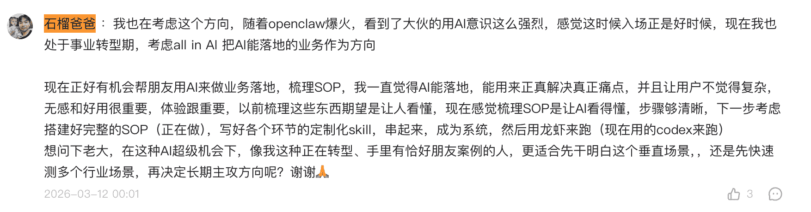
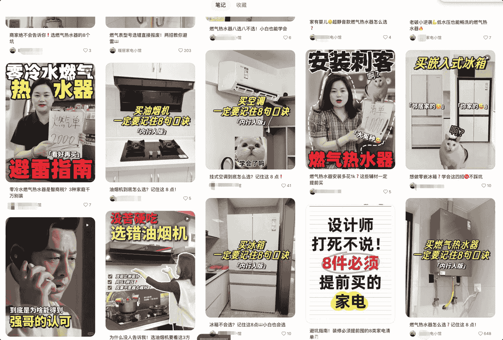
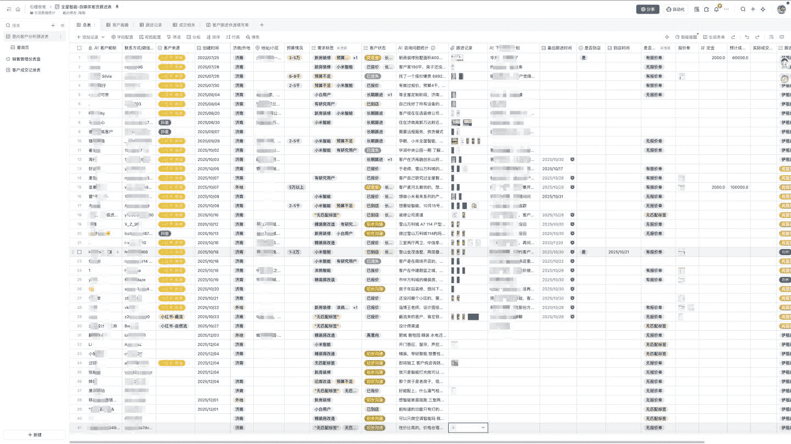
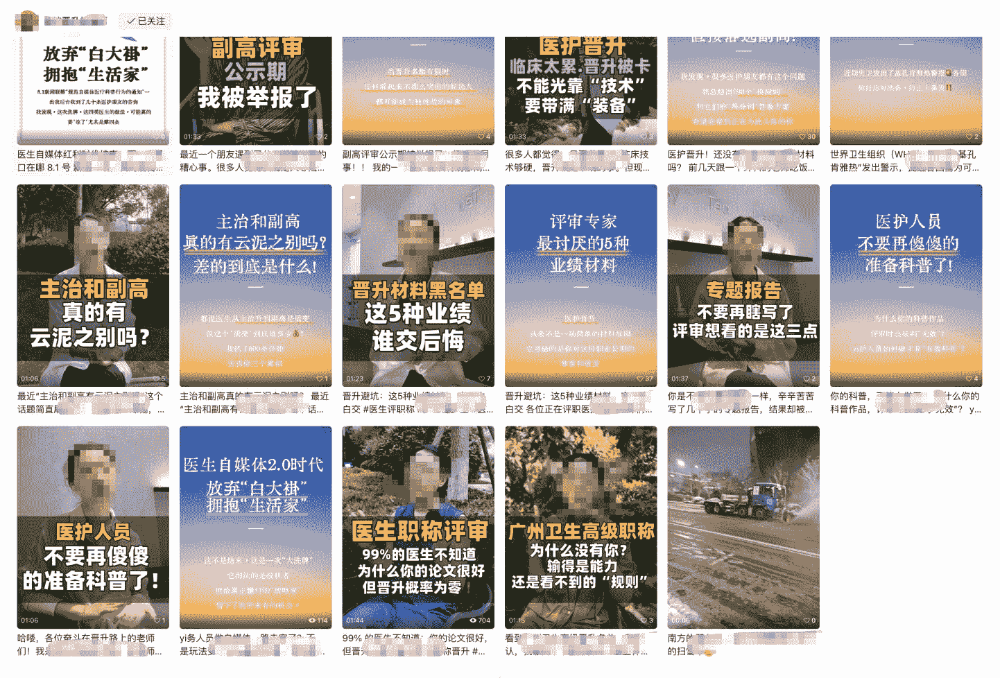
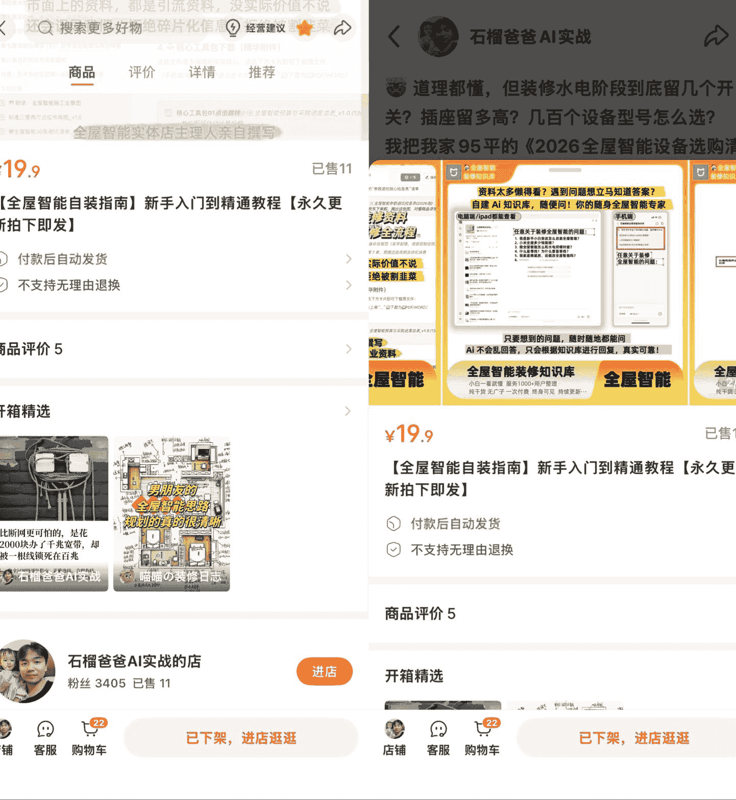
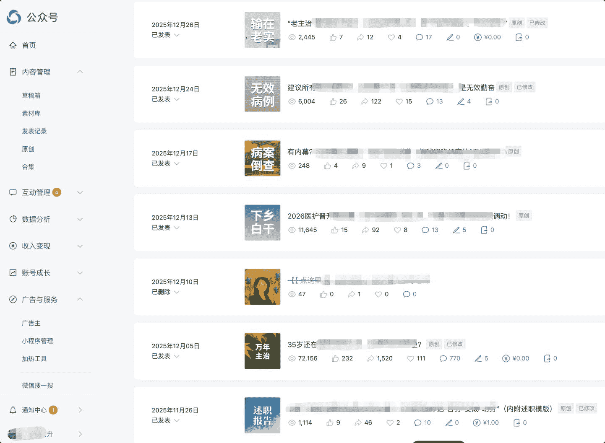
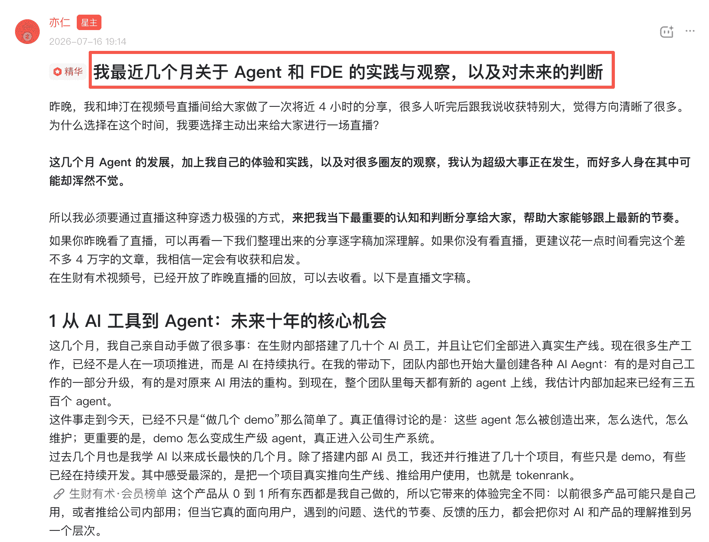

如果我想讲一个“逆袭”的故事，标题早就起好了——“普通人裸辞一年，靠AI月入过万”。听起来多提气，多励志。可惜，这不是真事。

我是石榴爸爸，坐标济南，做了9年园林景观设计。2025年1月1日，我从公司离开，没有存款万贯，没有成熟项目，只有一条刚起号的家居账号和一颗“必须动起来”的心。后来我加入赚钱，一口气试了家电、全屋智能、AI数字人、虚拟资料、垂直公众号，全部没成气候。再后来，我All in AI企业服务，拿到5000元一单的企业内训，同一个月内又做了第二次，两次加起来，勉强赚了1万块。

你看，距离“月入过万”还差着好几口气。

所以这篇文章不聊成功，只聊踩坑。一个普通人是怎么从设计院走到AI企业服务这条路上的，中间又踩了多少我原本以为可以避开的坑。

## 设计师的“完美病”，差点毁了我的创业

我做景观设计那9年，画过方案，出过施工图，跑过现场，也带过小团队。我特别享受“图纸变成实物”的瞬间——你画的东西真真切切立在大地上，那种成就感，设计师都懂。

这份职业给了我审美的底气、结构的敏感，以及“必须落地”的执念。做AI工作流时，我总下意识先拆问题、再理流程，还会反复琢磨用户能不能看懂、好不好用。这些习惯，全是当年做项目留下的。

但它也给了我一个很糟糕的副产品：我总想把方案想得万无一失再动手。

做设计时，这是讲究；创业后，这就是灾难。我花了大量时间研究工具、搭建SOP、把流程设计得漂漂亮亮，却把“先发出去、先见用户、先拿反馈”放在了最后。那时候我还觉得自己特认真、特能钻研，同事遇到软件问题都来问我，我也乐意折腾。

现在回头看，这股钻研劲让我很快就接受了AI，但“不研究透就不动手”的毛病，也让我在创业第一年交了不少学费。

真正逼我离开行业的，是2024年。景观园林和房地产深度绑定，行业一路下行，项目越来越少，公司连过年都悬。我8月就预感到了，但并没有提前找好退路。我是看着船要沉了，才拼命学自媒体、学拍摄、学剪辑，想抓住一块浮木。

2025年1月1日，我正式裸辞。彼时家居号只有1000粉，没有稳定收入，没有验证过的模式。这不叫蓄谋已久的转身，更像被浪潮推着走，恰好看到一点微光，就跳了下去。

## 从自己家开始，我第一次信了内容的力量

2022年装修自家房子时，我还没想过当博主。因为是设计师，我硬是自己画图、自己盯工、自己能动手的地方绝不让别人来。那套轻全屋智能，也是我翻遍资料、一点点搭起来的。

后来学自媒体，才发现这些经历全是素材：怎么找工人、施工要注意什么、全屋智能怎么做才不复杂。2024年8月29日，我开始系统做小红书，从拍摄剪辑到选题，全部重学。账号从智能家居切到家居好物，累计发了100多篇，做到3000多粉。

3000粉确实不算什么。但它让我信了一件事：我不仅能坐在公司里画图，我还能学会新的技能，能坚持把内容做下去。

不过我也陷入了一个大误区——我以为只要内容一直发、粉丝一直涨，变现自然会发生。但账号靠什么挣钱？用户来了怎么接？我能卖什么？我完全没想清楚。结果就是，我拥有了“做内容”的能力，却一直没有“做产品”的闭环。

## 加入赚钱后，我像一只突然看见大海的青蛙

离职三个月后，我花几千块加入了赚钱有术。

说实话，当时没想太远，就是想看看外面的人都在怎么赚钱。在此之前，我眼里的自媒体只有一条路：做号、涨粉、接广告。进了赚钱我才发现，原来有人做项目，有人做服务，有人把经验做成产品反复卖，还有各种航海和实战复盘。

我分明感到一扇门被推开了——不是世界上没有别的路，是我以前没有看见。

但认知打开也带来了新的麻烦：每条路看起来都能走。今天看这个项目适合我，明天看那个机会更有前景。于是接下来的日子，我马不停蹄地尝试了五个方向。

### 家电项目：有流量，不等于有生意

我先帮一个济南的家电老板做线上获客。我当时觉得，我会做内容，他有门店和产品，完美互补。只要把流量做起来，生意自然会变大。

结果呢？家电是血海。客户看完你的内容，第一件事就是比价。你辛苦讲半天，他拿着你给的报价，转头去别家问了一圈。

唯一有价值的，是我第一次接触到了个人IP的打法。我意识到，发内容的过程，其实是在提前建立信任。后来无论做自己的号还是帮别人做内容，这个认知都起了作用。

### 全屋智能：我什么都想干，最先停掉的反而是获客

家电没做通，我转回了自己最熟悉的领域——全屋智能。毕竟我自己的家就装过，内容、账号、行业知识全都现成。一开始做图文和IP，自然流有点反应后，我又想靠投流放大。

第一次投放我交给了代理商，后来在赚钱里学了投流内容才反应过来：代理商关心的是预算有没有花完，而我关心的是来了多少有效客资、能不能成交。大家盯的根本不是同一个KPI。

于是我自己学投流，前后投了几千块，加了微信的客资有几十个。这证明投流确实能给本地生意带来线索。

但新的坑来了：为了摸清闭环，我又自己当客服、做销售，甚至跟着客户去量房。结果前端内容是我，后端接待是我，转化也是我。一天忙到晚，最先停掉的，反而是最开始该做的获客更新。

创业初期最大的坑，就是老板恨不得一个人把所有的活都干了。

### AI数字人：有产能，不等于有精准客户

那段时期我还参加了一次AI数字人航海。我第一次把AI用在真实账号上，做选题、生成内容、多平台分发。一个月涨了二三十个垂直用户，我挺兴奋，觉得AI终于从“自己玩”变成了“持续产出”。

可问题也立刻暴露：用户虽然垂直，却不够精准。内容做得再快，也回答不了“你到底要吸引谁”这个问题。

产能过剩，但需求错配，等于白干。

### 虚拟资料：没有同行，不一定是蓝海

后来全屋智能合作停了，我又去试虚拟资料。用AI写文案，卖全屋智能的电子资料。当时几乎看不到同行，我觉得是不是挖到了漏？测了两周，果断停。

没有同行，很多时候不是蓝海，而是需求本身就不存在。AI能让我飞速生产，但如果需求没验证，生产得越快，浪费得越狠。

### 垂直公众号：第一次把内容连到了真实业务

绕了一大圈，我帮一个朋友做垂直公众号。这时我才感觉到，小红书让人看见你，公众号则处在微信生态里，内容、加微信、咨询、沟通，链路更顺滑。做了两个月，做到了1000粉，也带来了咨询。

虽然问题仍在，但这次给了我一个关键体感：原来内容可以从播放量、粉丝数，一步步连接到真实的咨询和生意。后来我做AI公众号工作流，很多最早的理解，都来自这个小号。

现在回头看，这五个项目，没有一个是拍脑袋决定的。它们各有各的理由，也都给过我零星的反馈。正因为不是彻底失败，我才总觉得“这个还能再救一下”“那个好像也该抓住”。

可真正的麻烦不是试错太多，而是每次试完之后，我没有及时收拢，也没有把有限的精力往一条主线上继续下探。

## 我最擅长的逃避，是研究一个又一个新工具

不知道你有没有同感：业务一遇到阻力，我就特别容易去研究新工具。装好一个新软件、跑通一个新流程，那种确定感会让我觉得“今天没白过，我还在努力”。

可真实业务不是这样的。内容发出去，有没有人咨询？加了微信，客户愿不愿意聊？该报多少钱？交付后对方满不满意？这些都没有标准答案，而且你认真做了，结果也可能很难看。

所以项目一卡壳，我就躲进工具里。研究新模型，搭新流程，把系统改得更漂亮。这些事情特别像工作，也确实耗时间。但工具越研究越多，真正该面对的客户、销售、报价和成交，一个都没增加。

2026年3月2日，我第一次把这件事想透了：我最常用的逃避方式，就是研究新的东西，享受技术上的满足感。

那次复盘挺疼的。以前我一直觉得自己特能折腾，项目不成还能换方向，工具不会能自己学，坑摔了能爬起来。这些都没错。可另一面我也终于承认：我嘴上说不怕客户、不怕销售，真到要直接面对结果时，我还是习惯性地想“再准备一下、再改完整一点、再把流程理顺一点”。

好像只要准备得够充分，走出去就不会失败。

可现实是，我已经没有工资了。现金流还没形成，每一天都在提醒我：你不能一直停在准备阶段，你得把自己交出去，让真实的市场给你答案。

## 最后，我是怎么拿到5000元第一单的？

2026年3月12日凌晨，我在赚钱的“超级标16”评论区留了很长一段话。我当时说，看到OpenClaw爆火，大家用AI的意识这么强烈，感觉正是入场的时候。我正处在转型期，想All in AI，做能落地的业务。

我还在评论区问龙哥：像我这种手里有朋友案例的转型者，应该先干透一个垂直场景，还是快速测多个行业？

其实问出这个问题时，我心里早就有答案了。

我已经不想只研究工具，也不想只自己用得爽。我想把AI放进真实业务里去解决问题，最好还能让用户觉得“不复杂、无感、好用”。我缺的，只是那一点笃定。

13天后，3月25日，我给一个团队做了第一次AI内容工作流培训。5月10日，又做了第二次。第一单具体怎么来的、怎么报价、怎么交付，我在赚钱单独写过一篇复盘。两次加起来，差不多1万块。

这当然算不上什么成就。但对我来说，它意味着我走出了“准备—逃避—再准备”的循环，开始真正面对客户、交付和那个不确定的结果。

以前我是设计师，画的东西必须落在地上才算数。现在我做AI企业服务，用AI帮企业做内容获客，再交付一套能真实运行的工作流。本质上，我依然在追求同样的事：让方案落地，让工具被人用起来。

这条路还很长，我也没有成功故事。但至少，我不再用“研究新工具”来麻痹自己了。

所谓All in，不是嘴上喊口号，而是把自己从“准备者”的舒适区里拽出来，站到“交付者”的位置上去。

这就是我过去一年最大的收获。

离职整一年后，再有人问我“走通了没有”，我不想再装淡定。

刚离开职场那阵子，我几乎每天都处在焦灼里：想快些拿出点东西，证明辞职不是一时冲动，也证明这一年没白费。可越急就越怕，怕最后的结果不体面。

后来我躲进一种“安全区”——钻技术。

机器不拒绝我，也不嫌弃我的报价低。只要肯花时间，它总会回赠一点小小的正向反馈。靠着这束微光，我熬过了最摇摆的阶段。

但我也从不觉得研究工具是件低微的事。

要不是过去喜欢捣鼓软件、琢磨各种生产环节，AI浪潮打过来时，我不会那么快接住它，更不会有后来的企业项目。学得快，一直是我的强项，这一点从未动摇。

我只是越来越明白：同样的强项，放进不同的坐标系，结果可能天差地别。放对了，是支点；放错了，只是自我感动。

三月初，我刚结束一轮复盘。OpenClaw忽然大火。和以前不一样的是，这次我手里已经有确定的业务切口，也有一条每天都在跑的内容生产链路。我终于没再急着去试十个新方向，而想把眼前这条路走深，看看它能不能真的钻进别人的生意里。

没过几天，有位圈友说要办一场济南线下聚会，主题就是OpenClaw。

我主动问了一句：需要搭把手吗？

这句话，把我从“自己闷头研究”直接推向了“开口谈钱”。

## 第一次，把“我会玩AI”变成报价

先说背景吧。我们早在2025年6月就见过面。那时我刚进圈不久，头一回参加线下活动，彼此只是脸熟。谁能料到，一年后会因为OpenClaw的合作走到一起。

3月10号，我刷到他发活动消息，心一下就亮了。一来OpenClaw正热，二来我手头有一条常跑的内容链路。因此我没打算只当观众，而是问他：要不要帮手。

他反问我：要不要来讲一场。

我想都没想就答应了。

放在以前，我八成会说“再等等”。等流程更圆满，等研究更透，等自己看起来足够专业再公开讲。但这次不同。我交出来的不是新学的一堆功能，而是一种真正用于生产的方法。我知道它哪里走得顺，哪里需要人拍板。它不完美，但它是我日常在用的东西。

当天深夜，我又在圈里看到那条编号16的动态，内容大意是企业如何用AI来做学习与服务。

我反复读了好几遍。

过去我总爱把自己切块：设计九年是一块，做自媒体是另一块，玩AI又算一块。那条动态像是头一回把几块拼进了同一张图。

那晚，心里有个声音特别强：

我已经不是旁观者。我早就在路上。

凌晨，我在那条动态下留了言。表面问“该钉死某个领域，还是快速测几个行业”，其实心里的答案已经浮上来：我想去真实场景里把AI用起来。只是换过太多次方向，不敢立刻信这次能成。

几天后的分享会，正好成了我落脚的台阶。

台上，我没讲“AI会重塑世界”，也没编造什么企业例子来撑场面。我只是打开自己日常操作的方式，一步步说：内容如何从资料整理走到初稿，又怎样变成成品，中间哪些要人盯。

这个演示非常素。台下人看到的，是我反复用过的方法，而不是一堆名词在排队。

也就在那场分享之后，我加到一位后来约我去讲课的人。到这里，难度突然变了。

免费分享我敢讲，真要我报个价，我却完全空了。

这是非标服务，我不知道从哪儿拆钱。按天算，好像开不了多少；按它能替对方省下的人力和后续收益算，我又不敢要太高。

我先问了对方的预算，再把我的时间投入、工具开销、客户可能的收益，以及“这大概是头号样本单”这些信息，分别交给ChatGPT和龙哥的数字分身。

他们没有替我拍板，却给了我一个推算价格的扶手。数字版龙哥的一句话我记得特别牢：四千出头，就是市场给出的第一张票。

3月23号，我把数字递过去：一天，4999元。

按下发送后，心里一直悬着。之前推演再多，只要对方不回复，都只是我的独角戏。

对方回来四个字：这价可以。

我当场脱口而出：原来企业客户真的会接这种报价。

3月25号，我头一回走进那家公司讲课，那一单最终收了5000。5月10号，同一伙人又约了一次。两回合计，大概一万。

我当然不会觉得这就跑通to B业务了，更不指望从此能稳定接单。但对我来说，它确实是一张有重量的票——头一回有人愿意为我梳理并演示出来的AI方法付费。

这笔单怎么谈的、价格怎么定的、培训有哪些坑，我在圈里单独写过一次详细复盘，这里就不展开了。

概括起来：16号动态指明方向，圈友给我入口，数字版龙哥帮我搭起定价骨架。把这一切缝起来的，是我自己。

但成交只能代表有人愿意买单。真正的难题在后面：这套玩法到底只有我会用，还是客户那边的人也能接手跑起来？

## 签下头一单，才摸到交付的门

刚拿到那单时，我满脑子都是“终于有人付费”的兴奋。可真开始准备，那点兴奋很快被细节碾碎。

因为自己跑通一件事，和带着别人跑通一件事，难度差出天际。

我自己操作时，很多动作根本不用过脑：素材放哪个夹子，哪一步容易卡住，AI吐出来的答案哪里要改，我看一眼便知。实在不行，还能换件工具，或手动补一步。

但这些“默认本领”，客户都没有。

他们必须知道从哪个入口打开、Profile改哪一行、原始材料按什么规格放、主链路从哪里启动、跑完怎么检查。到了现场，账号、环境、权限、材料是否备齐，每一项都可能变成拦路石。

过去我整理内容，目标只是“人看懂”。到了这时我才反应过来：写SOP，还得让AI看懂。步骤必须细到机器能执行，输入输出要固定，哪里允许自动连跑、哪里必须停手让人判断，都要在前面标清。

这次备课给我的冲击不小。

过去我总说：只要我会用，就算做出来了。但真正的交付不能只装在一颗脑子里。换个人就断片，那只能算是我的个人技能，还算不上客户接得住的系统。

也是从这单开始，我把内容链路分层。

最底下一层是固定顺序，决定事情从哪儿起、怎么转、怎样收。中间一层是能力模块，写作有写作模块，选题就换选题模块，任务一变模块跟着换。最上面一层是客户专属资料包，里面装着对方的业务、用户、人设、语气和行业背景。

我当时想得很直白：底层别老动，中间靠换模块去适应，真正随客户变的都塞进资料包。这样换新客户，不用把整条路推倒重来。

当然，这只是从首单里冒出的念头，离成熟很远。直到今天，我还在真实施交付里改这个框架。

首单还送我一个很实在的教训。

那时OpenClaw热度正高，我也真的喜欢那款产品。我一度执拗，想把整串长流程全放进去，做成全自动流水线。结果磨了两晚，好几个模型账户的额度都快耗尽，那条判断点密布的链路依然跑不稳。

可能是我火候没到，但客户的日程不会等我把问题磨透。

最后我只好放下“必须用最潮工具”的执念，换回当时更稳的搭配，先把闭环转起来。

这个跟头换来一条原则：验证期，稳定交付永远比工具新潮更重要。

客户不关心你背后部署了几个模型，也不在乎你用的是不是最火的工具。他们只盯一件事：这东西进了团队，能不能真转。

所以头回培训，我没把目标写成“把课件讲完”。

大家对AI的底子不一样，有人熟练，有人连起点都没够到。要是顺畅地讲完整套幻灯片，表面好看，可大家回到座位还是不知从何下手，那就不叫交付。

我给自己的及格线很低，却很具体：现场至少要有一个人，能独立跑完整个流程。

从开项目、理资料，到初稿生成后的核验，我陪着他们一步一挪。当现场真有人完整跑完时，我这才有了实感：这件事从“我会”变成了“别人也能”。

第二次再去，我更坚定：培训不能按功能清单讲，而应围绕现场要完成的任务来设计。先把初稿逼出来，再谈分发、配图、后续延展。一次性灌太多，只会让人更乱。

我现在理解的交付，依旧朴素：先把客户真正堵在哪弄清楚，再把步骤拆到AI可以一步步执行，让团队知道怎么开始、怎么检查、哪里要人判断。工具会换，模型会升级，最后能留下的是可用、好用、也能被接手的流程。

以前钻研新技术，我总问“它能干嘛”。真正给企业干活后，我更爱问：“客户现在卡在哪，我手里有什么能撬开它。”

两个问题只是换了顺序，产出的东西却像两个物种。

我也越来越确定：客户付钱，是想解决自己原有办法搞不定的事，是希望乱麻变顺，是希望团队拿到后就有用。至于背后是OpenClaw、Codex还是别的，他们其实无所谓。

首单让我从“会玩AI”挪到了“敢报价”。后续交付又逼我面对更硬的题：怎么把一次定制，慢慢磨成能反复交付的东西。

项目渐渐多起来后，我还看见一个现实：找客户、谈需求、做交付、沉淀产品，这些环节不可能永远靠我一个人硬撑。

## 从一面之缘，到并肩作战

“所有事都自己扛”这句话我很早听过，但听到和做到之间隔着很远的距离。

我的搭档，就是前面那位圈友。2025年6月聚会时，我们仅仅算互相见过。今年3月那场OpenClaw活动，我主动帮忙，又上台分享，这才开始真共事。

分享结束后，我们的合作越来越多。到5月底，我们把“项目怎么讲、产品怎么设计、价格怎么定、先推哪块”重新梳理了一遍。

那场讨论里，可做的事很多。但我越聊越清楚：如果什么都想抓，八成又会滑回原形——每件都做了表皮，没有一件被挖到根上。

于是6月初，我们正式定了：以搭档的方法一起走。

分工也简单：他冲前方，找客户、串资源；我守后方，拆需求、搭链路，把项目里可复用的部分慢慢养成产品。

这个变化对我而言很大。

以前做全屋智能，我做内容、盯投放，甚至客服销售也一肩挑。总觉得创业就得把整条产业链握在手里。结果每个位置都有我，人忙到焦头烂额，最该认真做的获客内容反而停了。

现在有人接住前端，我终于能把重心放回更顺手的地方：弄懂客户卡点，理顺路径，把交付做扎实。

但分了工，不等于事情变简单。

前方的机会越多，后方越要兜得住。客户谈定后，需求能不能拆透，工期怎么排，哪些这轮非做不可，哪些先放一放，最终都要变成动作。

过去单干，我随时可以改路。今天嫌这把刀不顺手就换，明天觉得那边更亮就拐。现在不成。我不能只对自己的兴趣交代。一个优先级的变动，会牵扯到客户感受，也会打乱后端计划。

很多事要提前摆明，要一起判断，也要有人对最后结果负责。

这些，我仍在学。

我手里这些to B项目，已经延伸到园林公司等真实现场。到了那里，对方更关心的是：这些工具能不能嵌入他们实际的内容、获客、业务流程，成为团队日常依赖的方法。我会多少技能，他们并不看重。

项目还在推进，不少环节仍没理顺。合作怎么磨合、需求怎么收口、交付怎么排期、产品怎样从实战里长出来，都还在探索。

这里我也想特意说明白。

我的客户来源很杂。我不能因为搭档是在圈里认识的，就把所有客户都记到圈子头上，更不能把一切功劳都放进他一个人的筐里。

这个圈子直接给我的，是认识人、表达自己的机会，是被看见的机会。

但从点头之交到真正共事，中间隔着主动伸手、现场亮活、反复解决真实问题的漫长过程。

我尤其不想把这段关系讲成“遇贵人”。

真实现法是：我们先认识，再共事，发现能力刚好咬合，才决定以搭档身份往下走。

眼下我们做的事情也越来越聚焦：帮企业用AI产出内容、引来客流；再把能跑顺的AI方法交到对方手里。

产品还在改，合作还在磨，远没到庆祝的时候。

只是和过去相比，我终于知道劲该往哪儿使，也开始接受：这条路不必一个人扛到底。

## 我还没成功，只是终于看清下一步

如果现在问我：你算走通了吗？我的答案还是：没有。

我确实有付费客户，也有推进中的项目。但许多流程还要随客户材料反复改，做出的东西仍要经过测试、审核、验收。产品在慢慢成形，离“跑顺”还差得远。

我有时觉得，“帮企业做AI”这个说法太大太空。

拆开来说，我眼下的活只有两块。第一块是靠AI生成内容，帮企业获客；第二块是把真实项目中走过的路径，整理成客户能接住的方法，交到他们手里。

7月15号，龙哥在直播里讲FDE，我想我正在做这件事。

我的大部分精力仍在交付上，产品也不断被项目推着迭代。每服务完一家，我都能挖出一些旧日盲点：有时是资料不齐全，有时是流程太绕，有时是我想当然的动作，别人接手却走不动。

这种问题解决得很慢，也远不如研究一个新玩法刺激。

可我反而觉得，这才是我该深耕的地方。

3月12号，我在留言里问过：像我这样还没定型、手里又有朋友案例的人，应该钉死某个领域，还是多测几条赛道？

到今天，我依然给不出人人适用的标准答案。

但我比当时多明确了一件事：答案不在更新的工具里，也不在我独自硬想的结

论里。答案要走向客户，走进真实的需求，在每次交付后的回望里寻找。

## 最后，谢这个社群的三个理由

回头看这一年，若让我列感谢名单，这个社群会排在最前面。

第一，谢无敌把我拉进来。

2025年4月18号，我才离职三个多月，花几千块加入。初衷很简单：去更大的地方看看还有什么路。今天回望，我仍觉得这是离职后最划算的一笔支出。

第二，这里把我的眼界撑开了。

以前我以为做内容，就是博主、涨粉、接广告。进来后才发现，外面有无数没见过的玩法，有各种服务人群的模式，也有普通得不能再普通的人，把自己的经验做成了真生意。那是我头一回意识到，过去的自己像是井底之蛙。

当然，看到更多机会也曾让我分心。但如果连路都没看到，我可能连试的方向都找不到。

第三，这里让平常人有了露脸的机会。

我在这儿参加活动、去线下见面，也把自己做过的东西打开来分享。正是这些举动，让我连上了更多圈友，也认识了现在的搭档。

这社群没有替我完成转型，也没有把客户送到我面前。但它让我望见了更远的天，也给了我走出去、说出去、和人一起做事的场。

若你现在也站在某个路口，试过不少事，学了不少东西，却还没找到那条确定的路，我没有资格给你成功样本。

我只能把这一年的经历原原本本放在这里。

我也绕过节，也慌过神，也会被新工具勾走。今天的我照样要应付交付、现金流、产品迭代、合作磨合。唯一不同的是，我不再急着从哪个新项目里偷一份安全感。

我开始愿意把时间埋进具体的问题，去服务真实的人，接住那些不好听的反馈，再把值得留下的东西一点点压实。

路还没到头。

但我愿意继续走。

能读到这，顺手点个赞、投个小锚⚓不过分吧，哈哈！

要是你也在这条to B的AI跑道上，也算FDE，欢迎来交流。

我是石榴爸爸，下次见。

——————

看完这篇复盘，你可能觉得懂了。真到自己动手，九成会卡住。

工具和资料只是最表面的门槛，真正的差别，是“立刻动手”和“别人没看见的窗口”。

想看全网最新变现套路，跟上行动派一起下场拿结果，可以来我的主阵地逛逛：【懒人专属群】。

这里不说废话，只做商业模式的拆解，也榨干AI的可用价值。库里已有1000多个验证过的套利案例。

👉 全部资料与入口：

https://lazyso.com/insider/

认可价值、准备开干的，加我微信（lazyhelper1）

备注：想上车

