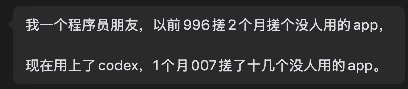
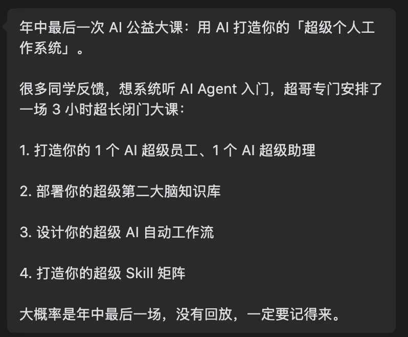

# AI时代怎么赚钱？先把离钱最近的动作做出来

260803 副业SC精华

整理：👸号懒人搜索，懒人专属群精选

懒人🛰️：lazyhelper1

各位朋友，我是根源。

从去年8月到现在，我累计办了31场线下分享。回头看，这31场其实分两段走。

去年聊的多是变现和转化。那时很多人已经有内容、有流量、甚至有产品，却卡在“怎么把这些变成现金流”。今年年初我开始深度使用AI，分享主题随之转向：如何借助AI赚钱，如何用AI来设计产品，如何把AI嵌入商业闭环。

但越讲越发现一个反差：

工具在变快，人卡住的点几乎没动。过去常听到的提问是：

- “老师，我的📕有播放，但不知道怎么变现。”

- “老师，人已经到🛰️了，后面该怎么推进？”
- “老师，课程已经做好了，怎么卖出去？”

今年的提问只换了表述：

- “老师，我用AI搭了个东西，可怎么把它卖掉？”
- “老师，AI让效率上去了，这份效率怎么兑成钱？”
- “老师，我是不是应该先把产品打磨完美再上线？”

问题内核没变。只是从内容/产品卡点，变成AI产品/工具卡点。而真正让人停住的，始终是同一件事：你不愿意把一个东西，有条理地讲给一个真实的人听，然后直接问一句愿不愿意付费。

最近的线下复盘里，我又听到相似的困境。大家用AI后，做品、做内容、做工具的节奏变快了，但一聊到赚钱，卡点高度一致。不是工具不够强，也不是非要再等三个月，而是很多人没迈出那一步：把自己要卖的东西讲清楚，并去跟一个具体的人谈付费。

# 一、AI让产出变快，但不自动带来成交

前两天看到一条调侃：

现在很多人对AI有误解：觉得只要我用AI把产品做出来，市场就会自动给出反馈。这个想法可以理解，因为过去做产品确实太慢。以前要找技术、设计、运营，反复开会、等版本，三个月出来个原型就算快。现在借助AI，一个人几天到几周就能把雏形搭好。

但要注意：产品成型，只说明你手里有件“可销售的物件”。它不等同于收入会自动到账。

收入发生的必要条件，是有人真实愿意掏钱。而愿意掏钱的前提，是你完成一次真实的交易行为。

这一点AI无法代理。

它可以帮你写落地页、写朋友圈文案、做海报、润色话术。但最关键的那一步，必须你亲自走：把产品拿出来，讲给一个“活人”听。

# 二、商业逻辑先简化，先回答三件事

商业模式可以讲得很复杂：用户画像、渠道、产品组合、成本、复购。

回到原点，其实就三问：

1. 你到底在卖什么？
2. 谁会为它买单？
3. 你怎么收回款项？

第三问最容易掉链子。卖什么心里大概有数，谁需要也差不多猜得到。但说到收钱，很多人就开始客气。

- 发朋友圈可以
- 写文章可以
- 做直播也可以

可要私信具体的人说：“这个东西很适合你，想不想试试？”就开始别扭。

所以很多人不是不懂商业模型，而是对销售这件事不习惯。模型第一步跨出去的动作，不是画图，而是开口。

| 你以为的阻碍 | 实际的阻碍 |
|---|---|
| 产品还不够好 | 你还没给足够多的人看过，也没让他们用钱投票 |
| 流量不够大 | 你还没把已经在🛰️里的人接住 |
| 模型不清楚 | 你没完成从介绍、报价到收款的闭环 |

# 三、先做离钱最近的动作

如果你现在没有海量流量、没有完整团队、没有跑通的销售体系，别把问题想得太远。

先做离现金最近的事。

什么叫近？

不是继续打磨产品，不是继续研究新工具，不是继续优化流程。

而是找到一个很可能需要你的人，把价值讲透，然后发出付费邀请。

听起来粗糙，但赚钱往往就是从粗糙的动作开始的。我早期卖东西，就是一扇扇敲门、一张张发传单。现在有互联网和AI，不用真的挨家挨户，但你仍要开口、介绍、报价、收款。

如果这个动作一直不发生，再漂亮的产品也只是摆设，像一间装修很好却从不营业的店。

# 四、加到🛰️只是完成了一半

不少人的📕做得不错。用户看内容→私信→加🛰️→进朋友圈/社群。

让一个人进到私域，前后至少要过四五个筛选：内容有吸引力、标题让人点、看完愿意私信、私信后愿意加。

可当他真的进入🛰️后，很多创作者突然沉默了。不敢主动搭话，不好意思介绍产品，更不敢明确询问购买意向。太可惜了。你花了很久把人从公域拉到私域，最后在离成交最近的位置自己闭嘴，前面投入基本作废。

我给一位做AI自媒体的朋友的建议是：线上有人味，私域话术也要有人味。固定话术可以用，但要有温度。

你可以这样开口：

“我看到你是从📕或B站过来的，很感谢你喜欢我的内容。最近加我的人比较多，我想提高沟通效率。介不介意我先发你三个常见需求给你参考？如果你的问题很明确，也可以直接告诉我。”

这也是分流，但它先承接了对方感受，再给选择，更适合个人IP。

有人会问：大IP不都是群发话术吗，我为什么不能用？（配图示例）

因为那些头部账号背后有专门的流量运营团队，他们看的是整体转化率。而我们做小个体，一天能加上十几二十个精准好友已经很不错，没有大流量托底，每个人的沟通都值得认真对待。

# 五、把产品先理清楚，再谈话术

很多人不是话术不行，是产品结构没想清。可能同时有免费群、付费群、一对一、课程、训练营。可每个产品给什么、价格多少、适合谁、边界在哪，都没界定，谈话时自然含糊。

私域成交前，先把层级理顺。

| 产品层级 | 功能 | 关键点 |
|---|---|---|
| 免费群 | 接住尚未有付费意识的人，建立信任 | 免费不等于随意，要有规则和稳定价值 |
| 付费群/课程 | 解决一类明确问题，做标准化交付 | 最好先做周期交付，别上来就做长期陪伴 |
| 一对一咨询 | 解决具体问题，承接高意愿用户 | 价位要高于社群，别低到损害专业感 |

我给那位朋友的建议是：先写清免费群给什么、付费群给什么、一对一给什么，再去设计话术。否则你再会聊天，也只是绕圈子。用户一问“付费群到底讲啥”，你含糊其辞，成交自然难发生。

# 六、别只收集掌声，要现金投票

上周有一位前产品经理朋友，做了款AI行动教练产品，完成度大概七八成，准备下月上线。他已有百来人的围观群，问我推广和定价怎么弄。

我说一个词：现金投票。

很多人习惯问用户：好不好？愿不愿意支持？有没兴趣？这些问题能得到掌声，掌声不是答案，现金才是。

你可以在群里这样说：

“很感谢大家这段时间围观我的产品。有时晚上挺累，但看到你们关注更新，我就有动力继续。现在进入内测，想从群里招募第一批付费用户。作为最早陪我做产品的人，我会给最大优惠。首月内测收99元。如果愿意支持并成为首批用户，现在付款，我后台开通权限。”

这才是真实检验。一百个人说愿意，不等于一百个人会买。最后付钱的人数，才是现阶段最真实的信号。

# 七、从职场到创业，要习惯先卖后完善

从上班族转创业者，有个思维转变。上班族习惯：先把产品做到完美，才敢推向市场。创业者常常相反：先卖，再迭代。

不是说可以交付粗糙的东西，而是别用“不够完美”当作不销售的借口。没有真实用户付费，你就不知道市场到底要什么。你在房间里想的需求，很可能只是自己的需求。用户聊出来的需求，才更可能成为产品方向。

一个项目至少补齐三种能力：

| 能力 | 含义 |
|---|---|
| 流量能力 | 用户从哪来？公域、私域、线下圈子都算 |
| 承接能力 | 用户来了，你能不能介绍、转化、成交 |
| 增量能力 | 用户买完后，能否复购、转介绍 |

很多人只会其中一种。创业不是单项运动，需要通才。你产品再好，不会卖，依然难起来。

# 八、价格别一开始就锁死

那位做AI行动教练的朋友最初想定199元/年，我不建议。如果只是副业尝试，可以。但若想当主业做，就别把价格压太低、周期拉太长。

一年199元，用户压力小，你却把自己锁死了。承诺一年后想调整方向会很尴尬，而且收不到健康的现金流。早期更建议月付，比如99元/月。

用户门槛低、愿意尝试，你也能根据反馈快速调整。跑几个月确认这是核心产品，再考虑年费也不迟。别太早给项目盖棺定论，现在只是试水。

# 九、打开通讯录，聊完一百个人

有人问我最快的变现路径长什么样，其实没有玄机：打开通讯录，找到可能需要的人，把产品介绍给他，邀约购买。

每天拿出1-2小时，找最近互动过的3-5人。先关心近况，再自然带出：

“我最近做了一个产品，主要是帮某类人解决某个具体问题。我觉得你可能用得上，方便我简单介绍一下吗？”

对方愿意听就继续，有疑问就解答，觉得合适就报价格并问：“愿意给我一个试试的机会吗？”

如果被拒也没关系：“谢谢你听我讲，后续有更新我再跟你同步可以吗？”

这不是打扰，是练习销售，也是收集真实需求。你会逐渐明白：谁更需要、为什么买、为什么拒、希望加什么功能、你以为的卖点别人是否在意。这些答案藏在对话里，不是闭门能想出来的。

# 十、AI时代，销售能力更重要

以前产品门槛高，产品本身就是壁垒。现在AI把生产门槛拉低，做工具、做页面、做小程序、做课程变得容易。这时拉开差距的，不是谁做得出来，而是：

- 谁能找到用户
- 谁能把价值讲明白
- 谁能完成第一次收款
- 谁能根据反馈迭代

所以AI时代，销售不是被削弱，而是被放大。因为产品、内容、工具越来越容易复制，但信任、表达、成交、复购很难复制。

个体创业早期，别急着外包销售。你自己去聊，虽然慢，但价值极高。因为卖不出去，你会知道为什么；收不到钱，你会知道卡在哪。聊得越多，对产品的理解越清晰。

# 十一、现在就把产品说清楚

如果只停留在“有道理”，这篇文章最多是个提醒。你会收藏，然后继续不敢卖。

现在就做第一步：别急着发朋友圈，也别继续改产品，先把你要卖的东西讲清。

产品三句定位：
我最近做了一个产品/服务：________
它主要帮助：________
解决的问题是：________
我准备先卖给：________
第一次测试价格是：________

很多人卖不出，不是话术差，是自己都没想清。填不出这几行，就别怪用户不买。

# 十二、做三层承接，别用一个产品打所有人

定位清晰后，第二步是分层。加你的人需求不同，不能一刀切。

最简三层：
- 免费群：给好奇、尚未有付费意识的人。每周资料、答疑、案例。
- 低客单产品：给愿意尝试的人。99/199/399档位，做一个月内测、训练营、资料包。
- 一对一咨询：给问题明确想快速解决的人。60-90分钟诊断+方案，价格至少为社群的1.5倍以上。

这样承接有路径，不会临场发挥。

# 十三、复制一段现金投票话术直接用

如果你有一个群，哪怕二三十人，都可以做现金投票。别问兴趣，要看付款。

话术参考：
很感谢大家这段时间一直围观我的产品。说实话，这是我第一次以创业者身份推产品，发这段话也有点紧张。现在进入第一轮内测，想从群里找第一批付费用户。因为你们是最早陪我看着产品成长的人，我会给最优惠价格。首月内测收99元。如果你愿意支持，成为首批内测用户，可以现在付款，我后台帮你开通。

发完后看付款人数。有人付钱，说明有初步市场信号。没人付钱，也不是失败，它告诉你产品、价格、表达或信任环节需要调整，这比在家想一个月更有用。

# 十四、用100人行动表逼自己面对市场

没群就更简单：打开通讯录，每天聊3-5个最近联系过的人，连续20天聊完100个。每人记录：姓名、核心问题、是否愿意听介绍、是否付款及原因。

这张表会把你推向真实市场。你会发现：有人没听懂你在卖什么，有人没被击中痛点，有人只是缺信任，有人确实不适合。这些信息AI给不了，必须从真实对话里长出来。

# 十五、接下来7天执行清单

别再看十篇干货，也别研究十个AI工具。给自己7天，只做这些：

| 时间 | 动作 |
| --- | --- |
| 第1天 | 写清卖什么、卖给谁、首测价 |
| 第2天 | 整理30个潜在需求对象 |
| 第3天 | 私聊5个人，不求成交，只求讲出口 |
| 第4天 | 根据反馈改介绍话术 |
| 第5天 | 有群做现金投票，无群继续私聊5人 |
| 第6天 | 把愿意付费的人拉入内测，明确交付 |
| 第7天 | 复盘：谁买了？为什么？谁没买？下轮改什么？ |

这7天不一定赚很多钱，但能让你跨过关键一关：从“我想赚钱”变成“我真的开口卖过一次”。这中间的差距很大。

# 写在最后

AI能让普通人拥有过去一个团队的生产力，但它替代不了最关键的交易动作：找到一个具体的人，把产品讲清楚，问他愿不愿意付钱。

别让产品一直躺着，像一间装修精美却从未开门的店。开口卖一次，答案自然会出现。

很多人兜兜转转研究各种AI工具，其实心里都清楚，真正让自己发怵的，无非就是那句话——“这个东西很适合你，要不要付款拿下？”

绕来绕去，避开的是成交，丢掉的是变现。

那AI时代到底该怎么搞钱？先把那些花里胡哨的工具扔一边，去找离钱最近的那条路。

翻翻手机通讯录，找出那个靠谱的人脉，主动去聊，把话说清楚，把价报明白，收到第一笔转账。无数看似复杂的商业模式，起点就是那笔让你手心出汗、不好意思收下的钱。

看完各种SOP，你可能觉得“我懂了”。但现实是，90%的人一到真正执行，第一步就直接卡死。

工具、课程，这些玩意根本没门槛。真正的分水岭，是你有没有当场就干，以及你手里的圈层情报有没有别人快。

想看我最新挖掘的赚钱野路子？想跟一群执行力拉到满的极客们并肩拿结果？欢迎来我的核心私域：【懒人专属群】。

这里不整虚的，只干两件事：拆透商业闭环，榨干AI效率。里面已经沉淀了1000+跑通了的实战局。

👉 想看圈子的完整家底和上车规则，点这里：

https://lazyso.com/insider/

觉得同频，备好心态打算真刀真枪干的，扫码加我🛰️（lazyhelper1）

备注：【实操上车】，闲聊勿扰

