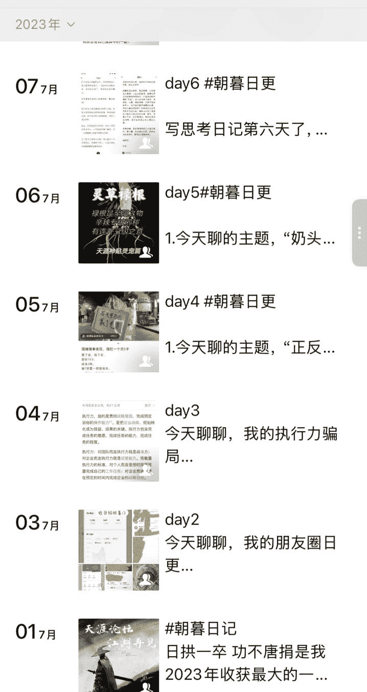
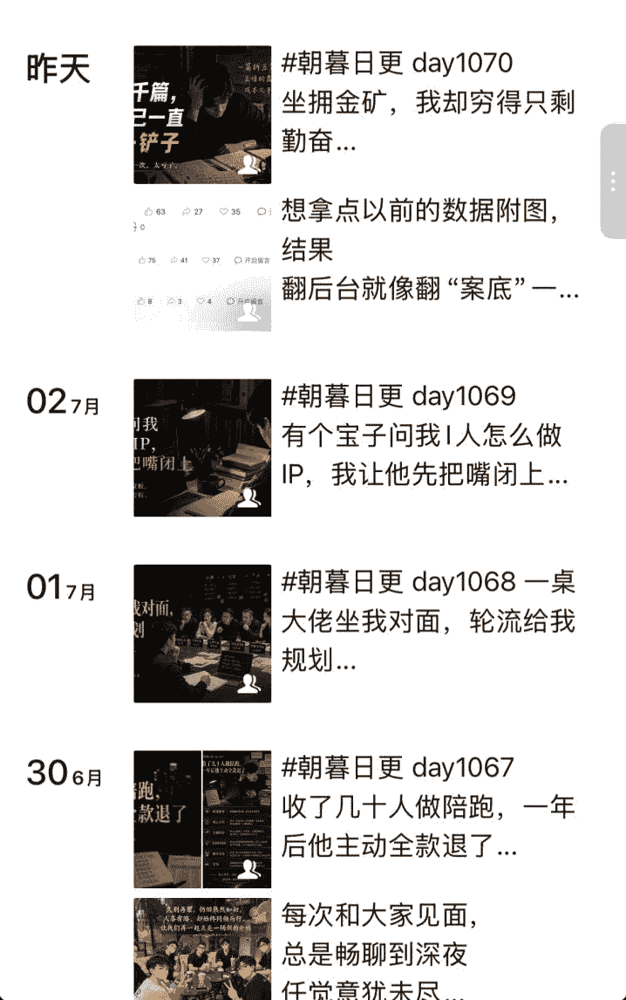
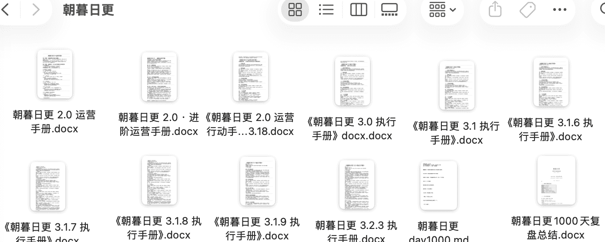
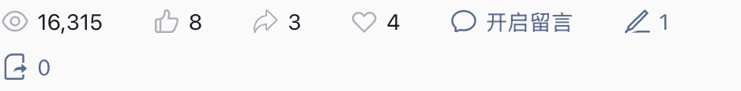
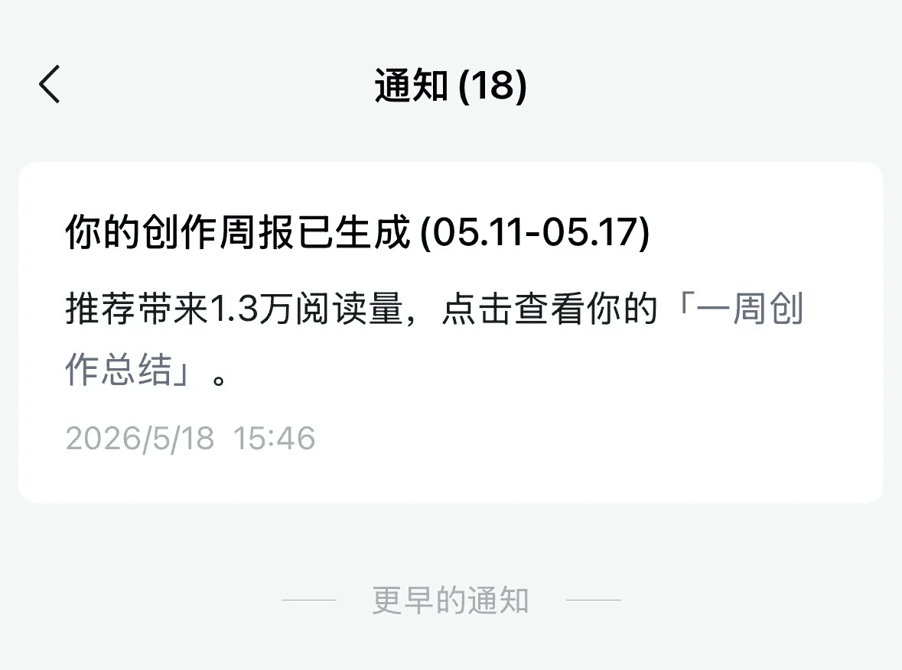
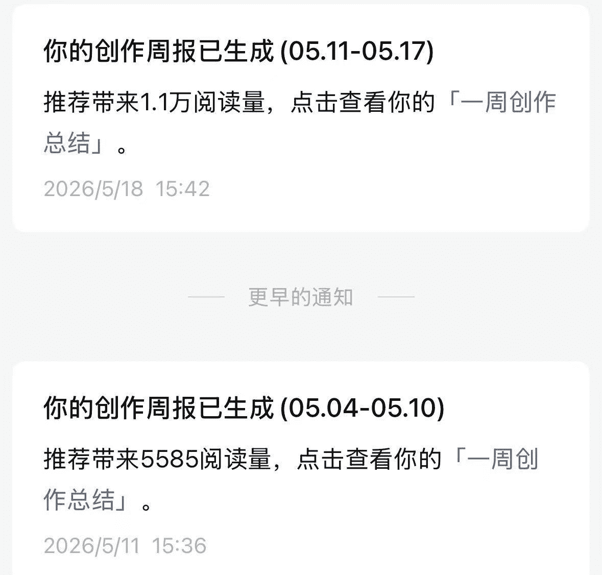
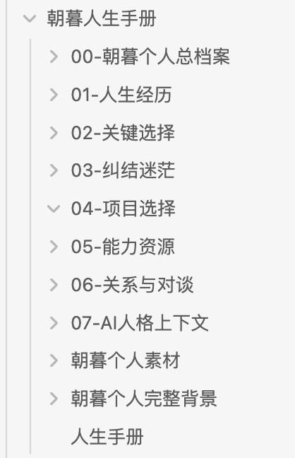

# 1092天连更、迭代400余次，我把个人内容工厂整体公开，Codex 与 Claude Code 均可接入
作者：龙哥

260803副业SC精华

# 一、这套工厂现阶段在帮我完成哪些事

各位好，我是龙哥，位于广东惠州，目前担任教培机构执行校长，朋友圈保持连续更新已经1092天。

当前这套产线主要支撑三件事：我个人朋友圈连更与👸号IP内容；👸号流量主变现；学员拿去跨场景复用以验证迁移性。

投入的材料来自口述转文字、日记、聊天记录、旧稿、新闻观察与热点。系统会先归档、拆解、生成初稿、选标题、独立审校与发布终审，最终输出朋友圈短帖、👸号长文或流量主稿件。

实打实的运行体感如下。

- 个人IP：朋友圈已经连更1092天。过去一篇需磨半小时，如今两小时可完成七篇初稿的生产，我再逐篇把关。更新压力明显下降，成稿仍保留我的经历、判断与表达习惯。
- 👸号流量号：把过往十万加文章与做死账号的经验提炼成规则后，用当前产线带新号。单篇阅读现阶段多稳定在千级；热点、选题、对标与表达全部到位时可冲至万级。
- 现场验证：2026年5月于惠州带14人用半天走完全流程，当场出现首篇初稿。加上日常一对一指导，累计已有30多人完整跑通。
- 开源交付：中文阅读包、通用机器包、标题子系统、人格工具、五分钟演示与安装入口，全部置于文末。

阅读完本文后可直接带走：

- 完整链路：原料整理、拆分、成稿、标题、独立审阅、发布终审。
- 两种打法：IP连更为主，流量号为辅。
- 两套材料：面向人的中文阅读包，面向模型的机器调用包。
- 写作组件：七罪标题方法、人格档案、写作人格内核、流量侧切换规范。
- 三种接入方式：装为Skill、直接读取机器包、在普通对话窗口逐站执行。
- 五分钟试跑：先验证安装是否通顺，再投入一份真实素材产出首篇。

# 成果与细节

### 1. 朋友圈与IP积累｜连更1092天
工厂首先服务于朋友圈连更与个人IP。长期公开记录可供回溯，商务洽谈时比口头介绍更具说服力。下方两图为早期与现阶段的连更凭证。

### 2. 从指令到工厂｜四百多次迭代
日更系统从2.0演进至7.2，才形成当下完整结构。下图保留了版本更迭痕迹。

### 3. 线下实操｜14人半天跑通，累计30余人
2026年5月惠州航海线下会，14人半天完成全流程，当场产出初稿。结合日常辅导，累计超30人跑通，证明普通人可操作。

### 4. 👸号历史流量｜单篇峰值十万+
曾运营娱乐八卦、情感、婆媳、银发赛道，峰值十万+，常见爆文一万至两万，亦有不少账号未起色。成功与失败被拆解为对标、选题、标题、风险边界等规则，写入流量侧。

多数十万+稿件已主动下架，故下图来自仍可访问的账号。下架原因与平台风险详见第二章。

### 5. 新号现阶段表现｜千级稳定，条件好上万

该批新号文章均由现系统产出。当前单篇多在千阅读，偶有万阅读。能否上万取决于热点质量、对标精度、选题爆发力与表达准确度，不保证每篇都爆。千级为常态，万级为上浮。

### 6. 内容带来的业务结果
数据说明流程可行，长期内容更在积累信任。下方合作即从👸号文章启动。

有读者经👸号加🛰️，长期阅读后恰逢一篇契合其需求的文章，便委托我对接“指定账号AI监控、定时推送与数据汇总”。该技术非我强项，转介给相关专家，合作结束后我获10%居间费用，并分出一部分给朋友与双方。

这件事再次验证：人先被长期内容吸引，交易发生前信任已在沉淀。

本文共改十稿。

首稿全部废弃。起初我只想分享指令，后变为Skill，最终决定把完整产线开源。每一次重写都在自问：交付物是什么？能否真实运行？他人取用会卡在哪？因此第十稿不再讲概念，而是把中文阅读包、机器包、操作路径与边界全部交代清楚。

全部引擎与系统在文末，拿走即可用。若有帮助，点赞投币三连，感谢。

# 二、工厂是如何打磨出来的

先说来路，后面设计才好理解。

最初做的是流量号。八卦、情感、婆媳、银发，追风口。起势时单篇可达十万+，评论区活跃；均值下来爆文一两万，亦有大量账号沉寂。

打法偏激，长期在红线边缘试探，违规、违禁、律师函都遇到过，账号要么被封要么残存。

十万+里有擦边、有被举报、有触线。一旦判定违禁，收益归零且难救回。现正用旧号尝试清洗，后续结果再告知。

此后我提炼出一条保命经验：做风口类短平快流量文，爆后收益到手即主动删除。平台对这类内容不会持续分发，本质是一次性生意，留存风险高于收益。主动删除，收益锁定；被动删除，收益归零。我的多数爆文都是自删。

因此本文中看不到十万+截图，现能翻到的最高七万多。钱落袋才算自己的，低调更稳。

那段经历教会我两点：流量号是概率博弈，上不上去看平台，死不死看自身节制；平台红线真实存在，能让数月心血一夜清零。

流量起伏的几年里，朋友圈IP连更从未中断。

连更辛苦。很早就想借助模型。第一次把素材丢入并要求“口语、真实、无机器感”。输出排比连绵、金句收尾、整体像广播体操。

当时并未深究，生成即发。发了，但内容无价值，等于宣告：机器在代笔，本人已离线。

后来明白，想做起来必须跨过这一关，于是开始长期打磨指令。

最初2.0版：一页纸，5个标题公式、3个素材池、正文三步走。

迭代到5月3.2.3版：17章约一万六千字，标题公式增至8个；情绪节奏独立成系统，4种骨架配10种风格；发布前核查清单20条；另有脱敏对照表。

随后是7.2，全量上下文日更系统。

随后出现瓶颈：指令过长难以管理，改动牵一发而动全身；换模型后部分指令失效；上下文过长导致前序规则被遗忘。指令的局限即活在单次对话，对话结束即遗忘。

这催生了Skill。

Skill本质仍是指令，差异在存储与执行方式。

指令：每次新对话需手动粘贴，篇幅长易贴不完且难保证完整记忆。

Skill：保存在.md文件中，AI Agent自动读取并按流程运行，无需人工顺序投喂。修改后次次运行即读取最新版本。配置、案例、禁用词、人格内核与产出均可存于指定目录，由总控按阶段调取。

类比：指令像菜谱，每次需从头翻阅并亲手备菜；Skill像装配线，投入原料后按工序自动产出。

从指令到Skill，是从作坊到工厂的跃迁。

早期我教的是指令，因多数人对Skill无概念，先上手最重要。但指令天花板很快显现，Skill才是长期解法。

目前产线核心为一条主线与五个专业岗位。总控负责启动、自检、调度；七罪标题系统负责标题；五个引擎各司其职：

总控｜配置与环境检查、任务调度、路径记录与风险确认
淘金引擎｜原始材料归档、事实判断金句案例定位
布局引擎｜拆分、去重、缺口追问、栏目排序与对标安排
铸文引擎｜依计划、原料、人格内核与对标生成初稿，不自检
七罪标题系统｜标题候选生成、正文兑现检查、用户确认
鉴文引擎｜独立上下文做八层审校，提供证据与局部建议
淬文引擎｜完成32项发布终审，核对事实、隐私、平台边界、格式与风险

中文阅读包呈现五个中文引擎，方便阅读理解；机器包包含七个可调用Skill，因总控与持续进化系统需独立识别。两者为同一逻辑的不同包装，非两套系统，且无须放入Obsidian。

为何拆分？同一模型不可兼任运动员与裁判。实测显示：同一上下文既写又审易遗漏问题，会为自身表达辩解。必须由未参与撰写的独立上下文审校，生产与质检才真正分离。

这就是工厂思路：各岗位各司其职，质检与生产必须分开。

前前后后修改四百余次。即使拿到全套，仍觉得不够像我。追问许久后顿悟：堆砌禁止性指令并不能让模型写出我的风格，核心在于模型是否足够认识我。

自此重心从“如何下指令”转向“如何让模型深度认识我”。

后续的人格档案、鉴文引擎、七罪引擎皆由此生长，它们并非孤立工具，而是工厂内的不同工位。

今年5月线下搬运，该流程被14人半天跑通，当场产出初稿，可行性已验证。

# 三、为何你的AI文易显生硬

直言几个痛点。

多数人让模型写文仅一句指令：“帮我写篇副业干货，要干货，不要机器味。”结果开头快节奏时代、中间排比、结尾愿你我皆好。无人阅读，平台判定低原创并限流。

市场上常见三种对策：卖指令包、推付费模型、卖降痕工具。皆试过，均为止痛药。指令包仍显生硬，付费模型只是废话更流畅，降痕工具过检却失去可读性。

核心不在指令。

模型让生产极便宜，选题即稿。但量越大可用越少。生产成本趋近零，判断何者值得写、何者像自己，反而更贵。

问题出于四重错配。

方向错配：要求爆款却未说明受众与解决的问题，无靶心的生产愈多愈乱。
原料错配：仅给选题与指令。内容质量取决于真实经历、踩坑点与对标爆文。质量构成中，对标素材约占六成，任务描述约三成，指令技巧仅一成。精力错配，难有好结果。
角色错配：将判断立场故事全交模型，自己仅复制粘贴。正确分工：人出判断经历立场，模型出结构连接与执行。
回路错配：选题→生成→发布→结束。发布数据、评论、用户问题未回流到下一轮创作，每次从零开始，模型永远不了解你。

一篇发完即死，只有将经历判断与反馈喂入下一篇，才算资产。多数人用模型生产大量内容，却未积累资产。

深挖之下，本质仍是：

## 模型不认识你

它不知你的经历、踩坑、说话腔调。让只认识三秒的陌生人代笔，只能得到人类平均值，而平均值即机器感。

简易自检：遮住作者名，同行能否直接拿去发。可若能，则为公共内容而非个人IP。模型给你的多为此类。

模型不认识你，一半因喂养不足，一半因你自己也未清晰。要求“写得真实”，你的真实具体长什么样？口头禅为何？判断有何差异？说不清，就别怪模型。它放大清晰，也放大模糊。

另需明白，底层模型为公共资源，你用Claude、豆包，别人亦用且会迭代，难以形成壁垒。真正私有的是你喂入的内容：经历与判断，难以复制。

因此正确顺序为：先让模型认识你，再让模型认识市场，最后才写。

本工厂即遵循此逻辑，下文将按站说明搭建路径。

操作前，请先确定入口。

# 四、搭建前的第零步：选择素材入口

工厂通用，差异仅在素材入口。

入口A：个人素材→IP打法

日常所见所感、灵感、对话，录音转文字即为原料。系统将匹配人格档案，按你的节奏语气判断生成。

IP逻辑：垂直至最小人群，先服务小圈层再外扩。

选IP路径前需先定交付物。你到底在交付信任还是商品？不定则内容零散，读者难知你为何而写。

产品为根，内容皆由根生长。无产品时，先做人，人即产品。

本人即样本。朋友圈写了三年，前段无反馈、阅读平平、亦无人咨询，看似无效。

但信任在缓慢累积。现阶段商务洽谈，对方加🛰️后翻阅连更记录，基础信任立即建立：此人靠谱，不会消失。

“朝暮日更”标签已绑定个人，坚持与靠谱关联即想到我。朋友圈阵地管信任，人从外来，信任由连更来。

反直觉点：起步时不必追求惊艳。

只需让所有人知三件事：你在坚持，你靠谱，你持续在做。

信任非一篇爆文建立，而是千余天“今日又更”的累积。

垂直号逻辑一致：一厘米宽，一万米深。持续输出百余篇后，用户在🛰️搜索该领域问题时，出现的多为你内容，赛道心智即为你的。

IP变现公式：信任+需求=购买。

入口B：爆款对标→流量打法

流量号入口非个人素材，而是已验证的爆款。找到对标后，将其状态、情绪、反差融入文案，流量文本就公式化。

做泛流量吃流量主收益，过度垂直则流量池缩小。

核心链路：点击—完读—点广告，未点击收益远低于点击。

追热点拼速度，需多账号测试。求流量就专注流量，别兼顾积累。又想流量又想IP又想粉丝，最后多头落空。

多账号亦有保命价值，我用真金白银换来的教训：单号即单点故障，出事则归零。

做流量主需脚踏多船，号挂一个其余可用，心态不崩。

入口如何选？
目标为长期信任沉淀，选IP；目标为快速流量收益，选流量。

一开始方向不清晰、急着看到回流的，适合先做流量变现号；能扛住空窗期、愿意把东西沉淀成复利的，就去做个人品牌。品牌不是靠灵感拍出来的，是养出来的；爆款也一样要养出来。别想着一次把规划钉死，先上线再调参，边发边复盘、边复盘边推进就是最实际的做事节奏。

入口确定后就进入生产链路，按站点顺序推进。

**第一站 让模型先认识你——人格档案**

很多人以为丢一段人设就能写出你的腔调，这只是表面。档案搭建与内容产出要分层：长期的人格档案负责让模型建立整体认知，单次生产的写作内核负责当期落地。浅档案只告诉模型你是谁，却说不清你卡在何处、什么情况下会崩盘、偏好怎样的沟通方式，模型看到的是履历，不是活人。

完整档案是上游的可选工具，帮助模型理解你的经历、价值取向、优势和长期走向，再从中提炼定位与写作内核。进入工厂后默认调用的是写作内核、内容定位和当期素材，不需要每次把全部私人档案都投喂进去。

基础信息、可用资源与能力、核心卡点、财务全貌、时间结构、情绪心理、身体饮食、能力资产、副业转型进展、目标体系、执行风格、自我瓦解模式。

完整提示词见文末附录，可直接使用。也不必被这12个模块框住，可以和自己的打法融合。参考图见下：

这套档案除写作外，也可用于长期规划、决策和IP方向提炼，但边界要清楚。模型可以了解，不等于可以公开。写作时只调用当前任务真正需要的信息。

重点讲三个容易被忽略的模块。

财务全貌必须写实。隐私提醒：不要提交密码、证件号码、精确住址及未经授权的第三方隐私，敏感内容先脱敏。人格信息按“可公开引用、仅作理解、脱敏后可用、禁止输入或保存”四类权限处理；未经授权，Agent不得复制、转发或保存到其他位置。

目标体系越小越具体。目标模糊本质上是在逃避执行。“本月赚100块”比“我要做大做强”管用一百倍。大脑对模糊的目标默认可以绕过，对具体的数字无法装看不见。

自我瓦解模式最易被忽视，也最关键。举例：你做👸号一个月阅读个位数，凌晨还在改稿，忽然冒出念头：这么拼到底图什么，一分钱没赚身体先垮，不如睡了。然后就真的停了。每个人都有这个开关，只是触发点不同。提前写进档案，模型识别到你进入该状态，会提醒：先停，明天再写，不用逼太紧。就这一句话，很多副业就死在没人说这句话的那个深夜。

配套还有一套天赋挖掘问答，已放附录。让模型像访谈一样一次只问一个问题，关键在于区分两种能力：你主动热爱的，和为生存被迫学会的。后者往往才是你最能打的。我线下常说一个观点：都说兴趣是最好的老师？我更认同：生存才是最好的老师。

实操注意两点：用GPT、Claude这类海外模型，档案三步对话能完成；用豆包、DeepSeek这类国内模型，务必拆成三次对话并本地留存，国产模型长对话容易失忆，这是通病。

还有一条铁律：永远不要让单一模型主导全部生活。核心问题，至少咨询两个以上模型才算咨询过模型。所以我在内容工厂公开包里把两层拆开了：中文阅读包保留完整的人格提炼工具；机器安装包只保留写作内核模板、使用权限和缺失时的降级规则。

没有内核也能继续生产，但任务必须标注“人格校准未完成”，模型不能虚构你的口吻和经历，最好补充3至5篇真实文章或口述材料再校准。

人格地基打好，下一站让模型认识市场。

**第二站 找对标——占比约六成的关键动作**

档案解决像你，对标解决能不能出圈。无论IP号还是流量号都要过这一关。区别是：IP号找同赛道标杆内容，流量号找热点赛道的爆款基因。

四条铁律：

1. 别对标头部大V。大V有原生推流、有团队、有品牌光环，新号照着学只能很努力但跑不动。
2. 找低粉高赞的号。起号千粉以内，就找三五千粉以下、阅读却做到一万、十万的号。目标比你高十倍即可，别找高百倍的。
3. 只看近半年新号。老号爆文靠多年IP积累或过时热点，抄不了。新号爆文才是用当下规则打出来的。
4. 只找同领域、用户画像重合的。起号期跨领域对标没有意义。

再给你一个词：异常值。同一作者平均阅读两三千，突然一篇冲到两万，那篇就是异常值。别找“好文章”，好没有坐标，异常值有坐标，是市场筛过的。找到后拆解为何爆：标题让谁停下来？评论区反复出现哪句话？评论区常比正文值钱，痛点读者会自己说出来。

喂给模型前，先过自己这道判断。模型一晚能分析几百篇，但哪篇值得学，得你自己定。品味外包不出去。

顺序记住：不是先写再等爆，是先找已爆的照着做。你遇到的问题都有人遇到过而且有答案，别从零摸索。

去哪找：🛰️搜一搜切到文章，按最热排序输入赛道关键词。超过十万阅读排序会乱，介意可用易撰、新榜，易撰免费版一天查十篇，新人够用。元宝等模型也能做竞品调研。

找到合适的，把标题、正文、账号名、粉丝数、阅读量记录下来，存飞书或备忘录，建立自己的低粉爆款库。凑够三篇风格相近的，进入下一站。

**第三站 素材整理与拆篇——工厂调度中心**

这一站决定当日产量、主题、顺序。对应两个引擎：淘金引擎+布局引擎。

淘金引擎用于前置整理。你每天的素材来源很杂：口述转写、备忘录、朋友聊天记录、看完有感的文章。直接丢给模型它读不懂，原始素材混着停顿、重复、离题、识别错误。淘金引擎把杂乱输入整理成结构化素材包，区分事实、观点、案例、情绪并标注来源。它不会编造，素材里没有的标“待补充”，不瞎写。

IP与流量侧重不同：IP打法淘金时要筛选，哪些观点适合从你人设发出，人设、热点、技能三者要对齐；流量打法核心是拆对标，爆点是什么、核心卖点是什么、驱动点击的情绪是什么。

布局引擎接素材包做三件事：拆——能出几篇、每篇核心点；排——按发布节奏定优先级；去重——自动检索已发文章，撞点就跳过。去重很关键，我日更1092天，不去重上周观点这周又出现，读者会觉得车轱辘话。

IP与流量拆篇逻辑也不同：IP若内容池某方向过冗余就要稀释换方向，IP是持续引流，读者想看同一个点的生长、延伸、不同面；流量则相反，点爆了要立刻追、持续追。爆过的内容会再爆。但流量热点变化快，不能用旧引擎打天下，需随实战调整。本篇开源的是IP类引擎。跑通IP后，流量核心步骤相同，按对标爆点调整即可。

如何自定义：淘金引擎里有素材来源表，可自行增加类型，如教培加“学员反馈”“家长提问”，电商加“客户评价”“退货原因”。布局引擎有去重检索范围，默认检索近期文章。号刚起步可关闭去重，已有几百篇建议拉到最近三个月。

**第四站 单篇生成——先学后写**

素材拆完才轮到模型动笔，对应铸文引擎，分两步：先学，再写。

IP打法核心是“像你自己说的话”：把你以前写的文章喂进去，融合喜欢且受众喜欢的博主拆解，铸文引擎按人格档案校准语感。流量打法核心是拆爆款基因：把之前的3篇对标让模型解析，提取赛道爆款基因再写主题。

拆对标系统我命名为噬文引擎，完整版在文末，可复制给任意模型。它从七个维度解析：作者身份、读者是谁、来求什么、结构、语言风格、不用词、信息来源、情绪走向。情绪走向单独说：爆文是情绪过山车，低开或高开、转折在前三分之一还是中段、峰值靠冲突还是认知颠覆。把这条曲线扒出来，节奏感就有了。

学完后给主题，建议四行：主题、你的真实观点、目标读者画像、期望感受。第二行最值钱，有真实立场才不空；不填出来就是正确废话。第三行别糊弄，“宝妈”等于没写。哪个宝妈？几点刷手机？最愁什么？不解决睡不着？这叫活人画像。读者不是因喜欢看，是因卡点才看。

铸文引擎可调开关：脱敏对照表，我的版本里📕→红薯，👸号→文章，抖音→某短视频平台，老板→领导，按需改。案例库路径指向本地目录，生成时按需读取。风格参考：IP要像自己，可准备一段录音对话或投喂自己写的文章；流量则直接借鉴最热写法换表述。

实操心法：用对话框时，一篇一个新窗口，上下文别串味，标题正文下一篇分开写。真实案例必须手动加入。用Agent时上述问题会自动处理。不管哪种，别指望一次成型，800字日更背后是上万字引擎、三套系统、20+质检，还要人工过。

模型相当于工作室，加速出文但不能完全替代。通用方案只能解短期问题，尤其流量必须随风口、爆点、热点实时调整。平台倾斜一直在变，别拿老引擎打天下。

模型选择：已有Agent基本不用纠结模型；仍用对话框需讲究。豆包擅长抖音口播稿，元宝语料偏👸号，点点适合📕，千问偏淘宝带货，Kimi上下文长适合长文，DeepSeek算国产基线。原则：模型背后站哪家平台，就用它干哪家平台的内容。引擎一套通用。

**第五站 标题定生死——内容核心**

写完不等于完成90%，只完成一半。用户给你的注意力是3秒，线下地推都知道街上拦人只有3秒，线上更残酷。标题没让人停下，正文再好也是零。标题定生死，好标题能破圈，好文章不能。

标题不是告知写了什么，是触发兴趣让人想点。先解决想点，再谈质量。

我用两层系统做标题，叫七罪引擎，完整版在文末。

第一层 开幕雷击七要素：金钱、异常、捷径、窥探、暴力、死亡、民族。金钱指具体数字；异常是反预期；捷径暗示更快路径；窥探是半遮半掩；暴力是冲突打脸；死亡指终结感。民族最易爆也最易出事，只讲概念，强烈建议不碰。前六个可自由组合，命中一个起效，命中两个以上点击明显提升。

第二层 人性七宗罪。贪婪：占有欲，标题触发收益、机会、损失。傲慢：优越感，可顺着读者或挑战自我判断。嫉妒：参照物要近，同起点的人产生的落差。愤怒：指出受害者与责任方。懒惰：对应acedia，是逃避沉重但重要的事，非单纯想省力。暴食：用下一口填补不适。

把标题当钩子，先让用户想点，再用内容兑现。人性问题才是所有爆款的根。

把七宗罪当成标题库来用，先弄清楚每个抽屉该放什么，乱塞只会让成稿受伤。

谈贪食。古典里的意思是，对饮食与味觉快感丧失克制。它不等于胃口大。传统划分里，提前吃、吃过量、吃过快、专挑昂贵稀奇的食材，都在范畴内。症结不在食物，而在明明不需要时，仍被口腹愉悦牵着走。

这种情绪切入口，最贴合美食测评、诱惑食谱、饮酒、减重、戒糖、深夜加餐、情绪进食与成瘾类题材。举例：

- “夜里根本没饿，嘴为什么就是停不下来？”
- “减脂最难放下的，也许不是糖，而是咀嚼那几分钟的安抚。”
- “你怀念的或许不是甜点，而是被填满的安定感。”

贪食在追问：这一口，能不能立刻让我好受点？

再看淫欲。古义很窄：性吸引、身体吸引、肉体快感的失控范围。它不等于“所有美好”，也不是泛指“渴望被看见”。更接近“想被特定的人渴望、想与某具身体亲近、想进入亲密关系”。

用到标题，能撬动魅力、异性吸引、暧昧、身体信号与亲密关系：

- “为何有些人样貌普通，却总让人想靠近？”
- “真正上头的，可能不是长相，而是泄露的身体讯号。”

擦边球是调动淫欲最省力也最粗暴的办法。它抢眼，却换不来信任，还会带来平台风险。拿捏不住度，别碰。

淫欲在追问：我能拿到想要的人吗？或者，我能变成被渴望的那个人吗？

使用原则必须记住：七宗罪并非每篇文章都适用。傲慢、嫉妒、愤怒、贪婪、懒惰跨题材能力强；贪食集中在饮食、瘦身、健康与成瘾；淫欲只适合外貌、魅力、情感与亲密。不要为凑齐名字硬安。文中若没有食欲、身体吸引或亲密元素，就不要强行挂上贪食与淫欲。

准确做法是反向操作：先在正文里找到真实存在的欲望，再选对应的标题钩子。正文里没有，标题就不要编造。

七个钩子负责让人停，七宗罪负责让读者觉得“就是在说我”。两层同时命中，传播才起来。

在这两层之上，我提炼了六个公式：数字反差、自我反叛、悬念场景、损失逼迫、结论前置、群体点名。具体释义与案例在文末的欲望引擎里。有现成AI，直接交出去用。

公式使用前先锁定顺序：先想哪句话能让人停，再判断它归属哪个公式。公式是归类器，不是创作起点。反过来先定公式再填词，产出全是模板味。

质检有两关，都不能省。

第一关，停留自测。把自己当成刷信息流的路人，这个标题会停吗？不会就推倒重写，没有借口。

第二关，匹配自测。正文能否接住这个标题？标题可以狠，但题文必须一致。UC当年为何翻车？骗进一次，取关一辈子，还易被举报，拖累账号流量。👸号还有条隐形规则：文章一旦发出，属性就定。删文救不回首波推流，首轮结束后改标题也无效。所以所有打磨必须在发布前完成。

初稿和标题齐了，还不能发。AI首稿普遍六十分：生硬、正确的废话多、排比整齐到可疑。

整套设计核心是生产与质检分线。过去的坑是让写稿上下文给自己审稿，它总替句子辩护，漏掉重复句式、无依据承诺与语气问题。所以第六站去机器味与第七站出稿终审交给独立Agent，与写稿Agent彻底隔离。

鉴文引擎做什么？

它由八层构成：22条AI特征、6类形式指纹、用户禁词清单、真实语料对照、人设保护、金句保护、局部改写、用户终审。融合了市面去AI味技巧与个人长期写作敏感点，以及自创的人味怪词系统。

它既能抓“不是X而是Y”、排比过密、结论先行等通用痕迹，也能发现你讨厌的词是否被误删、文中经历是否有素材支撑。证据确凿的强信号直接改；涉及真实口吻、亲身经历与中等风险处，必须回到你确认。每处修改都要列出原句、判定依据、改后版本；强信号改完再复扫。你可用口述或打字完成终审，系统不会在未确认情况下把修正稿冒充终稿。

淬文引擎做什么？

它做32项发布终审，把稿子从“读起来还行”推到“事实、边界、交付都过关”：

- 真实性与证据：数字、经历、案例、承诺能否在原始材料中找到出处
- 观点与读者：立意、结构、标题与正文是否一致，目标读者能否接住
- 表达与人格：机器痕迹、用户禁词、真实金句与个人边界是否处理正确
- 发布与风险：隐私、平台边界、排版、配图位置、行动引导与未通过项是否留痕

全部通过才放行。

想让两套引擎变成自己的工具，可持续添加禁词、语料与保护规则。所有行动引导统一命名为“已确认CTA”：用户明确允许、有事实或产品依据、无夸大承诺、不越过隐私与平台边界。鉴文不能因像营销就擅自删掉，更不能凭空添加销售动作。公开包不含私人语料、口头禅与未公开内容，你拿到的是可运行的检测与改写机制，最后用真实材料校准成个人版本。

它不承诺零机器味，也不替你承担最终判断。它只负责把高风险信号、证据缺口与越界修改标出，能自动处理的自动处理，该人决定的留在人手里。

去机器味，IP号与流量号打法不同。

IP号需要本人上场，自己讲、自己改。语气、停顿、口头禅是AI模仿不了的，必须亲手填入。

流量号可直接丢去检测，调标点、改措辞即可。参考同类号写法，人为嵌入话术，只要不全红，问题不大。

核心判断：内容够好，机器味是伪命题。但别假得太过。

四步之外，我每天用的笨办法是口述。

日更素材不是打字打出来的，是先用嘴讲出来的。白天遇到事、冒出想法，对着手机说一遍，转成文字，再进系统。你说话时的判断、停顿、口头禅都在里面，系统拿到就不是干巴巴要点。

反过来也好用：AI出初稿后，对着稿子读一遍，录音转文字，只修病句错别字，不再让AI润色。读不顺的地方，就是机器味最重的地方。嘴比眼睛灵。

人味是说出来的，不是改出来的。

看一组真实对比。同一主题，上是机直出，下是成稿。

前提：机直出版是已喂素材、调教两个多月的版本，机器味已算淡。裸奔直出更惨。

机直出版标题：day956 放下筷子那一刻，我读懂了人生的15个真相。下面15条格言整齐排列：取舍、知足、适可而止、健康、拒绝内耗、保持清醒、做减法、专注要事、不盲目跟风、理性看待AI、重视行动、管理精力、留白、关注长期价值、成为更好的自己。结尾：人生不是拥有越多越好，而是懂得选择、珍惜与适可而止。

单看每条都通顺，但排一起像仪仗队，整齐到没人味。

成稿改成：200块海鲜自助，我放下筷子那刻朋友问我是不是有病。故事是：去那家惦记很久的海鲜自助，虾贝堆满台，我只打一小盘，涮点火锅，吃到七八分饱就停了。朋友说才吃这点就停你是不是傻？以前不是。以前心态是：钱花了，不吃到扶墙出去就亏。但那天突然想通一件事——我花200买的是什么？是一肚子撑到反胃的食物，还是一顿吃得舒服心情好的午饭？如果是后者，多塞进去的东西，浪费在胃里和浪费在盘子里有区别吗？后来顺藤摸到更大事：当下全网焦虑AI，什么工具都想学什么风口都想追，生怕慢一步。机会像自助台上发光的海鲜，你的盘子就这么大，硬塞挤掉的就是该吃的那口。结尾：不是拿得越多越赚，是刚刚好收手才是真的赢。

意思未变，但排比被揉碎，节奏松下来，像人说话。去机器味去的不是信息，是“每个句子都站得笔直”的僵硬感。

顺带一句，上段成稿是几个月前的，如今回看仍有机器味。想过换最新版，最后没换，因为都是来时路。以前一年回看觉得去年蠢，现在一月回看觉得上月也不聪明。要持续更新自己，但别永远否定自己。

改完后做两个检测。

易撰查原创度与违规词，免费版一天十篇，新人够用。原创度70%即可标原创，注意70%不是你写七成，而是越过平台判定搬运的线，能安全发布。

朱雀查AI痕迹，比多数工具敏锐。分“疑似AI”与“纯AI”两档：纯AI部分回炉重写；只是疑似，问题不大，无需追求零检出逼死自己。

再提两条合规红线：不写具体收入数字，不用“轻松赚钱”类话术。轻则删文，重则封号。我那批号消失就是因此。

到这一步，一篇像你、能发、有爆款潜质的文章才算成型。但这只是及格线，再往上要盯紧对标号细磨。最后送一句：没有慧根，但要会跟。

整套流程摊开看，不是扔句话让系统偷偷决定，而是系统自动调度完整流程、关键判断点由你确认。流程如下：

启动与自检，总控建00-任务状态.md，你确认内容目标与工作目录；淘金模块产出01-原始材料.md与02-素材包.md，事实缺口时再确认；布局模块产出03-拆篇计划.md与04-对标拆解.md，你决定拆几篇、先写哪篇；铸文模块生成05-初稿.md，本阶段不自审；标题系统给出06-标题候选与标题确认，你拍板最终题目；鉴文引擎产出07-鉴文报告.md与08-修正稿.md，强信号修改后由你口述或打字终审；淬文引擎产出09-淬文报告.md与10-发布稿.md，未通过项风险由你确认。

IP号与流量号共用主产线，差异在入口、素材权重、排序逻辑与验收门槛。公开包默认按IP生产，流量侧按附带切换说明调整。

能读写本地文件的系统可由总控自动调度；不能装Skill但能读文件的，直接按机器包SKILL.md执行；还在用基础对话框，按中文阅读包逐站复制。三种入口不同，核心工序、证据规则与确认点保持一致。

交付物是一个“AI内容工厂公开版”文件夹，内含中文阅读包与机器安装包。中文目录为人看懂，英文Skill目录为系统识别，逻辑一致。

安装有三种方式：原生Skill模式，装入系统支持目录；只读模式，不安装，让能读文件的系统从机器入口读取总控与对应Skill；聊天框模式，按中文阅读包逐站复制。Claude Code本地文件能力与此结构匹配。不能安装也不需停，直接打开对应SKILL.md执行即可。

安装五步走。第一步，分清人看层与系统读层。第二步，让系统从机器包首入口读取00-先读我.md，它会自行判断环境决定安装、只读或兼容。第三步，确定内容工作目录，系统会问原始素材、生产文件与发布稿位置，可沿用旧目录或新建原始素材、素材包、生产中、待发布、已发布五小目录。不应扫描未指定的私人文件夹。

第四步，首次配置并跑五分钟演示验证。总控按序读取用户配置、内容定位、写作人格内核、脱敏与违规词、工厂运行状态，一次只问一个。写作人格内核可暂空，但必须标记“未完成人格校准”，不能虚构风格与经历。想验证安装，说“运行五分钟演示”。演示用虚构材料，不等待逐项回复，正常会生成00至10共11文件，最终状态显示“已淬文”。

第五步，放入真实原料启动正式生产。素材可为文章、口述、日记、聊天记录、旧文、观察或热点。总控自动调度淘金、布局、铸文、标题、独立鉴文与淬文。真实生产会在内容目标、拆篇计划、最终标题、强信号修改、用户终审与未通过项风险六个节点等你决定。可明确跳过，但系统必须记录决定与风险，不能假装已审核通过。

重要提醒：先把入口跑通，不要一开始就改完所有配置。中文阅读包用于理解与检查，机器安装包用于执行。可逐个审批调整，但先跑通演示或一篇真原料，再决定规则改动。先发出第一篇，再回头优化工厂。没有产出的工厂，再漂亮也是空壳。

新手易踩坑：

坑一，一上来就让系统写全文。档案没建、对标没找、丢主题就让它发挥。顺序反了，写出的是人类平均值。我第一批AI日更就是这样发，等于告诉所有人“下班了”。

坑二，把全部力气砸在提示词上。

很多人热衷于囤积天价提示词包，却从不过问自己的原料库里是否有货。这里先说一个我反复验证过的投喂比例：对标的爆款范文必须占六成，任务指令占三成，那些漂亮炫技的提示技巧只能被压缩进最后一成空间。无论你收藏了多少知名博主的咒语，拿不出属于自己的一手材料，这套产线依然只会空转。

雷区三：个人画像填得过分体面。
写档案时，大家总免不了给存款数字和空余时间做一做美化。数据一旦变得亮眼，AI便会默认你不愁钱、不愁时间，于是给出的方案全都不接地气。档案是你自己与自己的对照尺，粉饰得越狠，最后蒙住的只有自己的判断力。

雷区四：拆解爆款时只盯正文，评论区一片空白。
一篇文章为什么能火，最接近真相的线索通常埋在留言区。底下的读者不断追问的那个点、反复强调的那个词，才是这篇内容真正刺痛人心的地方。你只扒走正文的间架结构，等同于从宝库里提走一只空箱子。

雷区五：标题炸裂到超出正文负载。
把人吸引点进来只需要一次点击，但让人决定留下来却需要一百个理由。发布以前有两道关卡绝对不能凑合：其一是拿标题核对正文，确认所有承诺都有承接；其二是以陌生人的视角重新读完全文，把可疑的断裂处挑出来。

雷区六：轻信一键降低机器痕的工具。
这类小工具可以让检测报告变得顺眼，可读者读起来就是浑身不对劲。去除机器味的根本，在于入口处的素材质量以及引擎内部的禁区清单，而不是成稿以后做表面修补。当鉴文模块标记出个别段落疑似机器生成时，不用惊慌，只把实锤的片段丢回重写环节就可以。

雷区七：任何一篇都从空白开场，结束以后什么也不留下。
写完了就扔到一边，禁区清单没有新增条目，语料包也没有加厚，案例归档永远是空的。下一次开写，照样赤手空拳面对白纸。这套工厂的复利全部藏在沉淀里，引擎判断得越来越准确，前提是你一直在向它投喂养料。鉴文引擎里的禁区清单也是一样，每嗅到一种此前没记录过的机器味表达，就补录一笔，久而久之它写出来的东西会越来越像你。
把这几处雷区一一绕开，这套内容工厂才真正移交到你手里。

这套工序能不能复制到别人身上？已经有大量线下实测案例，而且还在根据学员反馈不断做着修正。
今年五月，惠州线下场来了十四位伙伴，大家用一个下午跑完了完整流程，当场就有人交出属于自己的第一篇初稿。再把私教和团队带教的经验一起算进去，全流程跑通的人数超过三十。
内容工厂不关乎天赋，只关乎流程。没有文采完全不是问题，不懂技术也不必焦虑。地基已经替你夯实，对标本替你筛好，接下来的事务交给引擎。
我把整套方法论拆解成一堆通用模块，发到每个人手上，让他们自行生长。只要运转一段时间，模块就会自动长成持有者习惯的模样。
通用引擎是所有人共享的起点，独属于你的生命经验才是它私人化的终点。
一次成型的东西绝对算不上佳作。经得起时间检验的作品，都是被反复修出来的，越用越贴手，越改越像你，这才是真正的复利飞轮。

写在最后，其实可以用一个公式概括：资料库负责存量，这套流程负责产量。仓库与产线合在一处，才构成完整的创作系统。
你往里投喂人格档案，它了解你是谁；你往里投喂爆款范本，它了解市场要什么；你往里投喂真实发生过的经历，它笔下的文字才会透出人味。
省去投喂环节、上来就张嘴要成稿的那些人，最终拿到手的只能是最普通的AI平均水平。
这篇内容更多是写给已经攒下了口述、日记、聊天记录、旧稿、灵光乍现和对标收藏的各位：原料已经在你手里了，怎么让它们持续变成文章？这套内容工厂就是我的回答。
即便你还没有建起大型资料库，也照样能够启动。这里不教人制造另一个大脑，更不要求你先搭建一套复杂的归档体系。一个AI能读的文件夹、一份真心实意的原始素材，再加上几篇完全属于你自己的文章或者口述样本，就可以直接发动了。

有两条叮嘱必须说清楚。
第一条，别卡在工具选择上面。Codex、Claude Code之类能读取文件的AI，哪款用得顺手就用哪款。机器包统一从08-给AI安装的机器包/00-先读我.md开始读取；如果当前环境不支持Skill安装，就直接把内容喂给它；如果只能聊天，就按中文阅读包一站接一站地跑完。
第二条，永远记住动作的顺序：先发出第一篇，再回头优化工厂。一家常年不出一件产品的工厂，布置得再好看也只是漂亮的空壳。
整套方案前后打磨了四百多次。你问我哪一版的提示词最值钱？我的回答是：没有任何一版值钱。真正值钱的只有顺序——先让AI认识你本人，再让它认识目标市场，最后才动笔去写。
顺序摆正了，连免费模型都能写出花来；顺序一旦颠倒，再昂贵的提示词也救不回方向。

现在兑现开头欠下的交代：这篇稿子的第一版为什么被我毙掉，又是怎样一步步改到第十版。
两周以前，第一版已经完成，标题叫《为什么你的AI文一眼假？我跑通了一套“有人味”的AI写作系统》。排好配图、裁好截图，我自己相当满意，拿给叁斤哥把关。他扫了一眼标题，毫不留情地丢来一句：你讲的是去掉AI味，稿子自己身上还带着AI味，这个切入点站不住。
话说得很重。当晚我重新通读全文，发现问题比他指出的还要深刻。我承诺错了命题。AI味只是症状，真正的病根是没有把自己讲清楚。一篇教人摆脱AI味的文章，从头到尾却弥漫着AI味，这不是天大的笑话？
要分享就拿出真东西。哪怕整整一个月才想通这一层，我也不后悔毙掉那版稿子。我连自己那条10万+爆文都下得了手删除，废掉一版初稿根本不值一提。
第五版写出来后发给小武协助把关。他替我理清了结论和修改方向，并指出应该补充的地方。我顺势调整了两版，把动作顺序和缺失内容全部填回去。第九版又请吴泽承学长审读，他帮我重新打磨了标题，也补全了面向零基础读者的讲解。做完新一轮迭代，最终定稿落到第十版。回头看，其实我已经把压箱底的内容全数掏空，越分享，越觉得自己赚到。
说到这里，不难发现这座工厂的最后一道工序，也是我从未写进操作文档里的那步：交稿以前，找几个敢说真话的人提前看一眼。把意见和建议吸收进来，你才能继续往前走。

在这里郑重感谢叁斤哥、小武、吴学长，以及每一位给过我真诚反馈的朋友，还有惠州场域里并肩作战的传术师们。把自己吃饭的AI内容生产方式全部开源，说实话确实需要拿出一点魄力。发布前我做了脱敏处理，但该给的机制一项都没有落下。
再谈谈为什么愿意公开。这套东西从2.0走到AI内容工厂，很多改动并非我一个人关上门就能想明白的。圈友实际使用中踩了坑，线下学员当场被卡住，老读者们看完留下一针见血的评价，我就在这中间一稿一稿地推倒、一轮一轮地修正。公开放出来，让更多人拿起它，我才有机会看到它真正会在哪个位置失灵。
所以请放心拿去用。用出问题、发现哪里的逻辑不顺，都欢迎回来告诉我，我们合力修理它。后续的更新迭代里，我也期望留一个属于你的位置。
日更还在继续，工厂也还在改建。我花了三年走到今天，而你不需要从我的第一年开始，可以直接踩在我的第三年上，去开拓属于自己的方向。

完整交付清单在这里。
中文阅读包里有总控、五大引擎、配置模板、系统附件、赠品、人格档案系统、标题系统和五分钟演示；机器安装包里包含7个可调用Skill以及共用的运行时文件。把整个包放入本地，让AI从机器入口开始处理，工厂就能点火。
具体而言，中文阅读包下设00-总控/、01-配置模板/、02-引擎/、03-系统附件/、04-赠品/、05-人格档案系统/、06-标题系统/、07-五分钟演示/，这套目录以人读为主，可以根据自己的习惯去调整。
机器安装包则指08-给AI安装的机器包/，内部集合了7个Skill和统一的content-factory-runtime/。把机器入口08-给AI安装的机器包/00-先读我.md直接交给AI，让它先完成引导说明的读取，再分情况执行安装、直读或兼容运行。
五大引擎，也就是淘金、布局、铸文、鉴文、淬文，已经全部收录进人读包与机读包；二者只是目录组织与调用形式有差异，底层逻辑没有任何不同。

我是朝暮，愿你朝朝暮暮有人陪，日日夜夜有人疼。放心去试，赢的和输的，全都算数。

尾部的工具索引按以下顺序列清。
附件A｜人格档案系统与写作人格内核
完整人格档案服务于长期背景理解与IP方向提炼，不需要在每次生产中都强制读取。对外发布时可以把完整工具原样保留，但要记得先做脱敏，再按信息权限分级填写。

国外AI私人顾问一体化
国内私人顾问提示词
【第一步】私人顾问_深度档案采集
【第二步】私人顾问_天赋深度挖掘
【第三步】私人顾问_AI人格档案生成
写作人格内核提炼系统

附件B｜七罪标题系统
对应文件位置：06-标题系统/七罪引擎.md

附件C｜噬文系统｜对标拆解后再写
对应文件位置：03-系统附件/噬文系统.md

附件D｜AI内容工厂公开版完整交付包
内容全景与上面交付清单完全一致：中文阅读包内设总控、配置模板、引擎、系统附件、赠品、人格档案系统、标题系统和五分钟演示；机器安装包内含7个Skill与统一的运行环境，把入口08-给AI安装的机器包/00-先读我.md交给AI即开即用。
人读的目录面向人，机读的目录面向机，双方各自负责自己的环节。

————分割————

读完整篇SOP，你会觉得自己已经懂了。可惜真到操作层面上，九成的人会一头撞死在第一步。
工具与教程始终是最低层的门槛，真正阻隔多数人的，是"立刻动手"这四个字，以及你身处哪个信息层。
我们不谈空话，只做商业闭环的拆解和AI效率的深度压榨。已经沉淀在系统内部的，是1000多套经过实际验证的套利模型。
💪 查看圈子的完整数字资产与上车标准：
https://lazyso.com/insider/
备注写【实操上车】，寒暄勿扰。
