# 三个月澳洲Gap，我把一段普通经历做成了持续增值的“个人资产”
作者：龙哥

大家好，我是龙哥。平时在成都做酒旅行业的新媒体运营，这么多年一直辗转在不同的公司写文案、做内容，中间也主动停下来休息过几次。副业方面，我试过📕电商、AI写作，但都没能坚持下来。

2024年，我给自己安排了一次“间隔季”：独自去澳洲打工生活三个月。回国的时候，我多了一个6000多粉丝的📕账号，一份记录了十几份工作的真实经历，以及远超出发前预期的回报——直接和间接的收入加起来超过5万块。除此之外，回国后谈薪资时腰杆更硬了，还被三联等媒体报道，认识了很多各行各业有趣的人。

这段经历带给我的最大收获，并不是那笔钱，而是一个认知：一个人认真走过的路，如果愿意把它整理成能帮到别人的内容，它就会像资产一样，不断为你带来新机会。它不要求你是什么大人物，只需要你真实、具体、愿意分享。

下面，我想把从“选题”到“变现”的关键步骤重新梳理一遍：

- 怎么在看似普通的生活里，找到一个小众但有价值的创作切口；
- 怎么把三个月的十几份工作，串成可持续产出的内容；
- 怎么把一段一次性的经历，延伸出多种收入方式；
- 以及为什么我在有流量、有用户之后，仍然错过了更大的机会，现在又打算用知识库和轻产品来接住它。

如果你也想过“把自己做过的事做成内容”，希望这段复盘能给你一点参考。

## 0 一段想看世界的小时光，最终变成了一份“资产”

同样是一段三个月的时间，如果你把它当作一次旅行，结束后留下的是照片和回忆；如果你把它当作一场可以被记录、被提炼、被分享的真实体验，它就可能变成内容、信任、机会，甚至是一份长期存在的个人名片。

那段时间，我在悉尼安顿下来之后，一边靠轮滑课赚生活费，一边抽出时间做约拍、送外卖、摆摊卖气球，几乎把当地华人能做的兼职都试了一遍。同时，我也把每一次“第一次”发在📕上：第一次租房、第一次英语点餐、第一次被拒绝、第一次拿到工资单……

回到国内时，我的📕已经有六千多位关注者。这个粉丝量并不算大，但它带来的连锁反应却很惊人：外卖平台推广奖励、客人约拍订单、品牌合作、私域好友、媒体采访、求职加分，以及各种意想不到的缘分，林林总总加起来，五万多的收入已经超出了我出发前的想象。

对普通人来说，最值得拿出来分享的，未必是耀眼的人生故事，而是自己真实迈过的每一步，以及那些能让后来者少走弯路的具体经验。

## 1 一个普通内容人的“非典型”选择

早在大三、大四，我就在知乎和豆瓣上看到过澳洲打工度假签证的介绍。那种“一边旅行一边工作”的生活，本质上是用较低的经济门槛，让人有机会彻底换一种活法。不需要家里支持太多，也不用走传统移民路线，只要自己愿意，就能去一个陌生的国家住上一阵子。

这个念头在我心里放了很多年。

2024年，我终于决定申请。那时我马上31岁，接近这个签证的年龄上限。对我来说，这不是一次“说走就走”的旅行，而是一次刻意为之的“稍微不那么标准的人生选择”。

当然，这个过程并不轻松。我是家里的独生女，父母更希望我留在成都、找份安稳的工作。为了争取这三个月，我们经历了很长一段时间的争执和冷战，出发之后又花了很久修复关系。最后，我带着几千块钱、两个行李箱和一部手机，一个人飞到了悉尼。落地当晚因为忘记开漫游，差点在机场大厅过夜，后来还要解决住宿、银行卡、英语环境以及一大堆从未想过的问题。

当时觉得每一步都是麻烦，现在回头看，它们恰恰构成了内容里最真实、最有共鸣的部分。

## 02 为什么是澳洲打工度假这个领域？

因为我本身就在做新媒体，所以遇到任何一件事，第一反应往往不是“我要不要发个帖”，而是“这件事有没有人在找答案？我的经验里有没有值得被大家看见的部分？”我不是到了澳洲才决定做博主，而是边生活边接收到许多需求信号，才慢慢确认，这是一个非常值得深耕的领域。

印象很深的是，我发的第一条相关笔记并不是攻略，也不是干货，而是一个简单的提问：“有准备去澳洲打工度假的人吗？我们可以组个搭子群。”那条帖子只获得了几十个赞，但评论区来了不少人——不是来“打卡”的，而是认真地想找一个同类、想获取信息、想确认“这条路真的走得通”。

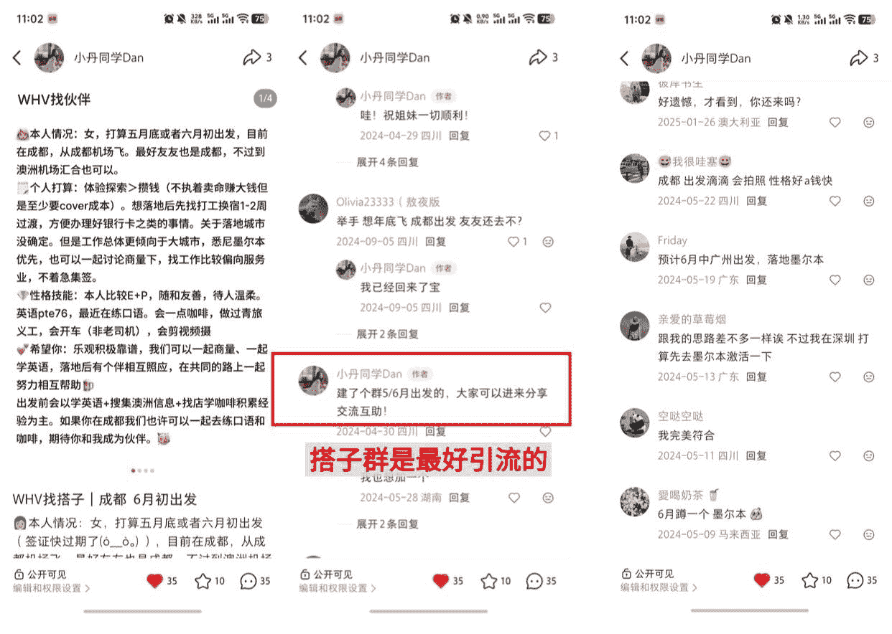

这个信号让我明白，这个小众赛道有非常具体、明确的需求。

最让我确定坚持下来的，是落地澳大利亚一周后的另一条内容。出发前我就联系好了一份悉尼轮滑课老师的工作，时薪40澳币。我把找工作的过程、工作内容和收入都写了出来，结果获得了1000多个赞。评论区涌进来许多问题：怎么找到的？英语不好能不能做？落地之后如何找第一份工作？一个女生过去安全吗？要准备多少钱？签证怎么申请？

我发现，“澳洲打工度假”是一个高决策成本的事情。用户面对的不是“买不买”的选择，而是“要不要辞职”“要不要离开熟悉的生活”“要不要独自去一个陌生国家”“要不要接受一两年的职场空白”……在这种焦虑下，最稀缺的正是“有人替我先走一遍”的真实信息。我选择这个方向，不是因为它容易爆，而是因为我知道这群人最怕什么，最需要什么。

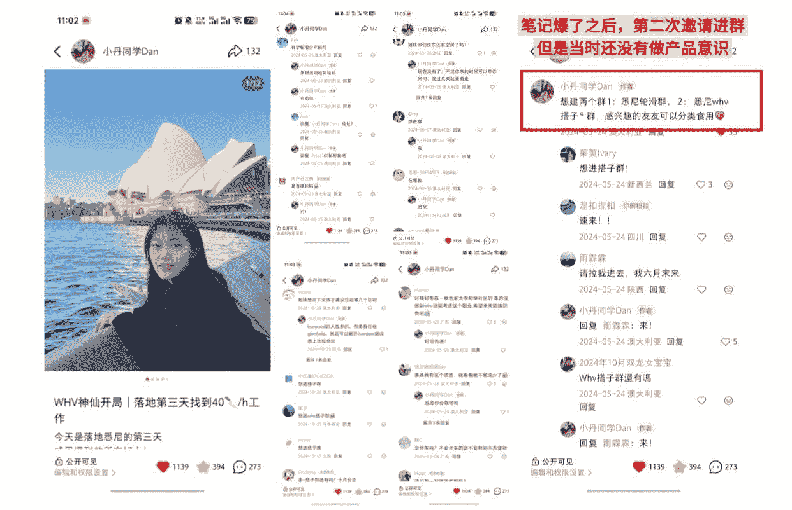

## 03 从0到6000粉，我做了哪些事？

我的账号定位很简单：不是攻略号，也不是资料库，而是“一个普通女孩独自到澳洲生活90天，找工作、看世界、学独立，同时把真实过程进行到底”。这样的定位，决定了内容里既要有工具性，也要有人味。

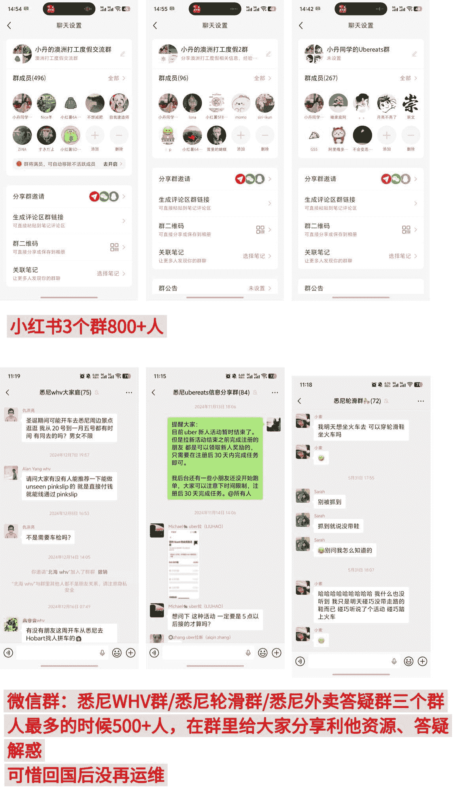

如果只有干货，用户收藏完就会走；如果只有故事，用户很难得到实际帮助。所以我的内容一直保持两条线：干货帮读者解决具体问题，故事让读者产生信任。

我没有坐在电脑前凭空做选题，而是从自己的经历里挖选题。在澳洲三个月，我做过轮滑老师、约拍摄影师、Uber Eats骑手、餐厅服务员、街头卖手工气球，也做过“跨国帮带”。每一份工作，我都会拆成这几个问题：这份工作是怎么找到的？适合什么样的人？薪资和门槛是多少？我踩过哪些坑？如果让一个刚落地的新人来做，他最该提前知道什么？

比如：
- 轮滑老师，我讲的是“怎么把国内学到的技能带出去变现”；
- 约拍，我讲的是“普通人怎么把兴趣变成服务，通过📕完成获客到交付”；
- 送外卖，我讲的是时薪、租车、电池续航、跑单路线和安全；
- 服务员，我讲的是华人餐厅里真实的一日三餐和客人。

每份工作都像一个小型选题库。成功可以讲，失败也可以讲；高薪工作可以讲，被拒、被放鸽子、听不懂英文，同样能讲。用户想看到的不是一个一路开挂的人，而是一个真的趟过路的人。

### 前期选题是怎么定的？

我没有一开始就列一个完整选题表，而是跟着生活的时间线走：遇到什么问题，就写什么问题；用户问什么问题，就延伸什么问题。同时也会去搜索“澳洲打工度假”等关键词，参考爆款笔记的常见方向，主要是签证流程和找工作渠道。

我的节奏大致是这样：

1. 先用“找搭子”帖试探需求，确认赛道里有人；
2. 分享落地一周找到轮滑老师工作的经历，得到第一篇爆款，继续晒收入；
3. 接着分享自己旅游的部分，做景点攻略；
4. 到第20天时，发一个“来了20天的真实感受”；
5. 继续更新不同工作的体验，做成一个系列；
6. 后来发现外卖拉新中间有佣金机会，于是反复写Uber Eats拉新相关内容。当时账号的信任度和内容密度已经比同行高出一截，我顺势建了拉新群，一波拉了50个人，赚了两万多（后面会拆）。

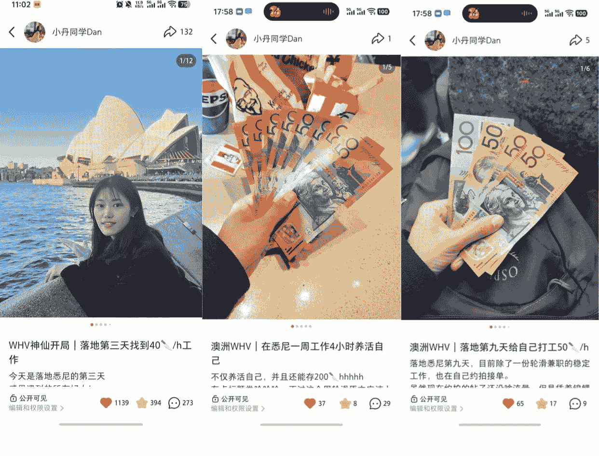

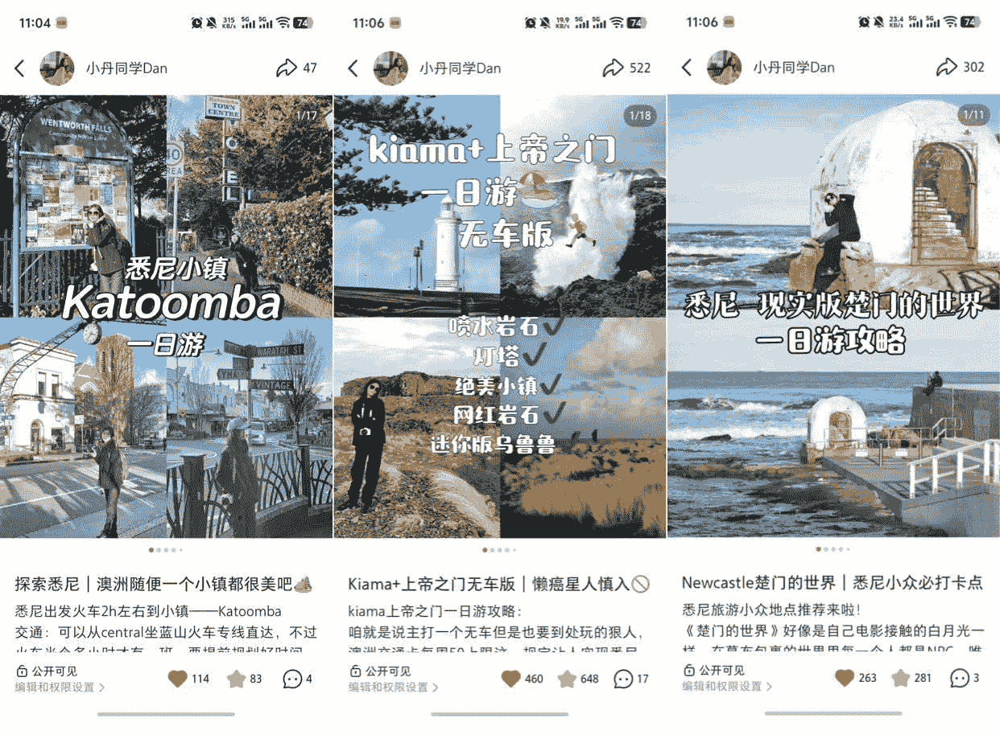

7. 因为家事提前回国，开始发阶段性的复盘和汇总笔记，比如找工作复盘、旅游攻略复盘、签证科普、父母反对的成长故事、回国后的现状；
8. 后来又从图文开始尝试口播，慢慢找到更适合自己的表达方式。

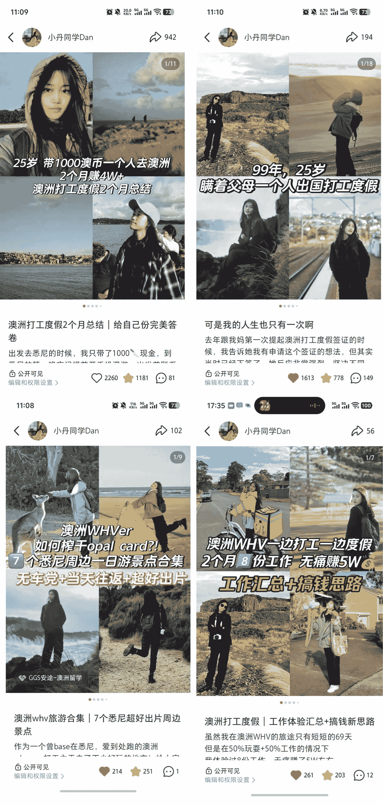

这整套内容里，有负责拉新的，有负责搜索的，也有负责沉淀信任的。我用AI对账号内容做了一次归纳，得到的结论是：

- 用结果吸引人点进来：时薪多少、赚了多少、落地多久找到工作；
- 用搜索词带来长尾流量：签证、落地、找工、租房、英语、费用、避坑；
- 用故事加深记忆：父母反对、独自出发、被拒、成长和改变；
- 用场景让账号立体：工作现场、生活照片、旅行路线和真实体验。

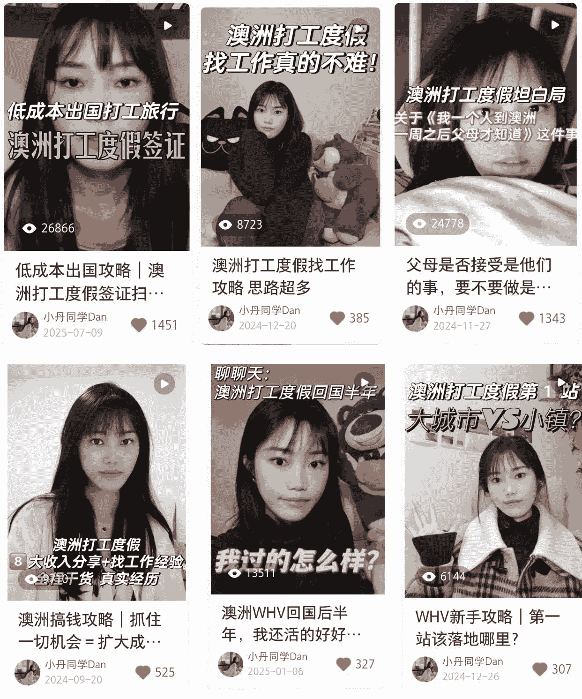

### 为什么有些内容更容易被看到？

因为我更关心“用户会搜什么”，而不是“我想说什么”。像“澳洲打工度假”“澳洲WHV”“找工”“费用”“签证申请”“租房”“电话卡”这些词，是用户自己的语言，我会把它们自然地放进标题和正文里。

当然，点进来之后，内容必须对得起标题。我不会只发一张工资单然后配文“澳洲真的太好赚了”，而是尽量写清楚：这份工作在哪里找到、具体做什么、收入多少、门槛是什么、我遇到的问题是什么、我会给后来者什么建议。在这个赛道上，真实感比炫耀重要得多。

### 真实经历如何帮我建立信任？

信任来自细节，也来自坦诚。比如做Uber Eats的时候，我并不是只发一个邀请码和后台截图，而是真的跑了80单，租过电动自行车，被电池续航坑过，也跑过悉尼City的午高峰和晚高峰。正因为这些细节，那篇“外卖教程”才不像信息搬运，而是“真的有人替你跑过一遍”之后的经验。

我甚至会把和父母之间的冲突写出来。这不是在教人“怎么找工作”，但很多人从里面看到自己——原来不只是我一个人想走出去，同时又害怕伤害家人。这种共鸣带来的信任，比什么技巧都有效。

到现在，陆陆续续在不同平台和社群里积累了几百个好友。翻聊天记录时发现，最开始的📕群只有三个人。还好，我当时迈出了那一步。

## 04 这个账号，到底怎么变现的？

很多人问，6000粉的账号也能赚钱吗？

我的回答是，能。两个多月，累计变现5万左右。这些钱不是靠几条广告，而是来自外卖奖励、跑单收入、约拍订单、品牌合作、帮带等等，也间接帮我拿到了悉尼本地的工作机会。不过在我看来，比钱更重要的，是它带来的机会和积累。

### 案例1：送个外卖，反而做成了完整运营链路

当时Uber Eats有一个活动：完成80单就能拿一笔丰厚的新手奖励。很多人跑完80单、拿完奖励就结束了。但我发现，很少有人会进一步去帮平台拉新赚中间的佣金，且很少有人愿意用内容好好做拉新。

大多数人只是随手发一句“有需要私我”，内容很单薄，没什么信任感。而我发现，连这样简单的帖子都有人来咨询。我自己当初找邀请码时，也会特意选那些主页像真人运营、内容详细的人，因为担心对方不返钱。

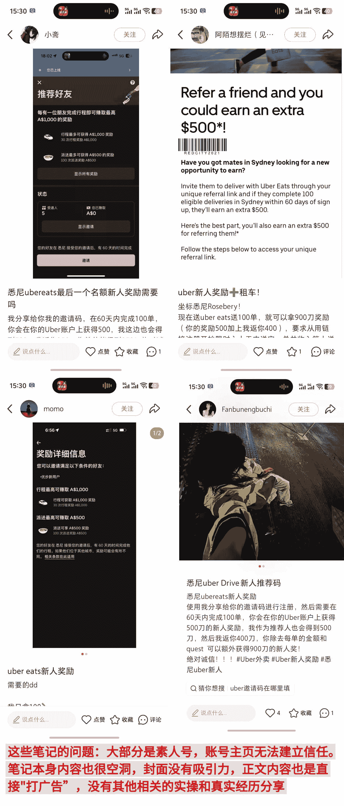

所以我判断，自己在内容上有优势：主页已经有爆款，信任度高，又擅长拆解干货，也懂用户运营。于是我一连写了几条Uber Eats的干货贴，内容包括怎么注册、怎么租车、怎么准备备用电池、怎么安排跑单节奏、新人奖励怎么拿。

我大概用了一周跑完80单，跑单收入加新人奖励大约是1500澳币。然后我把整个过程写成了图文，很快就收到大量咨询。来问的人不是单纯想要邀请码，而是真的不知道这一个个环节该怎么做。

我把所有咨询的人都拉进同一个群，统一答疑。那期活动的有效邀请人数有上限，我最终完成了50个有效邀请，拿到了大约5000澳币的推广奖励，折合人民币两万多。

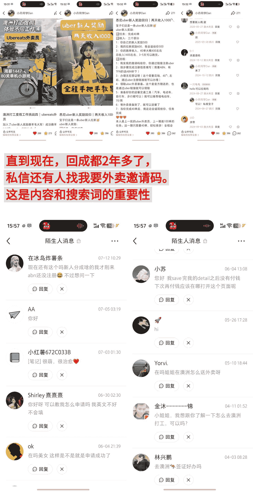

因为当时加了两百多个拉新相关的人，为了不遗漏，我在备注上打了不同标签：

- 已完成（✅：已经完成新人任务并收到我转账的，属于完整交付）；
- 待跟进（⭕：已注册但还在跑单的，需要盯着进度）；
- 已放弃（❌：明确表示不跑的，基本不用再管）；
- 没标注的，就是加了🛰️但还没行动的人，对这部分我不主动也不拒绝。

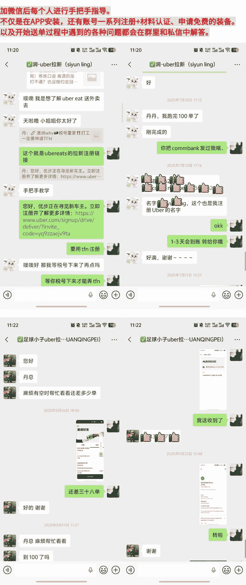

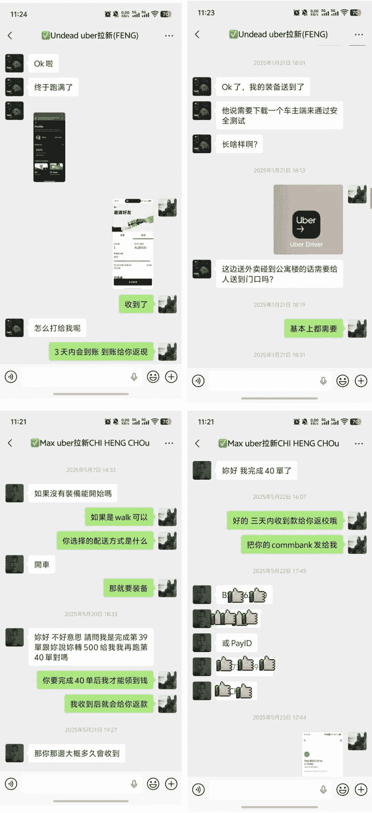

还没完。悉尼当地的哈啰单车公司营销部通过笔记找到我，想让我推广他们的Hello Ride骑行卡。因为内测阶段只能通过推荐人购卡，而我的受众恰好是外卖骑手和留学生。每卖出一张卡，我大概能赚10澳币。于是我长期在几个外卖群里“顺带”提供骑行卡信息，解决大家送外卖的交通工具问题。虽然只是佛系卖卡，也卖出几十张，复购的不少，前前后后赚了几百澳币。有些买卡的人根本不送外卖，只是留学生，也会来找我。

这段经历让我意识到，送外卖并不是一项“一单一单换来”的体力劳动。当我把它复盘成内容、教程和社群服务之后，它已经变成一条完整的运营闭环：

跑单收入 → 新人奖励 → 内容笔记 → 用户咨询 → 社群答疑 → 推广转化 → 相关合作 → 求职案例

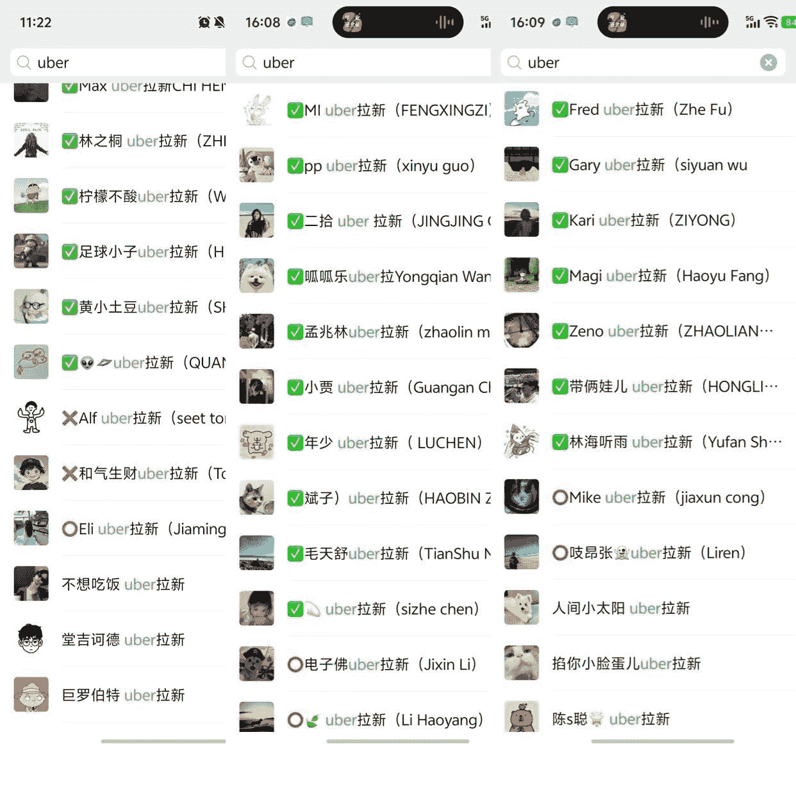

### 案例2：用摄影技能，在悉尼重新定价

如果说送外卖让我理解了“内容可以放大亲身经历”，那么约拍这件事，让我更深刻地体会到：普通人不必把自己的时间贱卖，完全可以把已有技能重新定价。

落地第一周，轮滑老师的保底工作已经为我带来每周400澳币左右的收入，每周只需上课10小时，日常生活开支基本覆盖。正因为不急着赚快钱，我也没有靠压低价格去抢第一单。

我开始问自己：除了轮滑，我还有什么能力在悉尼可以变现？我想起自己带了单反，会拍照，也有一些审美和内容运营的经验。我先在📕里搜“悉尼陪拍”，发现近期确实有不少真实咨询，而同行大多还是素人号。后来和一些拍过的华人游客聊天，我又确认了一个信息差：本地专业摄影机构普遍偏贵，而面向华人的轻陪拍服务还很稀缺，尤其是既能沟通、又有审美、还能照顾旅行体验的陪拍师，几乎没有。

这就是我看到的市场缺口。

我没有低价抢单，而是定了50澳币/小时、1小时起拍的定价，这比当时同行均价高约20%。敢这么定价，一是因为轮滑课的收入让我不必靠低价求订单；二是我在成都拍过十多次互勉写真，也研究过同行作品，知道自己能提供更好的交付。

我理解的陪拍，不是“有人按快门”，而是一整套体验：知道悉尼哪里好拍、能引导没有镜头感的人、会陪着聊天、控制节奏，并在24小时内交付修好的照片和全部底片。

确定方向后，我新注册了一个📕账号，用价格表、样片和服务说明直接获客。第一篇笔记不讲摄影技巧，也不讲旅游攻略，而是直接回答目标用户最关心的问题：在哪里拍？拍多久？怎么收费？没有镜头感怎么办？多久交片？以及我过去拍过什么样的作品。

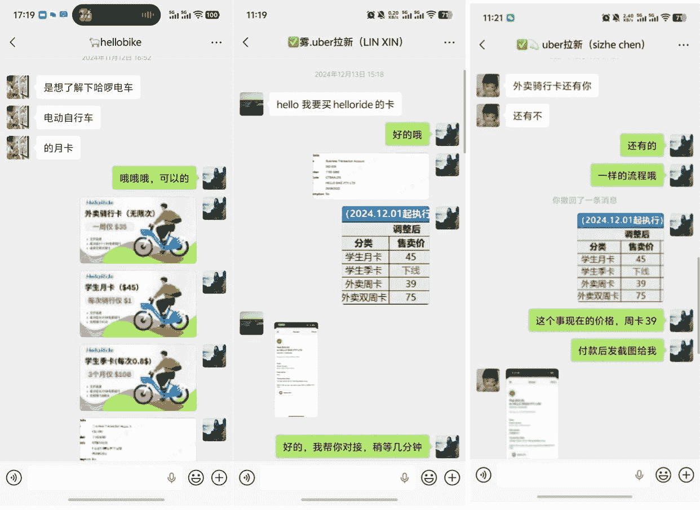

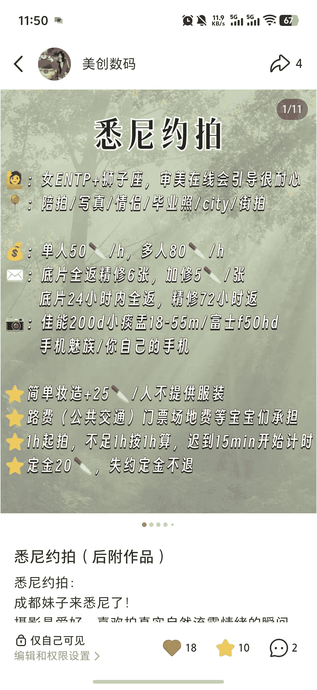

这个流程很快跑通：📕私信或评论问价 → 确认时间 → 收定金 → 当面拍摄 → 结清尾款 → 24小时内交付9张精修和全部底片。第一周就有二十多个🛰️来询。约拍订单叠加轮滑课收入，周收入轻松超过1000澳币。整个澳洲期间，拍照这件事给我带来了一万多元收入。

后来这段经历还被制作成《挑战不同工作》系列内容，继续为账号积累信任。

遇到接不过来的订单，我还会和室友协作：我负责获客、沟通、选片和精修，她负责现场拍摄，利润对半分。这次经验也让我明白：个人服务不一定非要一个人全都做。获客、沟通、执行、交付可以拆分，但前提是客户知情，标准、分钱和责任边界都要提前讲清楚。

我渐渐不再把“打工”理解成单一的形式。低门槛的工作可以解决生存问题；但一旦有了安全垫，就该想想：我有什么技能可以被重新定价？市场有哪些被忽略的需求？用户愿意为什么付费？我能不能把它设计成可交付的服务？

外卖和约拍，是我通过📕直接撬动的两笔收入；其他那些工作，后来都变成了账号里持续输出的素材。

### 案例3：账号写进简历，回国求职薪资翻倍

回国之后，我把这段经历和账号成果整理成作品集，写进了简历。面试时，不少面试官最初看到的就是这个账号——他们不是被“我做过什么岗位”打动，而是被“我真的去过、真的做过、真的拿到过结果”的内容打动。最终，我不仅顺利拿到了offer，薪资也比上一份工作高出一倍。三联等媒体也通过账号找到我，做了一次报道。

这件事给我最大的启发是：一份能沉淀的内容，就等于一份能持续更新的个人简历。它不会因为你离开某个岗位而失效，也不会因为一段空窗期而断档。只要它还在那里，就会不断替你连接新的机会。

### 一些反思

现在回头看，我的内容其实有流量、也有私域，但我没有及时做出自己的产品。这也是为什么我现在正在用知识库和轻产品，重新承接这些积累。如果你也打算做自己的内容，我想说：不用等成为专家，也不用攒够什么资格，只要你认真走过一段路，愿意把判断、细节、踩坑和选择整理出来，就已经是一份很好的“资产”了。

希望我这些真实的经历、踩坑和思考，能给正在做内容、做自媒体或者探索副业的你，带来一点参考。

澳洲经历真正开始兑现价值，是在我回国之后。

求职时，我没有把那段海外生活写成“离职后出去玩了一阵”，而是把它包装成了一次从策划到变现的独立实践：

我从自己的经历中寻找主题，持续输出内容，建立关注和信赖，随后把读者导入私域，完成合作、维护和运营。

放在新媒体岗位的语境里，这段经历能够对应到很多实际能力：选题设计、文字与视觉内容生产、受众研究、账号维护、社群承接、商业转化，以及从零搭建项目并执行落地。

更重要的是，面试官能够通过这段经历看见我是否能把目标拆开、持续推进，并最终拿到结果。

最后，我拿到了一份薪资约为出国前两倍的工作邀约。

账号带来的回报，也并没有随着求职结束而停止：

- 后续有多个品牌来找我合作。我没有全部接下，而是筛选出4个和账号受众契合的项目，每条内容的报价大约800元。
- 回国时，我还替客户从海外带回5副雷朋眼镜，获得约2000元收入，差不多覆盖了往返机票支出。

这些事情表面上属于不同的赚钱方式，底层却是同一件事：持续输出让我的经历获得曝光，也让陌生人更容易建立信任。

- 这个账号还给我带来了一个鲜明标签：澳洲打工度假内容创作者。

在线下活动中，我通常会这样介绍自己：“我曾在澳洲打工度假三个月，还运营过一个拥有6000多粉丝的相关账号。”相比只说自己做过什么普通工作，这种介绍更容易让对方产生兴趣，谈话也更容易展开。

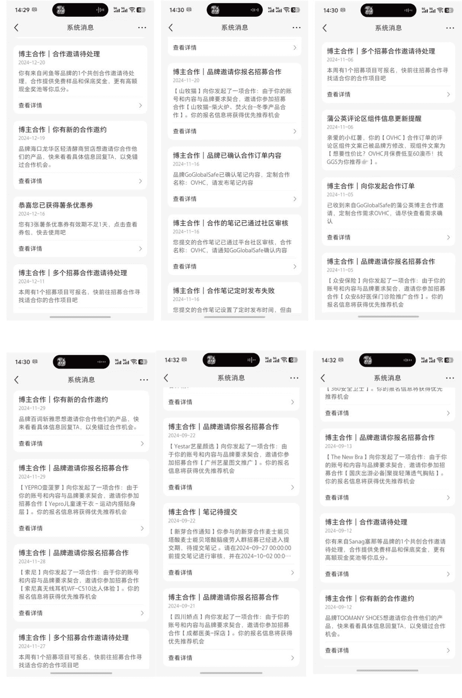

- 有自由作者通过账号找到我，采访了我的经历，并将其整理成文章，刊发在三联👸号。
- 还有三四名研究生因论文研究方向与我的经历相关，联系我进行访谈，把这些内容作为论文素材。

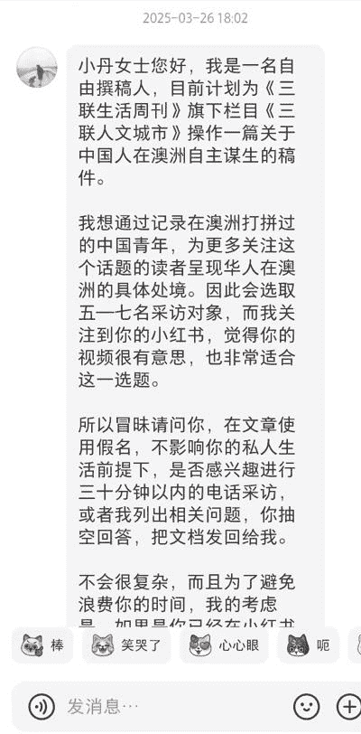

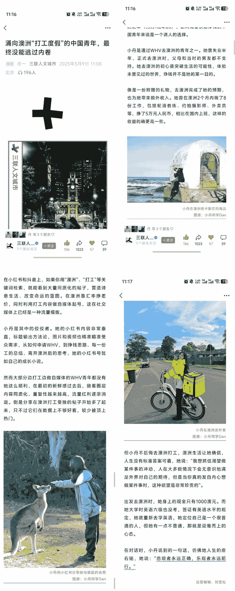

- 我也认识了一些处境相似的创作者。我们在线下碰面，交换创作经验，彼此获得了很强的支持感。若不是这个账号，我们原本很可能永远不会认识。

这让我重新认识了“内容资产”。

它当然可以带来收入，但它同时也是你留下的作品、积累的声誉、对外展示自己的名片，以及陌生人进入你世界的入口。

## 05 / 最遗憾的一步：有了流量，却没准备承接方案

回头看，那段经历最让我惋惜的，并不是粉丝规模只有6000左右，也不是少赚了一部分钱。

真正的问题是：当时已经有数百名用户被我吸引过来，几篇笔记也拿到了很高的互动，受众需求非常集中，可我没有提前设计可以承接这些需求的服务或商品。

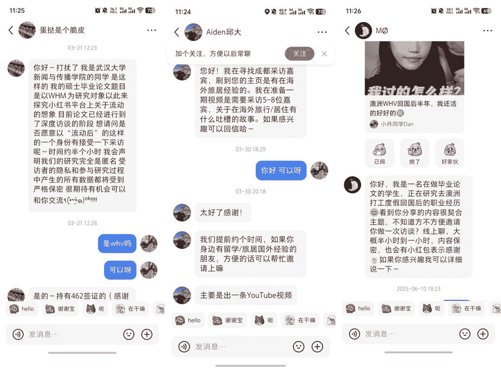

其实，市场信号早就出现了。用户会在评论区和私信里提问，也会主动进群，反复咨询签证办理、求职、初到当地的安排、住宿、英语沟通和外卖工作等问题。

然而，我能提供的只有信息触达，没有一套明确的交付方式。那时我尚未建立产品思维，也没有把自己的经验整理为：

- 到达当地后的资料包与行动表；
- 求职过程可直接套用的范本；
- 英文简历写法和面试表达；
- 不同城市的生活指南及风险提醒；
- 轻量、边界清楚、能够交付的服务。

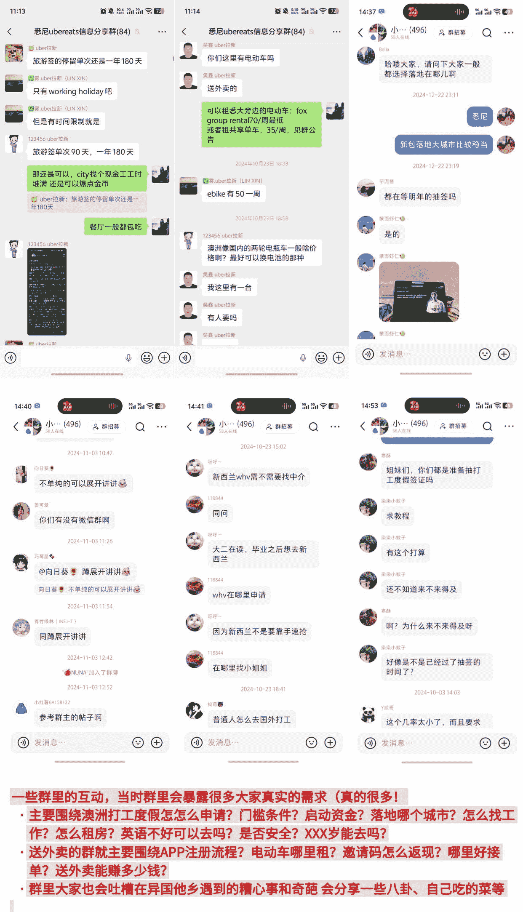

结果是，用户虽然被聚集到私域，问题却没有被归类处理，我的经验也停留在零散分享，没能转化为可使用的产品。

活动结束后，群里的讨论越来越少，原本建立的联系也逐步变弱。

我当时最大的误判，是把“把用户加进来”当成了“完成用户沉淀”。

其实，私域的价值从来不在于通讯录里增加了多少人，而在于你是否能够持续回应同一批人的真实需求。

那时我完成了需求发现和流量获取，却忽略了交付设计。现在再做内容，我会从早期就同步思考：未来究竟能为用户提供什么。

账号启动阶段，就应该建立一份持续更新的需求记录：

- 哪些问题被反复问到？
- 什么内容即使写成文章，仍然无法解决？
- 哪些经验可以加工成表格、范本或流程？
- 哪些适合标准化的小服务，哪些必须投入更多时间深度处理？

关注量只能说明有人对主题感兴趣；能否把兴趣转成持续价值，取决于后续有没有清晰的交付与承接机制。只有这样，才可能形成稳定循环，发展为副业，甚至成为长期事业。

我是在后来接触赚钱之后，才逐渐接触到这套思路。虽然目前还谈不上取得多大成绩，但它让我开始用“需求—交付—产品”这条链路，重新审视过去积累的关注和经历。

## 06 / 重新盘点澳洲经历：资料体系、轻量产品与新的创作方向

如今，我不会再把澳洲打工度假视为已经翻篇的旧故事。

对我来说，它更像一处尚待整理和开发的内容资源库。

近来，我重新翻看出发前后的资料、当时留下的笔记、做过的工作，以及读者曾在评论区、私信和群聊中反复提出的疑问。整理得越深入，我越确定：大家缺的不是又一份零碎攻略，而是一套能够辅助判断，并且能照着执行的完整路径。

比如：

- 自己到底适不适合走这条路？
- 出发之前，哪些事项必须先完成？
- 抵达后的头几天，应该按什么顺序处理事情？
- 关于工作、住处和人身安全，怎样做判断？

基于这些问题，我正在搭建澳洲打工度假资料库，目前🛰️小程序也已经完成了早期版本。

其中包含签证办理、城市比较、出行前准备表、抵达后30天行动安排、找工作渠道、简历与面试、日常生活提示、常见问题以及风险提醒。除了网上能够查到的公开内容，也加入了我尚未公开的工作细节、亲身踩过的坑和真实片段。

我并不是想简单地把资料数量做大，而是希望同时解决两类问题：

让使用者更有依据地做决定，并按步骤完成初到当地的准备；

也把自己过去散落在不同地方的经验，整理成结构清晰、未来还能反复使用的内容。

后续计划包括：付费资料库、数字资料包、求职简历范本、英文简历与面试表达，以及帮助用户完成判断和落地准备的澳洲打工度假小程序。

不过，我不会把方向做成长周期陪伴，也不会承接高强度咨询。

原因很简单：那段澳洲生活只有三个月，我回国也已经两年，手里不可能持续拥有当地的即时信息。我不想把自己塑造成常年生活在澳洲的专家，更不会承诺实时帮忙找工作、找房或长期跟进。

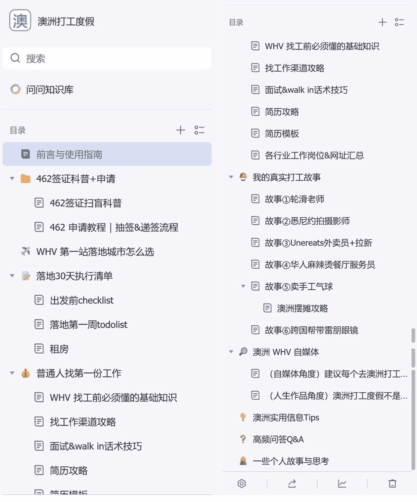

尤其是签证、薪资、税收等内容，规则更新很快，最终都应当回到官方渠道核对，个人经历不能代替正式规定。

因此，我更倾向于提供轻量化交付：将亲自走过的流程、实际遇到的问题、验证过的做法，和用户的具体疑问、执行步骤、可套用工具放在一起，帮助后来者降低无效焦虑，更快进入行动状态。

澳洲主题也不会成为我唯一的内容方向。

这段经历让我看到，内容积累可以给普通人带来长期的复利，所以我仍会继续创作，只是主题会跟随当前生活变化，逐渐延伸到成都本地人物与故事、个人成长、学习方法、效率工具和新的生活实践。

选题可以变化，但创作原则不会改变：

只分享自己确实走过、并且能够转化为他人参考的道路。

## 07 / 普通人的日常，也能形成独特内容

对没有专业背景的创作者而言，内容积累是一种投入不高、回报周期较长的杠杆。

澳洲打工度假只是我的一个样本。

买房装修、留学、海外生活、搬到新城市、职业转换、发展副业、备考、学习新本领、追星见面等经历，都伴随着较高的决策成本：既消耗预算，也占用时间，还可能遇到不少意外。正因为如此，人们才需要那些具体、诚实、带有亲身判断的经验分享。

创作者不必先成为领域里最厉害的那个人。

只要你认真完成过一件事，并愿意记录其中外界无法直接看到的取舍、花费和难题，就已经具备了内容起点。

如果一时找不到方向，可以从下面六个角度回看：

- 刚准备开始时，最担心的是什么？
- 哪些节点做出了重要取舍？
- 哪些投入最终证明值得？
- 哪些地方走了弯路？
- 假设重新来过，哪些做法会改变？
- 对完全不了解这件事的人来说，最可能先问什么？

当这些答案被逐一记录，经历就会从私人记忆，逐渐转化为可分享的主题。

AI也能在这里发挥整理工具的作用。

日记、录音、照片、聊天内容、备忘信息和临时念头，都可以交给AI，让它协助建立时间顺序、扩展主题、制作清单、调整文字结构。

例如可以这样下指令：

“下面是我从装修准备到入住期间留下的零碎记录。请严格依据原文，不虚构情节，并从预算安排、操作步骤、踩坑经历、关键取舍、情绪变化、给初学者的提醒六个方向，生成30个适合发布在📕或👸号的选题。”

需要明确的是，AI擅长整理和加工，却无法替你拥有真实体验。

当批量写作和矩阵化运营越来越容易，真正难以复制的，反而是一个人在特定领域长期生活、实践后形成的经验、判断力、审美和信誉。

你曾经认真做出的那些决定，也许正是最值得长期经营的内容来源。

——分割线——

看完这份SOP，很多人会产生“已经掌握”的错觉；真正开始操作时，却常常连起步动作都迟迟做不出来。

软件和教程只能构成表层优势，真正拉开差距的，是马上执行，以及身处不同圈层所带来的信息落差。

这里不做空泛讨论，重点拆解从需求到收入的完整链路，并研究如何用AI提升效率。系统中已经整理了1000多场经过验证的套利实战案例。

👉 查看圈子完整数字资产与加入条件：

https://lazyso.com/insider/

添加时请备注：【实操上车】，不闲聊。

